# Linear Algebra Done Right 中文第四版


## 数学专业本科教材

谢尔顿·阿克斯勒

$$
F_n = \frac{1}{\sqrt{5}}\left[\left(\frac{1+\sqrt{5}}{2}\right)^n - \left(\frac{1-\sqrt{5}}{2}\right)^n\right]
$$

![图片]

![图片]

![图片]

## 线性代数正确完成

第四版

Springer

## Sheldon Axler

美国加利福尼亚州旧金山

ISSN 0172-6056 ISSN 2197-5604(电子版)

数学专业本科教材

ISBN 978-3-031-41025-3 ISBN 978-3-031-41026-0(电子书)

https://doi.org/10.1007/978-3-031-41026-0

数学学科分类（2020 年）：15-01，15A03，15A04，15A15，15A18，15A21

© Sheldon Axler 1996, 1997, 2015, 2024. 本书是一本开放获取出版物。开放获取本书根据知识共享署名 - 非商业性 4.0 国际许可协议（http://creativecommons.org/licenses/by-nc/4.0/）进行许可，只要您给予原作者和来源适当的信用，提供创作共享链接，并指示是否进行了更改，就可以在任何媒介或格式中进行非商业使用、共享、改编、分发和复制。

本书中的图像或其他第三方材料包含在本书的创作共用许可证中，除非在材料的信用线中另有说明。如果材料未包含在本书的创作共用许可证中，并且您的预期使用不符合法定规定或超出了允许的使用范围，则您需要直接向版权持有人获取许可。

本作品受版权保护。作者保留所有商业权利，无论是全部还是部分材料，特别是翻译权、再版权、插图重用权、朗读权、广播权、微缩胶片复制权或以任何其他实体方式复制权，以及信息存储和检索、电子适应、计算机软件或类似或不同的已知或今后开发的方法学。关于这些商业权利，已向出版商授予非独家许可证。

本出版物中使用的一般描述性名称、注册名称、商标、服务标志等，并不意味着即使在没有特定声明的情况下，这些名称不受相关保护法律和法规的约束，因此可以自由使用。

出版商、作者和编辑可以安全地假设本书中的建议和信息在出版日期时是真实准确的。出版商、作者或编辑对本书中所包含的材料不提供任何明示或暗示的保证，也不对可能存在的错误或遗漏负责。出版商在已出版的地图和机构关系方面保持中立。

这本斯普林格印记是由注册公司斯普林格自然瑞士股份有限公司出版的。注册公司地址是：瑞士钻石 11 号，6330 Cham。

本产品的纸张可回收利用。

### 关于作者

谢尔顿·阿克斯勒 (Sheldon Axler) 本科毕业于普林斯顿大学，随后在加州大学伯克利分校获得数学博士学位。作为麻省理工学院的一名博士后摩尔讲师，阿克斯勒获得了全校范围的教学奖。他随后在密歇根州立大学担任助理教授、副教授和教授，获得了首届 J・萨瑟兰·弗雷姆教学奖和杰出教职员工奖。阿克斯勒于 1996 年获得了美国数学协会颁发的莱斯特·R・福特写作奖，该奖是为他的一篇论文而颁发的，最终发展成了这本书。除了发表大量研究论文外，他还是六本数学教材的作者，涵盖了从大一到研究生水平的内容。本书的前几版已被超过 375 所大学和学院采用为教材，并已被翻译成三种语言。

Axler 担任过《数学智者》的主编和《美国数学月刊》的副主编。他曾是美国数学学会理事会和数学科学研究所董事会的成员。他还曾在 Springer 的系列教材《数学本科教材》、《数学研究生教材》、《Universitext》和《Springer 数学专著》的编辑委员会任职。Axler 是美国数学学会的会士，并多次获得美国国家科学基金会的资助。他于 1997 年加入旧金山州立大学担任数学系主任。他曾在 2002 年至 2015 年担任科学与工程学院院长，后来回到数学系担任教授。

![作者和他的猫 Moon]

封面方程：第 n 个斐波那契数的公式。第 5D 节的练习 21 使用线性代数推导出这个公式。

## 目录

### 关于作者 五
### 学生前言 十二
### 教师前言 十三
### 致谢 十七

### 第一章 向量空间 一
- 1A Rⁿ和 Cⁿ 二
  - 复数 二
  - 列表 五
  - 关于域的插曲 十
  - 习题 1A 10
- 1B 向量空间的定义 十二
  - 习题 1B 16
- 1C 子空间 十八
  - 子空间的和 十九
  - 直和 21
  - 习题 1C 24

### 第二章 有限维向量空间 二十七
- 2A 张成与线性无关 二十八
  - 线性组合与张成 二十八
  - 线性无关 三十一
  - 习题 2A 37
- 2B 基 三十九
  - 习题 2B 42
- 2C 维数 四十四
  - 习题 2C 48

### 第三章 线性映射 51
- 3A 线性映射的向量空间 52
  - 线性映射的定义和例子 52
  - 线性映射的代数运算 L(., .) 55
  - 习题 3A 57
- 3B 零空间和值域 59
  - 零空间和单射性 59
  - 值域和满射性 61
  - 线性映射的基本定理 62
  - 习题 3B 66
- 3C 矩阵 69
  - 用矩阵表示线性映射 69
  - 矩阵的加法和标量乘法 71
  - 矩阵乘法 72
  - 列 - 行分解和矩阵的秩 77
  - 习题 3C 79
- 3D 可逆性和同构 82
  - 可逆线性映射 82
  - 同构向量空间 86
  - 线性映射可以看作矩阵乘法 88
  - 基的变换 90
  - 习题 3D 93
- 3E 向量空间的积和商 96
  - 向量空间的积 96
  - 商空间 98
  - 习题 3E 103
- 3F 对偶性 105
  - 对偶空间和对偶映射 105
  - 线性映射的零空间和值域的对偶 109
  - 线性映射的对偶矩阵 113
  - 习题 3F 115

### 第四章 多项式 119
- 多项式的零点 122
- 多项式的除法算法 123
- 复数域上的多项式因式分解 124
- 实数域上的多项式因式分解 127
- 习题 4 129

### 第五章 特征值和特征向量 132
- 5A 不变子空间 133
  - 特征值 133
  - 多项式应用于算子 137
  - 习题 5A 139
- 5B 最小多项式 143
  - 复向量空间上的特征值存在性 143
  - 特征值和最小多项式 144
  - 奇维实向量空间上的特征值 149
  - 习题 5B 150
- 5C 上三角矩阵 154
  - 习题 5C 160
- 5D 对角化算子 163
  - 对角矩阵 163
  - 对角化条件 165
  - 格尔什戈林圆盘定理 170
  - 习题 5D 172
- 5E 交换算子 175
  - 习题 5E 179

### 第六章 内积空间 181
- 6A 内积和范数 182
  - 内积 182
  - 范数 186
- 6B 正交基 197
- 6C 正交补和最小化问题 211

### 第七章 内积空间上的算子 227
- 7A 自伴和正规算子 228
- 7B 谱定理 243
- 7C 正算子 251
- 7D 等距映射、酉算子和矩阵分解 258
- 7E 奇异值分解 270
- 7F 奇异值分解的结果 280
  - 线性映射的范数 280
  - 低维度范围线性映射的逼近 283
  - 极分解 285
  - 通过奇异值应用于椭球和平行六面体的运算符 287
  - 体积由其特征值确定的运算符的性质 293
  - 练习 7F 294

### 第八章 复向量空间上的运算符 297
- 8A 广义特征向量和幂零算子 298
  - 幂零算子的零空间 298
  - 广义特征向量 300
  - 幂零算子 303
  - 练习 8A 306
- 8B 广义特征空间分解 308
  - 广义特征空间 308
  - 特征值的重数 310
  - 分块对角矩阵 314
  - 练习题 8B 316
- 8C 广义特征空间分解的结果 319
  - 算子的平方根 319
  - Jordan 标准型 321
  - 练习题 8C 324
- 8D 迹：矩阵和算子之间的联系 326
  - 练习题 8D 330

### 第九章 多线性代数和行列式 332
- 9A 双线性形式和二次型 333
  - 双线性形式 333
  - 对称双线性形式 337
  - 二次型 341
  - 练习题 9A 344
- 9B 交替多线性形式 346
  - 多线性形式 346
  - 交替多线性形式和排列 348
  - 练习题 9B 352
- 9C 行列式 354
  - 行列式的定义 354
  - 行列式的性质 357
  - 练习题 9C 367
- 9D 张量积 370
  - 两个向量空间的张量积 370
  - 内积空间的张量积 376
  - 多个向量空间的张量积 378
  - 习题 9D 380

### 照片来源 383
### 符号索引 384
### 索引 385
### 印记：排版注释 390

### 学生前言

你可能即将开始接触线性代数的第二次学习。与你第一次接触这门学科不同，第二次学习将侧重于抽象向量空间和线性映射。

这些术语将在后面定义，所以如果你不知道它们的意思，不要担心。本书从线性代数的基础开始，假设读者对线性代数一无所知。关键是你将沉浸在严肃的数学中，重点是深入理解定义、定理和证明。

你不能像读小说一样阅读数学。如果你在不到一个小时的时间内匆匆翻过一页，那你可能读得太快了。当你遇到“如你所验证”的短语时，你确实应该进行验证，这通常需要你写一些东西。当步骤被省略时，你需要补充缺失的部分。你应该思考并内化每个定义。

对于每个定理，你应该寻找例子来展示为什么每个假设都是必要的。与其他学生的讨论应该有所帮助。

作为视觉辅助，定义在黄色框中，定理在蓝色框中（在彩色版本的书中）。每个定理都有一个非正式的描述性名称。

请查看下面的网站以获取有关该书的其他信息，包括附带该书的免费视频链接。

欢迎您提出建议、评论和更正。

祝您在学习线性代数中取得成功和享受!

Sheldon Axler
旧金山州立大学

网站：https://linear.axler.net
电子邮件：linear@axler.net

### 教师前言

您即将教授一门课程，这可能是学生第二次接触线性代数。在他们第一次接触这个主题时，您的学生可能已经使用过欧几里得空间和矩阵。相比之下，这门课程将强调抽象向量空间和线性映射。

这本书的标题值得解释。大多数线性代数教材使用行列式来证明有限维复向量空间上的每个线性算子都有特征值。行列式难以理解，非直观，并且经常没有动机地定义。为了证明关于复向量空间上存在特征值的定理，大多数书籍必须定义行列式，证明线性算子不可逆当且仅当其行列式等于 0，然后定义特征多项式。这条曲折的路径让学生对特征值为何存在几乎没有感觉。

相比之下，这里提供的简单无行列式证明（例如，见 5.19）更具洞察力。一旦行列式被移到书的末尾，就会打开通往线性代数主要目标——理解线性算子结构的新途径。

本书从这个学科的开端开始，没有其他先决条件，只需要适当的数学素养。少数例题和练习涉及微积分概念，如连续性、微分和积分。如果你的学生还没有学过微积分，可以轻松跳过这些例题和练习。如果你的学生学过微积分，那么这些例题和练习可以通过展示数学不同部分之间的联系来丰富他们的经验。

即使你的学生已经在前几章中见过一些材料，他们可能还不习惯解决这里提出的大部分需要理解证明的练习题。

下面是本书章节的重点摘要：

- 第 1 章：本章定义了向量空间，并发展了它们的基本性质。
- 第 2 章：本章定义了线性独立性、张成空间、基和维数，介绍了有限维向量空间的基本理论。
- 第 3 章：本章介绍了线性映射。这里的关键结果是线性映射的基本定理：如果 $T$ 是 $V$ 上的线性映射，则 $\dim V = \dim \text{null } T + \dim \text{range } T$。本章讨论了商空间和对偶空间，这些主题比本书大部分内容更抽象；可以跳过这些主题（除了在第 9D 节中需要对偶空间来讨论张量积）。
- 第 4 章：本章介绍了理解线性算子所需的多项式理论的一部分。本章不包含线性代数内容。如果你的学生已经熟悉这些结果，可以快速地讲完这章。
- 第 5 章：通过将线性算子限制在小的子空间上进行研究的想法在本章的前半部分引入了特征向量。本章的亮点是一个简单的证明，即在复向量空间上，特征值总是存在的。然后利用这个结果证明了每个复向量空间上的线性算子都有一个关于某个基的上三角矩阵。最小多项式在这里以及本书的后面起着重要作用。例如，本章通过最小多项式的特征给出了对可对角化算子的刻画。如果想节省时间，可以跳过第 5E 节。
- 第 6 章：本章定义了内积空间，并发展了它们的基本性质，包括正交基和 Gram-Schmidt 过程等工具。本章还展示了如何利用正交投影来解决某些最小化问题。当逆矩阵不存在时，伪逆矩阵被引入为一个有用的工具。如果想节省时间，可以跳过关于伪逆矩阵的内容。
- 第 7 章：谱定理是本书的亮点之一，它描述了存在由特征向量组成的正交基的线性算子。前几章的工作在这里得到了回报，证明变得特别简单。本章还涉及正算子、等距映射、酉算子、矩阵分解，特别是奇异值分解，它导致了极分解和线性映射的范数。
- 第 8 章：本章证明了对于复向量空间上的每个算子，存在一个由广义特征向量组成的向量空间的基。然后，广义特征空间分解描述了复向量空间上的线性算子。特征值的重数定义为相应广义特征空间的维数。这些工具被用来证明复向量空间上的每个可逆线性算子都有一个平方根。然后，本章给出了一个证明，即复向量空间上的每个线性算子都可以转化为约当形式。本章以对算子的迹的研究结束。
- 第 9 章：本章首先研究双线性形式，并证明双线性形式的向量空间是对称双线性形式子空间和交替双线性形式子空间的直和。然后对二次型进行对角化。接下来讨论多线性形式，本章证明了在 n 维向量空间上，交替 n 线性形式的子空间的维数为一。这个结果导致了行列式的无基础定义，不依赖于基底的选择。对于复向量空间，行列式等于特征值的乘积，每个特征值的重数决定了它在乘积中出现的次数。本章最后介绍了张量积。

本书通常通过将 $F$ 表示为实数或复数，同时在实数和复数向量空间中同时发展线性代数。如果你和学生们更喜欢将 $F$ 看作是任意域，那么请参考第 1A 节末尾的注释。我更倾向于在这个层次避免使用任意域，因为它们引入了额外的抽象，而没有带来任何新的线性代数内容。此外，学生们更习惯将多项式看作函数，而不是有限域系数多项式所需的更正式对象。最后，即使理论的开始部分是用任意域发展的，内积空间也会将考虑范围限制在实数和复数向量空间。

你可能无法在一个学期内涵盖这本书的所有内容。在一个学期内完成前七或八章的所有材料可能需要较快的进度。如果你必须达到第 9 章，那么考虑跳过第 3E 节中关于商空间的内容，跳过第 3F 节关于对偶性的内容（除非你打算在第 9D 节中涵盖张量积），在半小时内涵盖第 4 章关于多项式的内容，跳过第 5E 节关于交换算子的内容，并跳过第 6C 节关于伪逆的子节。

比教授任何特定定理更重要的目标是培养学生理解和操作线性代数对象的能力。只有通过实践才能学好数学。幸运的是，线性代数有很多好的家庭作业练习题。在教授这门课程时，我通常会在每堂课上布置一些练习作业，下堂课交。检查作业可能会占用典型课堂的大部分时间。

一些练习旨在引导好奇的学生进入基本线性代数课程之外的重要主题。

## 作者的十大

以下列出了作者在书中的十个最喜欢的结果，按照它们在书中出现的顺序排列。掌握这些关键结果的学生将在线性代数方面有良好的基础。

- 向量空间的任意两个基具有相同的长度 (2.34)
- 线性映射的基本定理 (3.21)
- 如果 $F=C$，存在特征值 (5.19)
- 如果 $F=C$，上三角形式总是存在 (5.47)
- 柯西 - 施瓦茨不等式 (6.14)
- 格拉姆 - 施密特过程 (6.32)
- 谱定理 (7.29 和 7.31)
- 奇异值分解 (7.70)
- 当 $F=C$ 时，广义特征空间分解定理 (8.22)
- 在 $F$ 上的交替 $F$-线性形式的维度是 1，如果 dim $V$ = 1 (9.37)

### 第四版的主要改进和增加

- 超过 250 个新练习和 70 个新例子。
- 越来越多地使用最小多项式来提供更清晰的多个证明结果，包括某个基下的算子具有上三角矩阵的必要和充分条件（见第 5C 节），对角化的必要和充分条件（见第 5D 节）以及实数谱定理（见第 7B 节）。
- 关于交换算子的新部分（见第 5E 节）。
- 关于伪逆的新小节（见第 6C 节）。
- 关于 QR 分解/Cholesky 分解的新小节（见第 7D 节）。
- 奇异值分解现在适用于从一个内积空间到另一个内积空间的线性映射，而不仅仅是处理从一个内积空间到自身的线性算子（见第 7E 节）。
- 现在从奇异值分解中证明极分解，而不是相反的顺序；这导致了奇异值分解（见第 7E 节）和极分解（见第 7F 节）的证明更加简洁。
- 新的小节讨论有限维内积空间上线性映射的范数，利用奇异值分解甚至不提及范数的上确界（见第 7F 节）。
- 新的小节讨论具有低维度值域的线性映射的逼近（见第 7F 节）。
- 重要结果的新的初等证明：如果 T 是有限维复向量空间 V 上的算子，则存在 T 的一组由 T 的广义特征向量组成的基（见 8.9 节）。
- 新的第 9 章讲述多线性代数，包括双线性形式、二次形式、多线性形式和张量积。行列式现在使用无基础方法通过交替多线性形式来定义。
- 新的格式改善了书籍的学生友好外观。例如，定义和结果框现在具有圆角而不是直角，看起来更加温和。主要字体大小已从 11 点减小到 10.5 点。

请查看下面的网站以获取有关本书的其他链接和信息。欢迎您提出建议、评论和更正。

祝您成功地教授线性代数课程！

Sheldon Axler
旧金山州立大学
网站：https://linear.axler.net
电子邮件：linear@axler.net

> 联系作者，或者如果作者不可用，请联系 Springer 以获得对本书内容的翻译或其他商业再利用的许可。

### 致谢

我对过去两个世纪创造线性代数的所有数学家都有巨大的知识债务。本书中的结果属于数学的共同遗产。一个定理的特殊情况可能早在很久以前就被证明过，然后在不同的时间段由许多数学家进行了改进和完善。

给所有贡献者适当的荣誉将是一项艰巨的任务，我没有承担。在任何情况下，读者都不应假设这里呈现的任何结果是我原创的。

许多人帮助使这本书变得更好。这本书的前三个版本曾在全球 375 所大学和学院被用作教材。我收到了来自使用这本书的教职员工和学生的成千上万的建议和评论。其中许多建议导致了这个版本的改进。这第四版的手稿在 30 所大学进行了班级测试。我非常感谢在这次班级测试中收到的教职员工和学生的有用反馈。

应该感谢他们的建议的人名单将会填满很多页。阅读名单很无聊。因此，为了代表所有对这个版本做出贡献的人，我只提到了澳大利亚国立大学的研究生 Noel Hinton，他为这第四版提供了比其他任何人更多的建议和修正意见。对于所有提供建议的人，我要真心感谢你们。非常非常感谢!

我感谢 Springer 在我需要帮助时提供的支持，并允许我对内容和外观做出最终决定。特别感谢 Springer 的两位出色的数学编辑，他们与我一起合作完成了这个项目——Loretta Bartolini 在我完成第四版前半部分的工作期间，Elizabeth Loew 在我完成第四版后半部分的工作期间。我深深感谢 David Kramer，他在编辑方面做得非常出色，防止我犯下许多错误。

特别感谢我的出色合作伙伴 Carrie Heeter。她的理解和鼓励使我能够全力以赴地完成这个新版本。我们可爱的猫 Moon，在“关于作者”页面上出现的照片，为写作过程提供了愉快的休息时间。当这本书即将完成时，Moon 因血栓突发去世。我们与他共度的五年是我们珍贵的回忆。

## 第一章

### 向量空间

线性代数是研究有限维向量空间上的线性映射的学科。最终我们将学习这些术语的含义。在本章中，我们将定义向量空间并讨论它们的基本性质。

在线性代数中，如果与实数一起研究复数，将会得到更好的定理和更深入的见解。因此，我们将首先介绍复数及其基本性质。

我们将把平面和普通空间的例子推广到 R² 和 R³，然后将其推广到向量空间的概念。正如我们将看到的，向量空间是一个具有加法和标量乘法运算的集合，满足自然的代数性质。

接下来我们的下一个主题将是子空间，它在向量空间中起到了与子集在集合中所起的类似的作用。最后，我们将研究子空间的和（类似于集合的并）和子空间的直和（类似于不相交集合的并）。


Pierre Louis Dumesnil, Nils Forsberg

勒内·笛卡尔向瑞典克里斯蒂娜女王解释他的工作。向量空间是对平面的描述的一般化，使用两个坐标，正如笛卡尔在 1637 年发表的那样。

#### 1.A 复数

你应该已经熟悉实数集 R 的基本性质。

复数的发明是为了我们可以对负数进行平方根运算。这个想法是假设我们有一个平方根为 -1 的数，用 i 表示，并且遵守常规的算术规则。以下是正式的定义。

**1.1 定义：复数，C**
- 一个复数是一个有序对 (a, b)，其中 a, b ∈ R，但我们会将其写作 a + bi
- 所有复数的集合用 C 表示：
  C = {a + bi : a, b ∈ R}
- 复数上的加法和乘法定义如下：
  (a + bi) + (c + di) = (a + c) + (b + d)i
  (a + bi)(c + di) = (ac - bd) + (ad + bc)i
  这里 a, b, c, d ∈ R。

如果 a ∈ R，我们将 a + 0i 等同于实数 a。因此，我们将 C 看作是 R 的一个子集。我们通常将 0+0i 写作 0，将 0+1i 写作 i。

为了激发对上述复数乘法定义的兴趣，假设我们知道 i² = -1，然后使用常规算术规则推导出上述公式两个复数的乘积的公式。然后使用该公式验证我们确实拥有：

> 符号 i 首次被列奥纳德·欧拉在 1777 年使用来表示 √(-1)。

```
i² = -1.
```

不要记忆两个复数乘积的公式——你可以通过回忆 i² = -1 然后使用常规算术规则（如 1.3 中所给出的）重新推导出它。下一个例子说明了这个过程。

**1.2 例子：复数运算**
乘积 (2 + 3i)(4 + 5i) 可以通过应用 1.3 中的分配和交换性质来计算：
(2+3i)(4+5i) = 2 ⋅ (4+5i) + (3i)(4+5i)
= 2 ⋅ 4 + 2 ⋅ 5i + 3i ⋅ 4 + (3i)(5i)
= 8 + 10i + 12i - 15
= -7 + 22i.

我们的第一个结果表明，复数的加法和乘法具有我们所期望的熟悉性质。

##### 1.3 复数算术的性质

- **交换律**
  $z+w=w+z$ 且 $zw=wz$ 对于所有的 $z, w \in \mathbb{C}$。
- **结合律**
  $(z+w)+u=z+(w+u)$ 且 $(zw)u=z(wu)$ 对于所有的 $z, w, u \in \mathbb{C}$。
- **恒等式**
  $z+0=z$ 且 $z \cdot 1=z$ 对于所有的 $z \in \mathbb{C}$。
- **加法逆元**
  对于每个 $z \in \mathbb{C}$，存在唯一的 $w \in \mathbb{C}$ 使得 $z+w=0$。
- **乘法逆元**
  对于每个 $z \in \mathbb{C}$ 且 $z \neq 0$，存在唯一的 $w \in \mathbb{C}$ 使得 $zw=1$。
- **分配律**
  $z(w+u)=zw+zu$ 对于所有的 $z, w, u \in \mathbb{C}$。

上述性质是通过实数的熟知性质和复数加法和乘法的定义来证明的。下一个例子展示了如何证明复数乘法的交换律。其他上述性质的证明留作练习。

##### 1.4 例子：复数乘法的交换性

为了证明对于所有的 $z, w \in \mathbb{C}$，有 $zw=wz$。假设：
```
z=x+yi 和 w=u+vi
```
其中 $x, y, u, v \in \mathbb{R}$。然后，复数的乘法定义表明：
```
zw=(x+yi)(u+vi)
=(xu-yv)+(xv+yu)i
```
和
```
wz=(u+vi)(x+yi)
=(ux-vy)+(uy+vx)i。
```
上述方程和实数的乘法和加法的交换性表明 $zw=wz$。

接下来，我们定义复数的加法和乘法的逆元，然后使用这些逆元来定义复数的减法和除法运算。

##### 1.5 定义：-x, 减法, 1/x, 除法

假设 $x, y \in \mathbb{F}$（$\mathbb{F}$ 为 $\mathbb{R}$ 或 $\mathbb{C}$）。

- 令 $-x$ 表示 $x$ 的加法逆元。因此 $-x$ 是唯一的复数，满足 $x + (-x) = 0$。
- 复数 $x$ 上的减法定义为 $x - y = x + (-y)$。
- 对于 $x \neq 0$，令 $1/x$ 和 $x^{-1}$ 表示 $x$ 的乘法逆元。因此 $1/x$ 是唯一的复数，满足 $x(1/x) = 1$。
- 对于 $x \neq 0$，定义 $x$ 的除法为 $x/y = x(1/y)$。

为了方便地进行定义和证明适用于实数和复数的定理，我们采用以下符号。

##### 1.6 符号：F

在本书中，$\mathbb{F}$ 表示 $\mathbb{R}$ 或 $\mathbb{C}$。

因此，如果我们证明了一个涉及 $\mathbb{F}$ 的定理，我们就知道当 $\mathbb{F}$ 被替换为 $\mathbb{C}$ 时它成立，当 $\mathbb{F}$ 被替换为 $\mathbb{R}$ 时它也成立。

> 字母 $\mathbb{F}$ 被用来表示 $\mathbb{R}$ 和 $\mathbb{C}$ 是所谓的域的例子。

$\mathbb{F}$ 的元素被称为标量。当我们想强调一个对象是一个数，而不是一个向量时，我们经常使用“标量”这个词（它只是一个花哨的词来表示“数”）。

对于 $x \in \mathbb{F}$ 和 $n$ 为正整数，我们定义 $x^n$ 表示 $x$ 与自身 $n$ 次相乘的结果：

```
xⁿ = x⋯x (n 次)
```

这个定义意味着：

```
(xⁿ)ᵐ = xⁿᵐ 和 (xy)ⁿ = xⁿyⁿ
```

对于所有 $x, y \in \mathbb{F}$ 和所有正整数 $n, m$。

### 列表

在定义 $\mathbb{R}^n$ 和 $\mathbb{R}^m$ 之前，我们先看两个重要的例子。

**1.7 例子：R² 和 R³**
- 集合 $\mathbb{R}^2$，你可以将其看作平面，是所有有序对的集合实数：
  $$\mathbb{R}^2 = \{(x, y) : x, y \in \mathbb{R}\}.$$
- 集合 $\mathbb{R}^3$，你可以将其看作普通空间，是所有有序实数三元组的集合：
  $$\mathbb{R}^3 = \{(x, y, z) : x, y, z \in \mathbb{R}\}.$$
为了将 $\mathbb{R}^2$ 和 $\mathbb{R}^3$ 推广到更高维度，我们首先需要讨论列表的概念。

**1.8 定义：列表，长度**
- 假设 $n$ 是一个非负整数。长度为 $n$ 的列表是一个有序集合，其中包含 $n$ 个元素（可以是数字、其他列表或更抽象的对象）。
- 如果且仅如果两个列表具有相同的长度和相同的元素顺序，它们才相等。

列表通常用逗号分隔的元素括在括号中表示。因此，长度为两个的列表是一个有序对，可以写作 $(a, b)$。长度为三个的列表是一个有序三元组，可以写作 $(a, b, c)$。长度为 $n$ 的列表可能是这样的：
$$(a_1, ..., a_n).$$

> 许多数学家将长度为 $n$ 的列表称为 $n$ 元组。

有时我们会使用单词“列表”而不指定其长度。但请记住，根据定义，每个列表都有一个非负整数的有限长度。因此，像 $(a_1, a_2, \cdots)$ 这样的对象，可能被认为具有无限长度，但它不是一个列表。
长度为 0 的列表如下所示：()。我们将这样的对象视为一个列表，这样一些定理就不会有平凡的例外。
列表与集合有两个不同之处：列表中，顺序很重要且重复有意义；而在集合中，顺序和重复都是无关紧要的。

**1.9 例子：列表与集合**
- 列表 $(3, 5)$ 和 $(5, 3)$ 不相等，但集合 $\{3, 5\}$ 和 $\{5, 3\}$ 相等。
- 列表 $(4, 4)$ 和 $(4, 4, 4)$ 不相等（它们的长度不同），尽管集合 $\{4, 4\}$ 和 $\{4, 4, 4\}$ 都等于集合 $\{4\}$。

为了定义 $R^n$ 的高维类比，我们只需将 $\mathbb{F}$ 替换为 $n$（它等于 $\mathbb{R}$ 或 $\mathbb{C}$），并将 2 或 3 替换为任意正整数。

##### 1.10 表示法：n

固定一个正整数 $n$ 在本章的其余部分中。

##### 1.11 定义：R^n，坐标

$\mathbb{R}^n$ 是由 $n$ 个 $\mathbb{F}$ 元素组成的列表的集合：

```
$\mathbb{R}^n = \{(x_1, \cdots, x_n) : x_i \in \mathbb{F} \text{对于} i = 1, \cdots, n\}.$
```

对于 $(x_1, \cdots, x_n) \in \mathbb{R}^n$ 和 $i \in \{1, \cdots, n\}$，我们说 $x_i$ 是 $x$ 的第 $i$ 个坐标。

如果 $n \ge 3$ 且 $n$ 等于 2 或 3，则上述对 $\mathbb{R}^n$ 的定义与我们之前对 $\mathbb{R}^2$ 和 $\mathbb{R}^3$ 的概念一致。

##### 1.12 例子：R^4

$\mathbb{R}^4$ 是所有四个复数列表的集合：

```
$\mathbb{R}^4 = \{(x_1, x_2, x_3, x_4) : x_1, x_2, x_3, x_4 \in \mathbb{F}\}.$
```

如果 $n \ge 4$，我们无法将 $\mathbb{R}^n$ 视为一个物理对象。类似地，$\mathbb{R}^1$ 可以被看作是一个平面，但对于 $n \ge 2$，人脑无法提供 $\mathbb{R}^n$ 的完整图像。然而，即使 $n$ 很大，我们仍然可以像在 $\mathbb{R}^2$ 或 $\mathbb{R}^3$ 中一样轻松地进行 $\mathbb{R}^n$ 的代数运算。例如，在 $\mathbb{R}^n$ 中，加法的定义如下。

> 阅读《平面国：多维度的浪漫》（作者：埃德温·A·阿博特），了解生活在 $\mathbb{R}^2$ 中的生物如何看待 $\mathbb{R}^3$。
这本于 1884 年出版的小说可以帮助你想象四维或更高维度的物理空间。

##### 1.13 定义：R^n 中的加法

在 $\mathbb{R}^n$ 中，加法是通过相应坐标相加来定义的：

```
$(x_1, \cdots, x_n) + (y_1, \cdots, y_n) = (x_1 + y_1, \cdots, x_n + y_n).$
```

通常，如果我们使用一个字母来表示一个包含 $n$ 个数字的列表，而不是显式地写出坐标，那么 $\mathbb{R}^n$ 的数学会变得更简洁。例如，下一个结果是用 $x$ 和 $y$ 在 $\mathbb{R}^n$ 中陈述的，尽管证明需要更繁琐的符号 $(x_1, \cdots, x_n)$ 和 $(y_1, \cdots, y_n)$。

##### 1.14 中加法的交换性

如果 $x, y \in \mathbb{R}^n$，则 $x + y = y + x$。

证明假设 $x = (x_1, \cdots, x_n) \in \mathbb{R}^n$ 和 $y = (y_1, \cdots, y_n) \in \mathbb{R}^n$。那么

```
x + y = (x_1,...,x_n) + (y_1,...,y_n)
= (x_1+y_1, ⋯, x_n+y_n)
= (y_1+x_1, ⋯, y_n+x_n)
= (y_1,...,y_n) + (x_1,...,x_n)
= y + x，
```

其中上面的第二个和第四个等式成立是因为 $\mathbb{R}^n$ 中加法的定义，第三个等式成立是因为 $\mathbb{R}$ 中加法的交换律。

> 该符号表示“证明结束”。

如果用一个字母表示 $\mathbb{R}^n$ 的元素，那么在需要显示坐标时通常会使用带有适当下标的相同字母。
必须显示坐标。例如，如果 $x \in \mathbb{R}^n$，则将 $x$ 定义为 $(x_1, \cdots, x_n)$ 是很好的表示法，如上面的证明所示。更好的做法是尽量只使用 $x$，并在可能的情况下避免显示具体坐标。

##### 1.15 表示法：0

让 $\vec{0}$ 表示长度为 $n$ 的列表，其坐标都是 0：

```
0 = (0, ⋯, 0)。
```

这里我们使用符号 0 以两种不同的方式——在方程的左边，符号 0 表示长度为 $n$ 的列表，它是 $\mathbb{R}^n$ 的一个元素，而在方程的右边，每个 0 表示一个数字。这种潜在的混淆实际上不会造成问题，因为上下文应该总是清楚地表明所指的 0。

##### 1.16 例子：上下文决定了所指的 0

考虑 0 是 $\mathbb{R}^n$ 的加法单位元的陈述：

```
x + 0 =  x 对于所有 x ∈ R^n 成立。
```

这里上面的列表是在 1.15 中定义的，不是数字 0，因为我们还没有定义 $\mathbb{R}^n$（即 $\vec{0}$）和数字 0 的和。

#### 1.B 向量

图片可以帮助我们的直观理解。我们会在 $\mathbb{R}^2$ 中绘制图片，因为我们可以 在二维表面上（如纸张和计算机屏幕）绘制这个空间。实数$^2$的一个典型元素是一个点 $(a, b)$。有时候我们将 $(a, b)$ 看作不是一个点，而是一个从原点开始到 $(a, b)$ 的箭头，如图所示。当我们将 $\mathbb{R}^2$ 的一个元素看作箭头时，我们称之为向量。

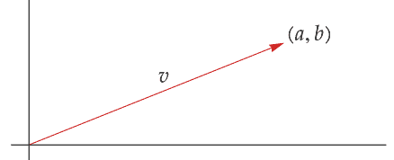

实数$^2$的元素可以看作是点或向量。

当我们将向量视为 $\mathbb{R}^2$ 中的箭头时，我们可以平行地移动箭头（不改变其长度或方向），仍然将其视为相同的向量。通过这种观点，您通常可以通过放弃坐标轴和显式坐标来获得更好的理解

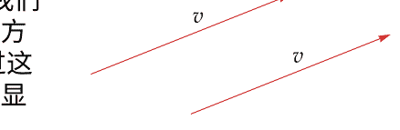

一个向量。

只需思考向量，如图所示。这里显示的两个箭头具有相同的长度和方向，因此我们将它们视为相同的向量。

无论我们在 $\mathbb{R}^2$ 中使用图片还是使用有些模糊的点和向量的语言，记住这些只是帮助我们理解的工具，而不是实际数学的替代品。尽管我们无法在高维空间中绘制好的图像，但这些空间的元素与 $\mathbb{R}^2$ 的元素一样严格定义。

> 经济的数学模型可能具有数千个变量，例如$x_1, \cdots, x_{5000}$，这意味着我们必须进行计算。这样的空间无法通过几何方式处理。然而，代数方法效果很好。因此，我们的学科被称为线性代数。

例如，(2, -3, 17, $x_4$, $\sqrt{2}$) 是 $\mathbb{R}^5$ 的一个元素，我们可以随意将其称为 $\mathbb{R}^5$ 中的一个点或者一个向量，而不必担心 $\mathbb{R}^5$ 的几何意义。

回想一下，我们定义了两个向量的和为通过相应坐标相加得到的向量；参见 1.13。现在我们将看到，在 $n=2$ 的特殊情况下，加法有一个简单的几何解释。

假设我们有两个在 $\mathbb{R}^2$ 中的向量 $x$ 和 $y$，我们想要将它们相加。将向量 $y$ 平行移动到与向量 $x$ 的终点重合，如图所示。然后，向量 $x$ 然后 $+ y$ 的和是一个向量，其起点等于向量 $x$ 的起点，终点等于向量 $y$（移动后）的终点，如图所示。

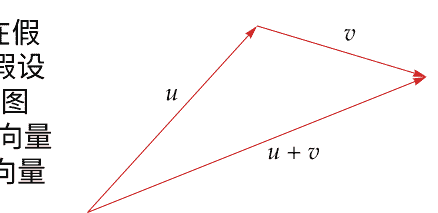

两个向量的和。

在下一个定义中，显示方程右侧的 0 是列表 $\vec{0} \in \mathbb{R}^n$。

##### 1.17 定义：R^n 中的加法逆元为 -x

对于 $x \in \mathbb{R}^n$，其加法逆元为 $-x$，记作 $-x \in \mathbb{R}^n$ 使得 $x + (-x) = 0$。因此，如果 $x = (x_1, \cdots, x_n)$，则 $-x = (-x_1, \cdots, -x_n)$。

在 $\mathbb{R}^2$ 中，一个向量的加法逆元是长度相同但指向相反方向的向量。这里的图示说明了对 $\mathbb{R}^2$ 中加法逆元的思考方式。正如你所看到的，标记为 $-x$ 的向量与标记为 $x$ 的向量长度相同，但方向相反。

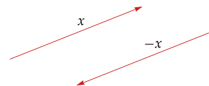

在处理了 $\mathbb{R}^n$ 中的加法之后，我们现在转向乘法。我们可以类似地定义 $\mathbb{R}^n$ 中的乘法，通过将对应的坐标相乘来得到 $\mathbb{R}^n$ 的另一个元素。

经验表明，这个定义对我们的目的没有用处。另一种乘法，称为标量乘法，将成为我们研究的核心。具体来说，我们需要定义如何将 $\mathbb{R}^n$ 的一个元素与 $\mathbb{F}$ 的一个元素相乘。

##### 1.18 定义：R^n 中的标量乘法

一个数 $x$ 与 $\mathbb{R}^n$ 中的一个向量的乘积是通过将向量的每个坐标与 $x$ 相乘来计算的：$x(x_1, \dots, x_n) = (x x_1, \dots, x x_n)$。这里 $x \in \mathbb{F}$, $(x_1, \cdots, x_n) \in \mathbb{R}^n$。

在 $\mathbb{R}^2$ 中，标量乘法有一个很好的几何解释。如果 $x > 0$，并且 $v \in \mathbb{R}^2$，则 $xv$ 是指向与 $v$ 相同方向且长度为 $x$ 倍 $|v|$ 长度的向量。换句话说，要得到 $xv$，我们通过缩放或拉伸 $v$，乘以 $x$，具体取决于 $x$ 是小于 1 还是大于 1。

在 $\mathbb{R}^n$ 中的标量乘法将一个标量和一个向量相乘，得到一个向量。相比之下，在 $\mathbb{R}^2$ 或 $\mathbb{R}^3$ 中的点积将两个向量相乘，得到一个标量。点积的推广在第 6 章中将变得重要。

如果 $x < 0$ 且 $v \in \mathbb{R}^2$，则 $xv$ 是指向与 $v$ 相反方向且长度为 $|x|$ 乘以 $v$ 长度的向量，如图所示。

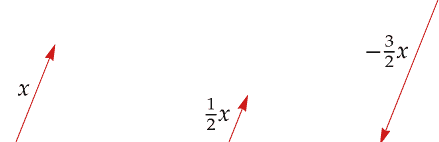

标量乘法。

### 第 1 章 向量空间

### 关于域的离题

域是一个包含至少两个不同元素 0 和 1 的集合，以及满足 1.3 中列出的所有性质的加法和乘法运算。因此，R 和 Q 是域，有理数集合与通常的加法和乘法运算也是域。另一个域的例子是集合 {0, 1}，除了 1 + 1 定义为 0 之外，加法和乘法的运算与通常相同。

在本书中，我们不讨论除 R 和 Q 之外的其他域。然而，许多线性代数中的定义、定理和证明对于任意域（而不仅仅是 R 和 Q）也适用。如果你愿意，在本书的大部分内容中（除了第 6 章和第 7 章，涉及内积空间），你可以将 F 视为表示任意域，而不是 R 或 Q。对于具有假设 F 是 R 的结果（除了内积章节），你可能可以用 F 是代数闭域的假设来替换该假设，这意味着在 F 系数的每个非常数多项式都有一个零点。一些结果，例如第 1C 节的练习 13，需要对 F 的假设 1 + 1 ≠ 0。

##### 练习题 1A

1. 证明 a + b = b + a 对于所有的 a, b ∈ F.
2. 证明 (a + b) + c = a + (b + c) 对于所有的 a, b, c ∈ F.
3. 证明 (ab)c = a(bc) 对于所有的 a, b, c ∈ F.
4. 证明 a(b + c) = ab + ac 对于所有的 a, b, c ∈ F.
5. 证明对于每个 a ∈ F, 存在唯一的 b ∈ F 使得 a + b = 0.
6. 证明对于每个 a ∈ F 且 a ≠ 0, 存在唯一的 b ∈ F 使得 ab = 1.
7. 证明
$$
\frac{-1+i\sqrt{3}}{2}
$$
是 1 的立方根（即它的立方等于 1）。
8. 找出 -1 的两个不同的平方根.
9. 找出 x ∈ R⁴ 使得
$$
(4, -3, 1, 7) + 2x = (5, 9, -6, 8).
$$
10. 解释为什么不存在 x ∈ R⁴ 使得
$$
x(2 - 3x, 5 + 4x, -6 + 7x) = (12 - 5x, 7 + 2x, -32 - 9x).
$$

11. 证明 (u + v) + w = u + (v + w) 对于所有 u, v, w ∈ V 成立.
12. 证明 (ab)v = a(bv) 对于所有 v ∈ V 和所有 a, b ∈ F.
13. 证明 1v = v 对于所有 v ∈ V.
14. 证明 a(u + v) = au + av 对于所有 v ∈ V 和所有 a, b ∈ F.
15. 证明 (a + b)v = av + bv 对于所有 a, b ∈ F 和所有 v ∈ V.

> “你会做加法吗？”白皇后问道。“一个加一个加一个加一个加一个加一个加一个加一个是多少？”
“我不知道，”爱丽丝说。“我数不过来了。”
—《镜中世界》，刘易斯·卡罗尔

#### 1B 向量空间的定义

定义向量空间的动机来自于 R^n 中的加法和标量乘法的性质：加法是可交换的、可结合的，并且有一个单位元。每个元素都有一个加法逆元。标量乘法是可结合的。标量乘以 1 的结果如预期一样。加法和标量乘法通过分配律相互关联。

我们将定义一个向量空间为一个集合 V，其中 V 上有一个加法和一个标量乘法，满足上面段落中的性质。

1.19 定义：加法，标量乘法

- 在集合 V 上的加法是一个将元素 v + w ∈ V 分配给每对元素 v, w ∈ V 的函数。
- 在集合 V 上的标量乘法是一个将元素 av ∈ V 分配给每个 a ∈ F 和每个 v ∈ V 的函数。

现在我们准备给出向量空间的正式定义。

1.20 定义：向量空间

向量空间是一个集合 V，以及 V 上的加法和标量乘法，满足以下性质。

**交换律**
对于所有的 u, v ∈ V，有 u + v = v + u。

**结合律**
对于所有的 u, v, w ∈ V 和所有的 a, b ∈ F，有 (u + v) + w = u + (v + w) 和 (ab)v = a(bv)。

**加法单位元**
存在一个元素 0 ∈ V 使得 v + 0 = v 对于所有 v ∈ V。

**加法逆元**
对于每个 v ∈ V，存在一个 -v ∈ V 使得 v + (-v) = 0。

**乘法单位元**
1v = v 对于所有 v ∈ V。

**分配律**
a(u + v) = au + av 且 (a + b)v = av + bv 对于所有 u, v ∈ V 和所有 a, b ∈ F。

以下几何语言有时有助于我们的直觉。

1.21 定义：向量，点

向量空间的元素被称为向量或点。

向量空间中的标量乘法取决于向量。因此，当我们需要精确时，我们会说 V 是 F 上的向量空间，而不仅仅是说 V 是一个向量空间。例如，R 是 R 上的向量空间，C 是 C 上的向量空间。

##### 1.22 定义：实向量空间，复向量空间

- R 上的向量空间称为实向量空间。
- C 上的向量空间称为复向量空间。

通常，F 的选择要么从上下文中清楚，要么无关紧要。因此，我们经常假设 F 在背景中存在，而不特别提及它。最简单的向量空间是 {0}。

通过常规的加法和标量乘法，R^n 是一个向量空间，你应该验证一下。R^n 的例子激发了我们对向量空间的定义。

> {0}，它只包含一个点。

##### 1.23 例子：R^∞

R^∞ 被定义为所有元素序列的集合，这些元素属于 R：

```
R^∞ = {(v₁, v₂, ⋯): vᵢ ∈ R，对于 i = 1, 2, ⋯}。
```

R^∞ 上的加法和标量乘法按预期进行定义：

```
(v₁, v₂, ⋯) + (w₁, w₂, ⋯) = (v₁ + w₁, v₂ + w₂, ⋯),
a(v₁, v₂, ⋯) = (av₁, av₂, ⋯).
```

通过这些定义，R^∞ 成为一个向量空间，你应该验证一下。在这个向量空间中，加法单位元是全 0 序列。

我们下一个向量空间的例子涉及一组函数。

##### 1.24 表示法：F^X

- 如果 X 是一个集合，那么 F^X 表示从 X 到 F 的函数集合。
- 对于 f, g ∈ F^X，和 f + g ∈ F^X，其定义如下：
(f + g)(x) = f(x) + g(x)
对于所有 x ∈ X。
- 对于 c ∈ F 和 f ∈ F^X，和 cf ∈ F^X，其定义如下：
(cf)(x) = cf(x)
对于所有 x ∈ X。

作为上述符号的一个例子，如果 I 是区间 [0, 1] 且 J = {1}，则 R^{[0,1]} 是区间 [0, 1] 上的实值函数的集合。

你应该验证下一个例子中的所有三个要点。

##### 1.25 例子：R^I 是一个向量空间

- 如果 I 是一个非空集合，则 R^I（使用上述定义的加法和标量乘法）是一个向量空间，其上的标量是 R。
- R^I 的加法单位元是函数 0 : I → R，定义为
0(i) = 0
对于所有 i ∈ I.
- 对于 v ∈ R^I，v 的加法逆元是函数 -v : I → R，定义为
(-v)(i) = -v(i)
对于所有 i ∈ I.

向量空间 R^n 是向量空间 R^I 的特殊情况，因为每个 (v₁, ⋯, vₙ) ∈ Rⁿ 可以被看作是从集合 {1, 2, ⋯, n} 到 R 的函数，通过用 v(i) 代替 vᵢ 表示第 i 个坐标的值。换句话说，

> 向量空间 R^{[0,1]} 的元素是定义在 [0, 1] 上的实值函数，而不是列表。
一般来说，向量空间是一个抽象的实体，其元素可以是列表、函数或奇怪的对象。

我们可以将 Rⁿ 看作 R^{{1, 2, ⋯, n}}。同样，我们可以将 R^∞ 看作 R^{{1, 2, ⋯}}。

很快我们将看到更多的向量空间的例子，但首先我们需要发展一些向量空间的基本性质。

向量空间的定义要求它具有一个加法单位元。下一个结果说明这个单位元是唯一的。

##### 1.26 唯一的加法单位元

一个向量空间有一个唯一的加法单位元。

证明假设 0 和 0' 都是某个向量空间 V 的加法单位元。
那么
```
0' = 0' + 0 = 0 + 0' = 0,
```
第一个等式成立是因为 0 是一个加法单位元，第二个等式来自于交换性，第三个等式成立是因为 0' 是一个加法单位元。因此 0' = 0，证明 V 只有一个加法单位元。

向量空间中的每个元素 v 都有一个加法逆元，即向量空间中的一个元素 -v，使得 v + (-v) = 0。下一个结果表明向量空间中的每个元素只有一个加法逆元。

##### 1.27 唯一的加法逆元

向量空间中的每个元素都有一个唯一的加法逆元。

证明假设 V 是一个向量空间。设 v ∈ V。假设 v' 和 v'' 是 v 的加法逆元。那么
```
v' = v' + 0 = v' + (v + v'') = (v' + v) + v'' = 0 + v'' = v''.
```
因此 v' = v'', 如所需。

由于加法逆元是唯一的，现在可以使用以下符号表示。

##### 1.28 符号表示：-v, v - w

设 v, w ∈ V。那么
- -v 表示 v 的加法逆元;
- v - w 被定义为 v + (-w)。

本书中几乎所有的结果都涉及一些向量空间。为了避免频繁地重申 V 是一个向量空间，我们现在一次性做出必要的声明。

##### 1.29 符号表示：V

在本书的其余部分，V 表示一个定义在 F 上的向量空间。

在下一个结果中，0 表示一个标量（即 0 ∈ F）在等式的左边，而一个向量（即 v 的加法单位元）在等式的右边。

##### 1.30 数字 0 乘以一个向量

对于每一个 v ∈ V，都有 0v = 0。

证明对于 v ∈ V，我们有
```
0v = (0 + 0)v = 0v + 0v。
```
将上述方程两边加上 0v 的加法逆元，得到 0 = 0v，如所需。

> 1.30 的结果涉及到向量空间 V 的加法单位元和标量乘法。
向量空间的定义中，唯一将向量加法和标量乘法联系起来的部分是分配律。因此，在 1.30 的证明中必须使用分配律。

在下一个结果中，0 表示向量空间 V 的加法单位元。尽管它们的证明相似，但 1.30 和 1.31 并不相同。更确切地说，1.30 表明标量 0 与任何向量的乘积等于向量 0，而 1.31 表明任何标量与向量 0 的乘积等于向量 0。

##### 1.31 一个数乘以向量 0

证明对于 v ∈ V, 我们有
```
0v = 0(0 + 0) = 0v + 0v.
```
将上述方程两边加上 0v 的加法逆元得到 0 = 0v, 如所需。

##### 1.32 数 -1 乘以一个向量

证明对于 v ∈ V, 我们有
```
v + (-1)v = 1v + (-1)v = (1 + (-1))v = 0v = 0.
```
这个方程表示 (-1)v 加上 v 等于 0. 因此 (-1)v 是 v 的加法逆元，如所需。

### 练习题 1B

1. 证明 -(-v) = v 对于每个 v ∈ V 成立。
2. 假设 v ∈ V, α ∈ F, 且 αv = 0. 证明 α = 0 或 v = 0.
3. 假设 v, w ∈ V. 解释为什么存在唯一的 v ∈ V 使得 v + 3w = v.
4. 空集不是一个向量空间。空集在向量空间的定义 (1.20) 中只有一个要求不满足。是哪一个？
5. 证明在向量空间的定义 (1.20) 中，加法逆元条件可以替换为对于所有 v ∈ V 成立的条件 0v = 0。

这里左边的 0 是数字 0，右边的 0 是 V 的加法单位元。

在定义中，“条件可以替换”这个短语意味着如果将原始条件替换为新条件，则满足定义的对象集合不会改变。

6. 让 ∞ 和 -∞ 表示两个不同的对象，都不属于 R。根据符号，定义 R ∪ {∞, -∞} 上的加法和标量乘法。具体来说，两个实数的和与积与通常一样，对于 α ∈ R，定义
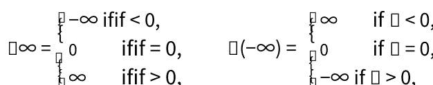
和
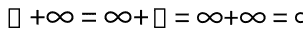
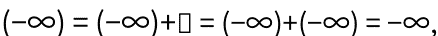
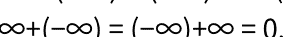
通过这些加法和标量乘法的运算，R ∪ {∞, -∞} 是 R 上的向量空间吗？请解释。

7. 假设 V 是一个非空集合。让 F^V 表示从 V 到 F 的函数集合。
在 F^V 上定义自然加法和标量乘法，并证明这些定义使 F^V 成为一个向量空间。

8. 假设 V 是一个实数向量空间。
- 复化 V 的结果是 V × V，记作 V_C。V_C 的元素是一个有序对 (v, w)，其中 v, w ∈ V，但我们将其写作 v + iw。
- V_C 上的加法定义为
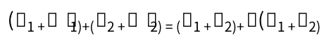
对于所有 v₁, w₁, v₂, w₂ ∈ V。
- 复数标量乘法在 V_C 上定义为
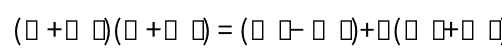
对于所有 a, b ∈ R 和所有 v, w ∈ V。
证明根据上述的加法和标量乘法定义，V_C 是一个复向量空间。
将 V 看作是 V_C 的一个子集，通过将 v ∈ V 与 v + 0i 等同起来。从 V 构造 V_C 可以被看作是将从 V^0 到 V^1 的构造进行了推广。

#### 1C 子空间

通过考虑子空间，我们可以大大扩展向量空间的例子。

> 1.33 定义：子空间
如果子集 W 是 V 的子空间，那么 W 也是一个向量空间，具有与 V 相同的加法单位元、加法和标量乘法。

下一个结果给出了检查向量空间的子集是否为子空间的最简单方法。

> 有些人使用术语线性子空间，意思与子空间相同。

> 1.34 子空间的条件
如果子集 W 是 V 的子空间，那么 W 满足以下三个条件。

**加法单位元**
0 ∈ W.

**封闭于加法**
如果 u, v ∈ W，则 u + v ∈ W.

**封闭于标量乘法**
α ∈ F 和 u ∈ W 意味着 αu ∈ W.

证明 如果 W 是 V 的子空间，则 W 通过向量空间的定义满足上述三个条件。

> 上面的加法恒等条件可以用条件替换 W 是非空的 (因为这样取 -u ∈ W 并将其乘以 0 将意味着 0 ∈ W)。然而，如果子集 W of V 确实是子空间，则通常最快的方法是展示 W 是非空的是展示 0 ∈ W。

反之，假设 W 满足上述三个条件。第一个条件确保了 V 的加法恒等元素在 W 中。第二个条件确保了 V 上的加法是有意义的。第三个条件确保了 W 上的标量乘法是有意义的。

如果 u ∈ W, 那么 -u [等于 (-1)u 根据 1.32] 也在 W 中，根据上面的第三个条件。因此，W 中的每个元素在 W 中都有一个加法逆元。

矢量空间的其他部分的定义，如结合律和交换律，对于 W 自动满足，因为它们在更大的空间 V 上成立。因此，W 是一个矢量空间，因此是 V 的子空间。

上述结果中的三个条件通常能够快速确定给定的 W 的子集是否是 V 的子空间。你应该验证下一个例子中的所有断言。

##### 1.35 例子：子空间

(a) 如果 v ∈ V, 那么
{(v₁, v₂, v₃, v₄) ∈ R⁴ : v₃ = 5v₄ + 1}
不是 R⁴ 的子空间。

(b) 在区间 [0, 1] 上连续的实值函数构成一个子空间 of [0,1]。

(c) 在 V 上可微的实值函数构成 V 的子空间。

(d) 在区间 (0, 3) 上满足 f'(2) = 0 的可微实值函数构成 V 的子空间，如果且仅如果... (注：此处 OCR 原文混乱，根据上下文应为特定条件)。

(e) 所有极限为 0 的复数序列构成 V^∞ 的子空间。

验证上面的一些项目显示了微积分的线性结构。例如，上面的 (b) 需要结果，即两个连续函数的和是连续的。作为另一个例子，上面的 (d) 需要结果，即对于常数 v, v 的导数等于 v 乘以 v 的导数。

> 集合 {0} 是 V 的最小子空间，而 V 本身是 V 的最大子空间。空集不是 V 的子空间，因为子空间必须是一个向量空间，因此必须至少包含一个元素，即加法恒等元素。

R² 的子空间恰好是 {0}，包含原点的所有直线，以及 R² 本身。R³ 的子空间恰好是 {0}，包含原点的所有直线，包含原点的所有平面，以及 R³ 本身。证明所有这些对象确实是子空间是直接的——困难的部分是要证明它们是 R² 和 R³ 的唯一子空间。在下一章中引入一些额外的工具后，这个任务将变得更容易。

#### 子空间的和

在处理向量空间时，我们通常只对子空间感兴趣，而不是任意子集。子空间的和的概念将会很有用。

> 子空间的并集很少是一个子空间 (见练习 12)，这就是为什么我们通常使用和而不是并集。

##### 1.36 定义：子空间的和

假设 U₁, ..., Uₙ 是 V 的子空间。U₁, ..., Uₙ 的和，表示为 U₁ + ... + Uₙ，是由 U₁, ..., Uₙ 的元素之和的所有可能组成的集合。更具体地说，
```
U₁ + ... + Uₙ = {u₁ + ... + uₙ : u₁ ∈ U₁, ..., uₙ ∈ Uₙ}.
```

让我们来看一些子空间的和的例子。

##### 1.37 例子：子空间的和 R^3

假设 U 是由 R³ 中所有第二个和第三个坐标相等的元素组成的集合，而 V 是由 R³ 中所有第一个和第三个坐标相等的元素组成的集合：
```
U = {(a, b, b) ∈ R³ : a, b ∈ R} 和 V = {(a, a, b) ∈ R³ : a, b ∈ R}。
```
那么
```
U + V = {(a, b, c) ∈ R³ : a, b, c ∈ R} = R³,
```
你应该验证一下。

##### 1.38 例子：子空间的和 R^4

假设
```
U = {(a, b, b, b) ∈ R⁴ : a, b ∈ R} 和 V = {(a, a, b, b) ∈ R⁴ : a, b ∈ R}。
```
使用文字而不是符号，我们可以说 U 是由第三和第四个坐标相等的 R⁴ 的元素集合。同样地，V 是由前三个坐标相等的 R⁴ 的元素集合。

要找到 U + V 的描述，考虑一个典型的 (a, b, c, d) 属于 U 的元素和一个典型的 (a', b', c', d') 属于 V 的元素，其中 a, b, c, d, a', b', c', d' ∈ R。我们有
```
(a, b, c, c) + (a', a', b', b') = (a + a', b + a', c + b', c + b'),
```
这表明 U + V 的每个元素的第三和第四个坐标相等。因此
```
1.39 U + V ⊆ {(a, b, c, c) ∈ R⁴ : a, b, c ∈ R}.
```
为了证明另一个方向的包含关系，假设 a, b, c ∈ R。那么
```
(a, b, c, c) = (a, b, c, c) + (0, 0, 0, 0),
```
其中右边的第一个向量在 U 中，右边的第二个向量在 V 中。因此 (a, b, c, c) ∈ U + V，证明了包含关系 1.39 也在相反方向成立。因此
```
U + V = {(a, b, c, c) ∈ R⁴ : a, b, c ∈ R},
```
这表明 U + V 是由 R⁴ 中的元素组成的，这些元素的第三和第四个坐标相等。

下一个结果说明子空间的和是一个子空间，并且实际上是包含所有加和项的最小子空间（这意味着每个包含所有加和项的子空间也包含这个和）。

##### 1.40 子空间的和是包含它们的最小子空间

假设 $V_1, \cdots, V_k$ 是 $V$ 的子空间。那么 $V_1 + \cdots + V_k$ 是 $V$ 的子空间，包含 $V_1, \cdots, V_k$。

**证明** 读者可以验证 $V_1 + \cdots + V_k$ 包含加法单位元 $0$，并且在加法和数乘下封闭。因此，1.34 意味着 $V_1 + \cdots + V_k$ 是 $V$ 的子空间。

子空间 $V_1, \cdots, V_k$ 都包含在 $V_1 + \cdots + V_k$ 中（要看到这一点，考虑和 $V_1 + \cdots + V_k$ 的和，其中除了一个 $V_i$ 为 $0$ 之外都为 $0$）。反过来，包含 $V_1, \cdots, V_k$ 的 $V$ 的每个子空间都包含 $V_1 + \cdots + V_k$（因为子空间必须包含其元素的所有有限和）。因此，$V_1 + \cdots + V_k$ 是包含 $V_1, \cdots, V_k$ 的 $V$ 的最小子空间。

> 向量空间理论中的子空间和集合论中的子集并类似。给定一个向量空间的两个子空间，包含它们的最小子空间就是它们的和。类似地，给定一个集合的两个子集，包含它们的最小子集就是它们的并集。

#### 直和

假设 $V_1, \cdots, V_k$ 是 $V$ 的子空间。每个 $V_1 + \cdots + V_k$ 的元素都可以用以下形式表示

$v = v_1 + \cdots + v_k$

其中每个 $v_i \in V_i$。特别感兴趣的是每个向量在 $V_1 + \cdots + V_k$ 中只能以上述形式表示一次的情况。这种情况非常重要，因此它有一个特殊的名称（直和）和一个特殊的符号（$\oplus$）。

### 1.41 定义：直和， $\oplus$

假设 $V_1, \cdots, V_k$ 是 $V$ 的子空间。

- $V_1 + \cdots + V_k$ 的和被称为直和，如果 $V_1 + \cdots + V_k$ 的每个元素只能以一种方式写成 $v_1 + \cdots + v_k$ 的和，其中每个 $v_i \in V_i$。
- 如果 $V_1 + \cdots + V_k$ 是一个直和，那么 $V_1 \oplus \cdots \oplus V_k$ 表示 $V_1 + \cdots + V_k$，其中 $\oplus$ 符号表示这是一个直和。

##### 1.42 例子：两个子空间的直和

假设 $W_1$ 是由最后一个坐标为 0 的向量组成的子空间，而 $W_2$ 是由前两个坐标为 0 的向量组成的子空间：

$W_1 = \{(x, y, 0) \in \mathbb{R}^3 : x, y \in \mathbb{R}\}$ 和 $W_2 = \{(0, 0, z) \in \mathbb{R}^3 : z \in \mathbb{R}\}$。

然后，你应该验证 $\mathbb{R}^3 = W_1 \oplus W_2$。

##### 1.43 例子：多个子空间的直和

假设 $V_i$ 是 $V^n$ 中的子空间，即那些向量的坐标都是 0，除了可能在第 $i$ 个位置上。例如，$V_i = \{(0, \dots, 0, v, 0, \dots, 0) \in V^n : v \in F\}$。

> 在 TEX 中输入 $\oplus$ 可以得到 `\oplus`。

那么 $V^n = V_1 \oplus \dots \oplus V_n$。

你应该验证一下。

有时候反例对我们的理解同样重要如例子。

##### 1.44 例子：一个不是直和的和

假设

$V_1 = \{(x, y, 0) \in V^3 : x, y \in F\}$,
$V_2 = \{(0, 0, z) \in V^3 : z \in F\}$,
$V_3 = \{(0, y, z) \in V^3 : y \in F\}$。

那么 $V^3 = V_1 + V_2 + V_3$ 因为每个向量 $(x, y, z) \in V^3$ 都可以写成

$(x, y, z) = (x, y, 0) + (0, 0, z) + (0, 0, 0)$

其中右边的第一个向量在 $V_1$ 中，第二个向量在 $V_2$ 中，第三个向量在 $V_3$ 中。

然而，$V^3$ 不等于直和 $V_1, V_2, V_3$，因为向量 $(0, 0, 0)$ 可以以多种方式写成 $V_1 + V_2 + V_3$ 的和，其中每个 $v_i \in V_i$。具体来说，我们有

$(0, 0, 0) = (0, 1, 0) + (0, 0, 1) + (0, -1, -1)$

当然，

$(0, 0, 0) = (0, 0, 0) + (0, 0, 0) + (0, 0, 0)$

上述每个方程右边的第一个向量在 $V_1$ 中，第二个向量在 $V_2$ 中，第三个向量在 $V_3$ 中。因此，和 $V_1 + V_2 + V_3$ 不是一个直和。

直和的定义要求和中的每个向量都有一个唯一的表示为适当的和。下一个结果表明，在决定子空间的和是否是直和时，我们只需要考虑是否 0 可以唯一地写成适当的和。

> 符号 $\oplus$，它是一个加号在一个圆圈里，提醒我们我们正在处理一种特殊类型的子空间的和——直和中的每个元素只能以一种方式表示为来自指定子空间的元素的和。

##### 1.45 直和的条件

假设 $U_1, \dots, U_n$ 是 $V$ 的子空间。那么 $U_1 + \dots + U_n$ 是直和，当且仅当 0 只能以 $u_1 + \dots + u_n$ 的形式写成，其中每个 $u_i \in U_i$，都等于 0。

**证明** 首先假设 $U_1 + \dots + U_n$ 是一个直和。然后直和的定义意味着，唯一的方式将 0 写成 $u_1 + \dots + u_n$ 的和，其中每个 $u_i \in U_i$，就是将每个 $u_i$ 等于 0。

现在假设将 0 写成 $u_1 + \dots + u_n$ 的和，其中每个 $u_i \in U_i$ 的唯一方式是将每个 $u_i$ 等于 0。为了证明 $U_1 + \dots + U_n$ 是一个直和，让 $v \in U_1 + \dots + U_n$。我们可以写成

$v = v_1 + \dots + v_n$

对于一些 $v_1 \in U_1, \dots, v_n \in U_n$。为了证明这个表示是唯一的，假设我们还有

$v = u_1 + \dots + u_n$

其中 $u_1 \in U_1, \dots, u_n \in U_n$。将这两个方程相减，我们得到

$0 = (v_1 - u_1) + \dots + (v_n - u_n)$

因为 $v_1 - u_1 \in U_1, \dots, v_n - u_n \in U_n$，上述方程意味着每个 $v_i - u_i$ 都等于 0。因此 $v_1 = u_1, \dots, v_n = u_n$，正如所期望的。

下一个结果给出了一个简单的条件，用于测试两个子空间的和是否是直和。

> 下面使用的符号 $\iff$ 表示“当且仅当”；这个符号也可以读作“等价于”。

##### 1.46 两个子空间的直和

假设 $U$ 和 $W$ 是 $V$ 的子空间。那么

$U + W$ 是直和 $\iff U \cap W = \{0\}$

**证明** 首先假设 $U+W$ 是直和。如果 $v \in U \cap W$，那么 $0 = v + (-v)$，其中 $v \in U$ 且 $-v \in W$。根据 0 作为 $U$ 中向量和 $W$ 中向量的和的唯一表示，我们有 $v = 0$。因此 $U \cap W = \{0\}$，完成了证明的一个方向。

为了证明另一个方向，现在假设 $U \cap W = \{0\}$。为了证明 $U+W$ 是直和，假设 $v \in U, v \in W$，并且

$0 = u + w$

为了完成证明，我们只需要证明 $u = w = 0$（根据 1.45）。上面的方程暗示了 $u = -w \in W$。因此，$u \in U \cap W$。因此，$u = 0$。根据上面的方程暗示了 $w = 0$，完成了证明。

### 第 1 章 向量空间

上面的结果仅涉及两个子空间的情况。当询问可能的直和包含超过两个子空间时，仅仅测试每对子空间是否只在 0 处相交是不够的。为了看到这一点，考虑例子 1.44。在那个不是直和的反例中，我们有

> 子空间的和类似于子集的并集。类似地，子空间的直和类似于子集的不相交并集。一个向量空间的两个子空间不能是不相交的，因为它们都包含 0。因此，不相交性在两个子空间的情况下被替换为交集等于 $\{0\}$ 的要求。

$U_1 \cap U_2 = \{0\} \quad U_1 \cap U_3 = U_2 \cap U_3 = \{0\}.$

# 习题 1C

1. 对于下面的 $\mathbb{R}^3$ 的子集，确定它是否是 $\mathbb{R}^3$ 的子空间。
   - (a) $\{ (x_1, x_2, x_3) \in \mathbb{R}^3 : x_1 + 2x_2 + 3x_3 = 0 \}$
   - (b) $\{ (x_1, x_2, x_3) \in \mathbb{R}^3 : x_1 + 2x_2 + 3x_3 = 4 \}$
   - (c) $\{ (x_1, x_2, x_3) \in \mathbb{R}^3 : x_1x_2x_3 = 0 \}$
   - (d) $\{ (x_1, x_2, x_3) \in \mathbb{R}^3 : x_1 = 5x_3 \}$

2. 验证例子 1.35 中关于子空间的所有断言。

3. 证明在区间 $(-4, 4)$ 上，满足 $f'(-1) = 3f(2)$ 的可微实值函数 $f$ 的集合是 $C(-4, 4)$ 的子空间。

4. 假设 $a \in \mathbb{R}$。证明在区间 $[0, 1]$ 上，满足 $\int_0^1 f = a$ 的连续实值函数 $f$ 的集合是 $C[0, 1]$ 的子空间，当且仅当 $a = 0$。

5. $\mathbb{R}^2$ 的子空间是 $\mathbb{R}^2$ 吗？

6. (a) Is $\{ (x, y, z) \in \mathbb{R}^3 : x^3 = z^3 \}$ $\mathbb{R}^3$ 的子空间吗？
   (b) 如果 $\{ (x, y, z) \in \mathbb{R}^3 : x^3 = z^3 \}$ 是 $\mathbb{R}^3$ 的子空间吗？

7. 证明或举出反例：如果 $U$ 是 $\mathbb{R}^2$ 的非空子集，满足对于任意 $u \in U$，有 $-u \in U$，则 $U$ 是 $\mathbb{R}^2$ 的子空间。

8. 举一个例子：给出一个非空子集 $S$，满足 $S$ 对于标量乘法封闭，但 $S$ 不是 $\mathbb{R}^2$ 的子空间。

9. 如果存在正数 $T$ 使得对于所有 $x \in \mathbb{R}$，函数 $f: \mathbb{R} \to \mathbb{R}$ 满足 $f(x) = f(x + T)$，则称其为周期函数。周期函数集合从 $\mathbb{R}$ 到 $\mathbb{R}$ 是否是 $\mathbb{R}^{\mathbb{R}}$ 的子空间？请解释。

10. 假设 $U_1$ 和 $U_2$ 是 $V$ 的子空间。证明交集 $U_1 \cap U_2$ 是 $V$ 的子空间。

11. 证明 $V$ 的所有子空间的交集是 $V$ 的子空间。

12. 当且仅当一个子空间包含另一个子空间时，两个子空间的并集是 $V$ 的子空间。

13. 证明如果三个子空间的并集是 $V$ 的子空间，那么其中一个子空间包含其他两个子空间，反之亦然。
    这个练习比练习 12 要难得多，可能是因为如果我们用一个只包含两个元素的域替换，这个练习就不成立了。

14. 假设
    $U = \{(x, -x, 2x) \in \mathbb{R}^3 : x \in \mathbb{R}\}$ 和 $W = \{(x, x, 2x) \in \mathbb{R}^3 : x \in \mathbb{R}\}$。
    用符号描述 $U + W$，并给出一个不使用符号的 $U + W$ 的描述。

15. 假设 $W$ 是 $V$ 的子空间。那么 $V + W$ 是什么？

16. 在 $V$ 的子空间上的加法运算是否满足交换律？换句话说，如果 $U$ 和 $W$ 是 $V$ 的子空间，是否有 $U + W = W + U$？

17. 在 $V$ 的子空间上的加法运算是否满足结合律？换句话说，如果 $U_1, U_2, U_3$ 是 $V$ 的子空间，是否有
    $(U_1 + U_2) + U_3 = U_1 + (U_2 + U_3)$?

18. 在 $V$ 的子空间上的加法运算是否有加法单位元？哪些子空间有加法逆元？

19. 证明或给出反例：如果 $U_1, U_2, W$ 是 $V$ 的子空间，且满足
    $U_1 + W = U_2 + W$，
    则 $U_1 = U_2$。

20. 假设
    $W = \{(x, y, x+y, x-y, 2x) \in \mathbb{R}^5 : x, y \in \mathbb{R}\}$。
    找到一个子空间 $U$ 到 $\mathbb{R}^5$，使得 $\mathbb{R}^5 = U \oplus W$。

21. 假设
    $W = \{(x, y, x+y, x-y, 2x) \in \mathbb{R}^5 : x, y \in \mathbb{R}\}$。
    找到三个子空间 $W_1, W_2, W_3$ 到 $\mathbb{R}^5$，其中没有一个等于 $\{0\}$，使得 $\mathbb{R}^5 = W \oplus W_1 \oplus W_2 \oplus W_3$。

22. 假设
    $W = \{(x, y, x+y, x-y, 2x) \in \mathbb{R}^5 : x, y \in \mathbb{R}\}$。
    找到三个子空间 $W_1, W_2, W_3$ 到 $\mathbb{R}^5$，其中没有一个等于 $\{0\}$，使得 $\mathbb{R}^5 = W \oplus W_1 \oplus W_2 \oplus W_3$。

23. 证明或给出一个反例：如果 $V_1, V_2, U$ 是 $V$ 的子空间
    $V = V_1 \oplus U$ 和 $V = V_2 \oplus U$，
    则 $V_1 = V_2$。
    提示：当尝试确定线性代数中的一个猜想是真还是假时，通常可以从在 $\mathbb{R}^2$ 中进行实验开始。

24. 一个函数 $f: \mathbb{R} \to \mathbb{R}$ 如果是偶函数，则称为
    $f(-x) = f(x)$
    对于所有 $x \in \mathbb{R}$。一个函数 $f: \mathbb{R} \to \mathbb{R}$ 如果是奇函数，则称为
    $f(-x) = -f(x)$
    对于所有 $x \in \mathbb{R}$。让 $V_e$ 表示实值偶函数的集合在 $\mathbb{R}$ 上。
    让 $V_o$ 表示实值奇函数的集合在 $\mathbb{R}$ 上。证明
    $V = V_e \oplus V_o$。

# 第二章

# 有限维向量空间

在上一章中，我们学习了向量空间。线性代数不关注任意的向量空间，而是关注有限维向量空间，在本章中我们将介绍。

我们从考虑向量列表的线性组合开始这一章节。这引导我们到线性独立的关键概念。线性依赖引理将成为我们最有用的工具之一。

在向量空间中，一个向量列表既足够小以线性独立，又足够大以填满向量空间的线性组合被称为向量空间的基。我们将看到每个向量空间的基都有相同的长度，这将允许我们定义向量空间的维度。

本章以两个子空间的和的维度公式结束。

#### 本章的基本假设

- $F$ 表示 $\mathbb{R}$ 或 $\mathbb{C}$。
- $V$ 表示一个在 $F$ 上的向量空间。

普林斯顿高级研究所的主楼，位于新泽西州普林斯顿。

保罗·哈尔莫斯（1916-2006）在这座建筑中写了第一本现代线性代数书籍。

Halmos 的线性代数书于 1942 年出版（第二版于 1958 年出版）。

Halmos 的书的标题与本章标题相同。

#### 2A 张成与线性独立

我们一直在写由括号括起来的数字列表，并且我们将继续为 $\mathbb{R}^n$ 的元素这样做；例如，$(2, -7, 8) \in \mathbb{R}^3$。然而，现在我们需要考虑向量的列表（可能是 $\mathbb{R}^n$ 或其他向量空间的元素）。为了避免混淆，我们通常会写出不带括号的向量列表。例如，$(4, 1, 6), (9, 5, 7)$ 是一个长度为两个的向量列表在 $\mathbb{R}^3$ 中。

##### 2.1 符号：向量列表

我们通常会在不加括号的情况下写出向量列表。

### 线性组合和张成

列表中向量的标量倍数之和称为该列表的线性组合。下面是正式的定义。

##### 2.2 定义：线性组合

向量列表 $v_1, \cdots, v_m$ 的线性组合是形如的向量
$v_1 a_1 + \cdots + v_m a_m$
其中 $a_1, \cdots, a_m \in F$。

### 2.3 例子：线性组合在 $\mathbb{R}^3$

- $(17, -4, 2)$ 是 $(2, 1, -3), (1, -2, 4)$ 的线性组合，这是一个长度为两个向量的列表在 $\mathbb{R}^3$，因为
$(17, -4, 2) = 6(2, 1, -3) + 5(1, -2, 4).$
- $(17, -4, 5)$ 不是 $(2, 1, -3), (1, -2, 4)$ 的线性组合，这是一个长度为两个向量的列表在 $\mathbb{R}^3$ 中，因为不存在 $a_1, a_2 \in F$ 使得
$(17, -4, 5) = a_1 (2, 1, -3) + a_2 (1, -2, 4).$
换句话说，方程组
\begin{align*} 17 &= 2a_1 + a_2 \\ -4 &= a_1 - 2a_2 \\ 5 &= -3a_1 + 4a_2 \end{align*}
没有解（你应该验证）。

##### 2.4 定义：张成

向量列表 $v_1, \dots, v_m$ 的所有线性组合的集合称为 张成($v_1, \dots, v_m$)，记作 $\text{span}(v_1, \dots, v_m)$。换句话说，
$\text{span}(v_1, \dots, v_m) = \{a_1 v_1 + \dots + a_m v_m \mid a_1, \dots, a_m \in F\}.$
空列表 $()$ 的张成空间定义为 $\{0\}.$

##### 2.5 例子：张成空间

前面的例子表明，在 $\mathbb{R}^3$ 中
- $(17, -4, 2) \in \text{span}((2, 1, -3), (1, -2, 4));$
- $(17, -4, 5) \notin \text{span}((2, 1, -3), (1, -2, 4)).$
一些数学家使用术语线性张成，它的意思与张成相同。

##### 2.6 张成是包含最小子空间

在 $F$ 中，向量列表的张成是包含列表中所有向量的最小子空间。

**证明** 假设 $v_1, \cdots, v_m$ 是 $V$ 中的向量列表。

首先，我们证明 $\text{span}(v_1, \cdots, v_m)$ 是 $V$ 的子空间。加法单位元素在 $\text{span}(v_1, \cdots, v_m)$ 中，因为
$0 = 0 v_1 + \dots + 0 v_m$
此外，$\text{span}(v_1, \cdots, v_m)$ 对于加法是封闭的，因为
$(a_1 v_1 + \dots + a_m v_m) + (b_1 v_1 + \dots + b_m v_m) = (a_1+b_1)v_1 + \dots + (a_m+b_m)v_m$
此外，由于 $\text{span}(v_1, \dots, v_m)$ 是封闭的，所以它在标量乘法下也是封闭的
$a(a_1 v_1 + \dots + a_m v_m) = (a a_1)v_1 + \dots + (a a_m)v_m$
因此 $\text{span}(v_1, \dots, v_m)$ 是 $V$ 的子空间（根据 1.34）。

每个 $v_j$ 都是 $v_1, \dots, v_m$ 的线性组合（为了证明这一点，令 $a_j = 1$，并让 2.2 中的其他 $a_i$ 的值等于 0）。因此 $\text{span}(v_1, \dots, v_m)$ 包含每个 $v_j$。反之，由于子空间在标量乘法和加法下是封闭的，包含每个 $v_j$ 的 $V$ 的每个子空间都包含 $\text{span}(v_1, \dots, v_m)$。因此 $\text{span}(v_1, \dots, v_m)$ 是包含所有向量 $v_1, \dots, v_m$ 的 $V$ 的最小子空间。

##### 2.7 定义：张成

如果 $\text{span}(v_1, \cdots, v_m)$ 等于 $V$，我们说列表 $v_1, \cdots, v_m$ 张成 $V$。

# 2.8 例子：一个张成 $\mathbb{R}^n$ 的列表

假设 $n$ 是一个正整数。我们想要证明

$(1,0,\cdots,0),(0,1,0,\cdots,0),\cdots,(0,\cdots,0,1)$

张成 $\mathbb{R}^n$。这里列表中的第 $i$ 个向量在第 $i$ 个位置上有 $1$，其他位置上都是 $0$。

假设 $(v_1, \cdots, v_n) \in \mathbb{R}^n$。那么

$$
(v_1, \cdots, v_n) = v_1(1,0,\cdots,0) + v_2(0,1,0,\cdots,0) + \cdots + v_n(0,\cdots,0,1).
$$

因此 $(v_1, \cdots, v_n) \in \text{span}((1,0, \cdots, 0), (0,1,0, \cdots, 0), \cdots, (0, \cdots, 0, 1))$，符合要求。

现在我们可以给线性代数中的一个关键定义。

##### 2.9 定义：有限维向量空间

如果向量空间中的某个向量列表可以张成空间，则该向量空间被称为有限维的。

上面的例子 2.8 表明，对于每个正整数 $n$，$\mathbb{R}^n$ 是一个有限维向量空间。

> 回想一下，根据定义，每个列表都有有限的长度。

多项式的定义对你来说无疑已经很熟悉了。

# 2.10 定义：多项式，$\mathcal{P}(\mathbb{F})$

- 一个函数 $p: \mathbb{F} \to \mathbb{F}$ 如果存在 $a_0, \cdots, a_n \in \mathbb{F}$，使得
  $$p(z) = a_0 + a_1z + a_2z^2 + \cdots + a_nz^n$$
  对于所有的 $z \in \mathbb{F}$。
- $\mathcal{P}(\mathbb{F})$ 是所有系数在 $\mathbb{F}$ 中的多项式的集合。

通过常规的加法和标量乘法，$\mathcal{P}(\mathbb{F})$ 是一个向量空间，你应该验证一下。因此，$\mathcal{P}(\mathbb{F})$ 是 $\mathbb{F}^\mathbb{F}$ 的一个子空间，即从 $\mathbb{F}$ 到 $\mathbb{F}$ 的函数空间。

如果一个多项式（可以看作是从 $\mathbb{F}$ 到 $\mathbb{F}$ 的函数）用两个系数集表示，那么从一个表示中减去另一个表示会产生一个在 $\mathbb{F}$ 上恒等于零的多项式，因此它的所有系数都为零（如果你对这个事实不熟悉，现在就相信它；我们将在 4.8 中证明它）。结论：多项式的系数由多项式唯一确定。因此，下一个定义唯一地定义了多项式的次数。

# 2.11 定义：多项式的次数，$\deg p$

- 一个多项式 $p \in \mathcal{P}(\mathbb{F})$ 被称为具有次数 $n$，如果存在标量 $a_0, a_1, \dots, a_n \in \mathbb{F}$，使得对于每个 $t \in \mathbb{F}$，我们有 $p(t) = a_0 + a_1t + \dots + a_nt^n$。
- 恒等于 $0$ 的多项式被称为具有次数 $-\infty$。
- 多项式 $p$ 的次数用 $\deg p$ 表示。

在下一个定义中，我们使用 $-\infty < n$ 的约定，这意味着多项式 $0$ 在 $\mathcal{P}_n(\mathbb{F})$ 中。

# 2.12 符号：$\mathcal{P}_n(\mathbb{F})$

对于 $n$ 为非负整数，$\mathcal{P}_n(\mathbb{F})$ 表示所有系数在 $\mathbb{F}$ 且次数最多为 $n$ 的多项式的集合。

如果 $n$ 是非负整数，则 $\mathcal{P}_n(\mathbb{F}) = \text{span}(1, t, \dots, t^n)$ [在这里我们稍微滥用了符号，让 $t^n$ 表示一个函数]。因此，对于每个非负整数 $n$，$\mathcal{P}_n(\mathbb{F})$ 是一个有限维向量空间。

# 2.13 定义：无限维向量空间

如果一个向量空间不是有限维的，则称其为无限维的。

# 2.14 例子：$\mathcal{P}(\mathbb{F})$ 是无限维的

考虑任意一个 $\mathcal{P}(\mathbb{F})$ 的元素列表。设 $n$ 表示这个列表中多项式的最高次数。那么这个列表生成的所有多项式的次数都不超过 $n$。因此，$t^{n+1}$ 不在我们的列表生成的空间中。因此，没有任何列表可以生成 $\mathcal{P}(\mathbb{F})$。因此，$\mathcal{P}(\mathbb{F})$ 是无限维的。

# 线性独立性

假设 $v_1, \dots, v_m \in V$ 且 $v \in \text{span}(v_1, \dots, v_m)$。根据生成空间的定义，存在 $a_1, \dots, a_m \in \mathbb{F}$ 使得

$$
v = a_1v_1 + \dots + a_mv_m
$$

考虑上述方程中标量的选择是否唯一。假设 $b_1, \dots, b_m$ 是另一组标量，使得 $v = b_1v_1 + \dots + b_mv_m$。

减去最后两个方程，我们得到

$$
0 = (a_1 - b_1)v_1 + \dots + (a_m - b_m)v_m
$$

因此，我们将 $0$ 写成了 $(a_1, \dots, a_m)$ 的线性组合。如果唯一的方法是在线性组合中使用 $0$ 作为所有标量的值，那么每个 $a_i - b_i$ 都等于 $0$，这意味着每个 $a_i$ 都等于 $b_i$（因此标量的选择确实是唯一的）。这种情况非常重要，我们给它一个特殊的名称——线性独立性，并在此定义。

# 2.15 定义：线性无关

- 向量列表 $v_1, \dots, v_n$ 在 $V$ 中被称为线性无关，如果唯一的选择 $c_1, \dots, c_n \in \mathbb{F}$ 使得 $c_1v_1 + \dots + c_nv_n = 0$ 是 $c_1 = \dots = c_n = 0$。
- 空列表 $()$ 也被声明为线性无关。

上述推理表明，当且仅当 $v_1, \dots, v_n$ 是线性无关的，则 $\text{span}(v_1, \dots, v_n)$ 中的每个向量只有一种表示形式，作为 $v_1, \dots, v_n$ 的线性组合。

# 2.16 例子：线性无关列表

- (a) 要证明列表 $(1, 0, 0, 0), (0, 1, 0, 0), (0, 0, 1, 0)$ 在 $\mathbb{F}^4$ 中线性无关，假设 $c_1, c_2, c_3 \in \mathbb{F}$，并且 $c_1(1,0,0,0)+c_2(0,1,0,0)+c_3(0,0,1,0)=(0,0,0,0)$。
  因此 $(c_1, c_2, c_3, 0) = (0,0,0,0)$。
  因此 $c_1=c_2=c_3=0$。因此列表 $(1, 0, 0, 0), (0, 1, 0, 0), (0, 0, 1, 0)$ 在 $\mathbb{F}^4$ 中线性无关。
- (b) 假设 $n$ 是一个非负整数。为了证明列表 $1, x, \dots, x^n$ 在 $\mathcal{P}(\mathbb{F})$ 中是线性无关的，假设 $a_0, a_1, \dots, a_n \in \mathbb{F}$ 并且 $a_0+a_1x+\dots+a_nx^n=0$，其中我们将两边都视为 $\mathcal{P}(\mathbb{F})$ 中的元素。然后 $a_0+a_1x+\dots+a_nx^n=0$ 对于所有 $x \in \mathbb{F}$。正如之前讨论的（并且根据 4.8 得出的），这意味着 $a_0=a_1=\dots=a_n=0$。因此 $1, x, \dots, x^n$ 是 $\mathcal{P}(\mathbb{F})$ 中的一个线性无关列表。
- (c) 如果向量空间中的一个向量列表的长度为一，则该列表中的向量线性无关当且仅当列表中的向量不为 $0$。
- (d) 如果向量空间中的一个向量列表的长度为二，则该列表中的两个向量都不是彼此的标量倍数时，该列表中的向量线性无关。

如果从一个线性无关的向量列表中移除一些向量，则剩余的列表仍然是线性无关的，你可以验证一下。

# 2.17 定义：线性相关

- 一个向量列表在 $V$ 中被称为线性相关，如果它不是线性无关的。
- 换句话说，如果存在 $c_1, \dots, c_n \in \mathbb{F}$，不全为 $0$，使得 $c_1 v_1 + \dots + c_n v_n = 0$，则向量列表 $v_1, \dots, v_n$ 在 $V$ 中是线性相关的。

# 2.18 例子：线性相关的列表

- $(2, 3, 1), (1, -1, 2), (7, 3, 8)$ 在 $\mathbb{R}^3$ 中是线性相关的，因为 $2(2, 3, 1) + 3(1, -1, 2) + (-1)(7, 3, 8) = (0, 0, 0)$。
- 列表 $(2, 3, 1), (1, -1, 2), (7, 3, v)$ 在 $\mathbb{R}^3$ 中是线性相关的，当且仅当 $v = 8$，你应该验证一下。
- 如果向量列表中的某个向量是其他向量的线性组合，则该列表是线性相关的。（证明：将列表中的一个向量写成其他向量的线性组合后，将该向量移到等式的另一边，它将乘以 $-1$。）
- $\emptyset$ 中包含的向量列表中的每个向量都是线性相关的。（这是前一个要点的特例。）

下一个引理是一个很棒的工具。它表明，给定一个线性相关的向量列表，其中一个向量是前面向量的线性组合。此外，我们可以去掉该向量而不改变原始列表的张成。

# 2.19 线性相关引理

假设 $v_1, \dots, v_m$ 是线性相关的。那么存在 $k \in \{1, 2, \dots, m\}$ 使得 $v_k \in \text{span}(v_1, \dots, v_{k-1})$。

此外，如果 $v$ 满足上述条件，并且从 $v_1, \dots, v_m$ 中删除第 $k$ 项，则剩余列表的张成等于 $\text{span}(v_1, \dots, v_m)$。

**证明** 因为列表 $v_1, \dots, v_m$ 是线性相关的，存在数 $c_1, \dots, c_m \in \mathbb{F}$，不全为 $0$，使得 $c_1 v_1 + \dots + c_m v_m = 0$。设 $k$ 是 $\{1, \dots, m\}$ 中最大的元素，使得 $c_k \neq 0$。那么

$$
v_k = - \frac{c_1}{c_k} v_1 - \dots - \frac{c_{k-1}}{c_k} v_{k-1}
$$

这证明了 $v_k \in \text{span}(v_1, \dots, v_{k-1})$，证毕。

现在假设 $k$ 是 $\{1, \dots, m\}$ 中的任意元素，使得 $v_k \in \text{span}(v_1, \dots, v_{k-1})$。假设 $v \in \text{span}(v_1, \dots, v_m)$。那么存在 $c_1, \dots, c_m \in \mathbb{F}$ 使得

$$
v = c_1 v_1 + \dots + c_m v_m
$$

在上述方程中，我们可以用 $v_k$ 的表达式替换 $v_k$，这表明 $v$ 在从 $v_1, \dots, v_m$ 中删除第 $k$ 项后得到的列表的张成空间中。

因此，删除列表的第 $k$ 项不会改变列表的张成空间。

如果在线性相关性引理中 $m = 1$，那么 $v_1 \in \text{span}(v_1, \dots, v_{m-1})$ 意味着 $v_1 = 0$，因为 $\text{span}() = \{0\}$。还要注意，如果 $m = 1$，线性相关性引理的证明的某些部分需要进行修改。一般来说，本书中的证明不会特别提及必须考虑的特殊情况，包括长度为 $0$ 的列表、子空间 $\{0\}$ 或其他需要稍微不同证明的特殊情况，尽管结果是正确的。请务必自行检查这些特殊情况。

# 2.21 例子：最小 $k$ 在线性相关引理中

考虑列表

$$
(1,2,3), (6,5,4), (15,16,17), (8,9,7)
$$

在 $\mathbb{R}^3$ 中。这个长度为四的列表是线性相关的，我们很快就会看到。因此，线性相关引理暗示着存在 $k \in \{1, 2, 3, 4\}$，使得该列表中的第 $k$ 个向量是列表中前面向量的线性组合。让我们看看如何找到最小的 $k$ 值。

在线性相关引理中取 $k = 1$ 的条件是第一个向量等于 $0$。因为 $(1, 2, 3)$ 不是 $0$ 向量，所以我们不能取 $k = 1$ 这个列表。

在线性相关引理中取 $k = 2$ 的条件是列表中的第二个向量是第一个向量的标量倍。然而，不存在 $c \in \mathbb{R}$ 使得 $(6, 5, 4) = c(1, 2, 3)$。因此，我们不能取 $k = 2$ 这个列表。

在线性相关引理中，取 $k = 3$ 的条件是第三个向量是前两个向量的线性组合。因此，在这个例子中，我们想知道是否存在 $c_1, c_2 \in \mathbb{R}$ 使得

$$
(15,16,17) = c_1(1,2,3) + c_2(6,5,4).
$$

上述方程等价于两个未知数 $c_1, c_2$ 的三个线性方程组。使用高斯消元法或适当的软件，我们发现 $c_1 = 3, c_2 = 2$ 是上述方程的解，你可以验证一下。因此，在这个例子中，取 $k = 3$ 是线性相关引理中起作用的最小值。

# 2A 节：张成与线性独立性

现在我们来介绍一个关键结果。它表明，在 $V$ 中，线性无关的列表不会比生成列表更长。

# 2.22 线性无关列表的长度 $\le$ 生成列表的长度

在有限维向量空间中，每个线性无关向量列表的长度都小于或等于每个生成向量列表的长度。

**证明** 假设 $v_1, \dots, v_m$ 在 $V$ 中线性无关。假设还有 $w_1, \dots, w_n$ 生成 $V$。我们需要证明 $m \le n$。我们通过下面的过程来证明，这个过程有 $m$ 步；注意，在每一步中，我们添加一个 $v$ 并且移除一个 $w$。

## 第 1 步

设 $W$ 为列表 $w_1, \dots, w_n$，它生成 $V$。在这个列表的开头添加 $v_1$ 会产生一个线性相关的列表（因为 $v_1$ 可以被写成 $w_1, \dots, w_n$ 的线性组合）。换句话说，这个列表

$$
v_1, w_1, \dots, w_n
$$

是线性相关的。

因此根据线性相关性引理（2.19），上述列表中的一个向量是前面列表中向量的线性组合。我们知道 $v_1 \neq 0$ 因为列表 $v_1, \dots, v_m$ 是线性无关的。因此 $v_1$ 不在上述列表中前面向量的张成空间中（因为 $v_1$ 不在 $\{0\}$ 中，这是空列表的张成空间）。因此线性相关性引理意味着我们可以删除一个 $w$，使得新列表 $W'$（长度为 $n$）由 $v_1$ 和剩余的 $w$ 组成，张成 $V$。

## 第 $k$ 步，对于 $k=2, \dots, m$

长度为 $n$ 的列表 $W$（来自步骤 $k-1$）跨越 $V$。特别地，$v_k$ 在列表 $W$ 的张成空间中。因此，通过将 $v_k$ 添加到列表 $W$ 的末尾（紧接在 $v_1, \dots, v_{k-1}$ 之后），得到长度为 $(k+1)$ 的列表，该列表是线性相关的。根据线性相关性引理（2.19），该列表中的一个向量在前面的向量的张成空间中，而且因为 $v_1, \dots, v_m$ 是线性无关的，所以这个向量不能是 $v$ 的其中之一。因此，在这一步中仍然必须至少有一个剩余的 $w$。我们可以从我们的新列表中（在适当的位置添加 $v_k$ 之后），移除一个是前面向量的线性组合的 $w$，这样新列表 $W$（长度为 $n$）由 $v_1, \dots, v_k$ 和剩余的 $w$ 组成，跨越 $V$。

在第 $m$ 步之后，我们已经添加了所有的 $v$，并且过程停止。在每一步中，当我们将 $v_k$ 添加到列表中时，线性相关引理意味着存在某个 $w$ 需要移除。因此，$m$ 的数量至少与 $n$ 的数量相同。

下面的两个例子展示了如何利用上述结果，无需进行任何计算，来证明某些列表不是线性无关的，以及某些列表不能生成给定的向量空间。

> 2.23 例子：在例子 3 中，没有长度为 4 的列表是线性无关的。长度为三的列表 $(1, 0, 0), (0, 1, 0), (0, 0, 1)$ 生成了 $\mathbb{R}^3$。因此，在 $\mathbb{R}^3$ 中，长度大于三的列表都不是线性无关的。

例如，我们现在知道 $(1, 2, 3), (4, 5, 8), (9, 6, 7), (-3, 2, 8)$，这是一个长度为四的列表，在 $\mathbb{R}^3$ 中不是线性无关的。

> 2.24 例子：没有长度为 3 的列表可以张成 $\mathbb{R}^4$。

列表 $(1, 0, 0, 0), (0, 1, 0, 0), (0, 0, 1, 0), (0, 0, 0, 1)$，这个列表的长度为四，在 $\mathbb{R}^4$ 中是线性无关的。因此，长度小于四的列表不能张成 $\mathbb{R}^4$。

例如，我们现在知道 $(1, 2, 3, -5), (4, 5, 8, 3), (9, 6, 7, -1)$，这是一个长度为三的列表，不张成 $\mathbb{R}^4$。

我们的直觉认为有限维向量空间的每个子空间也应该是有限维的。我们现在证明这个直觉是正确的。

# 2.25 有限维子空间

> 有限维向量空间的每个子空间都是有限维的。

**证明** 假设 $U$ 是有限维的，$W$ 是 $U$ 的一个子空间。我们需要证明 $W$ 是有限维的。我们通过以下多步构造来证明这一点。

## 第 1 步

如果 $U = \{0\}$，则 $W$ 是有限维的，我们完成了。如果 $U \neq \{0\}$，则选择一个非零向量 $u_1 \in W$。

## 步骤 $k$

如果 $U = \text{span}(u_1, \dots, u_{k-1})$，那么 $W$ 是有限维的，我们完成了。如果 $U \neq \text{span}(u_1, \dots, u_{k-1})$，那么选择一个向量 $u_k \in W$ 使得

$$
u_k \notin \text{span}(u_1, \dots, u_{k-1}).
$$

在每一步之后，只要过程继续，我们就构造了一个向量列表，使得该列表中的任何向量都不在前面向量的张成空间中。因此，在每一步之后，我们都构造了一个线性无关的列表，根据线性相关引理（2.19）。这个线性无关的列表不能比 $U$ 的任何张成列表更长（根据 2.22）。因此，这个过程最终会终止，这意味着 $W$ 是有限维的。

# 练习 2A

- 1. 找到一个由四个不同的向量组成的列表，其张成空间等于 $\mathbb{R}^3$。
  $$ \{(x, y, z) \in \mathbb{R}^3 : x + y + z = 0\}. $$
- 2. 证明或给出反例：如果 $v_1, v_2, v_3, v_4$ 张成 $V$，则该列表
  $$ v_1 - v_2, v_2 - v_3, v_3 - v_4, v_4 $$
  也张成 $V$。
- 3. 假设 $v_1, \dots, v_n$ 是 $V$ 中的向量列表。对于 $i \in \{1, \dots, n\}$，令
  $$ w_i = v_1 + \dots + v_i $$
  证明 $\text{span}(v_1, \dots, v_n) = \text{span}(w_1, \dots, w_n)$。
- 4. (a) 如果向量空间中的一个列表长度为一，则该列表是线性无关的，当且仅当列表中的向量不是 $0$。
  (b) 如果向量空间中的一个列表长度为二，则该列表是线性无关的，当且仅当列表中的两个向量不是彼此的标量倍数。
- 5. 找到一个数 $a$ 使得
  $$ (3, 1, 4), (2, -3, 5), (5, 9, a)\text{在} \mathbb{R}^3\text{中不是线性无关的.} $$
- 6. 如果且仅当 $a = 8$，证明列表 $(2, 3, 1), (1, -1, 2), (7, 3, a)$ 在 $\mathbb{R}^3$ 中是线性相关的。
- 7. (a) 证明如果我们将 $P(\mathbb{R})$ 看作是 $\mathbb{R}$ 上的向量空间，那么列表 $1 + x, 1 - x$ 是线性无关的。
  (b) 证明如果我们将 $P_2(\mathbb{R})$ 看作是 $\mathbb{R}$ 上的向量空间，那么列表 $1 + x, 1 - x$ 是线性相关的。
- 8. 假设 $v_1, v_2, v_3, v_4$ 在 $V$ 中是线性无关的。证明列表
  $$ v_1 - v_2, v_2 - v_3, v_3 - v_4, v_4 $$
  也是线性无关的。
- 9. 证明或举出反例：如果 $v_1, v_2, \dots, v_n$ 是 $V$ 中线性无关的向量列表，那么
  $$ 5v_1 - 4v_2, v_2, v_3, \dots, v_n $$
  是线性无关的。

### 第 2 章 有限维向量空间

- 10 证明或举出反例：如果 $v_1, v_2, \cdots, v_n$ 是线性无关的向量列表在 $V$ 中且 $v \in V$ 且 $v \neq 0$，那么 $v, v_1, v_2, \cdots, v_n$ 是线性无关的。
- 11 证明或举出反例：如果 $v_1, \cdots, v_n$ 和 $w_1, \cdots, w_n$ 是线性无关的向量列表在 $V$ 中，那么列表 $v_1 + w_1, \cdots, v_n + w_n$ 是线性无关的。
- 12 假设 $v_1, \cdots, v_n$ 在 $V$ 中线性无关，且 $v \in V$。证明如果 $v_1 + v, \cdots, v_n + v$ 线性相关，则 $v \in \text{span}(v_1, \cdots, v_n)$。
- 13 假设 $v_1, \cdots, v_n$ 在 $V$ 中线性无关，且 $v \in V$。证明 $v_1, \cdots, v_n, v$ 线性无关 $\iff v \notin \text{span}(v_1, \cdots, v_n)$。
- 14 假设 $v_1, \cdots, v_n$ 是向量列表在 $V$ 中。对于 $k \in \{1, \cdots, n\}$，让 $v'_k = v_1 + \cdots + v_k$。证明当且仅当列表 $v_1, \cdots, v_n$ 线性无关时，列表 $v'_1, \cdots, v'_n$ 也线性无关。
- 15 解释为什么不存在一个包含六个多项式的列表在 $P_4(V)$ 中线性无关。
- 16 解释为什么没有一个包含四个多项式的列表能够张成 $P_4(V)$。
- 17 证明当且仅当存在一个向量序列 $v_1, v_2, \cdots$ 在 $V$ 中，使得对于每个正整数 $n$，列表 $v_1, \cdots, v_n$ 都线性无关，那么 $V$ 是无限维的。
- 18 证明 $V^\infty$ 是无限维的。
- 19 证明在区间 $[0, 1]$ 上所有连续实值函数的实向量空间是无限维的。
- 20 假设 $v_0, v_1, \cdots, v_n$ 是 $P_3(V)$ 中的多项式，且对于每个 $k \in \{0, \cdots, n\}$，都有 $v_k(2) = 0$。证明 $v_0, v_1, \cdots, v_n$ 在 $P_3(V)$ 中不是线性无关的。

### 2B 基底

在前一节中，我们讨论了线性无关的列表，我们还讨论了生成列表。现在我们将这些概念结合起来，考虑同时具有这两个性质的列表。

> **2.26 定义：基底**
>
> $\mathbb{F}^n$ 的一个基底是 $\mathbb{F}^n$ 中的一组向量列表，它是线性无关的并且生成 $\mathbb{F}^n$ 的。

> **2.27 例子：基底**
>
> (a) 列表 $(1, 0, \cdots, 0), (0, 1, 0, \cdots, 0), \cdots, (0, \cdots, 0, 1)$ 是 $\mathbb{F}^n$ 的一个基底，称为标准基底。
> (b) 列表 $(1, 2), (3, 5)$ 是 $\mathbb{F}^2$ 的一个基底。注意，这个列表的长度是两个，与 $\mathbb{F}^2$ 的标准基底的长度相同。在下一节中，我们将看到这不是巧合。
> (c) 列表 $(1, 2, -4), (7, -5, 6)$ 在 $\mathbb{F}^3$ 中是线性无关的，但不是 $\mathbb{F}^3$ 的基因为它不能张成 $\mathbb{F}^3$。
> (d) 列表 $(1, 2), (3, 5), (4, 13)$ 张成 $\mathbb{F}^2$ 但不是 $\mathbb{F}^2$ 的基因为它不是线性无关的。
> (e) 列表 $(1, 1, 0), (0, 0, 1)$ 是 $\{(x, y, z) \in \mathbb{R}^3 : x, y \in \mathbb{R}\}$ 的基。
> (f) 列表 $(1, -1, 0), (1, 0, -1)$ 是一个基：
> $$ \{(x, y, z) \in \mathbb{R}^3 : x + y + z = 0\} $$
> (g) 列表 $1, x, \cdots, x^n$ 是 $P_n(\mathbb{F})$ 的一个基，称为 $P_n(\mathbb{F})$ 的标准基。

除了标准基之外，$\mathbb{F}^n$ 还有许多其他的基。例如，$(7, 5), (-4, 9)$ 和 $(1, 2), (3, 5)$ 都是 $\mathbb{F}^2$ 的基。

下一个结果有助于解释为什么基是有用的。回想一下，“唯一地”意味着“只有一种方式”。

> **2.28 基准则**
>
> 向量列表 $v_1, \cdots, v_m$ 在 $V$ 中是一组基，当且仅当每个 $v \in V$ 都可以唯一地表示为
> $$ v = a_1v_1 + \cdots + a_mv_m $$
> 其中 $a_1, \cdots, a_m \in \mathbb{F}$。

**证明**
首先假设 $v_1, \cdots, v_m$ 是 $V$ 的一组基。令 $v \in V$。因为 $v_1, \cdots, v_m$ 张成 $V$，所以存在 $c_1, \cdots, c_m \in \mathbb{R}$ 使得 2.29 成立。为了证明表示的唯一性，我们利用这一证明本质上是对导致我们定义线性无关性的思想的重复。

假设 2.29 中的表示是唯一的，假设 $c_1, \cdots, c_m$ 是标量，我们也有
$$ v = c_1 v_1 + \cdots + c_m v_m $$
从 2.29 中减去最后一个方程，我们得到
$$ 0 = (c_1 - d_1)v_1 + \cdots + (c_m - d_m)v_m $$
这意味着每个 $c_i - d_i$ 都等于 0（因为 $v_1, \cdots, v_m$ 是线性无关的）。因此 $c_1 = d_1, \cdots, c_m = d_m$。我们得到了所需的唯一性，完成了证明在一个方向上。

对于另一个方向，假设每个 $v \in V$ 都可以唯一地表示为 2.29 给出的形式。这意味着列表 $v_1, \cdots, v_m$ 张成 $V$。为了证明 $v_1, \cdots, v_m$ 是线性无关的，假设 $a_1, \cdots, a_m \in \mathbb{R}$ 是这样的
$$ 0 = a_1 v_1 + \cdots + a_m v_m $$
表示的唯一性 2.29（取 $v=0$）现在意味着 $a_1 = \cdots = a_m = 0$。因此 $v_1, \cdots, v_m$ 是线性无关的，因此是 $V$ 的一组基。

向量空间中的一个生成列表可能不是一组基，因为它不是线性无关的。我们的下一个结果表明，对于给定的任何生成列表，可以丢弃其中的一些（可能没有）向量，使得剩下的列表是线性无关的，并且仍然生成向量空间。

作为向量空间 $\mathbb{R}^2$ 的一个例子，如果在下面的证明中应用该过程到列表 $(1, 2), (3, 6), (4, 7), (5, 9)$，则第二个和第四个向量将被移除。这样剩下 $(1, 2), (4, 7)$，它是 $\mathbb{R}^2$ 的一组基。

### 2.30 每个生成列表都包含一个基

> 向量空间中的每个生成列表都可以化简为向量空间的基。

**证明**
假设 $v_1, \cdots, v_m$ 是 $V$ 的生成集。我们希望从 $v_1, \cdots, v_m$ 中删除一些向量，使剩下的向量构成 $V$ 的基。我们通过下面描述的多步骤过程来实现这一点。

从列表 $v_1, \cdots, v_m$ 开始，令 $L$ 等于 $v_1, \cdots, v_m$。

**第 1 步**
如果 $v_1 = 0$，则从 $L$ 中删除 $v_1$。如果 $v_1 \neq 0$，则保持 $L$ 不变。

**第 k 步**
如果 $v_k$ 在 $\text{span}(v_1, \cdots, v_{k-1})$ 中，那么从列表 $L$ 中删除 $v_k$。如果 $v_k$ 不在 $\text{span}(v_1, \cdots, v_{k-1})$ 中，那么保持列表 $L$ 不变。

在第 $k$ 步之后停止过程，得到列表 $L$。这个列表 $L$ 张成 $V$，因为我们的原始列表张成 $V$，而且我们只丢弃了已经在前面向量的张成中的向量。该过程确保 $L$ 中没有向量在前面的向量的张成中。因此，根据线性依赖引理（2.19），$L$ 是线性无关的。因此，$L$ 是 $V$ 的一组基。

我们现在来讨论前面结果的一个重要推论。

### 2.31 有限维向量空间的基

每个有限维向量空间都有一个基。

**证明**
根据定义，有限维向量空间有一个生成列表。前面的结果告诉我们，每个生成列表都可以化简为一个基。

我们的下一个结果在某种意义上是 2.30 的对偶，它说每个生成列表都可以化简为一个基。现在我们要证明，对于任意线性无关的列表，我们可以添加一些额外的向量（这包括可能不添加任何额外向量），使得扩展后的列表仍然是线性无关的，但也是空间的生成列表。

### 2.32 每个线性无关的列表都可以扩展为一个基

在有限维向量空间中，每个线性无关的向量列表都可以扩展为该向量空间的一个基。

**证明**
假设 $v_1, \cdots, v_k$ 在有限维向量空间 $V$ 中线性无关。设 $w_1, \cdots, w_m$ 是 $V$ 中生成 $V$ 的向量列表。因此，该列表 $v_1, \dots, v_k, w_1, \dots, w_m$ 张成 $V$。应用 2.30 证明的步骤将此列表缩减为一个 $V$ 的基，得到由向量 $v_1, \dots, v_k$ 和一些额外的向量构成的 $V$ 的基（在此过程中没有删除任何 $v_i$，因为 $v_1, \dots, v_k$ 是线性无关的）。

以 $\mathbb{R}^3$ 为例，假设我们从线性独立列表开始 $(2, 3, 4), (9, 6, 8)$。如果我们将 $e_1, e_2, e_3$ 作为 $\mathbb{R}^3$ 的标准基，则应用上述证明中的过程会产生以下列表
$$ (2,3,4),(9,6,8),(0,1,0) $$
它是 $\mathbb{R}^3$ 的一组基。

作为上述结果的一个应用，我们现在展示了有限维向量空间的每个子空间都可以与另一个子空间配对，形成整个空间的直和。

> 使用相同的思想，但更高级的工具，下一个结果可以在不假设 $V$ 是有限维的情况下证明。

### 2.33 向量空间的每个子空间都是 V 的一个直和的一部分

假设 $V$ 是有限维的，$U$ 是 $V$ 的子空间。那么存在一个子空间 $W$ 使得 $V = U \oplus W$。

**证明**
因为 $V$ 是有限维的，所以 $U$ 也是（见 2.25）。因此存在一个基 $v_1, \dots, v_n$ 使得 $V = \text{span}(v_1, \dots, v_n)$（由 2.31）。当然，$u_1, \dots, u_k$ 是 $U$ 中的线性无关向量列表。因此，这个列表可以扩展为一个基 $v_1, \dots, v_k, v_{k+1}, \dots, v_n$（见 2.32）。令 $W = \text{span}(v_{k+1}, \dots, v_n)$。
为了证明 $V = U \oplus W$，根据 1.46，我们只需要证明 $V = U + W$ 且 $U \cap W = \{0\}$。

为了证明上述第一个等式，假设 $x \in V$。然后，因为列表 $v_1, \dots, v_n, u_1, \dots, u_k$ 张成 $V$，存在 $a_1, \dots, a_n, b_1, \dots, b_k \in \mathbb{F}$ 使得
$$ x = a_1v_1 + \dots + a_nv_n + b_1u_1 + \dots + b_ku_k $$
我们有 $x = u + w$，其中 $u \in U$ 和 $w \in W$ 如上所定义。因此，$x \in U + W$，完成了 $V = U + W$ 的证明。

为了证明 $U \cap W = \{0\}$，假设 $x \in U \cap W$。那么存在标量 $a_1, \dots, a_k, b_1, \dots, b_{n-k} \in \mathbb{F}$ 使得
$$ x = a_1u_1 + \dots + a_ku_k = b_1u_{k+1} + \dots + b_{n-k}v_n $$
因此
$$ a_1u_1 + \dots + a_ku_k - b_1u_{k+1} - \dots - b_{n-k}v_n = 0 $$
因为 $u_1, \dots, u_k, u_{k+1}, \dots, v_n$ 线性无关，这意味着
$$ a_1 = \dots = a_k = b_1 = \dots = b_{n-k} = 0 $$
因此 $x = 0$，完成了证明 $U \cap W = \{0\}$。

### 练习 2B

- 1 找出所有只有一个基的向量空间。
- 2 验证例 2.27 中的所有断言。
- 3 (a) 让 $U$ 为 $\mathbb{F}^5$ 中由以下定义的子空间
  $$ U = \{(u_1, u_2, u_3, u_4, u_5) \in \mathbb{F}^5 : u_1 = 3u_2 \text{且} u_3 = 7u_4\} $$
  找出 $U$ 的一个基。
  (b) 将 (a) 中的基扩展为 $\mathbb{F}^5$ 的一个基。
  (c) 找到一个子空间 $W$ 到 $\mathbb{F}^5$，使得 $\mathbb{F}^5 = U \oplus W$。
- 4 (a) 让 $W$ 是 $\mathbb{R}^5$ 中的子空间，定义如下
  $$ W = \{(v_1, v_2, v_3, v_4, v_5) \in \mathbb{R}^5 : 6v_1 = v_2 \text{和} v_3 + 2v_4 + 3v_5 = 0\} $$
  找出 $W$ 的一个基。
  (b) 将 (a) 中的基扩展为 $\mathbb{R}^5$ 的基。
  (c) 找到一个子空间 $U$ 到 $\mathbb{R}^5$，使得 $\mathbb{R}^5 = W \oplus U$。
- 5 假设 $V$ 是有限维的，$U$ 和 $W$ 是 $V$ 的子空间，使得 $V = U + W$。证明存在一个由 $U \cup W$ 中的向量组成的 $V$ 的基。
- 6 证明或举出反例：如果 $p_0, p_1, p_2, p_3$ 是 $P_3(\mathbb{R})$ 中的列表，使得没有一个多项式 $p_0, p_1, p_2, p_3$ 的次数为 2，则 $p_0, p_1, p_2, p_3$ 不是 $P_3(\mathbb{R})$ 的基。
- 7 假设 $v_1, v_2, v_3, v_4$ 是 $V$ 的一组基。证明 $v_1 + v_2, v_2 + v_3, v_3 + v_4, v_4$ 也是 $V$ 的一组基。
- 8 证明或举出反例：如果 $v_1, v_2, v_3, v_4$ 是 $V$ 的一组基，且 $U$ 是 $V$ 的一个子空间，使得 $v_1, v_2 \in U$ 且 $v_3 \notin U$ 且 $v_4 \notin U$，则 $v_1, v_2$ 是 $U$ 的一组基。
- 9 假设 $v_1, \dots, v_n$ 是 $V$ 中的向量列表。对于 $k \in \{1, \dots, n\}$，令 $u_k = v_1 + \dots + v_k$。证明 $v_1, \dots, v_n$ 是 $V$ 的一组基当且仅当 $u_1, \dots, u_n$ 是 $V$ 的一组基。
- 10 假设 $U$ 和 $W$ 是 $V$ 的子空间，使得 $V = U \oplus W$。还假设 $u_1, \dots, u_m$ 是 $U$ 的一组基，$w_1, \dots, w_k$ 是 $W$ 的一组基。证明 $u_1, \dots, u_m, w_1, \dots, w_k$ 是 $V$ 的一组基。
- 11 假设 $V$ 是一个实数向量空间。证明如果 $v_1, \dots, v_n$ 是 $V$ 的一组基（作为实数向量空间），那么 $v_1, \dots, v_n$ 也是复数化 $V_C$ 的一组基（作为复数向量空间）。

请参阅第 1B 节中的练习 8，了解复数化 $V_C$ 的定义。

### 2C 维度

虽然我们一直在讨论有限维向量空间，但我们还没有定义这样一个对象的维度。维度应该如何定义？

一个合理的定义应该使 $\mathbb{R}^0$ 的维度等于 0。注意标准基
$$ (1,0,\cdots,0),(0,1,0,\cdots,0),\cdots,(0,\cdots,0,1) $$
的长度为 $n$。因此，我们倾向于将维度定义为基的长度。然而，一般来说，有限维向量空间有许多不同的基，我们尝试的定义只有在给定向量空间中的所有基具有相同长度时才有意义。幸运的是，事实证明确实如此，我们现在来证明。

> **2.34 基长度不依赖于基**
> 有限维向量空间的任意两个基具有相同的长度。

**证明**
假设 $V$ 是有限维的。让 $B_1$ 和 $B_2$ 是 $V$ 的两个基。那么 $B_1$ 在 $V$ 中是线性无关的，而 $B_2$ 张成 $V$，所以 $B_1$ 的长度至多等于 $B_2$ 的长度（根据 2.22）。反过来，交换 $B_1$ 和 $B_2$ 的角色，我们也可以看到 $B_2$ 的长度至多等于 $B_1$ 的长度。因此，$B_1$ 的长度等于 $B_2$ 的长度，正如所需。

现在我们知道有限维向量空间的任意两个基的长度相同，我们可以正式定义这种空间的维度。

> **2.35 定义：维度，dim V**
>
> - 有限维向量空间的维度是向量空间的任意基的长度。
> - 有限维向量空间 $V$ 的维度用 $\dim V$ 表示。

> **2.36 例子：维度**
>
> - $\dim \mathbb{R}^0 = 0$，因为 $\mathbb{R}^0$ 的标准基的长度为 0。
> - $\dim \mathbb{R}_n[\mathbb{R}] = n + 1$，因为 $\mathbb{R}_n[\mathbb{R}]$ 的标准基 $1, t, \dots, t^n$ 的长度为 $n + 1$。
> - 如果 $V = \{(x, y, z) \in \mathbb{R}^3 : x, y \in \mathbb{R}\}$，那么 $V$ 的维数为 2，因为 $(1, 1, 0), (0, 0, 1)$ 是 $V$ 的一组基。
> - 如果 $V = \{(x, y, z) \in \mathbb{R}^3 : x + y + z = 0\}$，那么 $V$ 的维数为 2，因为列表 $(1, -1, 0), (1, 0, -1)$ 是 $V$ 的一组基。

有限维向量空间的每个子空间都是有限维的（见 2.25），因此具有一个维度。下一个结果给出了关于子空间维度的预期不等式。

### 2.37 子空间的维度

如果 $V$ 是有限维的，而 $W$ 是 $V$ 的一个子空间，则 $\dim W \leqslant \dim V$。

**证明**
假设 $V$ 是有限维的，而 $W$ 是 $V$ 的一个子空间。将 $W$ 的一组基看作是 $V$ 中的一个线性无关列表，将 $W$ 的一组基看作是 $W$ 中的一个生成列表。现在使用 2.22 得出 $\dim W \leqslant \dim V$ 的结论。

为了检查向量列表是否是 $V$ 的基，根据定义，我们必须证明该列表满足两个性质：它必须是线性无关的，并且它必须张成 $V$。

接下来的两个结果表明，如果列表的长度正确，那么我们只需要检查它是否满足两个所需的性质之一。首先，我们证明了每个线性无关的正确长度的列表都是一组基。

> 实数向量空间 $\mathbb{R}^2$ 的维度为二；复数向量空间 $\mathbb{C}$ 的维度为一。作为集合，$\mathbb{C}^2$ 可以与 $\mathbb{R}$ 进行等同（两个空间上的加法和实数的标量乘法相同）。因此，在讨论向量空间的维度时，不能忽视 $V$ 的选择所起的作用。

### 2.38 线性无关的正确长度的列表是一组基

假设 $V$ 是有限维的。那么在 $V$ 中，每个线性无关的向量列表的长度为 $\dim V$，都是 $V$ 的一组基。

**证明**
假设 $\dim V = d$，且 $v_1, \cdots, v_d$ 在 $V$ 中是线性无关的。列表 $v_1, \cdots, v_d$ 可以扩展为 $V$ 的一组基（根据 2.32）。然而，$V$ 的每个基的长度都为 $d$，所以在这种情况下，扩展是平凡的，意味着没有元素被添加到 $v_1, \cdots, v_d$ 中。因此，$v_1, \cdots, v_d$ 是 $V$ 的一组基，正如所需的。

下一个结果是前一个结果的有用结果。

### 2.39 全维度的子空间等于整个空间

假设 $V$ 是有限维的，$W$ 是 $V$ 的子空间，且 $\dim W = \dim V$。那么 $V = W$。

**证明**
设 $v_1, \cdots, v_d$ 是 $V$ 的一组基。因此 $d = \dim V$，并且根据假设，我们也有 $d = \dim W$。因此 $v_1, \cdots, v_d$ 是 $W$ 中的线性无关向量组（因为它是 $V$ 的一组基），长度为 $\dim W$。根据 2.38，我们可以看出 $v_1, \cdots, v_d$ 是 $W$ 的一组基。特别地，$W$ 中的每个向量都可以表示为 $v_1, \cdots, v_d$ 的线性组合。因此 $W = V$。

## 2.40 例子：一个 $\mathbb{R}^2$ 的基

考虑向量列表 $(5, 7), (4, 3)$ 在 $\mathbb{R}^2$ 中。这个长度为两个的列表在 $\mathbb{R}^2$ 中是线性无关的（因为两个向量都不是另一个的标量倍数）。注意 $\mathbb{R}^2$ 的维度是两个。因此，2.38 表明长度为两个的线性无关列表 $(5, 7), (4, 3)$ 是 $\mathbb{R}^2$ 的基（我们不需要检查它是否张成 $\mathbb{R}^2$）。

## 2.41 例子：一个 $P_3(\mathbb{R})$ 的子空间的基

设 $W$ 是 $P_3(\mathbb{R})$ 中的子空间，定义为

$$W = \{ p \in P_3(\mathbb{R}) : p'(5) = 0 \}$$

要找到 $W$ 的一组基，首先注意到多项式 $1, (x - 5)^2$ 和 $(x - 5)^3$ 都在 $W$ 中。

假设 $a, b, c \in \mathbb{R}$ 并且

$$a + b(x - 5)^2 + c(x - 5)^3 = 0$$

对于每个 $x \in \mathbb{R}$。不需要明确展开方程左边的式子，我们可以看到左边有一个 $x^3$ 项。因为右边没有 $x^3$ 项，这意味着 $c = 0$。因为 $c = 0$，我们可以看到左边有一个 $x^2$ 项，这意味着 $b = 0$。因为 $c = b = 0$，我们还可以得出结论 $a = 0$。因此上述方程意味着 $a = b = c = 0$。因此，列表 $1, (x - 5)^2, (x - 5)^3$ 在 $W$ 中是线性无关的。因此 $3 \leqslant \text{维度 } W$。因此

$$3 \leqslant \text{维度 } W \leqslant \text{维度 } P_3(\mathbb{R}) = 4,$$

其中我们使用了 2.37。

多项式 $x$ 不在 $W$ 中，因为它的导数是常数函数 1。

因此 $W \neq P_3(\mathbb{R})$。因此，维度 $W \neq 4$（根据 2.39）。上述不等式现在暗示着维度 $W = 3$。因此，线性无关列表 $1, (x - 5)^2, (x - 5)^3$ 在 $W$ 中的长度为维度 $W$，因此是 $W$ 的一组基（根据 2.38）。

现在我们证明，长度合适的生成列表是一组基。

## 2.42 长度合适的生成列表是一组基

假设 $V$ 是有限维的。那么在 $V$ 中，每个生成向量列表的长度为 $\dim V$ 的向量列表都是 $V$ 的一组基。

**证明** 假设 $\dim V = n$ 且 $p_1, \dots, p_n$ 是 $V$ 的生成向量。向量列表 $p_1, \dots, p_n$ 可以被简化为 $V$ 的一组基（根据 2.30）。然而，$V$ 的每个基的长度都为 $n$，所以在这种情况下，简化是平凡的，意味着没有从 $p_1, \dots, p_n$ 中删除任何元素。因此，$p_1, \dots, p_n$ 是 $V$ 的一组基，正如所需。

下一个结果给出了有限维向量空间两个子空间和的维数的公式。这个公式类似于一个熟悉的计数公式：两个有限集合的并集中的元素个数等于第一个集合中的元素个数加上第二个集合中的元素个数减去两个集合的交集中的元素个数。

### 2.43 和的维数

如果 $U_1$ 和 $U_2$ 是有限维向量空间的子空间，则

$$\dim(U_1 + U_2) = \dim U_1 + \dim U_2 - \dim(U_1 \cap U_2)$$

**证明** 设 $U_1, \dots, U_k$ 是 $U_1 \cap U_2$ 的一组基；因此 $\dim(U_1 \cap U_2) = k$。因为 $U_1, \dots, U_k$ 是 $U_1 \cap U_2$ 的一组基，它在 $U_1$ 中是线性无关的。因此，这个列表可以扩展为 $U_1, \dots, U_k, U_{k+1}, \dots, U_m$ 是 $U_1$ 的一组基（根据 2.32）。因此 $\dim U_1 = m$。

还要将 $U_1, \dots, U_k$ 扩展为一组基 $U_1, \dots, U_k, U'_1, \dots, U'_l$ 成为 $U_2$ 的一组基；因此，$U_2$ 的维数为 $l$。

我们将证明

- $U_1, \dots, U_k, U_{k+1}, \dots, U_m, U'_1, \dots, U'_l$

是 $U_1 + U_2$ 的一组基。这将完成证明，因为我们将有

$$\dim(U_1 + U_2) = m + l - k = (m - k) + (l - k) - k = \dim U_1 + \dim U_2 - \dim(U_1 \cap U_2).$$

列表 $U_1, \dots, U_k, U_{k+1}, \dots, U_m, U'_1, \dots, U'_l$ 包含在 $U_1 + U_2$ 中。因此 $U_1 \cup U_2$ 包含在 $U_1 + U_2$ 中。这个列表的张成包含 $U_1$ 和包含 $U_2$，因此等于 $U_1 + U_2$。因此，要证明 $U_1, \dots, U_k, U_{k+1}, \dots, U_m, U'_1, \dots, U'_l$ 是 $U_1 + U_2$ 的一组基，我们只需要证明它是线性无关的。

为了证明 $U_1, \dots, U_k, U_{k+1}, \dots, U_m, U'_1, \dots, U'_l$ 是线性无关的，假设

$$a_1 U_1 + \dots + a_k U_k + b_1 U'_1 + \dots + b_l U'_l = 0$$

其中所有的 $a, b$ 都是标量。我们需要证明所有的 $a$ 和 $b$ 都等于 0。

上述方程可以重写为

$$-a_1 U_1 - \dots - a_k U_k = b_1 U'_1 + \dots + b_l U'_l$$

这表明 $-a_1 U_1 + \dots - a_k U_k \in U_1$。所有的 $b$ 都在 $U_2$ 中，所以这意味着 $-a_1 U_1 + \dots - a_k U_k \in U_1 \cap U_2$。因为 $U_1, \dots, U_k$ 是 $U_1 \cap U_2$ 的基，所以我们有

$$-a_1 U_1 - \dots - a_k U_k = 0$$

对于一些标量 $a_1, \dots, a_k$。但是 $U_1, \dots, U_k, U'_1, \dots, U'_l$ 是线性无关的，所以最后一个方程意味着所有的 $a$（和 $b$）都等于 0。因此 2.44 成为方程

$$b_1 U'_1 + \dots + b_l U'_l = 0.$$

因为列表 $U_1, \dots, U_k, U'_1, \dots, U'_l$ 是线性无关的，这个方程意味着所有的 $a$ 和 $b$ 都是 0，完成了证明。

对于 $S$ 为有限集合，记 $\#S$ 为 $S$ 的元素个数。下表比较了有限集合和有限维向量空间，展示了 $\#S$（对于集合）和 $\dim V$（对于向量空间）之间的类比，以及子集的并集（在集合的背景下）和子空间的和（在向量空间的背景下）之间的类比。

| 集合 | 向量空间 |
| :--- | :--- |
| $S$ 是有限集合 | $V$ 是有限维向量空间 |
| $\#S$ | $\dim V$ |
| 对于 $S$ 的子集 $S_1, S_2$，其并集 $S_1 \cup S_2$ 是包含 $S_1$ 和 $S_2$ 的最小子集 | 对于 $V$ 的子空间 $V_1, V_2$，其和 $V_1 + V_2$ 是包含 $V_1$ 和 $V_2$ 的最小子空间 |
| $\#(S_1 \cup S_2) = \#S_1 + \#S_2 - \#(S_1 \cap S_2)$ | $\dim(V_1 + V_2) = \dim V_1 + \dim V_2 - \dim(V_1 \cap V_2)$ |
| $\#(S_1 \cup S_2) = \#S_1 + \#S_2$ 若 $S_1 \cap S_2 = \emptyset$ | $\dim(V_1 + V_2) = \dim V_1 + \dim V_2$ 若 $V_1 \cap V_2 = \{0\}$ |
| $S_1 \cup \dots \cup S_n$ 是一个不相交的并集 $\#(S_1 \cup \dots \cup S_n) = \#S_1 + \dots + \#S_n$ | $V_1 + \dots + V_n$ 是一个直和 $\dim(V_1 + \dots + V_n) = \dim V_1 + \dots + \dim V_n$ |

上面的最后一行关注的是不相交并集（对于集合）和直和（对于向量空间）之间的类比。上面方框中结果的证明将在 3.94 中给出。

你应该能够找到关于集合的结果，通过类比与向量空间的结果相对应，在练习 12 到 18 中。

### 练习 2C

1. 证明 $\mathbb{R}^2$ 的子空间精确地是 $\{0\}$，所有包含原点的 $\mathbb{R}^2$ 中的直线，和 $\mathbb{R}^2$。
2. 证明 $\mathbb{R}^3$ 的子空间精确地是 $\{0\}$，所有包含原点的 $\mathbb{R}^3$ 中的平面，和 $\mathbb{R}^3$。
3. (a) 设 $W = \{ p \in P_4(\mathbb{R}) : p(6) = 0 \}$。找到 $W$ 的一组基。
   (b) 将 (a) 中的基扩展为 $P_4(\mathbb{R})$ 的基。
   (c) 找到一个子空间 $U$ of $P_4(\mathbb{R})$ 使得 $P_4(\mathbb{R}) = W \oplus U$。
4. (a) 设 $W = \{ p \in P_4(\mathbb{R}) : p''(6) = 0 \}$。找到 $W$ 的基。
   (b) 将 (a) 中的基扩展为 $P_4(\mathbb{R})$ 的基。
   (c) 找到一个子空间 $U$ of $P_4(\mathbb{R})$ 使得 $P_4(\mathbb{R}) = W \oplus U$。
5. (a) 设 $W = \{ p \in P_4(\mathbb{R}) : p(2) = p(5) \}$。找到 $W$ 的基。
   (b) 将 (a) 中的基扩展为 $P_4(\mathbb{R})$ 的基。
   (c) 找到一个子空间 $U$ of $P_4(\mathbb{R})$ 使得 $P_4(\mathbb{R}) = W \oplus U$。

6 (a) 设 $V = \{p \in P_4(\mathbb{R}) : p(2) = p(5) = p(6)\}$。找到 $V$ 的一组基。
   (b) 将 (a) 中的基扩展为 $P_4(\mathbb{R})$ 的基。
   (c) 找到一个子空间 $W$ of $P_4(\mathbb{R})$，使得 $P_4(\mathbb{R}) = V \oplus W$。

7 (a) 设 $W = \{p \in P_4(\mathbb{R}) : p'(1) = 0\}$。找到 $W$ 的一组基。
   (b) 将 (a) 中的基扩展为 $P_4(\mathbb{R})$ 的一组基。
   (c) 找到一个子空间 $U$ of $P_4(\mathbb{R})$，使得 $P_4(\mathbb{R}) = W \oplus U$。

8 假设 $v_1, \dots, v_k$ 在 $V$ 中线性无关，且 $v \in V$。证明
$$\dim \operatorname{span}(v_1+v, \dots, v_k+v) \geqslant k-1.$$

9 假设 $k$ 是一个正整数，且 $p_0, p_1, \dots, p_k \in P_k(\mathbb{R})$，每个 $p_i$ 的次数为 $i$。证明 $p_0, p_1, \dots, p_k$ 是 $P_k(\mathbb{R})$ 的一组基。

10 假设 $n$ 是一个正整数。对于 $0 \leqslant i \leqslant n$，让
$$b_i(x) = \binom{n}{i} x^i (1-x)^{n-i}.$$
证明 $b_0, \dots, b_n$ 是 $P_n(\mathbb{R})$ 的一组基。
这个练习中的基础导致了所谓的伯恩斯坦多项式。
你可以通过网络搜索了解伯恩斯坦多项式如何用来近似 $[0, 1]$ 上的连续函数。

11 假设 $U$ 和 $W$ 都是 6 维向量空间 $V$ 的四维子空间。证明存在两个向量在 $U \cap W$ 中，这两个向量不是彼此的标量倍数。

12 假设 $U$ 和 $W$ 是 8 维向量空间 $V$ 的子空间，使得 $\dim U = 3, \dim W = 5$，并且 $U+W = V$。证明 $V = U \oplus W$。

13 假设 $U$ 和 $W$ 都是 9 维向量空间 $V$ 的五维子空间。证明 $U \cap W \neq \{0\}$。

14 假设 $V$ 是一个十维向量空间，$U_1, U_2, U_3$ 是 $V$ 的子空间，$\dim U_1 = \dim U_2 = \dim U_3 = 7$。证明 $U_1 \cap U_2 \cap U_3 \neq \{0\}$。

15 假设 $V$ 是有限维的，$U_1, U_2, U_3$ 是 $V$ 的子空间，
$$\dim U_1 + \dim U_2 + \dim U_3 > 2 \dim V.$$
证明 $U_1 \cap U_2 \cap U_3 \neq \{0\}$。

16 假设 $V$ 是有限维的，$W$ 是 $V$ 的子空间且 $W \neq V$。令 $k = \dim V$，$m = \dim W$。证明存在 $k-m$ 个维数为 $k-1$ 的子空间，其交集等于 $W$。

17 假设 $U_1, \dots, U_k$ 是 $V$ 的有限维子空间。证明
$$U_1 + \dots + U_k$$
是有限维的，并且
$$\dim(U_1 + \dots + U_k) \leqslant \dim U_1 + \dots + \dim U_k.$$
如果 $U_1 + \dots + U_k$ 是一个直和，则上述不等式成立，这将在 3.94 中证明。

18 假设 $V$ 是有限维的，且 $\dim V = n \geqslant 1$。证明存在一维子空间 $V_1, \dots, V_n$ 是 $V$ 的子空间，使得
$$V = V_1 \oplus \dots \oplus V_n.$$

19 解释为什么你可能会猜测，受到三个有限集合并集元素个数公式的启发，如果 $V_1, V_2, V_3$ 是有限维向量空间的子空间，则
$$
\dim(V_1+V_2+V_3) = \dim V_1 + \dim V_2 + \dim V_3 - \dim(V_1 \cap V_2) - \dim(V_1 \cap V_3) - \dim(V_2 \cap V_3) + \dim(V_1 \cap V_2 \cap V_3).
$$
然后证明上述公式或给出一个反例。

20 证明如果 $V_1, V_2$ 和 $V_3$ 是有限维向量空间的子空间，则
$$
\dim(V_1+V_2+V_3) = \frac{\dim V_1 + \dim V_2 + \dim V_3 - \dim(V_1 \cap V_2) + \dim(V_1 \cap V_3) + \dim(V_2 \cap V_3)}{3} - \frac{\dim((V_1+V_2) \cap V_3) + \dim((V_1+V_3) \cap V_2) + \dim((V_2+V_3) \cap V_1)}{3}.
$$
上面的公式可能看起来很奇怪，因为右边看起来不像一个整数。

> 我立刻放弃了我以前的职业，将自然历史和它的所有后代视为畸形和失败的创造物，并对一个从未能够真正了解的所谓科学怀有最大的鄙视。在这种心情下，我转向数学和与该科学相关的学科，因为它们建立在坚实的基础上，值得我考虑。
>
> — 弗兰肯斯坦，玛丽·沃尔斯通克拉夫特·雪莉

# 第三章 线性映射

到目前为止，我们的注意力都集中在向量空间上。没有人对向量空间感到兴奋。线性代数的有趣部分是我们现在要转向的主题——线性映射。

我们经常使用线性映射的强大基本定理，它说明线性映射的定义域的维数等于被映射到 0 的子空间的维数加上值域的维数。这将意味着一个引人注目的结果，即从有限维向量空间到自身的线性映射是一一对应的，当且仅当它的值域是整个空间。

本章我们将介绍一个重要的概念，即与线性映射以及定义域空间和目标空间的基底相关的矩阵。线性映射和矩阵之间的对应关系为线性代数的关键方面提供了很多洞察力。

本章最后介绍了乘积空间、商空间和对偶空间。在本章中，除了向量空间 $F$ 之外，我们还需要额外的向量空间，分别称为 $U$ 和 $V$。因此，我们现在的基本假设如下。

#### 本章的基本假设

- $F$ 表示 $\mathbb{R}$ 或 $\mathbb{C}$。
- $U, V$，和 $W$ 表示 $F$ 上的向量空间。


十二世纪的丹克瓦德罗德城堡位于不伦瑞克（Braunschweig），卡尔弗里德里希·高斯（1777-1855）在那里出生并长大。1809 年，高斯发表了一种解线性方程组的方法。这种方法现在被称为高斯消元法，早在 1600 多年前的中国书籍中就有使用过。

## 3A 线性映射的向量空间

### 线性映射的定义和示例

现在我们准备好进行线性代数中的一个关键定义了。

### 3.1 定义：线性映射

从 $V$ 到 $W$ 的线性映射是一个函数 $T: V \rightarrow W$ 具有以下性质。

**可加性**

$$T(u+v)=Tu+Tv \text{ 对于所有 } u, v \in V \text{ 成立。}$$

**齐次性**

$$T(cu)=cT(u) \text{ 对于所有 } u \in V \text{ 和所有 } c \in \mathbb{F} \text{ 成立。}$$

请注意，对于线性映射，我们经常使用 $T$ 的符号，以及常规的函数符号 $T(u)$。

> 一些数学家使用术语线性变换，它的意思与线性映射相同。

### 3.2 符号：$\mathcal{L}(V, W), \mathcal{L}(V)$

- 从 $V$ 到 $W$ 的线性映射集合用符号 $\mathcal{L}(V, W)$ 表示。
- 从 $V$ 到 $V$ 的线性映射集合用符号 $\mathcal{L}(V)$ 表示。换句话说，$\mathcal{L}(V) = \mathcal{L}(V, V)$。

让我们来看一些线性映射的例子。确保验证下一个例子中定义的每个函数确实是线性映射：

### 3.3 例子：线性映射

**零**

除了其他用途外，我们用符号 0 表示将某个向量空间的每个元素映射到另一个（或可能是相同的）向量空间的加法单位元的线性映射。具体来说，$0 \in \mathcal{L}(V, W)$ 的定义为 $0v = 0$。

上述方程中左侧的 0 是从 $V$ 到 $W$ 的函数，而右侧的 0 是 $W$ 中的加法单位元。通常情况下，上下文应该能够区分 0 符号的多种用法。

**单位算子**

单位算子，用 $I$ 表示，是某个向量空间上的线性映射，将每个元素映射到其自身。具体来说，$I \in \mathcal{L}(V)$ 的定义为 $Iv = v$。

**微分**

定义 $D \in \mathcal{L}(P(\mathbb{R}))$ 为 $Dp = p'$。

这个函数是线性映射的断言是关于微分的一个基本结果的另一种表述：$(p+q)'=p'+q'$ 和 $(cp)'=cp'$，其中 $p, q$ 是可微的，$c$ 是常数。

**积分**

定义 $T \in \mathcal{L}(C(\mathbb{R}), \mathbb{R})$ 为
$$Tp = \int_{0}^{1} p.$$

这个函数是线性的断言是关于积分的一个基本结果的另一种表述：两个函数的和的积分等于积分的和，以及常数乘以一个函数的积分等于常数乘以函数的积分。

**乘以 $x^2$ 的线性映射**

定义一个线性映射 $T \in \mathcal{L}(P(\mathbb{R}))$ 为
$$(Tp)(x) = x^2 p(x)$$
对于每个 $x \in \mathbb{R}$。

**向后移位**

回想一下，$\mathbb{F}^\infty$ 表示所有 $\mathbb{F}$ 元素序列的向量空间。定义一个线性映射 $T \in \mathcal{L}(\mathbb{F}^\infty)$ 为
$$T(x_1, x_2, x_3, \cdots) = (x_2, x_3, \cdots).$$

**从 $\mathbb{R}^3$ 到 $\mathbb{R}^2$**

通过定义一个线性映射 $T \in \mathcal{L}(\mathbb{R}^3, \mathbb{R}^2)$ 来
$$T(x, y, z) = (2x - y + 3z, 7x + 5y - 6z).$$

**从 $\mathbb{F}^p$ 到 $\mathbb{F}^q$**

为了推广前面的例子，让 $p$ 和 $q$ 为正整数，让 $a_{i,j} \in \mathbb{F}$ 对于每个 $i=1, \dots, p$ 和每个 $j=1, \dots, q$，定义一个线性映射 $T \in \mathcal{L}(\mathbb{F}^p, \mathbb{F}^q)$ 通过
$$T(x_1, \dots, x_p) = (a_{1,1}x_1 + \dots + a_{1,p}x_p, \dots, a_{q,1}x_1 + \dots + a_{q,p}x_p).$$

实际上，从 $\mathbb{F}^p$ 到 $\mathbb{F}^q$ 的每个线性映射都是这种形式的。

**组合**

固定一个多项式 $q \in P(\mathbb{R})$。定义一个线性映射 $T \in \mathcal{L}(P(\mathbb{R}))$ 通过
$$(Tp)(x) = q(p(x)).$$

下一个结果的存在部分意味着我们可以找到一个线性映射，它在基向量上取任意我们希望的值。下一个结果的唯一性部分意味着一个线性映射完全由它在基上的值决定。

## 3.4 线性映射引理

> 假设 $v_1, \dots, v_m$ 是 $V$ 的一组基， $w_1, \dots, w_m \in W$。那么存在一个唯一的线性映射 $T: V \to W$ 使得 $T v_i = w_i$ 对于每个 $i = 1, \dots, m$。

证明 首先我们证明存在一个线性映射 $T$ 满足所需的性质。

定义 $T: V \to W$ 为

```
T(v_1 \alpha_1 + \dots + v_m \alpha_m) \doteq w_1 \alpha_1 + \dots + w_m \alpha_m
```

其中 $\alpha_1, \dots, \alpha_m$ 是 $F$ 的任意元素。列表 $v_1, \dots, v_m$ 是 $V$ 的一组基。因此，上述方程确实定义了一个从 $V$ 到 $W$ 的函数 $T$（因为 $V$ 的每个元素都可以唯一地写成 $v_1 \alpha_1 + \dots + v_m \alpha_m$ 的形式）。对于每个 $i$，将上述方程中的 $\alpha_i = 1$ 和其他 $\alpha_j$ 都等于 $0$，可以得到 $T v_i = w_i$。

如果 $u, v \in V$ 且 $u = v_1 \alpha_1 + \dots + v_m \alpha_m$ 且 $v = v_1 \beta_1 + \dots + v_m \beta_m$，那么

```
T(u+v) = T(v_1(\alpha_1 + \beta_1) + \dots + v_m(\alpha_m + \beta_m))
= v_1(\alpha_1 + \beta_1) + \dots + v_m(\alpha_m + \beta_m)
= (v_1 \alpha_1 + \dots + v_m \alpha_m) + (v_1 \beta_1 + \dots + v_m \beta_m)
= T(u) + T(v)
```

同样地，如果 $\alpha \in F$ 和 $v = v_1 \alpha_1 + \dots + v_m \alpha_m$，那么

```
T(\alpha v) = T(\alpha(v_1 \alpha_1 + \dots + v_m \alpha_m))
= T(v_1(\alpha \alpha_1) + \dots + v_m(\alpha \alpha_m))
= w_1(\alpha \alpha_1) + \dots + w_m(\alpha \alpha_m)
= \alpha(w_1 \alpha_1 + \dots + w_m \alpha_m)
= \alpha T(v)
```

因此 $T$ 是从 $V$ 到 $W$ 的线性映射。

为了证明唯一性，现在假设 $S \in \mathcal{L}(V, W)$ 且对于每个 $i = 1, \dots, m$，有 $S v_i = w_i$。 然后，$S$ 的齐次性意味着对于每个 $i = 1, \dots, m$，有 $S(\alpha_i v_i) = \alpha_i w_i$。现在，$S$ 的可加性意味着对于每个 $v = v_1 \alpha_1 + \dots + v_m \alpha_m$

```
v = v_1 \alpha_1 + \dots + v_m \alpha_m
```

因此 $S$ 在 $\text{span}(v_1, \dots, v_m)$ 上是由上述方程唯一确定的。因为 $v_1, \dots, v_m$ 是 $V$ 的一组基，这意味着 $S$ 在 $V$ 上是唯一确定的，如所需。

## 对 $\mathcal{L}(V, W)$ 进行代数运算

我们首先定义 $\mathcal{L}(V, W)$ 上的加法和标量乘法。

### 3.5 定义：$\mathcal{L}(V, W)$ 上的加法和标量乘法

假设 $S, T \in \mathcal{L}(V, W)$ 且 $v \in V$。和 $S + T$ 以及积 $ST$ 是从 $V$ 到 $W$ 的线性映射，定义如下

```
$$(S + T)(v) = Sv + Tv \text{ 且 } (ST)(v) = S(Tv)$$
$$
```

对于所有 $v \in V$。

你应该验证上述定义的 $S + T$ 和 $ST$ 确实是线性映射。

换句话说，如果 $S, T \in \mathcal{L}(V, W)$ 且 $v \in V$，那么 $S + T \in \mathcal{L}(V, W)$ 且 $ST \in \mathcal{L}(V, W)$。

因为我们费了力气在 $\mathcal{L}(V, W)$ 上定义了加法和标量乘法，所以下一个结果不应该让人感到惊讶。

> 线性映射在数学中无处不在。然而，它们并不像人们想象的那样无处不在，人们似乎认为 $\cos$ 是从从而到然而的线性映射，当他们错误地写出 $\cos(x+y)$ 等于 $\cos x + \cos y$ 和 $\cos^2 + \cos$ 以及 $\cos 2x$ 等于 $2 \cos x$ 时。

### 3.6 $\mathcal{L}(V, W)$ 是一个向量空间

根据上述定义的加法和标量乘法，$\mathcal{L}(V, W)$ 是一个向量空间。

上述结果的常规证明留给读者。注意，$\mathcal{L}(V, W)$ 的加法单位元是在示例 3.3 中定义的零线性映射。通常情况下，将两个向量空间的元素相乘

没有意义，但对于某些线性映射对，存在一个有用的乘积，就像下一个定义中一样。

### 3.7 定义：线性映射的乘积

如果 $S \in \mathcal{L}(V)$ 和 $T \in \mathcal{L}(V)$，那么乘积 $ST \in \mathcal{L}(V)$ 被定义为

```
$$(ST)(v) = S(Tv)$$
$$

```

对于所有 $v \in V$。

因此 $ST$ 就是两个函数的常规组合 $S \cdot T$，但当两个函数都是线性的时候

我们通常写作 $ST$ 而不是 $S \cdot T$。乘积符号 $ST$ 有助于使分配性质（见下一个结果）看起来更自然。注意，只有当 $S$ 映射到 $T$ 的定义域时，才

定义了 $ST$。你应该验证当 $S \in \mathcal{L}(U, V)$ 和 $T \in \mathcal{L}(V, W)$ 时，$ST$ 确实是从 $U$ 到 $W$ 的线性映射。

## 3.8 线性映射的代数性质

### 结合律

$(T_1 T_2)T_3 = T_1(T_2 T_3)$ 每当 $T_1, T_2$ 和 $T_3$ 是线性映射，使得乘积有意义（意味着 $T_3$ 映射到 $T_2$ 的定义域，$T_2$ 映射到 $T_1$ 的定义域）。

### 恒等映射

$I T = T I$ 每当 $T \in \mathcal{L}(V, W)$；这里的第一个 $I$ 是在 $V$ 上的恒等算子，第二个 $I$ 是在 $W$ 上的恒等算子。

### 分配律

$(T_1 + T_2)T = T_1 T + T_2 T$ 且 $T(T_1 + T_2) = T T_1 + T T_2$ 当 $T, T_1, T_2 \in \mathcal{L}(V, W)$。

上述结果的常规证明留给读者自行完成。

线性映射的乘法不满足交换律。换句话说，即使方程两边都有意义，也不一定成立 $TS = ST$。

## 3.9 例子：从 $P(\mathbb{R})$ 到 $P(\mathbb{R})$ 的两个不可交换的线性映射

假设 $D \in \mathcal{L}(P(\mathbb{R}))$ 是在例子 3.3 中定义的微分映射

而 $S \in \mathcal{L}(P(\mathbb{R}))$ 是在本节中之前定义的乘以 $x^2$ 的映射。
那么

```
((D)S)(p) = x^2 p'(p) 但是 ((S)(D))(p) = x^2 p'(p) + 2 x p(p)。
$$
```

因此 $SD \neq DS$—先微分再乘以 $x^2$ 与

先乘以 $x^2$ 再微分不同。

## 3.10 线性映射将 0 映射到 0

假设 $T$ 是从 $V$ 到 $W$ 的线性映射。那么 $T(0) = 0$。

证明 通过可加性，我们有

```
T(0) = T(0+0) = T(0)+T(0).
$$
```

在上述方程的两边加上 $T(0)$ 的加法逆元，得出 $T(0) = 0$。

假设 $a, b \in \mathbb{R}$。函数 $f: \mathbb{R} \to \mathbb{R}$ 定义为
$f(x) = ax + b$

如果且仅当 $b = 0$（使用 3.10），则该函数是一个线性映射。因此，在线性代数的上下文中，高中代数中的线性函数与线性映射不同。

## 练习 3A

- 1. 假设 $v, w \in V$。定义 $T: V^5 \to V^2$ 为
$T(v_1, v_2, v_3, v_4, v_5) = (2v_1 - 4v_2 + 3v_3 + v_4, 6v_1 + v_2 + v_3)$
证明 $T$ 是线性的当且仅当 $v_4 = v_5 = 0$。

- 2. 假设 $V$ 为函数向量空间。定义 $T: V \to V^2$ 为
$T(f) = (3f(4)+5f'(6)+f(1)f(2), \int_{-1}^{2} x^3 f(x) dx + f(0))$。
证明 $T$ 是线性的当且仅当 $c_1 = c_2 = 0$。（注：题目原文可能省略了部分参数，此处保持原意）。

- 3. 假设 $T \in \mathcal{L}(V^n, W^n)$。证明存在标量 $a_{i,j} \in F$ 使得 $a_{1,1} = 1, \dots, a_{n,n}$ 且 $b_{1,1} = 1, \dots, b_{n,n}$，满足
对于每个 $(v_1, \dots, v_n) \in V^n$，有
$T(v_1, \dots, v_n) = (a_{1,1} v_1 + \dots + a_{1,n} v_n, \dots, a_{n,1} v_1 + \dots + a_{n,n} v_n)$
这个练习展示了线性映射 $T$ 的形式，正如示例 3.3 倒数第二例所承诺的那样。

- 4. 假设 $T \in \mathcal{L}(V, W)$ 且 $v_1, \dots, v_n$ 是 $V$ 中的向量列表，使得 $T v_1, \dots, T v_n$ 是 $W$ 中的线性无关列表。证明 $v_1, \dots, v_n$ 是线性无关的。

- 5. 证明 $\mathcal{L}(V, W)$ 是一个向量空间，正如 3.6 中所断言的那样。证明

- 6. 线性映射的乘法具有 3.8 中所断言的结合、单位和分配性质。

- 7. 证明每个从一维向量空间到自身的线性映射都是某个标量的乘法。
更准确地说，证明如果 $\dim V = 1$ 且 $T \in \mathcal{L}(V)$，那么存在 $c \in F$ 使得对于所有 $v \in V$ 都有 $T v = c v$。

- 8. 给出一个函数 $f: V^2 \to F$，使得对于所有 $c \in F$ 和所有 $v \in V^2$ 都有 $f(cv) = c f(v)$，但 $f$ 不
是线性的。
这个练习和下一个练习表明，仅有齐次性或可加性都不足以说明一个函数是线性映射。

- 9. 给出一个函数的例子 $f: V \to W$ 使得
$f(v + w) = f(v) + f(w)$
对于所有的 $v, w \in V$ 但是 $f$ 不是线性的。（这里 $V$ 被看作是一个复向量空间。）
还存在一个函数 $f: \mathbb{C} \to \mathbb{C}$ 使得 $f$ 满足上述的可加性条件，但是 $f$ 不是线性的。然而，证明这样一个函数的存在涉及到更加高级的工具。

- 10. 证明或者给出一个反例：如果 $S \in \mathcal{L}(V)$ 且 $T: \mathcal{L}(V) \to \mathcal{L}(V)$ 被定义为 $S = T \circ S$，那么 $T$ 是一个线性映射。

这里定义的函数 $T$ 与 3.3 节最后一条的函数 $T$ 的函数顺序不同。

- 11. 假设 $V$ 是有限维的，且 $S \in \mathcal{L}(V)$。证明当且仅当对于每个 $v \in V$，$Sv = \lambda v$ 时，$S$ 是标量倍数的恒等映射。

- 12. 假设 $W$ 是 $V$ 的子空间且 $W \neq V$。假设 $S \in \mathcal{L}(V, W)$ 且 $S \neq 0$（这意味着对于某个 $v \in V$，$Sv \neq 0$）。定义 $T: V \to V$ 为

$$
T v = \begin{cases} 
v & \text{if } v \in W, \\
0 & \text{如果 } v \in V \text{ 且 } v \notin W.
\end{cases}
$$

证明 $T$ 不是 $V$ 上的线性映射。

- 13. 假设 $V$ 是有限维的。证明每个子空间上的线性映射都可以扩展为 $V$ 上的线性映射。换句话说，证明如果 $W$ 是 $V$ 的子空间且 $S \in \mathcal{L}(W, V)$，则存在 $T \in \mathcal{L}(V, V)$ 使得对于所有 $v \in W$，有 $Tv = Sv$。

这个练习中的结果在 3.12 的证明中使用。

- 14. 假设 $V$ 是有限维的且 $\dim V > 0$，且假设 $W$ 是无限维的。证明 $\mathcal{L}(V, W)$ 是无限维的。

- 15. 假设 $v_1, \dots, v_n$ 是 $V$ 中线性相关的向量列表。假设 $W \neq \{0\}$。证明存在 $w_1, \dots, w_n \in W$，使得没有 $S \in \mathcal{L}(V, W)$ 满足 $S v_i = w_i$ 对于每个 $i = 1, \dots, n$。

- 16. 假设 $V$ 是有限维的且 $\dim V > 1$。证明存在 $S, T \in \mathcal{L}(V)$ 使得 $ST \neq TS$。

- 17. 假设 $V$ 是有限维的。证明 $\mathcal{L}(V)$ 的唯一双边理想是 $\{0\}$ 和 $\mathcal{L}(V)$。

> 一个子空间 $\mathcal{E}$ of $\mathcal{L}(V)$ 如果对于所有的 $S \in \mathcal{E}$ 和所有的 $T \in \mathcal{L}(V)$ 都有 $TS \in \mathcal{E}$ 和 $ST \in \mathcal{E}$，那么它被称为 $\mathcal{L}(V)$ 的双边理想。

## 3B 零空间和值域

### 零空间和单射性

在这一节中，我们将学习与每个线性映射密切相关的两个子空间。我们从被映射到 0 的向量集合开始。

> **3.11 定义：零空间，零核**

对于 $T \in \mathcal{L}(V, W)$，$T$ 的零空间，记作 $\text{null } T$，是 $V$ 的子集，由那些被 $T$ 映射到 0 的向量组成：

$\text{null } T = \{v \in V : Tv = 0\}$。

### 3.12 例子：零空间

- 如果 $\varphi$ 是从 $V$ 到 $\{0\}$ 的零映射，即对于每个 $v \in V$，$\varphi v = 0$，那么 $\text{null } \varphi = V$。

- 假设 $\varphi \in \mathcal{L}(\mathbb{R}^3, \mathbb{R})$ 是由 $\varphi(x_1, x_2, x_3) = x_1 + 2x_2 + 3x_3$ 定义的。那么 $\text{null } \varphi$ 等于 $\{(x_1, x_2, x_3) \in \mathbb{R}^3 : x_1 + 2x_2 + 3x_3 = 0\}$，它是 $\mathbb{R}^3$ 的定义域的子空间。我们很快会看到，每个线性映射的零空间都是它的定义域的子空间。

- 假设 $D \in \mathcal{L}(\mathscr{P}(\mathbb{R}))$ 是由 $D p = p'$ 定义的微分映射。
唯一的导数等于零函数的函数是常数函数。因此，$D$ 的零空间等于常数函数的集合。

> “null” 一词表示零。因此，“零空间”一词应该让你想起与 0 的联系。一些数学家使用“核”一词代替零空间。

- 假设 $M \in \mathcal{L}(\mathscr{P}(\mathbb{R}))$ 是由 $(Mp)(t) = t^2 p(t)$ 定义的乘法映射。唯一的多项式 $p$ 使得 $Mp = 0$ for all $t \in \mathbb{R}$ is the 0 polynomial. 因此，$\text{null } M = \{0\}$。

- 假设 $S \in \mathcal{L}(\mathbb{R}^\infty)$ 是由后向移位定义的
$$ S(x_1, x_2, x_3, \cdots) = (x_2, x_3, \cdots). $$
那么 $S(x_1, x_2, x_3, \cdots)$ 等于 0 当且仅当数字 $x_2, x_3, \cdots$ 都是 0.
因此 $\text{null } S = \{(x_1, 0, 0, \cdots) : x_1 \in \mathbb{R}\}$。

下一个结果表明每个线性映射的零空间是定义域的子空间。特别地，0 是每个线性映射的零空间中的元素。

> **3.13 零空间是一个子空间**

假设 $T \in \mathcal{L}(V, W)$。那么 $\text{null } T$ 是 $V$ 的一个子空间。

## 第 3 章 线性映射

证明 因为 $T$ 是一个线性映射，$T(0) = 0$（根据 3.10）。因此 $0 \in \text{null } T$。

假设 $u, v \in \text{null } T$。那么

$T(u+v) = Tu+Tv = 0+0 = 0$.

因此 $u+v \in \text{null } T$。因此 $\text{null } T$ 在加法下封闭。

假设 $u \in \text{null } T$ 且 $c \in F$。那么

$T(cu) = cTu = c0 = 0$。

因此 $cu \in \text{null } T$。因此 $\text{null } T$ 在标量乘法下封闭。

我们已经证明了 $\text{null } T$ 包含 0 并且在加法和标量乘法下封闭。因此 $\text{null } T$ 是 $V$ 的一个子空间（根据 1.34）。

正如我们很快会看到的，对于线性映射，下一个定义与零空间密切相关。

### 3.14 定义：单射

如果一个函数 $T: V \to W$ 被称为单射，那么 $Tv = 0$ 意味着 $v = 0$。

> 术语一对一与单射意思相同。

我们可以重新表述上面的定义，即 $T$ 是单射的，如果 $u \neq v$ 意味着 $Tu \neq Tv$。因此，$T$ 是单射的，当且仅当它将不同的输入映射到不同的输出。

下一个结果表明，我们可以通过检查 0 是否是唯一被映射到 0 的向量来检查线性映射是否是单射。作为这个结果的一个简单应用，我们可以看到在我们计算出的零空间中，只有 $T^2$ 的乘法是单射的（除了特殊情况 $T = \{0\}$ 中的零映射是单射的）。

### 3.15 单射性：$\text{null } T = \{0\}$

设 $T \in \mathcal{L}(V, W)$。那么 $T$ 是单射的当且仅当 $\text{null } T = \{0\}$。

证明 首先假设 $T$ 是单射的。我们想要证明 $\text{null } T = \{0\}$。我们已经知道 $\{0\} \subseteq \text{null } T$（根据 3.10）。为了证明另一个方向的包含关系，假设 $v \in \text{null } T$。那么 $T(v) = 0 = T(0)$。

因为 $T$ 是单射的，上面的方程意味着 $v = 0$。因此我们可以得出结论，$\text{null } T = \{0\}$，正如所需。

为了证明另一个方向的蕴含，现在假设 $\text{null } T = \{0\}$。我们想要证明 $T$ 是单射的。为了做到这一点，假设 $u, v \in V$ 并且 $Tu = Tv$ 然后 $0 = Tv - Tu = T(v - u)$。

因此 $v - u$ 在 $\text{null } T$ 中，它等于 $\{0\}$。因此 $v - u = 0$，这意味着 $v = u$。因此 $T$ 是单射的，正如所需。

## 值域和满射性

现在我们给线性映射的输出集合一个名称。

### 3.16 定义：值域

对于 $T \in \mathcal{L}(V, W)$，T 的值域是由那些向量组成的 $W$ 的子集，它们等于 $T(v)$，其中 $v \in V$。

范围 $R(T) = \{T(v) : v \in V\}$。

### 3.17 例子：范围

- 如果 $T$ 是从 $V$ 到 $W$ 的零映射，即对于每个 $v \in V$，都有 $T(v) = 0$，则范围 $R(T) = \{0\}$。
- 假设 $T \in \mathcal{L}(\mathbb{R}^2, \mathbb{R}^3)$ 由 $T(x, y) = (2x, 5y, x+y)$ 定义。那么

范围 $R(T) = \{(2x, 5y, x+y) : x, y \in \mathbb{R}\}$。

注意范围 $R(T)$ 是 $\mathbb{R}^3$ 的子空间。我们很快会看到，每个 $\mathcal{L}(V, W)$ 的元素的范围都是 $W$ 的子空间。
- 假设 $D \in \mathcal{L}(P(\mathbb{R}))$ 是由 $D(p) = p'$ 定义的微分映射。因为对于每个多项式 $q \in P(\mathbb{R})$，都存在一个多项式 $p \in P(\mathbb{R})$ 使得 $p' = q$，所以 $D$ 的范围是 $P(\mathbb{R})$。

下一个结果表明，每个线性映射的范围都是它被映射到的向量空间的子空间。

### 3.18 范围是一个子空间

如果 $T \in \mathcal{L}(V, W)$，那么 $T$ 的范围是 $W$ 的一个子空间。

**证明** 假设 $T \in \mathcal{L}(V, W)$。那么 $T(0) = 0$（根据 3.10），这意味着 $0$ 属于 $T$ 的范围。如果 $w_1, w_2$ 属于 $T$ 的范围，那么存在 $v_1, v_2 \in V$ 使得 $T(v_1) = w_1$ 和 $T(v_2) = w_2$。因此

$$T(v_1 + v_2) = T(v_1) + T(v_2) = w_1 + w_2.$$

因此 $w_1 + w_2$ 属于 $T$ 的范围。因此 $T$ 的范围在加法下是封闭的。

如果 $w \in T$ 的范围且 $\alpha \in \mathbb{F}$，则存在 $v \in V$ 使得 $T(v) = w$。因此

$$T(\alpha v) = \alpha T(v) = \alpha w$$

因此 $\alpha w$ 属于 $T$ 的范围。因此范围 $T$ 在标量乘法下封闭。
我们已经证明范围 $T$ 包含 $0$ 并且在加法和标量乘法下封闭。因此范围 $T$ 是 $W$ 的子空间（根据 1.34）。

## 第 3 章 线性映射

### 3.19 定义：满射

如果函数 $f: V \to W$ 的范围等于 $W$，则称其为满射。

为了说明上述定义，注意在 3.17 中我们计算的范围中，只有微分映射是满射的（除了在特殊情况 $V = \{0\}$ 中零映射是满射的）。

线性映射是否是满射取决于我们将其映射到的向量空间。

有些人使用术语“到”，它的意思与满射相同。

### 3.20 例子：满射性取决于目标空间

微分映射 $D \in \mathcal{L}(P_5(\mathbb{R}))$ 由 $Dp = p'$ 定义，它不是满射，因为多项式 $x^5$ 不在 $D$ 的值域内。然而，微分映射 $D \in \mathcal{L}(P_5(\mathbb{R}), P_4(\mathbb{R}))$ 由 $Dp = p'$ 定义，它是满射，因为它的值域等于 $P_4(\mathbb{R})$，这是 $D$ 映射到的向量空间。

### 线性映射的基本定理

下一个结果非常重要，因此它有一个戏剧性的名字。

### 3.21 线性映射的基本定理

假设 $V$ 是有限维的，$T \in \mathcal{L}(V, W)$。那么 $T$ 的值域是有限维的，并且

$$\dim V = \dim \text{null } T + \dim \text{range } T$$

**证明** 设 $v_1, \dots, v_p$ 是 $\text{null } T$ 的一组基，因此 $\dim \text{null } T = p$。线性无关的列表 $v_1, \dots, v_p$ 可以扩展为一组基

$$v_1, \dots, v_p, u_1, \dots, u_q \text{ of } V \text{ (根据 2.32)}$$

因此 $\dim V = p + q$。为了完成证明，我们需要证明 $\text{range } T$ 是有限维的，并且 $\dim \text{range } T = q$。我们将通过证明 $T u_1, \dots, T u_q$ 是 $\text{range } T$ 的一组基来完成这个证明。

令 $v \in V$。因为 $v_1, \dots, v_p, u_1, \dots, u_q$ 张成 $V$，我们可以写成

$$v = a_1 v_1 + \dots + a_p v_p + b_1 u_1 + \dots + b_q u_q$$

其中 $a_i$ 和 $b_j$ 都属于 $\mathbb{R}$。对这个方程两边应用 $T$，我们得到

$$T v = a_1 T v_1 + \dots + a_p T v_p + b_1 T u_1 + \dots + b_q T u_q$$

因为每个 $T v_i$ 都在 $T$ 的零空间中，所以形如 $b_i T v_i$ 的项消失了。最后一个方程意味着列表 $T u_1, \dots, T u_q$ 张成 $T$ 的值域。特别地，$T$ 的值域是有限维的。

为了证明 $u_1, \dots, u_q$ 线性无关，假设 $c_1 u_1 + \dots + c_q u_q = 0$。

那么

$$T(c_1 u_1 + \dots + c_q u_q) = 0.$$

因此

$$c_1 T u_1 + \dots + c_q T u_q \in \text{null } T.$$

因为 $u_1, \dots, u_q$ 与 $v_1, \dots, v_p$ 一起构成了 $V$ 的基，且 $v_i \in \text{null } T$，我们可以写成

$$c_1 u_1 + \dots + c_q u_q = 0 v_1 + \dots + 0 v_p,$$

其中系数在 $\mathbb{R}$ 中。这个方程意味着所有的 $c_i$ (和 $0$) 都是 0（因为基是线性无关的）。因此 $u_1, \dots, u_q$ 是线性无关的，因此 $T u_1, \dots, T u_q$ 是 $\text{range } T$ 的基，正如所需。

现在我们可以证明，从一个有限维向量空间到一个“较小”的向量空间的线性映射不能是单射，其中“较小”是通过维度来衡量的。

### 3.22 线性映射到一个低维空间不是单射

假设 $V$ 和 $W$ 是有限维向量空间，满足 $\dim V > \dim W$。那么从 $V$ 到 $W$ 的线性映射都不是单射。

**证明** 设 $T \in \mathcal{L}(V, W)$。那么

$$\begin{aligned} \dim \text{null } T &= \dim V - \dim \text{range } T \\ &\ge \dim V - \dim W \\ &> 0, \end{aligned}$$

其中上面的第一行来自线性映射的基本定理 (3.21)，第二行来自 2.37。上面的不等式说明 $\dim \text{null } T > 0$。这意味着 $\text{null } T$ 中包含除了 0 以外的向量。因此 $T$ 不是单射（根据 3.15）。

### 3.23 例子：从 $\mathbb{R}^4$ 到 $\mathbb{R}^3$ 的线性映射不是单射

定义一个线性映射 $T: \mathbb{R}^4 \to \mathbb{R}^3$，通过

$$T(v_1, v_2, v_3, v_4) = (\sqrt{7}v_1 + \sqrt{2}v_2 + 4.9797v_3 + 2v_4, 6v_3 + 7v_4).$$

因为 $\dim \mathbb{R}^4 > \dim \mathbb{R}^3$，我们可以使用 3.22 来断定 $T$ 不是单射，无需进行任何计算。

下一个结果表明，从一个有限维向量空间到一个“更大”的向量空间的线性映射不能是满射，其中“更大”是通过维度来衡量的。

### 3.24 从一个高维空间到另一个空间的线性映射不是满射

假设 $V$ 和 $W$ 是有限维向量空间，使得 $\dim V < \dim W$。那么从 $V$ 到 $W$ 的线性映射都不是满射。

**证明** 设 $T \in \mathcal{L}(V, W)$。那么

$$\begin{aligned} \dim \text{range } T &= \dim V - \dim \text{null } T \\ &\le \dim V \\ &< \dim W, \end{aligned}$$

上述的等式来自于线性映射的基本定理 (3.21)。上述的不等式表明 $\dim \text{range } T < \dim W$。这意味着 $\text{range } T$ 不能等于 $W$。因此 $T$ 不是满射的。

正如我们很快将看到的，3.22 和 3.24 在线性方程理论中有重要的后果。这个想法是用线性映射的术语来表达关于线性方程组的问题。让我们首先用线性映射的术语来重新表述一个齐次线性方程组是否有非零解的问题。

设正整数 $m$ 和 $n$，并且让 $a_{j,k} \in \mathbb{F}$ 对于 $j = 1, \dots, m$ 和 $k = 1, \dots, n$。考虑齐次线性方程组

> 在这个背景下，齐次意味着下面每个方程的右侧常数项为 0。

$$\begin{gathered} \sum_{k=1}^n a_{1,k} x_k = 0 \\ \vdots \\ \sum_{k=1}^n a_{m,k} x_k = 0. \end{gathered}$$

显然 $x_1 = \dots = x_n = 0$ 是上述方程组的一个解；问题在于是否存在其他解。

定义 $T: \mathbb{F}^n \to \mathbb{F}^m$ 为

$$\text{3.25 } T(x_1, \dots, x_n) = \left( \sum_{k=1}^n a_{1,k} x_k, \dots, \sum_{k=1}^n a_{m,k} x_k \right).$$

方程 $T(x_1, \dots, x_n) = 0$（这里的 0 是 $\mathbb{F}^m$ 中的加法单位元，即，所有长度为 $m$ 的 0 列表）与上述齐次线性方程组相同。

因此，我们想知道 $\text{null } T$ 是否严格大于 $\{0\}$，这等价于 $T$ 不是单射（根据 3.15）。下一个结果给出了确保 $T$ 不是单射的一个重要条件。

### 3.26 齐次线性方程组

具有比方程数更多变量的齐次线性方程组有非零解。

**证明** 使用上面讨论的符号和结果。因此，$T$ 是从 $\mathbb{F}^n$ 到 $\mathbb{F}^m$ 的线性映射，我们有一个具有 $n$ 个变量 $x_1, \dots, x_n$ 的 $m$ 个线性方程的齐次系统。根据 3.22，如果 $n > m$，那么 $T$ 不是单射。

上面的例子：一个由四个线性方程组成的齐次系统在五个变量上有非零解。

现在我们考虑一个非齐次线性方程组是否对于某些常数项的选择没有解。为了用线性映射的术语重新表述这个问题，固定

> 非齐次的，如在这个上下文中使用，意味着至少一个方程下的常数项不等于 0。

正整数 $m$ 和 $n$，并且对于所有的 $i = 1, \dots, m$ 和所有的 $j = 1, \dots, n$，令 $a_{i,j} \in \mathbb{R}$。对于 $x_1, \dots, x_n \in \mathbb{R}$，考虑线性方程组

$$\text{3.27 } \begin{aligned} \sum_{j=1}^n a_{1j} x_j &= b_1 \\ \vdots \\ \sum_{j=1}^n a_{mj} x_j &= b_m \end{aligned}$$

这里的问题是是否存在某种选择 $b_1, \dots, b_m \in \mathbb{R}$，使得上述系统没有解。

定义 $T: \mathbb{R}^n \to \mathbb{R}^m$ 如 3.25 所示。方程 $T(x_1, \dots, x_n) = (b_1, \dots, b_m)$ 与方程组 3.27 相同。因此，我们想知道 $T$ 的范围 $\neq \mathbb{R}^m$。

> 结果 3.26 和 3.28，它们比较了变量的数量和方程的数量，也可以使用高斯消元法证明。这里采用的抽象方法似乎提供了更清晰的证明。

因此，我们可以重新表述我们的问题，即对于某些选择的常数项 $b_1, \dots, b_m \in \mathbb{R}$，没有解的条件是什么。什么条件能确保 $T$ 不是满射？下一个结果给出了一个这样的条件。

### 3.28 非齐次线性方程组

对于方程个数多于变量个数的非齐次线性方程组，存在某些常数项的选择使其无解。

**证明** 使用上面例子中的符号和结果。因此，$T$ 是从 $\mathbb{F}^n$ 到 $\mathbb{F}^m$ 的线性映射，我们有一个 $n$ 个变量 $x_1, \dots, x_n$ 的 $m$ 个方程组。从 3.24 我们可以看出，如果 $n < m$，那么 $T$ 不是满射。

上面的例子：一个具有四个变量的非齐次线性方程组在某些常数项选择下没有解。

## 练习 3B

- 1 给出一个线性映射 $T$，使得 $\text{null } T$ 的维数为 3，而 $\text{range } T$ 的维数为 2。
- 2 假设 $T \in \mathcal{L}(V)$ 满足 $\text{range } T \subseteq \text{null } T$。证明 $(T^2)^2 = 0$。
- 3 假设 $v_1, \dots, v_m$ 是 $V$ 中的向量列表。定义 $T \in \mathcal{L}(\mathbb{F}^m, V)$ 为 $T(a_1, \dots, a_m) = a_1 v_1 + \dots + a_m v_m$。
    - (a) $T$ 的哪个性质对应于 $v_1, \dots, v_m$ 张成 $V$?
    - (b) 什么性质 $T$ 对应于列表 $v_1, \dots, v_m$ 线性无关?
- 4 证明 $\{S \in \mathcal{L}(\mathbb{R}^5, \mathbb{R}^4) : \dim \text{null } S > 2\}$ 不是 $\mathcal{L}(\mathbb{R}^5, \mathbb{R}^4)$ 的子空间。
- 5 给出一个例子 $T \in \mathcal{L}(\mathbb{R}^4)$ 使得 $\text{range } T = \text{null } T$。
- 6 证明不存在 $T \in \mathcal{L}(\mathbb{R}^5)$ 使得 $\text{range } T = \text{null } T$。
- 7 假设 $V$ 和 $W$ 是有限维的，且 $2 \le \dim V \le \dim W$。证明 $\{T \in \mathcal{L}(V, W) : T \text{ 不是单射}\}$ 不是 $\mathcal{L}(V, W)$ 的子空间。
- 8 假设 $V$ 和 $W$ 是有限维的，且 $\dim V \ge \dim W \ge 2$。证明 $\{T \in \mathcal{L}(V, W) : T \text{ 不是满射}\}$ 不是 $\mathcal{L}(V, W)$ 的子空间。
- 9 假设 $T \in \mathcal{L}(V, W)$ 是单射，且 $v_1, \dots, v_m$ 在 $V$ 中线性无关。证明 $T v_1, \dots, T v_m$ 在 $W$ 中线性无关。
- 10 假设 $v_1, \dots, v_m$ 张成 $V$，且 $T \in \mathcal{L}(V, W)$。证明 $T v_1, \dots, T v_m$ 张成 $\text{range } T$。
- 11 假设 $V$ 是有限维的，且 $T \in \mathcal{L}(V, V)$。证明存在一个子空间 $U$ of $V$ 使得 $U \cap \text{null } T = \{0\}$ 且 $\text{range } T = \{T u : u \in U\}$。
- 12 假设 $T$ 是从 $\mathbb{R}^4$ 到 $\mathbb{R}^2$ 的线性映射，满足 $\text{null } T = \{(a_1, a_2, a_3, a_4) \in \mathbb{R}^4 : a_1 = 5a_2 \text{ 且 } a_3 = 7a_4\}$。证明 $T$ 是满射的。
- 13 假设 $W$ 是 $\mathbb{R}^8$ 的三维子空间，并且 $T$ 是从 $\mathbb{R}^8$ 到 $\mathbb{R}^5$ 的线性映射，使得 $T$ 的零空间等于 $W$。证明 $T$ 是满射的。
- 14 证明不存在从 $\mathbb{R}^5$ 到 $\mathbb{R}^2$ 的线性映射，其零空间等于 $\{(a_1, a_2, a_3, a_4, a_5) \in \mathbb{R}^5 : a_1=3a_2 \text{ 且 } a_3=a_4=a_5\}$。
- 15 假设存在一个线性映射在 $V$ 上，其零空间和值域都是有限维的。证明 $V$ 是有限维的。
- 16 假设 $V$ 和 $W$ 都是有限维的。证明存在一个从 $V$ 到 $W$ 的单射线性映射，当且仅当 $\dim V \le \dim W$。
- 17 假设 $V$ 和 $W$ 都是有限维的。证明存在一个从 $V$ 到 $W$ 的满射线性映射，当且仅当 $\dim V \ge \dim W$。
- 18 假设 $V$ 和 $W$ 都是有限维的，并且 $U$ 是 $W$ 的子空间。证明存在 $T \in \mathcal{L}(V, W)$ 使得 $\text{null } T = U$ 当且仅当 $\dim V \ge \dim W - \dim U$。
- 19 假设 $V$ 是有限维的，$S \in \mathcal{L}(V, V)$。证明当且仅当存在 $T \in \mathcal{L}(V, V)$ 使得 $TS = I_V$ 时，$S$ 是单射的。
- 20 假设 $V$ 是有限维的，$S \in \mathcal{L}(V, V)$。证明当且仅当存在 $T \in \mathcal{L}(V, V)$ 使得 $ST = I_V$ 时，$S$ 是满射的。
- 21 假设 $V$ 是有限维的，$T \in \mathcal{L}(V, V)$，$W$ 是 $V$ 的子空间。证明 $\{v \in V : T v \in W\}$ 是 $V$ 的子空间，并且 $\dim \{v \in V : T v \in W\} = \dim \text{null } T + \dim (W \cap \text{range } T)$。
- 22 假设 $V$ 和 $W$ 是有限维向量空间，$T \in \mathcal{L}(V, W)$ 且 $S \in \mathcal{L}(W, U)$。证明 $\dim \text{null } ST \le \dim \text{null } T + \dim \text{null } S$。
- 23 假设 $V$ 和 $W$ 是有限维向量空间，$T \in \mathcal{L}(V, W)$ 且 $S \in \mathcal{L}(W, U)$。证明 $\dim \text{range } ST \le \min\{\dim \text{range } T, \dim \text{range } S\}$。
- 24 (a) 假设 $\dim V = 5$ 和 $S, T \in \mathcal{L}(V)$ 满足 $TS = 0$。证明 $\dim \text{range } TS \le 2$。
    (b) 给出一个例子 $S, T \in \mathcal{L}(\mathbb{R}^5)$ 满足 $TS = 0$ 和 $\dim \text{range } TS = 2$。
- 25 假设 $V$ 是有限维的，$S, T \in \mathcal{L}(V, V)$。证明 $\text{null } S \subseteq \text{null } T$ 当且仅当存在 $R \in \mathcal{L}(V)$ 使得 $S = TR$。
- 26 假设 $V$ 是有限维的，且 $S, T \in \mathcal{L}(V, V)$。证明如果且仅如果存在 $R \in \mathcal{L}(V)$ 使得 $S = RT$，则范围 $S \subseteq$ 范围 $T$。
- 27 假设 $T \in \mathcal{L}(V)$ 且 $T^2 = 0$。证明 $V = \text{null } T \oplus \text{range } T$。
- 28 假设 $D \in \mathcal{L}(P(\mathbb{R}))$ 满足对于每个非常数多项式 $p \in P(\mathbb{R})$，有 $\deg Dp = (\deg p) - 1$。证明 $D$ 是满射。上面使用符号 $D$ 是为了提醒你微分映射，它将多项式 $p$ 映射到 $p'$。

假设 $ p \in P(\mathbb{R}) $。证明存在一个多项式 $ q \in P(\mathbb{R}) $，使得 $ 5q'' + 3q' = p $。

这个练习可以不用线性代数来完成，但是用线性代数会更有趣。

假设 $ T \in \mathcal{L}(V, W) $ 且 $ T \neq 0 $。假设 $ v \in V $ 不在 $ \text{null } T $ 中。证明
$$ V = \text{null } T \oplus \{ \alpha v : \alpha \in \mathbb{F} \} $$。

**31.** 假设 $ V $ 是有限维的，$ U $ 是 $ V $ 的子空间，$ W $ 是 $ V $ 的有限维子空间。证明存在 $ T \in \mathcal{L}(V, W) $ 使得 $ \text{null } T = U $ 且 $ \text{range } T = W $ 当且仅当 $ \dim U + \dim W = \dim V $。

**32.** 假设 $ V $ 是有限维的且 $ \dim V > 1 $。证明如果 $ T: \mathcal{L}(V) \to \mathbb{F} $ 是一个线性映射，满足对于所有 $ S, R \in \mathcal{L}(V) $，都有 $ T(SR) = T(S)T(R) $，则 $ T = 0 $。

提示：第 3A 节中的练习 17 给出了 $ \mathcal{L}(V) $ 的双边理想的描述，可能会有用。

假设 $ V $ 和 $ W $ 是实数向量空间，$ T \in \mathcal{L}(V, W) $。定义
$$ T_\mathbb{C}: V_\mathbb{C} \to W_\mathbb{C} $$
$$ T_\mathbb{C}(u + iv) = Tu + iTv $$
对于所有的 $ u, v \in V $。
- (a) 证明 $ T_\mathbb{C} $ 是从 $ V_\mathbb{C} $ 到 $ W_\mathbb{C} $ 的（复数）线性映射。
- (b) 证明 $ T_\mathbb{C} $ 是单射当且仅当 $ T $ 是单射。
- (c) 证明 $ \text{range } T_\mathbb{C} = W_\mathbb{C} $ 当且仅当 $ \text{range } T = W $。

请参阅第 1B 节中的练习 8，了解复数化 $ V_\mathbb{C} $ 的定义。线性映射 $ T_\mathbb{C} $ 被称为线性映射 $ T $ 的复化。

## 3C 矩阵

### 用矩阵表示线性映射

我们知道，如果 $ v_1, \dots, v_n $ 是 $ V $ 的一组基，$ T: V \to W $ 是线性的，那么 $ T v_1, \dots, T v_n $ 的值决定了 $ T $ 中任意向量的 $ T $ 的值—参见线性映射引理（3.4）。正如我们很快将看到的，矩阵提供了一种有效的方法来记录 $ T $ 的 $ T v_j $ 的值，以基 $ v $ 为基础。

> **3.29 定义：矩阵，定义 $ m, n $**

假设 $ m $ 和 $ n $ 是非负整数。一个 $ m $ 行 $ n $ 列的矩阵 $ A $ 是一个由 $ F $ 的元素组成的矩形数组：
$$ A = \begin{bmatrix} a_{1,1} & \dots & a_{1,n} \\ \vdots & & \vdots \\ a_{m,1} & \dots & a_{m,n} \end{bmatrix} $$
记号 $ A_{i,j} $ 表示矩阵 $ A $ 中第 $ i $ 行，第 $ j $ 列的元素。

> **3.30 例子： $ A_{i,j} $ 表示矩阵 $ A $ 中第 $ i $ 行，第 $ j $ 列的元素**

假设 $ A = \begin{pmatrix} 8 & 4 & 5 & -3 \\ 1 & 9 & 0 & 7 \end{pmatrix} $。
因此 $ A_{2,3} $ 指的是 $ A $ 的第二行，第三列的元素，这意味着 $ A_{2,3} = 7 $（注：此处假设原文 OCR 有误，实际应为 0 或对应数值，根据后文修正为 7 对应的列位置，修正为 $A = \begin{pmatrix} 8 & 4 & 5 & -3 \\ 1 & 9 & 7 \end{pmatrix}$ 更合理，但根据 OCR 文本 $A_{2,3}=7$ 推断矩阵为 $\begin{pmatrix} 8 & 4 & 5 & -3 \\ 1 & 9 & 7 \end{pmatrix}$ 或类似。这里保持原文逻辑：$A_{2,3}=7$）。
在处理矩阵时，第一个索引表示行号；第二个索引表示列号。

现在我们来到本节的关键定义。

> **3.31 定义：线性映射的矩阵， $ \mathcal{M}(T) $**

假设 $ T \in \mathcal{L}(V, W) $ 且 $ v_1, \dots, v_n $ 是 $ V $ 的一组基，$ w_1, \dots, w_m $ 是 $ W $ 的一组基。相对于这些基的 $ T $ 的矩阵是一个 $ m $ 行 $ n $ 列的矩阵 $ \mathcal{M}(T) $，其元素 $ M_{i,j} $ 的定义如下
$$ T v_j = M_{1,j} w_1 + \dots + M_{m,j} w_m $$
如果基底 $ v_1, \dots, v_n $ 和 $ w_1, \dots, w_m $ 从上下文中不清楚，那么使用符号 $ \mathcal{M}(T, (v_1, \dots, v_n), (w_1, \dots, w_m)) $。

线性映射 $ T \in \mathcal{L}(V, W) $ 的矩阵 $ \mathcal{M}(T) $ 取决于向量空间 $ V $ 的基底 $ v_1, \dots, v_n $ 和向量空间 $ W $ 的基底 $ w_1, \dots, w_m $，以及线性映射 $ T $。然而，基底应该从上下文中清楚，因此通常不包含在符号中。

为了记住如何从 $ V $ 构造 $ \mathcal{M}(T) $，你可以在矩阵的顶部写下定义域的基向量 $ v_1, \dots, v_n $，并沿着左边写下映射到的向量空间的基向量 $ w_1, \dots, w_m $，如下所示：

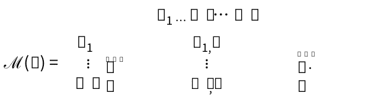

上面的矩阵只显示了第 $ k $ 列。因此，上面矩阵中每个显示的条目的第二个索引是 $ k $。上面的图像应该提醒你，可以通过将左列中每个条目与相应的 $ e_k $ 相乘，然后将得到的向量相加，从 $ \mathcal{M}(T) $ 计算 $ T $。

> 矩阵 $ \mathcal{M}(T) $ 的第 $ k $ 列由将 $ T e_k $ 写成 $ e_1, \dots, e_n $ 的线性组合所需的标量组成：
$$ T e_k = \sum_{i=1}^n a_{ik} e_i $$

如果 $ T $ 是从 $ \mathbb{R}^n $ 到 $ \mathbb{R}^m $ 的线性映射，那么除非另有说明，假设所讨论的基是标准基（其中第 $ i $ 个基向量在第 $ i $ 个位置上为 1，其他位置上为 0）。如果你认为将 $ \mathbb{R}^n $ 的元素看作 $ n $ 个数字的列，那么你可以将 $ \mathcal{M}(T) $ 的第 $ k $ 列看作 $ T $ 作用于第 $ k $ 个标准基向量的结果。

> 如果 $ T $ 是从一个 $ n $ 维向量空间到一个 $ m $ 维向量空间的线性映射，则 $ \mathcal{M}(T) $ 是一个 $ m $ 乘 $ n $ 矩阵。

### 3.32 例子：从 $ \mathbb{R}^2 $ 到 $ \mathbb{R}^3 $ 的线性映射的矩阵

假设 $ T \in \mathcal{L}(\mathbb{R}^2, \mathbb{R}^3) $ 由以下定义
```
T(u, v) = (u+3v, 2u+5v, 7u+9v)
```
因为 $ T(1, 0) = (1, 2, 7) $ 和 $ T(0, 1) = (3, 5, 9) $，所以关于标准基的 $ T $ 的矩阵是下面的 3 行 2 列矩阵:

| | | | |
|---|---|---|---|
| **1** | **3** | | |
| **2** | **5** | | |
| **7** | **9** | | |

在处理 $ P_3(\mathbb{R}) $ 时，请使用标准基 $ 1, x, x^2, \dots, x^n $，除非上下文另有说明。

### 3.33 例子：从 $ P_3(\mathbb{R}) $ 到 $ P_2(\mathbb{R}) $ 的微分映射的矩阵

假设 $ T \in \mathcal{L}(P_3(\mathbb{R}), P_2(\mathbb{R})) $ 是由 $ T(p) = p' $ 定义的微分映射。

因为 $ (x^n)' = n x^{n-1} $，关于标准基的 $ T $ 的矩阵如下所示：

| 0 | 1 | 0 | 0 |
|---|---|---|---|
| 0 | 0 | 2 | 0 |
| 0 | 0 | 0 | 3 |

## 矩阵的加法和标量乘法

在本节的其余部分中，假设 $ V, W $ 和 $ U $ 都是有限维的，并且已经为每个向量空间选择了一个基。因此，对于从 $ V $ 到 $ W $ 的每个线性映射，我们可以讨论它的矩阵（相对于所选择的基）。

两个线性映射的和的矩阵是否等于两个映射的矩阵的和？现在这个问题还没有意义，因为虽然我们已经定义了两个线性映射的和，但我们还没有定义两个矩阵的和。幸运的是，两个矩阵的和的自然定义具有正确的性质。具体来说，我们给出以下定义。

> **3.34 定义：矩阵加法**

两个相同大小的矩阵的和是通过将矩阵中对应的元素相加得到的矩阵：
$$ \begin{bmatrix} a_{1,1} & \cdots & a_{1,m} \\ \vdots & & \vdots \\ a_{n,1} & \cdots & a_{n,m} \end{bmatrix} + \begin{bmatrix} b_{1,1} & \cdots & b_{1,m} \\ \vdots & & \vdots \\ b_{n,1} & \cdots & b_{n,m} \end{bmatrix} = \begin{bmatrix} a_{1,1} + b_{1,1} & \cdots & a_{1,m} + b_{1,m} \\ \vdots & & \vdots \\ a_{n,1} + b_{n,1} & \cdots & a_{n,m} + b_{n,m} \end{bmatrix} $$

在下一个结果中，假设所有三个线性映射 $ T+S, T, S $ 使用相同的基底。

> **3.35 线性映射的和的矩阵**

假设 $ T, S \in \mathcal{L}(V, W) $. 那么 $ \mathcal{M}(T+S) = \mathcal{M}(T) + \mathcal{M}(S) $.

上述结果的验证可以通过定义得到，留给读者完成。

仍然假设我们有一些基底，一个标量乘以线性映射的矩阵是否等于标量乘以线性映射的矩阵？同样，这个问题还没有意义，因为我们还没有定义矩阵上的标量乘法。幸运的是，自然的定义再次具有正确的性质。

> **3.36 定义：矩阵的标量乘法**

标量与矩阵的乘积是通过将矩阵中的每个元素与标量相乘得到的矩阵：
$$ c \begin{bmatrix} a_{1,1} & \cdots & a_{1,m} \\ \vdots & & \vdots \\ a_{n,1} & \cdots & a_{n,m} \end{bmatrix} = \begin{bmatrix} c a_{1,1} & \cdots & c a_{1,m} \\ \vdots & & \vdots \\ c a_{n,1} & \cdots & c a_{n,m} \end{bmatrix} $$

## 72 第 3 章 线性映射

> **3.37 例子：矩阵的加法和标量乘法**

$ 2 \begin{pmatrix} 3 & 1 \\ -1 & 5 \end{pmatrix} + \begin{pmatrix} 4 & 2 \\ 1 & 6 \end{pmatrix} = \begin{pmatrix} 6 & 2 \\ -2 & 10 \end{pmatrix} + \begin{pmatrix} 4 & 2 \\ 1 & 6 \end{pmatrix} = \begin{pmatrix} 10 & 4 \\ -1 & 16 \end{pmatrix} $

在下一个结果中，假设线性映射 $ \phi $ 和 $ \psi $ 使用相同的基底。

> **3.38 标量乘以线性映射的矩阵**

假设 $ \phi \in \mathcal{L}(V, W) $ 和 $ c \in \mathbb{F} $。那么 $ \mathcal{M}(c\phi) = c \mathcal{M}(\phi) $。

上述结果的验证也留给读者。

因为矩阵的加法和标量乘法已经定义好了，所以当出现一个向量空间时，你不会感到惊讶。首先，我们引入一些符号，以便这个新的向量空间有一个名称，然后我们找到这个新的向量空间的维度。

> **3.39 表示法： $ \mathbb{F}^{m,n} $**

对于正整数 $ m $ 和 $ n $，所有元素在 $ \mathbb{F} $ 中的 $ m $ 行 $ \times $ $ n $ 列矩阵的集合用 $ \mathbb{F}^{m,n} $ 表示。

> **3.40 维数 $ \mathbb{F}^{m,n} = mn $**

假设 $ m $ 和 $ n $ 是正整数。通过上述定义的加法和标量乘法，$ \mathbb{F}^{m,n} $ 是一个维数为 $ mn $ 的向量空间。

证明留给读者验证 $ \mathbb{F}^{m,n} $ 是一个向量空间。注意 $ \mathbb{F}^{m,n} $ 的加法单位元是所有元素都等于 0 的 $ m $ 行 $ \times $ $ n $ 列矩阵。
读者还应验证具有不同 $ m $ 乘 $ n $ 矩阵的列表，除了一个条目中的 1 以外，所有条目都为 0，是 $ \mathbb{F}^{m,n} $ 的基础。有 $ mn $ 这样的矩阵，所以 $ \mathbb{F}^{m,n} $ 的维数等于 $ mn $。

## 矩阵乘法

假设，如前所述，$ v_1, \dots, v_n $ 是 $ V $ 的一组基，$ w_1, \dots, w_m $ 是 $ W $ 的一组基。还假设 $ u_1, \dots, u_p $ 是 $ U $ 的一组基。
考虑线性映射 $ \phi: U \to V $ 和 $ \psi: V \to W $。复合映射 $ \psi\phi $ 是从 $ U $ 到 $ W $ 的线性映射。是否 $ \mathcal{M}(\psi\phi) $ 等于 $ \mathcal{M}(\psi)\mathcal{M}(\phi) $？这个问题还没有意义，因为我们还没有定义两个矩阵的乘积。我们将选择一种矩阵乘法的定义，使得这个问题有一个肯定的答案。让我们看看如何做到这一点。

现在我们来看如何定义矩阵乘法，使得所需的方程 $ \mathcal{M}(\psi\phi) = \mathcal{M}(\psi)\mathcal{M}(\phi) $ 成立。

> **3.41 定义：矩阵乘法**

假设 $ A $ 是一个 $ m $ 行 $ n $ 列的矩阵，$ B $ 是一个 $ n $ 行 $ p $ 列的矩阵。那么 $ AB $ 被定义为一个 $ m $ 行 $ p $ 列的矩阵，其在第 $ i $ 行，第 $ j $ 列的元素由以下方程给出
$$ (AB)_{ij} = \sum_{k=1}^{n} A_{ik}B_{kj} $$
因此，$ C $ 在第 $ i $ 行，第 $ j $ 列的元素通过取 $ A $ 的第 $ i $ 行和 $ B $ 的第 $ j $ 列，对应元素相乘，然后求和计算得到。

请注意，我们只在第一个矩阵的列数等于第二个矩阵的行数时定义两个矩阵的乘积。

> 你可能在之前的课程中学过矩阵乘法的定义，尽管你可能没有看到这个动机。

### 3.42 例子：矩阵乘法

在这里，我们将一个 3 乘 2 矩阵和一个 2 乘 4 矩阵相乘，得到一个 3 乘 4 矩阵：

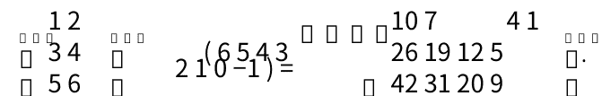

矩阵乘法不满足交换律——即使两个乘积都有定义，$ AB $ 不一定等于 $ BA $ （参见练习 10）。矩阵乘法满足分配律和结合律（参见练习 11 和 12）。

在下一个结果中，我们假设在考虑 $ \phi \in \mathcal{L}(U, V) $ 和 $ \psi \in \mathcal{L}(V, W) $ 时使用了相同的 $ V $ 基，在考虑 $ \phi \in \mathcal{L}(V, W) $ 和 $ \psi \in \mathcal{L}(W, Z) $ 时使用了相同的 $ W $ 基，在考虑 $ \phi \in \mathcal{L}(U, W) $ 和 $ \psi \in \mathcal{L}(W, Z) $ 时使用了相同的 $ W $ 基。

> ### 3.43 线性映射的乘积矩阵

如果 $ \phi \in \mathcal{L}(U, V) $ 和 $ \psi \in \mathcal{L}(V, W) $，那么 $ \mathcal{M}(\psi\phi) = \mathcal{M}(\psi)\mathcal{M}(\phi) $.

上述结果的证明是在矩阵乘法的定义之前进行的计算。

在下面的符号中，注意通常第一个索引表示行，第二个索引表示列，使用垂直居中的点作为占位符。

> ### 3.44 符号： $ A_{i,.} $ , $ A_{.,j} $

假设 $ A $ 是一个 $ m $ 行 $ n $ 列的矩阵。
- 如果 $ 1 \leq i \leq m $，那么 $ A_{i,.} $ 表示由 $ A $ 的第 $ i $ 行组成的 1 乘 $ n $ 矩阵。
- 如果 $ 1 \leq j \leq n $，那么 $ A_{.,j} $ 表示由 $ A $ 的第 $ j $ 列组成的 $ m $ 乘 1 矩阵。

> ### 3.45 例子： $ A_{i,.} $ 等于 $ A $ 的第 $ i $ 行，而 $ A_{.,j} $ 等于 $ A $ 的第 $ j $ 列

符号 $ A_{2,.} $ 表示 $ A $ 的第二行，而 $ A_{.,2} $ 表示 $ A $ 的第二列。
因此，如果 $ A = \begin{pmatrix} 8 & 4 & 5 & -3 \\ 1 & 9 & 7 \end{pmatrix} $，然后
$ A_{2,.} = (1, 9, 7) $ 和 $ A_{.,2} = (4, 9)^T $。

一个 1 乘以 $ n $ 矩阵和一个 $ n $ 乘以 1 矩阵的乘积是一个 1 乘以 1 矩阵。然而，我们经常将一个 1 乘以 1 矩阵与其元素等同起来。例如，
$$ \begin{pmatrix} 3 & 4 \end{pmatrix} \begin{pmatrix} 6 \\ 2 \end{pmatrix} = \begin{pmatrix} 26 \end{pmatrix} $$
因为 $ 3 \cdot 6 + 4 \cdot 2 = 26 $。然而，我们可以将 $ \begin{pmatrix} 26 \end{pmatrix} $ 与 26 等同起来，写作
$$ \begin{pmatrix} 3 & 4 \end{pmatrix} \begin{pmatrix} 6 \\ 2 \end{pmatrix} = 26 $$

下一个结果使用上面段落中讨论的约定，提供了另一种思考矩阵乘法的方式。例如，下一个结果和上面段落中的计算解释了为什么示例 3.42 中乘积的第 2 行，第 1 列的元素等于 26。

> ### 矩阵乘积的 3.46 入口等于行乘以列

假设 $ A $ 是一个 $ m $ 行 $ \times $ $ n $ 列的矩阵，$ B $ 是一个 $ n $ 行 $ \times $ $ q $ 列的矩阵。那么
$$ (AB)_{ij} = A_{i\cdot} \cdot B_{\cdot j} $$
如果 $ 1 \leq i \leq m $ 且 $ 1 \leq j \leq q $。换句话说，矩阵 $ AB $ 的第 $ i $ 行，第 $ j $ 列的入口等于 (矩阵 $ A $ 的第 $ i $ 行) 乘以 (矩阵 $ B $ 的第 $ j $ 列)。

证明假设 $ 1 \leq i \leq m $ 且 $ 1 \leq j \leq q $。矩阵乘法的定义是
$$ 3.47 \quad (AB)_{ij} = A_{i1}B_{1j} + \cdots + A_{in}B_{nj} $$
矩阵乘法的定义还暗示了，1 行 $ \times $ $ n $ 列的矩阵 $ A_{i\cdot} $ 和 $ m $ 行 $ \times $ 1 列的矩阵 $ B_{\cdot j} $ 的乘积是一个 1 行 $ \times $ 1 列的矩阵，其入口是上述等式右侧的数字。因此，矩阵 $ AB $ 的第 $ i $ 行，第 $ j $ 列的入口等于 (矩阵 $ A $ 的第 $ i $ 行) 乘以 (矩阵 $ B $ 的第 $ j $ 列)。

下一个结果提供了另一种思考矩阵乘法的方式。在下面的结果中，$ (AB)_{\cdot j} $ 是 $ AB $ 矩阵的第 $ j $ 列。因此，$ (AB)_{\cdot j} $ 是一个 $ m $ 行 1 列的矩阵。另外，$ A $ 是一个 $ m $ 行 $ n $ 列的矩阵，因为它是一个 $ m $ 行 $ n $ 列的矩阵和一个 $ n $ 行 1 列的矩阵的乘积。因此，在下面的结果中，方程的两边具有相同的大小，这使得它们可能相等。

> ### 3.48 矩阵乘积的列等于矩阵乘以列

假设 $ A $ 是一个 $ m $ 行 $ \times $ $ n $ 列的矩阵，$ B $ 是一个 $ n $ 行 $ \times $ $ k $ 列的矩阵。那么
$$ (AB)_{\cdot j} = A (B_{\cdot j}) $$
如果 $ 1 \leq j \leq k $。换句话说，矩阵 $ AB $ 的第 $ j $ 列等于矩阵 $ A $ 乘以矩阵 $ B $ 的第 $ j $ 列。

证明 如上所述，$ (AB)_{\cdot j} $ 和 $ A (B_{\cdot j}) $ 都是 $ m $ 行 1 列的矩阵。如果 $ 1 \leq i \leq m $，那么 $ (AB)_{ij} $ 的第 $ i $ 行是等式 3.47 的左边，而 $ A (B_{\cdot j}) $ 的第 $ i $ 行是等式 3.47 的右边。因此 $ (AB)_{\cdot j} = A (B_{\cdot j}) $。

我们的下一个结果将提供另一种思考一个 $ A $ 乘以 $ n $ 矩阵和一个 1 乘以 1 矩阵的乘积的方式，这是由下一个例子激发的。

> ### 3.49 例子：一个 3 乘以 2 矩阵和一个 2 乘以 1 矩阵的乘积

使用我们的定义和基本算术来验证
$$ \begin{pmatrix} 1 & 2 \\ 3 & 4 \\ 5 & 6 \end{pmatrix} \begin{pmatrix} 5 \\ 1 \end{pmatrix} = \begin{pmatrix} 7 \\ 19 \\ 31 \end{pmatrix} = 5 \begin{pmatrix} 1 \\ 3 \\ 5 \end{pmatrix} + 1 \begin{pmatrix} 2 \\ 4 \\ 6 \end{pmatrix} $$
因此，在这个例子中，一个 3 乘以 2 矩阵和一个 2 乘以 1 矩阵的乘积是一个列的线性组合，其中乘以列的标量 (5 和 1) 来自 2 乘以 1 矩阵。

## 3.50 列的线性组合

假设 $A$ 是一个 $m$ 行 $n$ 列矩阵，$x = \begin{bmatrix} x_1 \\ \vdots \\ x_n \end{bmatrix}$ 是一个 $n$ 行 1 列矩阵。那么 $Ax = x_1 A_{\cdot, 1} + \cdots + x_n A_{\cdot, n}$。

换句话说，$Ax$ 是 $A$ 的列的线性组合，其中乘以列的标量来自 $x$。

证明：如果 $j \in \{1, \cdots, m\}$，则矩阵乘法的定义意味着 $Ax$ 的第 $j$ 行的元素是 $[Ax]_{j, 1} = A_{j, 1}x_1 + \cdots + A_{j, n}x_n$。

第 $j$ 行的 $A_{j, 1}x_1 + \cdots + A_{j, n}x_n$ 的元素也等于上面显示的数字。因为 $Ax$ 和 $x_1 A_{\cdot, 1} + \cdots + x_n A_{\cdot, n}$ 对于每个行 $j \in \{1, \cdots, m\}$ 都有相同的元素，我们得出结论 $Ax = x_1 A_{\cdot, 1} + \cdots + x_n A_{\cdot, n}$。

我们之前的两个结果关注矩阵的列。类似的结果适用于矩阵的行。具体来说，参见练习 8 和 9，可以通过适当修改 3.48 和 3.50 的证明来证明。下一个结果是下一小节中用于证明列 - 行分解（3.56）和证明矩阵的列秩等于行秩（3.57）的主要工具。为了与通常在列 - 行分解中使用的符号一致，包括下一小节中使用的符号，下一个结果中的矩阵被称为 $A$ 和 $B$，而不是 $A$ 和 $x$。

## 3.51 矩阵乘法作为列的线性组合

假设 $A$ 是一个 $m$ 行 $n$ 列的矩阵，$B$ 是一个 $n$ 行 $p$ 列的矩阵。

(a) 如果 $j \in \{1, \cdots, p\}$，那么 $AB$ 的第 $j$ 列是 $A$ 的列的线性组合，其中线性组合的系数来自 $B$ 的第 $j$ 列。

(b) 如果 $i \in \{1, \cdots, m\}$，那么 $AB$ 的第 $i$ 行是 $B$ 的行的线性组合，其中线性组合的系数来自 $A$ 的第 $i$ 行。

证明：假设 $j \in \{1, \cdots, p\}$。那么 $AB$ 的第 $j$ 列等于 $A B_{\cdot, j}$ (根据 3.48)，这等于 $A$ 的列的线性组合，其中线性组合的系数来自 $B_{\cdot, j}$ (根据 3.50)。因此 (a) 成立。

为了证明 (b)，按照证明 (a) 的模式，但是使用行而不是列，并使用练习 8 和 9 而不是 3.48 和 3.50。

## 第 3C 节 矩阵

### 3.52 定义：列秩，行秩

假设 $A$ 是一个 $m$ 行 $n$ 列的矩阵，其元素在 $\mathbb{R}$ 中。

- 矩阵 $A$ 的列秩是 $A$ 的列的张成空间的维数，在 $\mathbb{R}^{m,1}$ 中。
- 矩阵 $A$ 的行秩是 $A$ 的行的张成空间的维数，在 $\mathbb{R}^{1,n}$ 中。

如果 $A$ 是一个 $m$ 行 $n$ 列的矩阵，则 $A$ 的列秩最多为 $m$（因为 $A$ 有 $m$ 列），而 $A$ 的列秩也最多为 $n$（因为维数 $\mathbb{R}^{m,1}=m$）。同样，$A$ 的行秩也最多为 $\min\{m, n\}$。

### 3.53 例子：列秩和行秩的一个 2 乘 4 矩阵

假设 $A = \begin{pmatrix} 4 & 7 & 1 & 8 \\ 3 & 5 & 2 & 9 \end{pmatrix}$。矩阵 $A$ 的列秩是 $\text{span}\{ (4, 3), (7, 5), (1, 2), (8, 9) \}$。

前两个向量中的任何一个都不是另一个的标量倍。因此，这个长度为四的向量列表的维数至少为两个。因此，这个列表的维数为二，这意味着矩阵 $A$ 的列秩为二。前两个向量中的任何一个都不是另一个的标量倍。因此，这个长度为二的向量列表的维数为二，这意味着矩阵 $A$ 的行秩为二。

### 3.54 定义：转置 $A^T$

矩阵 $A$ 的转置，表示为 $A^T$，是通过交换行和列得到的矩阵。具体来说，如果 $A$ 是一个 $m$ 行 $n$ 列的矩阵，则 $A^T$ 是一个 $n$ 行 $m$ 列的矩阵，其元素由以下方程给出

$$(A^T)_{ij} = A_{ji}$$

### 3.55 例子：矩阵的转置

```
M = 
 5 -7
 3  8
-4  2
```

则 $M^T = \begin{pmatrix} 5 & 3 & -4 \\ -7 & 8 & 2 \end{pmatrix}$。

请注意，这里 $M$ 是一个 3 行 2 列的矩阵，$M^T$ 是一个 2 行 3 列的矩阵。

转置具有良好的代数性质：$(A+B)^T = A^T+B^T$, $(A^T)^T = A$, 以及 $(A^T)^T = A$ 对于所有的 $m$ 行 $n$ 列的矩阵 $A$, $A \in \mathbb{R}^{m,n}$，以及所有的 $A$ 行 $\times$ 列的矩阵 $A$ (参见练习题 14 和 15)。

下一个结果将是证明列秩等于行秩的主要工具 (见 3.57)。

### 3.56 列 - 行分解

假设 $A$ 是一个 $m \times n$ 的矩阵，其元素在 $\mathbb{R}$ 中，列秩为 $r \ge 1$。那么存在一个 $m \times r$ 的矩阵 $C$ 和一个 $r \times n$ 的矩阵 $R$，它们的元素都在 $\mathbb{R}$ 中，使得 $A = CR$。

证明：$A$ 的每一列都是一个 $m \times 1$ 的矩阵。矩阵 $A$ 的列的列表 $c_1, \dots, c_n$ 可以被缩减为 $A$ 的列张成空间的一组基 (根据 2.30)。这个基的长度为 $r$，根据列秩的定义。这个基中的 $r$ 列可以组合成一个 $m \times r$ 的矩阵 $C$。

如果 $j \in \{1, \dots, n\}$，那么矩阵 $A$ 的第 $j$ 列是矩阵 $C$ 的列的线性组合。将这个线性组合的系数变成一个 $r$ 行 $n$ 列的矩阵，我们称之为 $R$。然后 $A = CR$，根据 3.51(a) 得到。

在例子 3.53 中，列秩和行秩相等。

下一个结果说明这对所有矩阵都成立。

### 3.57 列秩等于行秩

假设 $A \in \mathbb{R}^{m,n}$。那么 $A$ 的列秩等于 $A$ 的行秩。

证明：令 $r$ 表示 $A$ 的列秩。令 $A = CR$ 为由 3.56 给出的 $A$ 的列 - 行分解，其中 $C$ 是一个 $m$ 行 $r$ 列的矩阵，$R$ 是一个 $r$ 行 $n$ 列的矩阵。然后根据 3.51(b)，我们知道 $A$ 的每一行都是 $R$ 的行的线性组合。因为 $R$ 有 $r$ 行，这意味着 $A$ 的行秩小于等于 $A$ 的列秩 $r$。

为了证明不等式的另一个方向，应用前面段落中的结果到 $A^T$，得到

$$
\begin{aligned}
\text{矩阵 } A \text{ 的列秩} &= \text{矩阵 } A \text{ 的行秩} \\
&\le \text{矩阵 } A \text{ 的列秩} \\
&= \text{矩阵 } A \text{ 的行秩}
\end{aligned}
$$

因此，矩阵 $A$ 的列秩等于行秩。

由于列秩等于行秩，最后的结果使我们可以不使用“列秩”和“行秩”这些术语，而只使用更简单的术语“秩”。

### 3.58 定义：秩

矩阵 $T \in \mathcal{L}(V, W)$ 的秩是矩阵 $M$ 的列秩。

参见 3.133 和第 7A 节中的练习 8，以证明列秩等于行秩的替代证明。

## 练习 3C

- 1. 假设 $T \in \mathcal{L}(V, W)$。证明对于 $V$ 和 $W$ 的每个基的选择，$T$ 的矩阵至少有 $\dim \operatorname{range} T$ 个非零元素。

- 2. 假设 $V$ 和 $W$ 是有限维的，$T \in \mathcal{L}(V, W)$。证明如果且仅如果存在 $V$ 的一个基和 $W$ 的一个基，使得在这些基下，$\mathcal{M}(T)$ 的所有元素都等于 1，则 $\dim \operatorname{range} T = 1$。

- 3. 假设 $v_1, \dots, v_n$ 是 $V$ 的一个基，$w_1, \dots, w_m$ 是 $W$ 的一个基。
  - (a) 证明如果 $S, T \in \mathcal{L}(V, W)$，那么 $\mathcal{M}(S + T) = \mathcal{M}(S) + \mathcal{M}(T)$。
  - (b) 证明如果 $a \in F$ 和 $T \in \mathcal{L}(V, W)$，那么 $\mathcal{M}(aT) = a\mathcal{M}(T)$。
  这个练习要求你验证 3.35 和 3.38。

- 4. 假设 $T \in \mathcal{L}(\mathcal{P}_3(\mathbb{R}), \mathcal{P}_2(\mathbb{R}))$ 是由 $p \mapsto p'$ 定义的微分映射。找到 $\mathcal{P}_3(\mathbb{R})$ 和 $\mathcal{P}_2(\mathbb{R})$ 的基，使得关于这些基的 $T$ 的矩阵为

$$
\begin{bmatrix}
1 & 0 & 0 & 0 \\
0 & 1 & 0 & 0 \\
0 & 0 & 1 & 0
\end{bmatrix}
$$

与示例 3.33 进行比较。下一个练习将推广这个练习。

- 5. 假设 $V$ 和 $W$ 是有限维的，且 $T \in \mathcal{L}(V, W)$。证明存在 $V$ 的一组基和 $W$ 的一组基，使得相对于这些基，$\mathcal{M}(T)$ 的所有条目都是 0，除了行 $i$, 列 $j$ 中的条目等于 1，如果 $1 \le i \le \dim \operatorname{range} T$。

- 6. 假设 $v_1, \dots, v_n$ 是 $V$ 的一组基，$V$ 是有限维的。假设 $T \in \mathcal{L}(V, W)$。证明存在 $W$ 的一组基 $w_1, \dots, w_m$，使得 $\mathcal{M}(T)$ 的第一列的所有条目 [相对于基 $v_1, \dots, v_n$ 和 $w_1, \dots, w_m$] 都是 0，除了第一行第一列可能是 1。在这个练习中，与第 5 题不同，你已经给出了 $V$ 的基，而不是能够选择 $V$ 的基。

- 7. 假设 $u_1, \dots, u_m$ 是 $W$ 的一组基，$W$ 是有限维的。假设 $T \in \mathcal{L}(V, W)$。证明存在一组基 $v_1, \dots, v_n$ 使得 $\mathcal{M}(T)$ [相对于基 $v_1, \dots, v_n$ 和 $e_1, \dots, e_m$] 的第一行的所有元素都是 0，除了第一行第一列可能是 1。在这个练习中，与练习 5 不同，你已经给出了 $W$ 的基，而不是能够选择 $V$ 的基。

- 8. 假设 $A$ 是一个 $m$ 行 $n$ 列的矩阵，$B$ 是一个 $n$ 行 $p$ 列的矩阵。证明

$$
(AB)_{i.} = A_{i.} B
$$

对于每个 $1 \le i \le m$。换句话说，证明 $A$ 的第 $i$ 行等于 ($A$ 的第 $i$ 行) 乘以 $B$。

这个练习给出了 3.48 的行版本。

- 9. 假设 $u = (u_1 \cdots u_n)$ 是一个 $1$ 行 $n$ 列的矩阵，$A$ 是一个 $n$ 行 $p$ 列的矩阵。证明

$$
uA = u_1 A_{1.} + \cdots + u_n A_{n.}
$$

换句话说，证明 $uA$ 是 $A$ 的行的线性组合，其中乘以行的标量来自 $u$。

这个练习给出了 3.50 的行版本。

- 10. 给出一个例子，使得 2 乘以 2 矩阵 $A$ 和 $B$ 满足 $AB \neq BA$。

- 11. 证明矩阵加法和矩阵乘法满足分配律。换句话说，假设 $A, B, C$ 是矩阵，其大小使得 $A(B+C)$ 和 $(A+B)C$ 有意义。解释为什么 $A(B+C)$ 和 $(A+B)C$ 都有意义，并证明

$$
A(B+C) = AB + AC \text{ 并且 } (A+B)C = AC + BC
$$

- 12. 证明矩阵乘法是结合的。换句话说，假设 $A, B, C$ 是矩阵，其大小使得 $(AB)C$ 有意义。解释为什么 $A(BC)$ 有意义并证明

$$
(AB)C = A(BC).
$$

尝试找到一个简洁的证明，说明 Emil Artin 的以下引述：“根据我的经验，涉及矩阵的证明可以缩短 50%，如果将矩阵排除在外。”

- 13. 假设 $A$ 是一个 $n$ 乘 $n$ 的矩阵，且 $1 \le i, j \le n$。证明 $A^3$ (定义为 $AAA$) 中的第 $i$ 行，第 $j$ 列的元素是

$$
\sum_{k=1}^n \sum_{l=1}^n A_{ik} A_{kl} A_{lj}.
$$

- 14. 假设 $m$ 和 $n$ 是正整数。证明函数 $A \mapsto A^T$ 是从 $M_{m,n}$ 到 $M_{n,m}$ 的线性映射。

- 15. 证明如果 $A$ 是一个 $m$ 行 $n$ 列的矩阵，$B$ 是一个 $n$ 行 $p$ 列的矩阵，那么 $(AB)^T = B^T A^T$。

- 16. 假设 $A$ 是一个 $m$ 行 $n$ 列的矩阵，且 $A \neq 0$。证明如果 $A$ 的秩为 1，则存在 $(u_1, \dots, u_m) \in \mathbb{R}^m$ 和 $(v_1, \dots, v_n) \in \mathbb{R}^n$，使得对于每个 $i = 1, \dots, m$ 和每个 $j = 1, \dots, n$，都有 $A_{ij} = u_i v_j$。

- 17. 假设 $T \in \mathcal{L}(V)$，且 $v_1, \dots, v_n$ 和 $u_1, \dots, u_m$ 是 $V$ 的基。证明以下命题等价。
  - (a) $T$ 是单射。
  - (b) 矩阵 $M(T)$ 的列在 $\mathbb{F}^m, \mathbb{F}^n$ 中线性无关。
  - (c) 矩阵 $M(T)$ 的列张成 $\mathbb{F}^m, \mathbb{F}^n$。
  - (d) 矩阵 $M(T)$ 的行张成 $\mathbb{F}^n, \mathbb{F}^m$。
  - (e) 矩阵 $M(T)$ 的行在 $\mathbb{F}^n, \mathbb{F}^m$ 中线性无关。

这里 $M(T)$ 表示 $M(T, (v_1, \dots, v_n), (u_1, \dots, u_m))$。

## 3D 可逆性和同构

### 可逆线性映射

我们从线性映射的角度定义可逆和逆的概念。

### 3.59 定义：可逆，逆

- 对于线性映射 $T \in \mathcal{L}(V, V)$，如果存在一个线性映射 $S \in \mathcal{L}(V, V)$ 使得 $TS$ 在 $V$ 上等于单位算子，并且 $ST$ 在 $V$ 上等于单位算子，则称 $T$ 是可逆的。
- 一个线性映射 $S \in \mathcal{L}(V, V)$ 满足 $TS = I$ 和 $ST = I$ 被称为 $T$ 的逆（注意第一个 $I$ 是 $V$ 上的单位算子，第二个 $I$ 是 $V$ 上的单位算子）。

上面的定义提到了“一个逆”。然而，下一个结果表明我们可以将这个术语改为“逆”。

### 3.60 逆是唯一的

可逆线性映射有唯一的逆。

证明：假设 $T \in \mathcal{L}(V, V)$ 是可逆的，$T_1$ 和 $T_2$ 是 $T$ 的逆。那么

$$T_1 = T_1 I = T_1 (T T_2) = (T_1 T) T_2 = I T_2 = T_2.$$

因此 $T_1 = T_2$。

现在我们知道逆矩阵是唯一的，我们可以给它一个符号表示。

### 3.61 符号表示：$T^{-1}$

如果 $T$ 是可逆的，那么它的逆矩阵用 $T^{-1}$ 表示。换句话说，如果 $T \in \mathcal{L}(V, V)$ 是可逆的，那么 $T^{-1}$ 是 $\mathcal{L}(V, V)$ 中的唯一元素，满足 $T^{-1}T = I$ 和 $TT^{-1} = I$。

### 3.62 例子：从 $\mathbb{R}^3$ 到 $\mathbb{R}^3$ 的线性映射的逆矩阵

假设 $T \in \mathcal{L}(\mathbb{R}^3)$ 由 $T(1, 0, 0) = (-1, 0, 4)$ 定义。因此 $T$ 是一个在 $xy$ 平面上逆时针旋转 90° 并且在 $z$ 轴方向上以因子 4 进行拉伸的线性映射。

因此，逆映射 $T^{-1} \in \mathcal{L}(\mathbb{R}^3)$ 是在 $xy$ 平面上的顺时针旋转 90° 和一个因子为 1/4 的拉伸在 $z$-轴方向上：

$$T^{-1}(1, 0, 0) = (1, -1, 1/4 \times 0).$$

下一个结果表明，线性映射是可逆的当且仅当它是一对一和到一的。

### 3.63 可逆性，单射性和满射性

线性映射是可逆的当且仅当它是单射和满射的。

证明：假设 $T \in \mathcal{L}(V, V)$。我们需要证明 $T$ 是可逆的当且仅当它是单射和满射的。

首先假设 $T$ 是可逆的。为了证明 $T$ 是单射的，假设 $v, w \in V$ 且 $T v = T w$ 然后

$$T^{-1}(T w) = T^{-1}(T v) = v,$$

所以 $v = w$。因此 $T$ 是单射。

我们仍然假设 $T$ 是可逆的。现在我们想证明 $T$ 是满射。为了做到这一点，让 $x \in V$。然后 $x = T(T^{-1}x)$，这表明 $x$ 在 $T$ 的值域内。因此，值域 $T = V$。因此 $T$ 是满射，完成了证明的这一方向。

现在假设 $T$ 是单射和满射。我们想证明 $T$ 是可逆的。

对于每个 $v \in V$，定义 $T^{-1}(v)$ 为 $T$ 中的唯一元素，使得 $T(T^{-1}(v)) = v$ (这样的元素的存在和唯一性来自于 $T$ 的满射性和单射性)。定义 $T^{-1}$ 意味着 $T \cdot T^{-1}$ 等于单位算子在 $V$ 上。

为了证明 $T \cdot T^{-1}$ 等于 $V$ 上的单位算子，令 $v \in V$。那么

$$T((T \cdot T^{-1})v) = (T \cdot T^{-1})(T v) = T(T v) = v$$

这个方程意味着 $(T \cdot T^{-1})v = v$ (因为 $T$ 是单射的)。因此 $T \cdot T^{-1}$ 等于 $V$ 上的单位算子。

为了完成证明，我们需要展示 $T$ 是线性的。为了做到这一点，假设 $v_1, v_2 \in V$。那么

$$T(T^{-1}(v_1) + T^{-1}(v_2)) = T(T^{-1}(v_1)) + T(T^{-1}(v_2)) = v_1 + v_2.$$

因此 $T^{-1}(v_1) + T^{-1}(v_2)$ 是 $T$ 中映射到 $v_1 + v_2$ 的唯一元素。根据 $T^{-1}$ 的定义，这意味着 $T^{-1}(v_1 + v_2) = T^{-1}(v_1) + T^{-1}(v_2)$。因此 $T^{-1}$ 满足线性所需的可加性。

同样，齐性的证明类似。具体来说，如果 $\alpha \in \mathbb{F}$ 且 $v \in V$，那么

$$T(\alpha T^{-1}(v)) = \alpha T(T^{-1}(v)) = \alpha v$$

因此 $\alpha T^{-1}(v)$ 是 $T$ 中映射到 $\alpha v$ 的唯一元素。根据 $T^{-1}$ 的定义，这意味着 $T^{-1}(\alpha v) = \alpha T^{-1}(v)$。因此 $T^{-1}$ 是线性的，正如所期望的那样。

对于从一个向量空间到自身的线性映射，你可能想知道仅仅具有单射性或满射性是否足以暗示可逆性。在无限维向量空间中，仅仅满足其中一个条件并不能暗示可逆性，正如下一个例子所示，该例子使用了来自 3.3 的两个熟悉的线性映射。

### 3.64 例子：既不具有单射性也不具有满射性暗示可逆性

根据上面的例子，下一个结果是非凡的——它表明对于从有限维向量空间到相同维度的向量空间的线性映射，单射性或满射性中的任一条件都意味着另一个条件。

请注意，在下面的假设中，$\dim V = \dim W$ 在重要的特殊情况下自动满足，其中 $V$ 是有限维的且 $V = W$。

### 3.65 单射性等价于满射性（如果 $\dim V = \dim W < \infty$）

假设 $V$ 和 $W$ 是有限维向量空间，$V$ 的维数 = $W$ 的维数，且 $T \in \mathcal{L}(V, W)$。那么

$$T \text{ 是可逆的} \iff T \text{ 是单射的} \iff T \text{ 是满射的}$$

证明：线性映射的基本定理（3.21）表明

$$3.66 \quad \dim V = \dim \operatorname{null} T + \dim \operatorname{range} T.$$

如果 $T$ 是单射的（根据 3.15 等价于条件 $\operatorname{null} T$ 的维数 = 0），那么上述方程意味着

$$\dim \operatorname{range} T = \dim V - \dim \operatorname{null} T = \dim W = \dim V,$$

这意味着 $T$ 是满射的（根据 2.39）。

反之，如果 $T$ 是满射的，那么根据 3.66，意味着

$$\dim \operatorname{null} T = \dim V - \dim \operatorname{range} T = \dim V - \dim V = 0,$$

这意味着 $T$ 是单射的。

因此我们已经证明了 $T$ 是单射的当且仅当 $T$ 是满射的。因此如果 $T$ 是单射或满射，那么 $T$ 既是单射又是满射，这意味着 $T$ 是可逆的。因此 $T$ 是可逆的当且仅当 $T$ 是单射的当且仅当 $T$ 是满射的。

下一个例子说明了前面结果的威力。虽然在下面的例子中可以不使用线性代数来证明结果，但使用线性代数的证明更简洁、更容易。

## 3.67 例子

存在一个多项式 $p$，使得 $((p^2 + 5p + 7)p)'' = p$。

## 线性映射

$p \mapsto ((p^2 + 5p + 7)p)''$

从 $P(\mathbb{R})$ 到自身的映射是单射的，你可以证明。因此，我们倾向于使用 3.65 来证明这个映射是满射的。然而，例子 3.64 表明 3.65 的效力不适用于无限维向量空间 $P(\mathbb{R})$。我们将通过将注意力限制在有限维向量空间 $P_0(\mathbb{R})$ 上来解决这个问题。

假设 $p \in P(\mathbb{R})$。存在一个非负整数 $n$，使得 $p \in P_n(\mathbb{R})$。

定义 $S : P_0(\mathbb{R}) \to P_0(\mathbb{R})$ 为

$$
S p = ((p^2 + 5p + 7)p)''.
$$

将非零多项式乘以 $(p^2 + 5p + 7)$ 会使度数增加 2，然后对其进行两次求导会使度数减少 2。因此 $S$ 确实是从 $P_0(\mathbb{R})$ 到自身的线性映射。

每个二阶导数等于 0 的多项式都可以写成 $ap + b$ 的形式，其中 $a, b \in \mathbb{R}$。因此 $null S = \{0\}$。因此 $S$ 是单射的。

因此 $S$ 是满射（根据 3.65），这意味着存在一个多项式 $p \in P_0(\mathbb{R})$，使得 $((p^2 + 5p + 7)p)'' = p$，正如本例的标题所述。

第 6A 节中的练习 35 给出了一个类似但更引人注目的例子，使用了 3.65。

下面的结果中的假设 $\dim U = \dim W$ 在重要的特殊情况下成立，即 $U$ 是有限维的且 $U = W$。因此，在这种情况下，方程 $ST = I$ 意味着 $TS = I$，即使我们没有从 $V$ 到 $W$ 的任意线性映射的乘法交换性。

> ### 3.68 $ST = I \iff TS = I$（在维数相同的向量空间上）

假设 $U$ 和 $W$ 是维数相同的有限维向量空间，$T \in \mathcal{L}(U, W)$，且 $S \in \mathcal{L}(W, U)$。那么，当且仅当 $ST = I$ 时，$TS = I$。

证明 首先假设 $ST = I$。如果 $u \in U$ 且 $Tu = 0$，则

$$
u = Su = (TS)u = T(Su) = T(0) = 0.
$$

因此 $T$ 是单射（根据 3.15）。由于 $U$ 和 $W$ 具有相同的维度，这意味着 $T$ 是可逆的（根据 3.65）。

现在将等式 $ST = I$ 两边都乘以 $S^{-1}$，得到

$$
T = S^{-1}.
$$

因此 $TS = S S^{-1} = I$，如所需。

要证明另一个方向的蕴含，只需在我们已经证明的方向中颠倒 $U$ 和 $W$（以及 $T$ 和 $S$），从而证明如果 $TS = I$，则 $ST = I$。

## 同构向量空间

下一个定义捕捉了两个向量空间本质上相同的概念，除了它们元素的名称不同。

> ### 3.69 定义：同构，同构的
> - 同构是一个可逆线性映射。
> - 如果存在一个从一个向量空间到另一个向量空间的同构映射，则称这两个向量空间为同构的。

将同构映射 $T: V \to W$ 视为将向量 $v \in V$ 重新标记为 $w \in W$。这个观点解释了为什么两个同构的向量空间具有相同的向量空间属性。术语“同构”和“可逆线性映射”意思相同。当你想强调这两个空间本质上相同时，请使用“同构”。

确定两个数学结构（如群或拓扑空间）是否本质上相同，仅在底层集合的元素名称不同，可能很困难。然而，下一个结果表明我们只需要查看一个数（维度）就可以确定两个向量空间是否同构。

> ### 3.70 维数显示向量空间是否同构

如果两个有限维向量空间在 $F$ 上同构，则它们具有相同的维数。

证明 首先假设 $U$ 和 $W$ 是同构的有限维向量空间。因此存在一个从 $U$ 到 $W$ 的同构映射 $T$。由于 $T$ 是可逆的，我们有零空间 $null T = \{0\}$ 和值域 $range T = W$。因此

零空间的维数 $null dim T = 0$ 和值域的维数 $range dim T = \dim W$。

### 公式

$$
\dim U = \text{零空间的维数} + \text{值域的维数}
$$
(线性映射的基本定理，即 3.21）因此成为方程
$\dim U = \dim W$，从而完成了证明。

为了证明另一个方向，假设 $U$ 和 $W$ 是具有相同维度的有限维向量空间。设 $v_1, \dots, v_n$ 是 $U$ 的一组基，$w_1, \dots, w_n$ 是 $W$ 的一组基。设 $T \in L(U, W)$ 是由以下方式定义的。

$$
T(v_1 u_1 + \dots + v_n u_n) = w_1 u_1 + \dots + w_n u_n.
$$

由于 $v_1, \dots, v_n$ 是 $U$ 的一组基，所以 $T$ 是一个良定义的线性映射。此外，$T$ 是满射，因为 $w_1, \dots, w_n$ 张成 $W$。此外，$null T = \{0\}$ 因为 $v_1, \dots, v_n$ 线性无关。因此，$T$ 是单射。因为 $T$ 是单射且满射，它是一个同构映射（见 3.63）。因此，$U$ 和 $W$ 是同构的。

前面的结果意味着每个有限维向量空间 $F^n$ 同构于 $F^n$，其中 $n = \dim V$。例如，如果 $k$ 是非负整数，那么 $F^k$ 同构于 $F^{k+1}$。

> 每个有限维向量空间都同构于某个 $F^n$。那么为什么不直接学习 $F^n$，而不是更一般的向量空间呢？为了回答这个问题，注意到对 $F^n$ 的研究很快会导致其他向量空间。

回想一下，记号 $M^{m,n}$ 表示具有 $m$ 行 $n$ 列的矩阵，其元素属于 $F$。如果 $B_1, \dots, B_n$ 是 $U$ 的一组基且 $C_1, \dots, C_m$ 是 $W$ 的一组基，则对于每个 $T \in L(U, W)$，我们有一个矩阵 $M(T) \in F^{m,n}$。因此，一旦为 $U$ 和 $W$ 确定了基，$M$ 就成为了一个从 $L(U, W)$ 到 $F^{m,n}$ 的函数。注意 3.35 和 3.38 表明 $M$ 是一个线性映射。这个线性映射实际上是一个同构映射，我们现在来证明。

> 例如，我们会遇到线性映射的零空间和值域。
> 尽管每个这些向量空间都同构于某个 $F^n$，但将它们视为这种方式通常会增加复杂性，但不会带来新的见解。

> ### 3.71 $L(U, W)$ 和 $F^{n, m}$ 是同构的

假设 $B_1, \dots, B_n$ 是 $U$ 的一组基，$C_1, \dots, C_m$ 是 $W$ 的一组基。那么 $M$ 是 $L(U, W)$ 和 $F^{n, m}$ 之间的同构。

证明 我们已经注意到 $M$ 是线性的。我们需要证明 $M$ 是单射和满射。

我们从单射性开始。如果 $T \in L(U, W)$ 且 $M(T) = 0$，则对于每个 $j = 1, \dots, n$，有 $T(b_j) = 0$。因为 $b_1, \dots, b_n$ 是 $U$ 的一组基，这意味着 $T = 0$。因此 $M$ 是单射的（根据 3.15）。

为了证明 $M$ 是满射，假设 $A \in F^{n, m}$。根据线性映射引理 (3.4)，存在 $T \in L(U, W)$ 使得

$$
M(T) = A
$$

对于每个 $j = 1, \dots, n$。因为 $M(T)$ 等于 $A$，所以 $M$ 的值域等于 $F^{n, m}$，如所需。

现在我们可以确定从一个有限维向量空间到另一个的线性映射的向量空间的维度。

> ### 3.72 维度 $L(U, W) = (\dim U)(\dim W)$

假设 $U$ 和 $W$ 是有限维的。那么 $L(U, W)$ 是有限维的，并且

$$
\dim L(U, W) = (\dim U)(\dim W).
$$

证明 所需结果由 3.71、3.70 和 3.40 得出。

## 线性映射视为矩阵乘法

之前我们定义了线性映射的矩阵。现在我们定义了一个向量的矩阵。

> ### 3.73 定义：向量的矩阵，$\mathcal{M}(v)$

假设 $v \in V$ 且 $e_1, \dots, e_n$ 是 $V$ 的一组基。这个基下 $v$ 的矩阵是一个 $n$ 行 1 列的矩阵

$$
\mathcal{M}(v) = \begin{bmatrix} v_1 \\ \vdots \\ v_n \end{bmatrix},
$$

其中 $v_1, \dots, v_n$ 是标量，满足 $v = v_1 e_1 + \dots + v_n e_n$。

向量 $v \in V$ 的矩阵 $\mathcal{M}(v)$ 取决于 $V$ 的基 $e_1, \dots, e_n$，以及 $v$。然而，基础应该在上下文中清楚，因此不包含在符号中。

> ### 3.74 例子：向量的矩阵
> - 多项式 $2 - 7x + 5x^3 + x^4$ 相对于标准基的矩阵
> 基于 $P_4(\mathbb{R})$ 是
> $$
> \begin{bmatrix} 2 \\ -7 \\ 0 \\ 5 \\ 1 \end{bmatrix}.
> $$
> - 向量 $v \in \mathbb{R}^n$ 相对于标准基的矩阵是通过将 $v$ 的坐标写成一个 $n$ 乘 1 矩阵的条目。换句话说，如果 $v = (v_1, \dots, v_n) \in \mathbb{R}^n$，那么
> $$
> \mathcal{M}(v) = \begin{bmatrix} v_1 \\ \vdots \\ v_n \end{bmatrix}.
> $$

有时我们希望将 $v$ 的元素视为重新标记为 $n$ 乘 1 矩阵。一旦选择了基 $e_1, \dots, e_n$，将 $v \in V$ 映射到函数 $\mathcal{M}$ 上 $\mathcal{M}(v)$ 是 $V$ 到 $F^n$ 的同构，实现了这种重新标记。

回想一下，如果 $A$ 是一个 $m$ 行 $\times n$ 列的矩阵，那么 $A_{\cdot, j}$ 表示 $A$ 的第 $j$ 列，可以看作是一个 $m$ 行 $\times 1$ 列的矩阵。在下一个结果中，关于基 $e_1, \dots, e_n$ 的基下，计算 $\mathcal{M}(Av)$。

## 第 3D 节 可逆性和同构

### 3.75 $\mathcal{M}(T)_{\cdot, i} = \mathcal{M}(T e_i)$

假设 $T \in \mathcal{L}(V, W)$，$v_1, \dots, v_n$ 是 $V$ 的一个基，$w_1, \dots, w_m$ 是 $W$ 的一个基。$1 \leqslant i \leqslant n$. 那么 $\mathcal{M}(T)$ 的第 $i$ 列，用 $\mathcal{M}(T)_{\cdot, i}$ 表示，等于 $\mathcal{M}(T v_i)$。

证明 所需结果立即从 $\mathcal{M}(T)$ 和 $\mathcal{M}(T v_i)$ 的定义中得出。

下一个结果展示了线性映射的矩阵、向量的矩阵和矩阵乘法的概念如何相互关联。

### 3.76 线性映射的作用类似矩阵乘法

假设 $T \in \mathcal{L}(V, W)$ 且 $v \in V$。假设 $v_1, \dots, v_n$ 是 $V$ 的一组基，$w_1, \dots, w_m$ 是 $W$ 的一组基。那么

$$
\mathcal{M}(Tv) = \mathcal{M}(T)\mathcal{M}(v).
$$

证明 假设 $v = v_1 x_1 + \cdots + v_n x_n$，其中 $x_1, \dots, x_n \in F$. 因此

### 3.77

$$
Tv = x_1 Tv_1 + \cdots + x_n Tv_n
$$

因此

$$
\mathcal{M}(Tv) = x_1 \mathcal{M}(T v_1) + \cdots + x_n \mathcal{M}(T v_n)
$$

$$
= x_1 \mathcal{M}(T)_{\cdot, 1} + \cdots + x_n \mathcal{M}(T)_{\cdot, n}
$$

$$
= \mathcal{M}(T)\mathcal{M}(v),
$$

第一个等式来自于 3.77 和 $\mathcal{M}$ 的线性性质，第二个等式来自于 3.75，最后一个等式来自于 3.50。

每个 $m$ 行 $\times n$ 列的矩阵 $A$ 都会引出一个从 $F^{n,1}$ 到 $F^{m,1}$ 的线性映射，即矩阵乘法函数，它将 $x \in F^{n,1}$ 映射为 $Ax \in F^{m,1}$. 上述结果可以用来将每个线性映射（从一个有限维向量空间到另一个有限维向量空间）视为经过适当重标记后的矩阵乘法映射，通过 $\mathcal{M}$ 给出的同构。具体来说，如果 $T \in \mathcal{L}(V, W)$ 并且我们将 $v \in V$ 与 $\mathcal{M}(v) \in F^{n,1}$ 等同起来，那么上述结果表明我们可以将 $Tv$ 与 $\mathcal{M}(T)\mathcal{M}(v)$ 等同起来。

因为上面的结果允许我们通过同构来将每个线性映射视为乘以某个矩阵 $A$ 在 $F^{n,1}$ 上的 $F^{n,1}$，要记住具体的矩阵 $A$ 不仅取决于线性映射，还取决于基的选择。在后面的章节中，许多重要结果的一个主题将是选择一个使矩阵 $A$ 尽可能简单的基。

在本书中，我们专注于线性映射而不是矩阵。然而，有时将线性映射视为矩阵（或将矩阵视为线性映射）会给我们带来重要的见解。

请注意，在下一个结果的陈述中没有出现基。尽管下一个结果中的 $\mathcal{M}(T)$ 取决于 $V$ 和 $W$ 的基的选择，但下一个结果表明 $\mathcal{M}(T)$ 的列秩对所有这样的选择都是相同的（因为 $T$ 的值域不依赖于基的选择）。

### 3.78 维度等于 $T$ 的值域的列秩 $\mathcal{M}(T)$

> 假设 $V$ 和 $W$ 是有限维的，且 $T \in \mathcal{L}(V, W)$。那么 $T$ 的值域的维度等于 $\mathcal{M}(T)$ 的列秩。

证明 假设 $v_1, \dots, v_p$ 是 $V$ 的一组基，$w_1, \dots, w_q$ 是 $W$ 的一组基。将 $v \in V$ 映射为 $\mathcal{M}(v)$ 的线性映射是从 $V$ 到 $F^{p,1}$ 的空间的同构。将这个同构映射限制在 $T$ 的值域上 [根据 3B 节的练习 10，它等于 span($T v_1, \dots, T v_q$)]，得到从 $T$ 的值域到 span($\mathcal{M}(T w_1), \dots, \mathcal{M}(T w_q)$) 的同构。对于每个 $j \in \{1, \dots, q\}$，矩阵 $\mathcal{M}(T w_j)$ 等于 $\mathcal{M}(T)$ 的第 $j$ 列。因此，$T$ 的值域的维度等于 $\mathcal{M}(T)$ 的列秩，如所需。

## 基底变换

在第 3C 节中，我们定义了矩阵

$$
\mathcal{M}(T, (v_1, \dots, v_p), (w_1, \dots, w_q))
$$

线性映射 $T$ 从 $V$ 到可能不同的向量空间 $W$ 的矩阵表示，其中 $v_1, \dots, v_p$ 是 $V$ 的一个基，$w_1, \dots, w_q$ 是 $W$ 的一个基。对于从一个向量空间到自身的线性映射，我们通常在定义域向量空间和目标向量空间上使用相同的基。当在这两个方面使用相同的基时，我们通常只写一次基。换句话说，如果 $T \in \mathcal{L}(V)$ 且 $v_1, \dots, v_p$ 是 $V$ 的一个基，那么记号 $\mathcal{M}(T, (v_1, \dots, v_p))$ 由以下等式定义

$$
\mathcal{M}(T, (v_1, \dots, v_p)) = \mathcal{M}(T, (v_1, \dots, v_p), (v_1, \dots, v_p)).
$$

如果基底 $v_1, \dots, v_p$ 在上下文中清楚，那么我们可以只写 $\mathcal{M}(T)$。

### 3.79 定义：单位矩阵，I

假设 $n$ 是一个正整数。那么 $n$ 乘 $n$ 矩阵

$$
\begin{array}{ccccccccc}
 & & 1 & & & 0 & & & \\
 & \vdots & \vdots & & \vdots & \vdots & \vdots & & \\
1 & \square & \square & & \square & \square & \square & & \\
 & & 0 & & & 1 & \square & & \\
\end{array}
$$

对角线上有 1 的矩阵（行号等于列号的元素），其他位置上为 0 的矩阵被称为单位矩阵，用 $I$ 表示。

在上述定义中，矩阵左下角的 0 表示对角线以下的所有元素都为 0，矩阵右上角的 0 表示对角线以上的所有元素都为 0。

对于 $V$ 的每个基底，单位算子 $I \in \mathcal{L}(V)$ 的矩阵是单位矩阵 $I$。注意，符号 $I$ 既用于表示单位算子又用于表示单位矩阵。上下文表明了 $I$ 的意义。例如，考虑方程 $\mathcal{M}(I) = I$；方程左边的 $I$ 表示单位算子，而方程右边的 $I$ 表示单位矩阵。

如果 $Q$ 是一个与 $I$ (通常情况下，其元素为 0) 大小相同的方阵，则 $QI = IQ = Q$，你应该验证一下。

> ### 3.80 定义：可逆，逆，$Q^{-1}$

如果存在一个与 $Q$ 大小相同的方阵 $P$，使得 $QP = PQ = I$，则称方阵 $Q$ 为可逆矩阵；我们将其逆矩阵 $P$ 表示为 $Q^{-1}$。

与 3.60 中使用的证明相同，如果 $Q$ 是一个可逆方阵，则存在一个唯一的矩阵 $P$，使得 $QP = PQ = I$（因此，记号 $P = Q^{-1}$ 是合理的）。

> 一些数学家使用非奇异和奇异这两个术语，它们与可逆和非可逆是相同的意思。

如果 $Q$ 是一个可逆矩阵，那么 $(Q^{-1})^{-1} = Q$ 因为

$$
Q^{-1}Q = QQ^{-1} = I.
$$

另外，如果 $P$ 和 $Q$ 是相同大小的可逆方阵，那么 $PQ$ 是可逆的，并且 $(PQ)^{-1} = Q^{-1}P^{-1}$ 因为

$$
\begin{aligned}
(PQ)(Q^{-1}P^{-1}) &= P(QQ^{-1})P^{-1} \\
&= PIP^{-1} \\
&= PP^{-1} \\
&= I,
\end{aligned}
$$

同样地 $(Q^{-1}P^{-1})(PQ) = I$。

下一个结果成立是因为我们定义了矩阵乘法使其成为真实的——参见 3.43 和前面的材料。现在我们只是更明确地说明了所涉及的基础知识。

> ### 3.81 线性映射的乘积矩阵

假设 $T \in \mathcal{L}(V, W)$ 并且 $S \in \mathcal{L}(W, U)$。如果 $v_1, \dots, v_n$ 是 $V$ 的一组基，$w_1, \dots, w_m$ 是 $W$ 的一组基，$u_1, \dots, u_k$ 是 $U$ 的一组基，那么
$$
\mathcal{M}(ST, (v_1, \dots, v_n), (u_1, \dots, u_k)) = \mathcal{M}(S, (w_1, \dots, w_m), (u_1, \dots, u_k)) \mathcal{M}(T, (v_1, \dots, v_n), (w_1, \dots, w_m)).
$$

## 3.82 恒等算子相对于两个基底的矩阵

下一个结果涉及到恒等算子 $I$ 相对于两个不同的基底。注意 $\mathcal{M}(I, (v_1, \dots, v_n), (v'_1, \dots, v'_n))$ 的列由需要用来将 $v'_i$ 写成基底 $v_1, \dots, v_n$ 的标量组成。

在下一个结果的陈述中，$I$ 表示从 $V$ 到 $V$ 的恒等算子。在证明中，$I$ 也表示 $\mathbb{R}$ 乘 $\mathbb{R}$ 的单位矩阵。

### 3.82 恒等算子相对于两个基底的矩阵

假设 $v_1, \dots, v_n$ 和 $v'_1, \dots, v'_n$ 是 $V$ 的基。那么矩阵

$$ \mathcal{M}(I, (v_1, \dots, v_n), (v'_1, \dots, v'_n)) \quad \text{和} \quad \mathcal{M}(I, (v'_1, \dots, v'_n), (v_1, \dots, v_n)) $$

是可逆的，并且彼此互为逆矩阵。

证明在 3.81 中，将 $v_n$ 替换为 $v'_n$，并将 $T$ 和 $T'$ 替换为 $I$，得到

$$ I = \mathcal{M}(I, (v_1, \dots, v_n), (v_1, \dots, v_n)) \, \mathcal{M}(I, (v_1, \dots, v'_n), (v_1, \dots, v'_n)). $$

现在交换 $v$ 和 $v'$ 的角色，得到

$$ I = \mathcal{M}(I, (v_1, \dots, v'_n), (v_1, \dots, v_n)) \, \mathcal{M}(I, (v_1, \dots, v_n), (v_1, \dots, v'_n)). $$

上述两个方程给出了所需的结果。

### 3.83 例子：$\mathbb{R}^2$ 上的单位矩阵的矩阵

考虑基底 $(4, 2), (5, 3)$ 和 $(1, 0), (0, 1)$ 为 $\mathbb{R}^2$ 的基。因为 $I(4,2) = 4(1,0) + 2(0,1)$ 和 $I(5,3) = 5(1,0) + 3(0,1)$，所以我们有

$$ \mathcal{M}(I,((4,2),(5,3)),((1,0),(0,1))) = \begin{pmatrix} 4 & 5 \\ 2 & 3 \end{pmatrix}. $$

上述矩阵的逆矩阵是

$$ \begin{pmatrix} \frac{3}{2} & -\frac{5}{2} \\ -1 & 2 \end{pmatrix}, $$

如你所验证的那样。因此，3.82 暗示着

$$ \mathcal{M}(I,((1,0),(0,1)),((4,2),(5,3))) = \begin{pmatrix} \frac{3}{2} & -\frac{5}{2} \\ -1 & 2 \end{pmatrix}. $$

我们下一个结果展示了当我们改变基底时，$T$ 的矩阵如何改变。在下一个结果中，我们有两个不同的 $V$ 基础，每个基础都被用作域空间和目标空间的基础。回想一下我们的简写符号它允许我们在两个维度中只显示一次基础：

$$ \mathcal{M}(T, (v_1, \dots, v_n)) = \mathcal{M}(T, (v_1, \dots, v_n), (v_1, \dots, v_n)). $$

## 3.84 基变换公式

> 假设 $T \in \mathcal{L}(V)$。假设 $v_1, \dots, v_n$ 和 $w_1, \dots, w_n$ 是 $V$ 的基。
> $v = [v]_{(v_1, \dots, v_n)}$ 且 $w = [w]_{(w_1, \dots, w_n)}$
> 且 $[v]_{(w_1, \dots, w_n)} = P^{-1}[v]_{(v_1, \dots, v_n)}$。那么
> $[v] = P^{-1}w$。

**证明**：在 3.81 中，将 $v_n$ 替换为 $w_n$，将 $T$ 替换为 $I$，得到

$$ \begin{aligned}
[v]_{(v_1, \dots, w_n)} &= [I]_{(v_1, \dots, w_n), (v_1, \dots, w_n)} [v]_{(w_1, \dots, w_n)} \\
&= P^{-1} \mathcal{M}(I, (v_1, \dots, w_n), (w_1, \dots, w_n)),
\end{aligned} $$

其中我们使用了 3.82。

再次使用 3.81，这次将 $v_n$ 替换为 $w_n$。还将 $T$ 替换为 $I$，并将 $v$ 替换为 $w$，得到

$$ \mathcal{M}(I, (v_1, \dots, w_n), (w_1, \dots, w_n)) = w w $$

将上述方程代入上式得到方程 $v = P^{-1}w$。

下一个结果的证明留作练习。

## 3.86 逆矩阵的矩阵等于矩阵的逆

> 假设 $v_1, \dots, v_n$ 是 $V$ 的一组基，$T \in \mathcal{L}(V)$ 是可逆的。那么 $\mathcal{M}(T^{-1}) = (\mathcal{M}(T))^{-1}$，其中两个矩阵都是相对于基 $v_1, \dots, v_n$ 的。

# 练习题 3D

- 1 假设 $T \in \mathcal{L}(V, V)$ 是可逆的。证明 $T^{-1}$ 是可逆的，并且 $(T^{-1})^{-1} = T$。
- 2 假设 $T \in \mathcal{L}(V, V)$ 和 $S \in \mathcal{L}(V, V)$ 都是可逆的线性映射。证明 $TS \in \mathcal{L}(V, V)$ 是可逆的，并且 $(TS)^{-1} = S^{-1}T^{-1}$。
- 3 假设 $V$ 是有限维的，并且 $T \in \mathcal{L}(V)$。证明以下命题等价。
  (a) $T$ 是可逆的。
  (b) $v_1, \dots, v_n$ 是 $V$ 的一组基，对于 $V$ 的每一组基 $w_1, \dots, w_n$，$T$ 将其映射。
  (c) $v_1, \dots, v_n$ 是 $V$ 的一组基，对于 $V$ 的某一组基 $w_1, \dots, w_n$。
- 4 假设 $V$ 是有限维的且 $\dim V > 1$。证明从 $V$ 到自身的不可逆线性映射的集合不是 $\mathcal{L}(V)$ 的子空间。
- 5 假设 $V$ 是有限维的，$W$ 是 $V$ 的子空间，$T \in \mathcal{L}(V,W)$。证明存在一个可逆线性映射 $S$ 从 $V$ 到自身，使得对于每个 $w \in W$ 都有 $Tw \neq 0$ 当且仅当 $T|_W$ 是单射的。
- 6 假设 $V$ 是有限维的，$S, T \in \mathcal{L}(V,W)$。证明 $\text{null } S = \text{null } T$ 当且仅当存在一个可逆的 $R \in \mathcal{L}(W)$ 使得 $T = RS$。
- 7 假设 $V$ 是有限维的，且 $S, T \in \mathcal{L}(V,W)$。证明如果且仅如果存在可逆的 $S \in \mathcal{L}(V)$，使得 $T = SU$，则 $\text{range } T = \text{range } S$。
- 8 假设 $U$ 和 $V$ 是有限维的，且 $S, T \in \mathcal{L}(U,V)$。证明如果且仅如果存在可逆的 $R_1 \in \mathcal{L}(U)$ 和 $R_2 \in \mathcal{L}(V)$，使得 $T = R_2 S R_1$，则 $\text{null } T = \text{null } S$。
- 9 假设 $V$ 是有限维的，且 $T: V \to W$ 是一个满射线性映射从 $V$ 到 $W$。证明存在一个子空间 $U$ 的 $V$，使得 $T|_U$ 是一个从 $U$ 到 $W$ 的同构映射。这里 $T|_U$ 表示将函数 $T$ 限制在 $U$ 上。因此 $T|_U$ 是一个函数其定义域为 $U$，对于每个 $v \in U$，有 $T|_U(v) = Tv$。
- 10 假设 $U$ 和 $V$ 是有限维的，且 $W$ 是 $V$ 的一个子空间。让 $E = \{T \in \mathcal{L}(U,V) : \text{range } T \subseteq W\}$。
  (a) 证明 $E$ 是 $\mathcal{L}(U,V)$ 的子空间。
  (b) 寻找一个关于 $\dim E$ 的公式，其中包含 $\dim U, \dim V$，和 $\dim W$。
  提示：定义 $\Phi : \mathcal{L}(U,V) \to \mathcal{L}(U, V/W)$ 为 $\Phi(T) = \Pi \circ T$。那么 $\text{null } \Phi$ 是什么？$\text{range } \Phi$ 是什么？
- 11 假设 $V$ 是有限维的，$S, T \in \mathcal{L}(V)$。证明 $ST$ 可逆 $\Leftrightarrow$ $S$ 和 $T$ 可逆。
- 12 假设 $V$ 是有限维的，且 $S, T, ST \in \mathcal{L}(V)$ 且 $ST = TS$。证明 $S$ 是可逆的，且 $S^{-1} = T$。
- 13 证明在练习 12 中的结果在没有假设 $V$ 是有限维的情况下可能不成立。
- 14 证明或给出反例：如果 $V$ 是有限维向量空间且 $S, T, ST \in \mathcal{L}(V)$ 满足 $ST$ 是满射，则 $S$ 是单射。
- 15 假设 $T \in \mathcal{L}(V)$ 且 $v_1, \dots, v_n$ 是 $V$ 中的一个列表，使得 $Tv_1, \dots, Tv_n$ 张成 $V$。证明 $v_1, \dots, v_n$ 张成 $V$。
- 16 证明从 $F^m$ 到 $F^n$ 的每个线性映射都可以表示为矩阵乘法。换句话说，证明如果 $T \in \mathcal{L}(F^m, F^n)$，则存在一个 $n$ 乘 $m$ 的矩阵 $A$，使得对于每个 $v \in F^m$，都有 $Tv = Av$。

# 第 3D 节 可逆性和同构

- 17 假设 $V$ 是有限维的，且 $S \in \mathcal{L}(V)$。定义 $T \in \mathcal{L}(\mathcal{L}(V))$ 为 $T(S) = ST$。
  (a) 证明 $\text{null } T$ 的维数为 $(\dim V)(\dim \text{null } S)$。
  (b) 证明 $\text{range } T$ 的维数为 $(\dim V)(\dim \text{range } S)$。
- 18 证明 $V$ 和 $\mathcal{L}(V, W)$ 是同构的向量空间。
- 19 假设 $V$ 是有限维的，且 $S \in \mathcal{L}(V)$。证明如果 $T$ 对于 $V$ 的每个基都有相同的矩阵，则 $T$ 是标量倍数的恒等算子。
- 20 假设 $p \in \mathcal{P}(\mathbb{R})$。证明存在一个多项式 $q \in \mathcal{P}(\mathbb{R})$ 使得
  $$ p(x) = (x^2 + 1)p''(x) + 2xp'(x) + p(3) \quad \text{对于所有 } x \in \mathbb{R}。 $$
- 21 假设 $n$ 是一个正整数，且对于所有的 $i, j = 1, \dots, n$，有 $a_{ij} \in \mathbb{R}$。证明以下陈述是等价的（注意，在下面的两个部分中，方程的数量等于变量的数量）。
  (a) 平凡解 $x_1 = \dots = x_n = 0$ 是齐次方程组的唯一解
  $$ \sum_{j=1}^n a_{1j} x_j = 0 $$
  $$ \vdots $$
  $$ \sum_{j=1}^n a_{nj} x_j = 0 $$
  (b) 对于每个 $b_1, \dots, b_n \in \mathbb{R}$，方程组都存在解
  $$ \sum_{j=1}^n a_{1j} x_j = b_1 $$
  $$ \vdots $$
  $$ \sum_{j=1}^n a_{nj} x_j = b_n $$
- 22 假设 $T \in \mathcal{L}(V)$ 且 $v_1, \dots, v_n$ 是 $V$ 的一组基。证明
  $$ M(T, (v_1, \dots, v_n)) \text{ 是可逆的 } \Leftrightarrow T \text{ 是可逆的}。 $$
- 23 假设 $v_1, \dots, v_n$ 和 $w_1, \dots, w_n$ 是 $V$ 的两组基。设 $T \in \mathcal{L}(V)$ 满足对于每个 $j = 1, \dots, n$，有 $Tv_j = w_j$。证明
  $$ M(T, (v_1, \dots, v_n)) = M(T, (w_1, \dots, w_n), (v_1, \dots, v_n))。 $$
- 24 假设 $A$ 和 $B$ 是相同大小的方阵，且 $AB = I$。证明 $BA = I$。

## 3E 向量空间的积和商

# 向量空间的积

通常情况下，当涉及多个向量空间时，所有使用的向量空间都应该是在同一个域上的。

### 3.87 定义：向量空间的积

假设 $V_1, \dots, V_n$ 是在 $F$ 上的向量空间。
• 向量空间的积 $V_1 \times \dots \times V_n$ 的定义为
$$ V_1 \times \dots \times V_n = \{(v_1, \dots, v_n) : v_1 \in V_1, \dots, v_n \in V_n\}. $$
• 向量空间的加法 $V_1 \times \dots \times V_n$ 的定义为
$$ (v_1, \dots, v_n) + (u_1, \dots, u_n) = (v_1 + u_1, \dots, v_n + u_n). $$
• 向量空间的标量乘法 $V_1 \times \dots \times V_n$ 的定义为
$$ c(v_1, \dots, v_n) = (cv_1, \dots, cv_n). $$

### 3.88 例子：向量空间 $\mathcal{P}_5(\mathbb{Q})$ 和 $\mathbb{Q}^3$ 的乘积

$\mathcal{P}_5(\mathbb{Q}) \times \mathbb{Q}^3$ 的元素是长度为两个的列表，列表的第一项是 $\mathcal{P}_5(\mathbb{Q})$ 的元素，列表的第二项是 $\mathbb{Q}^3$ 的元素。例如，$(5 - 6x + 4x^2, (3, 8, 7))$ 和 $(x + 9x^5, (2, 2, 2))$ 是 $\mathcal{P}_5(\mathbb{Q}) \times \mathbb{Q}^3$ 的元素。它们的和由以下定义
$$ \begin{aligned} &(5 - 6x + 4x^2, (3, 8, 7)) + (x + 9x^5, (2, 2, 2)) \\ &= (5 - 5x + 4x^2 + 9x^5, (5, 10, 9)). \end{aligned} $$
另外，$2(5 - 6x + 4x^2, (3, 8, 7)) = (10 - 12x + 8x^2, (6, 16, 14))$。
下一个结果应该被解释为向量空间的乘积是一个具有加法和标量乘法操作的向量空间，如 3.87 所定义。

### 3.89 向量空间的乘积是一个向量空间

假设 $V_1, \dots, V_n$ 是 $F$ 上的向量空间。那么 $V_1 \times \dots \times V_n$ 是一个在 $F$ 上的向量空间。
上述结果的证明留给读者。注意，$V_1 \times \dots \times V_n$ 的加法单位元是 $(0, \dots, 0)$，其中每个槽中的 $0$ 是 $F$ 的加法单位元。对于 $(v_1, \dots, v_n) \in V_1 \times \dots \times V_n$ 的加法逆元是 $(-v_1, \dots, -v_n)$。

### 3.90 例子：$F^2 \times F^3 \neq F^5$ 但 $F^2 \times F^3$ 与 $F^5$ 同构

向量空间 $F^2 \times F^3$ 的元素是列表 $((F_1,F_2),(F_3,F_4,F_5))$。
向量空间 $F^5$ 的元素是列表 $(F_1,F_2,F_3,F_4,F_5)$。
其中 $F_1, F_2, F_3, F_4, F_5 \in F$。

尽管 $F^2 \times F^3$ 和 $F^5$ 的元素看起来相似，但它们不是同一种对象。$F^2 \times F^3$ 的元素是长度为两个的列表（第一项本身是长度为两个的列表，第二项是长度为三个的列表），而 $F^5$ 的元素是长度为五个的列表。因此，因此 $F^2 \times F^3$ 不等于 $F^5$。

线性映射
$$ ((F_1,F_2),(F_3,F_4,F_5)) \to (F_1,F_2,F_3,F_4,F_5) $$
是向量空间 $F^2 \times F^3$ 到向量空间 $F^5$ 的同构。因此，这两个向量空间是同构的，尽管它们不相等。

> 这个同构是如此自然，以至于我们应该将其视为重新标记。有些人非正式地说这个 $F^2 \times F^3$ 等于 $F^5$，这在技术上是不正确的，但捕捉到了通过重新标记进行的等同的精神。

下一个例子说明了我们将在 3.92 的证明中使用的思想。

### 3.91 例子：$F_2(F) \times F^2$ 的一组基

考虑这个长度为五的列表，其中包含 $F_2(F) \times F^2$ 的元素：
$$(1,(0,0)),(0,(0,0)),(x^2,(0,0)),(0,(1,0)),(0,(0,1)).$$
上面的列表是线性无关的，并且它张成了 $F_2(F) \times F^2$。因此，它是 $F_2(F) \times F^2$ 的一组基。

### 3.92 一个乘积的维度是维度之和

假设 $V_1, \dots, V_n$ 是有限维向量空间。那么 $V_1 \times \dots \times V_n$ 是有限维的，并且
$$ \dim(V_1 \times \dots \times V_n) = \dim V_1 + \dots + \dim V_n. $$
**证明**：选择每个 $V_i$ 的一组基。对于每个 $V_i$ 的基向量，考虑在 $V_1 \times \dots \times V_n$ 中等于基向量在第 $i$ 个位置上，为 $0$ 在其他位置上的元素。所有这样的向量的列表是线性无关的，并且张成 $V_1 \times \dots \times V_n$。因此它是 $V_1 \times \dots \times V_n$ 的一组基。这个基的长度是 $\dim V_1 + \dots + \dim V_n$，正如所需。

在下一个结果中，映射 $\Gamma$ 是由 $U_1 + \dots + U_k$ 的定义而成的满射。因此，下面结果中的最后一个词可以从“单射”改为“可逆”。

### 3.93 积和直和

假设 $U_1, \dots, U_k$ 是 $V$ 的子空间。定义一个线性映射 $\Gamma : U_1 \times \dots \times U_k \to U_1 + \dots + U_k$，其中 $\Gamma(u_1, \dots, u_k) = u_1 + \dots + u_k$。
那么 $U_1 + \dots + U_k$ 是直和当且仅当 $\Gamma$ 是单射。
**证明**：根据 3.15，$\Gamma$ 是单射当且仅当唯一的方式将 $0$ 写成和的形式 $U_1 + \dots + U_k$，其中每个 $u_i$ 都在 $U_i$ 中，是通过将每个 $u_i$ 等于 $0$ 来实现的。因此，3.45 表明 $\Gamma$ 是单射当且仅当 $U_1 + \dots + U_k$ 是直和，如所需。

### 3.94 如果维度相加，则和是直和

假设 $V$ 是有限维的，$U_1, \dots, U_k$ 是 $V$ 的子空间。那么，$U_1 + \dots + U_k$ 是直和当且仅当 $\dim(U_1 + \dots + U_k) = \dim U_1 + \dots + \dim U_k$。
**证明**：映射 $\Gamma$ 在 3.93 中是满射的。因此，根据线性映射的基本定理 (3.21)，$\Gamma$ 是单射当且仅当 $\dim(U_1 + \dots + U_k) = \dim(U_1 \times \dots \times U_k)$。
现在结合 3.93 和 3.92 可以证明 $U_1 + \dots + U_k$ 是直和当且仅当
$$ \dim(U_1 + \dots + U_k) = \dim U_1 + \dots + \dim U_k $$
，如所需。
在特殊情况 $k = 2$ 下，可以通过结合 1.46 和 2.43 得到一个关于 $U_1 + U_2$ 是直和的替代证明，当且仅当 $\dim(U_1 + U_2) = \dim U_1 + \dim U_2$。

# 商空间

我们通过定义向量和子集的和来开始我们对商空间的方法。

### 3.95 符号表示：$U + W$

假设 $U \in V$ 且 $W \subseteq V$。那么 $U + W$ 是由 $V$ 定义的子集。
$$ U + W = \{u + w : u \in U, w \in W\}. $$

## 3.96 例子：向量和 $\mathbb{R}^2$ 的一维子空间的和

假设
$$U = \{(x, 2x) \in \mathbb{R}^2 : x \in \mathbb{R}\}.$$

因此 $U$ 是通过原点的 $\mathbb{R}^2$ 上的直线，斜率为 2。因此

$$(17,20)+U$$

是通过点 $(17, 20)$ 且斜率为 2 的 $\mathbb{R}^2$ 上的直线。

因为

$$(10,20) \in U \text{ 且 } (17,20) \in (17, 20) + U,$$

我们可以看到 $(17, 20) + U$ 是通过将 $U$ 向右移动 7 个单位得到的。

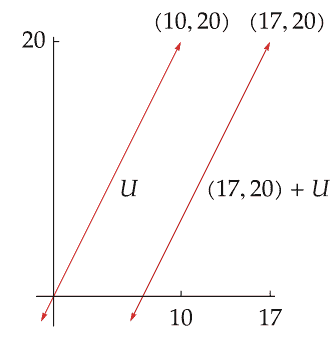

$(17, 20) + U$ 与子空间 $U$ 平行。

### 3.97 定义：平移
对于 $v \in V$ 和 $U$ 是 $V$ 的子集，集合 $v + U$ 被称为 $U$ 的一个平移。

## 3.98 例子：平移

- 如果 $U$ 是由 $U = \{(x, 2x) \in \mathbb{R}^2 : x \in \mathbb{R}\}$ 定义的 $\mathbb{R}^2$ 中的直线，则具有斜率 2 的所有直线都是 $U$ 的平移。参见上面的例子 3.96，其中画出了 $U$ 及其一个平移。
- 更一般地，如果 $U$ 是 $\mathbb{R}^2$ 中的一条直线，则 $U$ 的所有平移是 $\mathbb{R}^2$ 中与 $U$ 平行的所有直线的集合。
- 如果 $U = \{(x, y, 0) \in \mathbb{R}^3 : x, y \in \mathbb{R}\}$，则 $U$ 的平移是与 $xy$ 平面平行的 $\mathbb{R}^3$ 中的平面 $W$。
- 更一般地，如果 $W$ 是 $\mathbb{R}^3$ 中的一个平面，则所有平行于 $W$ 的平面的集合是 $W$ 的所有平移（参见例如练习 7）。

### 3.99 定义：商空间， $V/U$
假设 $U$ 是 $V$ 的一个子空间。那么商空间 $V/U$ 是所有 $U$ 的平移的集合。因此
$$V/U = \{v + U : v \in V\}.$$

## 3.100 例子：商空间

- 如果 $L = \{(x, 2x) \in \mathbb{R}^2 : x \in \mathbb{R}\}$，则 $\mathbb{R}^2/L$ 是所有斜率为 2 的直线的集合。
- 如果 $L$ 是包含原点的 $\mathbb{R}^3$ 中的一条直线，那么 $\mathbb{R}^3/L$ 是所有与 $L$ 平行的直线的集合。
- 如果 $L$ 是包含原点的 $\mathbb{R}^3$ 中的一个平面，那么 $\mathbb{R}^3/L$ 是所有与 $L$ 平行的平面的集合。

我们的下一个目标是将 $V/L$ 变成一个向量空间。为了做到这一点，我们需要下一个结果。

## 3.101 子空间的两个平移要么相等要么不相交
假设 $W$ 是 $V$ 的一个子空间， $u, v \in V$。那么
$$u - v \in W \iff u + W = v + W \iff (u + W) \cap (v + W) \neq \emptyset.$$

证明 首先假设 $u - v \in W$。如果 $v \in u + W$，那么
$$v + W = u + ((u - v) + W) \in u + W.$$
因此 $v + W \subseteq u + W$。同样地，$u + W \subseteq v + W$。因此 $u + W = v + W$，证明完成。

证明 $u - v \in W \Leftarrow$ 蕴含 $u + W = v + W$。方程 $u + W = v + W$ 蕴含 $(u + W) \cap (v + W) \neq \emptyset$。现在假设 $(u + W) \cap (v + W) \neq \emptyset$。因此存在 $u_1, v_1 \in V$ 使得
$$u + u_1 = v + v_1.$$
因此 $u - v = v_1 - u_1$。因此 $u - v \in W$，表明 $(u + W) \cap (v + W) \neq \emptyset$ 意味着 $u - v \in W$，这完成了证明。

现在我们可以在 $V/W$ 上定义加法和标量乘法。

## 3.102 定义：在 $V/W$ 上定义加法和标量乘法
假设 $W$ 是 $V$ 的子空间。然后，在 $V/W$ 上定义加法和标量乘法，
$$(u + W) + (v + W) = (u + v) + W$$
$$c(u + W) = (cu) + W$$
对于所有 $u, v \in V$ 和所有 $c \in \mathbb{R}$。

作为下一个结果证明的一部分，我们将证明上述定义是有意义的。

## 第 3E 节 向量空间的积和商

## 3.103 商空间是一个向量空间
假设 $W$ 是 $V$ 的一个子空间。然后 $V/W$，使用上述定义的加法和数量乘法，是一个向量空间。

证明 上述对 $V/W$ 的加法和数量乘法的定义存在潜在问题，即 $W$ 的平移表示不唯一。
具体来说，假设 $v_1, v_2, w_1, w_2 \in V$ 满足以下条件
$$v_1 + W = v_2 + W \quad \text{且} \quad w_1 + W = w_2 + W.$$
为了证明上述对 $V/W$ 的加法定义是合理的，我们必须证明 $(v_1 + w_1) + W = (v_2 + w_2) + W$。
根据 3.101，我们有
$$v_1 - v_2 \in W \quad \text{且} \quad w_1 - w_2 \in W.$$
因为 $W$ 是 $V$ 的子空间，因此在加法下封闭，这意味着 $(v_1 - v_2) + (w_1 - w_2) \in W$。因此 $(v_1 + w_1) - (v_2 + w_2) \in W$。再次使用 3.101，我们可以看到
$$(v_1 + w_1) + W = (v_2 + w_2) + W，$$
如所需。因此，在 $V/W$ 上定义的加法是有意义的。

同样地，假设 $\alpha \in F$。我们仍然假设 $v_1 + W = v_2 + W$。
因为 $W$ 是 $V$ 的子空间，因此在标量乘法下封闭，我们有 $\alpha(v_1 - v_2) \in W$。因此 $\alpha v_1 - \alpha v_2 \in W$。因此 3.101 意味着
$$(\alpha v_1) + W = (\alpha v_2) + W.$$
因此，在 $V / W$ 上标量乘法的定义是有意义的。

现在，加法和标量乘法已经在 $V/W$ 上定义好了，验证这些运算使 $V/W$ 成为一个向量空间是直接的，留给读者自行验证。注意，$V/W$ 的加法单位元是 $0 + W$（等于 $W$），而 $v + W$ 的加法逆元是 $(-v) + W$。

下一个概念将导致计算 $V / W$ 的维度。

## 3.104 定义：商映射， $\pi$
假设 $W$ 是 $V$ 的子空间。商映射 $\pi : V \to V/W$ 是由下式定义的线性映射
$$\pi(v) = v + W.$$
对于每个 $v \in V$，有 $\pi(v) = v + W$。

读者应该验证 $\pi$ 确实是一个线性映射。尽管 $\pi$ 依赖于 $V$ 和 $W$，但这些空间在符号中被省略，因为它们应该从上下文中清楚。

## 3.105 商空间的维度
假设 $V$ 是有限维的，$W$ 是 $V$ 的子空间。那么
$$\dim V/W = \dim V - \dim W.$$

证明 设 $\pi$ 表示从 $V$ 到 $V/W$ 的商映射。如果 $v \in V$，则 $v + W = 0 + W$ 当且仅当 $v \in W$（根据 3.101），这意味着 $\operatorname{null} \pi = W$。$\pi$ 的定义暗示着 $\operatorname{range} \pi = V/W$。线性映射的基本定理（3.21）现在暗示着 $\dim V = \dim W + \dim V/W$，这给出了所需的结果。

每个线性映射 $T$ 在 $V$ 上诱导出一个线性映射 $\tilde{T}$ 在 $V/(\operatorname{null} T)$ 上，我们现在来定义它。

## 3.106 定义：诱导映射
假设 $T \in \mathcal{L}(V, W)$。定义 $\tilde{T} : V/(\operatorname{null} T) \to W$，使得
$$\tilde{T}(v + \operatorname{null} T) = Tv.$$
为了证明 $\tilde{T}$ 的定义是合理的，假设 $v_1, v_2 \in V$，满足 $v_1 + \operatorname{null} T = v_2 + \operatorname{null} T$。根据 3.101，我们有 $v_1 - v_2 \in \operatorname{null} T$。因此 $T(v_1 - v_2) = 0$。因此 $Tv_1 = Tv_2$。因此 $\tilde{T}$ 的定义确实是合理的。验证 $\tilde{T}$ 是否是从 $V/(\operatorname{null} T)$ 到 $W$ 的线性映射留给读者。

下一个结果表明，我们可以将 $\tilde{T}$ 看作是 $T$ 的修改版本，其域产生一对一映射。

## 3.107 零空间和 $T$ 的范围
假设 $T \in \mathcal{L}(V, W)$。那么
- (a) $\tilde{T} \circ \pi = T$，其中 $\pi$ 是从 $V$ 到 $V/(\operatorname{null} T)$ 的商映射；
- (b) $\tilde{T}$ 是单射；
- (c) $\operatorname{range} \tilde{T} = \operatorname{range} T$;
- (d) $V/(\operatorname{null} T)$ 和 $\operatorname{range} T$ 是同构向量空间。

证明
- (a) 如果 $v \in V$，则 $(\tilde{T} \circ \pi)(v) = \tilde{T}(\pi(v)) = \tilde{T}(v + \operatorname{null} T) = Tv$，如所需。
- (b) 假设 $v \in V$ 且 $\tilde{T}(v + \operatorname{null} T) = 0$。那么 $Tv = 0$。因此 $v \in \operatorname{null} T$。因此 3.101 意味着 $v + \operatorname{null} T = 0 + \operatorname{null} T$。这意味着 $\operatorname{null} \tilde{T} = \{0 + \operatorname{null} T\}$。因此 $\tilde{T}$ 是单射，正如所需。
- (c) 根据 $\tilde{T}$ 的定义，$\operatorname{range} \tilde{T} = \operatorname{range} T$.
- (d) 现在 (b) 和 (c) 意味着如果我们将 $\tilde{T}$ 视为映射到 $\operatorname{range} T$，则 $\tilde{T}$ 是从 $V/(\operatorname{null} T)$ 到 $\operatorname{range} T$ 的同构。

## 练习题 3E

1. 假设 $f$ 是从 $V$ 到 $W$ 的函数。$f$ 的图是由 $V \times W$ 定义的子集
$$ \{(v, f(v)) \in V \times W : v \in V\}.$$
证明当且仅当 $f$ 的图是 $V \times W$ 的子空间时，$f$ 是一个线性映射。
严格来说，从 $V$ 到 $W$ 的函数 $f$ 是 $V \times W$ 的一个子集，对于每个 $v \in V$，存在唯一的元素 $(v, f(v)) \in f$。换句话说，严格来说，一个函数就是它的图。通常我们不会以这种形式思考函数。然而，如果我们变得严格，那么这个练习可以重新表述为：证明从 $V$ 到 $W$ 的函数 $f$ 是一个线性映射当且仅当 $f$ 是 $V \times W$ 的子空间。

2. 假设 $V_1, \dots, V_n$ 是向量空间，使得 $V_1 \times \dots \times V_n$ 是有限维的。证明对于每个 $i = 1, \dots, n$，$V_i$ 是有限维的。

3. 假设 $V_1, \dots, V_n$ 是向量空间。证明 $\mathcal{L}(V_1 \times \dots \times V_n, W)$ 和 $\mathcal{L}(V_1, W) \times \dots \times \mathcal{L}(V_n, W)$ 是同构的向量空间。

4. 假设 $U, V_1, \dots, V_n$ 是向量空间。证明 $\mathcal{L}(U, V_1 \times \dots \times V_n)$ 和 $\mathcal{L}(U, V_1) \times \dots \times \mathcal{L}(U, V_n)$ 是同构的向量空间。

5. 对于 $n$ 为正整数，定义 $\mathbb{R}^n$ 为
$$\mathbb{R}^n = \underbrace{\mathbb{R} \times \dots \times \mathbb{R}}_{n \text{ 次}}$$
证明 $\mathbb{R}^n$ 和 $\mathcal{L}(\mathbb{R}^n, \mathbb{R})$ 是同构向量空间。

6. 假设 $u, v$ 是 $V$ 中的向量， $U, W$ 是 $V$ 的子空间，满足 $u + U = v + W$。证明 $U = W$。

7. 设 $W = \{(x, y, z) \in \mathbb{R}^3 : 2x + 3y + 5z = 0\}$。假设 $S \subseteq \mathbb{R}^3$。证明 $S$ 是 $W$ 的平移，当且仅当存在 $v \in \mathbb{R}^3$，使得
$$S = \{(x, y, z) \in \mathbb{R}^3 : 2(x+x_0) + 3(y+y_0) + 5(z+z_0) = 0\}.$$
*(注：根据上下文修正公式)*
修正：当且仅当存在 $c \in \mathbb{R}$，使得
$$S = \{(x, y, z) \in \mathbb{R}^3 : 2x + 3y + 5z = c\}.$$

8. (a) 假设 $T \in \mathcal{L}(V, W)$ 且 $w \in W$。证明 $\{v \in V : T v = w\}$ 既不是空集也不是 $V$ 的平移。
(b) 解释为什么线性方程组的解集，如 3.27，要么是空集，要么是 $\mathbb{R}^n$ 的某个子空间的平移。

9. 证明非空子集 $S$ of $V$ 是 $V$ 的某个子空间的平移，当且仅当对于所有 $u, v \in S$ 和所有 $c \in \mathbb{R}$，都有 $u + (1 - c)v \in S$。
*(注：修正为仿射组合定义)*
证明非空子集 $S$ of $V$ 是 $V$ 的某个子空间的平移，当且仅当对于所有 $u, v \in S$ 和所有 $c \in \mathbb{R}$，都有 $cu + (1-c)v \in S$。

10. 假设 $S_1 = u + U_1$ 和 $S_2 = v + U_2$ 对于一些 $u, v \in V$ 和一些子空间 $U_1, U_2$ of $V$。证明交集 $S_1 \cap S_2$ 要么是 $V$ 的某个子空间的平移，要么是空集。

11. 假设 $V = \{(v_1, v_2, \dots) \in \mathbb{R}^\infty : v_i \neq 0 \text{ 只有有限多个 } i\}$。
    (a) 证明 $V$ 是 $\mathbb{R}^\infty$ 的子空间。
    (b) 证明 $\mathbb{R}^\infty/V$ 是无限维的。

12. 假设 $v_1, \dots, v_n \in V$。令
$$H = \{a_1 v_1 + \dots + a_n v_n : a_1, \dots, a_n \in \mathbb{R} \text{ 且 } a_1 + \dots + a_n = 1\}.$$
    (a) 证明 $H$ 是 $V$ 的某个子空间的平移。
    (b) 证明如果 $H$ 是 $V$ 的某个子空间的平移且 $\{v_1, \dots, v_n\} \subseteq H$，那么 $V \subseteq H$。
    (c) 证明 $H$ 是 $V$ 的某个维度小于 $n$ 的子空间的平移。

13. 假设 $U$ 是 $V$ 的子空间，且 $V/U$ 是有限维的。证明 $V$ 同构于 $U \times (V/U)$。

14. 假设 $U$ 和 $W$ 是 $V$ 的子空间，且 $V = U \oplus W$。假设 $v_1, \dots, v_n$ 是 $W$ 的一组基。
证明 $v_1 + U, \dots, v_n + U$ 是 $V/U$ 的一组基。

15. 假设 $U$ 是 $V$ 的子空间，$v_1 + U, \dots, v_m + U$ 是 $V/U$ 的基，
$u_1, \dots, u_n$ 是 $U$ 的基。证明 $u_1, \dots, u_n, v_1, \dots, v_m$ 是 $V$ 的基。

16. 假设 $T \in \mathcal{L}(V, W)$ 且 $T \neq 0$。证明 $\dim V / (\operatorname{null} T) = 1$。

17. 假设 $U$ 是 $V$ 的子空间，且 $\dim V/U = 1$。证明存在 $T \in \mathcal{L}(V, \mathbb{R})$ 使得 $\operatorname{null} T = U$。

18. 假设 $U$ 是 $V$ 的子空间，且 $V/U$ 是有限维的。(a) 证明如果 $W$ 是 $V$ 的有限维子空间，并且 $V = U + W$，则 $\dim W \ge \dim V/U$。
    (b) 证明存在一个有限维子空间 $W$ 是 $V$ 的子空间，使得 $\dim W = \dim V/U$ 且 $V = U \oplus W$。

19. 假设 $T \in \mathcal{L}(V, W)$ 且 $U$ 是 $V$ 的子空间。令 $\pi$ 表示从 $V$ 到 $V/U$ 的商映射。
证明存在 $S \in \mathcal{L}(V/U, W)$ 使得 $T = S \circ \pi$ 当且仅当 $U \subseteq \operatorname{null} T$。

# 3F 对偶性

### 对偶空间和对偶映射
线性映射到标量域 $F$ 在线性代数中起着特殊的作用，因此它们有一个特殊的名称。

### 3.108 定义：线性泛函
一个线性泛函在 $V$ 上是从 $V$ 到 $F$ 的线性映射。换句话说，线性泛函是 $\mathcal{L}(V, F)$ 的一个元素。

### 3.109 例子：线性泛函

- 定义 $F: \mathbb{R}^3 \rightarrow \mathbb{R}$ 为 $F(x_1, x_2, x_3) = 4x_1 - 5x_2 + 2x_3$。那么 $F$ 是一个线性泛函在 $\mathbb{R}^3$ 上。
- 固定 $(a_1, \dots, a_n) \in \mathbb{R}^n$。定义 $F: \mathbb{R}^n \rightarrow \mathbb{R}$ 为 $F(x_1, \dots, x_n) = a_1x_1 + \dots + a_nx_n$。那么 $F$ 是 $\mathbb{R}^n$ 上的线性泛函。
- 定义 $F: C[0,1] \rightarrow \mathbb{R}$ 为
$$F(f) = 3f''(5) + 7f'(4).$$
那么 $F$ 是 $C[0,1]$ 上的线性泛函。
- 定义 $F: C[0,1] \rightarrow \mathbb{R}$ 为
$$F(f) = \int_0^1 f(t) \, dt.$$
对于每个 $f \in C[0,1]$。那么 $F$ 是 $C[0,1]$ 上的线性泛函。

向量空间 $\mathcal{L}(V, F)$ 也有一个特殊的名称和特殊的符号。

### 3.110 定义：对偶空间， $V'$
对于 $V$ 的对偶空间，记作 $V'$，是所有在 $V$ 上的线性泛函的向量空间。换句话说，$V' = \mathcal{L}(V, F)$。

### 3.111 维度 $V' = \text{维度 } V$
假设 $V$ 是有限维的。那么 $V'$ 也是有限维的，且 $\dim V' = \dim V$。

证明 根据 3.72 我们有
$$\dim V' = \dim \mathcal{L}(V, F) = (\dim V)(\dim F) = \dim V,$$
所需的。

在以下定义中，线性映射引理 (3.4) 意味着每个 $v_i'$ 是明确定义的。

### 3.112 定义：对偶基

如果 $v_1, \dots, v_n$ 是 $V$ 的一组基，则 $v_1, \dots, v_n$ 的对偶基是 $V'$ 的元素列表，其中每个 $v_i'$ 是 $V$ 上的线性泛函，满足
$$v_i'(v_j) = \begin{cases} 1 & \text{if } i=j, \\ 0 & \text{if } i \neq j. \end{cases}$$

### 3.113 例子：标准基的对偶基 $\mathbb{R}^n$
假设 $n$ 是一个正整数。对于 $1 \le i \le n$，定义 $f_i$ 为 $\mathbb{R}^n$ 中向量的第 $i$ 个坐标的线性函数。因此
$$f_i(e_j) = \delta_{ij}$$
对于每个 $(x_1, \dots, x_n) \in \mathbb{R}^n$。
让 $e_1, \dots, e_n$ 成为 $\mathbb{R}^n$ 的标准基。那么
$$f_i(e_j) = \begin{cases} 1 & \text{if } i=j, \\ 0 & \text{if } i \neq j. \end{cases}$$
因此 $f_1, \dots, f_n$ 是标准基 $e_1, \dots, e_n$ 的对偶基 $\mathbb{R}^n$。

下一个结果表明，基底的對偶基底由在 $V$ 上的线性泛函组成，这些线性泛函给出了在 $V$ 中将向量表示为线性基向量组合的系数。

### 3.114 对偶基底给出线性组合的系数
假设 $v_1, \dots, v_n$ 是 $V$ 的一个基底， $f_1, \dots, f_n$ 是对偶基底。那么
$$v = f_1(v)v_1 + \dots + f_n(v)v_n$$
对于每个 $v \in V$。

证明 假设 $v \in V$。那么存在 $c_1, \dots, c_n \in \mathbb{R}$ 使得
$$v = c_1 v_1 + \dots + c_n v_n \tag{3.115}$$
如果 $j \in \{1, \dots, n\}$，那么将上述方程两边应用 $f_j$ 得到
$$f_j(v) = c_j.$$
将方程中给出的 $c_1, \dots, c_n$ 的值代入 3.115 式中，可以得到
$$v = f_1(v)v_1 + \dots + f_n(v)v_n.$$

下一个结果表明对偶基确实是对偶空间的一组基。因此，“对偶基”这个术语是合理的。

### 3.116 对偶基是对偶空间的一组基

假设 $V$ 是有限维的。那么 $V$ 的基的对偶基是 $V'$ 的一组基。

**证明**
假设 $\alpha_1, \cdots, \alpha_n$ 是 $V$ 的一组基。记 $\alpha^1, \cdots, \alpha^n$ 为对偶基。
为了证明 $\alpha^1, \cdots, \alpha^n$ 是 $V'$ 的线性无关元素列表，假设 $\alpha^1, \cdots, \alpha^n \in V'$ 是这样的元素：

$$3.117 \quad c_1 \alpha^1 + \cdots + c_n \alpha^n = 0.$$

现在

$$(c_1 \alpha^1 + \cdots + c_n \alpha^n)(\alpha_j) = c_j$$

对于每个 $j=1, \cdots, n$。因此，3.117 表明 $\alpha^1 = \cdots = \alpha^n = 0$。因此 $\alpha^1, \cdots, \alpha^n$ 是线性无关的。
因为 $\alpha^1, \cdots, \alpha^n$ 是 $V'$ 中的线性无关列表，其长度等于 $\dim V'$ (根据 3.111)，我们可以得出结论 $\alpha^1, \cdots, \alpha^n$ 是 $V'$ 的基 (参见 2.38)。

在下面的定义中，请注意如果 $T$ 是从 $U$ 到 $V$ 的线性映射，那么 $T'$ 是从 $V'$ 到 $U'$ 的线性映射。

### 3.118 定义：对偶映射， $T'$

假设 $T \in \mathcal{L}(U, V)$。对于每个 $\phi \in V'$，$T$ 的对偶映射是线性映射 $T' \in \mathcal{L}(V', U')$，定义如下：

$$T'(\phi) = \phi \circ T.$$

如果 $T \in \mathcal{L}(U, V)$ 且 $\phi \in V'$，则上述定义中 $T'(\phi)$ 是线性映射 $T$ 和 $\phi$ 的复合。因此， $T'(\phi)$ 确实是从 $U$ 到 $\mathbb{F}$ 的线性映射；换句话说， $T'(\phi) \in U'$。

以下两个要点表明 $T'$ 是从 $V'$ 到 $U'$ 的线性映射：

- 如果 $\phi, \psi \in V'$，则

$$T'(\phi + \psi) = (\phi + \psi) \circ T = \phi \circ T + \psi \circ T = T'(\phi) + T'(\psi).$$

- 如果 $c \in \mathbb{F}$ 且 $\phi \in V'$，则

$$T'(c\phi) = (c\phi) \circ T = c(\phi \circ T) = cT'(\phi).$$

下一个例子中，撇号符号具有两个无关的含义： $T'$ 表示线性映射 $T$ 的对偶，而 $P'$ 表示多项式 $P$ 的导数。

### 3.119 例子：微分线性映射的对偶映射

定义 $D: P(\mathbb{F}) \to P(\mathbb{F})$ 为 $D=D_{deriv}$。

- 假设 $\phi$ 是 $P(\mathbb{F})$ 上的线性泛函，定义为 $\phi(p) = p(0)$。那么 $\phi' \circ D$ 是 $P(\mathbb{F})$ 上的线性泛函，给定为

$$(\phi' \circ D)(p) = (\phi \circ D)(p) = \phi(D(p)) = \phi(D'(p)) = D'(0).$$

因此 $\phi' \circ D$ 是线性泛函，作用于 $P(\mathbb{F})$ 上，将 $\phi$ 映射为 $D'(0)$。

- 假设 $\phi$ 是定义在 $P(\mathbb{F})$ 上的线性泛函，定义为 $\phi(p) = \int_{0}^{1} p(x) \, dx$。则 $\phi' \circ D$ 是定义在 $P(\mathbb{F})$ 上的线性泛函，给定为

$$
\begin{aligned}
(\phi' \circ D)(p) &= (\phi \circ D)(p) \\
&= \phi(D(p)) \\
&= \phi(D'(p)) \\
&= \int_{0}^{1} D'(p) \, dx \\
&= p(1) - p(0).
\end{aligned}
$$

因此 $\phi' \circ D$ 是线性泛函，作用于 $P(\mathbb{F})$ 上，将 $\phi$ 映射为 $p(1) - p(0)$。

在下一个结果中，(a) 和 (b) 表明将 $T$ 映射为 $T'$ 的函数是从 $\mathcal{L}(V, W)$ 到 $\mathcal{L}(W', V')$ 的线性映射。

在下面的 (c) 中，注意从左边的 $T \circ S$ 到右边的 $S' T'$ 的顺序颠倒。

### 3.120 对偶映射的代数性质

假设 $T \in \mathcal{L}(V, W)$。那么

- (a) $(T + S)' = T' + S'$ 对于所有 $T, S \in \mathcal{L}(V, W)$;
- (b) $(cT)' = c T'$ 对于所有 $c \in \mathbb{F}$;
- (c) $(TS)' = S' T'$ 对于所有 $T, S \in \mathcal{L}(V, W)$。

证明留给读者证明 (a) 和 (b)。

为了证明 (c)，假设 $\phi \in W'$。那么

$$(TS)'(\phi) = \phi \circ (TS) = (\phi \circ T) \circ S = S'(\phi \circ T) = S'(T'(\phi)) = (S' T')(\phi).$$

上述的第一、第三和第四个等式成立是因为对偶映射的定义，第二个等式成立是因为函数的复合是结合的，最后一个等式是由复合的定义得出的。

> 一些书籍使用符号 $\phi^0$ 和 $\phi^*$ 表示对偶，而不是 $\phi'$ 和 $\phi^*$。然而，在这里我们保留符号 $\phi'$ 表示对偶，这将在第 7 章研究内积空间上的线性映射时引入 $\phi^*$ 表示伴随。

上面的方程表明

$$(TS)'(\phi) = (S' T')(\phi) \quad \text{对于所有的} \phi \in W'.$$

因此 $(TS)' = S' T'$。

### 线性映射的零空间和对偶的值域

在本小节中，我们的目标是用 $T$ 的值域和零空间来描述 $T'$ 的零空间和值域。为了做到这一点，我们需要下一个定义。

### 3.121 定义：零化子， $W^0$

对于 $W \subseteq V$，零化子 $W^0$ 的定义如下：

$$W^0 = \{\phi \in V' : \phi(w) = 0 \text{ 对于所有 } w \in W\}.$$

### 3.122 例子：一个零化子的元素

假设 $W$ 是由 $\mathcal{P}(\mathbb{F})$ 的多项式倍数组成的 $P(\mathbb{F})$ 的子空间。

如果 $\phi$ 是在 $P(\mathbb{F})$ 上定义的线性泛函，满足 $\phi(w) = \phi'(w) = 0$，则 $\phi \in W^0$。

对于 $W \subseteq V$，零化子 $W^0$ 是双对偶空间 $V''$ 的子集。因此， $W^0$ 取决于包含 $W$ 的向量空间，因此 $W^0_V$ 这样的符号会更加准确。然而，包含的向量空间在上下文中总是清楚的，所以我们将使用更简单的符号 $W^0$。

### 3.123 例子：一个二维子空间的零化子空间 $W^0$

设 $e_1, e_2, e_3, e_4, e_5$ 为 $\mathbb{F}^5$ 的标准基；设 $\epsilon_1, \epsilon_2, \epsilon_3, \epsilon_4, \epsilon_5 \in (\mathbb{F}^5)'$ 为 $e_1, e_2, e_3, e_4, e_5$ 的对偶基。假设

$$W = \text{span}(e_1, e_2) = \{(v_1, v_2, 0, 0, 0) \in \mathbb{F}^5 : v_1, v_2 \in \mathbb{F}\}.$$

我们想要证明 $W^0 = \text{span}(\epsilon_3, \epsilon_4, \epsilon_5)$。

回顾一下 (见 3.113)，$\epsilon_i$ 是线性泛函，作用在 $\mathbb{F}^5$ 上，选择第 $i$ 个坐标：$\epsilon_i(v_1, v_2, v_3, v_4, v_5) = v_i$。

首先假设 $\psi \in \text{span}(\epsilon_3, \epsilon_4, \epsilon_5)$。那么存在 $c_3, c_4, c_5 \in \mathbb{F}$，使得 $\psi = c_3\epsilon_3 + c_4\epsilon_4 + c_5\epsilon_5$。如果 $(v_1, v_2, 0, 0, 0) \in W$，那么

$$\psi(v_1, v_2, 0, 0, 0) = (c_3\epsilon_3 + c_4\epsilon_4 + c_5\epsilon_5)(v_1, v_2, 0, 0, 0) = 0.$$

因此 $\psi \in W^0$。因此我们已经证明了 $\text{span}(\epsilon_3, \epsilon_4, \epsilon_5) \subseteq W^0$。

为了证明另一个方向的包含关系，假设 $\psi \in W^0$。因为对偶基是 $(\mathbb{F}^5)'$ 的一组基，存在 $c_1, c_2, c_3, c_4, c_5 \in \mathbb{F}$ 使得 $\psi = c_1\epsilon_1 + c_2\epsilon_2 + c_3\epsilon_3 + c_4\epsilon_4 + c_5\epsilon_5$。因为 $e_1 \in W$ 且 $\psi \in W^0$，我们有

$$0 = \psi(e_1) = (c_1\epsilon_1 + c_2\epsilon_2 + c_3\epsilon_3 + c_4\epsilon_4 + c_5\epsilon_5)(e_1) = c_1.$$

同样地， $e_2 \in W$ 因此 $c_2 = 0$。因此 $\psi = c_3\epsilon_3 + c_4\epsilon_4 + c_5\epsilon_5$。因此 $\psi \in \text{span}(\epsilon_3, \epsilon_4, \epsilon_5)$，这表明 $W^0 \subseteq \text{span}(\epsilon_3, \epsilon_4, \epsilon_5)$。

因此 $W^0 = \text{span}(\epsilon_3, \epsilon_4, \epsilon_5)$。

### 3.124 零化子是一个子空间

假设 $W \subseteq V$。那么 $W^0$ 是 $V'$ 的一个子空间。

**证明**
注意 $0 \in W^0$ (这里 0 是线性泛函在 $W$ 上的零向量) 因为 零线性泛函作用于 $W$ 中的每个向量都是 $V$ 中的零向量。

假设 $w_1, w_2 \in W^0$。因此 $w_1, w_2 \in V'$ 且对于每个 $w \in W$, $w_1(w) = w_2(w) = 0$。如果 $w \in W$, 则

$$(w_1+w_2)(w) = w_1(w)+w_2(w) = 0+0 = 0.$$

因此 $w_1+w_2 \in W^0$。同样地， $W^0$ 在标量乘法下封闭。因此，1.34 意味着 $W^0$ 是 $V'$ 的子空间。

下一个结果表明 $\dim W^0$ 是 $\dim V$ 和 $\dim W$ 的差异。例如，这表明如果 $W$ 是 $\mathbb{F}^5$ 的二维子空间，则 $W^0$ 是 $(\mathbb{F}^5)^*$ 的三维子空间，就像例子 3.123 中一样。

下一个结果可以按照例子 3.123 的模式证明：选择 $W$ 的一组基 $w_1, \cdots, w_k$, 扩展为 $V$ 的一组基 $w_1, \cdots, w_k, \cdots, w_n$, 让 $w_1', \cdots, w_k', \cdots, w_n'$ 成为 $V'$ 的对偶基，然后证明 $w_{k+1}', \cdots, w_n'$ 是 $W^0$ 的一组基，这就证明了所需的结果。尽管这里提供了一个更简洁的证明，但你应该构建刚才概述的证明。

### 3.125 零化子的维度

假设 $V$ 是有限维的， $W$ 是 $V$ 的子空间。那么 $\dim W^0 = \dim V' - \dim W$。

**证明**
设 $i \in \mathcal{L}(W, V)$ 是由 $i(w)=w$ 定义的包含映射，对于每个 $w \in W$。因此 $i'$ 是从 $V'$ 到 $W'$ 的线性映射。线性映射的基本定理 (3.21) 应用于 $i'$ 表明

$$\dim \text{range } i' + \dim \text{null space } i' = \dim V'.$$

然而，零空间 $i' = W^0$(根据定义可知)，且 $\dim V' = \dim V$ (根据 3.111)，因此我们可以将上述方程重写为

$$3.126 \quad \dim \text{range } i' + \dim W^0 = \dim V'.$$

如果 $f \in W'$，那么 $f$ 可以扩展为线性泛函 $F$ 在 $V$ 上 (参见，例如，3A 节的练习 13)。根据 $i'$ 的定义可知 $i'(F) = f$。因此 $f \in \text{range } i'$，这意味着 $\text{range } i' = W'$。因此

$$\dim \text{range } i' = \dim W' = \dim W,$$

然后 3.126 成为方程 $\dim W + \dim W^0 = \dim V$，正如所需。

下一个结果可以是一个有用的工具，用来证明一个子空间的大小是尽可能大的一见 (a)—或者证明一个子空间的大小是尽可能小的一见 (b)。

### 3.127 使零化子空间等于 $\{0\}$ 或整个空间的条件

假设 $V$ 是有限维的， $U$ 是 $V$ 的一个子空间。那么

- (a) $U^0 = \{0\} \iff U = V$;
- (b) $U^0 = V' \iff U = \{0\}$.

**证明**
为了证明 (a)，我们有

$$
\begin{aligned}
U^0 = \{0\} &\iff \dim U^0 = 0 \\
&\iff \dim V = \dim U \\
&\iff U = V,
\end{aligned}
$$

其中第二个等价关系来自于 3.125，第三个等价关系来自于 2.39。

同样地，要证明 (b)，我们有

$$
\begin{aligned}
U^0 = V' &\iff \dim U^0 = \dim V \\
&\iff \dim U^0 = \dim V \\
&\iff \dim U = 0 \\
&\iff U = \{0\},
\end{aligned}
$$

其中第一个等价关系的一个方向来自于 2.39，第二个等价关系来自于 3.111，第三个等价关系来自于 3.125。

下一个结果中的 (a) 的证明不使用假设 $V$ 和 $V'$ 是有限维的。

### 3.128 $T'$ 的零空间

假设 $V$ 和 $W$ 是有限维的，且 $T \in \mathcal{L}(V, W)$。那么

- (a) $\text{null } T' = (\text{range } T)^0$;
- (b) 零空间维度 $T' =$ 零空间维度 $T + V$ 维度 $- W$ 维度。

**证明**
- (a) 首先假设 $x \in \text{零空间 } T'$。因此 $0 = T'(x) = x \circ T$。因此

$$0 = (x \circ T)(y) = x(Ty) \quad \text{对于每个 } y \in V.$$

因此 $x \in (\text{值域 } T)^0$。这意味着 $\text{null } T' \subseteq (\text{值域 } T)^0$。

为了证明相反方向的包含关系，现在假设 $x \in (\text{值域 } T)^0$。

因此 $x(Ty) = 0$ 对于每个向量 $y \in V$。因此 $0 = x \circ T = T'(x)$。换句话说，$x \in \text{零空间 } T'$，这表明 $(\text{值域 } T)^0 \subseteq \text{零空间 } T'$，完成了证明 (a)。

- (b) 我们有

$$
\begin{aligned}
\dim \text{null } T' &= \dim (\text{range } T')^0 \\
&= \dim V - \dim \text{range } T \\
&= \dim V - (\dim V - \dim \text{null } T) \\
&= \dim \text{null } T + \dim V - \dim V.
\end{aligned}
$$

其中第一个等式来自于 (a)，第二个等式来自于 3.125，第三个等式来自于线性映射的基本定理 (3.21)。

下一个结果可能很有用，因为有时候验证 $T'$ 是单射比直接证明 $T$ 是满射更容易。

### 3.129 $T$ 满射等价于 $T'$ 是单射
假设 $V$ 和 $W$ 是有限维的，$T \in \mathcal{L}(V, W)$。那么 $T$ 是满射 $\iff T'$ 是单射。

**证明**
我们有

$$
\begin{aligned}
T \in \mathcal{L}(V, W) \text{是满射} &\iff \text{range } T = W \\
&\iff (\text{range } T)^0 = \{0\} \\
&\iff \text{null } T' = \{0\} \\
&\iff T' \text{是单射},
\end{aligned}
$$

其中第二个等价关系来自于 3.127(a)，第三个等价关系来自于 3.128(a)。

### 3.130 $T'$ 的值域
假设 $V$ 和 $W$ 是有限维的，且 $T \in \mathcal{L}(V, W)$。那么
- (a) $\dim \text{range } T' = \dim \text{range } T$;
- (b) $\text{range } T' = (\text{null } T)^0$。

**证明**
- (a) 我们有

$$
\begin{aligned}
\dim \text{range } T' &= \dim V' - \dim \text{null } T' \\
&= \dim V - \dim (\text{range } T)^0 \\
&= \dim \text{range } T,
\end{aligned}
$$

其中第一个等式来自于 3.21，第二个等式来自于 3.111 和 3.128(a)，第三个等式来自于 3.125。

- (b) 首先假设 $\phi \in \text{range } T'$。因此存在 $\psi \in W'$ 使得 $\phi = T'(\psi)$。如果 $v \in \text{null } T$，那么

$$\phi(v) = (T'(\psi))(v) = (\psi \circ T)(v) = \psi(T(v)) = \psi(0) = 0.$$

因此 $\phi \in (\text{null } T)^0$。这意味着 $\text{range } T' \subseteq (\text{null } T)^0$。

我们将通过展示 $T'$ 的范围和 $(\text{null } T)^0$ 具有相同的维度来完成证明。为了做到这一点，注意到 $\dim \text{range } T' = \dim \text{range } T = \dim V - \dim \text{null } T = \dim (\text{null } T)^0$，

其中第一个等式来自于 (a)，第二个等式来自于 3.21，第三个等式来自于 3.125。

下一个结果应与 3.129 进行比较。

### 3.131 $T$ 是单射等价于 $T'$ 是满射。
假设 $V$ 和 $W$ 是有限维的，且 $T \in \mathcal{L}(V, W)$。那么 $T$ 是单射 $\iff T'$ 是满射。

**证明**
我们有

$$
\begin{aligned}
T \text{是单射} &\iff \text{null } T = \{0\} \\
&\iff (\text{null } T)^0 = V' \\
&\iff \text{range } T' = V',
\end{aligned}
$$

其中第二个等价关系来自于 3.127(b)，第三个等价关系来自于 3.130(b)。

### 线性映射的对偶矩阵

下一个结果的假设是我们有一个基 $\alpha_1, \cdots, \alpha_n$ of $V$，以及它的对偶基 $\alpha^1, \cdots, \alpha^n$ of $V'$。我们还有一个基 $\beta_1, \cdots, \beta_m$ of $W$，以及它的对偶基 $\beta^1, \cdots, \beta^m$ of $W'$。因此，对于 $V$ 和 $W$ 的上述基，计算 $\mathcal{M}(T)$，对于 $V'$ 和 $W'$ 的上述对偶基，计算 $\mathcal{M}(T')$。使用这些基得到以下漂亮的结果。

### 3.132 矩阵的转置是 $T$ 的转置矩阵
假设 $V$ 和 $W$ 是有限维的，且 $T \in \mathcal{L}(V, W)$。那么 $\mathcal{M}(T') = (\mathcal{M}(T))^t$。

**证明**
设 $A = \mathcal{M}(T)$ 和 $B' = \mathcal{M}(T')$。假设 $1 \leqslant i \leqslant n$ 且 $1 \leqslant j \leqslant m$。根据 $\mathcal{M}(T')$ 的定义，我们有

$$T'(\beta^j) = \sum_{i=1}^m A_{i,j} \alpha^i.$$

上述等式的左边等于 $\beta^j \circ T$。因此将上述等式两边都作用于 $\alpha_i$，得到

$$
\begin{aligned}
(T'(\beta^j))(\alpha_i) &= \sum_{i=1}^m A_{i,j} \alpha^i(\alpha_i) \\
&= A_{i,j}.
\end{aligned}
$$

我们还有

$$
\begin{aligned}
(T(\alpha_i))(\beta^j) &= \beta^j(T(\alpha_i)) \\
&= A_{i,j} (\sum_{i=1}^m A_{i,j} \alpha^i)(\beta^j) \\
&= \sum_{i=1}^m A_{i,j} \alpha^i(\beta^j) \\
&= A_{i,j}.
\end{aligned}
$$

比较最后两组方程的最后一行，我们有 $A_{i,j} = B'_{j,i}$。因此 $B' = A^t$。换句话说，$\mathcal{M}(T') = (\mathcal{M}(T))^t$，如所需。

现在我们使用对偶性给出一个矩阵的列秩等于行秩的另一种证明。这个结果之前使用不同的工具证明过——见 3.57。

### 3.133 列秩等于行秩
> 假设 $A \in \mathbb{R}^{m, n}$。那么 $A$ 的列秩等于 $A$ 的行秩。

**证明**
定义 $A: \mathbb{R}^{n, 1} \rightarrow \mathbb{R}^{m, 1}$ 为 $Ax$。因此 $\mathcal{M}(A) = A$，其中 $\mathcal{M}(A)$ 是相对于 $\mathbb{R}^{n, 1}$ 和 $\mathbb{R}^{m, 1}$ 的标准基计算的。现在 $A$ 的列秩 $= \mathcal{M}(A)$ 的列秩 $= \text{dim range } A' = \text{dim range } A^t = \mathcal{M}(A^t)$ 的列秩 $= A^t$ 的列秩 $= A$ 的行秩，

第二个等式来自 3.78，第三个等式来自 3.130(a)，第四个等式来自 3.78，第五个等式来自 3.132，最后一个等式根据行和列秩的定义得出。

在 7A 章节中的练习 8 中，还有另一种证明上述结果的方法。

## 3.F 练习题

- 1. 解释为什么每个线性泛函都是满射或者是零映射。
- 2. 给出三个在 $C[0,1]$ 上的线性泛函的不同例子。
- 3. 假设 $V$ 是有限维的，$v \in V$ 且 $v \neq 0$。证明存在 $f \in V'$ 使得 $f(v) = 1$。
- 4. 假设 $V$ 是有限维的，$W$ 是 $V$ 的子空间且 $W \neq V$。证明存在 $f \in V'$，使得对于每个 $v \in W$，都有 $f(v) = 0$ 但 $f \neq 0$。
- 5. 假设 $T \in \mathcal{L}(V, V)$，且 $v_1, \cdots, v_m$ 是 $V$ 的一个基。因此，对于每个 $v \in V$，存在唯一的数 $a_1(v), \cdots, a_m(v)$，使得
  $$v = a_1(v)v_1 + \cdots + a_m(v)v_m$$
  从而定义了从 $V$ 到 $\mathbb{F}$ 的函数 $a_1, \cdots, a_m$。证明每个函数 $a_1, \cdots, a_m$ 都是 $V$ 上的线性泛函。
- 6. 假设 $S, T \in V'$。证明如果且仅如果存在 $c \in \mathbb{F}$ 使得 $S = cT$ 则 $\text{null } T \subseteq \text{null } S$。
- 7. 假设 $V_1, \cdots, V_m$ 是向量空间。证明 $(V_1 \times \cdots \times V_m)'$ 和 $V_1' \times \cdots \times V_m'$ 是同构的向量空间。
- 8. 假设 $v_1, \cdots, v_m$ 是 $V$ 的一组基，$v_1', \cdots, v_m'$ 是 $V'$ 的对偶基。定义 $\Gamma: V \to \mathbb{F}^m$ 和 $\Lambda: \mathbb{F}^m \to V$ 为
  $$\Gamma(v) = (v_1(v), \cdots, v_m(v)) \quad \text{和} \quad \Lambda(a_1, \cdots, a_m) = a_1 v_1 + \cdots + a_m v_m.$$
  解释为什么 $\Gamma$ 和 $\Lambda$ 互为反函数。
- 9. 假设 $m$ 是一个正整数。证明基 $1, x, \cdots, x^m$ 的对偶基 $\phi_k(v)$ 是 $\phi_0, \phi_1, \cdots, \phi_m$，其中
  $$\phi_k(v) = v \frac{d^{(k)}(v)}{k!}.$$
  这里 $v^{(k)}$ 表示 $v$ 的 $k$ 阶导数，理解为 $v$ 的 0 阶导数是 $v$。
- 10. 假设 $n$ 是一个正整数。
    (a) 证明 $1, x - 5, \cdots, (x - 5)^n$ 是 $P_n(\mathbb{F})$ 的一组基。
    (b) 基 (a) 的对偶基是什么？
- 11. 假设 $v_1, \cdots, v_m$ 是 $V$ 的一组基，$v_1', \cdots, v_m'$ 是相应的对偶基。假设 $f \in V'$。证明
  $$f = f(v_1)v_1' + \cdots + f(v_m)v_m'$$

- 12. 假设 $S, T \in \mathcal{L}(V)$。
    (a) 证明 $(S + T)' = S' + T'$。
    (b) 证明 $(ST)' = T'S'$ 对于所有 $S, T \in \mathcal{L}(V)$。
    这个练习要求你验证 (a) 和 (b) 在 3.120 中。
- 13. 证明 $V$ 上的恒等算子的对偶映射是 $V'$ 上的恒等算子。
- 14. 定义 $T : \mathbb{F}^3 \to \mathbb{F}^2$ 为
    $$T(x, y, z) = (4x + 5y + 6z, 7x + 8y + 9z).$$
    假设 $e_1^*, e_2^*$ 表示 $\mathbb{F}^2$ 标准基的对偶基，
    $e_1^*, e_2^*, e_3^*$ 表示 $\mathbb{F}^3$ 标准基的对偶基。
    (a) 描述线性泛函 $T'(e_1^*)$ 和 $T'(e_2^*)$。
    (b) 将 $T'(e_1^*)$ 和 $T'(e_2^*)$ 写成 $e_1^*, e_2^*, e_3^*$ 的线性组合。
- 15. 定义 $T : \mathbb{F}(x) \to \mathbb{F}(x)$ 为
    $$(TD)(x) = x^2 D(x) + D''(x)$$
    对于每个 $x \in \mathbb{F}$。
    (a) 假设 $f \in \mathbb{F}(x)'$ 由 $f(x) = x'(4)$ 定义。描述线性泛函 $f$ 在 $\mathbb{F}(x)$ 上。
    (b) 假设 $f \in \mathbb{F}(x)'$ 的定义为 $f(x) = \int_0^1 x$。求解 $(f(T(x^3)))$。
- 16. 假设 $V$ 是有限维的，且 $T \in \mathcal{L}(V)$。证明 $T' = 0 \iff T = 0$。
- 17. 假设 $V$ 和 $W$ 是有限维的，且 $T \in \mathcal{L}(V, W)$。证明 $T$ 是可逆的当且仅当 $T' \in \mathcal{L}(W', V')$ 是可逆的。
- 18. 假设 $V$ 和 $W$ 是有限维的。证明从 $\mathcal{L}(V, W)$ 到 $\mathcal{L}(W', V')$ 的映射是 $\mathcal{L}(V, W)$ 到 $\mathcal{L}(W', V')$ 的同构映射。
- 19. 假设 $U \subseteq V$。解释为什么
    $$U^0 = \{\phi \in V' : U \subseteq \text{null } \phi\}。$$
- 20. 假设 $V$ 是有限维的，$W$ 是 $V$ 的子空间。证明
    $$W = \{v \in V : \phi(v) = 0 \text{ 对于每个 } \phi \in W^0\}。$$
- 21. 假设 $V$ 是有限维的，$U$ 和 $W$ 是 $V$ 的子空间。
    (a) 证明如果且仅如果 $U \subseteq W$，那么 $W^0 \subseteq U^0$。
    (b) 证明如果且仅如果 $U = W$，那么 $U^0 = W^0$。
- 22. 假设 $V$ 是有限维的，$U$ 和 $W$ 是 $V$ 的子空间。
    (a) 证明 $(U + W)^0 = U^0 \cap W^0$。
    (b) 证明 $(U \cap W)^0 = U^0 + W^0$。
- 23. 假设 $V$ 是有限维的，且 $v_1, \cdots, v_n$。证明以下三个集合相等。
    (a) $\text{span}(v_1, \cdots, v_n)$
    (b) $((\text{null } \phi_1) \cap \cdots \cap (\text{null } \phi_n))^0$
    (c) $\{v \in V' : (\text{null } \phi_1) \cap \cdots \cap (\text{null } \phi_n) \subseteq \text{null } \phi\}$
- 24. 假设 $V$ 是有限维的，且 $v_1, \cdots, v_n$。定义一个线性映射 $T : V' \to V^n$，其中 $T(\phi) = (\phi(v_1), \cdots, \phi(v_n))$。
    (a) 证明 $v_1, \cdots, v_n$ 张成 $V$ 当且仅当 $T$ 是单射。
    (b) 证明 $v_1, \cdots, v_n$ 线性无关当且仅当 $T$ 是满射。
- 25. 假设 $V$ 是有限维的，且 $v_1, \cdots, v_n$。定义一个线性映射 $T : V \to V'^n$，其中 $T(v) = (v_1(v), \cdots, v_n(v))$。
    (a) 证明 $v_1, \cdots, v_n$ 张成 $V'$ 当且仅当 $T$ 是单射。
    (b) 证明 $v_1, \cdots, v_n$ 线性无关当且仅当 $T$ 是满射。
- 26. 假设 $V$ 是有限维的，$\Omega$ 是 $V'$ 的子空间。证明
    $$\Omega = \{v \in V : v(\phi) = 0 \text{ 对于每个 } \phi \in \Omega\}^0。$$
- 27. 假设 $\phi \in V'$ 且 $\text{null } \phi'$ 的零空间是 $(\phi)$ 的张成，其中 $\phi$ 是 $V$ 上的线性泛函。$\phi$ 定义为 $\phi(v) = \phi(v)$。证明
    $$\text{null } \phi = \{v \in V : \phi(v) = 0\}。$$
- 28. 假设 $V$ 是有限维的，且 $v_1, \cdots, v_n$ 是一个线性无关的列表在 $V'$ 中。证明
    $$\dim((\text{null } \phi_1) \cap \cdots \cap (\text{null } \phi_n)) = (\dim V) - n。$$
- 29. 假设 $U$ 和 $W$ 是有限维的，且 $T \in \mathcal{L}(U, W)$。
    (a) 证明如果 $v \in U'$ 且 $\text{null } v' = \text{span}(V)$，那么 $\text{range } v' = \text{null } T$。
    (b) 证明如果 $v \in U'$ 且 $\text{range } v' = \text{span}(V)$，那么 $\text{null } v = \text{null } T$。
- 30. 假设 $V$ 是有限维的，且 $v_1, \cdots, v_n$ 是 $V'$ 的一组基。证明存在一组基 $v$，其对偶基是 $v_1, \cdots, v_n$。
- 31. 假设 $U$ 是 $V$ 的子空间。令 $i : U \to V$ 为包含映射，定义为 $i(v) = v$。因此 $i' \in \mathcal{L}(V', U')$。
    (a) 证明 $\text{null } i' = U^0$。
    (b) 证明如果 $V$ 是有限维的，则 $\text{range } i' = U'$。
    (c) 证明如果 $V$ 是有限维的，则 $V/U^0$ 到 $U'$ 的同构映射。
    在 (c) 中的同构映射是自然的，因为它不依赖于任何一个向量空间中基的选择。

- 32. 向量空间 $V$ 的双对偶空间 $V''$，记作 $V''$，被定义为 $V'$ 的对偶空间。换句话说，$V'' = (V')'$。定义 $\Lambda : V \to V''$ 为
    $$(\Lambda v)(f) = f(v)$$
    对于每个 $v \in V$ 和每个 $f \in V'$。
    - (a) 证明 $\Lambda$ 是从 $V$ 到 $V''$ 的线性映射。
    - (b) 证明如果 $T \in \mathcal{L}(V)$，则 $T'' \circ \Lambda = \Lambda \circ T$，其中 $T'' = (T')'$。
    - (c) 证明如果 $V$ 是有限维的，则 $\Lambda$ 是从 $V$ 到 $V''$ 的同构映射。

    假设 $V$ 是有限维的。那么 $V$ 和 $V'$ 是同构的，但是通常需要选择 $V$ 的一个基来找到从 $V$ 到 $V'$ 的同构映射。
    相比之下，同构映射 $\Lambda$ 从 $V$ 到 $V''$ 不需要选择基底，因此被认为更自然。

- 33. 假设 $W$ 是 $V$ 的子空间。设 $\pi : V \to V/W$ 为通常的商映射。
    因此 $\pi' \in \mathcal{L}((V/W)', V')$。
    - (a) 证明 $\pi'$ 是单射。
    - (b) 证明 $\text{range } \pi' = W^0$。
    - (c) 结论是 $\pi'$ 是从 $(V/W)'$ 到 $W^0$ 的同构映射。

    在 (c) 中的同构映射是自然的，因为它不依赖于任何一个向量空间中的基底选择。事实上，这里没有假设任何这些向量空间是有限维的。

# 第四章
多项式

本章包含了关于多项式的材料，我们将用它来研究从向量空间到自身的线性映射。本章中的许多结果可能已经在其他课程中熟悉了，但为了完整起见，在这里也包括了它们。

由于本章不是关于线性代数的，你的教师可能会快速地讲解。你可能不需要仔细审查所有的证明。然而，请确保至少阅读并理解本章中所有结果的陈述——它们将在后面的章节中使用。

本章首先简要讨论了复数的代数性质。然后我们证明了一个非常数多项式的零点数不能超过其次数。我们还给出了一个基于线性代数的多项式除法算法的证明，即使你已经熟悉了不使用线性代数的证明，也值得阅读。

正如我们将看到的，代数基本定理导致了每个多项式都可以分解为一次因子（如果标量域是 $\mathbb{C}$）或者至多二次因子（如果标量域是 $\mathbb{R}$）。

#### 本章的基本假设
• $\mathbb{F}$ 表示 $\mathbb{R}$ 或 $\mathbb{C}$。

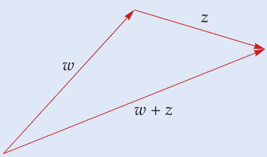

数学家和诗人奥马尔·海亚姆 (1048-1131) 的雕像，他在 1070 年写的代数书中首次对三次多项式进行了深入研究。

在讨论具有复数或实数系数的多项式之前，我们需要更多地了解复数。

### 4.1 定义：实部，Re $z$，虚部，Im $z$

假设 $z = a + bi$，其中 $a$ 和 $b$ 是实数。

- $z$ 的实部，记为 $\text{Re } z$，定义为 $\text{Re } z = a$。
- 复数 $z$ 的虚部，记作 $\text{Im } z$，定义为 $\text{Im } z = b$。

因此，对于每个复数 $z$，我们有
$$z = \text{Re}(z) + (\text{Im}(z))i$$

### 4.2 定义：复共轭，复数 $z$ 的绝对值，$|z|$

假设 $z \in \mathbb{C}$。

- 复数 $z \in \mathbb{C}$ 的复共轭，记作 $\bar{z}$，定义为 $\bar{z} = \text{Re}(z) - (\text{Im}(z))i$。
- 复数 $z$ 的绝对值，记作 $|z|$，定义为 $|z| = \sqrt{(\text{Re } z)^2 + (\text{Im } z)^2}$。

### 4.3 例子：实部和虚部，复共轭，绝对值

假设 $z = 3 + 2i$。那么

- $\text{Re } z = 3$ 和 $\text{Im } z = 2$。
- $\bar{z} = 3 - 2i$。
- $|z| = \sqrt{3^2 + 2^2} = \sqrt{13}$。

将复数 $z \in \mathbb{C}$ 与有序对 $(\text{Re } z, \text{Im } z) \in \mathbb{R}^2$ 进行对应，可以确定复数 $z$ 与实数 $\mathbb{R}^2$ 的关系。注意，$\mathbb{C}$ 是一个一维复向量空间，但我们也可以将 $\mathbb{C}$（与 $\mathbb{R}^2$ 对应）看作是一个二维实向量空间。

每个复数的绝对值是一个非负数。具体来说，如果 $z \in \mathbb{C}$，则 $|z|$ 等于从原点到点 $(\text{Re } z, \text{Im } z) \in \mathbb{R}^2$ 的距离。

实部和虚部，共轭复数和绝对值具有以下性质。

> 你应该验证 $z = \bar{z}$ 当且仅当 $z$ 是一个实数。

### 4.4 复数的性质

假设 $z, w \in \mathbb{C}$。则以下等式和不等式成立。

- $z$ 和 $\bar{z}$
  $z + \bar{z} = 2 \text{Re } z$ 的和。
- $z$ 和 $\bar{z}$
  $z - \bar{z} = 2(\text{Im } z)$ 的差。
- $z$ 和 $\bar{z}$
  $z\bar{z} = |z|^2$ 的乘积。

**共轭复数的可加性和可乘性**
$\overline{z+w} = \bar{z} + \bar{w}$ 和 $\overline{zw} = \bar{z}\bar{w}$。

**复共轭的双重**
$\bar{\bar{z}} = z$。

**实部和虚部都被 $|z|$**
$|\text{Re } z| \le |z|$ 和 $|\text{Im } z| \le |z|$ 所限制。

**复共轭的绝对值**
$|\bar{z}| = |z|$。

**绝对值的乘性**
$|zw| = |z||w|$。

**三角不等式**
$|z+w| \le |z| + |w|$。


证明 除了上面的最后一项之外，上述断言的常规验证留给读者。为了验证三角不等式，我们有

> 三角不等式的几何解释：三角形的每条边的长度都小于或等于另外两条边的长度之和。

$$
\begin{aligned}
|z+w|^2 &= (z+w)(\overline{z+w}) \\
&= (z+w)(\bar{z}+\bar{w}) \\
&= z\bar{z} + z\bar{w} + w\bar{z} + w\bar{w} \\
&= |z|^2 + |w|^2 + z\bar{w} + \overline{z\bar{w}} \\
&= |z|^2 + |w|^2 + 2\text{Re}(z\bar{w}) \\
&\le |z|^2 + |w|^2 + 2|z\bar{w}| \\
&= |z|^2 + |w|^2 + 2|z||w| \\
&= (|z|+|w|)^2
\end{aligned}
$$

现在取平方根即可得到所需的不等式 $|z+w| \le |z| + |w|$。

> 参见练习 2 以获得反向三角不等式。

# 多项式的零点

回想一下，如果存在 $\alpha_0, \cdots, \alpha_n \in \mathbb{F}$ 且 $\alpha_n \neq 0$，使得
$$f(x) = \alpha_0 + \alpha_1x + \cdots + \alpha_nx^n$$
则函数 $f : \mathbb{F} \to \mathbb{F}$ 被称为次数为 $n$ 的多项式。对于所有 $x \in \mathbb{F}$。如果上述形式中的表示 $x$ 不是唯一的，则多项式可能具有多个次数。我们的第一个任务是证明这是不可能的。

方程 $f(\alpha) = 0$ 的解在研究多项式 $f \in \mathbb{F}[x]$ 中起着关键作用。因此，这些解有一个特殊的名称。

> 4.5 定义：多项式的零点
>
> 数 $\alpha \in \mathbb{F}$ 被称为多项式 $f \in \mathbb{F}[x]$ 的零点（或根）如果 $f(\alpha) = 0$。

下一个结果是我们用来证明多项式的次数是唯一的关键工具。

> 4.6 每个多项式的零点对应一个一次因子
>
> 假设 $n$ 是一个正整数，$f \in \mathbb{F}[x]$ 是一个 $n$ 次多项式。假设 $\alpha \in \mathbb{F}$。那么 $f(\alpha) = 0$ 当且仅当存在一个次数为 $n-1$ 的多项式 $g \in \mathbb{F}[x]$ 使得对于每个 $x \in \mathbb{F}$，$f(x) = (x - \alpha)g(x)$ 成立。

证明 首先假设 $f(\alpha) = 0$。设 $\alpha_0, \alpha_1, \cdots, \alpha_n \in \mathbb{F}$ 满足 $f(x) = \alpha_0 + \alpha_1x + \cdots + \alpha_nx^n$ 对于所有 $x \in \mathbb{F}$。那么
$$f(x) = f(x) - f(\alpha) = \alpha_1(x - \alpha) + \cdots + \alpha_n(x^n - \alpha^n)$$
对于所有 $x \in \mathbb{F}$。对于每个 $k \in \{1, \cdots, n\}$，方程
$$x^k - \alpha^k = (x - \alpha) \sum_{j=1}^k x^{k-j} \alpha^{j-1}$$
表明 $x^k - \alpha^k$ 等于 $x - \alpha$ 乘以某个次数为 $k-1$ 的多项式。因此上述等式表明 $f$ 等于 $x - \alpha$ 乘以某个次数为 $n-1$ 的多项式，如所需。

为了证明另一个方向的蕴含，现在假设存在一个多项式 $g \in \mathbb{F}[x]$ 使得对于每个 $x \in \mathbb{F}$，有 $f(x) = (x - \alpha)g(x)$。那么 $f(\alpha) = (\alpha - \alpha)g(\alpha) = 0$，如所需。

现在我们可以证明多项式没有太多的零点。

### 4.8 度 $d$ 意味着最多 $d$ 个零点

假设 $d$ 是一个正整数，$P \in \mathcal{P}(d)$ 是一个 $d$ 次多项式。然后 $P$ 最多有 $d$ 个零点在 $\mathbb{F}$ 中。

证明 我们将对 $d$ 使用归纳法。如果 $d = 1$，所需的结果成立因为如果 $c_1 \neq 0$，那么多项式 $c_0 + c_1x$ 只有一个零点（等于 $-c_0/c_1$）。因此假设 $d > 1$ 并且所需的结果对 $d-1$ 成立。

如果 $P$ 在 $\mathbb{F}$ 中没有零点，则所需的结果成立，我们完成了。因此假设 $P$ 有一个零点 $x_0 \in \mathbb{F}$。根据 4.6，存在一个次数为 $d-1$ 的多项式 $Q \in \mathcal{P}(d)$ 使得
$$P(x) = (x - x_0)Q(x)$$
对于每个 $x \in \mathbb{F}$。我们的归纳假设表明 $P$ 有最多 $d-1$ 个零点在 $\mathbb{F}$ 中。上面的方程表明 $P$ 在 $\mathbb{F}$ 中的零点正好是 $Q$ 在 $\mathbb{F}$ 的零点以及 $x_0$。因此 $P$ 有最多 $d$ 个零点在 $\mathbb{F}$ 中。

上面的结果意味着多项式的系数是唯一确定的（因为如果一个多项式有两个不同的系数集，那么减去多项式的两个表示将得到一个多项式，其中一些系数非零但有无穷多个零点）。特别地，多项式的次数是唯一定义的。

回想一下，多项式的次数被定义为 $-\infty$。必要时，可以使用预期的算术运算 $-\infty$。例如，$-\infty < d$ 并且 $-\infty + d = -\infty$ 对于每个整数 $d$。

将 $0$ 次多项式声明为 degree $-\infty$，以便在各种合理的结果中不需要异常处理，例如 $\deg(fg) = \deg f + \deg g$。

### 多项式的除法算法

如果 $n$ 和 $m$ 是非负整数，并且 $m \neq 0$，则存在非负整数 $q$ 和 $r$ 使得 $n = mq + r$ 并且 $r < m$。

想象一下将 $n$ 除以 $m$，得到商 $q$ 和余数 $r$。我们下一个结果给出了多项式的类似结果。因此，下一个结果通常被称为多项式的除法算法，尽管在这里所述的它实际上不是一个算法，只是一个有用的结果。

多项式的除法算法可以在不使用任何线性代数的情况下证明。然而，作为一本线性代数教材，这里给出的证明使用了线性代数技巧。

将多项式的除法算法视为给出余式多项式 $r$，当多项式 $p$ 被多项式 $d$ 除时。

并且很好地利用了 $\mathcal{P}_n(\mathbb{F})$ 的基，它是具有系数在 $\mathbb{F}$ 且次数最多为 $n$ 的多项式的 $(n+1)$ 维向量空间。

## 第 4 章 多项式

## 4.9 多项式的除法算法

假设 $f, g \in P(\mathbb{F})$，且 $g \neq 0$。那么存在唯一的多项式 $q, r \in P(\mathbb{F})$，使得
$$f = qg + r$$
和 $\deg r < \deg g$。

证明：设 $n = \deg f$，设 $m = \deg g$。如果 $n < m$，那么取 $q = 0$ 和 $r = f$ 得到所需的方程 $f = qg + r$，其中 $\deg r < \deg g$。因此我们现在假设 $n \ge m$。

列表
- 4.10 $1, x, \dots, x^{m-1}, x^m, g_0, \dots, g_{n-m} x^{n-m}$

在 $P_{n-m}(\mathbb{F})$ 中是线性无关的，因为该列表中的每个多项式具有不同的次数。此外，列表 4.10 的长度为 $n - m + 1$，等于 $\dim P_{n-m}(\mathbb{F})$。因此 4.10 是 $P_{n-m}(\mathbb{F})$ 的一组基 [见 2.38]。
因为 $g \in P_m(\mathbb{F})$ 且 4.10 是 $P_m(\mathbb{F})$ 的一组基，所以存在唯一的常数 $q_0, q_1, \dots, q_{n-m} \in \mathbb{F}$ 和 $r_0, r_1, \dots, r_{m-1} \in \mathbb{F}$ 使得

- 4.11
$$
\begin{aligned}
f &= q_0 + q_1 x + \dots + q_{n-m} x^{n-m} + r_0 + r_1 x + \dots + r_{m-1} x^{m-1} \\
  &= (q_0 + q_1 x + \dots + q_{n-m} x^{n-m})g + (r_0 + r_1 x + \dots + r_{m-1} x^{m-1})
\end{aligned}
$$

根据上面定义的 $q$ 和 $r$，我们可以将 $f$ 写成 $f = qg + r$，其中 $\deg r < \deg g$，正如其所需。
满足这些条件的 $q$ 和 $r \in P(\mathbb{F})$ 的唯一性可以从常数 $q_0, q_1, \dots, q_{n-m} \in \mathbb{F}$ 和 $r_0, r_1, \dots, r_{m-1} \in \mathbb{F}$ 的唯一性推出，这满足 4.11。

## 复数域上的多项式因式分解

我们一直在处理具有复系数和实系数的多项式，现在我们将看到这两种情况之间的差异。
首先我们处理具有复系数的多项式。然后我们将使用这些结果来证明具有实系数的多项式的相应结果。

> 代数基本定理是一个存在性定理。
> 它的证明并不能导出找到零点的方法。
> 二次公式给出了二次多项式的零点。
> 对于三次和四次多项式，存在类似但更复杂的公式。
> 对于五次及以上的多项式，不存在这样的公式。

我们对代数基本定理的证明隐含地使用了一个连续实值函数在闭圆盘上取得最小值的结果。通过网络搜索可以找到几个相关的结果。

### 代数基本定理的其他证明

如果你对解析函数感到舒适，使用 Liouville 定理的证明尤其好。所有代数基本定理的证明都需要使用一些分析，因为如果用有理数替换所有复数，例如，用所有 $a + b\sqrt{2}$ 形式的数集，结果就不成立了。

## 4.12 代数基本定理，第一个版本

> 每个具有复系数的非常数多项式在每个 $\mathbb{C}$ 中都有一个零点。

证明：利用 De Moivre 定理，你可以使用对 $n$ 的归纳和余弦和正弦的加法公式来证明，该定理表明如果 $n$ 是正整数且 $n \in \mathbb{N}$，则
$$(\cos \theta + i \sin \theta)^n = \cos(n\theta) + i \sin(n\theta)$$

假设 $n \in \mathbb{N}$ 且 $n$ 是正整数。使用极坐标，我们知道存在 $r \ge 0$ 和 $\theta \in \mathbb{R}$ 使得 $z = r(\cos \theta + i \sin \theta)$。

De Moivre 定理意味着
$$(r^{1/n}(\cos \frac{\theta}{n} + i \sin \frac{\theta}{n}))^n = z$$

因此，每个复数都有一个 $n$ 次根，这是我们很快要用到的事实。

假设 $p$ 是一个具有复系数和最高非零项 $a_n z^n$ 的非常数多项式。那么 $|p(z)| \to \infty$ 当 $|z| \to \infty$（因为 $|p(z)| / |z^n| \to |a_n|$ 当 $|z| \to \infty$）。因此，连续函数 $z \mapsto |p(z)|$ 在某个点 $z_0 \in \mathbb{C}$ 处有一个全局最小值。为了证明 $p(z_0) = 0$，假设 $p(z_0) \neq 0$。

通过定义一个新的多项式 $q$，
$$q(z) = p(z_0 + z) / p(z_0)$$

函数 $z \mapsto |q(z)|$ 在 $z = 0$ 处有一个全局最小值 1。写成
$$q(z) = 1 + a_k z^k + \dots + a_m z^m$$

其中 $k$ 是最小的正整数，使得 $a_k$ 的系数非零；换句话说， $a_k \neq 0$。

设 $z \in \mathbb{C}$ 满足 $z^k = -1/a_k$。存在一个常数 $r > 0$，使得如果
$$|z| < r，则$$
$$|q(z)| \le | 1 + a_k z^k | + \dots$$
$$= 1 - \delta |z|^k (1 - \epsilon |z|)$$

因此，在上述不等式中取 $z$ 为 $1/(2k|a_k|^{1/k})$，我们有 $|q(z)| < 1$，这与全局最小值为 1 的假设矛盾。这个矛盾表明 $p(z_0) = 0$，证明了 $p$ 有一个零点，如所需。

计算机可以使用聪明的数值方法来找到多项式的良好近似零点，即使无法找到精确的零点。例如，没有人会给出多项式 $p$ 的精确零点的公式，该多项式定义为 $p(x) = x^5 - 5x^4 - 6x^3 + 17x^2 + 4x - 7$。

然而，计算机可以找到 $p$ 的零点近似值，大约为五个数 -1.87, -0.74, 0.62, 1.47, 5.51。

代数基本定理的第一个版本导致了具有复系数的多项式的以下因式分解结果。请注意，在这个因式分解中，多项式 $p$ 的零点是数字 $z_1, \dots, z_n$，它们是使得下一个结果方程的右边等于 0 的唯一值 $z$。

## 4.13 代数基本定理，第二版

如果 $p \in \mathbb{C}[x]$ 是一个非常数多项式，则 $p$ has a unique factorization (except for the order of the factors) of the form
$$p(z) = c(z - z_1)\cdots(z - z_n),$$
其中 $c, z_1, \dots, z_n \in \mathbb{C}$。

证明：设 $p \in \mathbb{C}[x]$ 且 $n = \deg p$。我们将对 $n$ 进行归纳。如果 $n = 1$，则所需的分解存在且唯一。因此假设 $n > 1$ 且对于所有 $n-1$ 次多项式，所需的分解存在且唯一。

首先我们将证明 $p$ 的所需分解存在。根据代数基本定理的第一版 (4.12)，$p$ has a zero $z_1 \in \mathbb{C}$。根据 4.6，存在一个 $n-1$ 次多项式 $q$ 使得 $p(z) = (z - z_1) q(z)$

对于所有 $z \in \mathbb{C}$。我们的归纳假设意味着 $q$ has the desired factorization, which when plugged into the equation above gives the desired factorization of $p$.

现在我们转向唯一性的问题。数字 $c$ 是唯一确定的，作为 $z^n$ in $p$ 的系数。所以我们只需要证明除了顺序之外，只有一种选择 $z_1, \dots, z_n$. 如果 $(z - z_1)\cdots(z - z_n) = (z - z'_1)\cdots(z - z'_n)$ 对于所有 $z \in \mathbb{C}$，那么因为上述方程的左边在 $z = z_1$ 时等于 0，右边的 $z'_i$ 之一等于 $z_1$

. 重新标记，我们可以假设 $z_1 = z'_1$. 现在如果 $z \neq z_1$，我们可以将上述方程两边除以 $z - z_1$，得到
```
(z - z_2)\cdots(z - z_n) = (z - z'_2)\cdots(z - z'_n) 对于所有 z \in \mathbb{C}
```
，除了可能 $z = z_1$. 实际上，上述方程对于所有 $z \in \mathbb{C}$ 都成立，因为否则通过将右边减去左边，我们将得到一个有无穷多个零点的非零多项式。上述方程和我们的归纳假设意味着除了顺序外，$z_i$ 的值与 $z'_i$ 的值相同，从而完成了唯一性的证明。

## 多项式在 $\mathbb{R}$ 上的因式分解

具有实系数的多项式可能没有实根。例如，多项式 $1 + x^2$ 没有实根。

> 代数基本定理在 $\mathbb{R}$ 上的失败解释了实数和复数向量空间上的线性代数之间的差异，我们将在后面的章节中看到。

为了得到关于多项式的因式分解定理，我们将使用关于多项式的因式分解定理。我们从下一个结果开始。

## 4.14 具有实系数的多项式具有成对的非实根。

假设 $P \in \mathbb{R}[x]$ 是具有实系数的多项式。如果 $z \in \mathbb{C}$ 是 $P$ 的一个零点，则 $\bar{z}$ 也是。

证明：设
```
P(x) = a_0 + a_1 x + \cdots + a_n x^n
```
，其中 $a_0, \dots, a_n$ 是实数。假设 $z \in \mathbb{C}$ 是 $P$ 的一个零点。那么
```
a_0 + a_1 z + \cdots + a_n z^n = 0.
```
对这个方程的两边取复共轭，得到
```
a_0 + a_1 \bar{z} + \cdots + a_n \bar{z}^n = 0,
```
其中我们使用了复共轭的基本性质（见 4.4）。上面的方程表明 $\bar{z}$ 是 $P$ 的一个零点。

我们希望得到一个关于实系数多项式的因式分解定理。我们从以下结果开始。

> 考虑下面的结果与二次公式的关系。

## 4.15 二次多项式的因式分解

假设 $a, b \in \mathbb{R}$。那么存在以下形式的多项式因式分解
```
x^2 + bx + c = (x - r_1)(x - r_2)
```
其中 $r_1, r_2 \in \mathbb{R}$ 当且仅当 $b^2 \ge 4c$。

证明：注意到
```
x^2 + bx + c = (x + b/2)^2 + (c - b^2/4).
```
首先假设 $b^2 < 4c$。那么上面方程的右边对于每个 $x \in \mathbb{R}$ 都是正的。因此多项式 $x^2 + bx + c$ 没有实根，因此
> 上面的方程是称为完成平方的技巧的基础。

不能以 $(x - r_1)(x - r_2)$ 的形式进行因式分解，其中 $r_1, r_2 \in \mathbb{R}$。

反过来，现在假设 $b^2 \ge 4c$。那么存在一个实数 $\delta$ 使得 $\delta^2 = b^2 - 4c$。从上面的方程中，我们得到
$$ x^2 + bx + c = \left(x + \frac{b}{2}\right)^2 - \frac{\delta^2}{4} $$
$$ = \left(x + \frac{b}{2} + \frac{\delta}{2}\right)\left(x + \frac{b}{2} - \frac{\delta}{2}\right), $$
这给出了所需的因式分解。

下一个结果给出了一个多项式在 $\mathbb{R}$ 上的因式分解。证明的思路是使用代数基本定理的第二个版本 (4.13)，它给出了一个以复系数的多项式 $p$ 的因式分解。
复数但非实数的 $p$ 的零点成对出现；参见 4.14。因此，如果 $p$ 的因式分解中包含形如 $(x - \alpha)$ 的项，其中 $\alpha$ 是一个非实数复数，则 $(x - \bar{\alpha})$ 也是因式分解中的一项。将这两个项相乘，我们得到
$$ (x^2 - 2(\text{Re}\alpha)x + |\alpha|^2), $$
这是所需形式的二次项。

上面段落中概述的思路几乎证明了我们所需的因式分解的存在性。然而，我们需要小心处理一个问题。假设 $\alpha$ 是一个非实复数，且 $(x - \alpha)$ 是 $p$ 在 $\mathbb{R}[x]$ 中的一个因式。根据 4.14，我们保证 $(x - \bar{\alpha})$ 也作为一个因式出现在分解中，但 4.14 并没有说明这两个因子出现的次数相同，而这是使上述思路成立所需的。

然而，这个证明解决了这个问题。

在下一个结果中，$k$ 或 $m$ 可以等于 0。数字 $r_1, \cdots, r_k$ 恰好是 $p$ 的实零点，因为这些是使下一个结果中方程的右边等于 0 的唯一实数值。

## 4.16 多项式在 $\mathbb{R}$ 上的因式分解

假设 $P \in \mathbb{R}[x]$ 是一个非常数多项式。那么 $P$ 有一个形式唯一的因式分解（除了因式的顺序）
$$ P(x) = c(x - r_1)\cdots(x - r_k)(x^2 + b_1 x + a_1)\cdots(x^2 + b_m x + a_m), $$
其中 $c, r_1, \cdots, r_k, a_1, \cdots, a_m, b_1, \cdots, b_m \in \mathbb{R}$，且对于每个 $j$，有 $b_j^2 < 4a_j$。

证明：首先我们将证明所需的因式分解存在，然后我们将证明唯一性。

将 $P$ 看作 $\mathbb{R}[x]$ 中的一个元素。如果 $P$ 的所有（复数）零点都是实数，则根据 4.13，我们可以得到所需的因式分解。因此假设 $P$ 有一个零点 $\alpha \notin \mathbb{R}$。根据 4.14， $\bar{\alpha}$ 是 $P$ 的一个零点。因此我们可以写成

$$ P(z) = (z-\alpha)(z-\bar{\alpha})Q(z) $$
$$ =(z^2-2(\text{Re}\alpha)z+|\alpha|^2)Q(z) $$

对于一些多项式 $Q \in \mathbb{C}[z]$ 其次数比 $P$ 低两个单位。如果我们能证明 $Q$ 有实系数，那么对 $Q$ 的次数进行归纳就完成了这个结果的存在性证明。

为了证明 $Q$ 有实系数，我们解上面的方程得到 $Q$，得到
$$ Q(z) = \frac{P(z)}{z^2 - 2(\text{Re}\alpha)z + |\alpha|^2} $$
对于所有 $z \in \mathbb{C}$。上面的方程意味着对于所有 $z \in \mathbb{C}$，有 $Q(z) \in \mathbb{C}$。写成
$$ Q(z) = Q_0 + Q_1 z + \cdots + Q_{n-2} z^{n-2} $$
，其中 $n = \deg P$ 且 $Q_0, \cdots, Q_{n-2} \in \mathbb{C}$，因此我们有
$$ 0=\text{Im}Q(z) = (\text{Im}Q_0)+(\text{Im}Q_1)z+\ldots+(\text{Im}Q_{n-2})z^{n-2} $$
对于所有的 $z \in \mathbb{C}$。这意味着 $\text{Im} Q_0, \cdots, \text{Im } Q_{n-2}$ 都等于 0 (根据 4.8)。因此所有 $Q$ 的系数都是实数，正如所需。因此所需的分解存在。

现在我们转向我们分解的唯一性问题。形如 $z^2+bz+c$ 的 $P$ 的一个因子，其中 $b^2 < 4c$，可以唯一地写成 $(z-\alpha)(z-\bar{\alpha})$ 其中 $\alpha \in \mathbb{C}$。稍加思考就可以发现，将 $P$ 作为 $P(z)$ 的一个元素的两种不同分解会导致将 $P$ 作为 $P(z)$ 的一个元素的两种不同分解，这与 4.13 矛盾。

## 练习题 4

- 1 假设 $P, Q \in \mathbb{C}$。验证以下等式和不等式。
  (a) $P + \bar{P} = 2\text{Re } P$
  (b) $P - \bar{P} = 2i\text{Im } P$
  (c) $P \bar{P} = |P|^2$
  (d) $\overline{P+Q} = \bar{P} + \bar{Q}$ 和 $\overline{PQ} = \bar{P}\bar{Q}$
  (e) $\bar{\bar{P}} = P$
  (f) $|\text{Re } P| \leqslant |P|$ 和 $|\text{Im } P| \leqslant |P|$
  (g) $|\bar{P}| = |P|$
  (h) $|PQ| = |P||Q|$
  以上结果是留给读者的 4.4 部分。
- 2 证明如果 $P, Q \in \mathbb{C}$，那么 $| |P|-|Q| | \leqslant |P-Q|$。
  上述不等式被称为反向三角不等式。
- 3 假设 $\mathbb{C}$ 是一个复向量空间，$z \in \mathbb{C}$。定义 $T: \mathbb{C} \to \mathbb{C}$ 为 $T(z) = \text{Re } z$ 对于每个 $z \in \mathbb{C}$。证明
  $T(z) = T(z) - T(\bar{z})$
  对于所有 $z \in \mathbb{C}$。
  *(注：原文本此处有歧义，按常规修正)*
- 4 假设 $n$ 是一个正整数。集合 $\{0\} \cup \{p \in P(\mathbb{C}) : \deg p = 0\}$ 是 $P(\mathbb{C})$ 的子空间吗？
- 5 这个集合
  $\{0\} \cup \{p \in P(\mathbb{C}) : \deg p \text{ 是偶数}\}$ 是 $P(\mathbb{C})$ 的子空间吗？
- 6 假设 $n$ 和 $m$ 是正整数，且 $n \le m$，且假设 $z_1, \dots, z_n \in \mathbb{C}$。证明存在一个多项式 $p \in P(\mathbb{C})$，使得 $\deg p = n$，且 $0 = p(z_1) = \dots = p(z_n)$ 且 $p$ 没有其他零点。
- 7 假设 $n$ 是一个非负整数，$z_1, \dots, z_{n+1}$ 是不同的元素来自 $\mathbb{C}$，且 $w_1, \dots, w_{n+1} \in \mathbb{C}$。证明存在唯一的多项式 $p \in P_n(\mathbb{C})$ 使得
  $p(z_j) = w_j$
  对于每个 $j = 1, \dots, n+1$。
  这个结果可以在不使用线性代数的情况下证明。然而，尝试找到使用一些线性代数的更清晰、更简短的证明。
- 8 假设 $p \in P(\mathbb{C})$ 的次数为 $n$。证明当且仅当 $p$ 及其导数 $p'$ 没有公共零点时，$p$ 有 $n$ 个不同的零点。
- 9 证明每个具有实系数的奇次多项式都有一个实根。
- 10 对于 $p \in P(\mathbb{C})$，定义 $T: P(\mathbb{C}) \to P(\mathbb{C})$ 为
  $(Tp)(z) = \begin{cases} \frac{p(z) - p(3)}{z - 3} & \text{if } z \neq 3, \ p'(3) & \text{if } z = 3 \end{cases}$
  对于每个 $z \in \mathbb{C}$。证明对于每个多项式 $p \in P(\mathbb{C})$，$Tp \in P(\mathbb{C})$，并且证明 $T: P(\mathbb{C}) \to P(\mathbb{C})$ 是一个线性映射。
- 11 定义 $S: P(\mathbb{C}) \to P(\mathbb{C})$ 为 $S(p)(z) = p(z) p'(z)$。
  证明 $S(p)$ 是一个具有实系数的多项式。（若 $p$ 有实系数）
  *(注：原文本此处存在歧义和 OCR 错误，根据上下文修正为证明 S 将实系数多项式映射为实系数多项式或类似意图)*

## 第五章

## 特征值和特征向量

从一个向量空间到另一个向量空间的线性映射是第 3 章的研究对象。现在我们开始研究算子，它们是从一个向量空间到自身的线性映射。它们的研究构成了线性代数最重要的一部分。

为了了解一个算子，我们可以尝试将其限制在一个较小的子空间上。要求这个限制是一个算子将引导我们到不变子空间的概念。每个一维不变子空间都由一个向量产生，算子将其映射为向量的标量倍数。这条路径将引导我们到特征向量和特征值。

然后将证明线性代数中最重要的结果之一：每个有限维非零复向量空间上的算子都有一个特征值。这个结果将使我们能够证明对于有限维复向量空间上的每个算子，存在一个基使得算子的矩阵至少有近一半的元素等于 0。

**本章的基本假设**
- $\mathbb{F}$ 表示 $\mathbb{R}$ 或 $\mathbb{C}$。
- $V$ 表示一个在 $\mathbb{F}$ 上的向量空间。


比萨的列奥纳多（约 1170 年 -1250 年，近似日期），也被称为斐波那契。第 5D 节的练习 21 展示了线性代数如何用于找到封面上显示的斐波那契数列的显式公式。

### 5A 不变子空间

#### 特征值

> ### 5.1 定义：算子
>
> 从一个向量空间到自身的线性映射称为算子。
>
> 假设 $T \in \mathcal{L}(V)$。如果 $n \geqslant 2$ 且 $V = V_1 \oplus \dots \oplus V_n$，回想一下，我们定义了符号 $\mathcal{L}(V)$ 表示 $\mathcal{L}(V, V)$。其中每个 $V_i$ 是 $V$ 的非零子空间，那么为了理解 $T$ 的行为，我们只需要理解每个 $T|_{V_i}$；这里 $T|_{V_i}$ 表示对较小的定义域 $V_i$ 的限制 $T$。处理 $T|_{V_i}$ 应该比处理 $T$ 更容易，因为 $V_i$ 是一个比 $V$ 更小的向量空间。
>
> 然而，如果我们打算应用在运算符研究中有用的工具（如取幂），那么我们就有一个问题：$T|_{V_i}$ 可能不会将 $V_i$ 映射到自身；换句话说，$T$ 可能不是 $V_i$ 上的一个算子。因此，我们只考虑 $T$ 将每个 $V_i$ 映射到自身的 $V$ 的分解形式。因此，我们现在给 $V$ 通过映射到自身的 $V$ 的子空间一个名称。

> ### 5.2 定义：不变子空间
>
> 假设 $T \in \mathcal{L}(V)$。如果对于每个 $v \in U$，都有 $Tv \in U$，那么子空间 $U$ 在 $T$ 下被称为不变的。
>
> 因此 $U$ 在 $T$ 下是不变的，如果 $T|_U$ 是 $U$ 上的一个算子。

> ### 5.3 例子：在微分算子下不变的子空间
>
> 假设 $D \in \mathcal{L}(P_4(\mathbb{R}))$ 是由 $D = \frac{d}{dx}$ 定义的。那么 $P_4(\mathbb{R})$，它是 $P(\mathbb{R})$ 的一个子空间，对于 $D$ 是不变的，因为如果 $p \in P_4(\mathbb{R})$ 的次数最多为 4，那么 $p'$ 的次数也最多为 4。

> ### 5.4 例子：四个不一定不同的不变子空间
>
> 如果 $T \in \mathcal{L}(V)$，那么 $V$ 的以下子空间都是 $T$ 下的不变子空间。
>
> - $\{0\}$ 子空间 $\{0\}$ 在 $T$ 下是不变的，因为如果 $v \in \{0\}$，那么 $Tv = 0$，因此 $Tv = 0 \in \{0\}$。
> - $V$ 子空间 $V$ 在 $T$ 下是不变的，因为如果 $v \in V$，那么 $Tv \in V$。
> - 零空间 $N(T)$ 在 $N(T)$ 下是不变的，因为如果 $v \in N(T)$，那么 $Tv = 0$，因此 $Tv \in N(T)$。
> - 值域 $R(T)$ 在 $R(T)$ 下是不变的，因为如果 $v \in R(T)$，那么 $Tv \in R(T)$。

12. 假设 $n$ 是一个非负整数，$p \in \mathcal{P}_n(\mathbb{R})$ 是这样的一个多项式，它具有不同的实数 $x_0, x_1, \dots, x_n$，使得对于每个 $i = 0, 1, \dots, n$，都有 $p(x_i) \in \mathbb{R}$。证明 $p$ 的所有系数都是实数。

13. 假设 $f \in \mathcal{P}(\mathbb{R})$ 且 $f \neq 0$。令 $I = \{ pf : p \in \mathcal{P}(\mathbb{R}) \}$。
    (a) 证明 $\dim \mathcal{P}(\mathbb{R})/I = \deg f$。
    (b) 找到 $\mathcal{P}(\mathbb{R})/I$ 的一组基。

14. 假设 $f, g \in \mathcal{P}(\mathbb{R})$ 是非常数多项式且没有共同的零点。
    令 $n = \deg f$ 和 $m = \deg g$。按照下面的线性代数方法在 (a)-(c) 中证明存在 $s \in \mathcal{P}_{n-1}(\mathbb{R})$ 和 $t \in \mathcal{P}_{m-1}(\mathbb{R})$ 使得 $sf + tg = 1$。
    (a) 定义 $\varphi : \mathcal{P}_{n-1}(\mathbb{R}) \times \mathcal{P}_{m-1}(\mathbb{R}) \to \mathcal{P}_{n+m-1}(\mathbb{R})$ 为 $\varphi(s, t) = sf + tg$。证明线性映射 $\varphi$ 是单射的。
    (b) 证明线性映射 $\varphi$ 在 (a) 中是满射的。
    (c) 利用 (b) 得出存在 $s \in \mathcal{P}_{n-1}(\mathbb{R})$ 和 $t \in \mathcal{P}_{m-1}(\mathbb{R})$ 使得 $sf + tg = 1$。

第 5 章 特征值和特征向量
一个算子 $A \in \mathcal{L}(V)$ 除了 $\{0\}$ 和 $V$ 之外，是否还有其他不变子空间？稍后我们将看到，如果 $V$ 是有限维的且 $\dim V > 1$（对于 $\mathbb{F} = \mathbb{C}$）或 $\dim V > 2$（对于 $\mathbb{F} = \mathbb{R}$），那么这个问题的答案是肯定的；参见 5.19 和第 5B 节的练习 29。

前面的例子指出，null $A$ 和 range $A$ 在 $A$ 下是不变的。然而，这些子空间不一定能够轻松回答上面关于存在除 $\{0\}$ 和 $V$ 之外的不变子空间的问题，因为 null $A$ 可能等于 $\{0\}$，而 range $A$ 可能等于 $V$（当 $A$ 是可逆的时候发生）。

我们稍后将深入研究不变子空间。现在我们转向对最简单的非平凡不变子空间进行研究——维数为一的不变子空间。

取任意 $v \in V$ 且 $v \neq 0$，令 $M$ 等于所有 $v$ 的标量倍数的集合：
$$M = \{ \lambda v : \lambda \in \mathbb{F} \} = \text{span}(v)$$
那么 $M$ 是 $V$ 的一维子空间（而且每个一维子空间都可以用适当选择的 $v$ 表示）。如果 $M$ 在算子 $A \in \mathcal{L}(V)$ 下不变，则 $Av \in M$，因此存在一个标量 $\lambda \in \mathbb{F}$ 使得
$$Av = \lambda v$$
反过来，如果 $Av = \lambda v$ 对于某个 $\lambda \in \mathbb{F}$ 成立，则 $\text{span}(v)$ 是一个不变的一维子空间在 $A$ 下。

方程 $Av = \lambda v$，我们刚刚看到它与一维不变子空间密切相关，它非常重要，因此标量 $\lambda$ 和向量 $v$ 满足它被赋予了特殊的名称。

> ### 5.5 定义：特征值
>
> 假设 $A \in \mathcal{L}(V)$。数 $\lambda \in \mathbb{F}$ 被称为 $A$ 的特征值，如果存在 $x \in V$ 使得 $x \neq 0$ 且 $Ax = \lambda x$
>
> 在上述定义中，我们要求 $x \neq 0$，因为每个标量 $0 \in \mathbb{F}$ 都满足 $0x = 0 \cdot 0$。
>
> 单词 eigenvalue 是德语和英语的混合。德语前缀 eigen 意思是“自己”，表示一种内在属性。
>
> 上面的注释表明，如果且仅如果 $A$ 具有特征值，那么 $A$ 具有一个不变的一维子空间。

### 5.6 例子：特征值

定义一个算子 $A \in \mathcal{L}(\mathbb{R}^3)$，其中
$$A(x_1, x_2, x_3) = (5x_1 + 3x_2, 3x_1 + 6x_2 + 9x_3, -6x_1 - 6x_3)$$
对于 $(x_1, x_2, x_3) \in \mathbb{R}^3$。那么 $A(3, 1, -1) = (18, 6, -6) = 6(3, 1, -1)$。因此 6 是 $A$ 的一个特征值。

下一个结果中的等价性，以及线性代数中的许多深层结果，仅在有限维向量空间的背景下有效。

### 5.7 成为特征值的等价条件

假设 $V$ 是有限维的，$T \in \mathcal{L}(V)$，且 $\lambda \in \mathbb{F}$。那么以下内容是等价的。
- (a) $\lambda$ 是 $T$ 的特征值。
- (b) $T - \lambda I$ 不是单射的。
- (c) $T - \lambda I$ 不是满射的。
- (d) $T - \lambda I$ 不可逆。

> 提示：$I \in \mathcal{L}(V)$ 是单位算子。因此，对于所有的 $v \in V$，有 $Iv = v$。

证明 条件 (a) 和 (b) 是等价的，因为方程 $Tv = \lambda v$ 等价于方程 $(T - \lambda I)v = 0$。条件 (b), (c), 和 (d) 是等价的，根据 3.65。

### 5.8 定义：特征向量

假设 $T \in \mathcal{L}(V)$ 且 $\lambda \in \mathbb{F}$ 是 $T$ 的特征值。向量 $v \in V$ 被称为 $T$ 对应于 $\lambda$ 的特征向量，如果 $v \neq 0$ 且 $Tv = \lambda v$。

换句话说，一个非零向量 $v \in V$ 是一个算子 $T \in \mathcal{L}(V)$ 的特征向量，当且仅当 $Tv$ 是 $v$ 的标量倍。因为 $Tv = \lambda v$ 当且仅当 $(T - \lambda I)v = 0$，一个非零向量 $v \in V$ 是 $T$ 对应于 $\lambda$ 的特征向量，当且仅当 $v \in \text{null } (T - \lambda I)$。

### 5.9 例子：特征值和特征向量

假设 $T \in \mathcal{L}(\mathbb{R}^2)$ 由 $T(x, y) = (-y, x)$ 定义。
- (a) 首先考虑 $\lambda \in \mathbb{R}$ 的情况。然后 $T$ 是绕原点逆时针旋转 $90^\circ$ 在 $\mathbb{R}^2$ 中。如果一个算子有特征值，那么存在一个非零向量在其定义域中，使得该算子将其发送到其自身的标量倍。一个非零向量在 $\mathbb{R}^2$ 中的 $90^\circ$ 逆时针旋转不能等于其自身的标量倍。结论：如果 $\lambda \in \mathbb{R}$，则 $T$ 没有特征值（因此也没有特征向量）。
- (b) 现在考虑 $\lambda \in \mathbb{C}$ 的情况。要找到 $T$ 的特征值，我们必须找到标量 $\lambda$，使得方程 $T(x, y) = \lambda(x, y)$ 有除了 $x = y = 0$ 之外的解。

方程 $T(x, y) = \lambda(x, y)$ 等价于以下联立方程组

```
-y = \lambda x, x = \lambda y
```

将第二个方程给出的 $y$ 的值代入第一个方程，得到

```
-x = \lambda^2 x.
```

现在 $\lambda$ 不能等于 0 [否则根据 5.10，我们有 $\lambda = 0$；我们要寻找的是满足 5.10 的解，使得 $(v, \lambda)$ 不是 0 向量]，因此上述方程导致以下方程

$$ -1 = \lambda^2 $$

这个方程的解是 $\lambda = i$ 和 $\lambda = -i$。

你可以验证 $\lambda$ 和 $-\lambda$ 是特征值。实际上，对应于特征值 $i$ 的特征向量是形如 $(i, -1)$ 的向量，其中 $\lambda \in \mathbb{F}$ 且 $\lambda \neq 0$。此外，对应于特征值 $-i$ 的特征向量是形如 $(i, 1)$ 的向量，其中 $\lambda \in \mathbb{F}$ 且 $\lambda \neq 0$。

在下一个证明中，我们再次使用等价性
$$ \mu v = \mu (T - \lambda I)v = 0 $$

### 5.11 线性无关的特征向量

> 假设 $T \in \mathcal{L}(V)$。那么，对于 $T$ 的不同特征值对应的特征向量列表是线性无关的。

证明 假设所需结果为假。那么存在一个最小的正整数 $m$，使得存在一个线性相关的向量列表 $v_1, \dots, v_m$ 对应于不同的特征值 $\lambda_1, \dots, \lambda_m$ 的 $m$（注意 $m \ge 2$，因为根据定义，特征向量非零）。因此存在 $a_1, \dots, a_m \in \mathbb{F}$，其中没有一个是 0（因为 $m$ 的最小性）。

$$ a_1 v_1 + \dots + a_m v_m = 0 $$

将上述方程两边都应用 $T - \lambda_m I$，得到

$$ a_1(\lambda_1 - \lambda_m) v_1 + \dots + a_m(\lambda_m - \lambda_m) v_m = 0 $$

因为特征值 $\lambda_1, \dots, \lambda_{m-1}$ 是不同的，上面的系数都不等于 0。因此 $v_1, \dots, v_{m-1}$ 是一个线性相关的向量列表，对应于不同的特征值，这与 $m$ 的最小性矛盾。这个矛盾完成了证明。

上面的结果导致了下面结果的简短证明，它对一个算子可以拥有的不同特征值的数量有一个上界。

### 5.12 算子的特征值不能超过向量空间的维数

> 假设 $V$ 是有限维的。那么 $V$ 上的每个算子最多有 $\dim(V)$ 个不同的特征值。

证明 设 $T \in \mathcal{L}(V)$。假设 $\lambda_1, \dots, \lambda_m$ 是 $T$ 的不同特征值。设 $v_1, \dots, v_m$ 是相应的特征向量。那么根据 5.11，列表 $v_1, \dots, v_m$ 是线性无关的。因此 $m \le \dim(V)$ 的维数（见 2.22），证毕。

## 多项式应用于算子

更丰富的理论存在于算子（将一个向量空间映射到自身）而不是更一般的线性映射的主要原因是算子可以被提升到幂次。在本小节中，我们定义了这个概念和将多项式应用于算子的概念。这个概念将是我们在下一节中使用的关键工具，用来证明非零有限维复向量空间上的每个算子都有一个特征值。

如果 $T$ 是一个算子，那么 $T^2$ 是有意义的（见 3.7），并且也是在与 $T$ 相同的向量空间上的算子。我们通常写 $T^2$ 代替 $T \circ T$。更一般地，我们有以下对 $T^n$ 的定义。

### 5.13 表示法：$T^n$

假设 $T \in \mathcal{L}(V)$ 且 $n$ 是一个正整数。
- $T^n \in \mathcal{L}(V)$ 的定义是 $T^n = \underbrace{T \cdot T \cdots T}_{n \text{ 次}}$。
- $T^0$ 的定义是单位算子 $\mathcal{I}$ 在 $V$ 上的作用。
- 如果 $T$ 是可逆的，其逆算子为 $T^{-1}$，那么 $T^{-n} \in \mathcal{L}(V)$ 的定义是 $T^{-n} = (T^{-1})^n$。

你应该验证如果 $T$ 是一个算子，那么

$$ T^n T^m = T^{n+m} \text{ 且 } (T^n)^m = T^{nm} $$

其中 $n$ 和 $m$ 是任意整数，如果 $T$ 是可逆的，则为非负整数如果 $T$ 不可逆。

在定义了算子的幂之后，我们现在可以定义什么是将多项式应用于算子。

### 5.14 表示法：$p(T)$

假设 $p \in \mathcal{P}(\mathbb{F})$，$a \in \mathbb{F}$ 是给定的多项式
$$ p(z) = a_0 + a_1 z + a_2 z^2 + \dots + a_m z^m $$
对于所有的 $z \in \mathbb{F}$。那么 $p(T)$ 是在 $V$ 上定义的算子
$$ p(T) = a_0 \mathcal{I} + a_1 T + a_2 T^2 + \dots + a_m T^m $$

这是符号 $T$ 的一个新用法，因为我们将 $T$ 应用于算子，而不仅仅是 $V$ 的元素。这里的思想是，要评估 $p(T)$，我们只需将表达式中的 $z$ 替换为 $T$。注意，在 $p(T)$ 中，常数项 $a_0$ 变成了算子 $a_0 \mathcal{I}$（这是一个合理的选择，因为 $a_0 = a_0 \mathcal{I}^0$，因此我们应该将 $a_0$ 替换为 $a_0 \mathcal{I}^0$，它等于 $a_0 \mathcal{I}$）。

138 第 5 章 特征值和特征向量
### 5.15 例子：多项式应用于微分算子

假设 $p \in \mathcal{L}(V)$ 是由 $D = \frac{d}{dt}$ 定义的微分算子，$p$ 是由 $p(x) = 7 - 3x + 5x^2$ 定义的多项式。那么 $p(D) = 7\mathcal{I} - 3D + 5D^2$。因此

```
(p(D))v = 7v - 3v' + 5v''
```

对于每个 $v \in V$。

如果我们固定一个算子 $D \in \mathcal{L}(V)$，那么从 $\mathcal{P}$ 到 $\mathcal{L}(V)$ 的函数由 $p \to p(D)$ 给出，正如你应该验证的那样。

### 5.16 定义：多项式的乘积

如果 $p, q \in \mathcal{P}$，那么 $pq \in \mathcal{P}$ 是由定义的多项式
```
(pq)(x) = p(x)q(x)
```

对于所有的 $x \in \mathbb{F}$。

在对单个算子的多项式进行乘积时，顺序不重要，如下一个结果中的 (b) 所示。

### 5.17 乘法性质

假设 $p, q \in \mathcal{P}$ 和 $D \in \mathcal{L}(V)$。
那么
(a) $(pq)(D) = p(D)q(D)$;
(b) $p(D)q(D) = q(D)p(D)$。

非正式证明：当展开多项式的乘积时，使用分配律时，符号 $p$ 或 $q$ 无关紧要。

证明
(a) 假设 $p(x) = \sum_{j=0}^{n} a_j x^j$ 和 $q(x) = \sum_{k=0}^{m} b_k x^k$ 对于所有 $x \in \mathbb{F}$。然后

```
(pq)(x) = \sum_{j=0}^{n} \sum_{k=0}^{m} a_j b_k x^{j+k}
```

因此

```
(pq)(D) = \sum_{j=0}^{n} \sum_{k=0}^{m} a_j b_k D^{j+k} = (\sum_{j=0}^{n} a_j D^j)(\sum_{k=0}^{m} b_k D^k) = p(D)q(D).
```

(b) 使用 (a) 两次，我们有 $p(D)q(D) = (pq)(D) = (qp)(D) = q(D)p(D)$。

我们之前观察到，如果 $T \in \mathcal{L}(V)$，那么子空间 null $T$ 和 range $T$ 在 $T$ 下是不变的（见 5.4）。现在我们证明 $p$ 的每个多项式的零空间和值域也在 $T$ 下是不变的。

### 5.18 零空间和值域 $p(T)$ 在 $T$ 下是不变的

假设 $T \in \mathcal{L}(V)$ 和 $p \in \mathcal{P}(\mathbb{F})$。那么 null $p(T)$ 和 range $p(T)$ 在 $T$ 下是不变的。

证明 假设 $v \in \text{null } p(T)$。那么 $p(T)v = 0$。因此
$$ (T(p(T)))(v) = p(T)(Tv) = (p(T)v) = p(0) = 0. $$
因此 $Tv \in \text{null } p(T)$。因此 null $p(T)$ 在 $T$ 下是不变的，正如所需。
假设 $u \in \text{range } p(T)$。那么存在 $v \in V$ 使得 $u = p(T)v$。因此
$$ Tu = T(p(T)v) = p(T)(Tv). $$
因此 $Tu \in \text{range } p(T)$。因此 range $p(T)$ 在 $T$ 下是不变的，正如所期望的那样。

## 练习 5A

1. 假设 $T \in \mathcal{L}(V)$ 和 $W$ 是 $V$ 的子空间。
   (a) 证明如果 $W \subseteq$ null $T$，那么 $W$ 在 $T$ 下是不变的。
   (b) 证明如果 range $T \subseteq W$，那么 $W$ 在 $T$ 下是不变的。

2. 假设 $T \in \mathcal{L}(V)$，且 $W_1, \dots, W_m$ 是 $V$ 的子空间，在 $T$ 下是不变的。证明 $W_1 + \dots + W_m$ 在 $T$ 下是不变的。

3. 假设 $T \in \mathcal{L}(V)$。证明每个在 $T$ 下不变的子空间的交集也在 $T$ 下不变。

4. 证明或给出反例：如果 $V$ 是有限维的且 $W$ 是 $V$ 上每个算子都不变的子空间，则 $W = \{0\}$ 或 $W = V$。

5. 假设 $T \in \mathcal{L}(\mathbb{R}^2)$ 由 $T(1, 1) = (-3, -3)$ 定义。找出 $T$ 的特征值。

6. 定义 $T \in \mathcal{L}(\mathbb{R}^2)$ 由 $T(1, 1) = (1, 1)$ 定义。找出 $T$ 的所有特征值和特征向量。

7. 定义 $T \in \mathcal{L}(V)$。找出 $T$ 的所有特征值和特征向量。

8. 假设 $T \in \mathcal{L}(V)$ 满足 $T^2 = T$。证明如果 $\lambda$ 是 $T$ 的特征值，那么 $\lambda = 0$ 或 $\lambda = 1$。

## 第 5 章 特征值和特征向量

9 定义 $T: V \to V$ 为 $T^2=T$. 找出 $T$ 的所有特征值和特征向量。

10 定义 $T \in \mathcal{L}(\mathbb{F}^4)$ 为 $T(v)=v$ 对于所有 $v \in \mathbb{F}^4$. 找出 $T$ 的所有特征值和特征向量。

11 假设 $V$ 是有限维的，$T \in \mathcal{L}(V)$，且 $\lambda \in \mathbb{F}$. 证明存在 $\varepsilon > 0$ 使得对于所有满足 $0 < |\mu - \lambda| < \varepsilon$ 的 $\mu \in \mathbb{F}$，$\mu I - T$ 是可逆的。

12 假设 $V = U \oplus W$，其中 $U$ 和 $W$ 是 $T$ 的非零子空间。定义 $T \in \mathcal{L}(V)$ 为 $T(u+w)=u$ 对于每个 $u \in U$ 和每个 $w \in W$. 找出 $T$ 的所有特征值和特征向量。

13 假设 $T \in \mathcal{L}(V)$. 假设 $T \in \mathcal{L}(V)$ 是可逆的。
(a) 证明 $T$ 和 $T^{-1}$ 具有相同的特征值。
(b) $T$ 的特征向量与 $T^{-1}$ 的特征向量之间有什么关系？

14 给出一个在 $\mathbb{R}^4$ 上没有（实数）特征值的算子的例子。

15 假设 $V$ 是有限维的，$T \in \mathcal{L}(V)$，并且 $\lambda \in \mathbb{F}$. 证明当且仅当 $\lambda$ 是对偶算子 $T' \in \mathcal{L}(V')$ 的特征值时，$\lambda$ 是 $T$ 的特征值。

16 假设 $v_1, \dots, v_n$ 是 $V$ 的一组基，且 $T \in \mathcal{L}(V)$。证明如果 $\lambda$ 是 $T$ 的特征值，则

$$
|\lambda| \le \max\{ |M(T)_{i,j}| : 1 \le i, j \le n\}
$$

其中 $M(T)_{i,j}$ 表示矩阵 $M(T)$ 相对于基 $v_1, \dots, v_n$ 的第 $i$ 行，第 $j$ 列的元素。

参见第 6A 节中的练习 19，以获得一个不同的界限 $|\lambda|$。

17 假设 $V=\mathbb{F}, T \in \mathcal{L}(V)$，且 $\lambda \in \mathbb{F}$. 证明当且仅当 $\lambda$ 是复化 $T_c$ 的特征值时，$\lambda$ 是 $T$ 的特征值。

参见第 3B 节中的练习 33，以获得 $T_c$ 的定义。

18 假设 $V=\mathbb{C}, T \in \mathcal{L}(V)$，且 $\lambda \in \mathbb{C}$. 证明当且仅当 $\lambda$ 是复化 $T_c$ 的特征值时，$\lambda$ 是 $T_c$ 的特征值。

19 证明正向移位算子 $S \in \mathcal{L}(\mathbb{F}^\infty)$ 定义为

$$
S(x_1, x_2, \dots) = (0, x_1, x_2, \dots)
$$

没有特征值。

20 定义反向移位算子 $T \in \mathcal{L}(\mathbb{F}^\infty)$ 为

$$
T(x_1, x_2, x_3, \dots) = (x_2, x_3, \dots).
$$

(a) 证明 $\mathbb{F}$ 的每个元素都是 $T$ 的特征值。

(b) 找出 $T$ 的所有特征向量。

21 假设 $T \in \mathcal{L}(V)$ 是可逆的。
(a) 假设 $\lambda \in \mathbb{F}$ 且 $\lambda \neq 0$. 证明 $\lambda$ 是 $T$ 的特征值当且仅当 $1/\lambda$ 是 $T^{-1}$ 的特征值。
(b) 证明 $T$ 和 $T^{-1}$ 有相同的特征向量。

22 假设 $T \in \mathcal{L}(V)$ 且存在非零向量 $u$ 和 $v$ 在 $V$ 中使得 $Tu = 3v$ 和 $Tv = 3u$.
证明 $3$ 或 $-3$ 是 $T$ 的特征值。

23 假设 $V$ 是有限维的，$S$ 和 $T \in \mathcal{L}(V)$. 证明 $ST$ 和 $TS$ 有相同的特征值。

24 假设 $A$ 是一个 $n \times n$ 的矩阵，其元素在 $\mathbb{F}$ 中。定义 $T \in \mathcal{L}(\mathbb{F}^n)$ 为 $Tx = Ax$，其中 $\mathbb{F}^n$ 的元素被视为 $n \times 1$ 的列向量。
(a) 假设矩阵 $A$ 的每一行元素之和等于 1。证明 1 是 $T$ 的特征值。
(b) 假设矩阵 $A$ 的每一列元素之和等于 1。证明 1 是 $T$ 的特征值。

25 假设 $T \in \mathcal{L}(V)$ 和 $u, v$ 是 $T$ 的特征向量，且 $u + v$ 也是 $T$ 的特征向量。证明 $u$ 和 $v$ 是 $T$ 对应的相同特征值的特征向量。

26 假设 $T \in \mathcal{L}(V)$ 是这样的，即 $V$ 中的每个非零向量都是 $T$ 的特征向量。证明 $T$ 是标量倍的单位算子。

27 假设 $V$ 是有限维的，设 $k \in \{1, \dots, \dim V - 1\}$. 假设 $T \in \mathcal{L}(V)$ 是这样的，每个维度为 $k$ 的子空间在 $T$ 下都是不变的。证明 $T$ 是标量乘以单位算子。

28 假设 $V$ 是有限维的，设 $T \in \mathcal{L}(V)$. 证明 $T$ 最多有 $1 + \dim \operatorname{range} T$ 个不同的特征值。

29 假设 $T \in \mathcal{L}(V)$ 且 $\dim V = 3$，以及 $-4, 5, \sqrt{7}$ 是 $T$ 的特征值。证明存在 $v \in V$，使得 $v, Tv, T^2v$ 对应的特征值为 $(-4, 5, \sqrt{7})$。（注：此处根据上下文修正为特征值对应的基向量性质）。

30 假设 $T \in \mathcal{L}(V)$ 和 $(T - 2I)(T - 3I)(T - 4I) = 0$. 假设 $\lambda$ 是 $T$ 的特征值。证明 $\lambda = 2$ 或 $\lambda = 3$ 或 $\lambda = 4$.

31 给出一个例子 $T \in \mathcal{L}(V)$ 使得 $\dim V = 2$ 且 $T^4 = -I$.

32 假设 $T \in \mathcal{L}(V)$ 没有特征值且 $T^4 = I$. 证明 $T^2 = -I$.

33 假设 $T \in \mathcal{L}(V)$ 和 $k$ 是一个正整数。
(a) 证明 $T^k$ 是单射当且仅当 $T$ 是单射。
(b) 证明当且仅当 $T$ 是满射时，$T^k$ 是满射。

34 假设 $V$ 是有限维的，$v_1, \dots, v_n \in V$. 证明如果存在 $T \in \mathcal{L}(V)$ 使得列表 $v_1, \dots, v_n$ 线性无关，则 $v_1, \dots, v_n$ 是 $T$ 对应于不同特征值的特征向量。

35 假设 $\lambda_1, \dots, \lambda_k$ 是一组不同的实数。证明在实值函数的向量空间中，列表 $e^{\lambda_1}, \dots, e^{\lambda_k}$ 是线性无关的。

提示：令 $W = \operatorname{span}(e^{\lambda_1}, \dots, e^{\lambda_k})$，并定义一个算子 $T \in \mathcal{L}(W)$，使得 $Tv = v'$。找出 $T$ 的特征值和特征向量。

36 假设 $\lambda_1, \dots, \lambda_k$ 是一组不同的正数。证明：列表 $\cos(\lambda_1), \dots, \cos(\lambda_k)$ 在实值函数的向量空间中是线性无关的。

37 假设 $V$ 是有限维的，$T \in \mathcal{L}(V)$。定义 $S \in \mathcal{L}(\mathcal{L}(V))$ 为 $S(T) = T^2$。
对于每个 $T \in \mathcal{L}(V)$。证明 $S$ 的特征值集合等于 $T$ 的特征值集合。

38 假设 $V$ 是有限维的，$T \in \mathcal{L}(V)$，并且 $W$ 是 $V$ 的一个子空间在 $T$ 下不变。商算子 $T/W \in \mathcal{L}(V/W)$ 的定义为

$$
(T/W)(v + W) = Tv + W
$$

对于每个 $v \in V$。

(a) 证明 $T/W$ 的定义是有意义的（需要使用 $W$ 在 $T$ 下不变的条件）并且证明 $T/W$ 是 $V/W$ 上的一个算子。

(b) 证明 $T/W$ 的每个特征值都是 $T$ 的特征值。

39 假设 $V$ 是有限维的，$T \in \mathcal{L}(V)$. 证明当且仅当存在一个维度为 $\dim(V) - 1$ 的子空间 $W$ 在 $T$ 下不变时，$T$ 具有一个特征值。

40 假设 $T, S \in \mathcal{L}(V)$ 且 $T$ 是可逆的。假设 $p \in \mathcal{P}(\mathbb{F})$ 是一个多项式。证明

$$
p(TST^{-1}) = T p(S) T^{-1}.
$$

41 假设 $T \in \mathcal{L}(V)$ 且 $W$ 是在 $T$ 下不变的子空间。证明对于每个多项式 $p \in \mathcal{P}(\mathbb{F})$，$W$ 在 $p(T)$ 下是不变的。

42 定义 $D \in \mathcal{L}(\mathbb{F}^3)$ 为 $D(x_1, x_2, x_3) = (x_1, 2x_2, 3x_3)$。

(a) 找出 $D$ 的所有特征值和特征向量。

(b) 找出 $D$ 下的所有不变子空间。

43 假设 $V$ 是有限维的，维度 $\dim(V) > 1$，并且 $T \in \mathcal{L}(V)$. 证明 $\{p(T) : p \in \mathcal{P}(\mathbb{F})\} \neq \mathcal{L}(V)$。

## 5B 最小多项式

### 复向量空间上的特征值存在性

现在我们来讨论有限维复向量空间上算子的一个核心结果。

> **5.19 特征值的存在性**
> 有限维非零复向量空间上的每个算子都有一个特征值。

**证明**
假设 $V$ 是一个维度为 $\dim V > 0$ 的有限维复向量空间，$T \in \mathcal{L}(V)$. 选择 $v \in V$ 且 $v \neq 0$. 那么

$$
v, Tv, T^2v, \dots, T^{\dim V}v
$$

不是线性无关的，因为 $V$ 的维度是 $\dim V$，而这个列表的长度是 $\dim V + 1$. 因此，上述向量的某个线性组合（其中不是所有系数都等于 0）等于 0. 因此存在一个非常数多项式 $p$ 最小次数，使得

$$
p(T)v = 0.
$$

根据代数基本定理的第一版（见 4.12），存在 $\lambda \in \mathbb{F}$ 使得 $p(\lambda) = 0$. 因此存在一个多项式 $q \in \mathcal{P}(\mathbb{F})$ 使得

对于每个 $v \in V$（见 4.6），有 $p(T) = (T - \lambda I)q(T)$. 这意味着（使用 5.17）

$$
0 = p(T)v = (T - \lambda I)(q(T)v).
$$

因为 $p$ 的次数比 $q$ 小，我们知道 $q(T)v \neq 0$. 因此上述方程意味着 $\lambda$ 是 $T$ 的特征值，对应的特征向量是 $q(T)v$.

上述证明关键地使用了代数基本定理。

在练习 16 之后的评论有助于解释为什么代数基本定理与上述结果如此紧密相关。

上述结果中的假设 $\dim V < \infty$ 不能被 $V = \{0\}$ 的假设所替代，正如示例 5.9 所示。下一个示例表明上述结果中的有限维假设也不能被删除。

> **5.20 示例：在没有特征值的复向量空间上的一个算子**
> 定义 $T \in \mathcal{L}(\mathcal{P}(\mathbb{C}))$ 为 $(Tp)(z) = z p(z)$. 如果 $p \in \mathcal{P}(\mathbb{C})$ 是一个非零多项式，则 $T$ 的次数比 $p$ 的次数多一，因此 $T$ 不能等于 $\lambda$ 的标量倍。因此 $T$ 没有特征值。
> 因为 $\mathcal{P}(\mathbb{C})$ 是无限维的，所以这个例子不与上面的结果矛盾。

## 特征值和最小多项式

在这个小节中，我们介绍了与每个算子相关的一个重要多项式。我们从以下定义开始。

> **5.21 定义：首一多项式**
> 首一多项式是一个最高次系数等于 1 的多项式。
> 例如，多项式 $2 + 9x^2 + x^7$ 是一个次数为 7 的首一多项式。

> **5.22 最小多项式的存在性、唯一性和次数**
> 假设 $V$ 是有限维的，$T \in \mathcal{L}(V)$. 那么存在一个唯一的首一多项式 $p \in \mathcal{P}(V)$，其次数最小且满足 $p(T) = 0$. 此外，$\deg p \le \dim V$.

**证明**
如果 $\dim V = 0$，那么 $T$ 是 $V$ 上的零算子，因此我们取 $p$ 为常数多项式 1。

现在对 $\dim V$ 使用归纳法。因此假设 $\dim V > 0$ 并且所需的结果对所有较小维度的复向量空间上的所有算子都成立。
设 $v_1, v_2, \dots, v_{\dim V + 1}$ 的长度为 $1 + \dim V$，因此线性相关。根据线性相关性引理 (2.19)，存在最小的正整数 $m \le \dim V$ 使得 $T^m$ 是 $I, T, \dots, T^{m-1}$ 的线性组合。因此存在标量 $a_0, a_1, a_2, \dots, a_{m-1} \in \mathbb{F}$ 使得

$$
T^m - a_{m-1}T^{m-1} - \dots - a_0 I = 0
$$

通过定义一个首一多项式 $p \in \mathcal{P}(V)$，

$$
p(x) = x^m - a_{m-1}x^{m-1} - \dots - a_0
$$

则上述方程意味着 $p(T) = 0$.

如果 $k$ 是非负整数，那么

$$
p(T)(T^k v) = T^k(p(T)v) = T^k(0) = 0.
$$

线性相关引理 (2.19) 表明 $I, T, \dots, T^{k-1}$ 是线性无关的。因此上述方程意味着 $\operatorname{null } p(T)$ 的维数 $\ge k$. 因此 $\operatorname{range } p(T)$ 的维数 $= \dim V - \operatorname{null } p(T)$ 的维数 $\le \dim V - k$.

因为 $\operatorname{range } p(T)$ 在 $T$ 下是不变的（根据 5.18），我们可以将归纳假设应用于向量空间 $\operatorname{range } p(T)$ 上的算子 $T | \operatorname{range } p(T)$. 因此存在一个首一多项式 $q \in \mathcal{P}(V)$，

$$
\deg q \le \dim V - k \text{ and } q(T | \operatorname{range } p(T)) = 0.
$$

因此对于所有 $v \in V$ 我们有

$$
(qp)(T)v = q(T)(p(T)v) = 0
$$

因为 $p(T)v \in \operatorname{range } p(T)$ 并且 $q(T)|_{\operatorname{range } p(T)} = 0$. 因此 $qp$ 是一个首一多项式，满足 $\deg (qp) \le \dim V$ 并且 $(qp)(T) = 0$.

上面的段落表明，存在一个次数不超过 $\dim V$ 的首一多项式，当应用于 $V$ 时得到 0 算子。因此存在一个最小次数的首一多项式，具有这个性质，完成了这个结果的存在部分。

设 $p \in \mathcal{P}(V)$ 为最小次数的首一多项式，使得 $p(T) = 0$.
为了证明结果的唯一性部分，假设 $q \in \mathcal{P}(V)$ 是与 $p$ 具有相同次数的首一多项式，且 $q(T) = 0$. 那么 $(q - p)(T) = 0$ 且 $\deg(q - p) < \deg p$. 如果 $q - p$ 不等于 0，那么我们可以将 $q - p$ 除以 $q - p$ 中最高次项的系数，得到一个首一多项式（次数比 $p$ 小），当作用于 $V$ 时得到 0 算子。因此 $q - p = 0$，如期望的。

前面的结果证明了以下定义。

> ### 5.24 定义：极小多项式
> 假设 $V$ 是有限维的，$T \in \mathcal{L}(V)$. 那么 $T$ 的极小多项式是唯一的首一多项式 $p \in \mathcal{P}(V)$，其次数最小，使得 $p(T) = 0$.

要计算算子 $T \in \mathcal{L}(V)$ 的极小多项式，我们需要找到最小的正整数 $k$，使得方程

$$
\alpha_0 I + \alpha_1 T + \cdots + \alpha_{k-1} T^{k-1} = -\alpha_k T^k
$$

有解 $\alpha_0, \alpha_1, \dots, \alpha_{k-1} \in \mathbb{R}$. 如果我们选择 $V$ 的一组基，并将上述方程中的 $T$ 替换为 $T$ 的矩阵，则上述方程可以看作是一个包含 $(\dim V)^2$ 个未知数 $\alpha_0, \alpha_1, \dots, \alpha_{k-1} \in \mathbb{R}$ 的线性方程组。
高斯消元法或其他快速解线性方程组的方法
可以告诉我们是否存在解，通过测试连续的值 $k = 1, 2, \dots$ 直到
存在解为止。根据 5.22，存在解的最小正整数为
$k \le \dim V$. 然后，$T$ 的最小多项式为 $\alpha_0I + \alpha_1T + \dots + \alpha_{k-1}T^{k-1} + \alpha_kT^k$.
更快的方法（通常），选择 $v \in V$ 并考虑方程

$$
\alpha_0 I + \alpha_1 T + \cdots + \alpha_{\dim-1} T^{\dim-1} = -\alpha_{\dim} T^{\dim}
$$

使用 $V$ 的基来将上述方程转化为一个由 $\dim V$ 个线性方程组成的系统 $\alpha_0, \alpha_1, \dots, \alpha_{\dim-1}$. 如果这个方程组有唯一解 $\alpha_0, \alpha_1, \dots, \alpha_{\dim-1}$（大多数情况下是这样的），那么标量 $\alpha_0, \alpha_1, \dots, \alpha_{\dim-1}, 1$ 就是 $T$ 的最小多项式的系数（因为 5.22 表明最小多项式的次数最多为 $\dim V$）。

考虑在 $\mathbb{R}^4$ 上的算子（可以看作是相对于标准基的 $4 \times 4$ 矩阵），并取 $v = (1, 0, 0, 0)$.

> 这些估计是基于对数百万个随机矩阵的测试。

在上面的段落中，上述快速方法适用于 99.8% 以上的整数区间为 $[-10, 10]$ 的 $4 \times 4$ 矩阵，并适用于 99.999% 以上的整数区间为 $[-100, 100]$ 的 $4 \times 4$ 矩阵。

下面的例子说明了上述快速过程。

> **5.26 例子：在 $V^5$ 上的算子的极小多项式**
> 假设 $M \in \mathcal{L}(V^5)$ 并
>
> |   |   |   |   |   |
> |---|---|---|---|---|
> | 0 | 0 | 0 | 0 | -3 |
> | 1 | 0 | 0 | 0 | 6 |
> | 0 | 1 | 0 | 0 | 0 |
> | 0 | 0 | 1 | 0 | 0 |
> | 0 | 0 | 0 | 1 | 0 |
>
> 相对于标准基 $v_1, v_2, v_3, v_4, v_5$. 对于 5.25，取 $v = v_1$，我们有
>
> $M v_1 = v_2,$
> $M^2 v_1 = M(M v_1) = M v_2 = v_3,$
> $M^3 v_1 = M(M^2 v_1) = M v_3 = v_4,$
>
> $M^4 v_1 = M(M^3 v_1) = M v_4 = v_5,$
> $M^5 v_1 = M(M^4 v_1) = M v_5 = -3v_1 + 6v_2.$
>
> 因此 $3v_1 - 6v_2 = -M^5 v_1$. 列表 $v_1, M v_1, M^2 v_1, M^3 v_1, M^4 v_1$，等于列表 $v_1, v_2, v_3, v_4, v_5$，是线性无关的，因此没有其他线性组合等于 $-M^5 v_1$. 因此，$M$ 的最小多项式是 $x^5 - 6x + 3$.
>
> 回想一下，根据定义，$M$ 上的算子的特征值和 $V$ 中的多项式的零点必须是 $M$ 的元素。特别地，如果 $V = \mathbb{R}$，那么特征值和零点必须是实数。

> **5.27 特征值是最小多项式的零点**
> 假设 $V$ 是有限维的，且 $M \in \mathcal{L}(V)$.
>
> (a) 最小多项式的零点是 $M$ 的特征值。
>
> (b) 如果 $V$ 是复向量空间，则 $M$ 的最小多项式的形式为
>
> $$
> (x - \lambda_1)\dots(x - \lambda_n)
> $$
>
> 其中 $\lambda_1, \dots, \lambda_n$ 是 $M$ 的所有特征值的列表，可能有重复。

**证明**
设 $q$ 是 $M$ 的最小多项式。

(a) 首先假设 $\lambda \in \mathbb{F}$ 是 $q$ 的零点。那么 $q$ 可以写成以下形式

$$
q(x) = (x - \lambda)p(x)
$$

其中 $p$ 是一个首一多项式，其系数在 $\mathbb{F}$ 中（见 4.6）。因为 $q(M) = 0$，所以我们有

$$
0 = (M - \lambda I)p(M)
$$

对于所有 $v \in V$. 因为 $p$ 的次数小于最小多项式 $q$ 的次数，所以至少存在一个向量 $v \in V$ 使得 $p(M)v \neq 0$. 上述方程表明 $\lambda$ 是 $M$ 的特征值，证毕。

## 第 5B 节 最小多项式

为了证明 $T$ 的每个特征值都是 $m$ 的零点，现在假设 $\lambda \in \mathbb{C}$ 是 $T$ 的一个特征值。因此存在一个 $v \in V$ 且 $v \neq 0$ 使得 $Tv = \lambda v$。对这个方程的两边重复应用 $T$ 可得 $T$ 的 $k$ 次幂 $T^k v = \lambda^k v$，对于每个非负整数 $k$。因此

$$T(\lambda)v = \lambda(T)v.$$

因为 $m$ 是 $T$ 的最小多项式，所以 $m(T) = 0$。因此上述方程意味着 $m(\lambda) = 0$。因此 $\lambda$ 是 $m$ 的一个零点，正如所需。

为了得到所需的结果，使用 (a) 和代数基本定理的第二个版本（见 4.13）。

非零多项式的不同零点最多与其次数相同（见 4.8）。因此，前一个结果的 (a) 与一个算子在 $V$ 上的最小多项式的次数最多为 $\dim(V)$ 的维数相结合，给出了 5.12 的另一种证明，该定理表明一个算子在 $V$ 上最多有 $\dim(V)$ 个不同的特征值。

每个首一多项式都是某个算子的最小多项式，如练习 16 所示，该练习推广了例子 5.26。因此，5.27 (a) 表明，找到算子的特征值的精确表达式等价于找到多项式的零点的问题（因此对于某些算子来说是不可能的）。

### 5.28 例子：一个无法准确找到特征值的算子

设 $T \in \mathscr{L}(\mathbb{C}^5)$ 是由定义的算子

$$T(e_1, e_2, e_3, e_4, e_5) = (-3e_1 - 35e_2, e_1 + 6e_5, e_2, e_3, e_4).$$

关于标准基的 $T$ 的矩阵是 $5 \times 5$ 的矩阵，参见例子 5.26。正如我们在那个例子中所示，$T$ 的极小多项式是多项式

$$\lambda^5 - 6\lambda + 3.$$

上述多项式的零点不能用有理数、有理数的根和常规算术规则来表示（证明这一点将远远超出线性代数的范围）。因为上述多项式的零点是 $\lambda$ [根据 5.27(a)] 的特征值，所以我们无法以任何熟悉的形式找到 $T$ 的任何特征值的精确表达式。

数值技术（我们在这里不讨论）表明上述多项式的零点，以及因此 $T$ 的特征值，大约是以下五个复数：

$$-1.67, \ 0.51, \ 1.40, \ -0.12 + 1.5959i, \ -0.12 - 1.5959i.$$

请注意，这个多项式的两个非实零是它们的共轭复数，这是我们对于具有实系数的多项式所期望的（见 4.14）。

下一个结果完全描述了当作用于运算符时得到零运算符的多项式。

### 5.29 如果 $p(T) = 0$，则 $p$ 是最小多项式的多项式倍数

假设 $V$ 是有限维的，$T \in \mathcal{L}(V)$，且 $p \in \mathcal{P}(V)$。那么，如果 $p(T) = 0$，则 $p$ 是 $m$ 的最小多项式的多项式倍数。

**证明** 设 $m$ 表示 $T$ 的最小多项式。
首先假设 $p(T) = 0$。根据多项式的除法算法（4.9），存在多项式 $q, r \in \mathcal{P}(V)$，使得

$$p = qm + r$$

且 $\deg r < \deg m$。我们有

$$0 = p(T) = q(T)m(T) + r(T) = 0 + r(T) = r(T).$$

上面的方程意味着 $r = 0$（否则，将 $r$ 除以其最高次系数会产生一个单项式，当应用于 $T$ 时会得到 0；这个多项式的次数会比最小多项式小，这将产生矛盾）。因此，方程变成了 $p = qm$。因此 $p$ 是 $m$ 的多项式倍数，正如所需。

为了证明另一个方向，现在假设 $p$ 是 $m$ 的多项式倍数。因此存在一个多项式 $q \in \mathcal{P}(V)$，使得 $p = qm$。我们有

$$p(T) = q(T)m(T) = 0 + 0 = 0,$$

正如所需。

下一个结果是上面结果的一个很好的推论。

### 5.31 限制算子的最小多项式

假设 $V$ 是有限维的，$T \in \mathcal{L}(V)$，且 $U$ 是 $V$ 的一个子空间，且在 $T$ 下不变。那么 $m_T$ 是 $T|_U$ 的最小多项式的倍数。

**证明** 假设 $m_T$ 是 $T$ 的最小多项式。因此，对于所有的 $v \in V$，有 $m_T(T)v = 0$。特别地，

对于所有的 $v \in U$，有 $m_T(T)v = 0$。

因此，$m_T(T|_U) = 0$。现在，根据 5.29，将算子 $T|_U$ 代替 $T$ 应用，可以得出 $m_T$ 是 $T|_U$ 的最小多项式的倍数。

参见练习 25，关于商算子的结果类似于上面的结果。

下一个结果表明，一个算子的最小多项式的常数项决定了该算子是否可逆。

### 5.32 T 不可逆，则 T 的最小多项式的常数项为 0

假设 $V$ 是有限维的，$T \in \mathcal{L}(V)$。那么，如果 $T$ 不可逆，则 $T$ 的最小多项式的常数项为 0。

**证明** 假设 $T \in \mathcal{L}(V)$ 且 $p$ 是 $T$ 的最小多项式。那么，$T$ 不可逆 $\iff$ $0$ 是 $T$ 的特征值 $\iff$ $0$ 是 $p$ 的零点 $\iff$ $p$ 的常数项为 0。其中第一个等价关系由 5.7 得到，第二个等价关系由 5.27(a) 得到，最后一个等价关系是因为 $p$ 的常数项等于 $p(0)$。

### 5.33 偶数维零空间

假设 $T \in \mathcal{L}(V)$ 且 $V$ 是有限维的。还假设 $\alpha, \beta \in \mathbb{R}$ 且 $\alpha^2 < 4\beta$。那么 $\text{null}(T^2 + \alpha T + \beta I)$ 的维数是一个偶数。

**证明** 回忆一下 $\text{null}(T^2 + \alpha T + \beta I)$ 在 $T$ 的作用下是不变的（根据 5.18）。通过将 $T$ 替换为 $T$ 限制在 $\text{null}(T^2 + \alpha T + \beta I)$ 上，我们可以假设 $T^2 + \alpha T + \beta I = 0$；现在我们需要证明 $\dim V$ 是偶数。

假设 $v \in V$ 且 $w \in V$ 满足 $Tv = \mu v$，那么

$$0 = (T^2 + \alpha T + \beta I)v = ((T + \frac{\alpha}{2}I)^2 + (\beta - \frac{\alpha^2}{4})I)v.$$

上面大括号中的项是一个正数。因此，上面的方程暗示着 $v = 0$。因此，我们已经证明了 $T$ 没有特征向量。

让 $W$ 是 $V$ 的一个子空间，它在 $T$ 下是不变的，并且在所有在 $T$ 下不变且维度最大的子空间中具有最大的维度。如果 $W = V$，那么我们就完成了；否则假设存在 $v \in V$ 使得 $v \notin W$。

让 $U = \text{span}(v, Tv)$。那么 $U$ 在 $T$ 下是不变的，因为 $T(Tv) = -\alpha Tv - \beta v$。此外，$U$ 的维度为 2，否则 $v$ 将是 $T$ 的特征向量。现在

$$\dim(W + U) = \dim W + \dim U - \dim(W \cap U) = \dim W + 2,$$

其中 $W \cap U = \{0\}$，因为否则 $W \cap U$ 将是 $V$ 的一个一维子空间，而这个子空间在 $T$ 下是不变的（不可能，因为 $T$ 没有特征向量）。

因为 $W + U$ 在 $T$ 下是不变的，上面的方程表明存在一个在 $T$ 下不变的 $U$ 的子空间，其维度比 $W$ 大且为偶数。因此，假设 $W \neq V$ 是错误的。因此，$V$ 的维数是偶数。

下一个结果表明，在奇数维向量空间中，每个算子都有一个特征值。我们已经知道对于有限维复向量空间（不考虑奇数假设），这个结果是成立的。因此，在下面的证明中，我们将假设 $V = \mathbb{C}$。

### 5.34 奇数维向量空间上的算子有特征值

奇数维向量空间上的每个算子都有一个特征值。

**证明** 假设 $V$ 是有限维的。令 $n = \dim V$，并假设 $n$ 是一个奇数。令 $T \in \mathcal{L}(V)$。我们将使用归纳法来证明 $T$ 具有一个特征值，步长为两个。为了开始，注意到如果 $V$ 的维度为 1，则所需的结果成立，因为那么 $V$ 中的每个非零向量都是 $T$ 的特征向量。

现在假设 $n \geqslant 3$ 并且对于所有维度小于 $n$ 的奇数维向量空间上的所有算子，所需结果成立。令 $m_T$ 表示 $T$ 的最小多项式。如果 $m_T$ 是 $q(T)$ 的多项式倍数，其中 $q \in \mathbb{R}[z]$，则 $m_T$ 是

存在一个首一多项式 $r \in \mathbb{R}[z]$ 使得对于所有 $v \in V$，有 $r(T) = q(T)(T^2 + \alpha T + \beta I)$。

现在

$$0 = m_T(T) = (q(T))(T^2 + \alpha T + \beta I),$$

这意味着 $q(T)$ 等于 0 在 $(T^2 + \alpha T + \beta I)$ 的范围上。因为 $\deg m_T = \deg q + \deg r$ 且 $m_T$ 是 $T$ 的最小多项式，这意味着 $(T^2 + \alpha T + \beta I)$ 的范围不等于 $V$。

线性映射的基本定理 (3.21) 告诉我们

$$\dim V = \dim \text{null}(T^2 + \alpha T + \beta I) + \dim \text{range}(T^2 + \alpha T + \beta I).$$

因为 $\dim V$ 是奇数（根据假设），而 $\dim \text{null}(T^2 + \alpha T + \beta I)$ 是偶数（根据 5.33），上面的方程表明 $\dim \text{range}(T^2 + \alpha T + \beta I)$ 是奇数。

因此，$V$ 的子空间 $\text{range}(T^2 + \alpha T + \beta I)$ 是 $V$ 的不变子空间（根据 5.18），并且其奇数维度小于 $\dim V$。我们的归纳假设现在意味着 $T$ 限制在 $\text{range}(T^2 + \alpha T + \beta I)$ 上有一个特征值，这意味着 $T$ 有一个特征值。

在第 8B 节的习题 23 和第 9C 节的习题 10 中，可以找到上述结果的另一种证明方法。

## 习题 5B

- 1 假设 $T \in \mathcal{L}(V)$。证明 9 是 $T^2$ 的特征值当且仅当 3 或 -3 是 $T$ 的特征值。
- 2 假设 $V$ 是一个复向量空间，$T \in \mathcal{L}(V)$ 没有特征值。证明 $T$ 不变的 $V$ 的每个子空间要么是 $\{0\}$ 要么是无限维的。
- 3 假设 $n$ 是一个正整数，$T \in \mathcal{L}(\mathbb{F}^n)$ 定义为 $T(x_1, \dots, x_n) = (x_1 + \dots + x_n, \dots, x_1 + \dots + x_n)$。
  - (a) 找出 $T$ 的所有特征值和特征向量。
  - (b) 找出 $T$ 的最小多项式。
  - $T$ 相对于标准基的矩阵由全部 1 组成。
- 4 假设 $S=T, T \in \mathcal{L}(V), p \in \mathcal{P}(V)$，且 $p \in \mathcal{P}$。证明当且仅当 $\lambda = p(\mu)$，其中 $\mu$ 是 $T$ 的特征值时，$\lambda$ 是 $p(T)$ 的特征值。
- 5 举一个在 $\mathbb{F}^2$ 上的算子的例子，说明练习 4 的结果在将 $V$ 替换为 $\mathbb{F}^2$ 时不成立。
- 6 假设 $T \in \mathcal{L}(\mathbb{F}^2)$ 由 $T(x,y)=(-y,x)$ 定义。找出 $T$ 的最小多项式。
- 7 (a) 给出一个例子，使得 $S, T \in \mathcal{L}(\mathbb{F}^2)$，且 $S \neq 0, T \neq 0$，且 $ST \neq TS$。
  (b) 假设 $V$ 是有限维的，且 $S, T \in \mathcal{L}(V)$。证明如果至少有一个 $S, T$ 是可逆的，则 $ST$ 和 $TS$ 的最小多项式相等。
  - 提示：证明如果 $T$ 是可逆的且 $p \in \mathcal{P}(T)$，则 $p(T^{-1}) = T^{-k}p(T)T^k$。
- 8 假设 $R \in \mathcal{L}(\mathbb{F}^2)$ 是逆时针旋转 $1^\circ$ 的算子。找到 $R$ 的最小多项式。
  - 因为 $\dim \mathbb{F}^2=2$，所以 $R$ 的最小多项式的次数最多为 2。
  - 因此 $R$ 的最小多项式不是诱人的多项式 $x^{180}+1$，即使 $x^{180}=-1$。
- 9 假设 $T \in \mathcal{L}(V)$ 是这样的算子，对于 $V$ 的某个基，$T$ 的矩阵的所有元素都是有理数。解释为什么 $T$ 的最小多项式的所有系数都是有理数。
- 10 假设 $V$ 是有限维的，$T \in \mathcal{L}(V)$，且 $p \in \mathcal{P}$。证明
  $$\text{span}(v, Tv, \dots, T^k v) = \text{span}(v, Tv, \dots, T^{\dim V - 1}v)$$
  对于所有整数 $k \geqslant \dim V - 1$。
- 11 假设 $V$ 是一个二维向量空间，$T \in \mathcal{L}(V)$，并且矩阵 $T$ 相对于 $V$ 的某个基的表示是 $\begin{pmatrix} a & b \\ c & d \end{pmatrix}$。
  - (a) 证明 $T^2 - (a+d)T + (ad-bc)I = 0$。
  - (b) 证明 $T$ 的最小多项式等于
    $$T^2 - (a+d)T + (ad-bc)I = 0$$
    如果 $a=d=0$ 且 $b=c$，
    $$otherwise$$
- 12 定义 $T \in \mathcal{L}(\mathbb{F}^n)$ 为 $T(x_1, x_2, x_3, \dots, x_n) = (x_1, 2x_2, 3x_3, \dots, n x_n)$。找出 $T$ 的最小多项式。
- 13 假设 $S \in \mathcal{L}(V)$ 和 $p \in \mathcal{P}(V)$。证明存在唯一的 $q \in \mathcal{P}(V)$ 使得 $q(T) = p(T)$ 且 $\deg q$ 小于最小多项式的次数 of $T$。
- 14 假设 $T$ 是有限维的且 $T \in \mathcal{L}(V)$ 有最小多项式 $4 + 5T - 6T^2 - 7T^3 + 2T^4 + T^5$。找出 $T^{-1}$ 的最小多项式。
- 15 假设 $V$ 是一个有限维的复向量空间，其维度 $\dim V > 0$ 且 $T \in \mathcal{L}(V)$。定义 $f: \mathcal{L}(V) \to \mathbb{R}$ 为
  $$f(T) = \dim \text{range}(T - \lambda I).$$
  证明 $f$ 不是连续函数。
- 16 假设 $a_0, \dots, a_{n-1} \in \mathbb{F}$。设 $T$ 是 $\mathbb{F}^n$ 上的算子，其矩阵（相对于标准基）为
  $$\begin{pmatrix}
  0 & 1 & 0 & \cdots & 0 & -a_0 \\
  0 & 0 & 1 & \cdots & 0 & -a_1 \\
  \vdots & \vdots & \vdots & \ddots & \vdots & \vdots \\
  0 & 0 & 0 & \cdots & 1 & -a_{n-2} \\
  0 & 0 & 0 & \cdots & 0 & -a_{n-1}
  \end{pmatrix}$$
  这里矩阵的所有元素都是 0，除了对角线下方的所有 1 和最后一列的元素（其中可能也有 0）。
  证明 $T$ 的最小多项式是
  $$a_0 + a_1 T + \cdots + T^n$$
  上述矩阵被称为上述多项式的伴随矩阵。
  这个练习表明每个首一多项式都是某个算子的最小多项式。因此，一个能够为每个 $T$ 上的算子产生精确特征值的公式或算法，然后可以为每个多项式产生精确的零点 [根据 5.27(a)]。因此，没有这样的公式或算法。然而，存在有效的数值方法来获得算子的特征值的非常好的近似值。
- 17 假设 $T$ 是有限维的，$T \in \mathcal{L}(V)$，且 $m$ 是最小多项式的。假设 $c \in \mathbb{F}$。证明 $T - cI$ 的最小多项式是多项式 $p$ 定义为 $p(z) = m(z + c)$。
- 18 假设 $T$ 是有限维的，$T \in \mathcal{L}(V)$，且 $m$ 是最小多项式的。假设 $c \in \mathbb{F} \setminus \{0\}$。证明 $cT$ 的最小多项式是多项式 $p$ 定义为 $p(z) = c^{\deg m} m(z/c)$。
- 19 假设 $V$ 是有限维的，且 $T \in \mathcal{L}(V)$。令 $\mathcal{E}$ 为由 $\mathcal{L}(V)$ 定义的子空间。
  $$\mathcal{E}=\{T(v): v \in V\}.$$
  证明 $\mathcal{E}$ 的维数等于 $T$ 的最小多项式的次数。
- 20 假设 $T \in \mathcal{L}(\mathbb{F}^4)$，且 $T$ 的特征值为 3、5、8。证明 $(T-3I)^2(T-5I)^2(T-8I)^2=0$。
- 21 假设 $V$ 是有限维的，且 $T \in \mathcal{L}(V)$。证明 $T$ 的最小多项式的次数至多为 $1 + \dim \text{range } T$。如果 $\dim \text{range } T < \dim V - 1$，那么这个练习给出了比 5.22 更好的上界对于 $T$ 的最小多项式的次数。
- 22 假设 $V$ 是有限维的且 $T \in \mathcal{L}(V)$。证明当且仅当 $T \in \operatorname{span}(T, T^2, \dots, T^{\dim V})$ 时，$T$ 是可逆的。
- 23 假设 $V$ 是有限维的且 $T \in \mathcal{L}(V)$。令 $n = \dim V$。证明如果 $v \in V$，那么 $\text{span}(v, Tv, \dots, T^{n-1}v)$ 在 $T$ 下是不变的。
- 24 假设 $V$ 是一个有限维复向量空间。假设 $T \in \mathcal{L}(V)$ 是一个使得 5 和 6 成为 $T$ 的特征值，并且 $T$ 没有其他特征值的线性变换。
  证明 $(T-5I)^{\dim V-1}(T-6I)^{\dim V-1}=0$。
- 25 假设 $V$ 是有限维的，$T \in \mathcal{L}(V)$，且 $U$ 是 $V$ 的一个不变子空间。
  - (a) 证明 $m_T$ 是商算子 $T/V$ 的最小多项式的倍数。（注：原文此处有混淆，应为 $V/U$ 或商算子 $T_{V/U}$。根据上下文修正为商算子 $T_{V/U}$）。
  - (b) 证明
    $$ (\text{restriction of T to U's minimal polynomial}) \times (V/U \text{ minimal polynomial}) \text{ is a polynomial multiple of } T \text{ minimal polynomial. }$$
    商算子 $T/V$ 在 5A 节的练习 38 中定义。
- 26 假设 $V$ 是有限维的，$T \in \mathcal{L}(V)$，且 $U$ 是 $V$ 的一个不变子空间。证明 $T$ 的特征值集合等于 $T|_U$ 的特征值集合和 $T_{V/U}$ 的特征值集合的并集。
- 27 假设 $V = \mathbb{C}^2$，$V$ 是有限维的，且 $T \in \mathcal{L}(V)$。证明 $T$ 的极小多项式等于 $T^*$ 的极小多项式。（注：根据上下文 3B 节练习 33，复化。此处修正为共轭转置或复化相关）。
- 28 假设 $V$ 是有限维的，$T \in \mathcal{L}(V)$。证明 $T'$ 的最小多项式等于 $T$ 的最小多项式。对偶映射 $T'$ 在 3F 节中定义。
- 29 证明至少维度为二的有限维向量空间上的每个算子都有一个维度为二的不变子空间。
  第 5C 节的练习 6 将在 $V=\mathbb{C}$ 的情况下改进这个结果。

## 5C 上三角矩阵

在第 3 章中，我们定义了从一个有限维向量空间到另一个有限维向量空间的线性映射的矩阵。该矩阵取决于两个向量空间的基的选择。现在我们正在研究将一个向量空间映射到自身的算子，重点是只使用一个基。

### 5.35 定义：算子的矩阵, $\mathcal{M}(T)$

假设 $T \in \mathcal{L}(V)$。关于基 $v_1, \dots, v_n$ 的 $T$ 的矩阵是 $n \times n$ 矩阵

$$\mathcal{M}(T) = \begin{bmatrix} T_{1,1} & \dots & T_{1,n} \\ \vdots & & \vdots \\ T_{n,1} & \dots & T_{n,n} \end{bmatrix}$$

其元素 $T_{ji}$ 定义如下

$$T v_j = T_{1j} v_1 + \dots + T_{nj} v_n$$

如果基不明确，记号 $\mathcal{M}(T, (v_1, \dots, v_n))$ 被使用。

算子有方阵（行数等于列数），而不是我们之前考虑的更一般的矩形矩阵。

如果 $T$ 是一个作用于 $\mathbb{R}^n$ 的算子，并且没有指定基底，则假设问题中的基底是标准基底（其中第 $k$ 个基向量在第 $k$ 个位置上为 1，其他位置上为 0）。然后你可以将其视为 $\mathcal{M}(T)$ 的第 $k$ 列作为 $T$ 作用于第 $k$ 个基向量的结果，其中我们将 $n \times 1$ 列向量与 $\mathbb{R}^n$ 中的元素等同起来。

> 矩阵 $\mathcal{M}(T)$ 的第 $j$ 列由用于将 $T v_j$ 写成基 $v_1, \dots, v_n$ 的线性组合的系数形成。

### 5.36 例子：相对于标准基底的算子的矩阵

定义 $T$ 属于 $\mathcal{L}(\mathbb{R}^3)$ 为 $T(x, y, z) = (2x + y, 5y + 3z, 8z)$。那么相对于 $\mathbb{R}^3$ 的标准基底，$T$ 的矩阵为

$$\mathcal{M}(T) = \begin{bmatrix} 2 & 1 & 0 \\ 0 & 5 & 3 \\ 0 & 0 & 8 \end{bmatrix}$$

你应该验证一下。

线性代数的一个核心目标是要证明，在有限维向量空间 $V$ 上给定一个算子 $T$，存在一个基底 $v$，使得 $T$ 在这个基底下的矩阵表示相对简单。为了使这个模糊的表述更加精确，我们可以尝试选择 $V$ 的一个基底，使得 $\mathcal{M}(T)$ 有尽可能多的 0。

如果 $V$ 是一个有限维复向量空间，那么我们已经知道，存在一个基底 $B$，使得 $T$ 的矩阵表示在第一列除了可能第一个元素外都是 0。换句话说，存在一个基底 $B$，使得 $T$ 的矩阵表示如下：

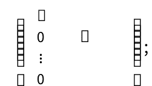

这里的 $x$ 表示除了第一列以外的所有列的元素。为了证明这一点，假设 $\lambda$ 是 $T$ 的一个特征值（根据定理 5.19，这样的特征值存在），$v$ 是相应的特征向量。将 $v$ 扩展为 $V$ 的一个基底。那么，相对于这个基底，$T$ 的矩阵表示具有上述形式。很快我们将看到，我们可以选择 $V$ 的一个基底，使得 $T$ 的矩阵表示具有更多的特性。

### 5.37 定义：矩阵的对角线

一个方阵的对角线由从左上角到右下角的线上的元素组成。

例如，矩阵的对角线

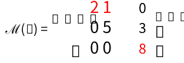

来自示例 5.36 的元素 2, 5, 8，在上面的矩阵中以红色显示。

### 5.38 定义：上三角矩阵

如果对角线以下的所有元素都为 0，则称方阵为上三角形。

例如，上面的 3 乘 3 矩阵是上三角形的。通常我们用以下形式表示上三角矩阵：

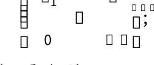

上面矩阵中的 0 表示在这个 $n$ 乘 $n$ 矩阵中，对角线以下的所有元素都等于 0。上三角矩阵通常表示为：

> 我们经常用 $*$ 表示我们不知道或与讨论的问题无关的矩阵元素。

简单来说，如果 $n$ 很大，那么一个 $n$ 乘 $n$ 的上三角矩阵中至少有一半的元素为 0。

下一个结果提供了上三角矩阵和不变子空间之间的有用联系。

### 5.39 上三角矩阵的条件

假设 $T \in \mathcal{L}(V)$ 且 $v_1, \dots, v_n$ 是 $V$ 的一组基。那么以下命题是等价的。

(a) 相对于 $v_1, \dots, v_n$ 的基，$T$ 的矩阵是上三角的。

(b) 对于每个 $k = 1, \dots, n$, $\text{span}(v_1, \dots, v_k)$ 在 $T$ 下是不变的。

(c) $T v_k \in \text{span}(v_1, \dots, v_k)$ 对于每个 $k = 1, \dots, n$。

证明 首先假设 (a) 成立。为了证明 (b) 成立，假设 $k \in \{1, \dots, n\}$。如果 $j \in \{1, \dots, k\}$，那么

$$ T v_j \in \text{span}(v_1, \dots, v_k) $$

因为 $T$ 相对于基 $v_1, \dots, v_n$ 的矩阵是上三角的。如果 $k \leq n$，我们可以看到

$$ T v_j \in \text{span}(v_1, \dots, v_k) $$

对于每个 $k \in \{1, \dots, n\}$。因此 $\text{span}(v_1, \dots, v_k)$ 在 $T$ 下是不变的，证明了 (a) 蕴含 (b)。

现在假设 (b) 成立，所以 $\text{span}(v_1, \dots, v_k)$ 对于每个 $k = 1, \dots, n$ 在 $T$ 下是不变的。特别地，$T v_k \in \text{span}(v_1, \dots, v_k)$ 对于每个 $k = 1, \dots, n$。因此 (b) 蕴含 (c)。

现在假设 (c) 成立，所以 $T v_k \in \text{span}(v_1, \dots, v_k)$ 对于每个 $k = 1, \dots, n$。这意味着当将每个 $T v_k$ 写成基向量 $v_1, \dots, v_n$ 的线性组合时，我们只需要使用向量 $v_1, \dots, v_k$。因此，矩阵 $\mathcal{M}(T)$ 的对角线下方的所有元素都是 0。因此，矩阵 $\mathcal{M}(T)$ 是一个上三角矩阵，从而完成了 (c) 蕴含 (a) 的证明。

我们已经证明了 (a) 蕴含 (b) 蕴含 (c) 蕴含 (a)，这表明 (a)，(b) 和 (c) 是等价的。

下一个结果告诉我们，如果 $T \in \mathcal{L}(V)$，并且相对于 $V$ 的某个基底，我们有

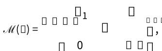

那么 $T$ 满足一个简单的方程，取决于 $\lambda_1, \dots, \lambda_n$。

### 5.40 满足上三角矩阵的算子的方程

假设 $T \in \mathcal{L}(V)$ 且 $T$ 相对于某个基有上三角矩阵，对角元为 $\lambda_1, \dots, \lambda_n$。那么

$$ (T - \lambda_1 I) \cdots (T - \lambda_n I) = 0. $$

证明 设 $v_1, \dots, v_n$ 是 $V$ 的一组基，相对于该基 $T$ 有上三角矩阵，对角元为 $\lambda_1, \dots, \lambda_n$。那么 $T v_1 = \lambda_1 v_1$，这意味着 $(T - \lambda_1 I)v_1 = 0$，这意味着 $(T - \lambda_1 I)\cdots(T - \lambda_n I)v_1 = 0$ 对于 $i = 1, \dots, n$（利用每个 $T - \lambda_i I$ 与每个 $T - \lambda_j I$ 的交换律）。

注意 $(T - \lambda_2 I)v_2 \in \text{span}(v_1)$。因此 $(T - \lambda_1 I)(T - \lambda_2 I)v_2 = 0$（根据前一段落），这意味着 $(T - \lambda_1 I)\cdots(T - \lambda_n I)v_2 = 0$ 对于 $i = 2, \dots, n$（使用每个 $T - \lambda_i I$ 与每个 $T - \lambda_j I$ 的交换律）。

注意 $(T - \lambda_3 I)v_3 \in \text{span}(v_1, v_2)$。因此根据前一段落，$(T - \lambda_1 I)(T - \lambda_2 I)(T - \lambda_3 I)v_3 = 0$，这意味着 $(T - \lambda_1 I)\cdots(T - \lambda_n I)v_3 = 0$ 对于 $i = 3, \dots, n$（使用每个 $T - \lambda_i I$ 与每个 $T - \lambda_j I$ 的交换律）。

继续这个模式，我们可以看到 $(T - \lambda_1 I)\cdots(T - \lambda_n I)v_n = 0$ 对于每个 $i = 1, \dots, n$。因此 $(T - \lambda_1 I)\cdots(T - \lambda_n I)$ 是 0 算子，因为它对于 $V$ 的每个基向量都是 0。

不幸的是，没有一种方法可以从矩阵精确计算算子的特征值。然而，如果我们足够幸运地找到一个基，使得算子的矩阵是上三角形的，那么计算特征值的问题就变得微不足道，正如下一个结果所示。

### 5.41 从上三角矩阵确定特征值

假设 $T \in \mathcal{L}(V)$ 相对于某个基有上三角矩阵。那么 $T$ 的特征值恰好是上三角矩阵对角线上的元素。

证明 假设 $v_1, \dots, v_n$ 是 $V$ 的一组基，相对于这组基，$T$ 有一个上三角矩阵。

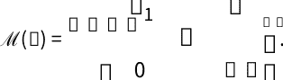

因为 $T v_1 = \lambda_1 v_1$，我们可以看出 $\lambda_1$ 是 $T$ 的特征值。

假设 $i \in \{2, \dots, n\}$。那么 $(T - \lambda_i I)v_i \in \text{span}(v_1, \dots, v_{i-1})$。因此 $T - \lambda_i I$ 将 $\text{span}(v_1, \dots, v_i)$ 映射到 $\text{span}(v_1, \dots, v_{i-1})$。因为

$$ \dim \text{span}(v_1, \dots, v_i) = i \text{ 且 } \dim \text{span}(v_1, \dots, v_{i-1}) = i-1, $$

这意味着 $T - \lambda_i I$ 限制在 $\text{span}(v_1, \dots, v_i)$ 上不是单射的（根据定理 3.22）。因此存在 $v \in \text{span}(v_1, \dots, v_i)$ 使得 $v \neq 0$ 且 $(T - \lambda_i I)v = 0$。因此 $\lambda_i$ 是 $T$ 的特征值。因此我们已经证明了 $\mathcal{M}(T)$ 的对角线上的每个元素都是 $T$ 的特征值。

为了证明 $T$ 没有其他特征值，让 $p$ 是由 $p(T) = (T - \lambda_1 I)\cdots(T - \lambda_n I)$ 定义的多项式。然后 $p(T) = 0$（根据定理 5.40）。因此 $p$ 是最小多项式的多项式倍数（根据定理 5.29）。因此，最小多项式的每个零点都是 $p$ 的零点。因为最小多项式的零点是 $T$ 的特征值（根据定理 5.27），这意味着 $p$ 的每个零点都是 $T$ 的特征值。因此，$T$ 的特征值都包含在列表 $\lambda_1, \dots, \lambda_n$ 中。

### 5.42 例子：通过上三角矩阵求特征值

定义 $\phi \in \mathscr{L}(\mathbb{R}^3)$ 为 $\phi(e_1, e_2, e_3) = (2e_1 + e_2, 5e_2 + 3e_3, 8e_3)$。关于标准基的 $\phi$ 的矩阵为

$$M(\phi) = \begin{bmatrix} 2 & 1 & 0 \\ 0 & 5 & 3 \\ 0 & 0 & 8 \end{bmatrix}.$$

现在定理 5.41 暗示 $\phi$ 的特征值为 2, 5, 和 8。

下一个例子说明了定理 5.44：如果一个算子相对于某个基有上三角矩阵，那么算子的最小多项式就是 1 次多项式的乘积。

### 5.43 例子：$\phi$ 是否有上三角矩阵可以取决于 $\mathbb{F}$

定义 $\phi \in \mathscr{L}(\mathbb{R}^4)$ 为

$$\phi(e_1, e_2, e_3, e_4) = (-e_2, e_1, 2e_1 + 3e_3, e_3 + 3e_4).$$

因此，关于 $\mathbb{R}^4$ 的标准基，$\phi$ 的矩阵是

$$\begin{bmatrix} 0 & -1 & 0 & 0 \\ 1 & 0 & 0 & 0 \\ 2 & 0 & 3 & 0 \\ 0 & 0 & 1 & 3 \end{bmatrix}.$$

你可以让计算机验证 $\phi$ 的最小多项式是由多项式 $p$ 定义的

$$p(z) = 9 - 6z + 10z^2 - 6z^3 + z^4.$$

首先考虑 $\mathbb{F} = \mathbb{R}$ 的情况。然后多项式 $p$ 可以分解为

$$p(z) = (z^2 + 1)(z - 3)(z - 3),$$

没有进一步将 $z^2 + 1$ 分解为两个次数为 1 的实系数多项式的乘积。因此，定理 5.44 陈述了不存在一个基于 $\mathbb{R}^4$ 的基，使得 $\phi$ 具有上三角矩阵。

现在考虑 $\mathbb{F} = \mathbb{C}$ 的情况。然后多项式 $p$ 可以分解为

$$p(z) = (z - i)(z + i)(z - 3)(z - 3),$$

其中所有上述因子的形式为 $z - \lambda$。因此，定理 5.44 表明存在一组基 $\mathbb{C}^4$，相对于该基，算子具有上三角矩阵。实际上，你可以验证相对于基 $(4-3i, -3-4i, -3+i, 1), (4+3i, -3+4i, -3-i, 1), (0, 0, 0, 1), (0, 0, 1, 0)$ 的 $\mathbb{C}^4$，算子具有上三角矩阵：

$$\begin{bmatrix} i & 0 & 0 & 0 \\ 0 & -i & 0 & 0 \\ 0 & 0 & 3 & 1 \\ 0 & 0 & 0 & 3 \end{bmatrix}.$$

### 5.44 有上三角矩阵的必要和充分条件

假设 $V$ 是有限维的，且 $T \in \mathcal{L}(V)$。当且仅当 $T$ 的最小多项式等于 $(z - \lambda_1) \cdots (z - \lambda_m)$，其中 $\lambda_1, \dots, \lambda_m \in \mathbb{F}$，那么 $T$ 相对于 $V$ 的某个基有上三角矩阵。

证明 首先假设 $T$ 相对于 $V$ 的某个基有上三角矩阵。用 $\lambda_1, \dots, \lambda_m$ 表示该矩阵的对角元素。定义一个多项式 $p \in \mathcal{P}(\mathbb{F})$ 为

$$p(z) = (z - \lambda_1) \cdots (z - \lambda_m).$$

然后 $p(T) = 0$，根据定理 5.40。因此 $p$ 是 $T$ 的最小多项式的多项式倍数，根据定理 5.29。因此 $T$ 的最小多项式等于 $(z - \lambda_1) \cdots (z - \lambda_m)$ 对于一些 $\lambda_1, \dots, \lambda_m \in \mathbb{F}$ 且 $\{\lambda_1, \dots, \lambda_m\} \subseteq \{\lambda_1, \dots, \lambda_m\}$。为了证明另一个方向的蕴含，现在假设 $T$ 的最小多项式等于 $(z - \lambda_1) \cdots (z - \lambda_m)$ 对于某些 $\lambda_1, \dots, \lambda_m \in \mathbb{F}$。我们将使用归纳法证明 $m$。为了开始，如果 $m = 1$ 那么 $z - \lambda_1$ 是 $T$ 的最小多项式，这意味着 $T = \lambda_1 I$，这意味着 $T$ 的矩阵（相对于任何基 $e$）是上三角的。

现在假设 $m > 1$ 并且对于所有较小的正整数，所需的结果成立。让

$$W = \text{range}(T - \lambda_m I).$$

那么 $W$ 在 $T$ 下是不变的（这是定理 5.18 的特殊情况，其中 $p(z) = z - \lambda_m$）。因此 $T|_W$ 是 $W$ 上的一个算子。如果 $v \in W$，则 $v = (T - \lambda_m I)u$ 对于某个 $u \in V$ 且

$$(T - \lambda_1 I) \cdots (T - \lambda_{m-1} I) v = (T - \lambda_1 I) \cdots (T - \lambda_m I) u = 0.$$

因此 $(z - \lambda_1) \cdots (z - \lambda_{m-1})$ 是 $T|_W$ 的最小多项式的多项式倍数，根据定理 5.29。因此，$T|_W$ 的最小多项式是最多 $m - 1$ 个形式为 $z - \lambda$ 的项的乘积。

根据我们的归纳假设，存在一组基 $e_1, \dots, e_{m-1}$ 使得对于这组基，$T|_W$ 在其上有一个上三角矩阵。因此对于每个 $j \in \{1, \dots, m-1\}$，我们有（使用定理 5.39）

5.45 $$T e_j \in \text{span}(e_1, \dots, e_j).$$

对于每个 $j \in \{1, \dots, m-1\}$，我们有

$$(T - \lambda_m I) T e_j = T (T - \lambda_m I) e_j$$

$W$ 的定义表明 $(T - \lambda_m I) e_j \in W = \text{span}(e_1, \dots, e_{m-1})$。因此上面的方程表明

5.46 $$T e_j \in \text{span}(e_1, \dots, e_{m-1}, v).$$

根据定理 5.45 和 5.46，我们得出结论（使用定理 5.39）：$T$ 相对于基 $e_1, \dots, e_{m-1}, v$，在 $V$ 中具有上三角矩阵，正如所需。

从之前的结果中，集合 $\{\lambda_1, \dots, \lambda_m\}$ 等于 $T$ 的特征值集合（因为 $T$ 的最小多项式的零点集合等于 $T$ 的特征值集合，根据定理 5.27），尽管之前结果的列表 $\lambda_1, \dots, \lambda_m$ 可能包含重复。

在第 8 章中，我们将进一步改进下面的精彩结果；参见 8.37 和 8.46。

### 5.47 若 $\mathbb{F} = \mathbb{C}$

假设 $V$ 是一个有限维复向量空间，$T \in \mathcal{L}(V)$。那么 $T$ 相对于 $V$ 的某个基有上三角矩阵。

证明 所需结果立即从定理 5.44 和代数基本定理的第二个版本（见定理 4.13）得出。

对于将上述结果扩展到两个算子 $S$ 和 $T$ 的情况（$ST = TS$）参见定理 5.80。此外，对于超过两个算子的扩展，请参见第 5E 节中的习题 9(b)。

注意：如果算子 $T \in \mathcal{L}(V)$ 相对于某个基 $q_1, \dots, q_n$ 在 $V$ 上具有上三角矩阵，则 $T$ 的特征值恰好是 $M(T)$ 对角线上的条目，如定理 5.41 所示，并且 $q_1$ 是 $T$ 的特征向量。然而，$q_2, \dots, q_n$ 不一定是 $T$ 的特征向量。事实上，基向量 $q_i$ 是 $T$ 的特征向量当且仅当 $T$ 的矩阵中的第 $i$ 列的所有条目都为 0，除了可能是第 $i$ 个条目。

你可能还记得在以前的课程中，任何数字矩阵都可以转换成所谓的行阶梯形矩阵。如果从一个方阵开始，行阶梯形矩阵将是一个上三角矩阵。

一个算子的行阶梯形并不能给我们算子的特征值列表。相比之下，对于某个基底而言，上三角矩阵给我们算子的所有特征值列表。然而，即使 5.47 保证了上述上三角矩阵的存在（如果 $\mathbb{F} = \mathbb{C}$），也没有一种方法可以精确计算出这样的上三角矩阵。

不要将这个上三角矩阵与上述上三角矩阵混淆（如果 $\mathbb{F} \neq \mathbb{C}$），它们之间没有任何联系。

# 练习 5C

1. 证明或给出反例：如果 $T \in \mathcal{L}(V)$ 且 $T^2$ 相对于 $\lambda$ 的某个基的上三角矩阵，则 $T$ 相对于 $\lambda$ 的某个基也是上三角矩阵。

- 2. 假设 $\mathcal{S}$ 和 $\mathcal{T}$ 是相同大小的上三角矩阵，其中 $\mathcal{S}$ 的对角线上有元素 $s_1, \cdots, s_n$，$\mathcal{T}$ 的对角线上有元素 $t_1, \cdots, t_n$。

- (a) 证明 $\mathcal{S} + \mathcal{T}$ 是一个上三角矩阵，其对角线上的元素为 $s_1 + t_1, \cdots, s_n + t_n$。

- (b) 证明 $\mathcal{S}\mathcal{T}$ 是一个上三角矩阵，对角线上的元素为 $s_1 t_1, \cdots, s_n t_n$。

这个练习中的结果在 5.81 的证明中使用。

- 3. 假设 $\mathcal{T} \in \mathcal{L}(V)$ 是可逆的，且 $v_1, \cdots, v_n$ 是 $V$ 的一组基，相对于这组基，$\mathcal{T}$ 的矩阵是上三角的，对角线上的元素为 $t_1, \cdots, t_n$。证明 $\mathcal{T}^{-1}$ 相对于基 $v_1, \cdots, v_n$ 也是上三角的，对角线上的元素为 $\frac{1}{t_1}, \cdots, \frac{1}{t_n}$ 在对角线上。

- 4. 举一个例子，其矩阵相对于某个基底在对角线上只包含 0，但是该算子是可逆的。

这个练习和下面的练习表明，在不考虑上三角矩阵的假设下，5.41 是错误的。

- 5. 举一个例子，其矩阵相对于某个基底在对角线上只包含非零数，但是该算子不可逆。

- 6. 假设 $V$ 是有限维的，并且 $\mathcal{T} \in \mathcal{L}(V)$。证明如果 $\lambda \in \{1, \cdots, \dim V\}$，则 $\mathcal{T}$ 有一个 $\lambda$ 维子空间在 $\mathcal{T}$ 下不变。

- 7. 假设 $V$ 是有限维的，$\mathcal{T} \in \mathcal{L}(V)$，且 $\mathcal{p} \in \mathcal{P}$。

- (a) 证明存在一个最小次数的唯一首一多项式 $\mathcal{m}_\mathcal{T}$，使得 $\mathcal{m}_\mathcal{T}(\mathcal{T}) = 0$。

- (b) 证明 $\mathcal{p}$ 的最小多项式是 $\mathcal{m}_\mathcal{T}$ 的多项式倍数。

- 8. 假设 $V$ 是有限维的，$\mathcal{T} \in \mathcal{L}(V)$，且存在一个非零向量 $v \in V$，使得 $\mathcal{T}^2 v + 2\mathcal{T} v = -2v$。

- (a) 证明如果 $\mathcal{T}$ 满足上述方程，则不存在一个基于 $V$ 的基，使得 $\mathcal{T}$ 在该基下有上三角矩阵。

- (b) 证明如果 $\mathcal{T}$ 满足上述方程且 $\mathcal{T}$ 是一个与某个基于 $V$ 的基下 $\mathcal{T}$ 的矩阵相等的上三角矩阵，则 $-1 + \mathcal{T}$ 或 $-1 - \mathcal{T}$ 出现在 $\mathcal{T}$ 的对角线上。

- 9. 假设 $\mathcal{T}$ 是一个具有复数元素的方阵。证明存在一个具有复数元素的 可逆方阵 $\mathcal{S}$，使得 $\mathcal{S}^{-1}\mathcal{T}\mathcal{S}$ 是一个上三角矩阵。

- 10. 假设 $T \in \mathcal{L}(V)$ 且 $v_1, \dots, v_n$ 是 $V$ 的一组基。证明以下命题等价。

- (a) 相对于 $v_1, \dots, v_n$ 这组基，$T$ 的矩阵是下三角形的。
- (b) 对于每个 $k=1, \dots, n$, $\text{span}(v_1, \dots, v_k)$ 在 $T$ 下是不变的。
- (c) $v_k \in \text{span}(v_1, \dots, v_k)$ 对于每个 $k=1, \dots, n$。

如果矩阵是方阵，并且对角线上方的所有元素都是 0，则称其为下三角矩阵。

- 11. 假设 $V$ 是有限维的。证明如果 $T \in \mathcal{L}(V)$，则存在一个基于 $V$ 的基，使得 $T$ 具有下三角矩阵。

- 12. 假设 $V$ 是有限维的，$T \in \mathcal{L}(V)$ 相对于 $V$ 的某个基具有上三角矩阵，且 $W$ 是 $V$ 的一个不变子空间。

- (a) 证明 $T|_W$ 相对于某个基底是上三角矩阵的 $W$.
- (b) 证明商算子 $T/W$ 相对于某个基底是上三角矩阵的 $V/W$.

商算子 $T/W$ 在 5A 节的练习 38 中定义。

- 13. 假设 $V$ 是有限维的，$T \in \mathcal{L}(V)$. 假设存在一个子空间 $W$ 的 $V$ 在 $T$ 下是不变的，使得 $T|_W$ 相对于某个基底是上-三角矩阵，并且 $T/W$ 相对于某个基底是上三角矩阵的 $V/W$. 证明 $T$ 相对于某个基底是上三角矩阵的 $V$.

- 14. 假设 $V$ 是有限维的，且 $T \in \mathcal{L}(V)$. 证明如果 $T$ 相对于某个基的上三角矩阵存在，则对偶算子 $T'$ 相对于某个对偶空间的基的上三角矩阵也存在。

## 5D 对角化算子

### 对角矩阵

> 5.48 定义：对角矩阵
> 一个对角矩阵是一个除了对角线上可能有非零元素外，其他地方都是 0 的方阵。

> 5.49 例子：对角矩阵

$\begin{bmatrix} 8 & 0 & 0 \\ 0 & 5 & 0 \\ 0 & 0 & 5 \end{bmatrix}$

是一个对角矩阵。

如果一个算子相对于某个基有对角矩阵，那么对角线上的元素正好是该算子的特征值；这可以从 5.41 推导出来（或者为对角矩阵找到一个更简单的直接证明）。

> 每个对角矩阵都是上三角的。对角矩阵通常比同样大小的大多数上三角矩阵有更多的 0。

> 5.50 定义：对角化
> 对于 $V$ 上的一个算子，如果该算子相对于某个基的对角矩阵是对角化的，则称该算子是对角化的。

> 5.51 例子：对角化可能需要不同的基
> 设 $T \in \mathcal{L}(\mathbb{R}^2)$ 为
> $T((x,y)) = (41x+7y, -20x-2y+74y)$.
> 相对于 $\mathbb{R}^2$ 的标准基，$T$ 的矩阵是
> $\begin{pmatrix} 41 & 7 \\ -20 & 74 \end{pmatrix}$,
> 该矩阵不是对角矩阵。然而，$T$ 是对角化的。具体来说，相对于基 $(1, 4), (7, 5)$，$T$ 的矩阵是
> $\begin{pmatrix} 69 & 0 \\ 0 & 46 \end{pmatrix}$
> 因为 $T(1,4) = (69,276) = 69(1,4)$ 且 $T(7,5) = (322,230) = 46(7,5)$。

对于 $A \in \mathcal{L}(V)$，我们发现给算子 $A$ 映射到 $\lambda$ 乘以向量的向量集合方便起见，我们需要一个名称和符号表示。

> 5.52 定义：特征空间，$E(\lambda, A)$
> 假设 $A \in \mathcal{L}(V)$ 且 $\lambda \in F$。对应于 $\lambda$ 的 $A$ 的特征空间是由以下定义的子空间 $E(\lambda, A)$ 的 $V$
> $E(\lambda, A) = \text{null}(A - \lambda I) = \{v \in V : Av = \lambda v\}$.
> 因此 $E(\lambda, A)$ 是 $A$ 对应于 $\lambda$ 的所有特征向量的集合，以及 0 向量。

对于 $A \in \mathcal{L}(V)$ 和 $\lambda \in F$，集合 $E(\lambda, A)$ 是 $V$ 的子空间，因为 $V$ 上每个线性映射的零空间都是 $V$ 的子空间。这些定义意味着 $\lambda$ 是 $A$ 的特征值当且仅当 $E(\lambda, A) \neq \{0\}$。

> 5.53 例子：算子的特征空间
> 假设算子 $A \in \mathcal{L}(V)$ 相对于基 $v_1, v_2, v_3$ 的矩阵是例子 5.49 中的矩阵。那么
> $E(8, A) = \text{span}(v_1)$, $E(5, A) = \text{span}(v_2, v_3)$.
> 如果 $\lambda$ 是一个算子 $A \in \mathcal{L}(V)$ 的特征值，那么 $\lambda I$ 限制在 $E(\lambda, A)$ 上就是乘以 $\lambda$ 的算子。

> 5.54 特征空间的和是直和
> 假设 $A \in \mathcal{L}(V)$ 且 $\lambda_1, \dots, \lambda_m$ 是 $A$ 的不同特征值。那么
> $E(\lambda_1, A) + \dots + E(\lambda_m, A)$
> 是直和。此外，如果 $V$ 是有限维的，那么
> $\dim E(\lambda_1, A) + \dots + \dim E(\lambda_m, A) \le \dim V$.
>
> **证明** 为了证明 $E(\lambda_1, A) + \dots + E(\lambda_m, A)$ 是直和，假设
> $v_1 + \dots + v_m = 0$,
> 其中每个 $v_i$ 都在 $E(\lambda_i, A)$ 中。因为对应于不同特征值的特征向量是线性无关的（根据 5.11），这意味着每个 $v_i$ 都等于 0。
> 因此 $E(\lambda_1, A) + \dots + E(\lambda_m, A)$ 是直和（根据 1.45），如所需。
> 现在假设 $V$ 是有限维的。那么
> $\dim E(\lambda_1, A) + \dots + \dim E(\lambda_m, A) = \dim(E(\lambda_1, A) \oplus \dots \oplus E(\lambda_m, A))$
> $\le \dim V$,
> 其中第一行由 3.94 得出，第二行由 2.37 得出。

## 第 5D 节 对角化算子

### 对角化的条件

对角化算子的以下特征描述将会很有用。

> 5.55 等价于对角化的条件
> 假设 $V$ 是有限维的，$T \in \mathcal{L}(V)$。让 $\lambda_1, \dots, \lambda_k$ 表示 $T$ 的不同特征值。那么以下命题是等价的。
> (a) $T$ 是可对角化的。
> (b) $V$ 有由 $T$ 的特征向量构成的基。
> (c) $V = \text{null}(T - \lambda_1 I) \oplus \dots \oplus \text{null}(T - \lambda_k I)$.
> (d) 维度 $V$ = 维度 $\text{null}(T - \lambda_1 I) + \dots + \text{维度 null}(T - \lambda_k I)$。
>
> **证明** 一个算子 $T \in \mathcal{L}(V)$ 有一个对角矩阵。
>
> 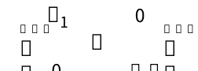
>
> 关于这组基 $\lambda_1, \dots, \lambda_k$ 的情况下，对于每个 $i$，当且仅当 $Tv_i = \lambda_i v_i$ 时，与 $T$ 相关。因此，(a)和(b)是等价的。
>
> 假设 (b) 成立；因此，$V$ 具有由 $T$ 的特征向量组成的基。因此，$V$ 中的每个向量都是 $T$ 的特征向量的线性组合，这意味着 $V = \text{null}(T - \lambda_1 I) + \dots + \text{null}(T - \lambda_k I)$。
>
> 现在，5.54 表明 (c) 成立，证明了 (b) 蕴含 (c)。
>
> 从 3.94 可以立即得出 (c) 蕴含 (d)。
>
> 最后，假设 (d) 成立；因此
> 5.56 $\dim V = \dim \text{null}(T - \lambda_1 I) + \dots + \dim \text{null}(T - \lambda_k I)$。
>
> 选择每个 $\text{null}(T - \lambda_i I)$ 的基，将所有这些基放在一起形成一个列表 $\lambda_1, \dots, \lambda_k$ 的特征向量 $v$，其中 $k = \dim V$ (由 5.56 得出)。为了证明这个列表是线性无关的，假设
>
> ```
> v_1 + ... + v_k = 0,
> ```
>
> 其中 $v_1, \dots, v_k \in V$。对于每个 $i = 1, \dots, k$，让 $w_i$ 表示所有项的和 $w_i v_i$，其中 $w_i \in \text{null}(T - \lambda_i I)$。因此，每个 $w_i$ 都在 $\text{null}(T - \lambda_i I)$ 中，且
>
> ```
> w_1 + ... + w_k = 0.
> ```
>
> 因为对应于不同特征值的特征向量是线性无关的（见 5.11），这意味着每个 $w_i$ 等于 0。因为每个 $w_i$ 是 $v_i v_i$ 的和，其中 $v_i$ 被选择为 $\text{null}(T - \lambda_i I)$ 的基，这意味着所有的 $v_i$ 都等于 0。因此 $v_1, \dots, v_k$ 是线性无关的，因此是 $V$ 的一组基（根据 2.38）。因此 (d) 蕴含 (b)，证明完成。
>
> 关于对角化的其他等价条件，请参见本节的 5.62、练习 5 和 15，第 7B 节的练习 24，以及第 8A 节的练习 15。

正如我们所知，有限维复向量空间上的每个算子都有一个特征值。然而，并不是每个有限维复向量空间上的算子都有足够的特征向量可以对角化，如下面的例子所示。

#### 5.57 例子：不可对角化的移位算子

定义一个算子 $T \in \mathcal{L}(\mathbb{R}^3)$ 为 $T(x, y, z) = (y, z, 0)$。相对于 $\mathbb{R}^3$ 的标准基的 $T$ 的矩阵为

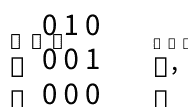

这是一个上三角矩阵，但不是对角矩阵。

正如你应该验证的那样，0 是 $T$ 的唯一特征值，而且
$N(T) = \{(0,0,0) \in \mathbb{R}^3 : T \in N\}$.

因此，5.55 的条件 (b)、(c) 和 (d) 不成立（当然，因为这些条件是等价的，只需要检查其中一个条件不成立即可）。因此，5.55 的条件 (a) 也不成立。因此，无论 $V = \mathbb{R}$ 还是 $V = \mathbb{C}$，$T$ 都不可对角化。

下一个结果表明，如果一个算子具有与其定义域的维度相同数量的不同特征值，则该算子是可对角化的。

#### 5.58 足够的特征值意味着可对角化

假设 $V$ 是有限维的，$T \in \mathcal{L}(V)$ 具有 $\dim V$ 个不同的特征值。那么 $T$ 是可对角化的。

**证明** 假设 $T$ 具有不同的特征值 $\lambda_1, \dots, \lambda_{\dim V}$。对于每个 $i$，让 $v_i \in V$ 是对应于特征值 $\lambda_i$ 的特征向量。因为对应于不同特征值的特征向量是线性无关的（见 5.11），$v_1, \dots, v_{\dim V}$ 是线性无关的。

在 $V$ 中，一个线性无关的向量列表是 $V$ 的一组基 (见 2.38); 因此 $v_1, \dots, v_{\dim V}$ 是 $V$ 的一组基。关于由特征向量组成的这组基，$T$ 有一个对角矩阵。

在后面的章节中，我们将找到其他条件，这些条件可以使得某些算子是对角化的。例如，参见实数谱定理 (7.29) 和复数谱定理 (7.31)。

上述结果给出了一个算子对角化的充分条件。然而，这个条件并不是必要的。例如，定义在 $\mathbb{R}^3$ 上的算子 $T(x, y, z) = (6x, 6y, 7z)$ 只有两个特征值 (6 和 7)，而 $\dim \mathbb{R}^3 = 3$，但 $T$ 是可对角化的 (通过 $\mathbb{R}^3$ 的标准基)。

下一个例子说明了对角化的重要性，它可以用于计算一个算子的高幂，利用方程 $T^k v = \lambda^k v$ 如果 $v$ 是 $T$ 的特征向量，其特征值为 $\lambda$。

> 对于这些技术的一个惊人应用，请参见练习 21，它展示了如何使用对角化来找到斐波那契数列的第 n 项的精确公式。

#### 5.59 例子：使用对角化计算 $T^{100}$

定义 $T \in \mathcal{L}(\mathbb{R}^3)$ 为 $T(x,y,z) = (2x + y, 5y + 3z, 8z)$。相对于标准基，$T$ 的矩阵为

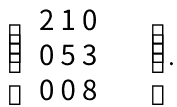

上面的矩阵是上三角矩阵，但不是对角矩阵。根据 5.41，$T$ 的特征值是 2、5 和 8。因为 $T$ 是一个三维向量空间上的算子，并且有三个不同的特征值，根据 5.58，我们可以确定存在一个基于 $V$ 的基，使得 $T$ 在该基下的矩阵是对角矩阵。

要找到这个基，我们只需要找到每个特征值对应的特征向量。换句话说，我们需要找到方程的非零解

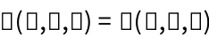

对于 $\lambda = 2$，然后对于 $\lambda = 5$，最后对于 $\lambda = 8$。解这些简单的方程可以得到，对于 $\lambda = 2$，我们有特征向量 (1, 0, 0)，对于 $\lambda = 5$，我们有特征向量 (1, 3, 0)，对于 $\lambda = 8$，我们有特征向量 (1, 6, 6)。

因此 (1, 0, 0), (1, 3, 0), (1, 6, 6) 是 $\mathbb{R}^3$ 的一组基，由 $T$ 的特征向量组成，相对于这个基，$T$ 的矩阵是对角矩阵

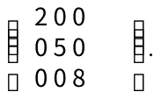

例如，要计算 $T^{100}(0, 0, 1)$，可以将 (0, 0, 1) 写成我们的特征向量基的线性组合：

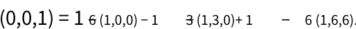

现在将上述方程两边都应用 $T^{100}$，得到

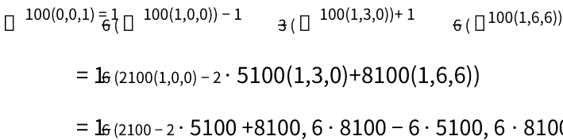

我们之前看到，如果一个有限维向量空间 $V$ 上的算子 $T$ 相对于某个基是上三角矩阵，那么 $T$ 的最小多项式等于 $(t - \lambda_1) \cdots (t - \lambda_n)$，其中 $\lambda_1, \cdots, \lambda_n \in F$ (见 5.44)。正如我们之前指出的（见 5.47），如果 $T = T^*$，则这个条件总是成立。

我们的下一个结果 5.62 表明，如果一个算子 $T \in \mathcal{L}(V)$ 相对于 $V$ 的某个基是对角矩阵，那么它的极小多项式等于 $(t - \lambda_1) \cdots (t - \lambda_n)$，其中 $\lambda_1, \cdots, \lambda_n \in F$ 是不同的。在正式陈述这个结果之前，我们给出两个使用它的例子。

#### 5.60 例子：可对角化，但没有已知的精确特征值

定义 $T \in \mathcal{L}(\mathbb{R}^5)$ 为

$T(e_1, e_2, e_3, e_4, e_5) = (-3 - 35, e_1 + 6e_5, e_2, e_3, e_4)$

算子 $T$ 的矩阵如例 5.26 所示，其中我们证明了 $T$ 的极小多项式是 $3 - 6t + t^5$。

如例 5.28 所述，对于这个多项式的任何零点，都没有已知的精确表达式，但数值技术表明，这个多项式的零点大约是 -1.67, 0.51, 1.40, -0.12 + 1.5959i, -0.12 - 1.5959i。生成这些近似值的软件精度超过三位数。因此，这些近似值足够好，可以证明上述五个数字是不同的。$T$ 的最小多项式等于具有这些零点的五次首一多项式。现在 5.62 表明，$T$ 是对角化的。

#### 5.61 例子：证明一个算子不可对角化

定义 $T \in \mathcal{L}(\mathbb{R}^3)$ 为

$T(e_1, e_2, e_3) = (6e_1 + 3e_2 + 4e_3, 6e_2 + 2e_3, 7e_3)$

相对于标准基的 $\mathbb{R}^3$ 的 $T$ 的矩阵是

$\begin{matrix} 6 & 3 & 4 \\ 0 & 6 & 2 \\ 0 & 0 & 7 \end{matrix}$

上面的矩阵是上三角矩阵，但不是对角矩阵。在其他某些基底的情况下，可能 $T$ 有对角矩阵吗？

为了回答这个问题，我们将找到 $T$ 的最小多项式。首先注意到 $T$ 的特征值是上面矩阵的对角元素（根据 5.41）。因此，$T$ 的最小多项式的零点是 6, 7 (根据 5.27(a))。上面矩阵的对角线告诉我们 $(T - 6I)^2(T - 7I) = 0$ （根据 5.40）。根据 5.22，$T$ 的最小多项式的次数最多为 3。将所有这些放在一起，我们可以看到 $T$ 的最小多项式要么是 $(T - 6)(T - 7)$，要么是 $(T - 6)^2(T - 7)$。

一个简单的计算表明 $(T - 6I)(T - 7I) \neq 0$。因此，最小多项式为 $T$ 是 $(T - 6)^2(T - 7)$。

现在 5.62 表明 $T$ 不可对角化。

开放获取 本章节根据知识共享署名-非商业性使用 4.0 国际许可协议 (https://creativecommons.org/licenses/by-nc/4.0) 进行许可，只要您给出适当的原作者和来源的信用，提供到创作共用许可证的链接，并指示是否进行了更改，您就可以在任何媒介或格式中进行非商业性使用、共享、改编、分发和复制。

本章节中的图像或其他第三方材料已包含在章节的创作共用许可证中，除非在材料的信用行中另有说明。如果材料未包含在章节的创作共用许可证中，并且您的预期使用未经法定规定许可或超出许可使用范围，您将需要直接从版权持有人获得许可。


## 5.62 对角化的必要和充分条件

假设 $V$ 是有限维的，$T \in \mathcal{L}(V)$。那么 $T$ 是可对角化的，当且仅当最小多项式为 $(x - \lambda_1)\cdots(x - \lambda_m)$ 对于一些不同的数 $\lambda_1, \cdots, \lambda_m \in \mathbb{F}$。

**证明** 首先假设 $T$ 是可对角化的。因此存在一组基 $v_1, \cdots, v_m$ 使得 $V$ 由 $T$ 的特征向量组成。设 $\lambda_1, \cdots, \lambda_m$ 是 $T$ 的不同特征值。对于每个 $\lambda_j$，存在 $v_j$ 使得 $(T - \lambda_j I)v_j = 0$。因此

$$
(T - \lambda_1 I)\cdots(T - \lambda_m I)v = 0,
$$

这意味着 $T$ 的最小多项式等于 $(x - \lambda_1)\cdots(x - \lambda_m)$。

为了证明另一个方向的蕴含，现在假设 $T$ 的最小多项式等于 $(x - \lambda_1)\cdots(x - \lambda_m)$，其中 $\lambda_1, \cdots, \lambda_m$ 是一组不同的数 $\lambda_1, \cdots, \lambda_m \in \mathbb{F}$。因此

$$
5.63 \quad (T - \lambda_1 I)\cdots(T - \lambda_m I) = 0.
$$

我们将通过对 $m$ 进行归纳证明 $T$ 是可对角化的。为了开始，假设 $m=1$。然后，$T - \lambda_1 I = 0$，这意味着 $T$ 是标量倍数的单位算子，这意味着 $T$ 是可对角化的。

现在假设 $m > 1$ 并且对于所有较小的值 $m$，所需的结果成立。子空间 $\text{range}(T - \lambda_m I)$ 在 $T$ 下是不变的（这是 5.18 的特殊情况，其中 $P(T) = T - \lambda_m I$）。因此，$T$ 限制在 $\text{range}(T - \lambda_m I)$ 上是一个算子。

如果 $v \in \text{range}(T - \lambda_m I)$，那么 $v = (T - \lambda_m I)u$ 对于一些 $u \in V$，而 5.63 暗示

$$
5.64 \quad (T - \lambda_1 I)\cdots(T - \lambda_{m-1} I)v = (T - \lambda_1 I)\cdots(T - \lambda_m I)u = 0.
$$

因此 $(x - \lambda_1)\cdots(x - \lambda_{m-1})$ 是最小多项式的多项式倍数对于 $T$ 限制在 $\text{range}(T - \lambda_m I)$（通过 5.29）。因此根据我们的归纳假设，存在一个由 $T$ 的特征向量组成的 $\text{range}(T - \lambda_m I)$ 的基。

假设 $v \in \text{range}(T - \lambda_m I) \cap \text{null}(T - \lambda_m I)$。那么 $v = \lambda_m v$。现在 5.64 暗示

$$
0 = (T - \lambda_1 I)\cdots(T - \lambda_{m-1} I)v = (T - \lambda_{m-1} I)\cdots(T - \lambda_m I)v.
$$

因为 $\lambda_1, \cdots, \lambda_m$ 是不同的，上面的方程意味着 $v = 0$。因此，$\text{range}(T - \lambda_m I) \cap \text{null}(T - \lambda_m I) = \{0\}$。

因此，$\text{range}(T - \lambda_m I) + \text{null}(T - \lambda_m I)$ 是一个直和（根据 1.46），其维度为 $\dim V$（根据 3.94 和 3.21）。因此，$\text{range}(T - \lambda_m I) \oplus \text{null}(T - \lambda_m I) = V$。每个在 $\text{null}(T - \lambda_m I)$ 中的向量都是 $T$ 的特征向量，其特征值为 $\lambda_m$。在这个证明中，我们之前看到 $\text{range}(T - \lambda_m I)$ 的一组基由 $T$ 的特征向量组成。将这个基扩充为 $\text{null}(T - \lambda_m I)$ 的一组基，得到一个由 $T$ 的特征向量组成的 $V$ 的基。相对于这个基，$T$ 的矩阵是一个对角矩阵，正如所期望的那样。

不存在一个公式可以求解 5 次或更高次多项式的零点。然而，之前的结果可以用来确定复向量空间上的算子是否可对角化，而无需找到最小多项式的零点的近似值——参见练习 15。

下一个结果将是我们证明关于两个算子同时对角化的一个关键工具；参见 5.76。注意如何使用最小多项式来表征可对角化算子的方式（参见 5.62），从而简洁地证明了下一个结果。

### 5.65 对可对角化算子在不变子空间上的限制

假设 $T \in \mathcal{L}(V)$ 是可对角化的，而 $W$ 是 $V$ 的一个不变子空间。那么 $T|_W$ 是 $W$ 上的一个可对角化算子。

**证明** 因为算子 $T$ 是可对角化的，所以 $T$ 的最小多项式等于 $(T - \lambda_1)\cdots(T - \lambda_n)$ 对于一些不同的数 $\lambda_1, \cdots, \lambda_n \in \mathbb{F}$（根据 5.62）。$T$ 的最小多项式是 $T|_W$ 的最小多项式的多项式倍数（根据 5.31）。因此，$T|_W$ 的最小多项式具有 5.62 所要求的形式，这表明 $T|_W$ 是可对角化的。

## 格尔什戈林圆盘定理

### 5.66 定义：格尔什戈林圆盘

假设 $A \in \mathcal{L}(V)$ 且 $e_1, \cdots, e_n$ 是 $V$ 的一组基。用这组基表示，$A$ 表示 $T$ 的矩阵。对于基 $e_1, \cdots, e_n$，$T$ 的格尔什戈林圆盘是一个集合，形式如下

$$
\{ \lambda \in \mathbb{C} : |\lambda - A_{jj}| \leqslant \sum_{k \neq j} |A_{jk}| \},
$$

其中 $j \in \{1, \cdots, n\}$。

因为在上述定义中，对于 $j$ 有 $n$ 种选择，所以 $T$ 有 $n$ 个格什戈林圆盘。如果 $n = 1$，那么对于每个 $j \in \{1, \cdots, n\}$，相应的格什戈林圆盘是以 $A_{jj}$ 为中心的 $\mathbb{C}$ 中的闭圆盘，其中 $A_{jj}$ 是 $A$ 对角线上的第 $j$ 个元素。这个闭圆盘的半径是 $A$ 的第 $j$ 行中除去对角线元素的绝对值之和。如果 $n = 1$，那么格什戈林圆盘是 $\mathbb{C}$ 中的闭区间。

在特殊情况下，方阵 $A$ 是一个对角矩阵，每个格什戈林圆盘都由 $A$ 的一个对角元素构成（而 $A$ 的每个特征值都是这些点之一，正如下一个结果所要求的）。我们下一个结果的一个推论是，如果 $A$ 的非对角元素很小，那么 $A$ 的每个特征值都接近 $A$ 的一个对角元素。

### 5.67 格什戈林圆盘定理

假设 $A \in \mathcal{L}(V)$ 且 $v_1, \dots, v_n$ 是 $V$ 的一组基。那么 $A$ 的每个特征值都包含在以基 $v_1, \dots, v_n$ 为参考的某个格什戈林圆盘中。

**证明** 假设 $\lambda \in \mathbb{C}$ 是 $A$ 的特征值。设 $v \in V$ 是对应的特征向量。存在 $a_1, \dots, a_n \in \mathbb{C}$ 使得

$$
5.68 \quad v = a_1 v_1 + \dots + a_n v_n
$$

记 $C$ 为基 $v_1, \dots, v_n$ 下 $A$ 的矩阵。将上述方程两边都应用 $A$ 得到

$$
5.69 \quad \lambda v = A v = \sum_{i=1}^n a_i A v_i = \sum_{i=1}^n a_i \sum_{j=1}^n c_{ij} v_j
$$

$$
5.70 \quad = \sum_{j=1}^n \left( \sum_{i=1}^n c_{ji} a_i \right) v_j
$$

设 $k \in \{1, \dots, n\}$ 满足

$$
|a_k| = \max\{|a_1|, \dots, |a_n|\}.
$$

根据 5.68，我们可以看出左侧 5.69 中 $v_k$ 的系数等于 $\lambda a_k$，这必须等于右侧 5.70 中 $v_k$ 的系数。换句话说，

$$
\lambda a_k = \sum_{i=1}^n c_{ki} a_i
$$

从方程两边减去 $c_{kk} a_k$，然后将两边除以 $a_k$，得到

$$
|\lambda - c_{kk}| = \left| \sum_{i=1, i \neq k}^n c_{ki} \frac{a_i}{a_k} \right| \leqslant \sum_{i=1, i \neq k}^n |c_{ki}|.
$$

因此，$\lambda$ 在基于 $v_1, \dots, v_n$ 的 $k$-th Gershgorin 圆盘中。

练习 22 给出了 Gershgorin 圆盘定理的一个很好的应用。

> Gershgorin 圆盘定理以 1931 年发表此结果的 Semyon Aronovich Gershgorin 命名。

练习 23 说明每个 Gershgorin 圆盘的半径可以改变。

将每个 Gershgorin 圆盘的半径改为相应列条目的绝对值之和（而不是行条目），排除对角线条目，上述定理仍然成立。

## 练习 5D

- 1. 假设 $V$ 是一个有限维复向量空间，$T \in \mathcal{L}(V)$。
    - (a) 证明如果 $T^4 = T$，那么 $T$ 是对角化的。
    - (b) 证明如果 $T^4 = T$，那么 $T$ 是对角化的。
    - (c) 给出一个算子 $T \in \mathcal{L}(\mathbb{C}^2)$ 的例子，使得 $T^4 = T^2$ 且 $T$ 不是对角化的。

- 2. 假设 $T \in \mathcal{L}(V)$ 相对于某个基底有对角矩阵 $D$。证明如果 $z \in \mathbb{C}$，那么 $z$ 在 $D$ 的对角线上出现的次数恰好是 $\text{null}(T - zI)$ 的维度。

- 3. 假设 $V$ 是有限维的，且 $T \in \mathcal{L}(V)$。证明如果算子 $T$ 是可对角化的，那么 $V = \text{null}(T) \oplus \text{range}(T)$。

- 4. 假设 $V$ 是有限维的，且 $T \in \mathcal{L}(V)$。证明以下命题等价。
    - (a) $V = \text{null}(T) \oplus \text{range}(T)$.
    - (b) $V = \text{null}(T) + \text{range}(T)$.
    - (c) $\text{null}(T) \cap \text{range}(T) = \{0\}$。

- 5. 假设 $V$ 是一个有限维复向量空间，$T \in \mathcal{L}(V)$。
    证明 $T$ 可对角化当且仅当
    $$V = \text{null}(T - \lambda I) \oplus \text{range}(T - \lambda I)$$
    对于每个 $\lambda \in \mathbb{C}$。

- 6. 假设 $T \in \mathcal{L}(\mathbb{C}^5)$ 且 $\dim \text{null}(T)$ 的维度为 4。证明 $T - 2I$ 或 $T - 6I$ 是可逆的。

- 7. 假设 $T \in \mathcal{L}(V)$ 是可逆的。证明
    $$p(T, T^{-1}) = q(1/T, T)$$
    对于每个 $p \in \mathcal{P}(\mathbb{C})$ 且 $p \neq 0$。

- 8. 假设 $V$ 是有限维的且 $T \in \mathcal{L}(V)$。设 $\lambda_1, \cdots, \lambda_k$ 表示 $T$ 的不同非零特征值。证明
    $$\dim \mathcal{E}(\lambda_1, T) + \dots + \dim \mathcal{E}(\lambda_k, T) \leqslant \dim \text{range}(T).$$

- 9. 假设 $T, S \in \mathcal{L}(\mathbb{C}^3)$ 都有 2, 6, 7 作为特征值。证明存在一个可逆算子 $U \in \mathcal{L}(\mathbb{C}^3)$ 使得 $S = U^{-1} T U$。

- 10. 找到 $T, S \in \mathcal{L}(\mathbb{C}^4)$ 使得 $T$ 和 $S$ 都有 2, 6, 7 作为特征值，$T$ 和 $S$ 没有其他特征值，并且不存在一个可逆算子 $U \in \mathcal{L}(\mathbb{C}^4)$ 使得 $S = U^{-1} T U$。

- 11. 找到 $T \in \mathcal{L}(\mathbb{R}^3)$ 使得 6 和 7 是 $T$ 的特征值，并且 $T$ 不对于 $\mathbb{R}^3$ 的任何基底有对角矩阵。

- 12. 假设 $T \in \mathcal{L}(\mathbb{R}^3)$ 是 6 和 7 的特征值。此外，假设 $T$ 对于 $\mathbb{R}^3$ 的任何基底都没有对角矩阵。
    证明存在 $(v_1, v_2, v_3) \in \mathbb{R}^3$，使得
    $$T(v_1, v_2, v_3) = (6+8v_1, 7+8v_2, 13+8v_3).$$

- 13. 假设 $D$ 是一个对角矩阵，对角线上有不同的元素，$A$ 是与 $D$ 大小相同的矩阵。证明当且仅当 $A$ 是一个对角矩阵时，$AD = DA$ 成立。

- 14. (a) 给出一个有限维复向量空间的例子和一个在该向量空间上的算子 $T$，使得 $T^2$ 是对角化的，但 $T$ 不是对角化的。
    (b) 假设 $T^k = T$，$k$ 是一个正整数，$T \in \mathcal{L}(V)$ 是可逆的。
    证明当且仅当 $T^k$ 是对角化的时候，$T$ 是对角化的。

- 15. 假设 $V$ 是一个有限维复向量空间，$T \in \mathcal{L}(V)$，$p$ 是 $T$ 的最小多项式。证明以下命题是等价的。
    - (a) $T$ 是可对角化的。
    - (b) 不存在 $\lambda \in \mathbb{C}$ 使得 $p$ 是多项式 $(z - \lambda)^2$ 的倍数。
    - (c) $p$ 及其导数 $p'$ 没有共同的零点。
    - (d) $p$ 和 $p'$ 的最大公约数是常数多项式 1。

    最大公约数 $p$ 和 $p'$ 是次数最大的首一多项式 $d$，使得 $p$ 和 $p'$ 都是 $d$ 的多项式倍。多项式的欧几里得算法（查阅）可以快速确定两个多项式的最大公约数，而不需要任何关于多项式零点的信息。因此，上面的 (a) 和 (d) 的等价性表明，我们可以确定 $T$ 是否可对角化，而不需要了解 $p$ 的任何零点。

- 16. 假设 $T \in \mathcal{L}(V)$ 可对角化。让 $\lambda_1, \dots, \lambda_n$ 表示 $T$ 的不同特征值。证明子空间 $W$ 是 $T$ 的不变子空间，当且仅当存在子空间 $W_1, \dots, W_n$ 是 $T$ 的特征值 $\lambda_i$ 的特征子空间，对于每个 $i$，$W = W_1 \oplus \dots \oplus W_n$。

- 17. 假设 $V$ 是有限维的。证明 $\mathcal{L}(V)$ 有由对角化算子组成的基。

- 18. 假设 $T \in \mathcal{L}(V)$ 是可对角化的，而 $U$ 是 $V$ 的一个不变子空间。证明商算子 $T/U$ 是 $V/U$ 上的可对角化算子。
    商算子 $T/U$ 在 5A 节的练习 38 中定义。

- 19. 证明或举出反例：如果 $U \in \mathcal{L}(V)$ 并且存在一个 $U$ 下的不变子空间 $W$，使得 $U|_W$ 和 $U/W$ 都是可对角化的，那么 $U$ 是可对角化的。
    参见第 5C 节中的练习 13，关于上三角矩阵的类似陈述。

- 20. 假设 $V$ 是有限维的，且 $S \in \mathcal{L}(V)$。证明当且仅当对偶算子 $S'$ 是可对角化的时候，$S$ 是可对角化的。

- 21. 斐波那契数列 $F_0, F_1, F_2, \cdots$ 的定义是
    $F_0=0, F_1=1$，且对于 $n \geqslant 2, F_n = F_{n-2} + F_{n-1}$。
    定义 $A \in \mathcal{L}(\mathbb{F}^2)$ 为 $A(x, y) = (y, x+y)$。
    - (a) 对于每个非负整数 $n$，证明 $A^n(0,1) = (F_n, F_{n+1})$。
    - (b) 找出 $A$ 的特征值。
    - (c) 找出由 $A$ 的特征向量组成的基。
    - (d) 使用问题 (c) 的解来计算 $A^n(0,1)$。得出结论：
        $$F_n = \frac{1}{\sqrt{5}} \left[ \left(\frac{1+\sqrt{5}}{2}\right)^n - \left(\frac{1-\sqrt{5}}{2}\right)^n \right]$$
        对于每个非负整数 $n$。
    - (e) 使用问题 (d) 的结论得出，如果 $n$ 是非负整数，则斐波那契数 $F_n$ 是最接近的整数。
        $$\frac{1}{\sqrt{5}} \left( \frac{1+\sqrt{5}}{2} \right)^n$$
        每个 $F_n$ 都是非负整数，尽管公式 (d) 的右侧看起来不像整数。这个数
        $$\frac{1+\sqrt{5}}{2}$$
        **被称为黄金比例。**

- 22. 假设 $A \in \mathcal{L}(V)$ 且 $A$ 是一个 $n \times n$ 矩阵，它是 $A$ 相对于 $V$ 的某个基的矩阵。证明如果
    $$|A_{ii}| > \sum_{j=1, j \neq i}^n |A_{ij}|$$
    对于每个 $i \in \{1, \cdots, n\}$，那么 $A$ 是可逆的。
    这个练习说明如果 $A$ 的对角线元素相对于非对角线元素很大，那么 $A$ 是可逆的。

- 23. 假设格什戈林圆盘的定义被改变，使得第 $i$ 个圆盘的半径是 $A$ 的第 $i$ 列（而不是行）的所有元素的绝对值之和，不包括对角线元素。证明这个改变了定义的格什戈林圆盘定理 (5.67) 仍然成立。

## 5E 交换算子

### 5.71 定义：交换

- 在同一向量空间上，两个算子 $A$ 和 $B$ 如果满足 $AB = BA$，则称其为可交换的。
- 如果两个相同大小的方阵 $A$ 和 $B$ 满足 $AB = BA$，则称其为可交换的。

例如，如果 $T$ 是一个算子，$C, D \in \mathcal{L}(V)$，则 $C(T)$ 和 $D(T)$ 是可交换的（见 5.17(b)）。

另一个例子，如果 $I$ 是向量空间 $V$ 上的单位算子，则 $I$ 与 $V$ 上的任何算子都是可交换的。

### 5.72 例子：偏微分算子可交换

假设 $n$ 是一个非负整数。令 $P_n(\mathbb{R}^2)$ 表示两个实变量的多项式（具有实系数）的实向量空间，其次数最多为 $n$，具有实值函数的常规加法和标量乘法。因此，$P_n(\mathbb{R}^2)$ 的元素是形如函数 $f$ 的 $\mathbb{R}^2$ 到 $\mathbb{R}$ 的函数

$$
5.73 \quad P = \sum_{i+j \le n} a_{ij} x^i y^j
$$

其中指标 $i$ 和 $j$ 取所有非负整数值，使得 $i+j \le n$，每个 $a_{ij}$ 在 $\mathbb{R}$ 中，且 $x^i y^j$ 表示在 $\mathbb{R}^2$ 上定义的函数 $(x,y) \to x^i y^j$。

定义运算算子 $\frac{\partial}{\partial x}, \frac{\partial}{\partial y} \in \mathcal{L}(P_n(\mathbb{R}^2))$ 为

$$
\frac{\partial P}{\partial x} = \sum_{i+j \le n} i a_{ij} x^{i-1} y^j \quad \text{和} \quad \frac{\partial P}{\partial y} = \sum_{i+j \le n} j a_{ij} x^i y^{j-1}
$$

其中 $n$ 如同 5.73。运算算子 $\frac{\partial}{\partial x}$ 和 $\frac{\partial}{\partial y}$ 被称为偏微分运算算子，因为每个运算算子对其中一个变量进行微分，假装另一个变量是常数。

运算算子 $\frac{\partial}{\partial x}$ 和 $\frac{\partial}{\partial y}$ 是可交换的，因为如果 $P$ 如同 5.73，那么

$$
\left(\frac{\partial}{\partial x} \frac{\partial}{\partial y} P\right) = \sum_{i+j \le n} i j a_{ij} x^{i-1} y^{j-1} = \left(\frac{\partial}{\partial y} \frac{\partial}{\partial x} P\right).
$$

方程 $\frac{\partial^2 P}{\partial x \partial y} = \frac{\partial^2 P}{\partial y \partial x}$ 在 $P_n(\mathbb{R}^2)$ 上说明了一个更一般的结果，即偏导数的顺序对于良好的函数没有影响。

可交换的矩阵是不寻常的。例如，在区间 $[-5, 5]$ 中，有 214,358,881 对 $2 \times 2$ 矩阵，所有元素都是整数。这些矩阵对中只有约 0.3% 是可交换的。

> 在考虑的 $2 \times 2$ 矩阵中，共有 214,358,881（相当于 $11^8$）对矩阵进行了计算，发现只有 674,609 对这些矩阵是可交换的。

下一个结果表明，当且仅当它们的矩阵（相对于相同的基）相互交换时，两个算子才相互交换。

### 5.74 相互交换的算子对应于相互交换的矩阵

假设 $T, S \in \mathcal{L}(V)$ 并且 $v_1, \dots, v_n$ 是 $V$ 的一组基。那么，当且仅当 $\mathcal{M}(T, (v_1, \dots, v_n))$ 和 $\mathcal{M}(S, (v_1, \dots, v_n))$ 相互交换时，$T$ 和 $S$ 相互交换。

证明：我们有
$$
\begin{aligned}
& T \text{ 和 } S \text{ 相互交换} \\
\iff & TS = ST \\
\iff & \mathcal{M}(TS) = \mathcal{M}(ST) \\
\iff & \mathcal{M}(T)\mathcal{M}(S) = \mathcal{M}(S)\mathcal{M}(T) \\
\iff & \mathcal{M}(T) \text{ 和 } \mathcal{M}(S) \text{ 相互交换}。
\end{aligned}
$$
正如所需。

下一个结果表明，如果两个算子相互交换，则一个算子的每个特征空间在另一个算子下是不变的。这个结果是我们将会多次使用的，它是一对相互交换的算子比一对不相互交换的算子表现更好的主要原因之一。

### 5.75 特征空间在相互交换的算子下是不变的

假设 $T, S \in \mathcal{L}(V)$ 相互交换且 $\lambda \in \mathbb{C}$。那么 $E(T, \lambda)$ 在 $S$ 下是不变的。

证明：假设 $v \in E(T, \lambda)$。那么
$$
\begin{aligned}
S(Tv) &= S(\lambda v) \\
&= \lambda Sv \\
&= \lambda (Sv)。
\end{aligned}
$$
利用 $ST = TS$，我们有 $T(Sv) = S(Tv) = \lambda Sv$。
上面的方程表明 $Sv \in E(T, \lambda)$。因此 $E(T, \lambda)$ 在 $S$ 下是不变的。

假设我们有两个可对角化的算子。如果我们想要进行涉及两个算子的计算（例如涉及它们的和），那么我们希望这两个算子能够由相同的基对角化。根据下一个结果，当这两个算子相互交换时，这是可能的。

### 5.76 同时对角化 $\iff$ 交换性

同一向量空间上的两个可对角化算子在相同基下具有对角矩阵，当且仅当这两个算子相互交换。

证明：首先假设 $T, S \in \mathcal{L}(V)$ 相对于相同基具有对角矩阵。相同大小的两个对角矩阵的乘积是通过将两个对角线上的对应元素相乘得到的对角矩阵。因此，任意两个相同大小的对角矩阵相互交换。因此 $T$ 和 $S$ 相互交换，根据 5.74。

为了证明另一个方向的蕴含，现在假设 $S, T \in \mathcal{L}(V)$ 是可对角化的且可交换的算子。让 $\lambda_1, \dots, \lambda_p$ 表示 $S$ 的不同特征值。因为 $S$ 是可对角化的，根据 5.55(c) 可知
$$ V = E(S, \lambda_1) \oplus \dots \oplus E(S, \lambda_p)。 $$
对于每个 $j = 1, \dots, p$，子空间 $E(S, \lambda_j)$ 在 $T$ 下是不变的（根据 5.75）。因为 $S$ 是可对角化的，对于每个 $j$，$E(S, \lambda_j)$ 都是可对角化的。因此，对于每个 $j = 1, \dots, p$，$E(S, \lambda_j)$ 的基由 $S$ 的特征向量组成。将这些基合并在一起得到一个 $V$ 的基（根据 5.77），这个基中的每个向量都是 $S$ 和 $T$ 的特征向量。因此，$S$ 和 $T$ 在这个基下都有对角矩阵，符合要求。

参见练习 2，对于超过两个算子的结果进行扩展。

假设 $V$ 是一个有限维的非零复向量空间。那么，$V$ 上的每个算子都有一个特征向量（参见 5.19）。下一个结果表明，如果 $V$ 上的两个算子相互交换，则存在一个向量在 $V$ 中同时是这两个算子的特征向量（但这两个相互交换的算子可能没有共同的特征值）。对于超过两个算子的下一个结果的扩展，请参见练习 9(a)。

### 5.78 相互交换算子的共同特征向量

在一个有限维的非零复向量空间上，每对相互交换的算子都有一个共同的特征向量。

证明：假设 $V$ 是一个有限维的非零复向量空间，$S, T \in \mathcal{L}(V)$ 相互交换。设 $\lambda$ 是 $T$ 的一个特征值（根据 5.19，我们知道 $T$ 确实有一个特征值）。因此，$E(T, \lambda) \neq \{0\}$。此外，$E(T, \lambda)$ 在 $S$ 下是不变的（根据 5.75）。

因此 $S|_{E(T, \lambda)}$ 有一个特征向量（再次使用 5.19），它是 $S$ 和 $T$ 的一个特征向量，完成了证明。

### 5.79 例子：偏微分算子的公共特征向量

设 $D_1, D_2$ 如例 5.72 所示，设 $D_1, D_2 \in \mathcal{L}(\mathcal{P}_3(\mathbb{R}))$ 为该例中的交换偏微分算子。正如你可以验证的那样，0 是这些算子的唯一特征值。同时
$$
\begin{aligned}
E(0, D_1) &= \left\{ \sum_{j=0}^3 a_j x^j \mid a_j \in \mathbb{C}, \right\} \\
E(0, D_2) &= \left\{ \sum_{j=0}^3 a_j y^j \mid a_j \in \mathbb{C} \right\}
\end{aligned}
$$
（注：此处根据例 5.72 上下文修正了表达式，原文本显示为求和符号及下标混淆）

这两个特征空间的交集是这两个算子的公共特征向量的集合。因为 $E(0, D_1) \cap E(0, D_2)$ 是常数函数的集合，我们可以看到 $D_1$ 和 $D_2$ 确实有一个共同的特征向量，正如 5.78 所承诺的。

下一个结果将 5.47（存在一个基，可以得到一个上三角矩阵）扩展到两个可交换的算子。

### 5.80 可交换的算子可以同时上三角化

假设 $V$ 是一个有限维复向量空间，$S, T$ 是 $V$ 上的可交换算子。那么存在一个基，使得 $S$ 和 $T$ 在该基下都有上三角矩阵。

证明：令 $n = \dim V$。我们将对 $n$ 使用归纳法。如果 $n=1$，那么所需的结果成立，因为所有的 $1 \times 1$ 矩阵都是上三角的。现在假设 $n > 1$，并且对于所有维度为 $n-1$ 的复向量空间，所需的结果都成立。

设 $v_1$ 为 $S$ 和 $T$ 的任意公共特征向量（使用 5.78）。因此 $S v_1 \in \text{span}(v_1)$ 且 $T v_1 \in \text{span}(v_1)$。设 $W$ 为 $V$ 的子空间，使得
$$ V = \text{span}(v_1) \oplus U; $$
参见 2.33 以获取 $U$ 的存在。定义线性映射 $P: V \to V$，使得 $P(v_1 + u) = 0$，对于每个 $u \in U$。定义 $S', T' \in \mathcal{L}(U)$，使得 $S' u = S(u) - S(v_1)$ 且 $T' u = T(u) - T(v_1)$（修正自 OCR 错误，意为限制算子）。

为了将我们的归纳假设应用于 $S'$ 和 $T'$，我们首先必须证明这两个作用算子在 $U$ 上是可交换的。为了做到这一点，假设 $u \in U$。那么
$$ (TS - ST)u = 0 \implies T(Su) - S(Tu) = 0. $$
这意味着 $S'$ 和 $T'$ 是可交换的。

因此，我们可以使用归纳假设来说明存在一组基 $v_2, \dots, v_n$ 使得 $S'$ 关于这组基有上三角矩阵，同时 $T'$ 也有上三角矩阵。序列 $v_1, \dots, v_n$ 是 $V$ 的一组基。

如果 $j \in \{2, \dots, n\}$，那么存在 $a_j, b_j \in \mathbb{C}$ 使得
$$ S v_j = a_j v_1 + S' v_j \quad \text{和} \quad T v_j = b_j v_1 + T' v_j. $$
因为 $S'$ 和 $T'$ 相对于 $v_2, \dots, v_n$ 有上三角矩阵，我们知道 $S' v_j \in \text{span}(v_2, \dots, v_n)$ 和 $T' v_j \in \text{span}(v_2, \dots, v_n)$。因此，上述方程意味着
$$ S v_j \in \text{span}(v_1, \dots, v_n) \quad \text{且} \quad T v_j \in \text{span}(v_1, \dots, v_n). $$
因此 $S$ 和 $T$ 相对于 $v_1, \dots, v_n$ 有上三角矩阵，正如所需。

习题 9(b) 将上述结果推广到两个以上的算子。

一般来说，无法从两个算子的特征值确定它们的和或积的特征值。然而，下一个结果表明，当两个算子相互交换时，会发生一些有趣的事情。

### 5.81 交换算子的和与积的特征值

假设 $V$ 是一个有限维复向量空间，$S$ 和 $T$ 是 $V$ 上的可交换算子。那么：
- $S + T$ 的每个特征值都是 $S$ 的一个特征值加上 $T$ 的一个特征值，
- $ST$ 的每个特征值都是 $S$ 乘以 $T$ 的一个特征值。

证明：存在一个基于 $V$ 的基，使得 $S$ 和 $T$ 都有上三角矩阵（根据 5.80）。相对于该基，
$$ \mathcal{M}(S+T) = \mathcal{M}(S) + \mathcal{M}(T) \quad \text{和} \quad \mathcal{M}(ST) = \mathcal{M}(S)\mathcal{M}(T), $$
如 3.35 和 3.43 所述。

矩阵加法的定义表明，$\mathcal{M}(S+T)$ 的对角线上的每个元素等于 $\mathcal{M}(S)$ 和 $\mathcal{M}(T)$ 对角线上相应元素的和。同样，因为 $\mathcal{M}(S)$ 和 $\mathcal{M}(T)$ 是上三角矩阵，矩阵乘法的定义表明，$\mathcal{M}(ST)$ 的对角线上的每个元素等于 $\mathcal{M}(S)$ 和 $\mathcal{M}(T)$ 对角线上相应元素的乘积。此外，$\mathcal{M}(S+T)$ 和 $\mathcal{M}(ST)$ 是上三角矩阵（见第 5B 节的习题 2）。

矩阵 $\mathcal{M}(S)$ 的对角线上的每个元素都是 $S$ 的特征值，矩阵 $\mathcal{M}(T)$ 的对角线上的每个元素都是 $T$ 的特征值（根据 5.41）。矩阵 $\mathcal{M}(S+T)$ 的对角线上的每个元素都是 $S+T$ 的特征值，矩阵 $\mathcal{M}(ST)$ 的对角线上的每个元素都是 $ST$ 的特征值（这些结论来自于 5.41）。综上所述，我们得出结论：矩阵 $\mathcal{M}(S+T)$ 的每个特征值都是 $S$ 的特征值加上 $T$ 的特征值，矩阵 $\mathcal{M}(ST)$ 的每个特征值都是 $S$ 的特征值乘以 $T$ 的特征值。

### 习题 5E

- 1. 给出两个可交换的算子 $S, T$ 在 $\mathbb{R}^4$ 上的例子，使得存在一个 $\mathbb{R}^4$ 的子空间在 $S$ 下不变但在 $T$ 下不变，并且存在一个 $\mathbb{R}^4$ 的子空间在 $T$ 下不变但在 $S$ 下不变。
- 2. 假设 $\mathcal{E}$ 是 $\mathcal{L}(V)$ 的一个子集，且 $\mathcal{E}$ 中的每个元素都是对角化的。
  证明存在一组基于 $V$ 的基，使得 $\mathcal{E}$ 中的每个元素都有对角矩阵，当且仅当 $\mathcal{E}$ 中的每一对元素都可交换。
  这个练习扩展了 5.76，该练习考虑了 $\mathcal{E}$ 只包含两个元素的情况。对于这个练习，$\mathcal{E}$ 可以包含任意数量的元素，甚至可以是一个无限集合。
- 3. 假设 $\phi, \psi \in \mathcal{L}(V)$ 满足 $\phi\psi = \psi\phi$。假设 $v \in \text{null}(\phi)$。
  (a) 证明 $\text{null}(\psi)$ 在 $\phi$ 下不变。
  (b) 证明 $\text{range}(\psi)$ 在 $\phi$ 下不变。
  参见 5.18，特殊情况下 $\psi = \phi$。
- 4. 证明或举出反例：如果 $A$ 是一个对角矩阵，$B$ 是一个与 $A$ 大小相同的上三角矩阵，则 $A$ 和 $B$ 是可交换的。
- 5. 证明：在有限维向量空间上，一对算子可交换当且仅当它们的对偶算子可交换。参见 3.118 节关于算子的对偶定义。
- 6. 假设 $V$ 是一个有限维复向量空间，$S, T \in \mathcal{L}(V)$ 互相交换。证明存在 $\lambda, \mu \in \mathbb{C}$ 使得
  $$ \text{range}(S - \lambda I) + \text{range}(T - \mu I) \neq V。 $$
- 7. 假设 $V$ 是一个复向量空间，$T \in \mathcal{L}(V)$ 是对角化的，并且 $S \in \mathcal{L}(V)$ 与 $T$ 交换。证明存在一组基 $B$ 使得 $T$ 在这组基下有一个对角矩阵，$S$ 在这组基下有一个上三角矩阵。
- 8. 假设 $V = \mathcal{P}_3(\mathbb{R})$ 在例子 5.72 中，$\partial_x$ 和 $\partial_y$ 是来自该例子中的 $\mathcal{L}(V)$ 的交换偏导数算子。找到一个基，使得对于该基，$\partial_x$ 和 $\partial_y$ 都有上三角矩阵。
- 9. 假设 $V$ 是一个有限维非零复向量空间。假设 $\mathcal{E} \subseteq \mathcal{L}(V)$，对于所有的 $S, T \in \mathcal{E}$，$S$ 和 $T$ 是可交换的。
  (a) 证明在 $V$ 中存在一个向量，对于 $\mathcal{E}$ 中的每个元素都是特征向量。
  (b) 证明存在一个基于 $V$ 的基，使得 $\mathcal{E}$ 中的每个元素都有一个上三角矩阵。
  这个练习扩展了 5.78 和 5.80，考虑了 $\mathcal{E}$ 只包含两个元素的情况。对于这个练习，$\mathcal{E}$ 可以包含任意数量的元素，甚至可以是一个无限集合。
- 10. 给出一个有限维实向量空间上的两个可交换算子 $S$ 和 $T$ 的例子，使得 $S + T$ 有一个不等于 $S$ 加上 $T$ 的特征值，且 $ST$ 有一个不等于 $S$ 乘以 $T$ 的特征值。
    这个练习表明 5.81 在实向量空间上不成立。

## 第 6 章 内积空间

在定义向量空间时，我们将 $\mathbb{R}^2$ 和 $\mathbb{R}^3$ 的线性结构（加法和标量乘法）进行了概括。我们忽略了几何特征，如长度和角度的概念。这些思想融入了内积的概念中，在本章中我们将进行探讨。

每个内积都会引出一个范数，你可以将其视为长度。这个范数满足一些关键性质，如勾股定理、三角不等式、平行四边形等式和柯西 - 施瓦茨不等式。

在欧几里得几何中，垂直向量的概念在内积空间中被重命名为正交向量。我们将看到，在内积空间中，标准正交基是非常有用的。格拉姆 - 施密特过程构造了这样的基。本章将通过将这些工具综合运用来解决最小化问题。

#### 本章的基本假设

- $\mathbb{F}$ 表示 $\mathbb{R}$ 或 $\mathbb{C}$。
- $V$ 和 $W$ 表示 $\mathbb{F}$ 上的向量空间。


乔治·皮博迪图书馆，现为约翰霍普金斯大学的一部分，是在詹姆斯·西尔维斯特（1814-1897）担任该大学的第一位数学教授时开放的。西尔维斯特的出版物中首次使用了数学中的矩阵一词。

© Sheldon Axler 2024
S. Axler, 线性代数正确地完成了，数学本科教材，https://doi.org/10.1007/978-3-031-41026-0_6

## 6A 内积和范数

### 内积

为了激发内积的概念，将 $\mathbb{R}^2$ 和 $\mathbb{R}^3$ 中的向量视为起点在原点的箭头。向量 $x$ 在 $\mathbb{R}^2$ 或 $\mathbb{R}^3$ 中的长度被称为向量 $x$ 的范数，用 $\|x\|$ 表示。因此，对于 $x = (0,0) \in \mathbb{R}^2$，我们有

$$ \|x\| = \sqrt{0^2+0^2}. $$

这个向量 $v$ 的范数是 $\sqrt{a^2 + b^2}$。

同样地，如果 $x = (0, 0, 0) \in \mathbb{R}^3$，那么 $\|x\| = \sqrt{0^2 + 0^2 + 0^2}$。

尽管我们无法在更高的维度中绘制图像，但对于 $\mathbb{R}^n$ 的泛化很容易：我们通过以下方式定义 $x = (x_1, \dots, x_n) \in \mathbb{R}^n$ 的范数

$$ \|x\| = \sqrt{x_1^2+\dots+x_n^2}. $$

范数在 $\mathbb{R}^n$ 上不是线性的。为了引入线性性质，我们引入了点积。

### 6.1 定义：点积

对于 $x, y \in \mathbb{R}^n$, 我们定义 $x \cdot y$ 为 $x$ 和 $y$ 的点积。
$$ x \cdot y = x_1y_1+\dots+x_ny_n $$
其中 $x = (x_1, \dots, x_n)$ 和 $y = (y_1, \dots, y_n)$。

在 $\mathbb{R}^n$ 中，两个向量的点积是一个数，而不是一个向量。注意到 $x \cdot x = \|x\|^2$ 对于所有 $x \in \mathbb{R}^n$ 成立。此外，在 $\mathbb{R}^n$ 上的点积具有以下性质。

> 如果我们将向量视为一个点，而不是一个箭头，那么 $\|x\|$ 应该被解释为从原点到点 $x$ 的距离。

- 对于所有 $x \in \mathbb{R}^n$，有 $x \cdot x \geqslant 0$.
- $x \cdot x = 0$ 当且仅当 $x = 0$.
- 对于固定的 $x \in \mathbb{R}^n$，从 $\mathbb{R}^n$ 到 $\mathbb{R}$ 的映射将 $y \in \mathbb{R}^n$ 映射为 $x \cdot y$ 是线性的。
- $x \cdot y = y \cdot x$ 对于所有的 $x, y \in \mathbb{R}^n$ 成立。

内积是点积的一种推广。此时，你可能会猜测内积是通过抽象化上一段讨论的点积的性质来定义的。对于实数向量空间，这个猜测是正确的。然而，为了能够给实数和复数向量空间都有用的定义，我们需要在给出定义之前先研究复数情况。

回想一下，如果 $z = x + iy$ 其中 $x, y \in \mathbb{R}$，那么

- $z$ 的绝对值，记作 $|z|$，定义为 $|z|=\sqrt{x^2+y^2}$；
- $z$ 的复共轭，记作 $\bar{z}$，定义为 $\bar{z}=x-iy$；
- $|z|^2=z\bar{z}$

有关绝对值和复共轭的定义和基本性质，请参阅第 4 章。

对于 $x=(x_1, \dots, x_n) \in \mathbb{C}^n$，我们定义 $x$ 的范数为

$$ \|x\|=\sqrt{|x_1|^2+\dots+|x_n|^2}. $$

需要绝对值是因为我们希望 $\|x\|$ 是一个非负数。

注意

$$ \|x\|^2=x_1\bar{x}_1+\dots+x_n\bar{x}_n. $$

我们希望将 $\|x\|^2$ 看作是 $x$ 与自身的内积，就像我们在 $\mathbb{C}^n$ 中所做的那样。因此，上面的方程表明向量 $x=(x_1, \dots, x_n) \in \mathbb{C}^n$ 与 $x$ 的内积应该等于

$$ x_1\bar{x}_1+\dots+x_n\bar{x}_n. $$

如果 $u$ 和 $v$ 的角色互换，上面的表达式将被其复共轭所替代。因此，我们应该期望 $u$ 与 $v$ 的内积等于 $v$ 与 $u$ 的复共轭。有了这个动机，我们现在可以定义一个内积在 $V$ 上，它可以是一个实数或复数向量空间。

关于下一个定义中使用的符号的一点评论：

- 对于 $\alpha \in \mathbb{R}$，符号 $\alpha \geqslant 0$ 表示 $\alpha$ 是实数且非负。

### 6.2 定义：内积

对于集合 $V$ 上的内积函数，它将 $V$ 中的每个有序对 $(u, v)$ 映射到一个数 $\langle u, v \rangle$，$\langle u, v \rangle \in \mathbb{C}$，并具有以下性质。

**正定性**
对于所有 $v \in V$，有 $\langle v, v \rangle \geqslant 0$。

**定零性**
当且仅当 $v=0$ 时，有 $\langle v, v \rangle=0$。

**第一个位置的可加性**
对于所有 $u, v, w \in V$，有 $\langle u+v, w \rangle=\langle u, w \rangle+\langle v, w \rangle$

**第一个位置的齐次性**
$\langle \alpha u, v \rangle=\alpha \langle u, v \rangle$ 对于所有 $u \in V$ 和所有 $\alpha \in \mathbb{C}$。

**共轭对称性**
$\langle u, v \rangle=\overline{\langle v, u \rangle}$ 对于所有 $u, v \in V$。

每个实数等于其复共轭。因此，如果我们处理的是实向量空间，那么在上述最后一个条件中，我们可以不考虑复共轭，只需简单地陈述因此 $\langle u, v \rangle = \langle v, u \rangle$ 对于所有 $u, v \in V$。

> 大多数数学家将内积定义如上所述，但许多物理学家使用的定义要求在第二个位置上具有齐次性，而不是第一个位置。

## 6.3 例子：内积

- (a) 欧几里得内积在 $\mathbb{R}^n$ 上定义如下

```latex
\langle (x_1, \dots, x_n), (y_1, \dots, y_n) \rangle = x_1 y_1 + \dots + x_n y_n
```

对于所有的 $(x_1, \dots, x_n), (y_1, \dots, y_n) \in \mathbb{R}^n$。

- (b) 如果 $w_1, \dots, w_n$ 是正数，则可以在 $\mathbb{R}^n$ 上定义内积

```latex
\langle u, v \rangle = w_1 u_1 v_1 + \dots + w_n u_n v_n
```

对于所有 $(x_1, \dots, x_n), (y_1, \dots, y_n) \in \mathbb{R}^n$。

- (c) 可以在连续实值函数的向量空间上定义内积，函数的区间 $[-1, 1]$ 通过

```latex
\langle f, g \rangle = \int_{-1}^{1} f g
```

对于所有 $f, g$ 连续实值函数在 $[-1, 1]$。

- (d) 一个内积可以在 $P(t)$ 上定义

```latex
\langle f, g \rangle = f(0)g(0) + \int_{-1}^{1} f' g'
```

对于所有的 $f, g \in P(t)$。

- (e) 一个内积可以在 $P(t)$ 上定义

```latex
\langle f, g \rangle = \int_{0}^{\infty} f(t)g(t)e^{-t} dt
```

对于所有的 $f, g \in P(t)$。

## 6.4 定义：内积空间

> 内积空间是一个向量空间 $V$ 以及在 $V$ 上的内积。

最重要的内积空间的例子是 $\mathbb{R}^n$，其欧几里得内积由上面的例子中的 (a) 给出。当 $\mathbb{R}^n$ 被称为内积空间时，除非明确说明，否则应该假设内积是欧几里得内积。

### 第 6A 节 内积和范数

为了不必一直重复假设 $V$ 和 $W$ 是内积空间，我们做出以下假设。

> **6.5 符号：$V, W$**
> 在本章和下一章的其余部分中，$V$ 和 $W$ 表示 $V$ 上的内积空间。

请注意这里稍微滥用了语言。内积空间是一个向量空间，以及该向量空间上的内积。当我们说一个向量空间 $V$ 是一个内积空间时，我们也在考虑一个内积在 $V$ 上潜伏或从上下文中清楚地表达出来（或者是欧几里得内积，如果向量空间是 $\mathbb{R}^n$ 的维的）。

> **6.6 内积的基本性质**
> - (a) 对于每个固定的 $v \in V$，将 $w \in V$ 映射到 $\langle v, w \rangle$ 的函数是从 $V$ 到 $\mathbb{C}$ 的线性映射。
> - (b) $\langle v, 0 \rangle = 0$ 对于每个 $v \in V$。
> - (c) $\langle 0, w \rangle = 0$ 对于每个 $w \in V$。
> - (d) $\langle v, w_1 + w_2 \rangle = \langle v, w_1 \rangle + \langle v, w_2 \rangle$ 对于所有 $v, w_1, w_2 \in V$。
> - (e) $\langle v, w \rangle = \overline{\langle w, v \rangle}$ 对于所有 $v \in V$ 和所有 $w, u \in V$。

**证明**

- (a) 对于 $v \in V$，函数 $w \mapsto \langle v, w \rangle$ 的线性性质可以从内积定义中第一个位置的可加性和齐次性条件推导出来。
- (b) 每个线性映射都将 0 映射到 0。因此 (b) 由 (a) 推出。
- (c) 如果 $v \in V$，则内积定义中的共轭对称性质和 (b) 表明 $\langle v, 0 \rangle = \overline{\langle 0, v \rangle} = \overline{0} = 0$。
- (d) 假设 $v, w_1, w_2 \in V$。那么

```latex
\langle v, w_1 + w_2 \rangle = \overline{\langle w_1 + w_2, v \rangle} 
= \overline{\langle w_1, v \rangle + \langle w_2, v \rangle} 
= \overline{\langle w_1, v \rangle} + \overline{\langle w_2, v \rangle} 
= \langle v, w_1 \rangle + \langle v, w_2 \rangle
```

- (e) 假设 $v \in V$ 和 $w, u \in V$。那么

```latex
\langle v, w \rangle = \overline{\langle w, v \rangle} = \langle v, \overline{\langle w, v \rangle} \rangle
```
（注：此处原文可能有 OCR 错误，通常性质为对称性，证明部分原文似有误，保留修正后的对称性逻辑）

## 范数

我们定义内积的动机最初来自于 $\mathbb{R}^2$ 和 $\mathbb{R}^3$ 上向量的范数。现在我们看到每个内积都确定了一个范数。

### 6.7 定义：范数，$\|\cdot\|$

对于 $v \in V$，范数 $\|v\|$ 的定义为
$$ \|v\| = \sqrt{\langle v, v \rangle} $$

### 6.8 例子：范数

- (a) 如果 $(v_1, \dots, v_n) \in \mathbb{R}^n$ (具有欧几里德内积)，那么
$$ \|(v_1, \dots, v_n)\| = \sqrt{|v_1|^2 + \dots + |v_n|^2}. $$

- (b) 对于 $f$ 在连续实值函数的向量空间上 $[-1, 1]$，并且内积如 6.3(c) 中给出，我们有
$$ \|f\| = \sqrt{\int_{-1}^{1} f^2} $$

### 6.9 范数的基本性质

假设 $v \in V$.
- (a) $\|v\| = 0$ 当且仅当 $v = 0$.
- (b) $\|cv\| = |c| \|v\|$ 对于所有 $c \in \mathbb{R}$.

**证明**
(a) 所需结果成立是因为 $\langle v, v \rangle = 0$ 当且仅当 $v = 0$.
(b) 假设 $v \in V$. 那么

```latex
\begin{align*}
\|cv\|^2 &= \langle cv, cv \rangle \\
&= c \langle v, cv \rangle \\
&= c \bar{c} \langle v, v \rangle \\
&= |c|^2 \|v\|^2.
\end{align*}
```

现在取平方根即可得到所需的等式。

上面结果中 (b) 的证明阐明了—个通用原则：使用范数的平方通常比直接使用范数更容易。

现在我们来到一个关键的定义。

## 6.10 定义：正交

如果两个向量 $u, v \in V$ 满足 $\langle u, v \rangle = 0$，则它们被称为正交的。

在上述定义中，两个向量的顺序无关紧要，因为 $\langle u, v \rangle = 0$ 当且仅当 $\langle v, u \rangle = 0$。有时候，我们不说 $u$ 和 $v$ 是正交的，而是说 $u$ 垂直于 $v$。

> 单词正交来自希腊语 orthogonios，意思是直角的。

练习 15 要求你证明，如果 $u, v$ 是非零向量在 $\mathbb{R}^2$ 中，那么
$$ \langle u, v \rangle = \|u\| \|v\| \cos \theta $$
其中 $\theta$ 是 $u$ 和 $v$ 之间的角度（将 $u$ 和 $v$ 视为起点在原点的箭头）。因此，在 $\mathbb{R}^2$ 中，两个非零向量在欧几里得内积下是正交的（如果且仅如果它们之间的角度的余弦值为 0），这意味着向量在平面几何中的垂直关系。因此，你可以将单词正交理解为一个高级词汇，意思是垂直。

我们从一个简单的结果开始研究正交性。

## 6.11 正交性和 0

- (a) 0 是与 $V$ 中的每个向量正交的。
- (b) 0 是与自身正交的 $V$ 中唯一的向量。

**证明**
(a) 回顾一下 6.6(b) 表明对于每个 $v \in V$，有 $\langle v, 0 \rangle = 0, \langle 0, v \rangle = 0$。
(b) 如果 $u \in V$ 且 $\langle u, u \rangle = 0$，则 $u = 0$（根据内积的定义）。

对于特殊情况 $V = \mathbb{R}^2$，下面的定理在巴比伦约 3500 年前已知，然后在希腊约 2500 年前重新发现和证明。当然，下面的证明不是原始证明。

## 6.12 勾股定理

假设 $u, v \in V$。如果 $u$ 和 $v$ 是正交的，那么
$$ \|u + v\|^2 = \|u\|^2 + \|v\|^2 $$

**证明** 假设 $\langle u, v \rangle = 0$。然后
$$
\begin{aligned}
\|u + v\|^2 &= \langle u+v, u+v \rangle \\
&= \langle u, u \rangle + \langle u, v \rangle + \langle v, u \rangle + \langle v, v \rangle \\
&= \|u\|^2 + \|v\|^2
\end{aligned}
$$

假设 $u, w \in V$，且 $u \neq 0$. 我们希望将 $w$ 写成 $u$ 的标量倍加上与 $u$ 正交的向量 $v$，如图所示。

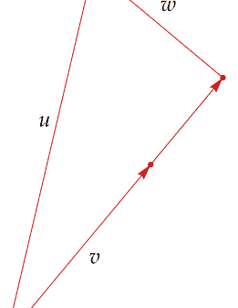

为了发现如何将 $w$ 写成 $u$ 的标量倍加上与 $u$ 正交的向量，让 $z \in V$ 表示一个标量。然后

$$ w = z u + (w - z u). $$

因此，我们需要选择 $z$ 使得 $(w - z u)$ 与 $u$ 正交。因此，我们希望

$$ 0 = \langle u, w - z u \rangle \iff \langle u, w \rangle - z \langle u, u \rangle = \langle u, w \rangle - z \|u\|^2. $$

上面的方程表明我们应该选择 $z$ 为 $\langle u, w \rangle / \|u\|^2$。选择这个 $z$ 的值，我们可以写成

$$ w = (\langle u, w \rangle / \|u\|^2) u + (w - (\langle u, w \rangle / \|u\|^2) u). $$

正如你应该验证的，上面显示的方程明确地将 $w$ 写成了一个标量倍的 $u$ 加上与 $u$ 正交的向量。因此，我们证明了以下关键结果。

## 6.13 正交分解

假设 $u, w \in V$，且 $u \neq 0$。设 $z = \langle u, w \rangle / \|u\|^2$ 和 $v = w - z u$。那么 $w = z u + v$ 且 $\langle v, u \rangle = 0$。

正交分解 6.13 将在柯西 - 施瓦茨不等式的证明中使用，这是我们下一个结果，也是数学中最重要的不等式之一。

### 第 6A 节 内积和范数

## 6.14 柯西 - 施瓦茨不等式

假设 $u, v \in V$。那么

$$ |\langle u, v \rangle| \leqslant \|u\| \|v\|. $$

如果且仅如果其中一个 $u, v$ 是另一个的标量倍，则此不等式是一个等式。

**证明** 如果 $v = 0$，那么所需不等式的两边都等于 0。因此我们可以假设 $v \neq 0$。考虑正交分解

$$ u = \frac{\langle u, v \rangle}{\|v\|^2}v + w $$

由 6.13 给出，其中 $w$ 与 $v$ 正交。根据勾股定理，

$$ \|u\|^2 = \left\| \frac{\langle u, v \rangle}{\|v\|^2}v \right\|^2 + \|w\|^2 $$

$$ = \left| \frac{\langle u, v \rangle}{\|v\|^2} \right|^2 \|v\|^2 + \|w\|^2 $$

$$ \geqslant \left| \frac{\langle u, v \rangle}{\|v\|^2} \right|^2 \|v\|^2 = \frac{|\langle u, v \rangle|^2}{\|v\|^2}. $$

将不等式两边乘以 $\|v\|^2$ 然后取平方根得到所需的不等式。

上面段落中的证明显示，当且仅当 6.15 是一个等式时，Cauchy-Schwarz 不等式才是一个等式。当且仅当 $w = 0$ 时，才会发生这种情况。但是，当且仅当 $u$ 是 $v$ 的倍数（参见 6.13）时，$w = 0$。因此，当且仅当 $u$ 是 $v$ 的标量倍数，或者 $v$ 是 $u$ 的标量倍数（或者两者都是；选择措辞以涵盖 $u$ 或 $v$ 等于 0 的情况）。

Augustin-Louis Cauchy (1789–1857) 在 1821 年证明了 6.16(a)。1859 年，Cauchy 的学生 Viktor Bunyakovsky(1804–1889) 证明了类似于 6.16(b) 的积分不等式。几十年后，Hermann Schwarz (1843–1921) 的类似发现引起了更多关注，并导致了这个不等式的命名。

## 6.16 例子：Cauchy-Schwarz 不等式

- (a) 如果 $x_1, \dots, x_n, y_1, \dots, y_n \in \mathbb{C}$，则

$$ (x_1 y_1 + \dots + x_n y_n)^2 \leqslant (x_1^2 + \dots + x_n^2)(y_1^2 + \dots + y_n^2) $$

这是由将柯西 - 施瓦茨不等式应用于向量 $(x_1, \dots, x_n), (y_1, \dots, y_n) \in \mathbb{C}^n$，使用通常的欧几里得内积得到的。

- (b) 如果 $f, g$ 是定义在 $[-1, 1]$ 上的连续实值函数，则

```latex
\int_{-1}^{1} |f g| \leqslant \left( \int_{-1}^{1} f^2 \right)^{1/2} \left( \int_{-1}^{1} g^2 \right)^{1/2}
```

这是由将柯西 - 施瓦茨不等式应用于例子 6.3(c) 得到的。

下一个结果被称为三角不等式，它有几何解释：三角形的每条边的长度都小于其他两条边长度之和。

请注意，三角不等式意味着两点之间的最短多边形路径是一条直线段（多边形路径由直线段组成）。

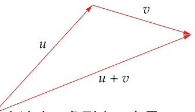

## 6.17 三角不等式

假设 $u, v \in V$。那么

$$ \|u+v\| \leqslant \|u\| + \|v\| $$

当且仅当其中一个 $u, v$ 是另一个的非负实数倍时，该不等式成立。

**证明** 我们有

```latex
\begin{aligned}
\|u+v\|^2 &= \langle u+v, u+v \rangle \\
&= \langle u, u \rangle + \langle u, v \rangle + \langle v, u \rangle + \langle v, v \rangle \\
&= \|u\|^2 + \|v\|^2 + 2 \text{Re} \langle u, v \rangle \\
&\leqslant \|u\|^2 + \|v\|^2 + 2 |\langle u, v \rangle| \quad \text{(6.18)} \\
&\leqslant \|u\|^2 + \|v\|^2 + 2 \|u\| \|v\| \quad \text{(6.19)} \\
&= (\|u\| + \|v\|)^2,
\end{aligned}
```

其中 6.19 是由柯西 - 施瓦茨不等式（6.14）推导出来的。对上述不等式两边取平方根得到所需的不等式。

上面的证明表明，当且仅当在 6.18 和 6.19 中等式成立时，三角不等式才成立。因此，当且仅当等式成立时，三角不等式成立。

$$ \text{Re} \langle u, v \rangle = \|u\| \|v\|. \quad \text{(6.20)} $$

如果其中一个 $u, v$ 是另一个的非负实数倍，则 6.20 成立。反过来，假设 6.20 成立。那么在柯西 - 施瓦茨不等式（6.14）中等式成立的条件意味着其中一个 $u, v$ 是另一个的标量倍数。这个标量必须是非负实数，根据 6.20，完成证明。

关于反三角不等式，请参见练习 20。

下一个结果被称为平行四边形等式，因为它具有几何解释：在每个平行四边形中，对角线长度的平方和等于四边长度的平方和。请注意，这里的证明比欧几里得几何中通常的证明更直接。

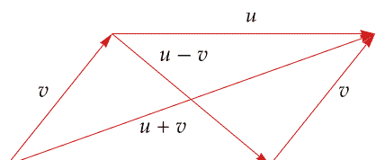

## 6.21 平行四边形等式

> 假设 $u, v \in V$。那么
> $\|u+v\|^2 + \|u-v\|^2 = 2(\|u\|^2 + \|v\|^2)$。

**证明** 我们有

```latex
\|u+v\|^2 + \|u-v\|^2 = \langle u+v, u+v \rangle + \langle u-v, u-v \rangle
= \|u\|^2 + \|v\|^2 + \langle u, v \rangle + \langle v, u \rangle + \|u\|^2 + \|v\|^2 - \langle u, v \rangle - \langle v, u \rangle
= 2(\|u\|^2 + \|v\|^2),
```

正如所需。

## 练习 6A

- 1 证明或给出反例：如果 $x_1, \dots, x_n \in V$，则 $\sum_{i=1}^n \sum_{j=1}^n \langle x_i, x_j \rangle \geqslant 0$。
- 2 假设 $T \in \mathcal{L}(V)$。定义 $\langle \cdot, \cdot \rangle_1$ 为 $\langle u, v \rangle_1 = \langle Tu, Tv \rangle$ 对于所有 $u, v \in V$。证明 $\langle \cdot, \cdot \rangle_1$ 是 $V$ 上的内积当且仅当 $T$ 是单射。
- 3 (a) 证明函数 $((x_1, y_1), (x_2, y_2))$ of elements of $\mathbb{R}^2$ to $|x_1x_2| + |y_1y_2|$ 不是 $\mathbb{R}^2$ 上的内积。
(b) 证明函数 $((x_1, y_1, z_1), (x_2, y_2, z_2))$ of elements of $\mathbb{R}^3$ to $x_1x_2 + z_1z_2$ 不是 $\mathbb{R}^3$ 上的内积。
- 4 假设 $S \in \mathcal{L}(V)$ 满足对于每个 $v \in V$，都有 $\|Sv\| \leqslant \|v\|$。证明 $I - \sqrt{2}S$ 是单射的。
- 5 假设 $v, u$ 是一个实内积空间。
(a) 证明 $\langle v+u, v-u \rangle = \|v\|^2 - \|u\|^2$ 对于每个 $v, u \in V$ 成立。
(b) 证明如果 $v, u \in V$ 具有相同的范数，则 $v+u$ 与 $v-u$ 正交。
(c) 使用 (b) 证明菱形的对角线互相垂直。
- 6 假设 $v, u \in V$。证明 $\langle v, u \rangle = 0 \implies \|v\| \leqslant \|v+u\|$ 对于所有 $v \in V$。
- 7 假设 $v, u \in V$。证明 $\|v+u\| = \|v-u\|$ 对于所有 $v, u \in V$ 当且仅当 $\|v\| = \|u\|$。
- 8 假设 $v_1, v_2, v_3, v_4, v_5 \in V$ 且 $v_1^2 + v_2^2 + v_3^2 + v_4^2 + v_5^2 \leqslant 1$。证明 $v_1 + v_2 + v_3 + 4v_4 + 9v_5 \leqslant 10$。
- 9 假设 $v, u \in V$ 且 $\|v\| = \|u\| = 1$ 且 $\langle v, u \rangle = 1$。证明 $v = u$。
- 10 假设 $v, u \in V$ 且 $\|v\| \leqslant 1$ 且 $\|u\| \leqslant 1$。证明 $\sqrt{1-\|v\|^2}\sqrt{1-\|u\|^2} \leqslant 1 - |\langle v, u \rangle|$。
- 11 找到向量 $v, u \in \mathbb{R}^2$ 使得 $v$ 是 $(1, 3)$ 的标量倍，$u$ 与 $(1, 3)$ 正交，且 $(1, 2) = v + u$。
- 12 假设 $a, b, c, d$ 是正数。
(a) 证明 $(a+b+c+d)(1/a+1/b+1/c+1/d) \geqslant 16$.
(b) 对于哪些正数 $a, b, c, d$，上述不等式成立？
- 13 证明平均数的平方小于或等于平方的平均数。更准确地说，如果 $x_1, \dots, x_n \in \mathbb{R}$，那么平均数的平方小于或等于平方的平均数。
- 14 假设 $x \in V$ 且 $x \neq 0$。证明 $x/\|x\|$ 是离 $x$ 在单位球面上最近的唯一元素。更准确地说，证明如果 $y \in V$ 且 $\|y\| = 1$，那么 $\|x/\|x\| - y\| \leqslant \|x - y\|$，当且仅当 $y = x/\|x\|$ 时，等式成立。
- 15 假设 $v, u$ 是 $\mathbb{R}^2$ 中的非零向量。证明 $\langle v, u \rangle = \|v\| \|u\| \cos\theta$，其中 $\theta$ 是 $v$ 和 $u$ 之间的角度（将 $v$ 和 $u$ 看作起点在原点的箭头）。提示：在由 $v, u$ 和 $v - u$ 组成的三角形上使用余弦定理。

16. 在 $\mathbb{R}^2$ 或 $\mathbb{R}^3$ 中，两个向量（被视为起点在原点的箭头）之间的角度可以几何地定义。然而，在 $\mathbb{R}^n$ 中（其中 $n > 3$），几何概念不太清晰。因此，定义 $\mathbf{x}, \mathbf{y} \in \mathbb{R}^n$ 为非零向量之间的角度为

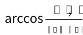

这个定义的动机来自于练习 15。解释为什么需要柯西 - 施瓦茨不等式来证明这个定义是有意义的。

17. 证明

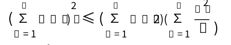

对于所有实数 $x_1, \dots, x_n$ 和 $y_1, \dots, y_n$。

18. (a) 假设 $f: [1, \infty) \rightarrow [0, \infty)$ 是连续的。证明

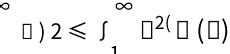

(b) 对于哪些连续函数 $f: [1, \infty) \rightarrow [0, \infty)$ 不等式成立？

(c) 两边都有限的等式是什么？

19. 假设 $v_1, \dots, v_n$ 是 $V$ 的一组基，且 $A \in \mathcal{L}(V)$。证明如果 $\lambda$ 是 $A$ 的特征值，则

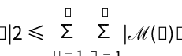

其中 $\mathcal{M}(A)_{ij}$ 表示矩阵 $A$ 相对于基 $v_1, \dots, v_n$ 的第 $i$ 行，第 $j$ 列的元素。

20. 证明如果 $u, v \in V$，那么 $|\|u\| - \|v\|| \leqslant \|u-v\|$。

上述不等式被称为反向三角不等式。对于当 $v = 0$ 时的反向三角不等式，请参见第 4 章的练习 2。

21. 假设 $u, v \in V$ 满足

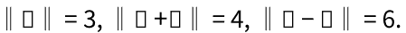

求 $\|v\|$ 等于多少？

22. 证明如果 $u, v \in V$，那么

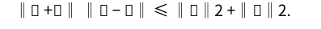

23. 假设 $v_1, \dots, v_n \in V$ 满足 $\|v_i\| \leqslant 1$ 对于每个 $i=1, \dots, n$。证明存在 $a_1, \dots, a_n \in \{1, -1\}$ 使得 $\|a_1 v_1 + \dots + a_n v_n\| \leqslant \sqrt{n}$。

### 第 6 章 内积空间

24. 证明或给出反例：如果 $\|\cdot\|$ 是与内积关联的范数，则存在 $(x, y) \in \mathbb{R}^2$，使得 $\|(x, y)\| \neq \max\{|x|, |y|\}$。

25. 假设 $p > 0$。证明存在一个内积在 $\mathbb{R}^2$ 上，其关联的范数为

```
||(x, y)|| = (|x|^p + |y|^p)^{1/p}
```

对于所有 $(x, y) \in \mathbb{R}^2$ 当且仅当 $p = 2$。

26. 假设 $V$ 是一个实内积空间。证明

```
⟨x, y⟩ = (||x+y||^2 - ||x-y||^2) / 4
```

对于所有的 $x, y \in V$。

27. 假设 $V$ 是一个复内积空间。证明

```
⟨x, y⟩ = (||x+y||^2 - ||x-y||^2 + i||x+iy||^2 - i||x-iy||^2) / 4
```

对于所有的 $x, y \in V$。

28. 向量空间 $V$ 上的范数是一个函数

```
||·|| : V → [0, ∞)
```

使得 $\|v\| = 0$ 当且仅当 $v = 0$, $\|\lambda v\| = |\lambda| \|v\|$ 对于所有的 $v \in V$ 和所有的 $\lambda \in \mathbb{F}$，以及 $\|x+y\| \leqslant \|x\| + \|y\|$ 对于所有的 $x, y \in V$。证明满足平行四边形等式的范数来自一个内积（换句话说，证明如果 $\|\cdot\|$ 是 $V$ 上满足平行四边形等式的范数，那么存在一个内积 $\langle \cdot, \cdot \rangle$ 在 $V$ 上，使得 $\|v\| = \langle v, v \rangle^{1/2}$ 对于所有的 $v \in V$）。假设 $V_1, \dots, V_n$ 是内

29. 积空间。证明方程 $\langle (x_1, \dots, x_n), (y_1, \dots, y_n) \rangle = \langle x_1, y_1 \rangle + \dots + \langle x_n, y_n \rangle$ 定义了 $V_1 \times \dots \times V_n$ 上的一个内积。

在上述表达式中，对于每个 $k = 1, \dots, n$，内积 $\langle x_k, y_k \rangle$ 表示 $V_k$ 上的内积。尽管在这里使用相同的符号，但每个空间 $V_1, \dots, V_n$ 可能具有不同的内积。

30. 假设 $V$ 是一个实内积空间。对于 $x, y, z, w \in V$，定义

```
⟨x+iy, z+iw⟩ = ⟨x, z⟩ + ⟨y, w⟩ + (⟨x, w⟩ - ⟨y, z⟩) i。
```

(a) 证明 $\langle \cdot, \cdot \rangle$ 使得 $V_{\mathbb{C}}$ 成为一个复内积空间。

(b) 证明如果 $x, y \in V$，那么

```
⟨ix, y⟩ = i⟨x, y⟩ 且 ||x+iy||^2 = ||x||^2 + ||y||^2。
```

请参阅第 1B 节中的练习 8，了解复数化 $V_{\mathbb{C}}$ 的定义。

31. 假设 $x, y, z \in V$。证明

$$ \|x - \frac{1}{2}(y+z)\|^2 = \frac{\|x-y\|^2 + \|x-z\|^2 - 2\|\frac{y-z}{2}\|^2}{2} $$

32. 假设 $C$ 是 $V$ 的一个子集，满足 $x, y \in C$ 则 $\frac{1}{2}(x+y) \in C$。令 $z \in V$。证明 $C$ 中至多存在一个离 $z$ 最近的点。换句话说，证明 $C$ 中至多存在一个 $x \in C$，使得对于所有 $y \in C$，有 $\|x-z\| \leqslant \|y-z\|$。

33. 假设 $f, g$ 是从 $I$ 到 $\mathbb{R}^p$ 的可微函数。

(a) 证明

$$ \langle f(t), g(t) \rangle' = \langle f'(t), g(t) \rangle + \langle f(t), g'(t) \rangle $$

(b) 假设 $c$ 是一个正数，对于每个 $t \in I$，有 $\|f(t)\| = c$。证明对于每个 $t \in I$，有 $\langle f'(t), f(t) \rangle = 0$。

(c) 以几何方式解释 (b) 中的结果，该结果涉及到位于原点的球面上的曲线的切向量。

如果存在可微函数 $f_1, \dots, f_p$ 从 $I$ 到 $\mathbb{R}$，使得对于每个 $t \in I$，都有 $f(t) = (f_1(t), \dots, f_p(t))$，则函数 $f: I \to \mathbb{R}^p$ 被称为可微的。此外，对于每个 $t \in I$，导数 $f'(t) \in \mathbb{R}^p$ 定义为 $f'(t) = (f_1'(t), \dots, f_p'(t))$。

34. 使用内积证明阿波罗尼斯恒等式：在一个边长为 $a, b, c$ 的三角形中，设 $d$ 为从边长为 $c$ 的中点到对边顶点的线段的长度。那么 $a^2 + b^2 = 2(\frac{c}{2})^2 + 2d^2$。


35. 固定一个正整数 $n$。两次可微的实值函数 $f$ 的 Laplacian $\Delta f$ on $\mathbb{R}^n$ 是定义在 $\mathbb{R}^n$ 上的函数

$$ \Delta f = \frac{\partial^2 f}{\partial x_1^2} + \dots + \frac{\partial^2 f}{\partial x_n^2} $$

如果 $\Delta f = 0$，则函数 $f$ 被称为调和函数。

在 $\mathbb{R}^n$ 上，多项式是形如 $x_1^{\alpha_1} \cdots x_n^{\alpha_n}$ 的函数的线性组合（其中 $c_1, \dots, c_k$ 是系数），其中 $\alpha_1, \dots, \alpha_n$ 是非负整数。

假设 $P$ 是 $\mathbb{R}^n$ 上的多项式。证明存在一个调和多项式 $H$ 在 $\mathbb{R}^n$ 上，使得对于每个满足 $\|\xi\| = 1$ 的 $\xi \in \mathbb{R}^n$，有 $H(\xi) = P(\xi)$。

对于这个练习，你需要知道关于调和函数的唯一事实是，如果 $f$ 是 $\mathbb{R}^n$ 上的调和函数，并且对于所有满足 $\|\xi\| = 1$ 的 $\xi \in \mathbb{R}^n$，有 $f(\xi) = 0$，则 $f = 0$。

提示：一个合理的猜测是所需的谐和多项式 $H$ 是形式为 $P+(1 - \|x\|^2)Q$ 的某个多项式 $Q$。通过在适当的向量空间上定义一个算子 $L$，证明存在一个多项式 $Q$ 在 $\mathbb{R}^n$ 上，使得 $P+(1 - \|x\|^2)Q$ 是谐和的。

$$ L(Q) = \Delta((1 - \|x\|^2)Q) $$

然后证明 $L$ 是单射，从而是满射。

在数字的领域里，秘密隐藏着，

一条高尚的真理从深处浮现，

柯西和施瓦茨，他们运用智慧，

一个不等式供所有人保留。

两个向量，通过这个纽带交织在一起，

内积编织出一根镀金的线，

他们的大小，由命运所限制，

一个界限，决定了他们的命运。

虽然阴影落下，黄昏昏暗了白天，这个不等式将经受住考验，引导我们的探索，

照亮道路，在它的真理中，我们的理解得以休息。

所以，吟唱吧，伟大的缪斯，这个高尚的壮举，柯西 - 施瓦茨，无人能超越的界限。

——由 ChatGPT 撰写，以柯西 - 施瓦茨不等式为输入的莎士比亚十四行诗

## 6B 正交归一基

### 正交列表和格拉姆 - 施密特过程

> **6.22 定义：正交归一**
>
> • 向量列表称为正交归一，如果列表中的每个向量的范数为 1，并且与列表中的其他向量正交。
>
> • 换句话说，向量空间中的向量列表，是正交归一的，如果
> $$ \langle u_i, u_j \rangle = \begin{cases} 1 & \text{if } i = j, \\ 0 & \text{if } i \neq j \end{cases} $$
> 对于所有 $i, j \in \{1, \dots, k\}$。

> **6.23 例子：正交归一列表**
>
> (a) $\mathbb{R}^3$ 的标准基是一个正交归一列表。
>
> (b) $(\frac{1}{\sqrt{3}}, \frac{1}{\sqrt{3}}, \frac{1}{\sqrt{3}}), (-\frac{1}{\sqrt{2}}, \frac{1}{\sqrt{2}}, 0)$ 是 $\mathbb{R}^3$ 中的一个正交归一列表。
>
> (c) $(\frac{1}{\sqrt{3}}, \frac{1}{\sqrt{3}}, \frac{1}{\sqrt{3}}), (-\frac{1}{\sqrt{2}}, \frac{1}{\sqrt{2}}, 0), (\frac{1}{\sqrt{6}}, \frac{1}{\sqrt{6}}, -\frac{2}{\sqrt{6}})$ 是 $\mathbb{R}^3$ 中的一个正交归一列表。
>
> (d) 假设 $N$ 是一个正整数。正如练习 4 所要求的那样，
> $$ \frac{1}{\sqrt{2}}, \cos \theta, \cos 2\theta, \dots, \cos N\theta, \sin \theta, \sin 2\theta, \dots, \sin N\theta $$
> 是在 $[-\pi, \pi]$ 上连续实值函数的一个正交归一列表，其中空间 $[-\pi, \pi]$ 是向量空间，具有内积
> $$ \langle f, g \rangle = \int_{-\pi}^{\pi} f g $$
> 上面的正交归一列表经常用于建模周期性现象，比如潮汐。
>
> (e) 假设我们使用给定的内积将 $\mathcal{P}_2(\mathbb{R})$ 转化为一个内积空间，该内积由
> $$ \langle p, q \rangle = \int_{-1}^{1} p q $$
> 对于所有 $p, q \in \mathcal{P}_2(\mathbb{R})$。标准基 $1, x, x^2$ 的 $\mathcal{P}_2(\mathbb{R})$ 不是一个正交的列表，因为该列表中的向量没有单位长度 1。将每个向量除以其长度得到列表 $1/\sqrt{2}, \sqrt{3}/2x, \sqrt{5}/2x^2$，其中每个向量的长度为 1，第二个向量与第一个和第三个向量正交。
>
> 然而，第一个和第三个向量不正交。因此，这不是一个正交的列表。
>
> 很快我们将看到如何从标准基 $1, x, x^2$ 构造一个正交的列表（见例子 6.34）。

正交归一列表特别容易处理，如下所示的结果。

**6.24 正交归一线性组合的范数**

假设 $v_1, \dots, v_m$ 是 $V$ 中的正交归一向量列表。那么
$$ \|a_1 v_1 + \dots + a_m v_m\|^2 = |a_1|^2 + \dots + |a_m|^2 $$
对于所有的 $a_1, \dots, a_m \in \mathbb{F}$。

证明因为每个 $v_j$ 的范数为 1，所以这可以通过重复应用勾股定理（6.12）得到。

上述结果有以下重要推论。

**6.25 正交归一列表是线性无关的**

每个正交归一向量列表都是线性无关的。

证明假设 $v_1, \dots, v_m$ 是 $V$ 中的正交归一向量列表， $a_1, \dots, a_m \in \mathbb{F}$ 是这样的
$$ a_1 v_1 + \dots + a_m v_m = 0. $$
然后 $|a_1|^2 + \dots + |a_m|^2 = 0$ (由 6.24)，这意味着所有的 $a_j$ 都是 0。因此 $v_1, \dots, v_m$ 是线性无关的。

现在我们来到一个重要的不等式。

**6.26 贝塞尔不等式**

假设 $v_1, \dots, v_m$ 是 $V$ 中的一组标准正交向量。如果 $v \in V$，那么
$$ |\langle v, v_1 \rangle|^2 + \dots + |\langle v, v_m \rangle|^2 \leqslant \|v\|^2. $$

证明假设 $v \in V$。那么
$$ v = v - u + u, $$
其中 $u = \langle v, v_1 \rangle v_1 + \dots + \langle v, v_m \rangle v_m$。

令 $u$ 和 $w$ 如上方程所定义。如果 $i \in \{1, \dots, m\}$，那么 $\langle w, v_i \rangle = \langle v, v_i \rangle - \langle u, v_i \rangle = \langle v, v_i \rangle - \langle v, v_i \rangle = 0$。这意味着 $w \perp u$。根据勾股定理，现在可以得出
$$ \begin{aligned} \|v\|^2 &= \|w + u\|^2 + \|w\|^2 \\ &\geqslant \|u\|^2 \\ &= |\langle v, v_1 \rangle|^2 + \dots + |\langle v, v_m \rangle|^2, \end{aligned} $$
最后一行来自于 6.24。

下一个定义引入了内积空间研究中最有用的概念之一。

**6.27 定义：正交归一基**

一个正交归一基 of $V$ 是 $V$ 中的正交归一向量列表，同时也是 $V$ 的一个基。

例如，标准基是 $\mathbb{R}^n$ 的一个正交归一基。

**6.28 正交归一列表的长度正确时，它们是正交基**

假设 $V$ 是有限维的。那么 $V$ 中长度为 $\dim V$ 的每个正交归一向量列表都是 $V$ 的正交基。

证明根据 6.25，$V$ 中的每个正交归一向量列表都是线性无关的。因此，长度正确的每个这样的列表都是一组基础—参见 2.38。

**6.29 例子： $\mathbb{R}^4$ 的一个正交基**

如上所述，标准基是 $\mathbb{R}^4$ 的一个正交基。我们现在证明
$$ (\frac{1}{2}, \frac{1}{2}, \frac{1}{2}, \frac{1}{2}), (\frac{1}{2}, \frac{1}{2}, -\frac{1}{2}, -\frac{1}{2}), (\frac{1}{2}, -\frac{1}{2}, -\frac{1}{2}, \frac{1}{2}), (-\frac{1}{2}, \frac{1}{2}, -\frac{1}{2}, \frac{1}{2}) $$
也是 $\mathbb{R}^4$ 的一个正交基。
我们有
$$ \|(\frac{1}{2}, \frac{1}{2}, \frac{1}{2}, \frac{1}{2})\| = \sqrt{1/2^2 + 1/2^2 + 1/2^2 + 1/2^2} = 1. $$
同样，上面列表中的其他三个向量的范数也是 1。
注意
$$ \langle (\frac{1}{2}, \frac{1}{2}, \frac{1}{2}, \frac{1}{2}), (\frac{1}{2}, \frac{1}{2}, -\frac{1}{2}, -\frac{1}{2}) \rangle = 1/2 \cdot 1/2 + 1/2 \cdot 1/2 + 1/2 \cdot (-1/2) + 1/2 \cdot (-1/2) = 0. $$
同样地，上述列表中任意两个不同向量的内积也等于 0。
因此，上述列表是正交的。因为在四维向量空间 $\mathbb{R}^4$ 中，我们有一个长度为四的正交列表，所以这个列表是 $\mathbb{R}^4$ 的正交基（根据 6.28）。

一般来说，给定 $V$ 的基 $v_1, \dots, v_n$ 和向量 $v \in V$，我们知道存在一些标量 $a_1, \dots, a_n \in \mathbb{F}$，使得
$$ v = a_1 v_1 + \dots + a_n v_n $$
计算满足上述方程的数 $a_1, \dots, a_n$ 对于 $V$ 的任意基来说可能是一个很长的计算。然而，下一个结果表明，对于正交基来说这是很容易的——只需取 $a_i = \frac{\langle v, v_i \rangle}{\langle v_i, v_i \rangle}$。

注意到下一个结果如何使每个有限维内积空间的行为类似于 $\mathbb{F}^n$，其中向量的坐标在 $\mathbb{F}^n$ 中由 $e_1, e_2, \dots, e_n$ 扮演。

> 下面的公式 $\|v\|$ 被称为 Parseval 恒等式。它在 1799 年发表在傅里叶级数的背景下。

## 6.30 将向量写成正交归一基的线性组合

假设 $e_1, \dots, e_n$ 是 $V$ 的正交归一基，$v, w \in V$。那么
(a) $v = \langle v, e_1 \rangle e_1 + \dots + \langle v, e_n \rangle e_n$
(b) $\|v\|^2 = |\langle v, e_1 \rangle|^2 + \dots + |\langle v, e_n \rangle|^2$,
(c) $\langle v, w \rangle = \langle v, e_1 \rangle \overline{\langle w, e_1 \rangle} + \dots + \langle v, e_n \rangle \overline{\langle w, e_n \rangle}$.

证明 因为 $e_1, \dots, e_n$ 是 $V$ 的一组基，存在标量 $a_1, \dots, a_n$ 使得
$v = a_1 e_1 + \dots + a_n e_n$.
因为 $e_1, \dots, e_n$ 是正交的，将这个方程两边与 $e_i$ 的内积得到 $\langle v, e_i \rangle = a_i$.
因此 (a) 成立。
现在 (b) 立即由 (a) 和 6.24 得出。
将 $w$ 与 (a) 的两边的内积，并利用内积的共轭对称性得到 (c)。

## 6.31 例子：寻找线性组合的系数

假设我们想要将向量 $(1, 2, 4, 7) \in \mathbb{C}^4$ 写成正交基的线性组合
$(\frac{1}{2}, \frac{1}{2}, \frac{1}{2}, \frac{1}{2}), (\frac{1}{2}, \frac{1}{2}, -\frac{1}{2}, -\frac{1}{2}), (\frac{1}{2}, -\frac{1}{2}, -\frac{1}{2}, \frac{1}{2}), (-\frac{1}{2}, \frac{1}{2}, -\frac{1}{2}, \frac{1}{2})$.
从例子 6.29 中的 $\mathbb{C}^4$ 来看，我们不需要解一个四元一次方程组。

```
7(\frac{1}{2}, \frac{1}{2}, \frac{1}{2}, \frac{1}{2}) - 4(\frac{1}{2}, \frac{1}{2}, -\frac{1}{2}, -\frac{1}{2}) + (\frac{1}{2}, -\frac{1}{2}, -\frac{1}{2}, \frac{1}{2}) + 2(-\frac{1}{2}, \frac{1}{2}, -\frac{1}{2}, \frac{1}{2}).
```

现在我们了解了正交基的用处，那么我们如何找到它们呢？例如，带有内积 6.3(c) 的 $\mathbb{C}^4(\mathbb{C})$ 是否有正交基？下一个结果将给出这些问题的答案。

下一个证明中使用的算法是 Gram-Schmidt 过程。它提供了一种将线性无关列表转换为具有相同张成的正交列表的方法。

> Jørgen Gram (1850-1916) 和 Erhard Schmidt (1876-1959) 推广了这个构造正交列表的算法。

## 6.32 Gram-Schmidt 过程

假设 $v_1, \dots, v_n$ 是 $V$ 中线性无关的向量列表。令 $e_1 = \frac{v_1}{\|v_1\|}$。
对于 $k = 2, \dots, n$，通过归纳定义 $v_k$ 如下：

$$ v_k = v_k - \frac{v_k \cdot e_1}{\|e_1\|^2}e_1 - \cdots - \frac{v_k \cdot e_{k-1}}{\|e_{k-1}\|^2}e_{k-1} $$

对于每个 $k = 1, \dots, n$，令 $e_k = \frac{v_k}{\|v_k\|}$。那么 $e_1, \dots, e_n$ 是 $V$ 中的正交向量列表，满足以下条件：

$$ \text{span}(v_1, \dots, v_k) = \text{span}(e_1, \dots, e_k) $$

对于每个 $k = 1, \dots, n$。

证明 我们将通过对 $n$ 进行归纳来证明所需的结论成立。为了开始 $n=1$，请注意因为 $e_1 = v_1 / \|v_1\|$，我们有 $\|e_1\| = 1$；同时，$\text{span}(e_1) = \text{span}(v_1)$ 因为 $e_1$ 是 $v_1$ 的非零倍数。

假设 $1 < k \le n$ 并且由 6.32 生成的列表 $e_1, \dots, e_{k-1}$ 是一个正交的列表，使得

6.33 $$ \text{span}(e_1, \dots, e_{k-1}) = \text{span}(v_1, \dots, v_{k-1}) $$

因为 $v_1, \dots, v_k$ 是线性无关的，所以我们有 $v_k \notin \text{span}(v_1, \dots, v_{k-1})$。因此 $v_k \notin \text{span}(v_1, \dots, v_{k-1}) = \text{span}(e_1, \dots, e_{k-1})$，这意味着 $v_k \neq 0$。因此在定义 6.32 中，我们没有除以 0。将一个向量除以其范数会产生一个范数为 1 的新向量；因此 $\|e_k\| = 1$。

设 $k \in \{1, \dots, n-1\}$。那么

$$ e_k \cdot e_n = \frac{1}{\|v_k\| \|v_n\|} v_k \cdot v_n $$

$$ = \frac{1}{\|v_k\| \|v_n\|} v_k \cdot \left( v_n - \frac{v_n \cdot e_1}{\|e_1\|^2}e_1 - \cdots - \frac{v_n \cdot e_{k-1}}{\|e_{k-1}\|^2}e_{k-1} \right) $$

$$ = \frac{1}{\|v_k\| \|v_n\|} (v_k \cdot v_n - 0 - \cdots - 0) = 0. $$

因此 $e_1, \dots, e_n$ 是一个标准正交列表。

根据 6.32 中给出的 $e_k$ 的定义，我们可以看出 $e_k \in \text{span}(v_1, \dots, v_k)$。结合这个信息和 6.33，我们可以得出

$$ \text{span}(v_1, \dots, v_k) \subseteq \text{span}(e_1, \dots, e_k) $$

上述两个列表都是线性无关的（根据假设，$v$ 的线性无关性和 $e$ 的标准正交性和 6.25）。因此，上述两个子空间的维度都是 $k$，因此它们是相等的，完成归纳步骤，从而完成证明。

## 6.34 例子：$P_2(\mathbb{R})$ 的标准正交基

假设我们使用给定的内积，将 $P_2(\mathbb{R})$ 变成内积空间

$$ \langle p, q \rangle = \int_{-1}^1 p(t)q(t) \, dt $$

对于所有的 $p, q \in P_2(\mathbb{R})$。我们知道 $1, x, x^2$ 是 $P_2(\mathbb{R})$ 的一个基，但它不是标准正交基。我们将通过应用 Gram-Schmidt 过程和 $V$ 找到 $P_2(\mathbb{R})$ 的标准正交基 $e_1=1, e_2=x$，和 $e_3=x^2$。

为了开始，取 $e_1 = e_1 = 1$。因此 $\|e_1\|^2 = \int_{-1}^1 1 = 2$。因此，公式 6.32 告诉我们

$$ e_2 = x - \frac{\langle x, e_1 \rangle}{\|e_1\|^2} e_1 = x - \frac{\int_{-1}^1 t \cdot 1 \, dt}{2} \cdot 1 = x - 0 = x $$

其中最后一个等式成立是因为 $\langle x, 1 \rangle = \int_{-1}^1 t \, dt = 0$。

上述公式对于 $e_2$ 意味着 $\|e_2\|^2 = \int_{-1}^1 x^2 \, dt = 2$。现在公式 6.32 告诉我们

$$ e_3 = x^2 - \frac{\langle x^2, e_1 \rangle}{\|e_1\|^2} e_1 - \frac{\langle x^2, e_2 \rangle}{\|e_2\|^2} e_2 = x^2 - \frac{\int_{-1}^1 t^2 \cdot 1 \, dt}{2} \cdot 1 - 0 = x^2 - \frac{2}{3} $$

上述公式对于 $e_3$ 意味着

$$ \|e_3\| = \int_{-1}^1 (x^2 - 1/3)^2 \, dt = \int_{-1}^1 (x^4 - 2/3 x^2 + 1/9) \, dt = 8/45。 $$

现在将 $e_1, e_2, e_3$ 分别除以其范数，我们得到正交归一列表

$$ \sqrt{1/2}, \sqrt{3} x, \sqrt{45/8} (x^2 - 1/3)。 $$

上述正交归一列表的长度为三，这是 $P_2(\mathbb{R})$ 的维度。因此，这个正交归一列表是 $P_2(\mathbb{R})$ 的正交基 [根据 6.28]。

现在我们可以回答有关正交基的存在性的问题。

## 6.35 正交基的存在

每个有限维内积空间都有一个正交基。

证明 假设 $V$ 是有限维的。选择一个 $V$ 的基。应用格拉姆 - 施密特过程 (6.32) 对其进行处理，得到一个长度为 $\dim V$ 的正交列表。根据 6.28，这个正交列表是 $V$ 的一个正交基。

有时我们不仅需要知道正交基的存在，还需要知道每个正交列表都可以扩展为一个正交基。在下一个推论中，格拉姆 - 施密特过程表明这样的扩展总是可能的。

## 6.36 每个正交列表都可以扩展为一个正交基

假设 $V$ 是有限维的。那么 $V$ 中的每个正交向量列表都可以扩展为 $V$ 的一个正交基。

证明 假设 $v_1, \dots, v_k$ 是 $V$ 中的一组标准正交向量。那么 $v_1, \dots, v_k$ 是线性无关的 (根据 6.25)。因此，这个列表可以扩展为一组基 $v_1, \dots, v_k, w_1, \dots, w_m$ (参见 2.32)。现在应用 Gram-Schmidt 过程 (6.32) 到 $v_1, \dots, v_k, w_1, \dots, w_m$，得到一组标准正交向量

```
$v_1, \dots, v_k, e_1, \dots, e_m$
```

这里由 Gram-Schmidt 过程给出的公式保持第一个 $k$ 向量不变，因为它们已经正交。上面的列表是 $V$ 的一个正交基，由 6.28 确定。

回想一下，如果矩阵看起来像这样，它被称为上三角矩阵：

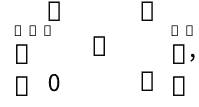

在上面的矩阵中，0 表示对角线以下的所有条目都等于 0，星号用于表示对角线及以上的条目。在上一章中，我们给出了一个算子具有上三角矩阵的必要和充分条件（见 5.44）。现在我们正在处理内积空间，我们想知道是否存在一个正交基，使得我们具有上三角矩阵。下一个结果表明，算子具有上三角矩阵的条件，无论是相对于某个正交基还是相对于任意基，都是相同的。

## 6.37 上三角矩阵相对于某个正交基

假设 $V$ 是有限维的，$T \in \mathcal{L}(V)$。如果且仅如果 $T$ 相对于 $V$ 的某个正交基有上三角矩阵，那么 $T$ 的最小多项式等于 $(T-\lambda_1)\cdots(T-\lambda_n)$，其中 $\lambda_1, \dots, \lambda_n \in \mathbb{C}$。

证明 假设 $T$ 相对于基 $v_1, \dots, v_n$ 有上三角矩阵。因此，对于每个 $k = 1, \dots, n$ (见 5.39)，$\text{span}(v_1, \dots, v_k)$ 在 $W_k$ 下是不变的。

应用格拉姆 - 施密特过程到 $v_1, \dots, v_n$，得到一个正交的基 $u_1, \dots, u_n$ of $V$。因为

```
$\text{span}(v_1, \dots, v_k) = \text{span}(u_1, \dots, u_k)$
```

对于每个 $k$ (见 6.32)，我们得出结论 $\text{span}(v_1, \dots, v_k)$ 在 $T$ 下是不变的，对于每个 $k = 1, \dots, n$。因此，根据 5.39，$T$ 在正交基 $u_1, \dots, u_n$ 下有一个上三角矩阵。现在使用 5.44 来完成证明。

对于复向量空间，下一个结果是上面结果的一个重要应用。参见练习 20 以获取一个实数 - 适用于多个算子的 Schur 定理的一个版本。

> 伊萨伊·舒尔 (1875-1941) 在 1909 年发表了下一个结果的证明。

## 6.38 Schur 定理

对于有限维复内积空间上的每个算子，存在一组正交基使得其上三角矩阵。

证明 所需结果可以从代数基本定理的第二个版本 (4.13) 和 6.37 推导出来。

# 内积空间上的线性泛函

由于线性映射到标量域 $\mathbb{F}$ 具有特殊作用，我们在第 3F 节中为它们及其向量空间定义了一个特殊名称。为了方便起见，以下是那些定义，以防你跳过了第 3F 节。

## 6.39 定义：线性泛函，对偶空间

- 一个线性泛函是从 $V$ 到 $\mathbb{F}$ 的线性映射。
- 对于 $V$ 的对偶空间，记作 $V'$，是所有在 $V$ 上的线性函数的向量空间。换句话说，$V' = \mathcal{L}(V, \mathbb{F})$。

## 6.40 例子：$\mathbb{R}^3$ 上的线性泛函

函数 $T: \mathbb{R}^3 \to \mathbb{R}$ 定义为

$T(x_1, x_2, x_3) = 2x_1 - 5x_2 + x_3$

是 $\mathbb{R}^3$ 上的线性泛函。我们可以将这个线性泛函写成形式

$T(x) = \langle x, u \rangle$

对于每个 $x \in \mathbb{R}^3$，其中 $u = (2, -5, 1)$。

## 6.41 例子：线性泛函在 $P_5(\mathbb{R})$ 上的定义函数

$f: P_5(\mathbb{R}) \to \mathbb{R}$

$f(p) = \int_{-1}^{1} p(t)(\cos(\pi t)) \, dt$

是 $P_5(\mathbb{R})$ 上的线性泛函。

如果 $u \in V$，那么将 $v$ 映射为 $\langle v, u \rangle$ 的函数是 $V$ 上的线性泛函。下一个结果说明每个 $V$ 上的线性泛函都可以表示为这种形式。例如，在例子 6.40 中，我们可以取 $u = (2, -5, 1)$。

> 下一个结果以 Frigyes Riesz (1880 -1956) 的名字命名，他在 20 世纪初证明了几个非常类似于下面结果的定理。

假设我们将向量空间 $C_{\mathbb{R}}[-1, 1]$ 定义为内积空间，通过定义 $\langle f, g \rangle := \int_{-1}^{1} f g$。让 $g$ 如示例 6.41 中所示。很明显存在 $f \in C_{\mathbb{R}}[-1, 1]$ 使得

```
$\int_{-1}^{1} f(t)(\cos(\pi t)) \, dt = \langle f, g \rangle$
```

对于每个 $g \in C_{\mathbb{R}}[-1, 1]$ [我们不能选择 $f(t) = \cos(\pi t)$ 因为这个选择的 $f$ 不是 $C_{\mathbb{R}}[-1, 1]$ 的元素]。下一个结果告诉我们一个有些令人惊讶的结果，即确实存在一个多项式 $f \in C_{\mathbb{R}}[-1, 1]$ 使得上述方程对所有 $g \in C_{\mathbb{R}}[-1, 1]$ 成立。

## 6.42 Riesz 表示定理

假设 $V$ 是有限维的，$\varphi$ 是 $V$ 上的线性泛函。那么存在唯一的向量 $u \in V$ 使得

```
$\varphi(v) = \langle v, u \rangle$
```

对于每个 $v \in V$。

证明 首先我们证明存在一个向量 $u \in V$ 使得 $\varphi(v) = \langle v, u \rangle$ 对于每个 $v \in V$。设 $v_1, \dots, v_n$ 是 $V$ 的正交归一基。那么 $\varphi(v) = \varphi(\langle v, v_1 \rangle v_1 + \dots + \langle v, v_n \rangle v_n)$

```
$= \langle v, v_1 \rangle \varphi(v_1) + \dots + \langle v, v_n \rangle \varphi(v_n)$
```

```
$= \langle v, \overline{\varphi(v_1)}v_1 + \dots + \overline{\varphi(v_n)}v_n \rangle$
```

对于每个 $v \in V$，其中第一个等式来自于 6.30(a)。因此设定

```
6.43
```

```
$u = \overline{\varphi(v_1)}v_1 + \dots + \overline{\varphi(v_n)}v_n$
```

我们有 $\varphi(v) = \langle v, u \rangle$ 对于每个 $v \in V$，如所需。

现在我们证明只有一个向量 $u \in V$ 具有所需的性质。假设 $u_1, u_2 \in V$ 满足

```
$\varphi(v) = \langle v, u_1 \rangle = \langle v, u_2 \rangle$
```

对于每个 $v \in V$。然后

```
$0 = \langle v, u_1 \rangle - \langle v, u_2 \rangle = \langle v, u_1 - u_2 \rangle$
```

对于每个 $v \in V$。取 $v = u_1 - u_2$ 可以得出 $u_1 - u_2 = 0$。因此 $u_1 = u_2$，完成了结果的唯一性部分的证明。

## 6.44 例子：计算说明了 Riesz 表示定理

假设我们想要找到一个多项式 $p \in P_2([-1,1])$ 使得

6.45 $\int_{-1}^1 p(t)(\cos(\pi t)) \, dt = \int_{-1}^1 1 \, dt$

对于每个多项式 $p \in P_2([-1,1])$。为了做到这一点，我们通过定义 $\langle p, q \rangle$ 为上述方程的右边来将 $P_2([-1,1])$ 变成一个内积空间，其中 $p, q \in P_2([-1,1])$。

请注意，上述方程的左侧不等于内积 in $P_2([-1,1])$ of $p$ 和函数 $f = \cos(\pi t)$，因为最后一个函数不是一个多项式。

通过定义一个线性泛函 $f$ 在 $P_2([-1,1])$ 上，

$f(p) = \int_{-1}^1 p(t)(\cos(\pi t)) \, dt$

对于每个 $p \in P_2([-1,1])$。现在使用例 6.34 中的正交归一基，并应用 Riesz 表示定理证明中的公式 6.43，可以看出如果 $p \in P_2([-1,1])$，则 $f(p) = \langle p, h \rangle$，其中

$h(t) = \left( \int_{-1}^1 \sqrt{1/2} \cos(\pi t) \, dt \right) \sqrt{1/2} + \left( \int_{-1}^1 \sqrt{3/2} t \cos(\pi t) \, dt \right) \sqrt{3/2} t + \left( \int_{-1}^1 \sqrt{45/2} (t^2 - 1/3) \cos(\pi t) \, dt \right) \sqrt{45/2} (t^2 - 1/3)$.

对上述方程应用一点微积分可以得到

$h(t) = 15/\pi^2 (1 - 3\pi^2)$.

同样的过程表明，如果我们想要找到 $p \in P_5([-1,1])$ 使得 6.45 对于所有的 $p \in P_5([-1,1])$ 成立，那么我们应该取

$p(t) = 105/(8\pi^4) ((27 - 2\pi^2) + (242 - 2)\pi^2 + (315 - 302)\pi^4)$.

假设 $V$ 是有限维的，$f$ 是 $V$ 上的线性泛函。那么 6.43 给出了一个满足 $f(v) = \langle v, h \rangle$ 对于所有的 $v \in V$ 的向量 $h$ 的公式。具体来说，我们有

$h = f(e_1)e_1 + \dots + f(e_n)e_n$。

上述方程的右侧似乎依赖于正交归一基 $e_1, \dots, e_n$ 以及 $f$。然而，6.42 告诉我们 $h$ 由 $f$ 唯一确定。因此，上述方程的右侧不论选择哪个正交归一基 $e_1, \dots, e_n$ of $V$ 都是相同的。

关于 Riesz 表示定理的另外两个不同证明，请参见 6.58 和第 6C 节中的练习 13。

## 练习题 6B

- 1 假设 $v_1, \dots, v_n$ 是 $V$ 中的向量列表，使得
$$ \| v_1 + \dots + v_n \|^2 = \| v_1 \|^2 + \dots + \| v_n \|^2 $$
对于所有 $v_1, \dots, v_n \in V$。证明 $v_1, \dots, v_n$ 是一组标准正交向量。
这个练习提供了 6.24 的逆命题。

- 2 (a) 假设 $v \in V$。证明两者都
$$ (\cos v, \sin v), (-\sin v, \cos v) \text{ 和 } (\cos v, \sin v), (\sin v, -\cos v) $$
都是 $\mathbb{R}^2$ 的标准正交基。
(b) 证明 $\mathbb{R}^2$ 的每个标准正交基都可以用 (a) 中的两种形式之一表示。

- 3 假设 $v_1, \dots, v_n$ 是 $V$ 中的标准正交列表，且 $v \in V$。证明
$$ \| v \|^2 = |\langle v, v_1 \rangle|^2 + \dots + |\langle v, v_n \rangle|^2, \ v \in \text{span}(v_1, \dots, v_n)。 $$

- 4 假设 $n$ 是一个正整数。证明
$$ \frac{1}{\sqrt{2}}, \cos \theta, \cos 2\theta, \dots, \cos n\theta, \sin \theta, \sin 2\theta, \dots, \sin n\theta $$
是在 $[-\pi, \pi]$ 上连续实值函数的向量空间中的一个标准正交向量列表，其内积为 $\langle f, g \rangle = \int_{-\pi}^{\pi} f(t)g(t) dt$。

提示：以下公式应该有所帮助。
$$ (\sin \alpha)(\cos \beta) = \sin\left(\frac{\beta+\alpha}{2}\right) + \sin\left(\frac{\beta-\alpha}{2}\right) $$
$$ (\sin \alpha)(\sin \alpha) = \cos\left(\frac{\alpha-\alpha}{2}\right) - \cos\left(\frac{\alpha+\alpha}{2}\right) $$
$$ (\cos \beta)(\cos \beta) = \cos\left(\frac{\beta-\beta}{2}\right) + \cos\left(\frac{\beta+\beta}{2}\right) $$

- 5 假设 $f: [-\pi, \pi] \to \mathbb{R}$ 是连续的。对于每个非负整数 $n$，定义
$$ a_n = \frac{1}{\pi} \int_{-\pi}^{\pi} f(t) \cos(nt) dt \text{ 和 } b_n = \frac{1}{\pi} \int_{-\pi}^{\pi} f(t) \sin(nt) dt $$
证明
$$ \frac{a_0^2}{2} + \sum_{n=1}^{\infty} (a_n^2 + b_n^2) \leqslant \frac{1}{\pi} \int_{-\pi}^{\pi} f(t)^2 dt。 $$
上述不等式对于所有连续函数 $f: [-\pi, \pi] \to \mathbb{R}$ 实际上是一个等式。然而，证明这个不等式是一个等式涉及到本书范围之外的傅里叶级数技术。

- 6 假设 $v_1, \dots, v_n$ 是 $V$ 的一个标准正交基。
(a) 证明如果 $u_1, \dots, u_n$ 是 $V$ 中的向量，满足
$$ \| u_i - v_i \| < \frac{1}{\sqrt{n}} $$
对于每个 $i$，那么 $u_1, \dots, u_n$ 是 $V$ 的一个基。
(b) 证明存在 $u_1, \dots, u_n \in V$，使得
$$ \| u_i - v_i \| \leqslant \frac{1}{\sqrt{n}} $$
对于每个 $i$，但 $u_1, \dots, u_n$ 不是线性无关的。

这个练习在 (a) 中说明了一个适当小的扰动可以得到一个正交基。
然后 (b) 证明了不等式中右边的数 $1/\sqrt{n}$ 是无法改进的。

- 7 假设 $T \in \mathcal{L}(\mathbb{R}^3)$ 相对于基 $(1, 0, 0), (1, 1, 1), (1, 1, 2)$ 有一个上三角矩阵。
找到一个相对于 $\mathbb{R}^3$ 的正交归一基，使得 $T$ 有一个上三角矩阵。

- 8 通过定义 $\langle p, q \rangle = \int_0^1 pq$ 将 $\mathcal{P}_2(\mathbb{R})$ 转化为内积空间。其中，$p \in \mathcal{P}_2(\mathbb{R})$。
(a) 对于基 $1, x, x^2$ 应用格拉姆-施密特过程，得到一个正交归一基 $\mathcal{P}_2(\mathbb{R})$。
(b) 微分算子 (将 $p$ 变为 $p'$) 对于基 $1, x, x^2$，其上三角矩阵为不是正交基。找出微分算子在由 (a) 产生的正交基上的矩阵验证这个矩阵是上三角的，符合 6.37 的证明。

- 9 假设 $u_1, \dots, u_n$ 是将线性无关列表 $v_1, \dots, v_n$ 应用 Gram-Schmidt 过程后的结果在 $V$ 中。证明对于每个 $i = 1, \dots, n$, $\|u_i\| > 0$。

- 10 假设 $v_1, \dots, v_n$ 是 $V$ 中一个线性无关的列表。解释为什么由 Gram-Schmidt 过程的公式 (6.32) 产生的标准正交列表 $u_1, \dots, u_n$ 是 $V$ 中唯一的标准正交列表，满足 $\|u_i\| > 0$ 且对于每个 $i = 1, \dots, n$，有 $\text{span}(u_1, \dots, u_i) = \text{span}(v_1, \dots, v_i)$。

这个练习的结果在证明 7.58 中使用。

- 11 找到一个多项式 $p \in \mathcal{P}_2(\mathbb{R})$ 使得 $\int_0^1 p(x) dx = 0$。

- 12 找到一个多项式 $p \in \mathcal{P}_2(\mathbb{R})$ 使得 $\int_0^1 p(x)\cos(x) dx = \int_0^1 x dx$
对于每个 $p \in \mathcal{P}_2(\mathbb{R})$。

- 13 证明向量列表 $v_1, \dots, v_n$ 在 $V$ 中线性相关，当且仅当 6.32 中的 Gram-Schmidt 公式产生 $v_k=0$ 对于某个 $k \in \{1, \dots, n\}$。
这个练习为确定内积空间中的向量列表是否线性相关提供了一种替代高斯消元技术的方法。

- 14 假设 $V$ 是一个实内积空间，$v_1, \dots, v_n$ 是 $V$ 中线性无关的向量列表。证明存在恰好 2 个正交归一列表 $u_1, \dots, u_n$，使得它们是 $V$ 中的向量。
$$ \text{span}(u_1, \dots, u_k) = \text{span}(v_1, \dots, v_k) $$
对于所有 $k \in \{1, \dots, n\}$。

- 15 假设 $\langle \cdot, \cdot \rangle_1$ 和 $\langle \cdot, \cdot \rangle_2$ 是 $V$ 上的内积，满足 $\langle v, v \rangle_1 = 0$ 当且仅当 $v = 0$。证明存在一个正数 $c$，使得对于每个 $v, u \in V$，有 $\langle v, u \rangle_1 = c \langle v, u \rangle_2$。
这个练习表明，如果两个内积具有相同的正交向量对，则每个内积都是另一个内积的标量倍。

- 16 假设 $V$ 是有限维的。假设 $\langle \cdot, \cdot \rangle_1, \langle \cdot, \cdot \rangle_2$ 是 $V$ 上的内积，对应的范数为 $\| \cdot \|_1$ 和 $\| \cdot \|_2$。证明存在一个正数 $c$，使得对于每个 $v \in V$，有 $\| v \|_1 \leqslant c \| v \|_2$。

- 17 假设 $V = \mathbb{R}$ 且 $V$ 是有限维的。证明如果 $T$ 是 $V$ 上的一个算子，且 1 是 $T$ 的唯一特征值，并且对于所有 $v \in V$，有 $\| Tv \| \leqslant \| v \|$，则 $T$ 是恒等算子。

- 18 假设 $v_1, \dots, v_n$ 是 $V$ 中线性无关的列表。证明存在一个 $\phi \in V^*$ 使得对于所有 $k \in \{1, \dots, n\}$，有 $\phi(v_k) = 1$。

- 19 假设 $v_1, \dots, v_n$ 是 $V$ 的一组基。证明存在一组基 $v_1^*, \dots, v_n^*$ 使得
$$
\langle v_i^*, v_j \rangle = 
\begin{cases} 
0 \text{ if } i \ne j \\
1 \text{ if } i = j.
\end{cases}
$$

- 20 假设 $V = \mathbb{R}^n$, $V$ 是有限维的，并且 $\mathcal{E} \subseteq \mathcal{L}(V)$ 满足
$T(V) = V$
对于所有 $T, S \in \mathcal{E}$. 证明存在一个正交基 $v$，使得 $\mathcal{E}$ 中的每个元素都有上三角矩阵。
这个练习加强了第 5E 节中练习 9(b) 的内积空间的背景，它断言该练习中的基可以选择为正交基。

- 21 假设 $T \in \mathcal{L}(V)$, $V$ 是有限维的，且 $T$ 的所有特征值的绝对值都小于 1。取 $\epsilon > 0$。证明存在一个正整数 $n$，使得对于每个 $v \in V$，都有 $\| T^n v \| \leqslant \epsilon \| v \|$。

- 22 假设 $C[-1, 1]$ 是在区间 $[-1, 1]$ 上具有连续实值函数的向量空间，其内积定义为
$$ \langle f, g \rangle = \int_{-1}^1 fg $$
对于所有的 $f, g \in C[-1, 1]$. 设 $\varphi$ 是定义在 $C[-1, 1]$ 上的线性泛函，满足 $\varphi(f) = f(0)$. 证明不存在 $g \in C[-1, 1]$ 使得
$$ \varphi(f) = \langle f, g \rangle $$
对于每个 $f \in C[-1, 1]$ 成立。

这个练习表明在无额外假设的无限维向量空间 $C$ 和 $\varphi$ 上，Riesz 表示定理 (6.42) 不成立。

- 23 对于所有 $f, g \in C$，定义 $d(f, g) = \| f - g \|$。
(a) 证明 $d$ 是 $C$ 上的度量。
(b) 证明如果 $C$ 是有限维的，那么 $d$ 是 $C$ 上的完备度量 (即每个柯西序列都收敛)。
(c) 证明 $d$ 的每个有限维子空间都是 $C$ 的一个闭集 (相对于度量 $d$)。

这个练习需要对度量空间有一定的了解。

> **最高法院的正交性**
>
> 2010 年，法学教授理查德·弗里德曼在美国最高法院提出一个案件：
>
> 先生 弗里德曼：我认为这个问题与这里的问题完全无关
> 因为联邦政府承认—
> 首席大法官罗伯茨：对不起。完全是什么？
> 弗里德曼先生：正交。直角。无关。不相关。
> 罗伯茨首席大法官：哦。
> 斯卡利亚法官：那个形容词是什么？我喜欢那个。
> 弗里德曼先生：正交。
> 罗伯茨首席大法官：正交。
> 弗里德曼先生：对，对。
> 斯卡利亚法官：正交，哦。（笑声）
> 肯尼迪法官：我知道这个案子给我们带来了一个问题。（笑声）

## 6C 节 正交补和最小化问题

### 正交补

> **6.46 定义:** 正交补，定义 1
>
> 如果 $S$ 是 $V$ 的子集，则 $S$ 的正交补，表示为 $S^\perp$，是 $V$ 中与 $S$ 中的每个向量正交的所有向量的集合：
> $$ S^\perp = \{v \in V : \langle v, u \rangle = 0 \text{ 对于每个 } u \in S\}。 $$
>
> 正交补 $S^\perp$ 取决于 $V$ 以及内积。然而，内积空间 $V$ 应该根据上下文清楚，并且可以从符号中省略。

> **6.47 例子:** 正交补

- 如果 $V = \mathbb{R}^3$ 并且 $S$ 是 $V$ 的子集，由单点 $(2, 3, 5)$ 组成，则 $S^\perp$ 是平面 $\{(x, y, z) \in \mathbb{R}^3 : 2x + 3y + 5z = 0\}$。
- 如果 $V = \mathbb{R}^3$，并且 $S$ 是平面 $\{(x, y, z) \in \mathbb{R}^3 : 2x + 3y + 5z = 0\}$，那么 $S^\perp$ 是直线 $\{(2t, 3t, 5t) : t \in \mathbb{R}\}$。
- 更一般地，如果 $S$ 是包含原点的 $\mathbb{R}^3$ 中的平面，那么 $S^\perp$ 是包含原点且垂直于 $S$ 的直线。
- 如果 $S$ 是包含原点的 $\mathbb{R}^3$ 中的直线，那么 $S^\perp$ 是包含原点且垂直于 $S$ 的平面。
- 如果 $V = \mathbb{R}^5$ 和 $S = \{(x, y, 0, 0, 0) \in \mathbb{R}^5 : x, y \in \mathbb{R}\}$，那么
$$ S^\perp = \{(0, 0, z, w, u) \in \mathbb{R}^5 : z, w, u \in \mathbb{R}\}。 $$
- 如果 $v_1, \dots, v_k, w_1, \dots, w_m$ 是 $V$ 的正交基，那么
$$ (\text{span}(v_1, \dots, v_k))^\perp = \text{span}(w_1, \dots, w_m)。 $$

我们从定义的一些直接结果开始。

> **6.48 正交补的性质**

- (a) 如果 $S$ 是 $V$ 的子集，则 $S^\perp$ 是 $V$ 的子空间。
- (b) $\{0\}^\perp = V$。
- (c) $V^\perp = \{0\}$。
- (d) 如果 $S$ 是 $V$ 的子集，则 $S \cap S^\perp \subseteq \{0\}$。
- (e) 如果 $S$ 和 $T$ 是 $V$ 的子集，并且 $S \subseteq T$，则 $T^\perp \subseteq S^\perp$。

#### 证明

- (a) 假设 $W$ 是 $V$ 的子集。那么对于每个 $w \in W$, $\langle w, 0 \rangle = 0$; 因此 $0 \in W^\perp$。
假设 $u, v \in W^\perp$. 如果 $w \in W$, 那么
$$ \langle u+w, w \rangle = \langle u, w \rangle + \langle v, w \rangle = 0 + 0 = 0。 $$
因此 $u + v \in W^\perp$, 这表明 $W^\perp$ 在加法下封闭。
同样，假设 $a \in \mathbb{R}$ 和 $v \in W^\perp$. 如果 $w \in W$, 那么
$$ a\langle v, w \rangle = 0, \text{ 即 } \langle av, w \rangle = 0。 $$
因此 $av \in W^\perp$, 这表明 $W^\perp$ 在标量乘法下封闭。
因此 $W^\perp$ 是 $V$ 的子空间。

- (b) 假设 $v \in V$. 那么 $\langle v, 0 \rangle = 0$, 这意味着 $v \in \{0\}^\perp$. 因此 $\{0\}^\perp = V$。

- (c) 假设 $v \in V^\perp$. 那么 $\langle v, v \rangle = 0$, 这意味着 $v = 0$. 因此 $V^\perp = \{0\}$。

- (d) 假设 $W$ 是 $V$ 的子集，且 $v \in W \cap W^\perp$. 那么 $\langle v, v \rangle = 0$, 这意味着 $v = 0$. 因此 $W \cap W^\perp \subseteq \{0\}$。

- (e) 假设 $W_1$ 和 $W_2$ 是 $V$ 的子集，且 $W_1 \subseteq W_2$. 假设 $v \in W_2^\perp$. 那么
$$ \langle v, w_2 \rangle = 0 \text{ 对于每个 } w_2 \in W_2 \text{ 成立，这意味着对于每个 } w_1 \in W_1 \text{ 也有 } \langle v, w_1 \rangle = 0。 $$
因此 $v \in W_1^\perp$. 因此 $W_2^\perp \subseteq W_1^\perp$。

回顾一下，如果 $W$ 和 $U$ 是 $V$ 的子空间，则 $V$ 是 $W$ 和 $U$ 的直和 (记作 $V = W \oplus U$)，当且仅当 $V$ 的每个元素都可以唯一地表示为 $W$ 中的一个向量加上 $U$ 中的一个向量 (见 1.41)。此外，当且仅当 $V = W + U$ 且 $W \cap U = \{0\}$ (见 1.46) 时，这种情况才会发生。

下一个结果表明，$V$ 的每个有限维子空间 $W$ 都会导致一个自然的直和分解 $V$。参见练习 16，其中展示了在没有子空间 $W$ 是有限维的假设的情况下，下面的结果可能失败。

> **6.49 子空间和其正交补的直和**

假设 $W$ 是 $V$ 的有限维子空间。那么
$$ V = W \oplus W^\perp $$

证明 首先我们将证明
$$ V = W + W^\perp $$

为了做到这一点，假设 $v \in V$。让 $e_1, \dots, e_m$ 成为 $W$ 的正交归一基。我们希望将 $v$ 写成 $W$ 中的一个向量和与 $W$ 正交的一个向量的和。

令 $w = \langle v, e_1 \rangle e_1 + \dots + \langle v, e_m \rangle e_m$。令 $z = v - w$。
让 $w$ 和 $z$ 如上面的方程中所定义（就像在 6.26 的证明中所做的那样）。因为每个 $e_i \in W$，我们可以看出 $w \in W$。因为 $e_1, \dots, e_m$ 是一个正交归一列表，对于每个 $i = 1, \dots, m$ 我们有 $\langle z, e_i \rangle = \langle v - w, e_i \rangle = \langle v, e_i \rangle - \langle v, e_i \rangle = 0$。

因此 $z$ 与 $\text{span}(e_1, \dots, e_m)$ 中的每个向量正交，这表明 $z \in W^\perp$。

因此，我们写成 $v = w + z$，其中 $z \in W^\perp$ 且 $w \in W$，完成了证明 $v = w + z$。

根据 6.48(d)，我们知道 $W \cap W^\perp = \{0\}$。现在方程 $v = w + z$ 意味着 $V = W \oplus W^\perp$（见 1.46）。

现在我们可以看到如何从 $\dim V$ 计算 $\dim W^\perp$。

> **6.51 正交补的维数**

假设 $V$ 是有限维的，$W$ 是 $V$ 的子空间。那么
$$ \dim W^\perp = \dim V - \dim W $$

证明 $\dim W^\perp$ 的公式立即由 6.49 和 3.94 得出。

下一个结果是 6.49 的一个重要推论。

> **6.52 正交补的正交补**

假设 $W$ 是 $V$ 的有限维子空间。那么
$$ W = (W^\perp)^\perp $$

证明 首先我们将证明
6.53 $W \subseteq (W^\perp)^\perp$。

为了做到这一点，假设 $w \in W$. 然后对于每一个 $v \in W^\perp$（根据 $W^\perp$ 的定义），有 $\langle v, w \rangle = 0$. 因为 $w$ 与 $W^\perp$ 中的每个向量正交，我们有 $w \in (W^\perp)^\perp$，完成了 6.53 的证明。

为了证明另一个方向的包含关系，假设 $w \in (W^\perp)^\perp$. 根据 6.49，我们可以写成 $w = u + v$，其中 $u \in W$ 且 $v \in W^\perp$. 我们有 $w - u = v \in W^\perp$. 因为 $w \in (W^\perp)^\perp$ 且 $u \in W \subseteq (W^\perp)^\perp$（根据 6.53），所以 $w - u \in (W^\perp)^\perp$. 因此，$w - u \in W^\perp \cap (W^\perp)^\perp$，这意味着 $w - u = 0$ [根据 6.48(d)]，这意味着 $w = u$，这意味着 $w \in W$. 因此 $(W^\perp)^\perp \subseteq W$，结合 6.53 完成了证明。

## 第 6 章 内积空间

假设 $W$ 是 $V$ 的子空间，我们想要证明 $W = V$。在某些情况下，最简单的方法是证明唯一与向量正交的向量是 $W^\perp$ 是 $0$，然后使用下面的结果。例如，下面的结果对于练习 4 很有用。

> 练习 16(a) 表明在没有假设 $W$ 是有限维的情况下，下面的结果是不正确的。

### 6.54 $W^\perp = \{0\} \iff W = V$ (对于 $W$ 是有限维的 $V$ 的子空间)

假设 $W$ 是 $V$ 的有限维子空间。那么

$$W^\perp = \{0\} \iff W = V.$$

**证明** 首先假设 $W^\perp = \{0\}$。然后根据 6.52，$V = (W^\perp)^\perp = \{0\}^\perp = V$，如所需。

反过来，如果 $W=V$，那么 $W^\perp = V^\perp = \{0\}$ 通过 6.48(c)。

我们现在为每个有限维子空间 $W$ of $V$ 定义一个算子 $P_W$。

### 6.55 定义：正交投影，$P_W$

假设 $W$ 是 $V$ 的有限维子空间。对于每个 $v \in V$，将其写成 $v = w + z$ 的形式，其中 $w \in W$ 且 $z \in W^\perp$。然后令 $P_W v = w$。

直和分解 $V = W \oplus W^\perp$ 由 6.49 给出的形式表明每个 $v \in V$ 都可以唯一地写成 $v = w + z$ 其中 $w \in W$ 且 $z \in W^\perp$。因此 $P_W v$ 是良定义的。请参考附带 6.61 证明的图示，了解描述 $P_W v$ 的图像。

### 6.56 例子：投影到一维子空间的正交投影

假设 $u \in V$ 且 $u \neq 0$， $W$ 是由 $W = \text{span}(u)$ 定义的一维子空间。

如果 $v \in V$，那么

$$v = \frac{\langle v, u \rangle}{\|u\|^2}u + \left(v - \frac{\langle v, u \rangle}{\|u\|^2}u\right)$$

其中右边的第一项在 $\text{span}(u)$ 中（因此在 $W$ 中），右边的第二项与 $u$ 正交（因此在 $W^\perp$ 中）。因此 $P_W v$ 等于右边的第一项。换句话说，我们有公式

$$P_W v = \frac{\langle v, u \rangle}{\langle u, u \rangle} u \quad \text{对于每个 } v \in V,$$

其中 $\|u\|^2 = \langle u, u \rangle$。

取 $v = 0$，上述公式变为 $P_W 0 = 0$，如预期。此外，取 $v \in \{0\}^\perp$，上述公式变为 $P_W v = 0$，也如预期。

### 6.57 正交投影的性质

假设 $M$ 是 $V$ 的有限维子空间。那么

- (a) $P_M \in \mathcal{L}(V)$;
- (b) $P_M v = v$ 对于每个 $v \in M$;
- (c) $P_M v = 0$ 对于每个 $v \in M^\perp$;
- (d) $P_M$ 的值域 $= M$;
- (e) $P_M$ 的零空间 $= M^\perp$;
- (f) 对于每个 $v \in V$, $v - P_M v \in M^\perp$;
- (g) $P_M^2 = P_M$;
- (h) $\|P_M v\| \leq \|v\|$ 对于每个 $v \in V$;
- (i) 如果 $e_1, \dots, e_m$ 是 $M$ 的标准正交基，并且 $v \in V$，那么 $P_M v = \langle v, e_1 \rangle e_1 + \dots + \langle v, e_m \rangle e_m$。

**证明**

- (a) 为了证明 $P_M$ 是 $V$ 上的线性映射，假设 $v_1, v_2 \in V$。写成 $v_1 = v_{1M} + v_{1M^\perp}$ 和 $v_2 = v_{2M} + v_{2M^\perp}$，其中 $v_{1M}, v_{2M} \in M$ 和 $v_{1M^\perp}, v_{2M^\perp} \in M^\perp$。因此 $P_M v_1 = v_{1M}$ 和 $P_M v_2 = v_{2M}$。现在 $v_1 + v_2 = (v_{1M} + v_{2M}) + (v_{1M^\perp} + v_{2M^\perp})$，其中 $v_{1M} + v_{2M} \in M$ 且 $v_{1M^\perp} + v_{2M^\perp} \in M^\perp$。因此 $P_M(v_1 + v_2) = v_{1M} + v_{2M} = P_M v_1 + P_M v_2$。
  同样，假设 $\alpha \in \mathbb{F}$ 且 $v \in V$。写作 $v = v_M + v_{M^\perp}$，其中 $v_M \in M$ 且 $v_{M^\perp} \in M^\perp$。那么 $\alpha v = \alpha v_M + \alpha v_{M^\perp}$，其中 $\alpha v_M \in M$ 且 $\alpha v_{M^\perp} \in M^\perp$。因此 $P_M(\alpha v) = \alpha v_M = \alpha P_M v$。
  因此 $P_M$ 是从 $V$ 到 $M$ 的线性映射。
- (b) 假设 $v \in M$。我们可以写成 $v = v + 0$，其中 $v \in M$ 且 $0 \in M^\perp$。因此 $P_M v = v$。
- (c) 假设 $v \in M^\perp$。我们可以写成 $v = 0 + v$，其中 $0 \in M$ 且 $v \in M^\perp$。因此 $P_M v = 0$。
- (d) $P_M$ 的定义意味着 $\text{range } P_M \subseteq M$。此外，(b) 意味着 $M \subseteq \text{range } P_M$。因此 $\text{range } P_M = M$。
- (e) 从 (c) 可以得出包含关系 $M^\perp \subseteq \text{null } P_M$。为了证明另一个方向的包含关系，注意如果 $v \in \text{null } P_M$，那么由 6.49 给出的分解必须是 $v = 0 + v$，其中 $0 \in M$ 且 $v \in M^\perp$。因此 $\text{null } P_M \subseteq M^\perp$。

(f) 如果 $v \in V$ 且 $w = u + v$，其中 $u \in U$ 且 $v \in U^\perp$，则 $w - P_U w = w - u = v \in U^\perp$。

(g) 如果 $v \in V$ 且 $w = u + v$ 其中 $u \in U$ 且 $v \in U^\perp$，那么 $w - P_U w = w - u = v \in U^\perp \subseteq V$。

(h) 如果 $v \in V$ 且 $w = u + v$ 其中 $u \in U$ 且 $v \in U^\perp$，那么 $\|w\|^2 = \|u\|^2 + \|v\|^2 \geqslant \|u\|^2 = \|P_U w\|^2$。

最后一个等式来自于勾股定理。

(i) 公式 $P_U v$ 来自于证明 6.49 中的方程 6.50。

在前一节中，我们证明了 Riesz 表示定理（6.42），其关键部分表明有限维内积空间上的每个线性泛函都可以通过与某个固定向量的内积来表示。看到不同的证明通常会提供新的见解。因此，我们现在给出 Riesz 表示定理关键部分的一个新证明，使用正交补空间而不是正交归一基底，就像我们之前的证明一样。

下面的 Riesz 表示定理的重新陈述提供了一个 $V$ 与 $V'$ 的等同性。我们只证明下面的“到”部分，因为更常规的“一对一”部分可以像 6.42 中那样证明。这个新证明的直觉是：如果 $\phi \in V'$，$v \in V$，并且对于所有的 $u \in V$，都有 $\phi(u) = \langle u, v \rangle$，那么 $v \in (\text{null } \phi)^\perp$。然而，$(\text{null } \phi)^\perp$ 是 $V$ 的一个一维子空间（除了 $\phi=0$ 的平凡情况），这可以从 6.51 和 3.21 得出。因此，我们可以通过选择 $(\text{null } \phi)^\perp$ 的任何非零元素，并乘以适当的标量来获得 $v$，就像下面的证明中所做的那样。

### 6.58 黎曼表示定理，重新审视

假设 $V$ 是有限维的。对于每个 $v \in V$，定义 $\phi_v \in V'$ 为 $\phi_v(u) = \langle u, v \rangle$ 对于每个 $u \in V$。那么 $v \to \phi_v$ 是从 $V$ 到 $V'$ 的一对一函数。

**证明** 为了证明 $v \to \phi_v$ 是满射，假设 $\phi \in V'$。如果 $\phi = 0$，那么 $v = 0$。因此假设 $\phi \neq 0$。因此 $\text{null } \phi \neq V$，这意味着 $(\text{null } \phi)^\perp \neq \{0\}$ (根据 6.49，取 $U = \text{null } \phi$)。

> 注意：函数 $v \to \phi_v$ 是从 $V$ 到 $V'$ 的线性映射，如果 $\mathbb{F} = \mathbb{R}$。然而，如果 $\alpha = i$，这个函数就不是线性的，因为 $\phi_{\alpha v} \neq \alpha \phi_v$，如果 $v \in V$。

设 $v \in (\text{null } \phi)^\perp$，使得 $v \neq 0$。

$$v = \frac{\overline{\phi(v)}}{\|\phi\|^2} v'$$

那么 $v \in (\text{null } \phi)^\perp$。另外，$v \neq 0$ (因为 $v \notin \text{null } \phi$)。

## 6C 节 正交补和最小化问题

两边同时取范数得到

$$6.60 \quad \|v\| = \frac{|\phi(v)|}{\|\phi\|}.$$

将 $\phi$ 应用于 6.59 的两侧，然后使用 6.60，我们有

$$\phi(v) = |\phi(v)| \|v\| = \|\phi\| \|v\|.$$

现在假设 $v \in V$。使用上面的方程，我们有

$$v = \left(v - \frac{\phi(v)}{\|\phi\|^2} v\right) + \frac{\phi(v)}{\|v\|^2} v.$$

上面括号中的第一项在 $\text{null } \phi$ 中，因此与 $v$ 正交。因此，将上述方程的两侧与 $v$ 的内积，得到

$$\|v\|^2 = \frac{\phi(v)}{\|\phi\|^2} \|v\|^2 = \phi(v).$$

因此，$v = \frac{\phi(v)}{\|\phi\|^2} v$，表明 $v \to \phi_v$ 是满射，正如所需。

参见练习 13，了解 Riesz 表示定理的另一个证明。

### 最小化问题

经常出现以下问题：给定子空间 $U$ 的 $V$ 的子空间 $U$ 和点 $v \in V$，找到一个点 $w \in U$，使得 $w$，使 $v - w$ 尽可能小。下一个结果表明 $w = P_U v$ 是这个最小化问题的唯一解。

这个最小化问题的解决方案的显著简洁性导致了纯数学以外的许多重要应用内积空间。

### 6.61 最小化到子空间的距离

假设 $U$ 是 $V$ 的有限维子空间，$v \in V$，且 $w \in U$。那么

$$\|v - P_U v\| \leqslant \|v - w\|.$$

此外，上述不等式仅在 $w = P_U v$ 时成立。

**证明** 我们有

$$6.62 \quad \|v - P_U v\|_2^2 + \|P_U v - w\|_2^2 = \|(v - P_U v) + (P_U v - w)\|_2^2 = \|v - w\|_2^2,$$

上面的第一行成立是因为 $0 \leqslant \|P_U v - v\|^2$，上面的第二行来自于勾股定理 [适用于 $v - P_U v \in U^\perp$ 根据 6.57(f)，以及 $P_U v - w \in U$]，上面的第三行通过简单的代数成立。取平方根即可得到所需的不等式。

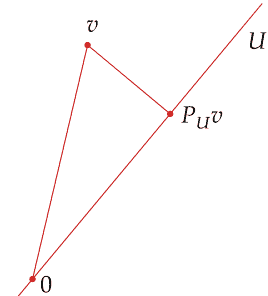

$P_U v$ 是离 $v$ 最近的点在 $U$ 中。

上面证明的不等式是一个等式，当且仅当 6.62 是一个等式时，这发生当且仅当 $\|P_U v - v\| = 0$，这发生当且仅当 $v = P_U v$。

最后的结果经常与公式 6.57(i) 结合使用，以计算最小化问题的显式解，如下例所示。

### 6.63 例子：使用线性代数来近似正弦函数

假设我们想要找到一个多项式 $p$，其具有实系数且最高次数不超过 5，在区间 $[-\pi, \pi]$ 上尽可能地逼近正弦函数，即

$$\int_{-\pi}^{\pi} | \sin x - p(x) |^2 dx$$

尽可能小。

让 $C[-\pi, \pi]$ 表示连续实值函数的实内积空间，在区间 $[-\pi, \pi]$ 上。

$$6.64 \quad \langle f, g \rangle = \int_{-\pi}^{\pi} fg.$$

令 $f \in C[-\pi, \pi]$ 为函数 $f(x) = \sin x$。令 $P$ 表示由实系数多项式组成的子空间 $C[-\pi, \pi]$，其次数最多为 5。现在，我们的问题可以重新表述如下：找到 $p \in P$，使得 $\|f - p\|$ 尽可能小。

为了计算我们的近似问题的解答，首先应用格拉姆-施密特过程（使用内积

> 在这里，一个能够进行积分的计算机非常有用。

给定的基 $1, x, x^2, x^3, x^4, x^5$ 的正交基 $p_1, p_2, p_3, p_4, p_5, p_6$。然后，再次使用给定的内积通过 6.64 计算 $p_i$，使用 6.57(i) （其中 $n=6$）。通过这个计算，可以得到 $p_i$ 是由函数 $x^i$ 定义的。

$$6.65 \quad p(x) = 0.98786298 - 0.15527115 x^3 + 0.0056431 x^5$$

其中出现在精确答案中的 $x^5$ 项已被替换为一个较好的小数近似。通过 6.61，上述多项式 61 是在 $[-\pi, \pi]$ 上使用最多次数为 5 的多项式对正弦函数进行最佳逼近（这里的“最佳逼近”是指在最小化 $\int |\sin x - p(x)|^2 dx$ 的意义上）。

为了看到这个逼近有多好，下图显示了正弦函数和我们的逼近为了在 $[-\pi, \pi]$ 区间上的图形，其中区间由 6.65 给出。

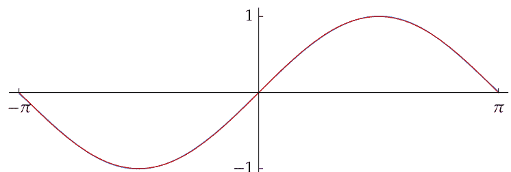

正弦函数 (红色) 及其最佳五次多项式逼近 $P$ (蓝色) 的图像在 $[-\pi, \pi]$ 上。

我们的逼近值 6.65 非常准确，以至于这两个图像几乎完全相同—我们的眼睛可能只看到一个图像！在这里，红色图像几乎完全覆盖在蓝色图像上。如果您在电子设备上查看此图像，请将其放大 400%，接近 $\pi$ 或 $-\pi$ 以查看两个图像之间的小间隙。

另一个众所周知的五次多项式逼近正弦函数的方法是泰勒多项式 $P$ 定义如下

$$6.66 \quad P(x) = x - \frac{x^3}{3!} + \frac{x^5}{5!}.$$

为了了解这个逼近的好坏，下图显示了正弦函数和泰勒多项式 $P$ 在区间 $[-\pi, \pi]$ 上的图像。

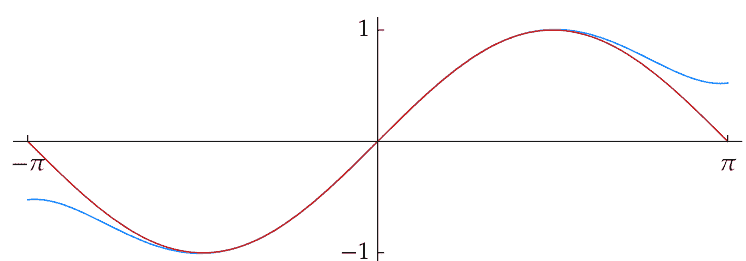

正弦函数 (红色) 和泰勒多项式 (蓝色) 在 $[-\pi, \pi]$ 上的图形从 6.66 开始。

泰勒多项式是对于 $x$ 接近于 0 的正弦函数的一个很好的近似。但是上面的图表显示，对于 $|x| > 2$，泰勒多项式并不那么准确，特别是与 6.65 相比。例如，取 $x = 3$，我们的近似值 6.65 估计 $\sin 3$ 的误差约为 0.001，但泰勒级数 6.66 估计 $\sin 3$ 的误差约为 0.4。因此，在 $x = 3$ 处，泰勒级数的误差比 6.65 给出的误差大几百倍。线性代数帮助我们发现了一个改进微积分中所学的正弦函数的近似值！

## 伪逆

假设 $T \in \mathcal{L}(U, W)$ 且 $w \in W$。考虑找到 $u \in U$ 使得 $Tu = w$。

例如，如果 $T = T^T$ 且 $w = w^T$，那么上面的方程可以表示一个有 $n$ 个未知数的 $m$ 个线性方程组。

如果 $T$ 可逆，则上面方程的唯一解为 $u = T^{-1}w$。

然而，如果 $T$ 不可逆，则对于某些 $w \in W$，上述方程可能没有任何解，对于某些 $w \in W$，上述方程可能有无穷多个解。

如果 $T$ 不可逆，那么我们仍然可以尽可能地解决上述方程。例如，如果上述方程没有解，那么我们可以尝试找到 $u \in U$，使得 $\|Tu - w\|$ 尽可能小。另一个例子是，如果上述方程有无限多个解 $u \in U$，那么在所有这些解中，我们可以尝试找到一个使得 $\|u\|$ 尽可能小的解。

即使 $T$ 不可逆，伪逆也可以提供解决上述方程的工具，使得解决结果尽可能好。我们需要下一个结果来定义伪逆。

在接下来的两个证明中，我们将不加评论地使用以下结果：如果 $U$ 是有限维的且 $T \in \mathcal{L}(U, W)$，则 $\text{null } T$, $(\text{null } T)^\perp$ 和 $\text{range } T$ 都是有限维的。

### 6.67 限制线性映射以获得一对一和满射映射

假设 $U$ 是有限维的，$T \in \mathcal{L}(U, W)$。那么 $T|_{(\text{null } T)^\perp}$ 是 $(\text{null } T)^\perp$ 到 $W$ 的一对一映射。

**证明** 假设 $u \in (\text{null } T)^\perp$ 且 $T|_{(\text{null } T)^\perp} u = 0$。因此 $Tu = 0$ 且因此 $u \in (\text{null } T) \cap (\text{null } T)^\perp$，这意味着 $u = 0$ [根据 6.48(d)]。因此 $\text{null } T|_{(\text{null } T)^\perp} = \{0\}$，这意味着 $T|_{(\text{null } T)^\perp}$ 是单射，如所需。

显然值域 $T|_{(\text{null } T)^\perp} \subseteq \text{值域 } T$。为了证明另一个方向的包含关系，假设 $w \in \text{值域 } T$。因此存在 $u \in U$ 使得 $w = Tu$。存在 $u_1 \in \text{零空间 } T$ 和 $u_2 \in (\text{零空间 } T)^\perp$ 使得 $u = u_1 + u_2$ (根据 6.49)。现在

$$T|_{(\text{零空间 } T)^\perp} u_2 = Tu_2 = T(u - u_1) = Tu - 0 = w,$$

这表明 $w \in \text{值域 } T|_{(\text{零空间 } T)^\perp}$。因此值域 $T \subseteq \text{值域 } T|_{(\text{零空间 } T)^\perp}$，从而完成了证明值域 $T|_{(\text{零空间 } T)^\perp} = \text{值域 } T$。

现在我们可以定义线性映射的伪逆 $T^\dagger$（读作“T dagger”）。在下一个定义中（从现在开始），将 $T|_{(\text{零空间 } U)^\perp}$ 视为从 $(\text{零空间 } U)^\perp$ 到值域 $T$ 的可逆线性映射，正如上面的结果所证明的。

要在 TEX 中产生伪逆符号 $T^\dagger$，请输入 `T\dagger`。

## 6.C 节 正交补和最小化问题

### 6.68 定义：伪逆，$A^+$

假设 $V$ 是有限维的，且 $A \in \mathcal{L}(V, W)$. 伪逆 $A^+ \in \mathcal{L}(W, V)$ 是由 $A$ 定义的从 $W$ 到 $V$ 的线性映射 $A^+ b = (A|_{(\text{null } A)^\perp})^{-1} b$ 对于每个 $b \in W$.

回想一下，如果 $b \in (\text{range } A)^\perp$，则 $P_{\text{range } A} b = 0$，如果 $b \in \text{range } A$，则 $P_{\text{range } A} b = b$. 因此，如果 $b \in (\text{范围 } A)^\perp$，那么 $A^+ b = 0$，如果 $b \in \text{范围 } A$，那么 $A^+ b$ 是 $(\text{零空间 } A)^\perp$ 的唯一元素，使得 $A(A^+ b) = b$.

伪逆矩阵的行为与逆矩阵非常相似，我们将会看到。

### 6.69 伪逆矩阵的代数性质

假设 $V$ 是有限维的，$A \in \mathcal{L}(V, W)$.

- (a) 如果 $A$ 是可逆的，那么 $A^+ = A^{-1}$。
- (b) $A A^+ = P_{\text{range } A} = $ 将向量投影到范围 $A$ 上的正交投影。
- (c) $A^+ A = P_{(\text{null } A)^\perp} = $ 将向量投影到 $(\text{null } A)^\perp$ 上的正交投影。

### 证明

- (a) 假设 $A$ 是可逆的。那么 $(\text{null } A)^\perp = V$ 且 $A$ 的值域 $= W$. 因此 $A|_{(\text{null } A)^\perp} = A$ 且 $A$ 上的恒等算子是 $A^+ = A^{-1}$.
- (b) 假设 $b \in A$ 的值域. 因此 $A A^+ b = A (A|_{(\text{null } A)^\perp})^{-1} b = b = P_{\text{range } A} b$.

如果 $b \in (\text{范围 } A)^\perp$，那么 $A^+ b = 0$. 因此 $A A^+ b = 0 = P_{\text{range } A} b$. 因此 $A A^+$ 和 $P_{\text{range } A}$ 在范围 $A$ 和 $(\text{范围 } A)^\perp$ 上是一致的。因此这两个线性映射是相等的 (根据 6.49).

- (c) 假设 $b \in (\text{零空间 } A)^\perp$. 因为 $A b \in \text{范围 } A$，根据 $A^+$ 的定义有 $A^+ (A b) = (A|_{(\text{零空间 } A)^\perp})^{-1} (A b) = b = P_{(\text{零空间 } A)^\perp} b$.

如果 $b \in \text{零空间 } A$，那么 $A^+ A b = 0 = P_{(\text{零空间 } A)^\perp} b$. 因此 $A^+ A$ 和 $P_{(\text{零空间 } A)^\perp}$ 在 $(\text{零空间 } A)^\perp$ 和在零空间 $A$ 上是一致的。因此这两个线性映射是相等的 (根据 6.49).

假设 $A \in \mathcal{L}(V, W)$. 如果 $A$ 是满射，那么 $A A^+$ 是 $W$ 上的恒等算子，如上述结果 (b) 所示。

> 伪逆也被称为摩尔 - 彭罗斯逆。

上面。如果 $A$ 是单射，那么 $A^+ A$ 是 $V$ 上的恒等算子，如上述结果 (c) 所示。有关伪逆的其他代数性质，请参见练习题 19-23。

假设 $T \in \mathcal{L}(X, Y), y \in Y$，我们想要找到一个 $x \in X$ 来解方程

$$Tx = y.$$

如果 $T$ 是可逆的，那么 $x = T^{-1}y$ 是唯一的解。如果 $T$ 不可逆，那么 $T^{-1}$ 是没有定义的。然而，伪逆 $T^\dagger$ 是有定义的。取 $x = T^\dagger y$ 使得 $Tx$ 尽可能接近 $y$，如下一个结果的 (a) 所示。因此，伪逆提供了上述方程的最佳拟合。

在所有使得 $Tx$ 尽可能接近 $y$ 的向量 $x \in X$ 中，向量 $T^\dagger y$ 具有最小的范数，如下一个结果的 (b) 与 (a) 中的等式条件所示。

### 6.70 伪逆提供最佳近似解或最佳解

假设 $X$ 是有限维的，$T \in \mathcal{L}(X, Y)$，并且 $y \in Y$.
- (a) 如果 $x \in X$，那么
$$\|Tx - y\| \geqslant \|T(T^\dagger y) - y\|,$$
等号成立当且仅当 $x \in T^\dagger y + \text{null } T$.
- (b) 如果 $x \in T^\dagger y + \text{null } T$，那么
$$\|T^\dagger y\| \leqslant \|x\|,$$
等号成立当且仅当 $x = T^\dagger y$.

### 证明

- (a) 假设 $x \in X$. 那么
$$Tx - y = (Tx - TT^\dagger y) + (TT^\dagger y - y).$$
括号中的第一项在范围 $T$ 中。因为算子 $TT^\dagger$ 是 $Y$ 到范围 $T$ 的正交投影 [见 6.69(b)]，括号中的第二项在 $(\text{范围 } T)^\perp$ 中 [见 6.57(f)]。

因此，勾股定理暗示了所需的不等式，即括号中的第二项的范数小于或等于 $\|Tx - y\|$，当且仅当括号中的第一项等于 0 时等号成立。因此，当且仅当 $x - T^\dagger y \in$ 零空间 $T$ 时，我们有等号成立，这等价于 $x \in T^\dagger y +$ 零空间 $T$，从而完成了 (a) 的证明。

- (b) 假设 $x \in T^\dagger y + \text{null } T$. 因此 $x - T^\dagger y \in \text{null } T$. 现在
$$x = (x - T^\dagger y) + T^\dagger y.$$ 对 $T^\dagger$ 的定义意味着 $T^\dagger y \in (\text{null } T)^\perp$. 因此，勾股定理意味着 $\|T^\dagger y\| \leqslant \|x\|$，当且仅当 $x = T^\dagger y$ 时等号成立。

下一章将给出 $T^\dagger$ 的一个公式 (见 7.78)。

### 6.71 例子：从 $\mathbb{R}^4$ 到 $\mathbb{R}^3$ 的线性映射的伪逆

假设 $A \in \mathcal{L}(\mathbb{R}^4, \mathbb{R}^3)$ 的定义为

$$A(x_1, x_2, x_3, x_4) = (x_1 + x_2 + x_3, 2x_3 + x_4, 0).$$

这个线性映射既不是单射也不是满射，但我们可以计算它的伪逆。为了做到这一点，首先注意到 $\text{range } A = \{(y_1, y_2, 0) : y_1, y_2 \in \mathbb{R}\}$。因此

$$P_{\text{range } A}(y_1, y_2, y_3) = (y_1, y_2, 0)$$

对于每个 $(y_1, y_2, y_3) \in \mathbb{R}^3$。另外，

$$\text{null } A = \{(x_1, x_2, x_3, x_4) \in \mathbb{R}^4 : x_1 + x_2 + x_3 = 0 \text{ 且 } 2x_3 + x_4 = 0\}.$$

两个向量的列表 $(-1, 1, 0, 0), (-1, 0, 1, -2)$ 在零空间 $A$ 中张成 $\mathbb{R}^4$，因为如果 $(x_1, x_2, x_3, x_4) \in \text{零空间 } A$，则

$$(x_1, x_2, x_3, x_4) = c_1(-1, 1, 0, 0) + c_2(-1, 0, 1, -2).$$

因为列表 $(-1, 1, 0, 0), (-1, 0, 1, -2)$ 线性无关，所以这个列表是零空间 $A$ 的一组基。

现在假设 $(y_1, y_2, y_3) \in \mathbb{R}^3$。那么

$$6.72 \quad A^\dagger (y_1, y_2, y_3) = (A|_{(\text{零空间 } A)^\perp})^{-1} P_{\text{range } A} (y_1, y_2, y_3) = (A|_{(\text{零空间 } A)^\perp})^{-1}(y_1, y_2, 0)。$$

上述方程的右侧是向量 $(x_1, x_2, x_3, x_4) \in \mathbb{R}^4$，使得 $A(x_1, x_2, x_3, x_4) = (y_1, y_2, 0)$ 且 $(x_1, x_2, x_3, x_4) \in (\text{null } A)^\perp$。换句话说，$x_1, x_2, x_3, x_4$ 必须满足以下方程：

$$x_1 + x_2 + x_3 = y_1$$
$$2x_3 + x_4 = y_2$$
$$-x_1 + x_2 = 0$$
$$-x_1 + x_3 - 2x_4 = 0,$$

其中前两个方程等价于方程 $A(x_1, x_2, x_3, x_4) = (y_1, y_2, 0)$ 而后两个方程来自于 $(x_1, x_2, x_3, x_4)$ 对于基向量 $(-1, 1, 0, 0), (-1, 0, 1, -2)$ 在这个基下是正交的条件。

将 $y_1$ 和 $y_2$ 视为常数，将 $x_1, x_2, x_3, x_4$ 视为未知数，我们可以解出上述的四个方程组，得到

$$x_1 = \frac{1}{14} (5y_1 - 2y_2), \quad x_2 = \frac{1}{14} (5y_1 - 2y_2), \quad x_3 = \frac{1}{14} (y_1 + 4y_2), \quad x_4 = \frac{1}{14} (-2y_1 - 2y_2 + 3y_3).$$

因此 6.72 告诉我们

$$A^\dagger (y_1, y_2, y_3) = \frac{1}{14} (5y_1 - 2y_2, 5y_1 - 2y_2, y_1 + 4y_2, -2y_1 - 2y_2 + 3y_3).$$

上述公式中的 $A^\dagger$ 表明 $A A^\dagger (y_1, y_2, y_3) = (y_1, y_2, 0)$ 对于所有的 $(y_1, y_2, y_3) \in \mathbb{R}^3$ 成立，这说明了方程 $A A^\dagger = P_{\text{range } A}$ 来自于 6.69(b)。

### 练习题 6.C

- 1 假设 $u_1, \dots, u_k \in U$。证明
$$\{u_1, \dots, u_k\}^\perp = (\text{span}(u_1, \dots, u_k))^\perp.$$

- 2 假设 $U$ 是 $V$ 的子空间，具有基向量 $u_1, \dots, u_m$ 和 $v_1, \dots, v_k, w_1, \dots, w_k$ 是 $V$ 的基向量。证明如果对 $U$ 的基向量应用 Gram-Schmidt 过程，得到一个列表 $u_1, \dots, u_m, u_1, \dots, u_m$，则 $u_1, \dots, u_m$ 是 $U$ 的正交基，$v_1, \dots, v_k$ 是 $U^\perp$ 的正交基。（注：此处原文 OCR 识别有误，根据上下文修正为：$v_1, \dots, v_k$ 是 $U^\perp$ 的正交基）。

- 3 假设 $W$ 是由 $\mathbb{R}^4$ 定义的子空间
$$W = \text{span}((1, 2, 3, -4), (-5, 4, 3, 2)).$$
找到 $W$ 的一个正交归一基和 $W^\perp$ 的一个正交归一基。

- 4 假设 $u_1, \dots, u_m$ 是 $V$ 中的向量列表，对于每个 $j = 1, \dots, m$ 有 $|\langle u_i, u_j \rangle| = 1$，并且
$$\|u\|^2 = |\langle u, u_1 \rangle|^2 + \cdots + |\langle u, u_m \rangle|^2$$
对于所有 $u \in V$ 成立。证明 $u_1, \dots, u_m$ 是 $V$ 的正交归一基。
这个练习提供了一个与 6.30(b) 相反的命题。

- 5 假设 $V$ 是有限维的，$U$ 是 $V$ 的子空间。证明 $P_{U^\perp} = I - P_U$，其中 $I$ 是 $V$ 上的单位算子。

- 6 假设 $V$ 是有限维的，$T \in \mathcal{L}(V, V)$。证明
$$V = T(\text{null } T)^\perp \oplus \text{range } T^*$$

- 7 假设 $U$ 和 $W$ 是 $V$ 的有限维子空间。证明 $U \perp W = 0$ 当且仅当对于所有的 $u \in U$ 和所有的 $w \in W$，有 $\langle u, w \rangle = 0$。

- 8 假设 $U$ 是 $V$ 的有限维子空间，且 $\phi \in V'$。定义一个线性泛函 $\psi: V \to \mathbb{F}$，满足
$$\psi(v) = \langle v, u_0 \rangle$$
对于所有 $v \in U$。根据 Riesz 表示定理（6.42）应用于内积空间 $U$，存在唯一的向量 $u_0 \in U$，使得
$$\psi(v) = \langle v, u_0 \rangle$$
对于所有 $v \in U$。证明 $\psi = P_{U^\perp} \phi$。

- 9 假设 $V$ 是有限维的。假设 $T \in \mathcal{L}(V)$ 满足 $T^2 = T$ 且 $\text{null } T$ 中的每个向量与 $\text{range } T$ 中的每个向量正交。证明存在一个子空间 $U$ 使得 $T = P_U$。

- 10 假设 $V$ 是有限维的，$T \in \mathcal{L}(V)$ 满足 $T^2=T$ 且 $\|T\| \leqslant \|I\|$ 对于每个 $v \in V$. 证明存在一个子空间 $W$ 使得 $v = P_Wv$.

- 11 假设 $T \in \mathcal{L}(V)$ 且 $W$ 是 $V$ 的有限维子空间。证明 $W$ 在 $T$ 下不变 $TW \subset W$.

- 12 假设 $V$ 是有限维的，$T \in \mathcal{L}(V)$，且 $W$ 是 $V$ 的子空间。证明 $W$ 和 $W^\perp$ 在 $T$ 下都是不变 $TW \subset W, TW^\perp \subset W^\perp$.

- 13 假设 $V = V'$ 且 $V$ 是有限维的。对于每个 $v \in V$，让 $T_v$ 表示在 $V$ 上定义的线性泛函，满足
$$T_v(u) = \langle v, u \rangle$$
对于所有的 $u \in V$.
- (a) 证明 $v \mapsto T_v$ 是从 $V$ 到 $V'$ 的单射线性映射。
- (b) 利用 (a) 和维数计数的论证，证明 $v \mapsto T_v$ 是从 $V$ 到 $V'$ 的同构映射。

这个练习的目的是在这个 $V = V'$ 的情况下，给出 Riesz 表示定理的另一种证明方式（见 6.42 和 6.58）。因此，在解决问题时，不应使用 Riesz 表示定理作为工具。

- 14 假设 $V$ 的一组规范正交基为 $e_1, \dots, e_n$。解释为什么在 Riesz 表示定理 (6.58) 提供的 $v'$ 与 $v$ 的对应下，$e_1, \dots, e_n$ 的对偶基（见 3.112）是 $e_1, \dots, e_n$。在 $\mathbb{R}^4$ 中，令
$$W = \text{span}((1, 1, 0, 0), (1, 1, 1, 2))$$

- 15 找到 $v \in W$ 使得 $\|v - (1, 2, 3, 4)\|$ 尽可能小。

- 16 假设 $V = C[-1, 1]$ 是在区间 $[-1, 1]$ 上具有连续实值的函数的向量空间，其内积为
$$\langle f, g \rangle = \int_{-1}^{1} fg \, dt$$
对于所有 $f, g \in V[-1, 1]$。设 $U$ 是由 $V[-1, 1]$ 中满足条件 $f(0) = 0$ 的函数所组成的子空间。
- (a) 证明 $U^\perp = \{0\}$。
- (b) 证明在没有有限维假设的情况下，6.49 和 6.52 不成立。

- 17 找到 $u \in P_3(\mathbb{R})$ 使得 $u(0) = 0, u'(0) = 0$，且 $\int_0^1 |2+3t - u(t)|^2 dt$ 尽可能小。

- 18 找到 $u \in P_5(\mathbb{R})$ 使得 $\int_{-1}^1 |\sin t - u(t)|^2 dt$ 尽可能小。

多项式 6.65 是对这个问题答案的一个很好的近似，但是在这里你被要求找到精确解，其中涉及到 $t$ 的幂。一台能够进行符号积分的计算机应该会有所帮助。

- 19 假设 $V$ 是有限维的，$P \in \mathcal{L}(V)$ 是 $V$ 的一个正交投影到某个子空间。证明 $P^\dagger = P$。

- 20 假设 $V$ 是有限维的，$T \in \mathcal{L}(V, W)$。证明
$$\text{null } T^\dagger = (\text{range } T)^\perp \text{ 和 } \text{range } T^\dagger = (\text{null } T)^\perp$$

- 21 假设 $T \in \mathcal{L}(\mathbb{R}^3, \mathbb{R}^2)$ 由以下定义
$$T(a,b,c) = (a+b+c, 2a+3c)$$

- (a) 对于 $(y,z) \in \mathbb{R}^2$，找到 $T^\dagger (y,z)$ 的公式。
- (b) 验证方程 $T T^\dagger = P_{\text{range } T}$ 从 6.69(b) 得到的公式与 (a) 中得到的 $T^\dagger$ 的公式相符。
- (c) 验证方程 $T^\dagger T = P_{(\text{null } T)^\perp}$ 从 6.69(c) 中得到的公式可以得出 $T^\dagger$ 的公式。

- 22 假设 $V$ 是有限维的，且 $T \in \mathcal{L}(V, W)$。证明
$$T T^\dagger T = T \text{ 且 } T^\dagger T T^\dagger = T^\dagger$$
如果 $T$ 是可逆的，那么上述两个公式显然成立，因为在这种情况下，我们可以用 $T^{-1}$ 替换 $T^\dagger$。

- 23 假设 $V$ 和 $W$ 是有限维的，且 $T \in \mathcal{L}(V, W)$。证明
$$(T^\dagger)^\dagger = T$$
上述方程类似于 $(T^{-1})^{-1}=T$ 的方程，该方程在 T 可逆时成立。

开放获取 本章节根据知识共享署名 - 非商业性使用 4.0 国际许可协议 (https://creativecommons.org/licenses/by-nc/4.0) 进行许可，只要您给出适当的原作者和来源的信用，提供到创作共用许可证的链接，并指示是否进行了更改，您就可以在任何媒介或格式中进行非商业性使用、共享、改编、分发和复制。


本章节中的图像或其他第三方材料已包含在章节的创作共用许可证中，除非在材料的信用行中另有说明。如果材料未包含在章节的创作共用许可证中，并且您的预期使用未经法定规定许可或超出许可使用范围，您将需要直接从版权持有人获得许可。

## 第 7 章
### 内积空间上的算子

与内积空间相关的最深刻的结果涉及到我们即将讨论的主题——线性映射和内积空间上的算子。正如我们将看到的那样，通过利用伴随的性质可以证明好的定理。

极其重要的谱定理将对实内积空间上的自伴算子和复内积空间上的正规算子提供完整的描述。然后我们将利用谱定理来帮助理解正算子和酉算子，这将导致酉矩阵和矩阵分解。谱定理还将导致流行的奇异值分解，这将导致极分解。

本书其余部分中最重要的结果仅在有限维度中成立。因此，从现在开始我们假设 $V$ 和 $W$ 是有限维的。

#### 本章的基本假设

- F 表示 $\mathbb{R}$ 或 $\mathbb{C}$。
- $W$ 和 $V$ 是非零有限维内积空间，属于 F。


利沃夫市场广场，这个城市因为国际边界的变化而有过几个名字，并且曾经属于几个国家。从 1772 年到 1918 年，该城市属于奥地利，被称为兰贝格。在第一次世界大战和第二次世界大战之间，该城市属于波兰，被称为卢沃夫。在这段时间里，卢沃夫的数学家，特别是斯特凡·巴纳赫（1892-1945）及其同事，使用分析工具研究了现代函数分析的基本结果，以研究无限维向量空间。

自第二次世界大战结束以来，利沃夫一直属于乌克兰，乌克兰在 1991 年成为独立国家之前是苏联的一部分。

# 第 7 章 自伴和正规算子

## 共轭

### 7.1 定义：共轭算子 $T^*$

假设 $T \in \mathcal{L}(V, W)$。算子 $T$ 的共轭是函数 $T^*: W \to V$，满足以下条件：

$$ \langle Tv, w \rangle = \langle v, T^*w \rangle $$

对于每个 $v \in V$ 和每个 $w \in W$。

为了理解上面的定义是否合理，假设 $T \in \mathcal{L}(V, W)$。固定 $v \in V$。考虑线性泛函 $\langle Tv, \cdot \rangle$。

> 共轭这个词在线性代数中还有另外一个意思。如果你在其他地方遇到第二个意思，请注意这两个意思是无关的。

在 $V$ 上映射 $w$ 到 $\langle Tv, w \rangle$ 这个线性泛函取决于 $v$ 和 $T$。根据 Riesz 表示定理 (6.42)，存在一个唯一的向量在 $V$ 中，使得这个线性泛函通过与它的内积给出。我们称这个唯一的向量为 $T^*v$。换句话说，$T^*v$ 是在 $V$ 中的唯一向量，使得

$$ \langle Tv, w \rangle = \langle v, T^*w \rangle $$

对于每个 $w \in W$。

在上述方程中，左边的内积发生在 $W$ 中，右边的内积发生在 $V$ 中。然而，我们对两个内积都使用相同的符号 $\langle \cdot, \cdot \rangle$。

### 7.2 例子：从 $\mathbb{C}^3$ 到 $\mathbb{C}^2$ 的线性映射的共轭

$T: \mathbb{C}^3 \to \mathbb{C}^2$，其中

$$ T(x_1, x_2, x_3) = (x_2 + 3x_3, 2x_1). $$

为了计算 $T^*$，假设 $(x_1, x_2, x_3) \in \mathbb{C}^3, (y_1, y_2) \in \mathbb{C}^2$。那么

$$ \begin{aligned} \langle T(x_1, x_2, x_3), (y_1, y_2) \rangle &= \langle (x_2 + 3x_3, 2x_1), (y_1, y_2) \rangle \\ &= x_2y_1 + 3x_3y_1 + 2x_1y_2 \\ &= \langle (x_1, x_2, x_3), (2y_2, y_1, 3y_1) \rangle. \end{aligned} $$

上述方程和共轭的定义意味着

$$ T^*(y_1, y_2) = (2y_2, y_1, 3y_1). $$

### 7.3 例子：线性映射的伴随映射的维度最多为 1

固定 $v \in W$ 和 $w \in V$。定义 $S \in \mathcal{L}(V, W)$ 为

$$ Su = \langle u, w \rangle v $$

对于每个 $u \in V$。为了计算 $S^*$，假设 $u \in V$ 和 $y \in W$。那么

$$ \begin{aligned} \langle y, Su \rangle &= \langle y, \langle u, w \rangle v \rangle \\ &= \overline{\langle u, w \rangle} \langle y, v \rangle \\ &= \langle u, w \rangle \langle y, v \rangle \quad (\text{若为实数内积}) \end{aligned} $$

(注：此处根据标准线性代数理论修正原文档中明显的变量混淆，原文档为 $Sv = v\langle w, v \rangle$ 导致数学上不成立，此处修正为标准的秩 1 算子定义形式 $S u = \langle u, w \rangle v$ 以保持一致性)。

因此

$$ S^*y = \langle y, v \rangle w $$

在上面的两个例子中，$S^*$ 不仅仅是从 $V$ 到 $W$ 的函数，而是从 $V$ 到 $W$ 的线性映射。这种行为是普遍适用的，如下面的结果所示。

> 上面的两个例子和下面的证明使用了一种常见的技巧来计算 $S^*$：从一个公式开始，计算 $\langle w, Sv \rangle$，然后对其进行操作，使得第一个位置只有 $w$；第二个位置的条目将会是 $S^*w$。

### 7.4 线性映射的伴随是一个线性映射

如果 $S \in \mathcal{L}(V, W)$，那么 $S^* \in \mathcal{L}(W, V)$。

证明：假设 $S \in \mathcal{L}(V, W)$。如果 $u_1, u_2 \in V$，那么

$$ \begin{aligned} \langle w, S(u_1 + u_2) \rangle &= \langle w, Su_1 + Su_2 \rangle \\ &= \langle w, Su_1 \rangle + \langle w, Su_2 \rangle \\ &= \langle S^*w, u_1 \rangle + \langle S^*w, u_2 \rangle \\ &= \langle S^*w, u_1 + u_2 \rangle. \end{aligned} $$

上面的方程表明

$$ S^*(u_1 + u_2) = S^*u_1 + S^*u_2 $$

如果 $u \in V, w \in W$，并且 $c \in F$，那么

$$ \begin{aligned} \langle w, S(cu) \rangle &= c \langle w, Su \rangle \\ &= c \langle S^*w, u \rangle \\ &= \langle c S^*w, u \rangle. \end{aligned} $$

上面的方程表明

$$ S^*(cu) = c S^*w \quad (\text{注：应为 } S^*(cw) = cS^*w \text{ 或 } S^*(cu) = cS^*w \text{ 视变量而定，此处修正为线性性质}) $$

因此 $S^*$ 是一个线性映射，正如所期望的那样。

### 7.5 伴随的性质

假设 $T \in \mathcal{L}(V, W)$。那么
(a) $(T+S)^* = T^* + S^*$ 对于所有 $S \in \mathcal{L}(V, W)$;
(b) $(\alpha T)^* = \bar{\alpha} T^*$ 对于所有 $\alpha \in F$;
(c) $(T^*)^* = T$;
(d) $(ST)^* = T^*S^*$ 对于所有 $S \in \mathcal{L}(U, V)$ (这里 $U$ 是一个有限维内积空间在 $F$ 上);
(e) $I^* = I$，其中 $I$ 是 $V$ 上的单位算子;
(f) 如果 $T$ 是可逆的，则 $T^*$ 是可逆的且 $(T^*)^{-1} = (T^{-1})^*$。

证明 假设 $u \in U$ 和 $w \in W$。
(a) 如果 $S \in \mathcal{L}(V, W)$，那么
$$ \langle (T+S)u, w \rangle = \langle Tu + Su, w \rangle = \langle Tu, w \rangle + \langle Su, w \rangle $$
$$ = \langle u, T^*w \rangle + \langle u, S^*w \rangle = \langle u, T^*w + S^*w \rangle $$
因此 $(T+S)^*w = T^*w + S^*w$，如所需。

(b) 如果 $\alpha \in F$，那么
$$ \langle (\alpha T)u, w \rangle = \alpha \langle Tu, w \rangle = \alpha \langle u, T^*w \rangle = \langle u, \bar{\alpha} T^*w \rangle $$
因此 $(\alpha T)^*w = \bar{\alpha} T^*w$，如所需。

(c) 我们有
$$ \langle Tu, v \rangle = \langle u, T^*v \rangle = \overline{\langle T^*v, u \rangle} = \overline{\langle v, T^{**}u \rangle} = \langle T^{**}u, v \rangle $$
因此 $(T^*)^*u = Tu$ 如所需。

(d) 假设 $S \in \mathcal{L}(V, W)$ 和 $T \in \mathcal{L}(U, V)$。那么
$$ \langle STu, w \rangle = \langle T u, S^*w \rangle = \langle u, T^*(S^*w) \rangle = \langle u, T^*S^*w \rangle $$
因此 $(ST)^*u = T^*S^*u$，正如所期望的。

(e) 假设 $u \in V$。那么
$$ \langle Iu, v \rangle = \langle u, v \rangle = \langle u, I^*v \rangle $$
因此 $I^*v = v$，正如所期望的。

(f) 假设 $T$ 是可逆的。对方程两边取共轭转置 $T^{-1}T = I$，然后使用 (d) 和 (e) 证明 $T^*(T^{-1})^* = I$。类似地，方程 $TT^{-1} = I$ 意味着 $(T^{-1})^*T^* = I$。因此 $(T^{-1})^*$ 是 $T^*$ 的逆，正如所期望的。

如果 $W = V$，那么映射 $T \to T^*$ 是从 $\mathcal{L}(V, V)$ 到 $\mathcal{L}(V, V)$ 的线性映射，根据上述结果的 (a) 和 (b) 可得。然而，如果 $V = W$，那么由于 (b) 中出现的复共轭，这个映射不是线性的。

## 零空间和值域的正交补

下一个结果展示了线性映射及其伴随的零空间和值域之间的关系。

### 7.6 零空间和值域的正交补

假设 $T \in \mathcal{L}(U, V)$。那么
(a) 零空间 $\text{null } T = (\text{range } T^*)^\perp$;
(b) 值域 $\text{range } T = (\text{null } T^*)^\perp$;
(c) $\text{null } T = (\text{range } T^*)^\perp$;
(d) $\text{range } T = (\text{null } T^*)^\perp$.

证明：我们首先证明 (a)。设 $v \in \text{null } T$。那么
$$ v \in \text{null } T^\perp \iff \langle v, u \rangle = 0 \dots $$
$$ \langle v, T^* u \rangle = 0 \quad \text{对于所有 } u \in U $$
$$ \langle Tv, u \rangle = 0 \quad \text{对于所有 } u \in U $$
$$ v \in (\text{range } T^*)^\perp. $$
因此 $\text{null } T = (\text{range } T^*)^\perp$，证明了 (a)。

如果对 (a) 的两边取正交补，我们得到 (d)，其中我们使用了 6.52。将 (a) 中的 $T$ 替换为 $T^*$ 得到 (c)，其中我们使用了 7.5(c)。最后，将 (d) 中的 $T$ 替换为 $T^*$ 得到 (b)。

正如我们很快将看到的，下一个定义与线性映射的伴随矩阵密切相关。

### 7.7 定义：共轭转置，$T^*$

一个 $m$ 行 $n$ 列矩阵 $A$ 的共轭转置是通过交换行和列，然后对每个元素取复共轭得到的 $n$ 行 $m$ 列矩阵 $A^*$。换句话说，如果 $j \in \{1, \cdots, m\}$ 且 $k \in \{1, \cdots, n\}$，则
$$ (A^*)_{jk} = \overline{A_{kj}} $$

### 7.8 例子：一个 2 乘 3 矩阵的共轭转置

一个 2 乘 3 矩阵的共轭转置是

$$ \begin{pmatrix} 2 & 6 \\ 3-4i & 5 \\ 7 & -8-8i \end{pmatrix} $$

的 3 乘 2 矩阵。

> 如果一个矩阵 $A$ 只有实数元素，那么 $A^* = A^t$，其中 $A^t$ 表示 $A$ 的转置（通过交换行和列得到的矩阵）。

## 伴随矩阵

下一个结果展示了如何从 $T$ 的矩阵计算 $T^*$ 的矩阵。

> 注意：对于非正交基，注意 $T$ 的矩阵不一定等于 $T^*$ 的矩阵的共轭转置。

> 线性映射的伴随不依赖于基的选择。因此，我们经常强调线性映射的伴随，而不是矩阵的转置或共轭转置。

### 7.9 $T^*$ 的矩阵等于 $T$ 的矩阵的共轭转置

设 $T \in \mathcal{L}(V, W)$。假设 $v_1, \dots, v_n$ 是 $V$ 的正交归一基，$w_1, \dots, w_m$ 是 $W$ 的正交归一基。那么 $M(T^*, (v_1, \dots, v_n), (w_1, \dots, w_m))$ 是 $M(T, (w_1, \dots, w_m), (v_1, \dots, v_n))$ 的共轭转置。换句话说，

$$ M(T^*) = (M(T))^*. $$

证明：在这个证明中，我们将写作 $M(T)$ 和 $M(T^*)$ 而不是较长的表达式。

回想一下，我们通过将 $Tw_j$ 写成 $v_i$ 的线性组合来获得 $M(T)$ 的第 $j$ 列；这个线性组合中使用的标量则成为 $M(T)$ 的第 $i$ 列。因为 $v_1, \dots, v_n$ 是 $V$ 的正交归一基，我们知道如何将 $T^*v_i$ 写成 $w_j$ 的线性组合 [见 6.30(a)]:

$$ T^*v_i = \sum_{j=1}^m \langle T^*v_i, w_j \rangle w_j. $$

因此

在上述陈述中，将行 $i$，列 $j$ 的元素 $M(T)$ 替换为 $\langle Tv_j, v_i \rangle$。

在上述陈述中，将 $T$ 替换为 $T^*$，并交换 $v_1, \dots, v_n$ 和 $w_1, \dots, w_m$。这表明，行 $i$，列 $j$ 的元素 $M(T^*)$ 为 $\langle T^*v_i, w_j \rangle$，等于 $\langle w_j, T^*v_i \rangle$ 的共轭，等于 $\langle Tv_j, v_i \rangle$ 的共轭，等于 $M(T)$ 的行 $j$，列 $i$ 的复共轭。因此 $M(T^*) = (M(T))^*$。

在 6.58 中所述的 Riesz 表示定理提供了一个将 $V$ 与其对偶空间 $V'$ 在 3.110 中定义的进行对应的方法。在这个对应下，一个子集 $U \subseteq V$ 的正交补 $U^\perp$ 对应于 $V$ 的零化子 $U^0$。如果 $U$ 是 $V$ 的子空间，则在这个对应下，$U^\perp$ 和 $U^0$ 的维度公式变得相同—参见 3.125 和 6.51。

假设 $T: V \to W$ 是一个线性映射。在 $V$ 与 $V'$ 的对应以及 $W$ 与 $W'$ 的对应下，伴随映射 $T^*: V \to W$ 对应于在 3.118 中定义的对偶映射 $T': V' \to W'$，正如习题 32 要求你验证的那样。

> 因为正交补和伴随比零化子和对偶映射更容易处理，在内积空间的背景下没有必要使用零化子和对偶映射。

在这种等同下，公式为

零空间 $N(T)$ 和值域 $R(T)$ [7.6(a)和(b)] 的公式与零空间 $N(T')$ 和值域 $R(T')$ [3.128(a)和 3.130(b)] 的公式相同。此外，关于 $T^*$ 的矩阵的定理 (7.9) 类似于关于 $T'$ 的矩阵的定理 (3.132)。

## 自伴算子

现在我们将注意力转向内积空间上的算子。我们将重点放在从 $V$ 到 $V$ 的线性映射上，而不是考虑从 $V$ 到 $V$ 的线性映射；回忆一下这样的线性映射被称为算子。

### 7.10 定义：自伴

如果 $T \in \mathcal{L}(V)$，那么算子 $T$ 被称为自伴的，如果 $T = T^*$。

如果 $T \in \mathcal{L}(V)$ 且 $v_1, \dots, v_n$ 是 $V$ 的正交基，则 $T$ 是自伴的当且仅当 $M(T, (v_1, \dots, v_n)) = M(T, (v_1, \dots, v_n))^*$，根据 7.9 可得。

### 7.11 例子：从其矩阵确定 $T$ 是否自伴

假设 $T \in \mathcal{L}(\mathbb{R}^2)$ 且 $T$ 是作用于 $\mathbb{R}^2$ 的算子，其矩阵（相对于标准基）为

$$ M(T) = \begin{pmatrix} 2 & 3 \\ 3 & 7 \end{pmatrix}. $$

矩阵 $M(T)^t$ (相对于标准基) 是

$$ M(T^t) = \begin{pmatrix} 2 & 3 \\ 3 & 7 \end{pmatrix}. $$

因此 $M(T) = M(T^t)$ 当且仅当 $3 = 3$。因此算子 $T$ 是自伴的当且仅当 $3 = 3$。

一个好的类比是，伴随算子在 $\mathcal{L}(V)$ 中扮演着类似于复共轭在 $\mathbb{C}$ 中的角色。一个复数 $z$ 是实数当且仅当 $z = \bar{z}$；因此自伴算子 ($T = T^*$) 类似于一个实数。

> 一个算子 $T \in \mathcal{L}(V)$ 是自伴的当且仅当
$$ \langle Tv, w \rangle = \langle v, Tw \rangle $$
对于所有 $v, w \in V$。

我们将看到，上面讨论的类比在自伴算子的一些重要性质中得到了体现，从下一个结果开始，我们将讨论特征值。

如果 $T = T^*$，那么根据定义，每个特征值都是实数，所以下一个结果只在 $\mathbb{C} \neq \mathbb{R}$ 时有兴趣。

### 7.12 自伴算子的特征值

自伴算子的每个特征值都是实数。

证明 假设 $T$ 是一个自伴算子在 $V$ 上。设 $\lambda$ 是 $T$ 的一个特征值，并且设 $v$ 是 $V$ 中的一个非零向量，使得 $Tv = \lambda v$。那么

$$ \lambda \|v\|^2 = \langle \lambda v, v \rangle = \langle Tv, v \rangle = \langle v, Tv \rangle = \langle v, \lambda v \rangle = \bar{\lambda} \|v\|^2. $$

因此 $\lambda = \bar{\lambda}$，这意味着 $\lambda$ 是实数，符合要求。

对于实内积空间，下一个结果是错误的。举个例子，考虑算子 $T \in \mathcal{L}(\mathbb{R}^2)$，它是绕原点逆时针旋转 90°的；因此 $T(x,y) = (-y, x)$。注意到对于每个 $x \in \mathbb{R}^2$，$x$ 都与 $Tx$ 正交，即使 $x \neq 0$。

> 7.13 $T$ 对于所有 $v$ 有 $\langle Tv, v \rangle = 0$ (假设 $V \neq 0$)

假设 $V$ 是一个复内积空间，$T \in \mathcal{L}(V)$。那么 $\langle Tv, v \rangle = 0$ 对于每个 $v \in V$ 有 $T = 0$。

证明 如果 $u, v \in V$，那么
$$ \langle Tu, v \rangle = \frac{1}{4} (\langle T(u+v), u+v \rangle - \langle T(u-v), u-v \rangle + i\langle T(u+iv), u+iv \rangle - i\langle T(u-iv), u-iv \rangle) $$

通过计算右边可以验证。注意右边的每一项都是形如 $\langle Tz, z \rangle$ 的适当 $z \in V$。

现在假设 $\langle Tv, v \rangle = 0$ 对于每个 $v \in V$。然后上面的方程意味着对于所有 $u, v \in V$，有 $\langle Tu, v \rangle = 0$，这进而意味着对于每个 $v \in V$，有 $Tv = 0$ (取 $u = Tv$)。因此 $T = 0$，符合要求。

下一个结果对于实内积空间是错误的，这可以通过考虑任意一个不是自伴的实内积空间上的算子来证明。

> 下一个结果提供了另一个很好的示例，说明自伴算子如何像实数一样行为。

> 7.14 $T$ 自伴 $\iff \langle Tv, v \rangle$ 对于所有 $v$ 是实数 (假设 $V \neq 0$)

假设 $V$ 是一个复内积空间，$T \in \mathcal{L}(V)$。那么 $T$ 是自伴的 $\iff \langle Tv, v \rangle \in \mathbb{R}$ 对于每一个 $v \in V$。

证明 如果 $v \in V$，那么
$$ \langle Tv, v \rangle = \overline{\langle Tv, v \rangle} = \langle v, Tv \rangle $$

现在

$T$ 是自伴的 $\iff T - T^* = 0$

$\langle (T - T^*)v, v \rangle = 0$ 对于每一个 $v \in V$

$\langle Tv, v \rangle - \langle T^*v, v \rangle = 0$ 对于每一个 $v \in V$

$\in \mathbb{R}$ 对于每一个 $v \in V$，其中第二个等价关系来自于对 $T - T^*$ 应用 7.13，第三个等价关系来自于 7.15。

## 第 7 章 内积空间上的算子

### 第 7A 节 自伴和正规算子

在一个实内积空间 $V$ 上，一个非零的算子 $T$ 可能满足 $\langle Tv, v \rangle = 0$ 对于所有 $v \in V$。然而，下一个结果表明这对于一个自伴算子是不可能的。

> **7.16** 若 $T$ 自伴且 $\langle Tv, v \rangle = 0$ 对于所有 $v \in V$ 则 $T = 0$

**证明** 我们已经证明了这一点（没有假设 $T$ 是自伴的）当 $V$ 是一个复内积空间时（见 7.13）。因此我们可以假设 $V$ 是一个实内积空间。如果 $u, v \in V$，那么

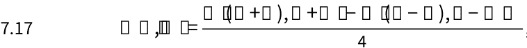

通过使用方程计算右侧可以证明

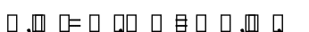

其中第一个等式成立是因为 $T$ 是自伴的，第二个等式成立是因为我们在一个实内积空间中工作。

现在假设对于每个 $v \in V$，都有 $\langle Tv, v \rangle = 0$。因为右侧的每一项都是形如 $\langle Tw, w \rangle$ 的适当 $w$，这意味着对于所有的 $u, v \in V$，都有 $\langle Tu, v \rangle = 0$。这意味着对于每个 $v \in V$，都有 $Tv = 0$（取 $u=v$）。因此，$T = 0$，如所需。

### 正规算子

> **7.18 定义: 正规**
> - 在内积空间上的算子被称为正规算子，如果它与其共轭转置相交换。
> - 换句话说，$T \in \mathcal{L}(V)$ 是正规的，如果 $T^*T = TT^*$。

每个自伴算子都是正规的，因为如果每个 $T$ 是自伴的，那么每个 $T^* = T$，因此 $T$ 与 $T^*$ 相交换。

> **7.19 例子：一个正规但不是自伴的算子**
> 设 $T$ 是 $\mathbb{R}^2$ 上的算子（相对于标准基）的矩阵为 $\begin{pmatrix} 2 & -3 \\ 3 & 2 \end{pmatrix}$。因此 $T((x,y)) = (2x - 3y, 3x + 2y)$。

这个算子 $T$ 不是自伴的，因为第 2 行第 1 列的元素（等于 $3$）不等于第 1 行第 2 列的复共轭元素（等于 $-3$）。

算子 $T^*T$ 的矩阵等于 $\begin{pmatrix} 2 & -3 \\ 3 & 2 \end{pmatrix} \begin{pmatrix} 2 & 3 \\ -3 & 2 \end{pmatrix}$ 等于 $\begin{pmatrix} 13 & 0 \\ 0 & 13 \end{pmatrix}$。

同样地，算子 $TT^*$ 的矩阵等于 $\begin{pmatrix} 2 & 3 \\ -3 & 2 \end{pmatrix} \begin{pmatrix} 2 & -3 \\ 3 & 2 \end{pmatrix}$ 等于 $\begin{pmatrix} 13 & 0 \\ 0 & 13 \end{pmatrix}$。因为算子 $T^*T$ 和 $TT^*$ 有相同的矩阵，我们可以看出 $T^*T = TT^*$。因此 $T$ 是正规的。

在下一节中，我们将看到为什么正规算子值得特别关注。下一个结果提供了正规算子的有用特征描述。

> 如果 $T$ 是正规的，那么 $\mathcal{N}(T)$ 和 $\mathcal{N}(T^*)$ 具有相同的范数
> 假设 $T \in \mathcal{L}(V)$。那么对于每个 $v \in V$，$T$ 是正规的 $\iff \|Tv\| = \|T^*v\|$。

**证明** 我们有

+ 对于每个 $v \in V$，$T$ 是正规的 $\iff T^*T - TT^* = 0$
+ 对于每个 $v \in V$，$\langle (T^*T - TT^*)v, v \rangle = 0$
+ 对于每个 $v \in V$，$\langle T^*Tv, v \rangle = \langle TT^*v, v \rangle$
+ 对于每个 $v \in V$，$\langle Tv, Tv \rangle = \langle T^*v, T^*v \rangle$
+ $\|Tv\|^2 = \|T^*v\|^2$ 对于每个 $v \in V$
+ $\|Tv\| = \|T^*v\|$ 对于每个 $v \in V$

我们使用 7.16 来建立第二个等价关系（注意算子 $T^*T - TT^*$ 是自伴的）。

下一个结果呈现了上面结果的几个推论。将下一个结果的 (e) 与练习 3 进行比较。该练习说明了每个算子的伴随算子的特征值（作为集合）等于算子的复共轭的特征值。该练习没有提及特征向量，因为一个算子及其伴随算子可能具有不同的特征向量。然而，下一个结果的 (e) 暗示了一个正规算子及其伴随算子具有相同的特征向量。

### 7.21 范围，零空间和特征向量的正规算子

假设 $T \in \mathcal{L}(V)$ 是正规的。那么

- (a) 零空间 $T$ = 零空间 $T^*$;
- (b) 范围 $T$ = 范围 $T^*$;
- (c) $V$ = 零空间 $T$ $\oplus$ 范围 $T$;
- (d) $T - \lambda I$ 对于每个 $\lambda \in \mathbb{F}$ 都是正规的;
- (e) 如果 $v \in V$ 且 $w \in V$，则 $\langle Tv, Tw \rangle = \langle T^*v, T^*w \rangle$ 当且仅当 $\langle Tv, Tw \rangle = \langle v, w \rangle$。

**证明**

- (a) 假设 $v \in V$。那么
  $$ v \in \text{零空间 } T \iff \|Tv\| = 0 \iff \|T^*v\| = 0 \iff v \in \text{零空间 } T^* $$
  其中上述中间等价关系来自于 7.20。因此，零空间 $T$ = 零空间 $T^*$。
- (b) 我们有
  $$ \text{像空间 } T = (\text{零空间 } T^*)^\perp = (\text{零空间 } T)^\perp = \text{像空间 } T^* $$
  间 $T^*$，其中第一个等式来自于 7.6(d)，第二个等式来自于此结果中的 (a)，第三个等式来自于 7.6(b)。
- (c) 我们有
  $$ V = (\text{零空间 } T) \oplus (\text{零空间 } T)^\perp = \text{零空间 } T \oplus \text{像空间 } T^* = \text{零空间 } T \oplus \text{像空间 } T $$
  $\oplus$ 像空间 $T$，其中第一个等式来自于 6.49，第二个等式来自于 7.6(b)，第三个等式来自于此结果中的 (b)。
- (d) 假设 $\lambda \in \mathbb{F}$。那么
  $$ (T - \lambda I)(T - \lambda I)^* = (T - \lambda I)(T^* - \bar{\lambda}I) $$
  $$ = TT^* - \lambda T^* - \bar{\lambda}T + |\lambda|^2 I $$
  $$ = T^*T - \lambda T^* - \bar{\lambda}T + |\lambda|^2 I $$
  $$ = (T^* - \bar{\lambda}I)(T - \lambda I) $$
  $$ = (T - \lambda I)^*(T - \lambda I). $$
  因此 $T - \lambda I$ 与其共轭转置相交换。因此 $T - \lambda I$ 是正规的。
- (e) 假设 $\lambda \in \mathbb{F}$ 和 $v \in V$。那么 (d) 和 7.20 意味着
  $$ \|(T - \lambda I)v\| = \|(T - \lambda I)^* v\| = \|(T^* - \bar{\lambda}I)v\|. $$
  因此 $\|(T - \lambda I)v\| = 0$ 当且仅当 $\|(T^* - \bar{\lambda}I)v\| = 0$。因此 $Tv = \lambda v$ 当且仅当 $T^*v = \bar{\lambda}v$。

### 7.22 正规算子的正交特征向量

假设 $T \in \mathcal{L}(V)$ 是正规的。那么对应于不同特征值的特征向量是正交的。

**证明** 假设 $\lambda_1, \lambda_2$ 是 $T$ 的不同特征值，对应的特征向量是 $v_1, v_2$。因此 $T v_1 = \lambda_1 v_1$ 且 $T v_2 = \lambda_2 v_2$。根据 7.21(e)，我们有 $T^* v_1 = \overline{\lambda_1} v_1$。

$$
\begin{aligned}
(\lambda_1 - \lambda_2) \langle v_1, v_2 \rangle &= \langle T v_1, v_2 \rangle - \langle v_1, T^* v_2 \rangle \\
&= \lambda_1 \langle v_1, v_2 \rangle - \lambda_2 \langle v_1, v_2 \rangle \\
&= 0.
\end{aligned}
$$

因为 $\lambda_1 \neq \lambda_2$，上面的方程意味着 $\langle v_1, v_2 \rangle = 0$。因此 $v_1$ 和 $v_2$ 是正交的，正如所需。

### 7.23 $T$ 是正规的 $S, A$ 的实部和虚部相互交换

假设 $T = S + iA$ 和 $S, A \in \mathcal{L}(V)$。那么 $T$ 是正规的，当且仅当存在可交换的自伴算子 $S$ 和 $A$ 使得 $T = S + iA$。

**证明** 首先假设 $T$ 是正规的。让

7.24 $\quad S = \frac{T + T^*}{2} \quad \text{和} \quad A = \frac{T - T^*}{2i}$。

那么 $S$ 和 $A$ 是自伴的，且 $T = S + iA$。快速计算表明

7.25 $\quad SA - AS = \frac{TT^* - T^*T}{2i}$。

因为 $T$ 是正规的，上述等式的右边等于 0。因此，算子 $S$ 和 $A$ 是可交换的，正如所需。

为了证明另一个方向的蕴含，现在假设存在可交换的自伴算子 $S$ 和 $A$ 使得 $T = S + iA$。那么 $T^* = S - iA$。

将最后两个方程相加，然后除以 2，得到 $S$。在 7.24 中的方程。将最后两个方程相减，然后除以 $2i$，得到 $A$。

在 7.24 中的方程。现在 7.24 暗示了 7.25。因为 $S$ 和 $A$ 是可交换的，7.25 暗示 $T$ 是正规的，正如所期望的那样。

### 练习 7A

- 1 假设 $n$ 是一个正整数。定义 $T \in \mathcal{L}(\mathbb{F}^n)$ 为 $T(z_1, \dots, z_n) = (0, z_1, \dots, z_{n-1})$。找出 $T^n(z_1, \dots, z_n)$ 的公式。
- 2 假设 $T \in \mathcal{L}(V, V)$。证明 $T = 0 \iff T^*T = 0 \iff TT^* = 0$。
- 3 假设 $T \in \mathcal{L}(V)$ 和 $\lambda \in \mathbb{F}$。证明 $\lambda$ 是 $T$ 的特征值 $\iff \bar{\lambda}$ 是 $T^*$ 的特征值。
- 4 假设 $T \in \mathcal{L}(V)$ 和 $W$ 是 $V$ 的子空间。证明 $W$ 在 $T$ 下不变 $\iff W^\perp$ 在 $T^*$ 下不变。
- 5 假设 $T \in \mathcal{L}(V, V)$。假设 $v_1, \dots, v_n$ 是 $V$ 的正交归一基，$w_1, \dots, w_n$ 是 $W$ 的正交归一基。证明 $\|Tv_1\|_2^2 + \dots + \|Tv_n\|_2^2 = \|w_1\|_2^2 + \dots + \|w_n\|_2^2$。方程中的数 $\|Tv_1\|_2, \dots, \|Tv_n\|_2$ 取决于正交归一基 $v_1, \dots, v_n$，但方程的右边不取决于 $v_1, \dots, v_n$。因此，上述方程表明左边的和不取决于使用哪个正交归一基 $v_1, \dots, v_n$。
- 6 假设 $T \in \mathcal{L}(V, V)$。证明
  - (a) $T$ 是单射 $\iff T^*$ 是满射;
  - (b) $T$ 是满射 $\iff T^*$ 是单射。
- 7 证明如果 $T \in \mathcal{L}(V, V)$，那么
  - (a) 零空间维数 $T^n$ = 零空间维数 $T^*n$ + 维数 $W$ - 维数 $Z$;
  - (b) 值域维数 $T^n$ = 值域维数 $T^*n$。
- 8 假设 $A$ 是一个 $m$ 行 $\times$ $n$ 列的矩阵，其元素属于 $\mathbb{F}$。使用练习 7 中的 (b) 证明 $A$ 的行秩等于 $A$ 的列秩。这个练习要求用另一种方法证明一个之前在 3.57 和 3.133 中已经证明过的结果。
- 9 证明在 $\mathbb{F}$ 上两个自伴算子的乘积是自伴的，当且仅当这两个算子可交换。
- 10 假设 $V = \mathbb{R}^n$ 且 $T \in \mathcal{L}(V)$。证明当且仅当 $T$ 是自伴的时候对于所有的 $v \in \mathbb{F}$，有 $\langle Tv, v \rangle = \langle v, Tv \rangle$。

- 11 定义一个算子 $T: V^2 \to V^2$, 通过 $T(x,y) = (-y,x)$。
  - (a) 找出 $T^2$ 的公式。
  - (b) 证明 $T$ 是正规的但不是自伴的。
  - (c) 找出 $T$ 的所有特征值。
  如果 $T = I$, 则 $T$ 是 $V^2$ 上的逆时针旋转运算符，旋转角度为 90°。

- 12 一个 $T \in \mathcal{L}(V)$ 的算子被称为斜的如果 $T^* = -T$。
  假设 $T \in \mathcal{L}(V)$。证明 $T$ 是正规的当且仅当存在可交换的算子 $A$ 和 $B$ 使得 $A$ 是自伴的，$B$ 是斜算子，且 $T = A + B$。

- 13 假设 $V = \mathbb{R}^2$。定义 $M \in \mathcal{L}(\mathcal{L}(V))$ 为 $M(T) = T^2$ 对于所有 $T \in \mathcal{L}(V)$。
  - (a) 找出 $M$ 的所有特征值。
  - (b) 找出 $M$ 的最小多项式。

- 14 通过 $\langle p,q \rangle = \int_0^1 p(t)q(t) dt$ 来定义 $P_2(\mathbb{R})$ 上的内积。通过 $T \in \mathcal{L}(P_2(\mathbb{R}))$ 来定义一个算子。$T(p) = p' + p$。
  - (a) 证明在这个内积下，算子 $T$ 不是自伴的。
  - (b) 在基 $1, x, x^2$ 下，算子 $T$ 的矩阵为
    | | | |
    |---|---|---|
    | 0 | 0 | 0 |
    | 0 | 1 | 0 |
    | 0 | 0 | 0 |
    即使 $T$ 不是自伴的，这个矩阵等于其共轭转置。解释为什么这不是一个矛盾。

- 15 假设 $T \in \mathcal{L}(V)$ 是可逆的。证明
  - (a) $T$ 是自伴的 $\iff T^{-1}$ 是自伴的;
  - (b) $T$ 是正规的 $\iff T^{-1}$ 是正规的。

- 16 假设 $V = \mathbb{R}^n$。
  - (a) 证明自伴算子集合在 $V$ 上是 $\mathcal{L}(V)$ 的子空间。
  - (b) 在 (a) 中，子空间 $\mathcal{L}(V)$ 的维度是多少？[用维度 $n$ 表示]

- 17 假设 $V = \mathbb{C}^n$。证明自伴算子集合不是 $\mathcal{L}(V)$ 的子空间。

- 18 假设维度 $n \ge 2$。证明正规算子集合不是 $\mathcal{L}(V)$ 的子空间。

- 19 假设 $T \in \mathcal{L}(V)$ 且 $\|Tv\| \le \|T^*v\|$ 对于每个 $v \in V$ 成立。证明 $T$ 是正规的。
  这个练习在无限维内积空间上失败，导致了所谓的次正规算子，其理论已经很成熟。

- 20 假设 $T \in \mathcal{L}(V)$ 满足 $T^2 = T$。证明以下命题等价。
  - (a) $T$ 是自伴的。
  - (b) $T$ 是正规的。
  - (c) 存在子空间 $W$ of $V$ 使得 $T = P_W$。

- 21 假设 $T: C^\infty(V) \to C^\infty(V)$ 是由定义的微分算子 $T = D'$。证明 $C^\infty(V)$ 上不存在使 $T$ 成为正规算子的内积。

- 22 给出一个算子的例子 $T \in \mathcal{L}(\mathbb{R}^3)$ 使得 $T$ 是正规的但不是自伴的。

- 23 假设 $T$ 是一个正规算子在 $V$ 上。还假设 $T, T^* \in V$ 满足以下方程
  $\|T\| = \|T^*\| = 2, T^2 = 3T, T^3 = 4T$。
  证明 $\|T(T+T^*)\| = 10$。

- 24 假设 $T \in \mathcal{L}(V)$ 并且
  $\alpha_0 I + \alpha_1 T + \alpha_2 T^2 + \dots + \alpha_k T^k = 0$
  是 $T$ 的最小多项式。证明 $T^*$ 的最小多项式是
  $\overline{\alpha_0} I + \overline{\alpha_1} T^* + \overline{\alpha_2} (T^*)^2 + \dots + \overline{\alpha_k} (T^*)^k = 0$。
  这个练习表明，如果 $T=0$，则 $T^*$ 的最小多项式等于 $T$ 的最小多项式。

- 25 假设 $T \in \mathcal{L}(V)$。证明当且仅当 $T^2$ 是对角化的时候，$T$ 是对角化的。

- 26 假设 $T, S \in \mathcal{L}(V)$。定义 $R \in \mathcal{L}(V)$ 为 $R = T+S$, $\forall v \in V$。
  (a) 证明如果 $V$ 是实数向量空间，则 $T$ 是自伴的当且仅当列表 $T, S$ 是线性相关的。
  (b) 证明 $T$ 是正规的当且仅当列表 $T, S$ 是线性相关的。

- 27 假设 $T \in \mathcal{L}(V)$ 是正规的。证明
  $\text{null } T^k = \text{null } T$ 且 $\text{range } T^k = \text{range } T$
  对于每个正整数 $k$。

- 28 假设 $T \in \mathcal{L}(V)$ 是正常的。证明如果 $\lambda \in \mathbb{C}$，则 $T$ 的最小多项式不是 $(T - \lambda)^2$ 的多项式倍数。

- 29 证明或给出反例：如果 $T \in \mathcal{L}(V)$ 并且存在一个正交的基 $v_1, \dots, v_n$ of $V$ 使得对于每个 $k = 1, \dots, n$，有 $\| T v_k \| = \| T^* v_k \|$，则 $T$ 是正常的。

- 30 假设 $T \in \mathcal{L}(\mathbb{R}^3)$ 是正常的，且 $T(1,1,1) = (2, 2, 2)$。假设 $(v_1, v_2, v_3) \in \text{null } T$。证明 $v_1 + v_2 + v_3 = 0$。

- 31 固定一个正整数 $n$。在连续实值函数的内积空间中，函数定义在 $[-\pi, \pi]$ 上，内积为 $\langle f, g \rangle = \int_{-\pi}^{\pi} f g$，让
  $V = \text{span}(1, \cos x, \cos 2x, \dots, \cos nx, \sin x, \sin 2x, \dots, \sin nx)$。
  (a) 定义 $D \in \mathcal{L}(V)$ 为 $Df = f'$。证明 $D^2 = -I$。推断 $D$ 是正规的但不是自伴的。
  (b) 定义 $D \in \mathcal{L}(V)$ 为 $Df = f''$。证明 $D$ 是自伴的。

- 32 假设 $T : V \to W$ 是一个线性映射。证明在标准的 $W$ 与 $V'$ (见 6.58) 的对应以及相应的 $V$ 与 $W'$ 的对应下，伴随映射 $T^* : W \to V$ 对应于对偶映射 $T' : V' \to W'$。
  更准确地说，证明
  $\langle T'f, v \rangle = \langle f, Tv \rangle$
  对于所有 $v \in V$，其中 $\hat{v}$ 和 $\widehat{T^*v}$ 的定义如 6.58 中所示。

## 7B 谱定理

回想一下，对角矩阵是一个在对角线上可能除外都为 0 的方阵。回想一下，对于 $V$ 上的算子，如果算子相对于 $V$ 的某个基有一个对角矩阵，则称该算子是可对角化的。还要回想一下，只有当算子的特征向量构成 $V$ 的一组基时，这种情况才会发生（见 5.55）。

在 $V$ 上最好的算子是那些相对于某个标准正交基有一个对角矩阵的算子。这些算子恰好是 $T \in \mathcal{L}(V)$ 的算子，其中存在 $V$ 的一组标准正交基由 $T$ 的特征向量组成。本节的目标是证明谱定理，该定理将这些算子刻画为当 $\mathbb{F} = \mathbb{R}$ 时的自伴算子，以及当 $\mathbb{F} = \mathbb{C}$ 时的正规算子。

谱定理可能是研究内积空间上算子最有用的工具之一。它在某些无穷维内积空间的推广（例如，见作者的书《测度、积分与实分析》第 10D 节）在函数分析中起着关键作用。

由于谱定理的结论取决于 $\mathbb{F}$，我们将把谱定理分为两部分，称为实谱定理和复谱定理。

### 实谱定理

为了证明实谱定理，我们需要两个初步结果。这些初步结果适用于实数和复数内积空间，但对于复谱定理的证明不需要。

你可以猜测下一个结果是真的，甚至通过思考具有实系数的二次多项式来发现它的证明。具体地说，假设 $a, b \in \mathbb{R}$ 且 $a^2 < 4b$。设 $x$ 是一个实数。那么

> 这种完成平方的技巧可以用来推导二次方程的公式。

$$ x^2 + ax + b = (x + \frac{a}{2})^2 + (b - \frac{a^2}{4}) > 0. $$

特别是，$x^2 + ax + b$ 是一个非零的实数（这是一种复杂的方式来表达它不等于 0）。将实数 $x$ 替换为自伴算子（回想一下实数和自伴算子之间的类比）得到下一个结果。

### 7.26 可逆二次表达式

假设 $T \in \mathcal{L}(V)$ 是自伴的，$a, b \in \mathbb{R}$ 是满足 $a^2 < 4b$ 的数。那么

$$ T^2 + aT + bI $$

是一个可逆算子。

**证明** 设 $v$ 是 $V$ 中的非零向量。那么

$$ \langle (T^2 + aT + bI)v, v \rangle = \langle Tv, Tv \rangle + a \langle Tv, v \rangle + b \langle v, v \rangle = \|Tv\|^2 + a \langle Tv, v \rangle + b \|v\|^2. $$

利用柯西 - 施瓦茨不等式 $\langle Tv, v \rangle \leq \|Tv\| \|v\|$，可得

$$ \langle (T^2 + aT + bI)v, v \rangle \geq \|Tv\|^2 - a \|Tv\| \|v\| + b \|v\|^2. $$

令 $x = \frac{\|Tv\|}{\|v\|}$，则 $\langle (T^2 + aT + bI)v, v \rangle \geq \|v\|^2 (x^2 - ax + b)$。由于 $a^2 < 4b$，该二次多项式恒大于 0。

上面的第三行由柯西 - 施瓦茨不等式 (6.14) 得出。最后的不等式意味着 $(T^2 + aT + bI)v \neq 0$。因此 $T^2 + aT + bI$ 是单射的，这意味着它是可逆的（见 3.65）。

下一个结果将是我们证明实谱定理的关键工具。

### 7.27 自伴算子的最小多项式

> 假设 $T \in \mathcal{L}(V)$ 是自伴的。那么 $T$ 的最小多项式等于 $(T - \lambda_1)\cdots(T - \lambda_n)$，其中 $\lambda_1, \dots, \lambda_n \in \mathbb{R}$。

**证明** 首先假设 $T = 0$。最小多项式的零点是 $T$ 的特征值 [见 5.27(a)]。所有 $T$ 的特征值都是实数（见 7.12）。因此，代数基本定理的第二个版本（见 6.69）告诉我们，$T$ 的最小多项式具有所需的形式。

现在假设 $T \neq 0$。根据多项式在 $\mathbb{R}$ 上的因式分解（见 4.16），存在 $\lambda_1, \dots, \lambda_p \in \mathbb{R}$ 和 $a_1, \dots, a_q, b_1, \dots, b_q \in \mathbb{R}$，使得对于每个 $\lambda_j$，有 $a_j^2 < 4b_j$，且 $T$ 的最小多项式等于

$$ (T - \lambda_1)\cdots(T - \lambda_p)(T^2 + a_1 T + b_1)\cdots(T^2 + a_q T + b_q). \quad (7.28) $$

这里 $\lambda$ 或 $a_j$ 可能等于 0，这意味着没有对应形式的项。现在

$$ (T - \lambda_1 I)\cdots(T - \lambda_p I)(T^2 + a_1 T + b_1 I)\cdots(T^2 + a_q T + b_q I) \neq 0. $$

如果 $T \neq 0$，那么我们可以将上述方程的两边都乘以右侧的逆 $T^2 + a_q T + b_q I$（根据 7.26，这是一个可逆算子）得到一个关于 $T$ 的多项式表达式等于 0。相应的多项式的次数将比 7.28 的次数少两个，违反了具有这个性质的多项式的最小性。因此我们必须有 $T = 0$，这意味着 7.28 中的最小多项式具有 $(T - \lambda_1)\cdots(T - \lambda_p)$ 的形式，正如所期望的那样。

上述结果以及 5.27(a) 意味着每个自伴算子都有一个特征值。事实上，正如我们将在下一个结果中看到的那样，自伴算子有足够的特征向量来构成一组基。

下一个结果给出了实内积空间上自伴算子的完整描述，是线性代数中的一个重要定理之一。

### 7.29 实数谱定理

假设 $V = \mathbb{R}^n$ 且 $T \in \mathcal{L}(V)$。那么以下命题等价。

- (a) $T$ 是自伴的。
- (b) $T$ 相对于某个标准正交基有对角矩阵。
- (c) $T$ 有由 $T$ 的特征向量组成的标准正交基。

**证明** 首先假设 (a) 成立，即 $T$ 是自伴的。我们关于极小多项式的结果，特别是 6.37 和 7.27，意味着 $T$ 相对于某个标准正交基有一个上三角矩阵。相对于这个标准正交基，$T^*$ 的矩阵是 $T$ 的转置。然而，$T^* = T$。

因此，矩阵的转置 $T$ 等于矩阵的转置 $T^*$。由于矩阵的转置 $T$ 是上三角形的，这意味着对角线上方和下方的矩阵元素都是 0。因此，$T$ 相对于正交基是对角矩阵。因此，(a) 蕴含 (b)。

反过来，现在假设 (b) 成立，所以 $T$ 相对于某个正交基有对角矩阵。那个对角矩阵等于它的转置。因此，相对于那个基，矩阵的共轭转置 $T^*$ 等于矩阵的转置 $T$。因此，$T^* = T$，证明了 (b) 蕴含 (a)。

(b) 和 (c) 的等价性可以从定义中得出 [或者参见 5.55 中证明 (a) 和 (b) 等价的证明]。

### 7.30 例子：找到一个算子的正交归一基

考虑算子 $T$ 在 $\mathbb{R}^3$ 上的作用（相对于标准基）的矩阵是

$$ \begin{pmatrix} 14 & -13 & 8 \\ -13 & 14 & 8 \\ 8 & 8 & -7 \end{pmatrix}. $$

这个实数矩阵等于它的转置；因此 $T$ 是自伴的。你可以验证一下，

$$ \frac{(1,-1,0)}{\sqrt{2}}, \frac{(1,1,1)}{\sqrt{3}}, \frac{(1,1,-2)}{\sqrt{6}} $$

是 $T$ 的特征向量组成的 $\mathbb{R}^3$ 上的正交归一基。相对于这个基，$T$ 的矩阵是对角矩阵

$$ \begin{pmatrix} 27 & 0 & 0 \\ 0 & 9 & 0 \\ 0 & 0 & -15 \end{pmatrix}. $$

参见练习 17，其中给出了适用于多个算子的实数谱定理的版本。

### 复数谱定理

下一个结果给出了复内积空间上正规算子的完整描述。

> 7.31 复数谱定理

假设 $T \in \mathcal{L}(V)$。那么以下命题等价。
- (a) $T$ 是正规的。
- (b) $T$ 相对于某个标准正交基有对角矩阵。
- (c) $T$ 有由 $T$ 的特征向量组成的标准正交基。

**证明** 首先假设 (a) 成立，所以 $T$ 是正规的。根据 Schur 定理 (6.38)，存在一个正交基 $v_1, \dots, v_n$ 使得 $T$ 相对于这个基 $V$ 有一个上三角矩阵。因此我们可以写成

$$ \mathcal{M}(T, (v_1, \dots, v_n)) = \begin{pmatrix} \lambda_1 & & & \\ & \ddots & & \\ & & & \lambda_n \end{pmatrix}. \quad (7.32) $$

我们将证明这个矩阵实际上是一个对角矩阵。
从上面的矩阵我们可以看出

$$ \|Tv_1\|^2 = |\lambda_1|^2, $$
$$ \|Tv_1\|^2 = |\lambda_1|^2 + |a_{12}|^2 + \dots + |a_{1n}|^2. $$

因为 $T$ 是正规的， $\|Tv_1\| = \|T^*v_1\|$（见 7.20）。因此上面的两个方程式意味着矩阵 7.32 中第一行的所有条目，除了可能是第一个条目 $a_{11}$，都等于 0。

现在 7.32 意味着

$$ \|Tv_2\|^2 = |a_{22}|^2 $$
(因为 $a_{12} = 0$，正如我们在上面的段落中所示) 并且

$$ \|Tv_2\|^2 = |a_{22}|^2 + |a_{23}|^2 + \dots + |a_{2n}|^2. $$

因为 $T$ 是正规的， $\|Tv_2\| = \|T^*v_2\|$。因此，上面的两个方程意味着矩阵 7.32 中第二行的所有条目，除了可能的对角线条目 $a_{22}$，都等于 0。

继续这样进行，我们可以看到矩阵 7.32 中的所有非对角线条目都等于 0。因此，(b) 成立，完成了 (a) 蕴含 (b) 的证明。

现在假设 (b) 成立，所以 $T$ 相对于某个正交归一基的对角矩阵。相对于相同基的 $T^*$ 的矩阵是通过取 $T$ 的共轭转置得到的；因此 $T^*$ 也有一个对角矩阵。任意两个对角矩阵都是可交换的；因此 $T$ 与 $T^*$ 可交换，这意味着 $T$ 是正规的。换句话说，(a) 成立，完成了 (b) 蕴含 (a) 的证明。

从定义（也见 5.55）可以得出 (b) 和 (c) 的等价性。

在前面的结果中，参见练习 13 和 20 以获得 (a) 蕴含 (b) 的替代证明。

通过将定义域空间表示为正交直和的特征空间，练习 14 和 15 解释了实数谱定理和复数谱定理。

参见练习 16，了解适用于多个算子的复数谱定理的版本。

复数谱定理的主要结论是，复有限维内积空间上的每个正规算子都可以由一个正交归一基底对角化，下面的例子说明了这一点。

> 7.33 例子：一个算子的正交归一特征向量基底
考虑定义在 $\mathcal{L}(\mathbb{C}^2)$ 上的算子 $T$，其中 $T(x, y) = (2x - 3y, 3x + 2y)$。
$T$（相对于标准基）的矩阵是
$$ \begin{pmatrix} 2 & -3 \\ 3 & 2 \end{pmatrix}. $$
正如我们在例 7.19 中看到的那样，$T$ 是一个正规算子。
正如你可以验证的那样，
$$ \frac{1}{\sqrt{2}}(1, i), \frac{1}{\sqrt{2}}(-1, i) $$
是由 $T$ 的特征向量组成的 $\mathbb{C}^2$ 的标准正交基，并且相对于这个基，$T$ 的矩阵是对角矩阵
$$ \begin{pmatrix} 2+3i & 0 \\ 0 & 2-3i \end{pmatrix}. $$

### 练习 7B

- 1 证明复内积空间上的正规算子是自伴的，当且仅当它的所有特征值都是实数。

这个练习加强了自伴算子和实数之间的类比（对于正规算子）。

- 2 假设 $V = \mathbb{C}$。假设 $T \in \mathcal{L}(V)$ 是正规的，并且只有一个特征值。证明 $T$ 是标量乘以单位算子。

- 3 假设 $T^2 = T$ 并且 $T \in \mathcal{L}(V)$ 是正规的。证明 $T$ 是正的特征值集合包含在 $\{0, 1\}$ 中，当且仅当存在子空间 $W$ 使得 $T$ 是 $W$ 上的投影。

- 4 证明复内积空间上的正规算子是反对称的（即等于其共轭的负数）当且仅当其所有特征值都是纯虚数（即实部等于 0）。

- 5 证明或给出一个反例：如果 $T \in \mathcal{L}(\mathbb{R}^3)$ 是一个可对角化算子，那么 $T$ 是正规的（相对于通常的内积）。

- 6 假设 $V$ 是一个复内积空间，$T \in \mathcal{L}(V)$ 是一个正规算子且 $T^9 = T^8$。证明 $T$ 是自伴的且 $T^2 = T$。

- 7 给出一个在复向量空间上的算子 $T$ 的例子，使得 $T^9 = T^8$ 但 $T^2 \neq T$。

- 8 假设 $V = \mathbb{C}$ 并且 $T \in \mathcal{L}(V)$。证明 $T$ 是正规的当且仅当每个特征向量都是 $T^*$ 的特征向量。

- 9 假设 $V = \mathbb{C}$ 并且 $T \in \mathcal{L}(V)$。证明 $T$ 是正规的当且仅当存在一个多项式 $p \in \mathbb{C}[x]$ 使得 $T^* = p(T)$。

- 10 假设 $V$ 是一个复内积空间。证明每个正规算子在 $V$ 上都有一个平方根。
    如果一个算子 $S \in \mathcal{L}(V)$ 是 $S^2 = T$ 的算子 $T \in \mathcal{L}(V)$ 的平方根，则称其为 $T$ 的平方根。我们将在第 7C 和第 8C 节中讨论更多关于算子的平方根。

- 11 证明每个自伴算子在 $V$ 上都有一个立方根。
    如果一个算子 $S \in \mathcal{L}(V)$ 是 $S^3 = T$ 的算子 $T \in \mathcal{L}(V)$ 的立方根，则称其为 $T$ 的立方根。

- 12 假设 $V$ 是一个复向量空间，$T \in \mathcal{L}(V)$ 是正规的。证明如果 $S$ 与 $T$ 交换算子，则 $S$ 也与 $T^*$ 交换。
    这个练习的结果被称为 Fuglede 定理。

- 13 在不使用复数谱定理的情况下，使用适用于两个可交换算子的 Schur 定理版本（在第 6B 节的练习 20 中）给出一个不同的证明，即如果 $T$ 是正规的，则 $T$ 相对于某个正交基是对角矩阵。

- 14 假设 $V = \mathbb{R}$ 并且 $T \in \mathcal{L}(V)$。证明当且仅当对应于不同特征值的所有特征向量对正交时，$T$ 是自伴的，并且 $V = \text{null}(T - \lambda_1) \oplus \dots \oplus \text{null}(T - \lambda_k)$，其中 $\lambda_1, \dots, \lambda_k$ 表示 $T$ 的不同特征值。

- 15 假设 $V = \mathbb{C}$ 和 $T \in \mathcal{L}(V)$。证明 $T$ 是正规的当且仅当所有对应于不同特征值的特征向量对正交且 $V = \text{null}(T - \lambda_1) \oplus \dots \oplus \text{null}(T - \lambda_k)$，其中 $\lambda_1, \dots, \lambda_k$ 表示不同的特征值。

- 16 假设 $V = \mathbb{C}$ 和 $E \subseteq \mathcal{L}(V)$。证明存在一个正交基对于 $V$，其中每个 $E$ 的元素都有一个对角矩阵，当且仅当对于所有 $S, T \in E$，$S$ 和 $T$ 是可交换的正规算子。
    这个练习将复数谱定理扩展到一组交换正规算子的情境中。

- 17 假设 $V = \mathbb{R}^n$ 和 $\mathcal{E} \subseteq \mathcal{L}(V)$。证明存在一个关于 $V$ 的正交基，对于 $\mathcal{E}$ 中的每个元素，它在该基下的矩阵是对角矩阵，当且仅当对于 $S, T \in \mathcal{E}$，$S$ 和 $T$ 是交换自伴算子。

这个练习将实数谱定理扩展到一组交换自伴算子的情境中。

- 18 给出一个实内积空间 $V$，一个算子 $T \in \mathcal{L}(V)$，以及实数 $a, b$ 满足 $a^2 < 4b$ 的例子。

$T^2 + aT + bI$ 不可逆。

这个练习表明，在 7.26 中，即使对于实数向量空间，假设 $T$ 是自伴的也不能删除。

- 19 假设 $T \in \mathcal{L}(V)$ 是自伴的，$U$ 是 $V$ 的一个不变子空间。

    - (a) 证明 $U^\perp$ 是 $V$ 的不变子空间。
    - (b) 证明 $T|_U \in \mathcal{L}(U)$ 是自伴的。
    - (c) 证明 $T|_{U^\perp} \in \mathcal{L}(U^\perp)$ 是自伴的。

- 20 假设 $T \in \mathcal{L}(V)$ 是正规的，$U$ 是 $V$ 的一个不变子空间。

    - (a) 证明 $U^\perp$ 是 $V$ 的不变子空间。
    - (b) 证明 $U$ 在 $T^*$ 下是不变的。
    - (c) 证明 $(T|_U)^* = (T^*)|_U$。
    - (d) 证明 $T|_U \in \mathcal{L}(U)$ 且 $T|_{U^\perp} \in \mathcal{L}(U^\perp)$ 是正规算子。

这个练习可以用来给复数谱定理提供另一个证明（使用对 $V$ 的维度进行归纳和 $T$ 有一个特征向量的结果）。

- 21 假设 $T$ 是有限维内积空间上的自伴算子，并且 2 和 3 是 $T$ 的唯一特征值。证明

$$ T^2 - 5T + 6I = 0. $$

- 22 给出一个算子的例子 $T \in \mathcal{L}(\mathbb{R}^3)$ 使得 2 和 3 是 $T$ 的唯一特征值，并且 $T^2 - 5T + 6I \neq 0$。

- 23 假设 $T \in \mathcal{L}(V)$ 是自伴的，$v \in V$，且 $\epsilon > 0$。假设存在一个 $x \in V$ 使得 $\|x\| = 1$ 且

$$ \|Tx - \lambda x\| < \epsilon. $$

证明 $T$ 有一个特征值 $\lambda'$ 使得 $|\lambda - \lambda'| < \epsilon$。

这个练习表明，对于一个自伴算子，一个接近满足使其成为特征值的方程的数接近一个特征值。

- 24 假设 $V$ 是一个有限维向量空间，$T \in \mathcal{L}(V)$。
    - (a) 假设 $T = T^*$。证明 $T$ 是对角化的当且仅当存在一个基 $\mathcal{E}$，使得 $T$ 相对于这个基的矩阵等于它的转置。
    - (b) 假设 $TT^* = T^*T$。证明 $T$ 是对角化的当且仅当存在一个基 $\mathcal{E}$，使得 $T$ 相对于这个基的矩阵与其共轭转置交换。

这个练习在等价于对角化的条件列表 5.55 中添加了另一个等价条件。

- 25 假设 $T \in \mathcal{L}(V)$，并且存在一个正交基 $v_1, \dots, v_n$，其中 $v_j$ 是 $T$ 的特征向量，对应的特征值是 $\lambda_1, \dots, \lambda_n$。

证明如果 $j \in \{1, \dots, n\}$，那么伪逆 $T^\dagger$ 满足方程

$$ T^\dagger v_j = \begin{cases} \frac{1}{\lambda_j} v_j & \text{if } \lambda_j \neq 0, \\ 0 & \text{if } \lambda_j = 0. \end{cases} $$

## 7C 正算子

### 7.34 定义：正算子

一个算子 $T \in \mathcal{L}(V)$ 如果自伴且 $\langle Tx, x \rangle \geqslant 0$

对于所有 $x \in V$。

如果 $V$ 是一个复向量空间，那么上述定义中 $T$ 是自伴的要求可以忽略（根据 7.14）。

### 7.35 例子：正算子

- (a) 设 $T \in \mathcal{L}(\mathbb{C}^2)$ 是一个算子，其矩阵（使用标准基）是 $\begin{pmatrix} 2 & -1 \\ -1 & 1 \end{pmatrix}$。那么 $T$ 是自伴的且 $\langle T(x, y), (x, y) \rangle = 2|x|^2 - 2 \operatorname{Re}(x \bar{y}) + |y|^2 = |x - y|^2 + |y|^2 \geqslant 0$ 对于所有 $(x, y) \in \mathbb{C}^2$。因此 $T$ 是一个正算子。
- (b) 如果 $U$ 是 $V$ 的子空间，则正交投影 $P_U$ 是一个正算子，你应该验证一下。
- (c) 如果 $T \in \mathcal{L}(V)$ 是自伴的，且 $\lambda, \mu \in \mathbb{R}$ 满足 $\lambda^2 < 4\mu$，则 $T^2 + \mu I$ 是一个正算子，如 7.26 的证明所示。

### 7.36 定义：平方根

一个算子 $S$ 被称为算子 $T$ 的平方根，如果 $S^2 = T$。

### 7.37 例子：算子的平方根

如果 $T \in \mathcal{L}(\mathbb{C}^3)$ 由 $T(x_1, x_2, x_3) = (x_3, 0, 0)$ 定义，那么算子 $S \in \mathcal{L}(\mathbb{C}^3)$ 由 $S(x_1, x_2, x_3) = (x_2, x_3, 0)$ 定义是 $T$ 的平方根，因为 $S^2 = T$，你可以验证一下。

> 因为正算子对应非负数，更好的术语应该使用非负算子。然而，算子理论家一直称这些为正算子，所以我们遵循这个习惯。一些数学家使用正半定算子这个术语，意思与正算子相同。

下一个结果中正算子的特征与下一中非负数的特征相对应。具体来说，一个数 $x \in \mathbb{R}$ 是非负的当且仅当它有一个非负平方根，对应条件 (d)。此外，一个数 $x$ 是非负的当且仅当它有一个实数平方根，对应条件 (e)。最后，一个数 $x$ 是非负的当且仅当存在一个数 $y \in \mathbb{C}$ 使得 $x = y \bar{y}$，对应条件 (f)。

参见练习 20，其中还有一个等价于正算子的条件。

## 7.38 正算子的表征

证明：我们将证明 (a)⇒(b)⇒(c)⇒(d)⇒(e)⇒(f)⇒(a)。

首先假设 (a) 成立，这意味着 $T$ 是正的，这意味着 $T$ 是自伴的（根据正算子的定义）。为了证明 (b) 中的另一个条件，假设 $\lambda$ 是 $T$ 的特征值。让 $v$ 是 $T$ 对应于 $\lambda$ 的特征向量。然后有 $0 \leq \langle Tv, v \rangle = \langle \lambda v, v \rangle = \lambda \langle v, v \rangle$。

因此 $\lambda$ 是一个非负数。因此 (b) 成立，证明了 (a) 蕴含 (b)。

现在假设 (b) 成立，这意味着 $T$ 是自伴的，并且 $T$ 的所有特征值都是非负的。根据谱定理 (7.29 和 7.31)，存在一个由 $T$ 的特征向量组成的正交基 $e_1, \cdots, e_n$。让 $\lambda_1, \cdots, \lambda_n$ 是 $T$ 对应于 $e_1, \cdots, e_n$ 的特征值；因此每个 $\lambda_j$ 是一个非负数。对于 $e_1, \cdots, e_n$ 作为基，$T$ 的矩阵是对角矩阵，对角线上的元素是 $\lambda_1, \cdots, \lambda_n$，这表明 (b) 蕴含 (c)。

现在假设 (c) 成立。假设 $e_1, \cdots, e_n$ 是 $T$ 的一个正交归一基，使得 $T$ 相对于这个基的矩阵是一个对角矩阵，对角线上的元素是非负数 $\lambda_1, \cdots, \lambda_n$。线性映射引理 (3.4) 表明存在 $S \in \mathcal{L}(V)$ 使得
$$Se_j = \sqrt{\lambda_j}e_j$$
对于每个 $j = 1, \cdots, n$。正如你应该验证的那样，$S$ 是一个正算子。此外，$S^2e_j = Se_j = \sqrt{\lambda_j}Se_j = \lambda_j e_j$ 对于每个 $j$ 成立，这意味着 $S^2 = T$。因此，$S$ 是 $T$ 的一个正平方根。因此 (d) 成立，这表明 (c) 蕴含 (d)。

每个正算子都是自伴的（根据正算子的定义）。
因此 (d) 蕴含 (e)。

现在假设 (e) 成立，意味着存在一个自伴算子 $S$ 在 $V$ 上，使得 $T=S^2$。则 $T = SS^*$（因为 $S^*=S$）。因此 (e) 蕴含 (f)。

最后，假设 (f) 成立。让 $S \in \mathcal{L}(V)$ 满足 $T = SS^*$。则 $T^* = (SS^*)^* = S^{**}S^* = SS^* = T$。因此 $T$ 是自伴的。为了证明 (a) 成立，注意到
$$\langle Tv, v \rangle = \langle SS^*v, v \rangle = \langle S^*v, S^*v \rangle \geq 0$$
对于每个 $v \in V$。因此 $T$ 是正的，说明 (f) 蕴含 (a)。

每个非负数都有唯一的非负平方根。下一个结果表明正算子具有类似的性质。

### 7.39 每个正算子只有一个正平方根

每个正算子在 $V$ 上有唯一的正平方根。

**证明**：假设 $A \in \mathcal{L}(V)$ 是正的。假设 $v \in V$ 是 $A$ 的特征向量。因此存在一个实数 $\lambda \geq 0$ 使得 $Av = \lambda v$。

设 $B$ 是 $A$ 的正平方根。

我们将证明 $Bv = \sqrt{\lambda} v$。这将意味着 $B$ 在 $A$ 的特征向量上的行为是唯一确定的。因为 $A$ 存在由 $A$ 的特征向量组成的基（根据谱定理），这将意味着 $B$ 是唯一确定的。

> 一个正算子可以有无限多个平方根（尽管只有一个是正的）。例如，在 $\mathbb{R}^2$ 上的单位算子，如果 $\dim V > 1$，则有无限多个平方根。

为了证明 $B e_j = \sqrt{\lambda_j} e_j$，注意谱定理断言存在一个由 $A$ 的特征向量组成的正交归一基 $e_1, \cdots, e_m$。因为 $A$ 是一个正算子，它的所有特征值都是非负的。因此存在非负数 $\lambda_1, \cdots, \lambda_m$ 使得对于每个 $j = 1, \cdots, m$，有 $Ae_j = \lambda_j e_j$。

因为 $e_1, \cdots, e_m$ 是 $V$ 的一组基，我们可以写成 $v = c_1 e_1 + \cdots + c_m e_m$，其中 $c_1, \cdots, c_m \in \mathbb{C}$。因此 $Bv = B(c_1 e_1 + \cdots + c_m e_m) = c_1 B e_1 + \cdots + c_m B e_m$。

因此 $Bv = c_1 \sqrt{\lambda_1} e_1 + \cdots + c_m \sqrt{\lambda_m} e_m$。上面的方程意味着 $c_1 (B e_1 - \sqrt{\lambda_1} e_1) + \cdots + c_m (B e_m - \sqrt{\lambda_m} e_m) = 0$。因此 $c_j (B e_j - \sqrt{\lambda_j} e_j) = 0$ 对于每个 $j = 1, \cdots, m$ 成立。因此 $B e_j = \sqrt{\lambda_j} e_j$。

因此 $B = \sum \sqrt{\lambda_j} e_j \otimes e_j$，因此 $Bv = \sum c_j \sqrt{\lambda_j} e_j$。正如所需。

下面定义的符号是有意义的，得益于上面的结果。

### 7.40 符号：$\sqrt{A}$

对于一个正算子 $A$，$\sqrt{A}$ 表示 $A$ 的唯一正平方根。

### 7.41 例子：正算子的平方根

定义算子 $S, T$ 在 $\mathbb{R}^2$ 上（使用常规的欧几里得内积），由以下方式给出：
$$S(x, y) = (x, 2y) \quad \text{和} \quad T(x, y) = (x+y, x+y)。$$

然后相对于 $\mathbb{R}^2$ 的标准基，我们有
7.42
$$\mathcal{M}(S) = \begin{pmatrix} 1 & 0 \\ 0 & 2 \end{pmatrix} \quad \text{和} \quad \mathcal{M}(T) = \begin{pmatrix} 1 & 1 \\ 1 & 1 \end{pmatrix}。$$

这些矩阵都等于它们的转置；因此 $S$ 和 $T$ 是自伴的。

如果 $(x, y) \in \mathbb{R}^2$，则
$$\langle S(x, y), (x, y) \rangle = x^2 + 2y^2 \geq 0$$
和
$$\langle T(x, y), (x, y) \rangle = x^2 + 2xy + y^2 = (x + y)^2 \geq 0。$$

因此 $S$ 和 $T$ 是正算子。

$\mathbb{R}^2$ 的标准基是由 $T$ 的特征向量组成的正交归一基。注意
$$\left( \frac{1}{\sqrt{2}}, \frac{1}{\sqrt{2}} \right), \quad \left( \frac{1}{\sqrt{2}}, -\frac{1}{\sqrt{2}} \right)$$
是由 $T$ 的特征向量组成的正交归一基，第一个特征向量的特征值为 2，第二个特征向量的特征值为 0。因此 $\sqrt{T}$ 具有相同的特征向量，特征值为 $\sqrt{2}$ 和 0。

你可以验证
$$\mathcal{M}(\sqrt{S}) = \begin{pmatrix} 1 & 0 \\ 0 & \sqrt{2} \end{pmatrix} \quad \text{和} \quad \mathcal{M}(\sqrt{T}) = \begin{pmatrix} \frac{1}{\sqrt{2}} & \frac{1}{\sqrt{2}} \\ \frac{1}{\sqrt{2}} & \frac{1}{\sqrt{2}} \end{pmatrix}$$

关于标准基的矩阵表示可以通过证明上述矩阵的平方等于 7.42 中的矩阵，并且每个上述矩阵都是正算子的矩阵来进行。

下一个结果的陈述不涉及平方根，但是干净的证明很好地利用了正算子的平方根。

### 7.43 $S$ 是正算子 $Sv=0 \Rightarrow S^{1/2}v=0$

假设 $S$ 是 $V$ 上的正算子，且 $v \in V$ 满足 $Sv=0$。
那么 $S^{1/2}v=0$。

**证明**：我们有
$$0 = \langle Sv, v \rangle = \langle S^{1/2}S^{1/2}v, v \rangle = \langle S^{1/2}v, S^{1/2}v \rangle = \| S^{1/2}v \|^2。$$

因此 $\sqrt{S}v=0$。因此 $Sv=\sqrt{S}(\sqrt{S}v)=0$，证毕。

## 习题 7C

- 1. 假设 $T \in \mathcal{L}(V)$。证明如果 $T$ 和 $-T$ 都是正算子，则 $T = 0$。

- 2. 假设 $T \in \mathcal{L}(\mathbb{R}^4)$ 是矩阵的算子（相对于标准基）是
$$\left[\begin{array}{rrrr}
2 & -1 & 0 & 0 \\
-1 & 2 & -1 & 0 \\
0 & -1 & 2 & -1 \\
0 & 0 & -1 & 2
\end{array}\right]$$
证明 $T$ 是一个可逆的正算子。

- 3. 假设 $n$ 是一个正整数，$T \in \mathcal{L}(\mathbb{C}^n)$ 是一个算子，其矩阵（相对于标准基）由所有 1 组成。证明 $T$ 是一个正算子。

- 4. 假设 $n$ 是一个大于 1 的整数。证明存在一个 $n$ 乘 $n$ 的矩阵 $A$，其中 $A$ 的所有元素都是正数，并且 $A = A^T$，但是对于与 $A$ 相等的 $\mathbb{R}^n$ 上的算子（相对于标准基），它不是一个正算子。

- 5. 假设 $T \in \mathcal{L}(V)$ 是自伴的。证明如果对于每个正交基 $v_1, \cdots, v_n$ of $V$，$\mathcal{M}(T, (v_1, \cdots, v_n))$ 的对角线上的所有元素都是非负数，则 $T$ 是一个正算子。

- 6. 证明两个正算子的和 $S+T$ 是一个正算子。

- 7. 假设 $S \in \mathcal{L}(V)$ 是一个可逆的正算子，$T \in \mathcal{L}(V)$ 是一个正算子。证明 $S+T$ 是可逆的。

- 8. 假设 $T \in \mathcal{L}(V)$。证明 $T$ 是一个正算子当且仅当伪逆 $T^+$ 是一个正算子。

- 9. 假设 $T \in \mathcal{L}(V)$ 是一个正算子，$S \in \mathcal{L}(U, V)$。证明 $S^* T S$ 是 $U$ 上的一个正算子。

- 10. 假设 $T$ 是 $V$ 上的一个正算子。假设 $x, y \in V$ 是这样的。
$$Tx = x \text{ 和 } Ty = y.$$
证明 $x = y$。

- 11. 假设 $T$ 是 $V$ 上的正算子，$W$ 是 $V$ 的不变子空间。证明 $T|_W \in \mathcal{L}(W)$ 是 $W$ 上的正算子。

- 12. 假设 $T \in \mathcal{L}(V)$ 是正算子。证明对于每个正整数 $n$，$T^n$ 是正算子。

- 13. 假设 $T \in \mathcal{L}(V)$ 是自伴算子，$S \in \mathcal{L}(V)$。 (a) 证明当且仅当 $S$ 小于或等于 $T$ 的每个特征值时，$S - T$ 是正算子。 (b) 证明 $T - S$ 是一个正算子当且仅当 $S$ 大于或等于 $T$ 的每个特征值。

- 14. 假设 $A$ 是 $V$ 上的正算子，$x_1, \cdots, x_n \in V$。证明 $\sum_{j=1}^n \sum_{k=1}^n \langle x_j, x_k \rangle \ge 0$。 (注：公式部分显示为方框)

- 15. 假设 $T \in \mathcal{L}(V)$ 是自伴算子。证明存在正算子 $P, N \in \mathcal{L}(V)$ 使得 $T = P - N$ 且 $\sqrt{P}N = 0$ 且 $PN = NP = 0$。 (注：公式部分显示为方框)

- 16. 假设 $T$ 是 $V$ 上的正算子。证明 $\text{null } \sqrt{T} = \text{null } T$ 且 $\text{range } \sqrt{T} = \text{range } T$。 (注：公式部分显示为方框)

- 17. 假设 $T \in \mathcal{L}(V)$ 是一个正算子。证明存在一个多项式 $p$，其系数为实数，使得 $\sqrt{T} = p(T)$。 (注：公式部分显示为方框)

- 18. 假设 $S$ 和 $T$ 是 $V$ 上的正算子。证明当且仅当 $S$ 和 $T$ 可交换时，$ST$ 是一个正算子。

- 19. 证明 $\mathbb{R}^2$ 上的单位算子有无穷多个自伴的平方根。

- 20. 假设 $T \in \mathcal{L}(V)$ 且 $v_1, \cdots, v_n$ 是 $V$ 的正交基。证明当且仅当存在 $a_1, \cdots, a_n \in \mathbb{R}$ 时，$T$ 是一个正算子。对于所有 $j, k=1, \cdots, n$。这些数字 $\{ \langle T v_j, v_k \rangle \}_{j,k=1, \cdots, n}$ 是矩阵 $\mathcal{M}(T)$ 相对于正交基 $v$ 的条目。

- 21. 假设 $n$ 是一个正整数。这个 $n$ 乘 $n$ 的希尔伯特矩阵是一个 $n$ 乘 $n$ 的矩阵，其在第 $i$ 行，第 $j$ 列的条目是 $\frac{1}{i+j-1}$。假设 $T \in \mathcal{L}(V)$ 是一个算子，其相对于某个正交基的矩阵是 $n$ 乘 $n$ 的希尔伯特矩阵。证明 $T$ 是一个正可逆算子。

例子：4 乘 4 的希尔伯特矩阵是

| | 1 | 1/2 | 1/3 | 1/4 |
|---|---|---|---|---|
| **1** | 1 | 1/2 | 1/3 | 1/4 |
| **2** | 1/2 | 1/3 | 1/4 | 1/5 |
| **3** | 1/3 | 1/4 | 1/5 | 1/6 |
| **4** | 1/4 | 1/5 | 1/6 | 1/7 |

- 22. 假设 $A \in \mathcal{L}(V)$ 是一个正算子，$v \in V$ 是一个满足 $\|v\| = 1$ 且对于所有满足 $\|v\| = 1$ 的 $v \in V$，有 $\|Av\| \geqslant \|v\|$。证明 $v$ 是 $A$ 对应于最大特征值的特征向量。

- 23. 对于 $T \in \mathcal{L}(V)$ 和 $x, y \in V$，定义 $\langle x, y \rangle_S$ 为 $\langle Sx, Sy \rangle$。
    - (a) 假设 $A \in \mathcal{L}(V)$。证明 $\langle x, \cdot \rangle_A$ 是 $V$ 上的内积，当且仅当 $A$ 是可逆的正算子（相对于原内积 $\langle \cdot, \cdot \rangle_V$）。
    - (b) 证明 $V$ 上的每个内积都可以表示为 $\langle x, \cdot \rangle_A$ 的形式，其中 $A$ 是可逆的正算子 $A \in \mathcal{L}(V)$。

- 24. 假设 $A$ 和 $B$ 是 $V$ 上的正算子。证明
$$\text{null}(A+B) = \text{null} A \cap \text{null} B。$$

- 25. 设 $A$ 是第 7A 节练习 31(b) 中的二阶导数算子。证明 $-A$ 是一个正算子。

## 7D 等距映射，酉算子和矩阵分解

### 等距映射

保持范数的线性映射非常重要，值得命名。

### 7.44 定义：等距映射

线性映射 $T \in \mathcal{L}(V, W)$ 被称为等距映射，如果
$$\|Tv\| = \|v\|$$
对于每个 $v \in V$。换句话说，线性映射是等距映射，如果它保持范数。

如果 $T \in \mathcal{L}(V, W)$ 是一个等距变换，且 $v \in V$ 满足 $Tv = 0$，则
$$\|v\| = \|Tv\| = \|0\| = 0,$$
这意味着 $v = 0$。因此，每个等距变换都是单射的。

> 希腊词 **isos** 意为相等；希腊词 **metron** 意为测量。
> 因此等距变换字面上意味着等量测量。

### 7.45 例子：正交归一基底映射到正交列表 $T$ 等距变换

假设 $v_1, \cdots, v_m$ 是 $V$ 的正交归一基底，$w_1, \cdots, w_m$ 是 $W$ 的正交列表。设 $T \in \mathcal{L}(V, W)$ 是一个线性映射，满足 $Tv_j = w_j$ 对于每个 $j = 1, \cdots, m$。为了证明 $T$ 是一个等距变换，假设 $v \in V$。那么
$$v = \langle v, v_1 \rangle v_1 + \cdots + \langle v, v_m \rangle v_m \quad (7.46)$$
和
$$\|v\|^2 = |\langle v, v_1 \rangle|^2 + \cdots + |\langle v, v_m \rangle|^2, \quad (7.47)$$
其中我们使用了 6.30(b)。将 $T$ 应用于 7.46 的两边得到
$$Tv = \langle v, v_1 \rangle w_1 + \cdots + \langle v, v_m \rangle w_m = \langle v, v_1 \rangle Tv_1 + \cdots + \langle v, v_m \rangle Tv_m。$$
因此
$$\|Tv\|^2 = |\langle v, v_1 \rangle|^2 + \cdots + |\langle v, v_m \rangle|^2. \quad (7.48)$$
比较 7.47 和 7.48 表明 $\|v\| = \|Tv\|$。因此 $T$ 是等距映射。

下一个结果给出了等价于等距映射的条件。(a) 和 (c) 的等价性表明，线性映射是等距映射当且仅当它保持内积。(a) 和 (d) 的等价性表明，线性映射是等距映射当且仅当它将一些正交基映射到正交列表。

因此，例 7.45 给出的等距映射包括所有等距映射。此外，线性映射是等距映射当且仅当它将每个正交基映射到正交列表 [因为（a）是否成立不依赖于基底 $v_1, \cdots, v_m$]。

## 7.49 等距映射的特征描述

下一个结果中 (a) 和 (e) 的等价性表明，线性映射是等距映射当且仅当其矩阵的列（相对于任意正交基）形成一个正交序列。在这里，我们将一个 $m \times n$ 矩阵的列与 $\mathbb{R}^m$ 中的元素进行对应，并使用 $\mathbb{R}^n$ 上的欧几里得内积。

### 7.49 等距映射的特征描述

假设 $T \in \mathcal{L}(\mathbb{R}^n, \mathbb{R}^m)$。假设 $v_1, \dots, v_n$ 是 $\mathbb{R}^n$ 的正交基，$w_1, \dots, w_m$ 是 $\mathbb{R}^m$ 的正交基。那么以下命题是等价的。
- (a) $T$ 是等距映射。
- (b) $T^*T = I$。
- (c) $\langle Tv, Tw \rangle = \langle v, w \rangle$ 对于所有 $v, w \in \mathbb{R}^n$ 成立。
- (d) $Tv_1, \dots, Tv_n$ 是 $\mathbb{R}^m$ 中的标准正交序列。
- (e) 矩阵 $\mathcal{M}(T, (v_1, \dots, v_n), (w_1, \dots, w_m))$ 的列构成了一个关于欧几里得内积的 $\mathbb{R}^m$ 中的标准正交序列。

证明首先假设 (a) 成立，即 $T$ 是等距映射。如果 $v \in \mathbb{R}^n$，那么

$$
\|T(v-w)\|^2 - \|v-w\|^2 = \|v\|^2 - \|v\|^2 = 0.
$$

因此，自伴算子 $T^*T - I$ 等于 0（由 7.16 得出）。因此 $T^*T = I$，证明了 (a) 蕴含 (b) 的结论。

现在假设 (b) 成立，所以 $T^*T = I$。如果 $v, w \in \mathbb{R}^n$，那么

$$
\langle Tv, Tw \rangle = \langle v, T^*T w \rangle = \langle v, w \rangle
$$

证明了 (b) 蕴含 (c) 的结论。

现在假设 (c) 成立，所以 $\langle Tv, Tw \rangle = \langle v, w \rangle$ 对于所有 $v, w \in \mathbb{R}^n$ 成立。因此，如果 $j, k \in \{1, \dots, n\}$，那么

$$
\langle Tv_j, Tv_k \rangle = \delta_{jk}
$$

因此 $Tv_1, \dots, Tv_n$ 是 $\mathbb{R}^m$ 中的一个标准正交序列，证明了 (c) 蕴含 (d)。

现在假设 (d) 成立，所以 $Tv_1, \dots, Tv_n$ 是 $\mathbb{R}^m$ 中的一个标准正交序列。如果 $j, k \in \{1, \dots, n\}$，那么

$$
7.50 \begin{align} \sum_{k=1}^m \langle T v_j, T v_k \rangle &= \sum_{k=1}^m \sum_{k=1}^m \langle e_k, e_k \rangle = \begin{cases} 1 \text{ if } j = k, \\ 0 \text{ if } j \neq k. \end{cases} \end{align}
$$

7.50 的左边是 $T$ 的列 $c_j$ 和 $c_k$ 的内积。因此，$T$ 的列形成了 $\mathbb{R}^m$ 中的一个标准正交序列，证明了 (d) 蕴含 (e)。

现在假设 (e) 成立，所以矩阵 $T$ 在上面的段落中定义的列形成了一个正交归一序列。然后 7.50 表明 $Tv_1, \dots, Tv_n$ 是一个正交归一序列。因此，例 7.45 中，以 $Tv_1, \dots, Tv_n$ 作为 $v_1, \dots, v_n$ 的角色，表明 $T$ 是一个等距映射，证明了 (e) 蕴含 (a)。

参见练习 1 和 11，了解与等距映射等价的其他条件。

## 幺正算子

在本小节中，我们将限制我们的注意力在从一个向量空间到自身的线性映射上。换句话说，我们将使用算子进行工作。

> **7.51 定义：幺正算子**

一个算子 $U \in \mathcal{L}(V)$ 如果 $U$ 是可逆等距的，则称其为幺正的。

正如之前提到的，每个等距算子都是单射的。有限维向量空间上的每个单射算子都是可逆的（见 3.65）。本章的一个基本假设是 $V$ 是一个有限维内积空间。因此，我们可以在上述定义中删除“可逆”的词而不改变意义。

尽管对于有限维内积空间上的算子，“幺正”和“等距”意味着相同的事情，但请记住，幺正算子将一个向量空间映射到其自身，而等距算子将一个向量空间映射到另一个（可能不同的）向量空间。“可逆”一词在上述定义中被保留是为了与读者在学习不一定是有限维的内积空间时可能遇到的定义保持一致。

> **7.52 例子：旋转 $\mathbb{R}^2$**

假设 $U \in \mathbb{R}^{2 \times 2}$ 并且 $U$ 是 $\mathbb{R}^2$ 上的算子，其矩阵相对于标准基的 $\mathbb{R}^2$ 是

$$
\begin{pmatrix} \cos\theta & -\sin\theta \\ \sin\theta & \cos\theta \end{pmatrix}
$$

这个矩阵的两列构成了 $\mathbb{R}^2$ 中的一个标准正交序列；因此，$U$ 是一个等距映射 [根据 7.49 中 (a) 和 (e) 的等价性]。因此，$U$ 是一个幺正算子。

如果 $\theta = 0$，那么 $U$ 是绕 0 弧度逆时针旋转的算子，围绕 $\mathbb{R}^2$ 的原点。这个观察给了我们另一种思考 $U$ 为什么是等距映射的方式，因为围绕 $\mathbb{R}^2$ 的每个原点旋转都保持范数不变。

下一个结果（7.53）列出了几个与成为一个幺正算子等价的条件。所有与成为一个等距映射的条件在 7.49 中都应该被添加到这个列表中。7.53 中的额外条件是由于将上下文限制为从一个向量空间到自身的线性映射而产生的。例如，7.49 表明，如果线性映射 $T \in \mathcal{L}(U, V)$ 是一个等距映射，那么 $T^*T = I$；而 7.53 表明，如果算子 $U \in \mathcal{L}(V)$ 是一个幺正算子，那么 $U^*U = UU^* = I$。

另一个区别是 7.49 (d) 提到了一个标准正交序列，而 7.53 (d) 提到了一个标准正交基。此外，7.49 (e) 提到了 $\mathcal{M}(T)$ 的列，而 7.53 (e) 提到了 $\mathcal{M}(U)$ 的行。此外，在 7.49 (e) 中，$\mathcal{M}(T)$ 是相对于 $v$ 的一个标准正交基和 $v$ 的一个标准正交基，而在 7.53 (e) 中，$\mathcal{M}(U)$ 是相对于 $V$ 的一个单一基做双重工作。

## 7.53 幺正算子的表征

假设 $U \in \mathcal{L}(V)$。假设 $v_1, \dots, v_n$ 是 $V$ 的标准正交基。那么以下命题等价。

- (a) $U$ 是幺正算子。
- (b) $U^*U = UU^* = I$。
- (c) $U$ 可逆且 $U^{-1} = U^*$。
- (d) $Uv_1, \dots, Uv_n$ 是 $V$ 的标准正交基。
- (e) 对于欧几里得内积，$\mathcal{M}(U, (v_1, \dots, v_n))$ 的行构成 $U^*$ 的标准正交基。
- (f) $U^*$ 是一个幺正算子。

证明首先假设 (a) 成立，所以 $U$ 是一个幺正算子。因此

$$
U^*U = I
$$

根据 7.49 中 (a) 和 (b) 的等价性，将此方程的两边都乘以 $U^{-1}$ 得到 $U^* = U^{-1}$。因此 $UU^* = UU^{-1} = I$，证明了 (a) 蕴含 (b)。

可逆和逆的定义表明 (b) 蕴含 (c)。

现在假设 (c) 成立，所以 $U$ 是可逆的且 $U^{-1} = U^*$。因此 $U^*U = I$。因此 $Uv_1, \dots, Uv_n$ 是 $V$ 中的一个标准正交序列，根据 7.49 中 (b) 和 (d) 的等价性。该列表的长度等于 $V$ 的维数。因此 $Uv_1, \dots, Uv_n$ 是 $V$ 的一个标准正交基，证明了 (c) 蕴含 (d)。

现在假设 (d) 成立，所以 $Uv_1, \dots, Uv_n$ 是 $V$ 的一个标准正交基。7.49 中 (a) 和 (d) 的等价性表明 $U$ 是一个幺正算子。因此

$$
(Uv)^* (Uv) = v^* v,
$$

最后一个等式成立是因为我们已经证明了在这个结果中 (a) 蕴含 (b)。上面的方程和 7.49 中 (a) 和 (b) 的等价性表明 $U$ 是一个等距变换。因此 $\mathcal{M}(U^*, (v_1, \dots, v_n))$ 的列构成 $U^*$ 的一个标准正交基 [根据 7.49 中 (a) 和 (e) 的等价性]。$\mathcal{M}(U, (v_1, \dots, v_n))$ 的行是 $\mathcal{M}(U^*, (v_1, \dots, v_n))$ 的复共轭。因此 $\mathcal{M}(U, (v_1, \dots, v_n))$ 的行构成 $U^*$ 的一个标准正交基，证明了 (d) 蕴含 (e)。

现在假设 (e) 成立。因此，矩阵 $\mathcal{M}(U^*, (v_1, \dots, v_n))$ 的列构成了 $U^*$ 的一个标准正交基。在 7.49 中，(a) 和 (e) 的等价性表明 $U^*$ 是一个等距映射，从而证明了 (e) 蕴含 (f)。

现在假设 (f) 成立，所以 $U^*$ 是一个幺正算子。我们在这个结果中已经证明的蕴含链表明 (a) 蕴含 (f)。将这个结果应用于 $U^*$，可以得到 $(U^*)^*$ 是一个幺正算子，从而证明了 (f) 蕴含 (a)。

我们已经证明了 (a) $\Rightarrow$ (b) $\Rightarrow$ (c) $\Rightarrow$ (d) $\Rightarrow$ (e) $\Rightarrow$ (f) $\Rightarrow$ (a)，完成了证明。

回想一下我们在复数和算子之间的类比。根据这个类比，一个复数对应于一个算子 $U \in \mathcal{L}(V)$，而复共轭对应于伴随 $U^*$。实数 ($z = \bar{z}$) 对应于自伴算子 ($U = U^*$)，而非负数对应于（名字不好的）正算子。

另一个特殊的集合是单位圆，它由复数组成，满足 $|z| = 1$。条件 $|z| = 1$ 等价于条件 $\bar{z} z = 1$。根据我们的类比，这对对应于条件 $U^* U = I$，即 $U$ 是一个幺正算子。因此，类比表明复数中的单位圆对应于幺正算子的集合。在接下来的两个结果中，这个类比出现在幺正算子的特征值中。另请参见练习 15，了解这个类比的另一个例子。

## 7.54 幺正算子的特征值的绝对值为 1

假设 $\lambda$ 是一个幺正算子的特征值。那么 $|\lambda| = 1$。

证明 假设 $U \in \mathcal{L}(V)$ 是一个幺正算子，$\lambda$ 是 $U$ 的特征值。令 $v \in V$ 是一个非零向量，且 $U v = \lambda v$。那么

$$
|\lambda| \|v\| = \|U v\| = \|v\|.
$$

因此 $|\lambda| = 1$，证毕。

下一个结果使用复数谱定理作为主要工具，描述了有限维复数内积空间上的幺正算子。

## 7.55 复数内积空间上幺正算子的描述

假设 $U \in \mathcal{L}(V)$。那么以下命题等价。
- (a) $U$ 是幺正算子。
- (b) 存在一个由 $U$ 的特征向量组成的 $V$ 的标准正交基，其对应的特征值的绝对值都为 1。

证明 假设 (a) 成立，所以 $U$ 是一个幺正算子。7.53 中 (a) 和 (b) 的等价性表明 $U$ 是正规的。因此，复数谱定理 (7.31) 表明存在一个由 $U$ 的特征向量组成的 $V$ 的标准正交基 $v_1, \dots, v_n$。每个特征值的绝对值都为 1 (根据 7.54)，从而完成了 (a) 蕴含 (b) 的证明。

现在假设 (b) 成立。设 $v_1, \dots, v_n$ 是由 $U$ 的特征向量组成的 $V$ 的标准正交基，其对应的特征值 $\lambda_1, \dots, \lambda_n$ 的绝对值都为 1。那么 $U v_1, \dots, U v_n$ 也是 $V$ 的一个标准正交基，因为

$$
\langle v_i, v_j \rangle = \begin{cases} 0 & \text{if } i \neq j, \\ 1 & \text{if } i = j \end{cases}
$$

对于所有 $i, j = 1, \dots, n$。因此，7.53 中的 (a) 和 (d) 的等价性表明 $U$ 是幺正的，证明了 (b) 蕴含 (a)。

## 第 7D 节 等距映射、酉算子和矩阵分解

## QR 分解

在本小节中，我们将注意力从算子转移到矩阵上。这个转换应该让你熟练地将算子与方阵对应起来（在定义算子的向量空间上选择一个基之后）。你还应该更加熟悉在算子和方阵的背景下相互转换概念和结果。

当从 $m \times m$ 矩阵开始而不是算子时，除非另有说明假设相关的算子存在于 $\mathbb{C}^m$（具有欧几里得内积）上，并且它们的矩阵是相对于 $\mathbb{C}^m$ 的标准基计算的。

我们首先通过以下定义来将幺正算子的概念转化为幺正矩阵。

> **7.56 定义：幺正矩阵**
>
> 如果一个 $m \times m$ 矩阵的列构成一个标准正交序列，则称其为幺正的。

在上述定义中，我们可以用“标准正交基”替换“标准正交序列”，因为在 $m$ 维内积空间中，长度为 $m$ 的任何标准正交序列都是标准正交基。如果 $U \in \mathcal{L}(\mathbb{C}^m)$ 且 $e_1, \dots, e_m$ 和 $f_1, \dots, f_m$ 是 $\mathbb{C}^m$ 的标准正交基，则 $U$ 是幺正算子当且仅当 $\mathcal{M}(U, (e_1, \dots, e_m), (f_1, \dots, f_m))$ 是幺正矩阵，这由 7.49 中 (a) 和 (e) 的等价性所示。还要注意，我们也可以通过使用 7.53 中 (a) 和 (e) 的等价性，将上述定义中的“列”替换为“行”。

下一个结果，其证明将留作读者的练习，给出了一些等价条件，使得一个方阵是幺正的。在 (c) 中，$U$ 表示矩阵 $U$ 和 $x$ 的矩阵乘积，将 $x$ 的元素与 $m \times 1$ 矩阵（有时称为列向量）进行对应。(c) 中的范数是来自欧几里得内积的 $\mathbb{C}^m$ 上的常规欧几里得范数。在 (d) 中，$U^*$ 表示矩阵 $U$ 的共轭转置，对应于相关算子的伴随。

> **7.57 幺正矩阵的特征描述**
>
> 假设 $U$ 是一个 $m \times m$ 的矩阵。那么以下条件等价。
>
> - (a) $U$ 是一个幺正矩阵。
> - (b) $U$ 的行构成了 $\mathbb{C}^m$ 中的一个标准正交序列。
> - (c) 对于每个 $x \in \mathbb{C}^m$, $\|Ux\| = \|x\|$。
> - (d) $U^*U = I = UU^*$，即 $m \times m$ 的矩阵，对角线上为 1，其他位置为 0。

下面所述的 QR 分解是广泛使用的 QR 算法（此处不讨论）中的主要工具，用于找到方阵的特征值和特征向量的良好近似。在下面的结果中，如果矩阵 $A$ 在 $\mathbb{R}^{n,n}$ 中，则矩阵 $Q$ 和 $R$ 也在 $\mathbb{R}^{n,n}$ 中。

> **7.58 QR 分解**
>
> 假设 $A$ 是一个具有线性独立列的方阵。那么存在唯一的矩阵 $Q$ 和 $R$，使得 $Q$ 是幺正矩阵，$R$ 是上三角矩阵，其对角线上只有正数，并且
>
> $$ A = QR $$
>
> 证明 设 $a_1, \dots, a_n$ 表示 $A$ 的列，视为 $\mathbb{R}^n$ 的元素。对列表 $a_1, \dots, a_n$ 应用格拉姆-施密特过程（6.32），得到一个标准正交基 $q_1, \dots, q_n$，使得
>
> $$ \text{span}(a_1, \dots, a_n) = \text{span}(q_1, \dots, q_n) $$
>
> 对于每个 $j = 1, \dots, n$。设 $R$ 是由 $Q$ 和 $R$ 矩阵定义的。
>
> $$ r_{ij} = q_i^T a_j $$
>
> 其中 $r_{ij}$ 表示矩阵 $R$ 的第 $i$ 行，第 $j$ 列的元素。如果 $i > j$，则 $q_i$ 与 $(a_1, \dots, a_j)$ 张成的空间正交，并且 $q_i$ 与 $q_j$ 正交（根据 7.59）。换句话说，如果 $i > j$，则 $r_{ij} = 0$。因此，$R$ 是一个上三角矩阵。
>
> 设 $Q$ 是列向量为 $q_1, \dots, q_n$ 的幺正矩阵。如果 $j \in \{1, \dots, n\}$，则 $A$ 的第 $j$ 列是 $A$ 的列向量的线性组合，其中线性组合的系数来自 $R$ 的第 $j$ 列—参见 3.51 (a)。因此，$A$ 的第 $j$ 列等于
>
> $$ \sum_{i=1}^n r_{ij} q_i $$
>
> 这等于 $q_j$ [由 6.30 (a)]，即 $R$ 的第 $j$ 列。因此 $A = QR$，符合要求。
>
> 格拉姆-施密特过程的方程（见 6.32）表明，每个 $r_{jj}$ 都等于 $q_j$ 的正倍数加上 $q_1, \dots, q_{j-1}$ 的线性组合。因此，每个 $r_{jj}$ 都是一个正数。因此，$R$ 的对角线上的所有元素都是正数，符合要求。
>
> 最后，为了证明 $Q$ 和 $R$ 的唯一性，假设我们还有 $A = \tilde{Q}\tilde{R}$，其中 $\tilde{Q}$ 是幺正矩阵，$\tilde{R}$ 是上三角矩阵，其对角线上的元素都是正数。让 $\tilde{q}_1, \dots, \tilde{q}_n$ 表示 $\tilde{Q}$ 的列。根据上述矩阵乘法的思路，我们可以看出每个 $\tilde{q}_j$ 都是 $q_1, \dots, q_n$ 的线性组合，其中系数来自 $\tilde{R}$ 的第 $j$ 列。这意味着 $\text{span}(\tilde{q}_1, \dots, \tilde{q}_n) = \text{span}(q_1, \dots, q_n)$ 且 $r_{jj} > 0$。满足这些条件的正交列表的唯一性（见第 6B 节的练习 10）现在表明每个 $j = 1, \dots, n$ 都有 $\tilde{q}_j = q_j$。因此，$\tilde{Q} = Q$，进而意味着 $\tilde{R} = R$，证明唯一性的完成。

## 第 7D 节 等距映射、酉算子和矩阵分解

QR 分解的证明表明，幺正矩阵的列可以通过对待分解矩阵的列应用 Gram-Schmidt 过程来计算。下一个例子说明了基于我们刚刚完成的证明的 QR 分解的计算过程。

## 7.60 例子：一个 3 乘 3 矩阵的 QR 分解

要找到矩阵的 QR 分解

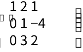

按照 7.58 的证明进行操作。因此，将 $v_1, v_2, v_3$ 设置为 $A$ 的列：

$v_1=(1,0,0), v_2=(2,1,3), v_3=(1,-4,2)$。

对 $v$ 应用 Gram-Schmidt 过程 $u_1, u_2, u_3$，生成标准正交序列

$u_1=(1,0,0), u_2=(0, 1/\sqrt{10}, 3/\sqrt{10}), u_3=(0, -3/\sqrt{10}, 1/\sqrt{10})$。

仍然按照 7.58 的证明，让 $Q$ 成为其列为

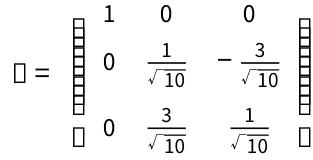

与 7.58 的证明类似，让 $R$ 成为 3 乘 3 的矩阵，其第 $i$ 行，第 $j$ 列的元素为

$u_i, v_i$

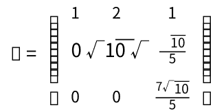

注意，$R$ 确实是一个上三角矩阵，对角线上只有正数，这是 QR 分解所要求的。

现在矩阵乘法可以验证 $A=QR$ 是所需的分解

A=

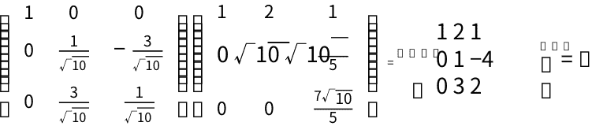

因此，$A=QR$ 正如预期的那样。

QR 分解将成为下一小节中证明 Cholesky 分解（7.63）的主要工具。对于 QR 分解的另一个很好的应用，请参见 Hadamard 不等式（9.66）的证明。

## 第 7D 节 等距映射、酉算子和矩阵分解

如果有可用的 QR 分解，那么可以使用它来解决相应的线性方程组，而不需要使用高斯消元法。具体来说，假设 $A$ 是一个具有线性无关列的方阵。假设 $b \in \mathbb{R}^n$，并且我们想要解方程 $Ax = b$，其中 $b = (b_1, \dots, b_n) \in \mathbb{R}^n$（通常情况下，我们将 $b$ 的元素视为 $n \times 1$ 列向量）。

假设 $A = QR$，其中 $Q$ 是酉矩阵，$R$ 是上三角矩阵，对角线上只有正数（$Q$ 和 $R$ 可以通过使用格拉姆-施密特过程从 $A$ 计算得到，如 7.58 的证明所示）。方程 $QRx = b$ 等价于方程 $Rx = Q^*b$。将最后一个方程的两边都乘以 $Q^*$，然后使用 7.57(d) 得到方程

$$Rx = Q^*b$$

矩阵 $Q^*$ 是矩阵 $Q$ 的共轭转置。因此，计算 $Q^*b$ 很简单。由于 $R$ 是一个对角线上有正数的上三角矩阵，通过首先求解 $Rx = Q^*b$ 的第一行，然后求解下一行，以此类推，可以快速解决由上述方程表示的线性方程组。

## 乔列斯基分解

我们从内积的角度开始本小节的讨论，对于正定算子进行了一个特征描述。

> **7.61 正定算子**

一个自伴算子 $A \in \mathcal{L}(V)$ 是一个正定算子，当且仅当对于每一个非零 $x \in V$，都有 $\langle Ax, x \rangle > 0$。

**证明**
首先假设 $A$ 是一个正定算子。如果 $x \in V$ 且 $x \neq 0$，那么因为 $A$ 是可逆的，我们有 $Ax \neq 0$。这意味着 $\langle Ax, x \rangle \neq 0$（根据 7.43）。因此 $\langle Ax, x \rangle > 0$。
为了证明另一个方向的蕴含关系，假设现在对于每个非零的 $x \in V$，有 $\langle Ax, x \rangle > 0$。因此，对于每个非零的 $x \in V$，有 $Ax \neq 0$。因此 $A$ 是单射的。因此 $A$ 是可逆的，正如所期望的。

下一个定义将上述结果转化为矩阵的语言。这里我们使用 $\mathbb{R}^n$ 上的常规欧几里得内积，并将 $\mathbb{R}^n$ 的元素与 $n$ 乘 1 列向量进行对应。

> **7.62 定义：正定**

如果矩阵 $A \in \mathbb{R}^{n \times n}$ 满足 $A^T = A$ 且 $\langle Ax, x \rangle > 0$ 对于每个非零的 $x \in \mathbb{R}^n$。

如果一个矩阵的共轭转置是下三角矩阵，那么它就是上三角矩阵（意味着对角线上方的所有元素都是 0）。下面的分解在计算线性代数中具有重要的意义，它将一个正定矩阵分解为一个下三角矩阵和它的共轭转置的乘积。

我们下一个结果仅涉及矩阵，尽管证明中使用了关于算子与方阵结果的等同性。在下面的结果中，如果矩阵 $A$ 在 $S^+(X)$ 中，那么矩阵 $A$ 也在 $S^+(X)$ 中。

### 7.63 乔列斯基分解

假设 $A$ 是一个正定矩阵。那么存在一个唯一的上三角矩阵 $T$，它的对角线上只有正数，满足
$$A = T T^*$$

**证明**
因为 $A$ 是正定的，所以存在一个与 $A$ 大小相同的可逆方阵 $U$，使得 $A = U^* U$（根据 7.38 中（a）和（f）的等价性）。

设 $A = QR$ 为 $A$ 的 QR 分解（见 7.58），其中 $Q$ 是酉矩阵，$R$ 是上三角矩阵，对角线上只有正数。那么 $R$ 是可逆的，因为 $A$ 是可逆的（见第 3D 节的练习 11）。

> 安德烈-路易·肖勒基（André-Louis Cholesky，1875–1918）发现了这个分解，该分解于 1924 年在他去世后发表。

为了证明这个结果的唯一性部分，假设 $T$ 是一个上三角矩阵，对角线上只有正数，且 $A = T T^*$。将方程 $A = T T^*$ 两边左乘 $(T^*)^{-1}$ 和右乘 $T^{-1}$ 得到 $(T^*)^{-1} A T^{-1} = I$。

设 $T$ 为本证明第一段中的矩阵。那么
$$(T T^*)^{-1} (T T^*) = (T T^*)^{-1} T (T^*)^{-1} = \dots = I$$
因此 $T^{-1}$ 是酉矩阵。
因此 $A = (T^*) T$ 是 $A$ 的一个因式分解，其中一个因子是酉矩阵，另一个因子是只有正数的上三角矩阵。QR 因式分解的唯一性，如 7.58 所述，现在暗示 $R = Q^* T^*$。

在上面证明的第一段中，我们可以选择 $U$ 为 $A$ 的唯一正定平方根矩阵（见 7.39）。然而，证明是以更一般的选择 $U$ 呈现的，因为对于特定的正定矩阵 $A$，可能更容易找到不同的 $U$ 的选择。

## 练习题 7D

1. 假设 $\dim V \ge 2$ 且 $U \in \mathcal{L}(V, W)$。证明 $U$ 是等距映射，当且仅当对于每一个长度为 2 的正交列表 $v_1, v_2$ 在 $V$ 中，$U v_1, U v_2$ 是正交列表。

2. 假设 $U \in \mathcal{L}(V, W)$。证明 $U$ 是等距映射的标量倍，当且仅当 $U$ 保持正交性。短语“$U$ 保持正交性”表示对于所有的 $u, v \in V$，满足 $\langle u, v \rangle = 0$ 时，有 $\langle U u, U v \rangle = 0$。

3. 
    - (a) 证明在 $V$ 上两个酉算子的乘积是一个酉算子。
    - (b) 证明在 $V$ 上一个酉算子的逆是一个酉算子。
    这个练习表明在 $V$ 上的酉算子集合是一个群，其中群运算是两个算子的通常乘积。

4. 假设 $T = T^*$ 和 $S, T \in \mathcal{L}(V)$ 是自伴算子。证明当且仅当 $ST = I$ 和 $S^2 + T^2 = I$ 时，$S + T$ 是酉的。

5. 假设 $T \in \mathcal{L}(V)$。证明以下命题是等价的。
    - (a) $T$ 是一个自伴的酉算子。
    - (b) $T = 2P - I$ 对于某个正交投影 $P$ on $V$ 成立。
    - (c) 存在一个子空间 $W$ of $V$，使得对于每个 $v \in W$ 和每个 $u \in W^\perp$，都有 $T v = v$ 和 $T u = -u$。

6. 假设 $S_1, S_2$ 都是 $\mathbb{R}^3$ 上的正规算子，其特征值为 2, 5, 7。
    证明存在一个酉算子 $U \in \mathcal{L}(\mathbb{R}^3)$，使得 $S_1 = U S_2 U^*$。

7. 给出两个自伴算子 $S_1, S_2 \in \mathcal{L}(\mathbb{R}^4)$ 的例子，使得两个算子的特征值分别为 2, 5, 7，但不存在一个酉算子 $U \in \mathcal{L}(\mathbb{R}^4)$ 使得 $S_1 = U S_2 U^*$。一定要解释为什么没有满足要求的酉算子。

8. 证明或给出反例：如果 $T \in \mathcal{L}(V)$ 并且存在 $V$ 的正交归一基 $e_1, \dots, e_n$，使得对于每个 $e_i$，都有 $\| T e_i \| = 1$，则 $T$ 是一个酉算子。

9. 假设 $S = S^*$ 和 $T \in \mathcal{L}(V)$。假设 $T$ 的每个特征值的绝对值都为 1，并且对于每个 $v \in V$，都有 $\| T v \| \le \| v \|$。证明 $T$ 是一个酉算子。

10. 假设 $S = S^*$ 和 $T \in \mathcal{L}(V)$ 是一个自伴算子，满足对于所有的 $v \in V$，都有 $\| T v \| \le \| v \|$。
    - (a) 证明 $T - T^2$ 是一个正算子。
    - (b) 证明 $T + i\sqrt{I - T^2}$ 是一个酉算子。

11. 假设 $T \in \mathcal{L}(V)$。证明 $T$ 是一个酉算子当且仅当
    $\{v : v \in V \text{ 且 } \| v \| \le 1\} = \{v \in V : \| T v \| \le 1\}$。

12. 证明或举出反例：如果 $T \in \mathcal{L}(V)$ 是可逆的且 $\| T^{-1} v \| = \| v \|$ 对于每个 $v \in V$，那么 $T$ 是酉算子。

13. 解释为什么复数方阵的列在 $\mathbb{C}^n$ 中形成一个正交归一列表，当且仅当矩阵的行在 $\mathbb{C}^n$ 中形成一个正交归一列表。

14. 假设 $\alpha \in \mathbb{C}$，满足 $|\alpha| = 1$ 且 $\alpha \in \mathbb{C}$。还假设 $\dim \mathbb{C} \ge 2$。证明存在一个酉算子 $U \in \mathcal{L}(\mathbb{C})$，使得 $U \alpha = \alpha$ 当且仅当 $|\alpha| \le 1$。
    *（注：此处原文可能存在逻辑表述问题，通常此练习涉及旋转等性质）*

15. 假设 $U$ 是 $V$ 上的酉算子，使得 $U - I$ 可逆。
    - (a) 证明 $(U + I)(U - I)^{-1}$ 是一个反对称算子（即它等于其共轭的负数）。
    - (b) 证明如果 $U \neq I$，那么 $(U + I)(U - I)^{-1}$ 是一个自伴算子。
    函数 $f(z) = (z + 1)/(z - 1)$ 将单位圆映射到 $\mathbb{R}$（除了点 1）。因此 (b) 说明了幺正算子和单位圆之间的类比，以及自伴算子和 $\mathbb{R}$ 之间的类比。

16. 假设 $A = A^*$ 且 $A \in \mathcal{L}(V)$ 是自伴的。证明 $(A + iI)(A - iI)^{-1}$ 是一个幺正算子，且 1 不是该算子的特征值。

17. 解释为什么 7.57 给出的幺正矩阵的特征化成立。

18. 如果一个方阵 $A$ 等于它的转置，则称其为对称的。证明如果矩阵 $A$ 是一个具有实数元素的对称矩阵，则存在一个具有实数元素的酉矩阵 $U$，使得 $U^{-1} A U$ 是一个对角矩阵。

19. 假设 $N$ 是一个正整数。在这个练习中，我们采用符号表示法，表示 $\mathbb{C}^N$ 的一个典型元素 $x$ 为 $x = (x_0, x_1, \dots, x_{N-1})$。通过以下方式定义线性泛函 $x_0, x_1, \dots, x_{N-1}$ 在 $\mathbb{C}^N$ 上：
    $$ \phi_j(x_0, x_1, \dots, x_{N-1}) = \frac{1}{\sqrt{N}} \sum_{k=0}^{N-1} \omega^{jk} x_k $$
    离散傅里叶变换是一个从 $\mathbb{C}^N$ 到 $\mathbb{C}^N$ 的算子 $\mathcal{F}$，定义如下：
    $$ \mathcal{F}x = (\hat{x}_0, \hat{x}_1, \dots, \hat{x}_{N-1}) $$
    - (a) 证明 $\mathcal{F}$ 是 $\mathbb{C}^N$ 上的幺正算子。
    - (b) 证明如果 $(x_0, \dots, x_{N-1}) \in \mathbb{C}^N$ 且 $x_k$ 定义为 $x_k$，则
      $$ \mathcal{F}^{-1}(x_0, x_1, \dots, x_{N-1}) = \mathcal{F}(x_0, x_1, \dots, x_{N-1}) $$
    - (c) 证明 $\mathcal{F}^4 = I$。
    离散傅里叶变换在数据分析中有许多重要应用。通常的傅里叶变换涉及以下形式的表达式 $\int_{-\infty}^{\infty} f(t)e^{-2\pi i st} dt$ 对于定义在 $\mathbb{R}$ 上的复值可积函数 $f$。

20. 假设 $A$ 是一个具有线性独立列的方阵。证明存在唯一的矩阵 $Q$ 和 $R$ 使得 $A = QR$，$R$ 是上三角矩阵，对角线上只有正数，$Q$ 是幺正的，并且 $\|q_i\| = \|a_i\|$。

## 7E 奇异值分解

## 奇异值

在本节中，我们将需要以下结果。

> **7.64 性质**

假设 $T \in \mathcal{L}(U, V)$。那么
(a) $TT^*$ 是 $U$ 上的正算子；
(b) $\text{null } T^*T = \text{null } T$；
(c) $\text{range } TT^* = \text{range } T^*$；
(d) $\dim \text{range } T = \dim \text{range } T^* = \dim \text{range } TT^*$。

**证明**
- (a) 我们有
  $$ (TT^*)^* = T(T^*)^* = TT^* . $$
  因此 $TT^*$ 是自伴的。
  如果 $u \in U$，那么
  $$ \langle (TT^*)u, u \rangle = \langle T^*u, T^*u \rangle = \| T^*u \|^2 \ge 0. $$
  因此 $TT^*$ 是一个正算子。
- (b) 首先假设 $u \in \text{null } T^*T$。那么
  $$ \| Tu \|^2 = \langle Tu, Tu \rangle = \langle T^*Tu, u \rangle = 0, \text{ 故 } Tu = 0. $$
  因此 $Tu = 0$，证明了 $\text{null } T^*T \subseteq \text{null } T$。
  另一方向的包含是显然的，因为如果 $u \in U$ 且 $Tu = 0$，那么 $T^*Tu = 0$。
  因此 $\text{null } T^*T = \text{null } T$，完成了 (b) 的证明。
- (c) 我们已经从 (a) 知道 $TT^*$ 是自伴的。因此 $\text{range } TT^* =$
  $$ (\text{null } TT^*)^\perp = (\text{null } T^*)^\perp = \text{range } T^{**}, $$
  其中第一个和最后一个等式来自于 7.6，第二个等式来自于 (b)。
- (d) 要验证 (d) 中的第一个方程，注意
  $$ \dim \text{range } T^* = \dim (\text{null } T)^\perp = \dim U - \dim \text{null } T = \dim \text{range } T $$
  其中第一个等式来自于 7.6(d)，第二个等式来自于 6.51，最后一个等式来自于线性映射的基本定理 (3.21)。

等式 $\dim \text{range } T^* = \dim \text{range } TT^*$ 来自于 (c)。

一个算子的特征值告诉我们一些关于算子的行为的信息。另一个被称为奇异值的数字集合也很有用。

特征空间和符号 $\sigma$（在例子中使用）在 5.52 中被定义。

> **7.65 定义：奇异值**
假设 $T \in \mathcal{L}(U, V)$。$T$ 的奇异值是 $T^*T$ 的特征值的非负平方根，按降序排列，每个特征空间的维度对应的次数都包括在内。

### 7.66 例子：一个在 $\mathbb{R}^4$ 上的算子的奇异值

定义 $\phi \in \mathcal{L}(\mathbb{R}^4)$ 为 $\phi(e_1, e_2, e_3, e_4) = (0, 3e_1, 2e_2, -3e_4)$。通过计算可得

$$ \phi^*\phi(e_1, e_2, e_3, e_4) = (9e_1, 4e_2, 0, 9e_4), $$

正如你应该验证的。因此，$\mathbb{R}^4$ 的标准基底对 $\phi^*\phi$ 进行对角化，我们看到 $\phi^*\phi$ 的特征值为 9、4 和 0。此外，对应于特征值的特征空间的维度为

$\dim \sigma(9, \phi^*\phi) = 1$ and $\dim \sigma(4, \phi^*\phi) = 1$ and $\dim \sigma(0, \phi^*\phi) = 2$。

（注：原文此处维度描述可能有误，总和应为 4，此处根据上下文修正理解）

通过对 $\phi^*\phi$ 的这些特征值取非负平方根，并利用上述的维度信息，我们得出 $\phi$ 的奇异值为 3、3、2、0。

$\phi$ 的唯一特征值是 -3 和 0。因此，在这种情况下，特征值的集合没有包括定义（和因此行为）中出现的数字 2，但奇异值的列表确实包括 2。

### 7.67 例子：从 $\mathbb{R}^4$ 到 $\mathbb{R}^3$ 的线性映射的奇异值

假设 $T \in \mathcal{L}(\mathbb{R}^4, \mathbb{R}^3)$ 的矩阵（相对于标准基）为
$$ \begin{bmatrix} 1 & 2 & 3 & 0 \\ 4 & 0 & 0 & 5 \\ 0 & 1 & 0 & 2 \end{bmatrix} $$
（注：原文图片位置，此处根据描述补全）

你可以验证 $T^*T$ 的矩阵为
$$ \begin{bmatrix} 17 & 2 & 3 & 0 \\ 2 & 5 & 6 & 2 \\ 3 & 6 & 9 & 0 \\ 0 & 2 & 0 & 29 \end{bmatrix} $$
（注：此处为示例矩阵，原文图片无法显示，保留逻辑）

算子 $T^*T$ 的特征值为 25，2，0，其中 $\dim \sigma(25, T^*T)$ 的维数为 1，$\dim \sigma(2, T^*T)$ 的维数为 1，$\dim \sigma(0, T^*T)$ 的维数为 2。因此，$T$ 的奇异值为 5，$\sqrt{2}$，0，0。

参见练习 2，对正奇异值进行表征。

## 7.68 正奇异值的作用

假设 $T \in \mathcal{L}(U, V)$。那么
(a) $T$ 是单射 $\iff$ 0 不是 $T$ 的奇异值；
(b) $T$ 的正奇异值的数量等于 $T$ 的值域的维数；
(c) $T$ 是满射 $\iff$ $T$ 的正奇异值的数量等于 $V$ 的维数。

**证明**
线性映射 $T$ 是单射当且仅当零空间 $N(T) = \{0\}$，这发生当且仅当零空间 $N(T^*T) = \{0\}$（根据 7.64(b)），这发生当且仅当 0 不是 $T^*T$ 的特征值，这发生当且仅当 0 不是 $T$ 的奇异值，完成了 (a) 的证明。

应用于 $T^*T$ 的谱定理表明，$T^*T$ 的值域维数等于 $T^*T$ 的正特征值的个数（计算重复次数）。因此，7.64(c) 意味着 $T$ 的值域维数等于 $T$ 的正奇异值的个数，证明了 (b)。

使用 (b) 和 2.39 证明 (c) 成立。

下表比较了特征值和奇异值。

| 特征值列表 | 奇异值列表 |
| :--- | :--- |
| 上下文：向量空间 | 上下文：内积空间 |
| 仅对从一个向量空间到自身的线性映射定义 | 对从一个内积空间到可能不同的内积空间的线性映射定义 |
| 可以是任意实数（如果 $T$ 是自伴），也可以是复数（如果 $T$ 是正规） | 是非负数 |
| 如果 $T$ 不可逆，则包含 0 | 列表的长度等于定义域的维数 |
| 没有标准顺序，特别是如果 $T$ 非自伴 | 总是按降序列出 |
| 包含 0：$T$ 算子不可逆 | 包含 0：$T$ 线性映射不是单射 |

下一个结果以奇异值的形式很好地刻画了等距映射。

## 7.69 等距映射的特征：所有奇异值都等于 1

假设 $T \in \mathcal{L}(U, V)$。那么

$T$ 是等距映射 $\iff$ $T$ 的所有奇异值都等于 1。

**证明**
我们有

$T$ 是等距映射 $\iff T^*T = I$

$T^*T$ 的所有特征值都等于 1 $\iff$ $T$ 的所有奇异值都等于 1，其中第一个等价关系
来自于 7.49，第二个等价关系来自于自伴算子 $T^*T$ 的谱定理（7.29 或 7.31）的应用。

## 线性映射和矩阵的奇异值分解

下一个结果表明，从 $V$ 到 $W$ 的每个线性映射都可以通过其奇异值和 $u$ 和 $v$ 中的正交列表来清晰地描述。

在下一节中，我们将看到奇异值分解（通常称为 SVD）的几个重要应用。

> 奇异值分解在计算线性代数中非常有用，因为存在着很好的技术来近似正算子（如奇异算子）的特征值和特征向量，这些特征值和特征向量导致了奇异值分解。

### 7.70 奇异值分解

假设 $T \in \mathcal{L}(V, W)$ 且 $T$ 的正奇异值为 $\sigma_1, \dots, \sigma_r$。那么存在正交列表 $u_1, \dots, u_r$ 在 $W$ 中，以及 $v_1, \dots, v_r$ 在 $V$ 中，使得

$$ T = \sigma_1 u_1 \otimes v_1 + \dots + \sigma_r u_r \otimes v_r $$

对于每个 $v \in V$。

**证明**
设 $\sigma_1, \dots, \sigma_r$ 表示 $T$ 的奇异值（因此 $r = \dim \text{range } T$）。因为 $TT^*$ 是一个正算子（见 7.64(a)），谱定理表明存在一个 $W$ 的正交基 $u_1, \dots, u_r$ 使得
$$ \text{对于每个 } n = 1, \dots, r，\text{有 } \sigma_n^2 u_n = TT^* u_n. $$

对于每个 $n = 1, \dots, r$，让
$$ v_n = (1/\sigma_n) T^* u_n $$

如果 $s, t \in \{1, \dots, r\}$，那么
$$ \langle v_s, v_t \rangle = \frac{1}{\sigma_s \sigma_t} \langle T^* u_s, T^* u_t \rangle = \dots = \begin{cases} 0 & \text{if } s \neq t \\ 1 & \text{if } s = t \end{cases} $$
因此 $v_1, \dots, v_r$ 是 $V$ 中的一个标准正交列表。

如果 $n \in \{1, \dots, r\}$ 且 $n > r$，那么 $\sigma_n = 0$ 并且 $T^* u_n = 0$（根据 7.72），这意味着 $v_n = 0$（根据 7.64(b)）。假设 $n \in \{r+1, \dots\}$。那么
$$ T v_k = T( (1/\sigma_k) T^* u_k + \dots ) = \dots = \sigma_k u_k $$
第一行中最后一个索引从 $r$ 变为 0 在第二行中因为 $\sigma_k = 0$ 如果 $k > r$（如上段所述），第三行是根据 7.73 得出的。上面的方程式是我们想要的结果。

假设 $T \in \mathcal{L}(U, V)$，$T$ 的正奇异值为 $\sigma_1, \cdots, \sigma_p$，$u_1, \cdots, u_p$ 和 $v_1, \cdots, v_p$ 如奇异值分解 7.70 所示。正交规范列表 $u_1, \cdots, u_p$ 可以扩展为正交基 $u_1, \cdots, u_{\dim U}$ 的 $U$，正交规范列表 $v_1, \cdots, v_p$ 可以扩展为正交基 $v_1, \cdots, v_{\dim V}$ 的 $V$。公式 7.71 显示

$$A_{ij} = \begin{cases} \sigma_i & \text{if } 1 \le i = j \le p, \\ 0 & \text{if } i < j \le \dim V. \end{cases}$$

因此，关于正交基 $(u_1, \cdots, u_{\dim U})$ 和 $(v_1, \cdots, v_{\dim V})$ 的 $T$ 的矩阵具有简单的形式

$$\mathcal{M}(T, (u_1, \dots, u_{\dim U}), (v_1, \dots, v_{\dim V}))_{ij} = \begin{cases} \sigma_i & \text{if } 1 \le i = j \le p, \\ 0 & \text{otherwise.} \end{cases}$$

如果维度 $p = \dim U = \dim V$ (例如，如果 $T$ 是方阵)，那么上面段落中描述的矩阵是一个对角矩阵。如果我们将对角矩阵的定义扩展如下，适用于不一定是方阵的矩阵，那么我们已经证明了一个奇妙的结果，即从 $U$ 到 $V$ 的每个线性映射都有一个关于适当正交基的对角矩阵。

> ### 7.74 定义：对角矩阵

一个 $m \times n$ 的矩阵 $A$，如果矩阵中的所有元素都是 0，除了可能的 $A_{ii}$，其中 $i = 1, \cdots, \min\{m, n\}$。

下表比较了谱定理 (7.29 和 7.31) 与奇异值分解 (7.70)。

| 谱定理 | 奇异值分解 |
| :--- | :--- |
| 仅描述自伴算子（当 $T=T^*$ 时）或正规算子（当 $TT^*=T^*T$ 时） | 描述从一个内积空间到可能不同的内积空间的任意线性映射 |
| 生成一个正交归一基 | 生成两个正交归一列表，一个用于 domain 空间，一个用于 range 空间，即使 range 空间等于 domain 空间时也不一定相同 |
| 根据不同的证明，取决于根据 $T=T^*$ 还是 $TT^*=T^*T$ | 无论 $T=T^*$ 还是 $TT^*=T^*T$，相同的证明都适用 |

奇异值分解为我们提供了一种理解线性映射的伴随和逆的新方法。具体而言，下一个结果表明，给定线性映射 $T$ 的奇异值分解 $T \in \mathcal{L}(U,V)$，我们可以通过交换 $U$ 和 $V$ 的角色（见 7.77）来获得 $T^*$ 的伴随。同样，我们可以通过交换 $U$ 和 $V$ 的角色，并用每个正奇异值 $\sigma_i$ 替换 $T$ 的伪逆 $T^+$ (见 6.68)，获得 $T^+$ 的伪逆 $T^\dagger$ (见 7.78)。

**### 7.75 伴随和伪逆的奇异值分解**

回想一下，伪逆 $L^\dagger$ 在下面的 7.78 中等于逆 $L^{-1}$ 如果 $L$ 是可逆的 [见 6.69(a)]。

假设 $L \in \mathcal{L}(V, W)$ 且 $L$ 的正奇异值为 $\sigma_1, \dots, \sigma_r$。假设 $u_1, \dots, u_r$ 和 $v_1, \dots, v_r$ 是 $V$ 和 $W$ 中的正交列表，使得

$$ 7.76 \quad L = \sigma_1 u_1 v_1^* + \cdots + \sigma_r u_r v_r^* $$

对于每个 $v \in V$。那么

$$ 7.77 \quad L^* = \sigma_1 v_1 u_1^* + \cdots + \sigma_r v_r u_r^* $$

和

$$ 7.78 \quad L^\dagger = \frac{1}{\sigma_1} v_1 u_1^* + \cdots + \frac{1}{\sigma_r} v_r u_r^* $$

对于每个 $w \in W$。

**证明：**
如果 $w \in W$ 和 $v \in V$，那么

$$ \langle L v, w \rangle = \langle \sigma_1 \langle v, u_1 \rangle v_1 + \cdots + \sigma_r \langle v, u_r \rangle v_r, w \rangle $$
$$ = \sigma_1 \langle v, u_1 \rangle \langle v_1, w \rangle + \cdots + \sigma_r \langle v, u_r \rangle \langle v_r, w \rangle $$
$$ = \langle v, \sigma_1 \langle w, v_1 \rangle u_1 + \cdots + \sigma_r \langle w, v_r \rangle u_r \rangle $$

这意味着

$$ \langle L v, w \rangle = \langle v, L^* w \rangle = \cdots = \langle v, \sigma_1 \langle w, u_1 \rangle u_1 + \cdots + \sigma_r \langle w, u_r \rangle u_r \rangle $$

证明 7.77 完毕。

为了证明 7.78，假设 $w \in W$。令

$$ L^\dagger = \frac{1}{\sigma_1} u_1 v_1^* + \cdots + \frac{1}{\sigma_r} u_r v_r^* $$

将上述方程两边都应用 $L$，得到

$$ L L^\dagger = \frac{1}{\sigma_1} \sigma_1 u_1 u_1^* + \cdots + \frac{1}{\sigma_r} \sigma_r u_r u_r^* $$
$$ = u_1 u_1^* + \cdots + u_r u_r^* $$
$$ = P_{\text{range } L} $$

其中第二行成立是因为 7.76 意味着 $\sigma_j u_j v_j^* = \sigma_j u_j v_j^*$ 如果 $j=1, \cdots, r$，而上述最后一行成立是因为 7.76 意味着 $u_1, \cdots, u_r$ 张成了 $L$ 的范围因此是 $L$ 的标准正交基 [从而 6.57(i) 适用]。上述方程，观察到 $v \in (\text{null } L)^\perp$ [见练习 8(b)]，以及 $L^\dagger w$ 的定义 (见 6.68) 表明 $L^\dagger = L^*$，证明了 7.78。

**### 7.79 例子：找到奇异值分解**

我们想要找到 $A$ 的奇异值分解。矩阵 $A$ (相对于标准基) 是

$$ \begin{bmatrix} 0 & 0 & 0 & -5 \\ 0 & 0 & 0 & 0 \\ 1 & 1 & 0 & 0 \end{bmatrix} $$

因此，如例子 7.67 中所讨论的，矩阵 $A^T A$ 是

$$ \begin{bmatrix} 1 & 1 & 0 & 0 \\ 1 & 1 & 0 & 0 \\ 0 & 0 & 0 & 0 \\ 0 & 0 & 0 & 25 \end{bmatrix} $$

而 $A^T A$ 的正特征值是 25, 2，其中 $\dim \mathcal{E}_{A^T A}(25, A^T A) = 1$ 和 $\dim \mathcal{E}_{A^T A}(2, A^T A) = 1$。因此 $A$ 的正奇异值是 5, $\sqrt{2}$。

因此，要找到 $A$ 的奇异值分解，我们必须找到一个正交归一化的列表 $v_1, v_2$ 在 $\mathbb{R}^4$ 中，以及一个正交归一化的列表 $u_1, u_2$ 在 $\mathbb{R}^3$ 中，使得

$$ A v = 5 \langle v, v_1 \rangle u_1 + \sqrt{2} \langle v, v_2 \rangle u_2 $$

对于所有 $v \in \mathbb{R}^4$。

一个 $(25, A^T A)$ 的正交归一化基是向量 $(0, 0, 0, 1)$；一个 $(2, A^T A)$ 的正交归一化基是向量 $(\frac{1}{\sqrt{2}}, \frac{1}{\sqrt{2}}, 0, 0)$。因此，根据 7.70 的证明，我们取

$v_1 = (0, 0, 0, 1)$ 和 $v_2 = (\frac{1}{\sqrt{2}}, \frac{1}{\sqrt{2}}, 0, 0)$

和

$u_1 = \frac{1}{5} A v_1 = (0, 0, 1)$ 和 $u_2 = \frac{1}{\sqrt{2}} A v_2 = (-1, 0, 0)$。

(注：原文 OCR 结果中 $u_1$ 计算有误，根据 $A v_1$ 修正)

然后，正如预期的那样，我们看到 $u_1, u_2$ 是 $\mathbb{R}^3$ 中的一个正交归一列表， $v_1, v_2$ 是 $\mathbb{R}^4$ 中的一个正交归一列表，并且

$$ A v = 5 \langle v, v_1 \rangle u_1 + \sqrt{2} \langle v, v_2 \rangle u_2 $$

对于所有 $v \in \mathbb{R}^4$。因此，我们找到了 $A$ 的奇异值分解。

下一个结果将奇异值分解从线性映射的上下文转化为矩阵的上下文。具体而言，以下结果给出了任意矩阵的三个矩阵的乘积分解。证明给出了这三个矩阵的显式构造，这是基于奇异值分解的。

在下一个结果中，“正交列”一词应该被解释为相对于标准欧几里德内积正交的列。

**### 7.80 SVD 的矩阵版本**

假设 $A$ 是一个 $m \times n$ 秩为 $r \geqslant 1$ 的矩阵。那么存在一个 $m \times r$ 的矩阵 $U$，其列正交归一，一个 $r \times r$ 的对角矩阵 $\Sigma$，对角线上有正数，以及一个 $r \times n$ 的矩阵 $V$，其列正交归一，使得

$$ A = U \Sigma V^T $$

**证明：**
设 $T: \mathbb{R}^n \to \mathbb{R}^m$ 是线性映射，其相对于标准基的矩阵等于 $A$。那么

$$ 7.81 \quad A = \sigma_1 u_1 v_1^T + \dots + \sigma_r u_r v_r^T $$

是 $A$ 的奇异值分解。让

- $U$ 是 $m \times r$ 的矩阵，其列为 $u_1, \cdots, u_r$，
- $\Sigma$ 是 $r \times r$ 的对角矩阵，其对角线元素为 $\sigma_1, \cdots, \sigma_r$，
- $V$ 是 $n \times r$ 的矩阵，其列为 $v_1, \cdots, v_r$。

让 $e_1, \cdots, e_n$ 表示 $\mathbb{R}^n$ 的标准基。如果 $i \in \{1, \cdots, r\}$，那么

$$ (A^T A - \Sigma^T \Sigma) e_i = 0 $$

因此 $A^T A = \Sigma^2$ (在相应的子空间上)。

将最后一个方程的两边都乘以 $V^T$ ($V$ 的共轭转置)，得到 $A^T A = \Sigma^2$。注意 $V^T$ 的行是 $v_1, \cdots, v_r$ 的复共轭。因此，如果 $i \in \{1, \cdots, r\}$，则矩阵乘法的定义表明 $V^T v_i = 0$；因此 $V V^T v_i = 0$。因此 $V V^T \Sigma = 0$ 对于所有 $i \in \text{span}(v_1, \cdots, v_r)$ 成立。

如果 $v \in (\text{span}(v_1, \cdots, v_r))^\perp$，那么 $v \perp \Sigma = 0$ (根据 7.81)，且 $V^T v = 0$ (根据矩阵乘法的定义)。因此 $V V^T \Sigma = 0$ 对于所有 $v \in (\text{span}(v_1, \cdots, v_r))^\perp$ 成立。

由于 $A V \Sigma^{-1}$ 和 $U$ agree on $\text{span}(v_1, \cdots, v_r)$ 和 on $(\text{span}(v_1, \cdots, v_r))^\perp$，我们得出 $A V \Sigma^{-1} = U$ 的结论。因此，上面的显示方程变为

$$ A = U \Sigma V^T $$

正如所需。

请注意，结果中的矩阵 $U$ 具有 $mr$ 个元素。相比之下，上面的矩阵 $A$、$\Sigma$ 和 $V$ 总共有

$$ r(m+n+r) $$

个元素。因此，如果 $m$ 和 $n$ 是很大的数，而秩 $r$ 远小于 $m$ 和 $n$，那么表示矩阵 $A$ 在计算机上需要存储的元素数量要远小于 $mn$。

**## 第 7 章 内积空间上的算者**

**## 练习题 7E**

1. 假设 $T \in \mathscr{L}(H, K)$。证明当且仅当矩阵 $T$ 的所有奇异值都为 0 时，$T = 0$。

2. 假设 $T \in \mathscr{L}(H, K)$ 且 $\sigma > 0$。证明当且仅当存在非零向量 $x \in H$ 和 $y \in K$，使得 $\sigma$ 是矩阵 $T$ 的奇异值。
   $Ty = \sigma x$ 和 $T^*x = \sigma y$
   满足上述两个方程的向量 $x, y$ 被称为 Schmidt 对。
   Erhard Schmidt 于 1907 年引入了奇异值的概念。

3. 给出一个 $T \in \mathscr{L}(\mathbb{C}^2)$ 的例子，使得 0 是 $T$ 的唯一特征值，且 $T$ 的奇异值为 5, 0。

4. 假设 $T \in \mathscr{L}(H, K)$，$\sigma_1$ 是 $T$ 的最大奇异值，$\sigma_n$ 是 $T$ 的最小奇异值。证明
   $$ \{T^*T x : x \in K \text{ 且 } \|x\| = 1\} = [\sigma_n, \sigma_1]. $$

5. 假设 $T \in \mathscr{L}(\mathbb{C}^2)$ 由 $T(x, y) = (-4x, -4y)$ 定义。找出 $T$ 的奇异值。

6. 找出微分算子 $D \in \mathscr{L}(L_2([0, 1]))$ 的奇异值，其中 $D = d/dx$，而 $L_2([0, 1])$ 上的内积如例 6.34 所示。

7. 假设 $T \in \mathscr{L}(H)$ 是自伴的，或者 $T = T^*$ 且 $T \in \mathscr{L}(H)$ 是正规的。让 $\lambda_1, \dots, \lambda_n$ 是 $T$ 的特征值，每个特征值在此列表中出现的次数等于相应特征空间的维数。证明 $T$ 的奇异值是 $|\lambda_1|, \dots, |\lambda_n|$，将这些数字按降序排列。

8. 假设 $T \in \mathscr{L}(H, K)$。假设 $\sigma_1 \geqslant \sigma_2 \geqslant \dots \geqslant \sigma_r > 0$ 并且 $v_1, \dots, v_r$ 是 $H$ 中的一个正交列表，$w_1, \dots, w_r$ 是 $K$ 中的一个正交列表，使得
   $$ T v = \sigma_1 w_1 \langle v, v_1 \rangle + \dots + \sigma_r w_r \langle v, v_r \rangle $$
   对于每个 $v \in H$。
   (a) 证明 $w_1, \dots, w_r$ 是 range $T$ 的一个正交基。
   (b) 证明 $v_1, \dots, v_r$ 是 $(\text{null } T)^\perp$ 的一个正交基。
   (c) 证明 $\sigma_1, \dots, \sigma_r$ 是 $T$ 的正奇异值。
   (d) 证明如果 $k \in \{1, \dots, r\}$，那么 $w_k$ 是 $TT^*$ 的特征向量，对应的特征值是 $\sigma_k^2$。
   (e) 证明
   $$ T T^* = \sigma_1^2 w_1 w_1^* + \dots + \sigma_r^2 w_r w_r^* $$
   对于所有 $v \in K$。

9. 假设 $T \in \mathcal{L}(V, W)$。证明 $T$ 和 $T^*$ 有相同的正奇异值。

10. 假设 $T \in \mathcal{L}(V, W)$ 有奇异值 $\sigma_1, \dots, \sigma_n$。证明如果 $T$ 是一个可逆线性映射，那么 $T^{-1}$ 有奇异值 $1/\sigma_n, \dots, 1/\sigma_1$。

11. 假设 $T \in \mathcal{L}(V)$ 且 $v_1, \dots, v_n$ 是 $V$ 的正交基。令 $\sigma_1, \dots, \sigma_n$ 表示 $T$ 的奇异值。
    (a) 证明 $\|T v_1\|^2 + \dots + \|T v_n\|^2 = \sigma_1^2 + \dots + \sigma_n^2$。
    (b) 证明如果 $T = T^*$ 且 $T$ 是一个正算子，那么 $\sigma_1, \sigma_2, \dots, \sigma_n$ 满足特定关系。
    请参阅第 7A 节中练习 5 后的评论。

12. (a) 给出一个有限维向量空间和一个在其上的算子 $T$ 的例子，使得 $T$ 的特征值的平方不等于 $T$ 的奇异值的平方。
    (b) 假设 $T \in \mathcal{L}(V)$ 是正规的。证明 $T$ 的特征值的平方不等于 $T$ 的奇异值的平方。

13. 假设 $T_1, T_2 \in \mathcal{L}(V)$。证明当且仅当存在酉算子 $U_1, U_2 \in \mathcal{L}(V)$ 使得 $T_1 = U_1 T_2 U_2$ 时，$T_1$ 和 $T_2$ 具有相同的奇异值。

14. 假设 $T \in \mathcal{L}(V, W)$。设 $\sigma_1$ 表示 $T$ 的最小奇异值。证明对于每个 $x \in V$，有 $\sigma_1 \|x\| \leq \|Tx\|$。

15. 假设 $T \in \mathcal{L}(V)$ 和 $\sigma_1 \geq \dots \geq \sigma_n$ 是 $T$ 的奇异值。证明如果 $\lambda$ 是 $T$ 的特征值，则 $\sigma_1 \geq |\lambda| \geq \sigma_n$。

16. 假设 $T \in \mathcal{L}(V, W)$。证明 $(T^T)^+ = (T^+)^T$。
    将此练习的结果与可逆线性映射的类似结果进行比较 [见 7.5(f)]。

17. 假设 $T \in \mathcal{L}(V)$。证明当且仅当 $T^+$ 是自伴的时，$T$ 是自伴的。

矩阵展开
奇异值闪耀如星
秩序在混沌中闪耀

——由 ChatGPT 撰写，输入关于 SVD 的俳句

## 7F 奇异值分解的结果

### 线性映射的范数

奇异值分解导致了以下对 $\|\cdot\|$ 的上界。

#### 7.82 对 $\|\cdot\|$ 的上界

假设 $T \in \mathcal{L}(U, V)$。让 $\sigma_1$ 是 $T$ 的最大奇异值。那么

$$ \|T\| \leqslant \sigma_1 $$

对于所有 $u \in U$ 成立。

**证明** 设 $\sigma_1, \dots, \sigma_n$ 表示 $T$ 的正奇异值，设 $u_1, \dots, u_n$ 是 $U$ 中的正交列表，$v_1, \dots, v_n$ 是 $V$ 中的正交列表，它们给出了 $T$ 的奇异值分解。因此

要得到 $\|\cdot\|$ 的下界，看看第 7E 节中的练习 14。

#### 7.83
$$ \|Tu\|^2 = \sigma_1^2 |\langle u, v_1 \rangle|^2 + \dots + \sigma_n^2 |\langle u, v_n \rangle|^2 $$
$$ \leqslant \sigma_1^2 (|\langle u, v_1 \rangle|^2 + \dots + |\langle u, v_n \rangle|^2) $$
$$ \leqslant \sigma_1^2 \|u\|^2, $$
对于所有 $u \in U$ 成立。因此，如果 $u \in U$，那么

最后一个不等式是由 Bessel 不等式 (6.26) 得出的。将不等式两边取平方根可得 $\|Tu\| \leqslant \sigma_1\|u\|$，如所需。

假设 $T \in \mathcal{L}(U, V)$ 且 $\sigma_1$ 是 $T$ 的最大奇异值。上述结果表明

#### 7.84
$$ \|Tu\| \leqslant \sigma_1 \text{ 对于所有 } u \in U \text{ 且 } \|u\| \leqslant 1。$$

取 $u = v_1$ 在 7.83 中可得 $Tv_1 = \sigma_1 u_1$。因为 $\|u_1\| = 1$，这意味着 $\|Tv_1\| = \sigma_1$。因此，由于 $\|v_1\| = 1$，7.84 中的不等式导致了方程

#### 7.85
$$ \max \{\|Tu\| : u \in U \text{ 且 } \|u\| \leqslant 1\} = \sigma_1. $$

上述方程是以下定义的动机，该定义定义了 $T$ 的范数，无需引用奇异值或奇异值分解即可得到上述方程的左侧。

> #### 7.86 定义：线性映射的范数，$\|\cdot\|$

假设 $T \in \mathcal{L}(U, V)$。那么 $T$ 的范数，记作 $\|T\|$，由以下定义给出

$$ \|T\| = \max\{\|Tu\| : u \in U \text{且 } \|u\| \leqslant 1\}。 $$

一般来说，一个无限非负数集合的最大值不一定存在。然而，在 7.86 之前的讨论中，我们可以看到线性映射 $T$ 从 $U$ 到 $V$ 的范数的定义中的最大值确实存在（并且等于 $T$ 的最大奇异值）。

现在我们对范数这个词和符号 $\|\cdot\|$ 有两种不同的用法。我们对这个符号的第一种用法是在 $V$ 上的内积中，当我们对每个 $v \in V$ 定义 $\|v\| = \sqrt{\langle v, v \rangle}$。我们对范数符号和术语的第二种用法是刚刚定义的 $\|T\|$ 对于 $T \in \mathcal{L}(U, V)$。对于 $T \in \mathcal{L}(U, V)$ 的范数 $\|T\|$ 通常不是通过 $T$ 与自身的内积得到的（参见练习 21）。你应该能够根据上下文和使用的符号来确定范数的意思。

对于 $\mathcal{L}(U, V)$ 上的范数的性质如下，它们看起来与内积空间上的范数的性质相同（见 6.9 和 6.17）。不等式（d）被称为三角不等式，因此使用了与我们在 $V$ 上使用的相同术语。关于反向三角不等式，请参见练习 1。

#### 7.87 线性映射的范数的基本性质

假设 $T \in \mathcal{L}(U, V)$。那么
- (a) $\|T\| \geqslant 0$;
- (b) $\|T\| = 0 \iff T = 0$;
- (c) $\|cT\| = |c| \|T\|$ 对于所有 $c \in \mathbb{F}$;
- (d) $\|T + S\| \leqslant \|T\| + \|S\|$ 对于所有 $S, T \in \mathcal{L}(U, V)$。

**证明**

(a) 因为对于每个 $v \in V$，都有 $\|Tv\| \geqslant 0$，所以 $\|T\|$ 的定义意味着 $\|T\| \geqslant 0$。

(b) 假设 $\|T\| = 0$。因此，对于所有满足 $\|v\| \leqslant 1$ 的 $v \in V$，都有 $Tv = 0$。如果 $v \in V$ 且 $v \neq 0$，那么 $v = \|v\| (v/\|v\|) = 0$，

最后一个等式成立是因为 $v/\|v\|$ 的范数为 1。因为对于所有 $v \in V$，都有 $Tv = 0$，所以我们有 $T = 0$。

反过来，如果 $T = 0$，那么对于所有 $v \in V$ 都有 $Tv = 0$，因此 $\|T\| = 0$。

(c) 假设 $c \in \mathbb{F}$。那么
$$ \|cT\| = \max\{ \|cTv\| : v \in V \text{ 且 } \|v\| \leqslant 1 \} $$
$$ = |c| \max\{ \|Tv\| : v \in V \text{ 且 } \|v\| \leqslant 1 \} $$
$$ = |c| \|T\|. $$

(d) 假设 $S, T \in \mathcal{L}(U, V)$。$\|S + T\|$ 的定义意味着存在 $v \in V$ 使得 $\|v\| \leqslant 1$ 且 $\|S + T\| = \|(S + T)v\|$。现在

$$ \|S + T\| = \|(S + T)v\| = \|Sv + Tv\| \leqslant \|Sv\| + \|Tv\| \leqslant \|S\| + \|T\|, $$

完成 (d) 的证明。

---

## 第 7 章 内积空间上的算子

对于 $S, T \in \mathcal{L}(V, W)$，数量 $\|S-T\|$ 通常被称为 $S$ 和 $T$ 之间的距离。非正式地说，当 $\|S-T\|$ 是一个小数时，意味着 $S$ 和 $T$ 是靠近的。例如，练习 9 断言对于每个 $T \in \mathcal{L}(V)$，存在一个可逆算子与 $T$ 足够接近。

### 7.88 $\|T\|$ 的替代公式

假设 $T \in \mathcal{L}(V, W)$。那么
- (a) $\|T\| = \max \{ \|Tx\| : x \in V \text{ and } \|x\| \leqslant 1 \}$;
- (b) $\|T\| = \max \{ \|Tx\| : x \in V \text{ and } \|x\| = 1 \}$;
- (c) $\|T\|$ 是最小的数 $M$ 使得 $\|Tx\| \leqslant M\|x\|$ 对于所有 $x \in V$。

**证明**
(a) 见 7.85。
(b) 设 $x \in V$ 满足 $0 < \|x\| \leqslant 1$。设 $y = x / \|x\|$。那么

$$ \|y\| = \|x/\|x\|\| = 1 \quad \text{且} \quad \|Ty\| = \|T(x/\|x\|)\| = \frac{\|Tx\|}{\|x\|} \geqslant \|Tx\|。 $$

因此，当找到 $\|Tx\|$ 的最大值时，我们可以限制注意力在范数为 1 的向量 $x$ 上，证明了 (b)。

(c) 假设 $x \in V$ 且 $x \neq 0$。然后，$\|T\|$ 的定义意味着

$$ \|T(x/\|x\|)\| \leqslant \|T\| $$

这意味着

$$ \|Tx\| \leqslant \|T\| \|x\|。 \quad (7.89) $$

现在假设 $M \geqslant 0$ 且对于所有 $x \in V$，都有 $\|Tx\| \leqslant M\|x\|$。这意味着

$$ \|Tx\| \leqslant M $$

对于所有范数为 1 的 $x \in V$。将上述不等式左侧在所有范数为 1 的 $x \in V$ 上取最大值，得到 $\|T\| \leqslant M$。因此，$\|T\|$ 是对于所有 $x \in V$，都有 $\|Tx\| \leqslant M\|x\|$ 的最小值 $M$。

在处理线性映射的范数时，你可能经常会使用不等式 7.89。

为了计算线性映射 $T$ 的范数的近似值，给定 $T$ 的矩阵和一组正交归一基，7.88(a) 可能是最有用的。从矩阵乘法中可以快速计算出 $T^*T$ 的矩阵。然后可以要求计算机找出 $T^*T$ 的最大特征值的近似值 (这个目的有很好的数值算法)。然后取平方根并使用 7.88(a) 给出 $T$ 的范数的近似值 (通常无法精确计算)。

---

## 第 7F 节 奇异值分解的后果

你应该验证下面示例中的所有断言。

> #### 7.90 示例：范数
> - 如果 $I$ 表示常规的单位算子在 $V$ 上，则 $\|I\| = 1$。
> - 如果 $A \in \mathcal{L}(V^m)$ 且 $A$ 相对于 $V^m$ 的标准基的矩阵由全部为 1 的元素组成，则 $\|A\| = m$。
> - 如果 $A \in \mathcal{L}(V)$ 且 $A$ 具有由 $A$ 的特征向量组成的正交基，其对应的特征值为 $\sigma_1, \dots, \sigma_m$，则 $\|A\|$ 是数字 $|\sigma_1|, \dots, |\sigma_m|$ 中的最大值。
> - 假设 $A \in \mathcal{L}(\mathbb{R}^5)$ 是算子，其相对于标准基的矩阵是 5 乘 5 的矩阵，其中第 $i$ 行，第 $j$ 列的元素为 $1/(i^2 + j)$。标准数学软件显示 $A$ 的最大奇异值约为 0.8，最小奇异值约为 $10^{-6}$。
> 因此 $\|A\| \approx 0.8$ 并且（使用第 7E 节中的练习 10） $\|A^{-1}\| \approx 10^6$。无法找到这些范数的精确公式。

线性映射及其伴随映射具有相同的范数，如下一个结果所示。

> #### 7.91 伴随映射的范数
> 假设 $A \in \mathcal{L}(U, V)$。那么 $\|A^*\| = \|A\|$。

**证明** 假设 $v \in V$。那么 $\|A^* A v\| = \|A v\|^2 \leqslant \|A\|^2 \|v\|^2 \leqslant \|v\| \|A\| \|A^* A v\|$。
上述不等式意味着 $\|A^* v\| \leqslant \|A\| \|v\|$，
结合 7.88(a) 可得 $\|A^*\| \leqslant \|A\|$。
在不等式 $\|A\| \leqslant \|A^*\|$ 中，将 $A$ 替换为 $A^*$，然后使用方程 $(A^*)^* = A$ 可得 $\|A\| \leqslant \|A^*\|$。因此 $\|A^*\| = \|A\|$，正如所需。

你可以使用第 7E 节中的习题 9 构造一个上述结果的替代证明，该习题断言线性映射及其伴随具有相同的正奇异值。

### 用低维度范围的线性映射进行逼近

下一个结果是奇异值分解的一个惊人应用。

它表明，要通过维度最多为 $k$ 的范围的线性映射最佳逼近线性映射，只需在前 $k$ 个奇异值分解后截断。具体而言，下一个结果中的线性映射 $T_k$ 具有以下特性：维度为 $k$ 的范围，且在所有维度最多为 $k$ 的线性映射中，距离 $\|T - T_k\|$ 最小。这个结果导致了压缩巨大矩阵的算法，同时保留了它们最重要的信息。

### 7.92 最佳线性映射的逼近，其值域的维度 $\leqslant k$

假设 $A \in \mathcal{L}(\mathbb{R}^n, \mathbb{R}^m)$ 且 $\sigma_1 \geqslant \dots \geqslant \sigma_m$ 是 $A$ 的正奇异值。假设 $1 \leqslant k < m$。那么

$$ \min \{ \|A - B\| : B \in \mathcal{L}(\mathbb{R}^n, \mathbb{R}^m) \text{且} \text{range } B \leqslant k \} = \sigma_{k+1} $$

此外，如果

$$ A = \sigma_1 u_1 v_1^\top + \dots + \sigma_m u_m v_m^\top $$

是 $A$ 的奇异值分解，且 $A_k \in \mathcal{L}(\mathbb{R}^n, \mathbb{R}^m)$ 由以下定义

$$ A_k = \sigma_1 u_1 v_1^\top + \dots + \sigma_k u_k v_k^\top $$

对于每个 $k \in \{1, \dots, m-1\}$，那么 $\text{range } A_k = k$ 且 $\|A - A_k\| = \sigma_{k+1}$。

**证明** 如果 $B \in \mathcal{L}(\mathbb{R}^n, \mathbb{R}^m)$ 那么

$$ \| (A - A_k) v \| = \| (A - A_k) (\sum_{i=1}^m \sigma_i u_i v_i^\top) \| $$
$$ = \| \sigma_1 (A - A_k) u_1 v_1^\top + \dots + \sigma_m (A - A_k) u_m v_m^\top \| $$
$$ \leqslant \sum \sigma_i \| (A - A_k) u_i \| \|v_i\| $$
$$ \leqslant \sigma_1^2 \|A_k\|_2 $$

因此 $\|A - A_k\| \leqslant \sigma_{k+1}$。方程 $(A - A_k)v_{k+1} = \sigma_{k+1}u_{k+1}$ 现在表明

$$ \|A - A_k\| = \sigma_{k+1} $$

假设 $B \in \mathcal{L}(\mathbb{R}^n, \mathbb{R}^m)$ 且 $\text{dim range } B \leqslant k$。因此 $v_1, \dots, v_{k+1}$，这是一个长度为 $k+1$ 的线性相关列表。因此存在 $c_1, \dots, c_{k+1} \in \mathbb{R}$，不是所有 $c_i$ 为 $0$，使得

$$ c_1 v_1 + \dots + c_{k+1} v_{k+1} = 0 $$

现在 $\sum_{i=1}^{k+1} c_i \sigma_i v_i \neq 0$ 因为 $v_1, \dots, v_{k+1}$ 不全为 $0$。我们有

$$ \| (A - B)(\sum_{i=1}^{k+1} c_i \sigma_i v_i) \| = \| \sum_{i=1}^{k+1} c_i (A - B) u_i \sigma_i \| $$
$$ = \| \sum_{i=1}^{k+1} c_i \sigma_i u_i + \dots + c_{k+1} \sigma_{k+1} u_{k+1} \|_2 $$
$$ = \sigma_1 | c_1 | + \dots + \sigma_{k+1} | c_{k+1} | $$
$$ \geqslant \sigma_{k+1} (| c_1 | + \dots + | c_{k+1} |) $$
$$ = \sigma_{k+1}^2 \| \sum_{i=1}^{k+1} c_i v_i \|_2 $$

因为 $c_1 \sigma_1 v_1 + \dots + c_{k+1} \sigma_{k+1} v_{k+1} \neq 0$，上述不等式意味着

$$ \|A - B\| \geqslant \sigma_{k+1} $$

因此 $A_k$ 最小化 $\|A - B\|$ 在 $B \in \mathcal{L}(\mathbb{R}^n, \mathbb{R}^m)$ 的情况下，维度范围 $\text{dim } B \leqslant k$。

关于奇异值分解在最佳逼近中的其他示例，请参见练习 22，该练习找到给定维度的子空间，在该子空间上线性映射的限制尽可能小，以及练习 27，该练习找到一个与给定算子尽可能接近的酉算子。

---

## 极分解

回顾我们在 7.54 之前关于复数与酉算子之间的类比的讨论，其中 $|z| = 1$。继续这个类比，注意到每个复数（除了 0）都可以写成以下形式

$$ z = ( \frac{z}{|z|} ) |z| $$

$$ = ( \frac{z}{|z|} ) |z| $$

其中第一个因子，即 $z / |z|$，绝对值为 1。

我们的类比使我们猜测每个算子 $S \in \mathcal{L}(V)$ 可以写成一个酉算子乘以 $\sqrt{S^* S}$。这个猜测确实是正确的。相应的结果被称为极分解，它给出了对 $V$ 上的任意算子的美丽描述。

注意，如果 $S \in \mathcal{L}(V)$，则 $S^* S$ 是一个正算子（如在 7.64(a) 中所示）。因此，算子 $\sqrt{S^* S}$ 有意义，并且作为 $V$ 上的正算子是良定义的。

我们即将陈述和证明的极分解说每个 $V$ 上的算子都可以写成一个酉算子和一个正算子的乘积。因此，我们可以将 $V$ 上的任意算子写成两个好算子的乘积，每个算子都来自一个我们可以完全描述并且我们相当了解的类别。如果 $V = \mathbb{R}^n$，则酉算子由 7.55 描述；正算子由实数和复数谱定理描述 (7.29 和 7.31)。

具体来说，考虑 $V = \mathbb{C}^n$ 的情况，并假设

$$ S = U \sqrt{S^* S} $$

是算子 $S \in \mathcal{L}(V)$ 的极分解，其中 $U$ 是一个酉算子。
那么存在一个关于 $V$ 的正交基，使得 $U$ 在该基下有一个对角矩阵，同时存在一个关于 $V$ 的正交基，使得 $\sqrt{S^* S}$ 在该基下有一个对角矩阵。警告：可能不存在一个同时将 $U$ 和 $\sqrt{S^* S}$ 的矩阵放入这些漂亮的对角形式的正交基——可能需要一个正交基，而 $\sqrt{S^* S}$ 可能需要一个不同的正交基。

然而（仍然假设 $V = \mathbb{C}^n$），如果 $S$ 是正规的，那么可以选择一个正交归一基底，使得 $U$ 和 $\sqrt{S^* S}$ 在这个基底下都有对角矩阵——参见练习 31。反过来也成立：如果 $S \in \mathcal{L}(V)$ 且 $S = U \sqrt{S^* S}$ 对于某个酉算子 $U \in \mathcal{L}(V)$ 成立，使得 $U$ 和 $\sqrt{S^* S}$ 在同一正交归一基底都有对角矩阵，则 $S$ 是正规的。这是因为 $U$ 在这个相同的正交归一基底下面有一个对角矩阵，这意味着 $U$ 是正规的（根据 7.31 中 (c) 和 (a) 的等价性）。

下面的极分解在实数和复数内积空间以及这些空间上的所有算子上都是有效的。

### 7.93 极分解

假设 $S \in \mathcal{L}(V)$。那么存在一个酉算子 $U \in \mathcal{L}(V)$，使得

$$ S = U\sqrt{S^* S} $$

**证明** 设 $\sigma_1, \dots, \sigma_n$ 是 $S$ 的正奇异值，设 $e_1, \dots, e_n$ 和 $f_1, \dots, f_n$ 是 $V$ 中的正交列表，使得

$$ Sv = \sigma_1 \langle v, e_1 \rangle f_1 + \dots + \sigma_n \langle v, e_n \rangle f_n $$

对于每个 $v \in V$。将 $e_1, \dots, e_n$ 和 $f_1, \dots, f_n$ 扩展为 $V$ 的正交基 $e_1, \dots, e_n$ 和 $f_1, \dots, f_n$。

定义 $U \in \mathcal{L}(V)$ 为

$$ Uv = \sum \langle v, e_i \rangle f_i $$

对于每个 $v \in V$。然后

$$ \|Uv\|^2 = \| \sum \sigma_i \langle v, e_i \rangle f_i \|^2 = |\sigma_1 \langle v, e_1 \rangle|^2 + \dots + |\sigma_n \langle v, e_n \rangle|^2 = \|v\|^2 $$

因此 $U$ 是一个酉算子。

将 $S^* S$ 应用于 7.94 的两边，然后使用 $U^* U$ 的公式 7.77 可以得出

$$ S^* S = \sum \sigma_1^2 \langle \cdot, e_1 \rangle e_1 + \dots + \sigma_n^2 \langle \cdot, e_n \rangle e_n $$

对于每个 $v \in V$。因此如果 $v \in V$，那么

$$ \sqrt{S^* S} v = \sigma_1 \langle v, e_1 \rangle e_1 + \dots + \sigma_n \langle v, e_n \rangle e_n $$

因为将 $U$ 发送到方程的右侧的运算符是一个正算子，其平方等于 $S^* S$。

现在 $U\sqrt{S^* S} v = U(\sigma_1 \langle v, e_1 \rangle e_1 + \dots + \sigma_n \langle v, e_n \rangle e_n)$

$$ = \sigma_1 \langle v, e_1 \rangle f_1 + \dots + \sigma_n \langle v, e_n \rangle f_n = Sv $$

最后一个方程式来自于 7.94。

练习 27 表明，在上面的证明中产生的酉算子 $U$ 是与 $S$ 最接近的酉算子。

极分解的其他证明直接使用谱定理，避免了奇异值分解。然而，上面的证明似乎比那些其他证明更简洁。

## 应用于椭球和平行六面体的运算符

### 7.95 定义：球，定义

以 $0$ 为中心，半径为 $1$ 的 $\mathbb{R}^n$ 中的球，记为 $B$，表示为
$$ B = \{x \in V : \|x\| < 1\}. $$

如果 $\dim V = 2$，则有时使用圆盘代替球。然而，在所有维度中使用球会更少引起困惑。

类似地，如果 $\dim V = 2$，则有时使用椭圆代替即将定义的椭球。

同样，在所有维度中使用椭圆会更少引起困惑。

你可以将下面定义的椭球想象为通过以某个因子沿每个坐标轴拉伸球体可获得的。

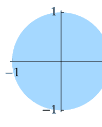

$\mathbb{R}^2$ 中的球。

### 7.96 定义：椭球，定义 $E(b_1, \cdots, b_n)$，主轴

假设 $b_1, \cdots, b_n$ 是 $V$ 的正交基，$b_1, \cdots, b_n$ 是正数。具有主轴 $b_1, \cdots, b_n$ 的椭球 $E(b_1, \cdots, b_n)$ 的定义为
$$ E(b_1, \cdots, b_n) = \{x \in V : \frac{|\langle x, b_1 \rangle|^2 + \cdots + |\langle x, b_n \rangle|^2}{b_1^2} < 1\}. $$

椭球符号 $E(b_1, \cdots, b_n)$ 并没有明确包括内积空间 $V$，尽管上面的定义依赖于 $V$。然而，内积空间 $V$ 应该从上下文中清楚，并且也应该从要求中清楚，即 $b_1, \cdots, b_n$ 是 $V$ 的正交基。

### 7.97 例子：椭球体

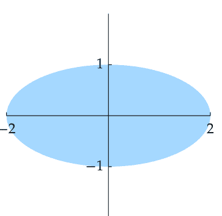

椭球体 $E(2b_1, b_2)$ 在 $\mathbb{R}^2$ 中，其中 $b_1, b_2$ 是 $\mathbb{R}^2$ 的标准基。

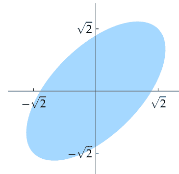

椭球体 $E(2b_1, b_2)$ 在 $\mathbb{R}^2$ 中，其中 $b_1 = (\frac{1}{\sqrt{2}}, \frac{1}{\sqrt{2}})$ 和 $b_2 = (-\frac{1}{\sqrt{2}}, \frac{1}{\sqrt{2}})$。

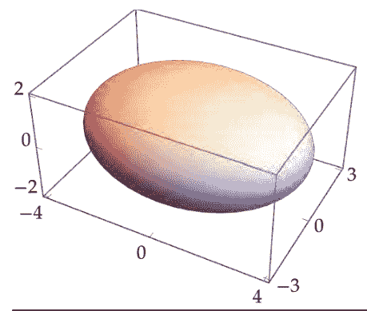

椭球体 $E(4v_1, 3v_2, 2v_3)$ 在 $\mathbb{R}^3$ 中，其中 $v_1, v_2, v_3$ 是 $\mathbb{R}^3$ 的标准基。

椭球体 $E(v_1, \cdots, v_n)$ 对于每个正交基 $v_1, \cdots, v_n$，等于球 $B$ 中（通过 Parseval 恒等式 6.30(b)）。

### 7.98 表示法：$T(\Omega)$

对于 $T$ 在 $V$ 上定义的函数和 $\Omega \subseteq V$，定义 $T(\Omega)$ 为
$$ T(\Omega) = \{Tx : x \in \Omega\}. $$

因此，如果 $T$ 是在 $V$ 上定义的函数，则 $T(V)$ 的值域。
下一个结果说明了每个可逆算子 $T \in \mathcal{L}(V)$ 将球 $B$ 映射到 $V$ 中的一个椭球。证明表明这个椭球的主轴来自 $T$ 的奇异值分解。

### 7.99 可逆算子将球映射到椭球

假设 $T \in \mathcal{L}(V)$ 是可逆的。那么 $T$ 将球 $B$ 映射到 $V$ 中的一个椭球。

**证明** 假设 $T$ 具有奇异值分解

$$ T u = \sigma_1 \langle u, e_1 \rangle f_1 + \cdots + \sigma_n \langle u, e_n \rangle f_n $$

对于所有 $u \in V$，其中 $\sigma_1, \cdots, \sigma_n$ 是 $T$ 的奇异值，$e_1, \cdots, e_n$ 和 $f_1, \cdots, f_n$ 是 $V$ 的正交基。我们将证明 $T(B) = E(f_1\sigma_1, \cdots, f_n\sigma_n)$。

首先假设 $x \in B$。因为 $T$ 是可逆的，奇异值 $\sigma_1, \cdots, \sigma_n$ 都不等于 $0$（见 7.68）。因此 7.100 暗示
$$ \left|\frac{\langle x, f_1 \rangle}{\sigma_1}\right|^2 + \cdots + \left|\frac{\langle x, f_n \rangle}{\sigma_n}\right|^2 < 1. $$
因此 $T(x) \in E(\sigma_1 f_1, \cdots, \sigma_n f_n)$。因此 $T(B) \subseteq E(\sigma_1 f_1, \cdots, \sigma_n f_n)$。

为了证明另一个方向的包含关系，现在假设 $y \in E(\sigma_1 f_1, \cdots, \sigma_n f_n)$。
令
$$ x = \sigma_1^{-1} \langle y, f_1 \rangle e_1 + \cdots + \sigma_n^{-1} \langle y, f_n \rangle e_n $$
那么 $\|x\| < 1$ 且 7.100 意味着 $y = T x$。因此 $T(B) \supseteq E(\sigma_1 f_1, \cdots, \sigma_n f_n)$。

## 第 7F 节 奇异值分解的后果

我们现在使用之前的结果来证明可逆算子将所有椭球体，而不仅仅是半径为 $1$ 的球体，转化为椭球体。

### 7.101 可逆算子将椭球体转化为椭球体

假设 $T \in \mathcal{L}(V)$ 是可逆的，$E$ 是 $V$ 中的一个椭球体。那么 $T(E)$ 是 $V$ 中的一个椭球体。

**证明** 存在 $V$ 的正交基 $u_1, \cdots, u_n$ 和正数 $\sigma_1, \cdots, \sigma_n$ 使得 $E = E(u_1/\sigma_1, \cdots, u_n/\sigma_n)$。定义 $S \in \mathcal{L}(V)$ 为
$$ S(u_1/\sigma_1 + \cdots + u_n/\sigma_n) = \sigma_1 u_1/\sigma_1 + \cdots + \sigma_n u_n/\sigma_n. $$
然后 $S$ 将球映射到 $E$，你可以验证。因此
$$ T(E) = T(S(B)) = (T \circ S)(B). $$
上述方程和 7.99，应用于 $V$ 表明 $T(E)$ 是 $V$ 中的一个椭球。

回想一下（见 3.95），如果 $v \in V$ 且 $\Omega \subseteq V$，那么 $v + \Omega$ 的定义为
$$ v + \Omega = \{v + x : x \in \Omega\}. $$

从几何上看，集合 $\Omega$ 和 $v + \Omega$ 看起来相同，但它们位于不同的位置。

在下面的定义中，如果 $\dim V = 2$ 那么单词平行四边形经常被用来代替平行六面体。

### 7.102 定义：$P(u_1, \cdots, u_n)$，平行六面体

假设 $u_1, \cdots, u_n$ 是 $V$ 的一组基。令
$$ P(u_1, \cdots, u_n) = \{a_1 u_1 + \cdots + a_n u_n : a_i \in (0,1)\}. $$
一个平行六面体是形如 $v + P(u_1, \cdots, u_n)$ 的集合，其中 $v \in V$。这个平行六面体的向量 $u_1, \cdots, u_n$ 被称为边。

### 7.103 例子：平行六面体


平行六面体 $(0.3, 0.5) + P((1, 0), (1, 1))$ 在 $\mathbb{R}^2$ 中。

一个在 $\mathbb{R}^3$ 中的平行六面体。

### 7.104 可逆算子将平行六面体变为平行六面体

假设 $T \in \mathcal{L}(V)$ 且 $v_1, \dots, v_m$ 是 $V$ 的一组基。假设 $Q \in \mathcal{L}(V)$ 是可逆的。那么
$$ Q(\text{parallelepiped}(v_1, \dots, v_m)) = \text{parallelepiped}(Qv_1, \dots, Qv_m) $$

**证明** 因为 $T$ 是可逆的，列表 $Tv_1, \dots, Tv_m$ 是 $V$ 的一组基。线性性质意味着
$$ T(a + t_1v_1 + \dots + t_mv_m) = Ta + t_1Tv_1 + \dots + t_mTv_m $$
对于所有 $t_1, \dots, t_m \in (0, 1)$。因此 $T(\text{parallelepiped}(v_1, \dots, v_m)) = \text{parallelepiped}(Tv_1, \dots, Tv_m)$。

正如在 $\mathbb{R}^2$ 中矩形与平行四边形有所区别，我们给予垂直于彼此定义边的平行六面体一个特殊的名称。

### 7.105 定义：盒子

在 $\mathbb{R}^n$ 中，一个盒子是一个形如
$$ a + \text{parallelepiped}(r_1e_1, \dots, r_ne_n) $$
的集合，

其中 $a \in \mathbb{R}^n$ 且 $r_1, \dots, r_n$ 是正数，$e_1, \dots, e_n$ 是 $\mathbb{R}^n$ 的正交规范基。

请注意，在 $\mathbb{R}^2$ 的特殊情况下，每个盒子都是一个矩形，但术语盒子可以在所有维度中使用。

### 7.106 例子：盒子


盒子 $(1,0) + \text{parallelepiped}(\sqrt{2}v_1, \sqrt{2}v_2)$，其中 $v_1 = (\frac{1}{\sqrt{2}}, \frac{1}{\sqrt{2}})$ 和 $v_2 = (-\frac{1}{\sqrt{2}}, \frac{1}{\sqrt{2}})$。


盒子 $\text{parallelepiped}(v_1, 2v_2, v_3)$，其中 $v_1, v_2, v_3$ 是 $\mathbb{R}^3$ 的标准基。

假设 $T \in \mathcal{L}(V)$ 是可逆的。那么 $T$ 将 $V$ 中的每个平行六面体映射到 $V$ 中的一个平行六面体（根据 7.104）。特别地，$T$ 将 $V$ 中的每个盒子映射到一个 $V$ 中的平行六面体。这引出了一个问题，即 $T$ 是否将 $V$ 中的一些盒子映射到 $V$ 中的盒子。下面的结果通过奇异值分解来回答这个问题。

### 7.107 每个可逆算子都将一些盒子映射到盒子中

假设 $A \in \mathcal{L}(V)$ 是可逆的。假设 $A$ 具有奇异值分解
$$ A = \sigma_1 u_1 v_1^T + \dots + \sigma_n u_n v_n^T $$

其中 $\sigma_1, \dots, \sigma_n$ 是 $A$ 的奇异值， $u_1, \dots, u_n$ 和 $v_1, \dots, v_n$ 是 $V$ 的正交基。那么 $A$ 将盒子 $0 + (0, \sigma_1 u_1, \dots, \sigma_n u_n)$ 映射到盒子 $0 + (\sigma_1 v_1, \dots, \sigma_n v_n)$ 中，对于所有正数 $\sigma_1, \dots, \sigma_n$ 和所有 $v \in V$。

**证明** 如果 $\sigma_1, \dots, \sigma_n \in (0, 1)$ 并且 $\sigma_1, \dots, \sigma_n$ 是正数，且 $v \in V$, 那么
$$ A(0 + \sigma_1 u_1 v_1^T + \dots + \sigma_n u_n v_n^T) = \sigma_1 v_1 + \dots + \sigma_n v_n $$
因此 $A(0 + (\sigma_1 v_1, \dots, \sigma_n v_n)) = \sigma_1 u_1 + \dots + \sigma_n u_n$。

## 奇异值求体积

本小节的目标是理解算子如何改变其定义域的子集的体积。因为体积的概念属于分析而不是线性代数，我们只使用直观的体积概念进行讨论。我们对体积的直观方法可以通过分析的方法转化为适当的定义、正确的陈述和正确的证明。

我们对体积的直觉在实内积空间中效果最好。因此，在本小节的其余部分中，假设 $V = \mathbb{R}^n$ 将经常出现。
如果 $\dim V = n$，那么通过体积我们将指的是 $n$ 维体积。你应该对 $\mathbb{R}^3$ 中的这个概念很熟悉。当 $n = 2$ 时，这通常被称为面积，而不是体积，但为了保持一致，我们在所有维度上使用体积这个词。

关于体积最基本的直觉是，一个盒子的体积（其定义边缘与彼此正交）是定义边缘长度的乘积。因此，我们给出以下定义。

### 7.108 定义：盒子的体积

假设 $V = \mathbb{R}^n$。如果 $a \in V$ 且 $\sigma_1, \dots, \sigma_n$ 是正数， $u_1, \dots, u_n$ 是 $V$ 的正交归一基，则

体积 $( a + (0, \sigma_1 u_1, \dots, \sigma_n u_n) ) = \sigma_1 \times \dots \times \sigma_n$。

上述定义与在 $\mathbb{R}^2$ 中矩形的面积（我们称之为体积）和在 $\mathbb{R}^3$ 中盒子的体积的熟悉公式一致。例如，示例 7.106 中的第一个盒子具有二维体积（或面积）2，因为该盒子的定义边长为 $\sqrt{2}$ 和 $\sqrt{2}$。示例 7.106 中的第二个盒子具有三维体积 2，因为该盒子的定义边长为 $1$、$\sqrt{2}$ 和 $1$。

为了定义 $\mathbb{R}^3$ 的一个子集的体积，我们用有限个不相交的盒子来近似这个子集，然后将这些盒子的体积相加。当我们用更多的盒子的不相交并集来更准确地近似 $\mathbb{R}^3$ 的一个子集时，我们得到一个更好的体积近似。


这个球的体积 ≈ 五个盒子的体积之和。

这些思想应该让你想起黎曼积分是如何通过一组不相交的矩形来近似曲线下的面积的。这个讨论导致了以下的非严格但直观的定义。

### 7.109 定义：体积

假设 $\mathbb{R}^3 = \mathbb{R}^3$ 且 $\Omega \subseteq \mathbb{R}^3$。那么 $\Omega$ 的体积，记作 $\text{volume}(\Omega)$，大致上是一组近似 $\Omega$ 的不相交盒子的体积之和。

通过直观的方法来忽略许多合理的问题，我们对体积进行了处理。例如，如果我们用一个基准来近似 $\Omega$ 的话，我们用另一个基准来近似 $\Omega$，我们得到的体积是否相同？如果 $\Omega_1$ 和 $\Omega_2$ 是 $\mathbb{R}^3$ 的不相交子集，那么 $\text{volume}(\Omega_1 \cup \Omega_2) = \text{volume}(\Omega_1) + \text{volume}(\Omega_2)$ 吗？只要我们只考虑 $\mathbb{R}^3$ 的合理子集，分析技术表明这两个问题都有肯定的答案，与我们对体积的直觉一致。

### 7.110 例子：线性映射的体积变化

假设 $A \in \mathcal{L}(\mathbb{R}^2)$ 由 $Ae_1 = 2e_1$，$Ae_2 = e_2$ 定义，其中 $e_1, e_2$ 是 $\mathbb{R}^2$ 的标准基。这个线性映射沿着 $e_1$ 轴拉伸了 2 倍。通过 $A$ 映射，上面的五个盒子近似得到了这个椭球体。原始图中的每个盒子都映射到一个宽度是原始图中的两倍，高度相同的盒子。因此，每个盒子都得到


这里的每个盒子的宽度是之前图中盒子的两倍，高度相同。

映射到原图形的两倍体积（面积）的盒子上。五个新盒子的体积之和近似于椭球的体积。
因此 $A$ 将球的体积改变了 2 倍。

在上面的例子中，$A$ 将基于 $e_1$，$e_2$ 的盒子映射到基于相同基础的盒子；因此我们可以看到 $A$ 如何改变体积。一般来说，算子将盒子映射到不是盒子的平行六面体。然而，如果我们选择正确的基础（来自奇异值分解！），那么相对于该基础的盒子将被映射到相对于可能不同的基础的盒子，如 7.107 所示。这个观察结果导致了以下结果的自然证明。

## 7.111 体积变化的因子是奇异值的乘积

假设 $T \in \mathcal{L}(V)$ 是可逆的，且 $\Omega \subseteq V$。那么体积 $T(\Omega) = (\text{奇异值的乘积 } \sigma_1 \cdots \sigma_n)(\Omega \text{ 的体积})$。

**证明** 假设 $T$ 具有奇异值分解
$$ T u = \sigma_1 \langle u, e_1 \rangle f_1 + \cdots + \sigma_n \langle u, e_n \rangle f_n $$
对于所有的 $u \in V$，其中 $e_1, \cdots, e_n$ 和 $f_1, \cdots, f_n$ 是 $V$ 的正交基。

用形式为 $\sigma_1 I \times \cdots \times \sigma_n I$ 的盒子来近似表示其体积为 $\sigma_1 \times \cdots \times \sigma_n$。算子 $T$ 将每个盒子 $v + \text{box}(\sigma_1 e_1, \cdots, \sigma_n e_n)$ 映射到盒子 $Tv + \text{box}(T(\sigma_1 e_1), \cdots, T(\sigma_n e_n))$，其体积为 $(\sigma_1 \times \cdots \times \sigma_n)(\Omega \times \cdots \times \Omega)$。

算子 $T$ 将逼近 $\Omega$ 的一组盒子映射到逼近 $T(\Omega)$ 的一组盒子。因为 $T$ 改变了逼近 $\Omega$ 的每个盒子的体积，使其乘以一个因子 $\sigma_1 \times \cdots \times \sigma_n$，所以线性映射 $T$ 以相同的因子改变了 $\Omega$ 的体积。

假设 $T \in \mathcal{L}(V)$。正如我们在行列式中所看到的，$T$ 的奇异值的乘积等于 $|\det T|$；参见 9.60 和 9.61。

## 算子的特性由其特征值决定

我们通过下表来总结本章内容。该表的背景是一个有限维复内积空间。表的第一列显示了这样一个空间上的正规算子可能具有的性质。

表的第二列显示了一个子集 $\sigma$，使得算子具有相应的性质当且仅当算子的所有特征值都在指定的子集中。例如，表的第一行说明了一个正规算子是可逆的当且仅当它的所有特征值都非零（这是表中唯一一个不需要假设算子是正规的行）。

确保你能解释表中所有结果的成立原因。例如，表的最后一行成立是因为一个算子的范数等于它的最大奇异值（根据 7.85），而一个正规算子的奇异值，假设 $T$ 是正规的，等于特征值的绝对值（根据第 7 节的练习 7）。

| 正规算子的性质 | 特征值包含在子集 σ 中 |
| --- | --- |
| 可逆 | $\sigma \setminus \{0\}$ |
| 自伴 | $\mathbb{R}$ |
| 反对称 | $\{\lambda \in \mathbb{C} : \text{Re} \lambda = 0\}$ |
| 正交投影 | $\{0, 1\}$ |
| 正的 | $[0, \infty)$ |
| 幺正的 | $\{\lambda \in \mathbb{C} : |\lambda| = 1\}$ |
| 范数小于 1 | $\{\lambda \in \mathbb{C} : |\lambda| < 1\}$ |

## 练习题 7F

1.  证明如果 $T, S \in \mathcal{L}(V)$，那么 $| \|T\| - \|S\| | \le \|T - S\|$。
    上述不等式被称为反向三角不等式。

2.  假设 $T \in \mathcal{L}(V)$ 是自伴的或者 $T^* = T$ 且 $T \in \mathcal{L}(V)$ 是正规的。证明
    $$\|T\| = \max\{ |\lambda| : \lambda \text{是 } T \text{的特征值}\}.$$

3.  假设 $T \in \mathcal{L}(V)$ 对于给定的内积空间 $(V, \langle \cdot, \cdot \rangle)$ 和向量 $x \in V$，证明
    $$\|Tx\| = \|T\| \|x\|.$$

4.  假设 $T \in \mathcal{L}(V)$ 对于给定的向量空间 $(V, \langle \cdot, \cdot \rangle)$, $x \in V$，且 $\|Tx\| = \|T\| \|x\|$。证明如果 $Tx = 0$ 且 $\|T\| \neq 0$，那么 $x = 0, T \neq 0$。

5.  假设 $V$ 是一个有限维内积空间, $S \in \mathcal{L}(V, W)$, 且 $T \in \mathcal{L}(U, V)$。证明
    $$\|ST\| \le \|S\| \|T\|.$$

6.  证明或给出反例：如果 $T, S \in \mathcal{L}(V)$，则 $\|ST\| = \|S\| \|T\|$。

7.  证明定义 $d(T, S) = \|T - S\|$ 对于 $T, S \in \mathcal{L}(V, W)$ 构成了 $\mathcal{L}(V, W)$ 上的度量 on $\mathcal{L}(V, W)$。
    这个练习是为了那些熟悉度量空间的读者而设计的。

8.  (a) 证明如果 $T \in \mathcal{L}(V)$ 且 $\|I - T\| < 1$，则 $T$ 是可逆的。
    (b) 假设 $T \in \mathcal{L}(V)$ 是可逆的。证明如果 $S \in \mathcal{L}(V)$ 且 $\|T - S\| < 1/\|T^{-1}\|$，则 $S$ 是可逆的。
    这个练习展示了在 $\mathcal{L}(V)$ 中可逆算子的集合是 $\mathcal{L}(V)$ 的一个开集，使用了练习 7 中定义的度量。

9.  假设 $T \in \mathcal{L}(V)$。证明对于每个 $\epsilon > 0$，存在一个可逆算子 $S \in \mathcal{L}(V)$ 使得 $0 < \|S - T\| < \epsilon$。

10. 假设 $\dim V > 1$ 且 $T \in \mathcal{L}(V)$ 不可逆。证明对于每个 $\epsilon > 0$，存在 $S \in \mathcal{L}(V)$ 使得 $0 < \|S - T\| < \epsilon$ 且 $S$ 不可逆。

11. 假设 $T$ 是正规的且 $T \in \mathcal{L}(V)$。证明对于每个 $\epsilon > 0$，存在一个对角化算子 $S \in \mathcal{L}(V)$ 使得 $0 < \|S - T\| < \epsilon$。

12. 假设 $T \in \mathcal{L}(V)$ 是一个正算子。证明 $\|\sqrt{T}\| = \sqrt{\|T\|}$。

13. 假设 $S, T \in \mathcal{L}(V)$ 是正算子。证明
    $$\|S - T\| \le \max\{ \|S\|, \|T\| \} \le \|S + T\|.$$

14. 假设 $U$ 和 $W$ 是 $V$ 的子空间，使得 $\|P_U - P_W\| < 1$。证明 $\dim U = \dim W$。

15. 定义 $T \in \mathcal{L}(\mathbb{F}^3)$ 为
    $$T(x_1, x_2, x_3) = (x_2, x_3, x_1).$$
    找到（明确地）一个酉算子 $U \in \mathcal{L}(\mathbb{F}^3)$，使得 $U = T \sqrt{T^*T} \dots$。

16. 假设 $A \in \mathcal{L}(V)$ 是一个正可逆算子。证明存在 $\epsilon > 0$，使得对于每个自伴算子 $T \in \mathcal{L}(V)$，当 $\|T - A\| < \epsilon$ 时，$T$ 是一个正算子。

17. 证明如果 $x \in V$ 并且 $\varphi_0$ 是在 $V$ 上定义的线性泛函，满足方程 $\varphi_0(x) = \langle x, y \rangle, x \in V$ 那么 $\|\varphi_0\| = \|y\|$。
    在这里，我们将标量域 $\mathbb{F}$ 视为具有内积的内积空间，其中 $\alpha \varphi_0 = \overline{\alpha} \varphi_0$ 对于所有 $\alpha, \varphi_0 \in \mathbb{F}$ 成立。因此， $\|\varphi_0\|$ 表示 $\varphi_0$ 作为从 $V$ 到 $\mathbb{F}$ 的线性映射的范数。

18. 假设 $u_1, \dots, u_k$ 是 $V$ 的正交归一基，并且 $T \in \mathcal{L}(V, W)$。
    (a) 证明 $\max\{\|Tu_1\|, \dots, \|Tu_k\|\} \le \|T\| \le (\|Tu_1\|^2 + \dots + \|Tu_k\|^2)^{1/2}$。
    (b) 证明 $\|T\| = (\|Tu_1\|^2 + \dots + \|Tu_k\|^2)^{1/2}$ 当且仅当 $\dim \text{range } T \le 1$。
    这里 $u_1, \dots, u_k$ 是任意的正交基 $u$，不一定与 $T$ 的奇异值分解相关。
    如果 $s_1, \dots, s_k$ 是 $T$ 的奇异值列表，则上述不等式的右边等于 $(s_1^2 + \dots + s_k^2)^{1/2}$，如在第 7E 节的练习 11(a) 中所示。

19. 证明如果 $T \in \mathcal{L}(V, W)$，那么 $\|T^*T\| = \|T\|^2$。
    这个公式 $\|T^*T\|$ 导致了重要的 $C^*$-代数的课题。

20. 假设 $T \in \mathcal{L}(V)$ 是正常的。证明对于每个正整数 $n$，有 $\|T^n\| = \|T\|^n$。

21. 假设 $V$ 的维数大于 1 且 $W$ 的维数大于 1。证明 $\mathcal{L}(V, W)$ 上的范数不是由内积产生的。换句话说，证明 $\mathcal{L}(V, W)$ 上不存在内积使得
    $$\max\{\|T \varphi\| : \varphi \in V \text{ 且 } \|\varphi\| \le 1\} = \sqrt{\sum_{i,j} |\langle T e_i, f_j \rangle|^2}$$
    对于所有的 $T \in \mathcal{L}(V, W)$。

22. 假设 $T \in \mathcal{L}(V, W)$。令 $n = \dim V$ 并且令 $s_1 \ge \dots \ge s_n$ 表示 $T$ 的奇异值。
    证明如果 $1 \le k \le n$，那么
    $$\min\{\|T|_M\| : M \text{ 是 } V \text{ 的子空间且 } \dim M = k\} = s_{n-k+1}.$$

23. 假设 $T \in \mathcal{L}(V, W)$。证明 $T$ 相对于这些空间上的度量是一致连续的（见第 6B 节的练习 23）。
    24. 假设 $A \in \mathcal{L}(V)$ 是可逆的。证明
    $$\|A^{-1}\| = \|A\|^{-1} \quad \text{且} \quad A A^* = I \implies A \text{ 是一个幺正算子}.$$

296 第 7 章 内积空间上的算子

25. 固定 $v, w \in V$ 且 $v \neq 0$。定义 $T \in \mathcal{L}(V)$ 为 $Tv = \|v\|$, $Tw = 0$ 对于每个 $w \in V$。证明
    $$\sqrt{T^*T}v = \|T\|v \quad \text{对于每个 } v \in V.$$

26. 假设 $T \in \mathcal{L}(V)$。证明当且仅当存在唯一的幺正算子 $U \in \mathcal{L}(V)$ 使得 $T = U\sqrt{T^*T}$ 时，$T$ 是可逆的。

27. 假设 $T \in \mathcal{L}(V)$ 和 $\sigma_1, \dots, \sigma_n$ 是 $T$ 的奇异值。设 $u_1, \dots, u_n$ 和 $v_1, \dots, v_n$ 是 $V$ 的正交基，使得 $Tv_j = \sigma_j u_j$ 对于所有 $v \in V$。定义 $S \in \mathcal{L}(V)$ 为 $Sv_j = \sigma_j u_j$。
    (a) 证明 $S$ 是酉的，且 $\|S - I\| = \max\{|\sigma_1 - 1|, \dots, |\sigma_n - 1|\}$。
    (b) 证明如果 $T \in \mathcal{L}(V)$ 是酉的，那么 $\|T - I\| \ge \|S - I\|$。
    这个练习找到一个酉算子 $S$，它尽可能接近给定的算子 $T$。假设 $T \in \mathcal{L}(V)$。

28. 假设 $T \in \mathcal{L}(V)$。证明存在一个酉算子 $U \in \mathcal{L}(V)$，使得 $T = \sqrt{T^*T}U$。

29. 假设 $T \in \mathcal{L}(V)$。 (a) 使用极分解证明存在一个酉算子 $U \in \mathcal{L}(V)$，使得 $T = U|T|$。 (b) 证明 (a) 表明 $T$ 和 $|T|$ 具有相同的奇异值。

30. 假设 $T \in \mathcal{L}(V), U \in \mathcal{L}(V)$ 是一个酉算子，$P \in \mathcal{L}(V)$ 是一个正算子，使得 $T = UP$。证明 $P = \sqrt{T^*T}$。这个练习表明，如果我们将 $T$ 写成一个酉算子和一个正算子的乘积（如极分解 7.93），则正算子等于 $\sqrt{T^*T}$。

31. 假设 $T \in \mathcal{L}(V)$ 且 $T$ 是正规算子。证明存在一个酉算子 $U \in \mathcal{L}(V)$ 使得 $T = U\sqrt{T^*T}$ 并且使得 $U$ 和 $\sqrt{T^*T}$ 都有关于 $V$ 的同一正交基的对角矩阵。

32. 假设 $T \in \mathcal{L}(V, W)$ 且 $T \neq 0$。令 $\sigma_1, \dots, \sigma_n$ 表示 $T$ 的正奇异值。证明存在一个正交基 $w_1, \dots, w_n$ 使得 (零空间 $T$) $w \in (0 (\sigma_1 u_1, \dots, \sigma_n u_n)$ 等于半径为 1、以 0 为中心的球的范围 $T$。

## 第 8 章
### 复向量空间上的算子

在本章中，我们深入研究算子的结构，主要关注复向量空间。 本章中的一些结果适用于实向量空间和复向量空间；因此我们不做一个固定的假设 $\mathbb{F} = \mathbb{R}$。此外，内积对于这个材料没有帮助，因此我们回到有限维向量空间的一般设置。

即使在有限维复向量空间上，一个算子可能没有足够的特征向量来构成向量空间的基。因此，我们将考虑与之密切相关的对象，称为广义特征向量。我们将看到，对于有限维复向量空间上的每个算子，存在一个由算子的广义特征向量构成的向量空间的基。广义特征空间分解为有限维复向量空间上的任意算子提供了一个很好的描述。

幂零算子是指当其被某个幂次方等于 0 时，在这些研究中起着重要作用。幂零算子在我们证明每个有限维复向量空间上的可逆算子都有平方根以及我们处理 Jordan 标准型时提供了一个关键工具。

本章通过定义迹并证明其关键性质来结束。

**本章的基本假设**
- $\mathbb{F}$ 表示 $\mathbb{R}$ 或 $\mathbb{C}$。
- $V$ 表示一个有限维非零向量空间在 $\mathbb{F}$ 上。

![都柏林大学旧图书馆的长廊，威廉·哈密顿（1805–1865）曾是该校的学生和教职员工。哈密顿于 1853 年证明了我们现在称之为 Cayley-Hamilton 定理的一个特殊情况。]

### 8A 广义特征向量和幂零算子

#### 算子的幂的零空间
我们从研究算子的幂的零空间开始本章。

**8.1 递增的零空间序列**
假设 $T \in \mathcal{L}(V)$。那么
$$\{0\} = \text{零 } T^0 \subseteq \text{零 } T^1 \subseteq \dots \subseteq \text{零 } T^j \subseteq \text{零 } T^{j+1} \subseteq \dots$$
证明 假设 $j$ 是非负整数且 $v \in \text{零 } T^j$。那么 $T^j v = 0$，
这意味着 $T^{j+1}v = T(T^j v) = T(0) = 0$。因此 $v \in \text{零 } T^{j+1}$。因此
$\text{零 } T^j \subseteq \text{零 } T^{j+1}$，证毕。

> 以下结果说明，如果序列中的两个连续项相等，则序列中的所有后续项都相等。
>
> 关于递减的类似结果，请参见练习 6、7 和 8。

**8.2 零空间序列中的相等性**
假设 $T \in \mathcal{L}(V)$ 且 $j$ 是非负整数
$$\text{零空间 } T^j = \text{零空间 } T^{j+1}$$
那么
$$\text{零空间 } T^j = \text{零空间 } T^{j+1} = \text{零空间 } T^{j+2} = \text{零空间 } T^{j+3} = \dots$$
证明 设 $j$ 为正整数。我们要证明
$$\text{null } T^j = \text{null } T^{j+1}$$
我们已经从 8.1 知道 $\text{null } T^{j+j} \subseteq \text{null } T^{j+j+1}$。
为了证明另一个方向的包含关系，假设 $v \in \text{null } T^{j+j+1}$。那么
$$T^{j+1}(Tv) = T^{j+1}Tv = 0.$$
因此
$$Tv \in \text{null } T^{j+1} = \text{null } T^j.$$
因此 $T^{j+1}v = T^j(Tv) = 0$，这意味着 $v \in \text{null } T^{j+j}$。这意味着
$$\text{null } T^{j+j+1} \subseteq \text{null } T^{j+j}$$，完成证明。

上述结果引出了一个问题，即是否存在一个非负整数 $j$，使得 $\text{null } T^j = \text{null } T^{j+1}$。下一个结果表明，当 $j$ 等于 $T$ 作用的向量空间的维度时，这个等式至少成立。

**8.3 零空间停止增长**
假设 $T \in \mathcal{L}(V)$。那么

$$\text{null } T^{\dim V} = \text{null } T^{\dim V + 1} = \text{null } T^{\dim V + 2} = \dots$$

证明 我们只需要证明 $\text{null } T^{\dim V} = \text{null } T^{\dim V + 1}$ (根据 8.2)。假设这不成立。 然后，根据 8.1 和 8.2，我们有

$$\{0\} = \text{null } T^0 \subsetneq \text{null } T^1 \subsetneq \dots \subsetneq \text{null } T^{\dim V} \subsetneq \text{null } T^{\dim V + 1}$$

其中符号 $\subsetneq$ 表示“包含但不等于”。

在上述链中的每个严格包含关系中，维度至少增加 1。 因此，$\dim \text{null } T^{\dim V + 1} \ge \dim V + 1$，这与子空间 $V$ 的维度不可能大于 $\dim V$ 的假设矛盾。

并非对于每个 $T \in \mathcal{L}(V)$，都有 $V = \text{null } T \oplus \text{range } T$ 成立。 然而，下一个结果可以作为一个有用的替代。

**8.4 $V$ 是 $\text{null } T^{\dim V}$ 和 $\text{range } T^{\dim V}$ 的直和**
假设 $T \in \mathcal{L}(V)$。那么

$$V = \text{null } T^{\dim V} \oplus \text{range } T^{\dim V}$$

证明 设 $k = \dim V$。首先我们证明

**8.5** $(\text{null } T^k) \cap (\text{range } T^k) = \{0\}$

假设 $v \in (\text{null } T^k) \cap (\text{range } T^k)$。那么 $T^k v = 0$，并且存在 $w \in V$ 使得 $v = T^k w$。将上一个方程两边都应用 $T^k$ 可以得到 $T^k v = T^{2k} w$。因此 $T^{2k} w = 0$，这意味着 $T^k w = 0$ (根据 8.3)。因此 $v = T^k w = 0$，完成了 8.5 的证明。

现在 8.5 意味着 $\text{null } T^k + \text{range } T^k$ 是一个直和（根据 1.46）。此外，

$$\dim(\text{null } T^k \oplus \text{range } T^k) = \dim \text{null } T^k + \dim \text{range } T^k = \dim V$$

，其中上面的第一个等式来自于 3.94，第二个等式来自于线性映射的基本定理（3.21）。上面的方程意味着 $\text{null } T^k \oplus \text{range } T^k = V$（见 2.39），正如所期望的那样。

有关上述结果的改进，请参见练习 19。

**8.6 例子： $V = \text{null } T^3 \oplus \text{range } T^3$ 对于 $T \in \mathcal{L}(V^3)$**
假设 $T \in \mathcal{L}(V^3)$ 由以下定义

$$T(x_1, x_2, x_3) = (4x_2, 0, 5x_3)$$

## 广义特征向量

null $T = \{(\lambda_1, 0, 0) : \lambda_1 \in \mathbb{F}\}$ 和 范围 $T = \{(\lambda_1, 0, \lambda_3) : \lambda_1, \lambda_3 \in \mathbb{F}\}$。因此 null $T \cap$ 范围 $T \neq \{0\}$。因此 null $T +$ 范围 $T$ 不是直和。还要注意 null $T +$ 范围 $T \neq \mathbb{F}^3$。然而，我们有 $T^3(e_1, e_2, e_3) = (0, 0, 125e_3)$。因此我们看到

null $T^3 = \{(\lambda_1, \lambda_2, 0) : \lambda_1, \lambda_2 \in \mathbb{F}\}$ 和 range $T^3 = \{(0, 0, \lambda_3) : \lambda_3 \in \mathbb{F}\}$。

因此 $T^3 = \text{null } T^3 \oplus \text{range } T^3$，正如 8.4 所预期的。

## 第 8A 节 广义特征向量和幂零算子

有些算子没有足够的特征向量来描述它们的行为。因此，在本小节中，我们引入了广义特征向量的概念，它在我们描述算子的结构中起着重要的作用。

为了理解为什么我们需要更多的特征向量，让我们来研究将一个算子通过将其定义域分解为不变子空间的问题。固定 $\lambda \in \mathbb{F}(T)$。我们试图通过找到一个“好”的直和分解 $V = U_1 \oplus \dots \oplus U_k$ 来描述 $T$。

其中每个 $U_i$ 是 $V$ 的一个不变子空间，且在 $T$ 下保持不变。最简单的非零不变子空间是一维的。如上所述的分解中，如果每个 $U_i$ 是 $V$ 的一个一维不变子空间，那么只有当 $V$ 有由 $T$ 的特征向量组成的基时才可能实现（见 5.55）。这种情况发生的充分必要条件是 $V$ 有特征空间分解。

### 8.7 $V = G(\lambda_1, T) \oplus \dots \oplus G(\lambda_m, T)$

其中 $\lambda_1, \dots, \lambda_m$ 是 $T$ 的不同特征值（见 5.55）。前一章中的谱定理表明，如果 $V$ 是一个内积空间，那么对于每个自伴算子，形式为 8.7 的分解成立；如果 $T = T^*$（自伴）；对于每个正规算子，形式为 8.7 的分解成立。因为这些类型的算子有足够的特征向量来构成 $V$ 的基（见 7.29 和 7.31）。

然而，对于更一般的算子，即使在复向量空间上，形式为 8.7 的分解可能不成立。在 5.57 中给出了一个例子，该算子没有足够的特征向量使 8.7 成立。我们现在介绍的广义特征向量和广义特征空间将解决这个问题。

> ### 8.8 定义：广义特征向量
> 假设 $\lambda \in \mathbb{F}(T)$ 且 $\lambda$ 是 $T$ 的特征值。向量 $v \in V$ 被称为 $T$ 的广义特征向量，对应于 $\lambda$，如果 $v \neq 0$ 且 $(T - \lambda I)^m v = 0$ 对于某个正整数 $m$。

非零向量 $v \in V$ 是 $T$ 的广义特征向量，对应于 $\lambda$，当且仅当 $(T - \lambda I)^m v = 0$。这是从应用 8.1 和 8.3 到算子 $T - \lambda I$ 得到的结论。

正如我们所知，复向量空间上的算子可能没有足够的特征向量来构成定义域的基。下一个结果表明，在复向量空间上有足够的广义特征向量来实现这一点。

> ### 8.9 广义特征向量的基
> 假设 $\dim V < \infty$ 且 $T \in \mathcal{L}(V)$。那么存在一个由 $T$ 的广义特征向量组成的 $V$ 的基。

**证明** 令 $n = \dim V$。我们将对 $V$ 使用归纳法。为了开始，注意到当 $n = 1$ 时，所需的结果成立，因为此时 $V$ 中的每个非零向量都是 $T$ 的特征向量。

这一步是我们使用假设 $\dim V < \infty$ 的地方，因为如果 $\dim V = \infty$ 那么 $V$ 可能没有任何特征值。

现在假设 $n > 1$ 并且对于所有更小的值 $\dim V$，所需的结果成立。设 $\lambda$ 是 $T$ 的一个特征值。应用 8.4 定理到 $T - \lambda I$ 可以得到

$V = \text{null}(T - \lambda I)^n \oplus \text{range}(T - \lambda I)^n$。

如果 $\text{null}(T - \lambda I)^n = V$，那么 $V$ 中的每个非零向量都是 $T$ 的广义特征向量，因此在这种情况下，$V$ 的一组基由广义特征向量组成。因此我们可以假设 $\text{null}(T - \lambda I)^n \neq V$，这意味着 $\text{range}(T - \lambda I)^n \neq \{0\}$。

此外，$\text{null}(T - \lambda I)^n \neq \{0\}$，因为 $\lambda$ 是 $T$ 的特征值。因此我们有

$0 < \dim \text{range}(T - \lambda I)^n < n$。

此外，range $(T - \lambda I)^n$ 在 $T$ 下是不变的（根据 5.18 和 $T(V) = (T - \lambda I)^n V$）。

令 $S \in \mathcal{L}(\text{range}(T - \lambda I)^n)$ 等于 $T$ 限制在 range $(T - \lambda I)^n$ 上的运算。我们对运算 $S$ 应用归纳假设，得出 $V$ 的一组基是 range $(T - \lambda I)^n$ 的广义特征向量，当然也是 $T$ 的广义特征向量。将 range $(T - \lambda I)^n$ 的这组基与零空间 $(T - \lambda I)^n$ 的一组基相连，得到 $V$ 的一组基，其中包含 $T$ 的广义特征向量。

如果 $n > 1$ 且 $T$ 上的一些算子具有以下性质：存在一个由该算子的广义特征向量组成的基，而（与 $n = 1$ 不同）其他算子则没有这个性质。

请参考练习 11，以确定一个算子是否具有这个性质的必要和充分条件。

### 8.10 例子：$\mathbb{C}^3$ 上一个算子的广义特征向量

定义 $T \in \mathcal{L}(\mathbb{C}^3)$ 为

$T(e_1, e_2, e_3) = (4e_2, 0, 5e_3)$

对于每个 $(e_1, e_2, e_3) \in \mathbb{C}^3$。通过对特征值定义的常规使用，可以得知 $T$ 的特征值为 0 和 5。此外，对应于特征值 0 的特征向量是形如 $(e_1, 0, 0)$ 的非零向量，而对应于特征值 5 的特征向量是形如 $(0, 0, e_3)$ 的非零向量。

因此，这个算子没有足够的特征向量来覆盖其定义域 $\mathbb{C}^3$。

我们计算得到 $T^3(e_1, e_2, e_3) = (0, 0, 125e_3)$。因此，8.1 和 8.3 意味着 $T$ 的广义特征向量对应于特征值 0 是形如 $(e_1, e_2, 0)$ 的非零向量。

我们还有 $(T - 5I)^3(e_1, e_2, e_3) = (-125e_1 + 100e_2, -125e_2, 0)$。因此，$T$ 的广义特征向量对应于特征值 5 是形如 $(0, 0, e_3)$ 的非零向量。

上面的段落表明，上面 $\mathbb{C}^3$ 的每个标准基向量都是 $T$ 的广义特征向量。因此，如 8.9 所承诺的，$\mathbb{C}^3$ 确实有一个由广义特征向量组成的基。

如果 $v$ 是 $T \in \mathcal{L}(V)$ 的特征向量，那么对应的特征值 $\lambda$ 由方程 $Tv = \lambda v$ 唯一确定，这个方程只能由一个 $v \in V$（因为 $v \neq 0$）满足。然而，如果 $v$ 是 $T$ 的广义特征向量，那么很明显方程 $(T - \lambda I)^{\dim V} v = 0$ 不能只由一个 $v \in V$ 满足。幸运的是，下一个结果告诉我们这个问题一切都好。

### 8.11 广义特征向量对应唯一的特征值

假设 $T \in \mathcal{L}(V)$。那么 $T$ 的每个广义特征向量只对应一个特征值。

**证明** 假设 $v \in V$ 是 $T$ 对应于特征值 $\lambda$ 和 $\mu$ 的广义特征向量。令 $n$ 是最小的正整数，使得 $(T - \lambda I)^n v = 0$。令 $m = \dim V$。那么

$0 = (T - \mu I)^n v$

$= ((T - \lambda I) + (\lambda - \mu)I)^n v$

$= \sum_{k=0}^n \binom{n}{k} (T - \lambda I)^k (\lambda - \mu)^{n-k} v$，

其中 $\binom{n}{0} = 1$，其他二项式系数 $\binom{n}{k}$ 的值不重要。

将算子 $(T - \lambda I)^{n-1}$ 作用于上述方程的两边，得到

$0 = (\lambda - \mu) (T - \lambda I)^{n-1} v - (\lambda - \mu) v$。

因为 $(T - \lambda I)^{n-1} v \neq 0$，上面的方程暗示 $v = 0$，如所需。

### 8.12 线性无关的广义特征向量

假设 $v_1, \dots, v_k$ 是对应于 $T$ 的不同特征值的广义特征向量列表。那么这些向量是线性无关的。

**证明** 假设所需结果不成立。那么存在最小的正整数 $k$，使得存在线性相关的列表 $v_1, \dots, v_k$，对应于 $T$ 的不同特征值 $\lambda_1, \dots, \lambda_k$（注意 $k \geqslant 2$，因为广义特征向量定义上非零）。因此存在 $a_1, \dots, a_k \in \mathbb{F}$，其中没有一个 $a_i$ 是 0（因为 $k$ 的最小性），使得

$a_1 v_1 + \dots + a_k v_k = 0$。

令 $m = \dim V$。将方程两边都乘以 $(T - \lambda_k I)^m$，得到

$8.13 \quad a_1 (T - \lambda_1 I)^m v_1 + \dots + a_k (T - \lambda_k I)^m v_k = 0$。

假设 $j \in \{1, \dots, k-1\}$。那么

$(T - \lambda_k I)^m v_k \neq 0$

否则，$v_k$ 将是 $T$ 对应于不同特征值 $\lambda_k$ 和 $\lambda_k$ 的广义特征向量，这将与 8.11 矛盾。然而，

$(T - \lambda_k I)^m ((T - \lambda_k I)^m v_k) = (T - \lambda_k I)^m (0) = 0$。

因此，最后两个显示的方程表明 $(T - \lambda_k I)^m v_k$ 是 $T$ 对应于特征值 $\lambda_k$ 的广义特征向量。因此

$(T - \lambda_1 I)^m v_1, \dots, (T - \lambda_{k-1} I)^m v_{k-1}$

是一个线性相关的列表（通过 8.13），对应于 $k-1$ 个不同特征值的广义特征向量，与 $k$ 的最小性矛盾。这个矛盾完成了证明。

## 幂零算子

> ### 8.14 定义：幂零
> 如果一个算子的某个幂等于 0，则称其为幂零。

因此，对于 $V$ 上的算子 $T$，如果 $v$ 对应于特征值 0 的广义特征向量，则它是幂零的。

### 8.15 例子：幂零算子

(a) 算子 $N \in \mathcal{L}(\mathbb{C}^4)$ 的定义为

$N(e_1, e_2, e_3, e_4) = (0, 0, e_1, e_2)$

是幂零的，因为 $N^4 = 0$（原文误写 $N^2=0$ 实际需 4 次）。

(b) 对于标准基的 $N^3$ 的算子，其矩阵为

| | 0 | 0 | 0 | 0 |
|---|---|---|---|---|
| 0 | 0 | -3 | 9 | 0 |
| 0 | 0 | -7 | 9 | 6 |
| 0 | 0 | 4 | 0 | -6 |

如上所示，通过将矩阵立方得到零矩阵，可以证明它是幂零的。

(c) 在 $P_4(\mathbb{R})$ 上的微分算子是幂零的，因为最多次数为 $N$ 的多项式的 $(N + 1)$ 阶导数等于 0。请注意，在维度为 $N + 1$ 的空间中，我们需要将幂零算子提升到 $N + 1$ 次方才能得到 0 算子。

下一个结果表明，当将幂零算子提升到某个幂次时，我们永远不需要使用比空间维度更高的幂次。对于一个稍微更强的结果，请参见练习 18。

> 拉丁语单词 nil 意为无或零；拉丁语单词 potens 意为有力量。因此，nilpotent 字面上意味着具有零的幂。

### 8.16 零幂算子的维度

假设 $N \in \mathcal{L}(V)$ 是零幂算子。那么 $N^{\dim V} = 0$。

**证明** 因为 $N$ 是零幂算子，存在一个正整数 $m$ 使得 $N^m = 0$。因此 $\text{null } N^m = V$。现在 8.1 和 8.3 暗示 $\text{null } N^{\dim V} = V$。因此 $N^{\dim V} = 0$。

### 8.17 零幂算子的特征值

假设 $N \in \mathcal{L}(V)$。

(a) 如果 $N$ 是幂零算子，则 0 是 $N$ 的特征值，且 $N$ 没有其他特征值。

(b) 如果 $\sigma(T) = \{0\}$ 且 0 是 $N$ 的唯一特征值，则 $N$ 是幂零的。

**证明**

(a) 要证明 (a)，假设 $N$ 是幂零的。因此存在一个正整数 $m$ 使得 $N^m = 0$。这意味着 $N$ 不是单射的。因此 0 是 $N$ 的一个特征值。

为了证明 $T$ 没有其他特征值，假设 $\lambda$ 是 $T$ 的一个特征值。那么存在一个非零向量 $v \in V$ 使得

$Tv = \lambda v$。

反复应用 $T$ 到这个方程的两边可以得到

$T^m v = 0$。

因此 $\lambda^m v = 0$，因为 $v \neq 0$，所以 $\lambda = 0$，证毕。

(b) 假设 $\sigma(T) = \{0\}$ 且 0 是 $T$ 的唯一特征值。根据 5.27(b)，$T$ 的最小多项式等于 $\lambda^k$，其中 $k$ 是一个正整数。因此 $T^k = 0$。因此 $T$ 是幂零的。

练习 23 表明，在上述结果的 (b) 中，假设 $\sigma(T) = \{0\}$ 不能被删除。

给定 $V$ 上的一个算子，我们想要找到一个基，使得该算子相对于这个基的矩阵尽可能简单，即矩阵中包含许多 0。下一个结果表明，如果 $T$ 是幂零的，则我们可以选择 $V$ 的一个基，使得相对于这个基的 $T$ 的矩阵有超过一半的条目等于 0。在本章的后面，我们将做得更好。

### 8.18 最小多项式和幂零算子的上三角矩阵

假设 $T \in \mathcal{L}(V)$。那么以下命题是等价的。

(a) $T$ 是幂零的。

(b) $T$ 的最小多项式是 $\lambda$ 的 $k$ 次方，其中 $k$ 是正整数。

(c) 存在一组基于 $V$ 的基，使得 $T$ 的矩阵具有以下形式：

$$
\begin{pmatrix}
0 & * & \dots & * \\
0 & 0 & \dots & * \\
\vdots & \vdots & \ddots & \vdots \\
0 & 0 & \dots & 0
\end{pmatrix}
$$

其中对角线及其以下的所有元素都等于 0。

**证明** 假设 (a) 成立，即 $T$ 是幂零的。因此存在一个正整数 $k$，使得 $T$ 的 $k$ 次方等于 0。现在根据 5.29，我们可以得出 $T$ 的 $k$ 次方是 $T$ 的最小多项式的多项式倍数。因此，$T$ 的最小多项式是 $\lambda$ 的 $k$ 次方，其中 $k$ 是正整数，证明了 (a) 蕴含 (b)。

现在假设 (b) 成立，即 $T$ 的最小多项式是 $\lambda$ 的 $k$ 次方，其中 $k$ 是正整数。根据 5.27(a)，这意味着 $T$ 的 $k$ 次方的唯一零点是 0（也就是 $T$ 的唯一特征值是 0）。根据 5.44，这进一步意味着存在一组基于 $V$ 的基，使得 $T$ 的矩阵是上三角形的。根据 5.41，这还意味着该矩阵的对角线上的所有元素都是 0，证明了 (b) 蕴含 (c)。

现在假设 (c) 成立。那么 5.40 暗示着 $T^{\dim V} = 0$。因此 $T$ 是幂零的，证明了 (c) 蕴含 (a)。

## 第 8 章 复向量空间上的算子

## 练习 8A

- 1 假设 $T \in \mathcal{L}(V)$。证明如果 $\dim \text{null } T^4 = 8$ 且 $\dim \text{null } T^6 = 9$，则对于所有整数 $k \geqslant 5$，有 $\dim \text{null } T^k = 9$。

- 2 假设 $T \in \mathcal{L}(V)$。$k$ 是一个正整数，$v \in V$，且 $T^{k-1}v \neq 0$ 但 $T^k v = 0$。证明 $v, Tv, T^2v, \dots, T^{k-1}v$ 是线性无关的。
这个练习的结果在 8.45 的证明中使用。

- 3 假设 $T \in \mathcal{L}(V)$。证明 $V = \text{null } T \oplus \text{range } T$。$\text{null } T^2 = \text{null } T$。

- 4 假设 $T \in \mathcal{L}(V)$, $\lambda \in \mathbb{F}$，并且 $k$ 是一个正整数，使得 $T$ 的最小多项式是 $(\lambda - T)^k$ 的多项式倍数。证明 $\dim \text{null}(T - \lambda I)^k \geqslant k$。

- 5 假设 $T \in \mathcal{L}(V)$ 并且 $k$ 是一个正整数。证明 $\dim \text{null } T^k \leqslant \dim \text{null } T^{k+1}$。
提示：第 3B 节的练习 21 可能会有用。

- 6 假设 $T \in \mathcal{L}(V)$。证明 $\text{range } T^0 \supseteq \text{range } T^1 \supseteq \cdots \supseteq \text{range } T^k \supseteq \text{range } T^{k+1} \supseteq \cdots$。

- 7 假设 $T \in \mathcal{L}(V)$ 和 $j, k$ 是非负整数，满足 $\text{range } T^j = \text{range } T^{k+1}$。证明 $\text{range } T^m = \text{range } T^k$ 对于所有 $m > k$。

- 8 假设 $T \in \mathcal{L}(V)$。证明 $\dim \text{range } T = \dim \text{range } T^{k+1} = \dim \text{range } T^{k+2} = \cdots$。

- 9 假设 $T \in \mathcal{L}(V)$ 和 $k$ 是非负整数。证明 $\text{null } T^k = \text{null } T^{k+1} \implies \text{range } T^k = \text{range } T^{k+1}$。

- 10 定义 $S \in \mathcal{L}(V^2)$ 通过 $S(v, w) = (w, 0)$。找出 $S$ 的所有广义特征向量。

- 11 假设 $T \in \mathcal{L}(V)$。证明如果且仅如果 $T$ 的最小多项式等于 $(T - \lambda_1) \cdots (T - \lambda_k)$，那么 $V$ 存在由 $T$ 的广义特征向量构成的基。其中 $\lambda_1, \dots, \lambda_k \in \mathbb{F}$。
假设 $V = \mathbb{C}$（因为情况 $V = \mathbb{C}$ 可以从 5.27(b) 和 8.9 得出）。这个练习说明了存在一个由 $T$ 的广义特征向量组成的基的条件与存在一个基，使得 $T$ 相对于该基有一个上三角矩阵的条件是相同的（见 5.44）。注意：如果 $T$ 相对于基 $v_1, \dots, v_n$ 是一个上三角矩阵，那么 $v_1$ 是 $T$ 的特征向量，但不一定是真正的广义特征向量；$v_2, \dots, v_n$ 是 $T$ 的广义特征向量。

- 12 假设 $T \in \mathcal{L}(V)$ 是这样的，每个向量都是 $T$ 的广义特征向量。证明存在 $S \in \mathcal{L}(V)$ 使得 $S - \lambda I$ 是幂零的。

- 13 假设 $S, T \in \mathcal{L}(V)$ 且 $ST$ 是幂零的。证明 $TS$ 是幂零的。

- 14 假设 $T \in \mathcal{L}(V)$ 是幂零的且 $T \neq 0$。证明 $T$ 不可对角化。

- 15 假设 $V = \mathbb{C}$ 且 $T \in \mathcal{L}(V)$。证明当且仅当 $T$ 的每个广义特征向量都是 $T$ 的特征向量时，$T$ 可对角化。
对于 $V = \mathbb{C}$，这个练习在 5.55 的条件列表中添加了另一个等价条件。

- 16 (a) 给出一个在同一向量空间上的幂零算子 $S, T$ 的例子，使得 $S + T$ 和 $ST$ 都不是幂零的。
(b) 假设 $S, T \in \mathcal{L}(V)$ 都是幂零的，并且 $ST = TS$。证明 $S + T$ 和 $ST$ 都是幂零的。

- 17 假设 $T \in \mathcal{L}(V)$ 是幂零的，并且 $k$ 是一个正整数，使得 $T^k = 0$。
(a) 证明 $I - T$ 是可逆的，并且 $(I - T)^{-1} = I + T + \dots + T^{k-1}$。
(b) 解释你如何猜测上述公式。

- 18 假设 $T \in \mathcal{L}(V)$ 是幂零的。证明 $T^{1+\dim \text{range } T} = 0$。
如果 $\dim \text{range } T < \dim V - 1$，则此练习改进了 8.16。

- 19 假设 $T \in \mathcal{L}(V)$ 不是幂零的。证明 $V = \text{null } T^{\dim V - 1} \oplus \text{range } T^{\dim V - 1}$。
对于非幂零的算子，此练习改进了 8.4。

- 20 假设 $V$ 是内积空间，$T \in \mathcal{L}(V)$ 是正规的且幂零的。证明 $T = 0$。

- 21 假设 $T \in \mathcal{L}(V)$ 是这样的，使得 $\text{null } T^{\dim V - 1} \neq \text{null } T^{\dim V}$。
证明 $T$ 是幂零的，并且对于每个整数 $k$ 满足 $0 \leqslant k \leqslant \dim V$，$\text{null } T^k = \text{null } T^k$。

- 22 假设 $T \in \mathcal{L}(\mathbb{C}^5)$ 满足 $\text{range } T^4 \neq \text{range } T^5$。证明 $T$ 是幂零的。

- 23 举一个有限维实向量空间上的算子 $T$ 的例子，使得 0 是 $T$ 的唯一特征值，但 $T$ 不是幂零的。
这个练习表明，在 8.17 中，蕴含关系 (b) $\implies$ (a) 没有成立的情况下，没有假设 $\sigma(T) = \{0\}$。

- 24 对于 Example 8.15 中的每个项目，找到定义域向量空间的一组基，使得相对于该基的幂零算子的矩阵具有 8.18(c) 所承诺的上三角形式。

- 25 假设 $V$ 是一个内积空间，$T \in \mathcal{L}(V)$ 是幂零的。证明
存在 $V$ 的一组标准正交基，相对于该基，$T$ 的矩阵具有 8.18(c) 所承诺的上三角形式。

# 第 8 章 复向量空间上的算子

## 8B 广义特征空间分解

### 广义特征空间

> **8.19 定义：广义特征空间**
> 定义 $(\lambda, A)$，是指假设 $A \in \mathcal{L}(V)$ 且 $\lambda \in \mathbb{C}$。广义特征空间 of $A$ 对应于 $\lambda$，记作 $G(\lambda, A)$，定义为
> $$G(\lambda, A) = \{v \in V : (A - \lambda I)^k v = 0 \text{ 对于某个正整数 } k\}。$$
> 因此 $G(\lambda, A)$ 是 $A$ 对应于 $\lambda$ 的广义特征向量的集合，以及 0 向量。

因为 $A$ 的每个特征向量都是 $A$ 的广义特征向量（在广义特征向量的定义中取 $k = 1$），所以每个特征空间都包含在相应的广义特征空间中。换句话说，如果 $A \in \mathcal{L}(V)$ 且 $\lambda \in \mathbb{C}$，那么 $E(\lambda, A) \subseteq G(\lambda, A)$。

下一个结果表明，如果 $A \in \mathcal{L}(V)$ 且 $\lambda \in \mathbb{C}$，则广义特征空间 $G(\lambda, A)$ 是 $V$ 的子空间（因为每个线性映射在 $V$ 上的零空间都是 $V$ 的子空间）。

### 8.20 广义特征空间的描述
假设 $A \in \mathcal{L}(V)$ 且 $\lambda \in \mathbb{C}$。那么 $G(\lambda, A) = \text{null}(A - \lambda I)^{\dim V}$。

**证明** 假设 $v \in \text{null}(A - \lambda I)^{\dim V}$。根据定义，我们可以得出 $v \in G(\lambda, A)$。因此 $G(\lambda, A) \supseteq \text{null}(A - \lambda I)^{\dim V}$。
反过来，假设 $v \in G(\lambda, A)$。因此存在一个正整数 $k$ 使得 $v \in \text{null}(A - \lambda I)^k$。根据 8.1 和 8.3（将 $A - \lambda I$ 替换为 $N$），我们得到 $v \in \text{null}(A - \lambda I)^{\dim V}$。因此 $G(\lambda, A) \subseteq \text{null}(A - \lambda I)^{\dim V}$，证明完成。

### 8.21 例子：一个算子的广义特征空间 $\mathbb{C}^3$
定义 $T \in \mathcal{L}(\mathbb{C}^3)$ 为
$$T(e_1, e_2, e_3) = (4e_2, 0, 5e_3)。$$
在例子 8.10 中，我们看到 $T$ 的特征值是 0 和 5，并且我们找到了相应的广义特征向量集合。将这些集合与 $\{0\}$ 取并集，我们得到
$$G(0, T) = \{(v_1, v_2, 0) : v_1, v_2 \in \mathbb{C}\} \text{ 和 } G(5, T) = \{(0, 0, v_3) : v_3 \in \mathbb{C}\}。$$
注意 $\mathbb{C}^3 = G(0, T) \oplus G(5, T)$。

## 第 8B 节 广义特征空间分解

在例 8.21 中，定义域空间 $V$ 是该例中算子 $T$ 的广义特征空间的直和。我们的下一个结果表明，这种行为通常成立。具体而言，以下主要结果表明，如果 $V \neq \{0\}$ 且 $T \in \mathcal{L}(V)$，则 $V$ 是 $T$ 的广义特征空间的直和，每个特征空间在 $T$ 下是不变的，并且在该特征空间上 $T$ 是一个幂零算子加上标量倍数的单位矩阵。因此，下一个结果实现了我们将 $V$ 分解为 $T$ 在不变子空间上具有已知行为的目标。

正如我们将看到的，证明是通过将我们所学的关于广义特征空间的知识整合起来，然后利用我们的结果，即对于每个算子 $T \in \mathcal{L}(V)$，存在一个由 $T$ 的广义特征向量组成的 $V$ 的基础。

> **8.22 广义特征空间分解**

假设 $V \neq \{0\}$ 且 $T \in \mathcal{L}(V)$。设 $\lambda_1, \dots, \lambda_m$ 是 $T$ 的不同特征值，则

- (a) 对于每个 $j = 1, \dots, m$, $G(\lambda_j, T)$ 在 $T$ 下是不变的;
- (b) $(T - \lambda_j I)|_{G(\lambda_j, T)}$ 是幂零的
- (c) $V = G(\lambda_1, T) \oplus \dots \oplus G(\lambda_m, T)$。

**证明**
(a) 假设 $j \in \{1, \dots, m\}$。那么 8.20 表明 $G(\lambda_j, T) = \text{null}(T - \lambda_j I)^{\dim V}$。
因此由 5.18，取 $(T - \lambda_j I)^{\dim V}$，可以推出 $G(\lambda_j, T)$ 在 $T$ 下不变，证明了 (a)。

(b) 假设 $j \in \{1, \dots, m\}$。如果 $v \in G(\lambda_j, T)$，那么 $(T - \lambda_j I)^{\dim V} v = 0$ (根据 8.20)。因此 $((T - \lambda_j I)|_{G(\lambda_j, T)})^{\dim V} = 0$。因此 $(T - \lambda_j I)$ 是幂零的，证明 (b)。

(c) 为了证明 $G(\lambda_1, T) + \dots + G(\lambda_m, T)$ 是直和，假设 $v_1 + \dots + v_m = 0$，
其中每个 $v_j$ 都在 $G(\lambda_j, T)$ 中。因为 $v$ 对应于不同特征值的广义特征向量是线性无关的（根据 8.12），这意味着每个 $v_j$ 都等于 0。因此 $G(\lambda_1, T) + \dots + G(\lambda_m, T)$ 是直和（根据 1.45）。

最后，向量空间 $V$ 中的每个向量都可以写成 $T$ 的广义特征向量的有限和（见 8.9）。因此
$$V = G(\lambda_1, T) \oplus \dots \oplus G(\lambda_m, T),$$
证明 (c)。

对于 $V = \{0\}$ 的类似结果，请参见练习 8。

## 特征值的重数

如果 $\mathbb{F}$ 是一个复向量空间，$T \in \mathcal{L}(\mathbb{F})$，则广义特征空间分解 (8.22) 提供的 $T$ 的分解可以是一个强大的工具。涉及到这个分解的子空间的维度非常重要，下一个定义给出了它们的名称。

> **8.23 定义：重数**

- 假设 $T \in \mathcal{L}(V)$。特征值 $\lambda$ 的重数定义为对应的广义特征空间 $G(\lambda, T)$ 的维度。
- 换句话说，一个特征值 $\lambda$ of $T$ 的重数等于
$$\dim \text{null}(T - \lambda I)^{\dim V}。$$

上面的第二个要点成立是因为 $G(\lambda, T) = \text{null}(T - \lambda I)^{\dim T}$ (见 8.20)。

> **8.24 例子：一个算子的每个特征值的重数**
假设 $T \in \mathcal{L}(\mathbb{C}^3)$ 是由定义的
$$T(e_1, e_2, e_3) = (6e_1 + 3e_2 + 4e_3, 6e_2 + 2e_3, 7e_3)。$$
$T$ (相对于标准基) 的矩阵是
$$\begin{bmatrix} 6 & 3 & 4 \\ 0 & 6 & 2 \\ 0 & 0 & 7 \end{bmatrix}。$$特征值 $\lambda$ 的对角线条目 6 和 7，如 5.41 所示。你可以验证 $T$ 的广义特征空间如下：
$$G(6, T) = \text{span}((1,0,0), (0,1,0)) \text{ and } G(7, T) = \text{span}((10,2,1))。$$
因此，特征值 6 的重数为 2，特征值 7 的重数为 1。直和 $\mathbb{C}^3 = G(6, T) \oplus G(7, T)$ 是 8.22 保证的广义特征空间分解。由 8.9 保证的 $T$ 的广义特征向量组成的 $\mathbb{C}^3$ 的基是

> 在这个例子中，每个特征值的重数等于特征值在表示该算子的上三角矩阵的对角线上出现的次数。这种行为总是发生的，正如我们将在 8.31 中看到的那样。

不存在由该算子的特征向量组成的 $\mathbb{C}^3$ 的基。

在上面的例子中，$\lambda$ 的特征值的重数之和等于 3，这是 $V$ 的定义域的维度。下一个结果表明，这对于有限维复向量空间上的所有算子都成立。

## 8.25 特征值的重数之和等于维度

假设 $V$ 是有限维且 $T \in \mathcal{L}(V)$。那么 $T$ 的所有特征值的重数之和等于维度 $V$。

**证明** 所需结果可以从广义特征空间分解 (8.22) 和直和维度公式 (见 3.9) 得出。

有些书中使用代数重数和几何重数这些术语。如果你遇到这些术语，请注意代数重数与此处定义的重数相同，而几何重数是相应特征空间的维度。换句话说，如果 $T \in \mathcal{L}(V)$ 且 $\lambda$ 是 $T$ 的特征值，则

代数重数 $m = \text{dim null}(T - \lambda I)^{\dim V}$,
几何重数 $g = \text{dim null}(T - \lambda I) = \dim V(\lambda)$。

请注意，如上所定义，代数重数也有几何意义，即某个零空间的维度。这里给出的重数定义比涉及行列式的传统定义更简洁；9.62 暗示这些定义是等价的。

如果 $V$ 是内积空间， $T \in \mathcal{L}(V)$ 是正规算子， $\lambda$ 是 $T$ 的特征值，那么 $T$ 的代数重数等于 $T$ 的几何重数，这可以从将第 7A 节的练习 27 应用于正规算子 $T - \lambda I$ 中看出。作为特例， $T \in \mathcal{L}(V, W)$ 的奇异值 (这里 $V$ 和 $W$ 都是有限维内积空间）取决于自伴算子 $T^*T$ 的重数（无论是代数的还是几何的）。下一个定义将每个有限维复向量空间上的算子与一个首一多项式相关联。

## 8.26 定义：特征多项式
假设 $V$ 是有限维和 $T \in \mathcal{L}(V)$。让 $\lambda_1, \dots, \lambda_k$ 表示不同的特征值
of $T$, with multiplicities $\mu_1, \dots, \mu_k$. The polynomial
$$(t - \lambda_1)^{\mu_1}\dots(t - \lambda_k)^{\mu_k}$$
被称为 $T$ 的特征多项式。

## 8.27 例子：一个算子的特征多项式
假设 $T \in \mathcal{L}(\mathbb{R}^3)$ 如同例子 8.24 中所定义。因为 $T$ 的特征值是 6，重
数为 2，和 7，重数为 1，我们可以看出 $T$ 的特征多项式是 $(\lambda - 6)^2(\lambda - 7)$。

## 8.28 度和特征多项式的零点
假设 $V$ 是有限维且 $T \in \mathcal{L}(V)$。那么
(a) $T$ 的特征多项式的次数为 $\dim V$;
(b) $T$ 的特征多项式的零点是 $T$ 的特征值。

**证明** 我们关于重数和的结果 (8.25) 暗示了 (a)。特征多项式的定义暗示了 (b)。

大多数教材使用行列式来定义特征多项式 (两个定义在 9.62 中是等价的)。这里采用的方法更简单，导致了 Cayley–Hamilton 定理的以下漂亮的证明。

## 8.29 Cayley–Hamilton 定理
假设 $V$ 是有限维且 $T \in \mathcal{L}(V)$，并且 $p$ 是 $T$ 的特征多项式。那么 $p(T) = 0$。

**证明** 设 $\lambda_1, \dots, \lambda_k$ 是 $T$ 的不同特征值，并且设 $d_j = \dim G(\lambda_j, T)$。对于每个 $j \in \{1, \dots, k\}$，我们知道 $(T - \lambda_j I)|_{G(\lambda_j, T)}$ 是幂零的。因此我们有

$$ (T - \lambda_1 I)^{d_1} \dots (T - \lambda_k I)^{d_k} = 0 $$
(根据 8.16) 对于每个 $j \in \{1, \dots, k\}$。广义特征空间分解 (8.22) 声明了在向量空间 $V$ 中，每个向量都可以表示为 $G(\lambda_1, T), \dots, G(\lambda_k, T)$ 的和。因此，要证明 $p(T) = 0$，我们只需要证明 $p(T)|_{G(\lambda_j, T)}$ 对于每个 $j$。

我们有

$$ p(T) = (T - \lambda_1 I)^{d_1} \dots (T - \lambda_k I)^{d_k} $$
方程的右侧的算子都是可交换的，因此我们可以将因子 $(T - \lambda_j I)$ 移到 $d_j$ 作为右边表达式的最后一项。
因为 $(T - \lambda_j I)^{d_j}|_{G(\lambda_j, T)} = 0$，我们有 $p(T)|_{G(\lambda_j, T)} = 0$，如所需。

下一个结果表明，如果一个算子 $T \in \mathcal{L}(V)$ 的最小多项式的次数为 $\dim V$（几乎总是如此—见 5.24 后的段落），那么 $T$ 的特征多项式等于 $T$ 的最小多项式。

## 8.30 特征多项式是最小多项式的倍数
假设 $V$ 是有限维且 $T \in \mathcal{L}(V)$。那么 $T$ 的特征多项式是最小多项式的多项式倍数。

**证明** 所需结果立即由 Cayley-Hamilton 定理 (8.29) 和 5.29 得出。

现在我们可以证明例 8.24 提出的结果对于有限维复向量空间上的所有算子成立。

## 8.31 特征值的重数等于对角线上出现的次数
假设 $T \in \mathcal{L}(V)$。假设 $\alpha_1, \dots, \alpha_n$ 是 $V$ 的一组基，使得 $\mathcal{M}(T, (\alpha_1, \dots, \alpha_n))$ 是上三角的。那么 $T$ 的每个特征值 $\lambda$ 在 $\mathcal{M}(T, (\alpha_1, \dots, \alpha_n))$ 的对角线上出现的次数等于 $\lambda$ 作为 $T$ 的特征值的重数。

**证明** 设 $M = \mathcal{M}(T, (\alpha_1, \dots, \alpha_n))$。因此 $T$ 是一个上三角矩阵。令 $\alpha_1, \dots, \alpha_n$ 表示 $T$ 的对角线上的元素。因此对于每个 $k \in \{1, \dots, n\}$，我们有
$$\alpha_k \in \text{span}(\alpha_1, \dots, \alpha_{k-1})$$
对于某个 $k \in \text{span}(\alpha_1, \dots, \alpha_{k-1})$。因此如果 $k \in \{1, \dots, n\}$ 且 $\alpha_k \neq 0$，那么 $\alpha_k$ 不是 $\alpha_1, \dots, \alpha_{k-1}$ 的线性组合。线性相关性引理 (2.19) 现在暗示着那些 $\alpha_k$ 使得 $\alpha_k \neq 0$ 的列表是线性无关的。

令 $m$ 表示 $k \in \{1, \dots, n\}$ 中 $\alpha_k = 0$ 的索引数量。前一段的结论意味着
$$\dim \text{range} \ge n - m$$
因为 $n = \dim V = \dim \text{null} + \dim \text{range}$，上述不等式意味着
$$ \dim \text{null} T \le m。 $$
(8.32)

算子 $T^m$ 相对于基 $\alpha_1, \dots, \alpha_n$ 的矩阵是上三角矩阵 $T^m$，其对角线元素为 $\alpha_1^m, \dots, \alpha_n^m$ [见第 5C 节练习 2(b)]。因为 $\alpha_k = 0$ 当且仅当 $\alpha_k^m = 0$， $T^m$ 的对角线上出现 0 的次数等于 $m$。因此，将 8.32 应用于 $T$ 替换为 $T^m$，我们有
$$ \dim \text{null} T^m \le m。 $$
(8.33)

对于 $T$ 的特征值 $\lambda$，让 $m$ 表示 $\lambda$ 作为特征值的重数，让 $m'$ 表示 $\lambda$ 在 $T$ 的对角线上出现的次数。将 8.33 中的 $T$ 替换为 $T - \lambda I$，我们可以看到
$$ m \le m' $$
对于每个特征值 $\lambda$ 的 $T$。所有特征值 $\lambda$ 的重数 $m$ 之和等于 $n$，即 $T$ 的维数 (根据 8.25)。所有特征值 $\lambda$ 的次数 $m'$ 之和也等于 $n$，因为 $T$ 的对角线长度为 $n$。

因此将 8.34 两边对所有特征值 $\lambda$ of $T$ 求和得到一个等式。因此对于每个特征值 $\lambda$ of $T$，8.34 实际上必须是一个等式。因此，作为 $T$ 的特征值 $\lambda$ 的重数等于 $T$ 的对角线上出现的 $\lambda$ 的次数，正如所需。

## 分块对角矩阵

为了以矩阵形式解释我们的结果，我们给出以下定义，将对角矩阵的概念推广。

> 通常，我们可以通过将矩阵视为由较小的矩阵组成来更好地理解它。

如果定义中的每个矩阵 $A_i$ 都是 $1 \times 1$ 的矩阵，那么我们实际上得到一个对角矩阵。

## 8.35 定义：分块对角矩阵
分块对角矩阵是一个形如的方阵

其中 $A_1, \dots, A_k$ 是沿对角线排列的方阵，矩阵的其他元素都相等 0。

## 8.36 例子：一个分块对角矩阵
这个 $5 \times 5$ 的矩阵

是一个分块对角矩阵，其中

其中

上面 $5 \times 5$ 的矩阵中的内部矩阵被分块显示，以展示我们如何将其视为一个分块对角矩阵。

请注意，在上面的例子中，每个 $A_1, A_2, A_3$ 都是一个上三角矩阵，其对角线元素都相等。下一个结果表明，在适当的基下，有限维复向量空间上的每个算子都有这种形式的矩阵。请注意，这个结果给出的矩阵中有比上三角矩阵所需更多的零元素。

## 8.37 分块对角矩阵，其中每个分块都是上三角矩阵
假设 $V$ 是有限维且 $T \in \mathcal{L}(V)$。设 $\lambda_1, \dots, \lambda_m$ 是 $T$ 的不同特征值，其重数分别为 $n_1, \dots, n_m$。那么存在一组基于 $V$ 的基，使得 $T$ 相对于该基的矩阵为分块对角矩阵

其中每个 $T_i$ 是一个 $n_i \times n_i$ 的上三角矩阵，形式如下


**证明** 每个 $(T - \lambda_i I)|_{G(\lambda_i, T)}$ 是幂零的（见 8.22）。对于每个 $i$，选择一个基于 $G(\lambda_i, T)$ 的基，该向量空间的维度为 $n_i$，使得矩阵为 $(T - \lambda_i I)|_{G(\lambda_i, T)}$ 相对于这个基的矩阵如 8.18(c) 所示。因此，相对于这个基，所示 $T$ 的矩阵
看起来像 $T_i$ 所示的期望形式。

广义特征空间分解 (8.22) 表明，将上述选择的 $G(\lambda_i, T)$ 的基合并在一起，得到了 $V$ 的基。相对于这个基的 $T$ 的矩阵具有期望的形式。

## 8.38 例子：通过广义特征向量得到分块对角矩阵
设 $T \in \mathcal{L}(\mathbb{R}^3)$ 定义为 $T(e_1, e_2, e_3) = (6e_1 + 3e_2 + 4e_3, 6e_2 + 2e_3, 7e_3)$。 $T$ (相对于标准基) 的矩阵是

这是一个上三角矩阵，但不符合 8.37 中所承诺的形式。

正如我们在例 8.24 中看到的那样，$T$ 的特征值是 6 和 7，
$G(6, T) = \text{span}((1, 0, 0), (0, 1, 0))$ 和 $G(7, T) = \text{span}((10, 2, 1))$。我们还看到，$T$ 的广义特征向量构成子基
- (1,0,0), (0,1,0), (10,2,1).

相对于这个基，$T$ 的矩阵是

这是一个由 8.37 承诺的分块对角形式的矩阵。

# 练习 8B

1. 定义 $T \in \mathcal{L}(\mathbb{C}^2)$ 通过 $T(z_1, z_2) = (-z_2, z_1)$。找到与 $T$ 的不同特征值对应的广义特征空间。
2. 假设 $T \in \mathcal{L}(V)$ 是可逆的。证明 $T$ 和 $T^{-1}$ 具有相同的特征向量。对于每个 $v \in V$，其中 $v \neq 0$。
3. 假设 $T \in \mathcal{L}(V)$。假设 $S \in \mathcal{L}(V)$ 是可逆的。证明 $T$ 和 $S^{-1}TS$ 具有相同的特征值和相同的重数。
4. 假设 $\dim V \geqslant 2$ 且 $T \in \mathcal{L}(V)$ 是这样的 $\text{null } T^{\dim V - 2} \neq \text{null } T^{\dim V - 1}$。证明 $T$ 最多有两个不同的特征值。
5. 假设 $T \in \mathcal{L}(V)$ 和 $3$ 和 $8$ 是 $T$ 的特征值。令 $d = \dim V$。证明 $V = (\text{null } T^{d-2}) \oplus (\text{range } T^{d-2})$。
6. 假设 $T \in \mathcal{L}(V)$ 和 $\lambda$ 是 $T$ 的特征值。解释为什么 $T - \lambda$ 的指数在 $T$ 的最小多项式的因式分解中是最小的正整数 $m$，使得 $(T - \lambda)^m | p(T, \lambda) = 0$。
7. 假设 $T \in \mathcal{L}(V)$ 和 $\lambda$ 是 $T$ 的特征值，其重数为 $m$。证明 $\dim(\text{null } (T - \lambda I)^m)$ 的维度为 $m$。如果 $d < \text{维度 } V$，则此练习改进了 8.20。
8. 假设 $T \in \mathcal{L}(V)$ 和 $\lambda_1, \dots, \lambda_p$ 是 $T$ 的不同特征值。证明
$$ V = E(\lambda_1, T) \oplus \dots \oplus E(\lambda_p, T) $$
当且仅当 $T$ 的最小多项式等于 $(T - \lambda_1)^{d_1} \dots (T - \lambda_p)^{d_p}$ 时，$d_1, \dots, d_p$ 为正整数。
$d = 1$ 的情况立即得出 5.27(b) 和广义特征空间分解 (8.22)；因此，只有当 $d > 1$ 时，这个练习才有趣。
9. 假设 $T = S + N$ 且 $T \in \mathcal{L}(V)$。证明存在 $S, N \in \mathcal{L}(V)$ 使得 $T = S + N$，算子 $S$ 是对角化的，$N$ 是幂零的，并且 $SN = NS$。
10. 假设 $V$ 是一个复内积空间，$v_1, \dots, v_n$ 是 $V$ 的一个正交基，且 $T \in \mathcal{L}(V)$。设 $\lambda_1, \dots, \lambda_n$ 是 $T$ 的特征值，每个特征值的重数都包含在内。证明
$$ |\lambda_1|^2 + \dots + |\lambda_n|^2 \leqslant \| T v_1 \|^2 + \dots + \| T v_n \|^2. $$
请参阅第 7A 节中练习 5 后的评论。
11. 给出一个在 $\mathbb{C}^4$ 上的算子的例子，其特征多项式等于 $(z - 7)^2 (z - 8)^2$。

# 第 8B 节 广义特征空间分解

12. 给出一个在 $\mathbb{C}^4$ 上的算子的例子，其特征多项式等于 $(z - 1)(z - 5)^3$，且最小多项式等于 $(z - 1)(z - 5)^2$。
13. 给出一个在 $\mathbb{C}^4$ 上的算子的例子，其特征多项式和最小多项式都等于 $z(z - 1)^2(z - 3)$。
14. 给出一个在 $\mathbb{C}^4$ 上的算子的例子，其特征多项式等于 $z(z - 1)^2(z - 3)$，且最小多项式等于 $z(z - 1)(z - 3)$。
15. 设 $T$ 为 $\mathbb{C}^4$ 上的算子，定义为 $T(x_1, x_2, x_3, x_4) = (0, x_1, x_2, x_3)$。求 $T$ 的特征多项式和最小多项式。
16. 设 $T$ 为 $\mathbb{C}^6$ 上的算子，定义为
$$ T(x_1, x_2, x_3, x_4, x_5, x_6) = (0, x_1, x_2, 0, x_4, 0) $$
求 $T$ 的特征多项式和最小多项式。
17. 假设 $T = 0$，且 $T \in \mathcal{L}(V)$ 满足 $T^2 = T$。证明 $T$ 的特征多项式为 $z^n(z - 1)^m$，其中 $n$ = 零空间维数 $V$，$m$ = 值域维数 $V$。
18. 假设 $T \in \mathcal{L}(V)$ 且 $\lambda$ 是 $T$ 的特征值。解释为什么以下四个数相等。
    (a) 在 $T$ 的最小多项式的因式分解中，$(z - \lambda)$ 的指数。
    (b) 最小的正整数 $k$ 使得 $(T - \lambda I)^k |_{V} = 0$。
    (c) 最小的正整数 $k$ 使得
    $$ \text{null}(T - \lambda I)^k = \text{null}(T - \lambda I)^{k+1} $$
    (d) 最小的正整数 $k$ 使得
    $$ \text{range}(T - \lambda I)^k = \text{range}(T - \lambda I)^{k+1} $$
19. 假设 $T \in \mathcal{L}(V)$ 和 $T$ 是一个酉算子。证明 $T$ 的特征多项式中的常数项的绝对值为 1。
20. 假设 $V = V_1 \oplus \dots \oplus V_k$ 是 $\mathbb{C}^n$ 的非零子空间。
    假设 $T \in \mathcal{L}(V)$ 且每个 $V_j$ 在 $T$ 下都是不变的。对于每个 $j$，让 $p_j$ 表示 $T|_{V_j}$ 的特征多项式。证明 $T$ 的特征多项式等于 $p_1 \dots p_k$。
21. 假设 $p, q \in \mathcal{P}(\mathbb{C})$ 是具有相同零点的首一多项式，且 $q$ 是 $p$ 的多项式倍数。证明存在 $T \in \mathcal{L}(\mathbb{C}^{\deg p})$ 使得 $T$ 的特征多项式为 $q$，最小多项式为 $p$。
    这个练习表明每个首一多项式都是某个算子的特征多项式。

318 第 8 章 复向量空间上的算子

22. 假设 $A$ 和 $B$ 是形如的分块对角矩阵
$$ A = \begin{bmatrix} A_1 & 0 \\ 0 & A_0 \end{bmatrix}, \quad B = \begin{bmatrix} B_1 & 0 \\ 0 & B_0 \end{bmatrix} $$
其中 $A_k$ 和 $B_k$ 是每个 $k = 1, \dots, m$ 的相同大小的方阵。
证明 $AB$ 是形如的分块对角矩阵
$$ AB = \begin{bmatrix} A_1 B_1 & 0 \\ 0 & A_0 B_0 \end{bmatrix} $$
23. 假设 $V = \mathbb{C}$，$U \in \mathcal{L}(V)$，并且 $v \in V$。
    (a) 证明 $U + \lambda I \in \text{GL}(V, \mathbb{C})$ 当且仅当 $U - \lambda I \notin \text{GL}(V, \mathbb{C})$。
    (b) 证明 $U^*$ 的特征值 $\lambda$ 的重数等于 $U$ 的特征值 $\lambda$ 的重数。
    (c) 使用 (b) 和关于重数之和的结果 (8.25) 证明如果 $\dim V$ 是奇数，那么 $U$ 有一个实特征值。
    (d) 使用 (c) 和关于实特征值的结果 $U^*$ (在第 5A 节的练习 17 中) 证明如果 $V$ 的维度是奇数，则 $U$ 有一个特征值 (从而给出 5.34 的另一种证明)。
    有关复化 $U$ 的定义，请参见第 3B 节的练习 33。

开放获取 本章节根据知识共享署名 - 非商业性使用 4.0 国际许可协议 (https://creativecommons.org/licenses/by-nc/4.0) 进行许可，只要您给出适当的原作者和来源的信用，提供到创作共用许可证的链接，并指示是否进行了更改，您就可以在任何媒介或格式中进行非商业性使用、共享、改编、分发和复制。

本章节中的图像或其他第三方材料已包含在章节的创作共用许可证中，除非在材料的信用行中另有说明。如果材料未包含在章节的创作共用许可证中，并且您的预期使用未经法定规定许可或超出许可使用范围，您将需要直接从版权持 有人获得许可。

# 8C 广义特征空间分解的结果

# 算子的平方根

回想一下，算子 $A \in \mathcal{L}(V)$ 的平方根是一个算子 $B \in \mathcal{L}(V)$，使得 $B^2 = A$ (见 7.36)。每个复数都有一个平方根，但并不是每个复向量空间上的算子都有一个平方根。例如，定义在 $\mathbb{R}^3$ 上的算子 $T(e_1, e_2, e_3) = (e_2, e_3, 0)$ 没有平方根，正如你在练习 1 中所要证明的。那个算子不可逆并非偶然，我们很快就会看到。我们首先证明，单位算子加上任何幂零算子都有一个平方根。

### 8.39 恒等加上幂零算子有一个平方根

**假设** $N \in \mathcal{L}(V)$ 是幂零的。那么 $I + N$ 有一个平方根。

证明考虑函数 $\sqrt{1+z}$ 的泰勒级数：

8.40
$$ \sqrt{1+z} = 1 + \frac{1}{2}z + \frac{-1}{8}z^2 + \cdots. $$

我们不会找到一个显式的公式来计算系数，也不会担心无穷级数是否收敛，因为我们只是将这个方程用作动机。

> 因为 $\frac{1}{2} = \frac{1}{2}$，上述公式意味着 $1 + \frac{z}{2}$ 是 $\sqrt{1+z}$ 的一个很好的估计值，当 $z$ 很小时。

因为 $N$ 是幂零的，$N^p = 0$ 对于一些正整数 $p$。在 8.40 中，假设我们用 $N$ 代替 $z$，用 $I$ 代替 1。然后，右侧的无穷和变成了有限和（因为对于所有 $k \ge p$，$N^k = 0$）。因此，我们猜测存在一个形式为 $I + a_1N + a_2N^2 + \cdots + a_{p-1}N^{p-1}$ 的平方根
$$ I + a_1N + a_2N^2 + \cdots + a_{p-1}N^{p-1}. $$
在做出这个猜测后，我们可以尝试选择 $a_1, a_2, \cdots, a_{p-1}$ 这样的值，使得上述运算符的平方等于 $I + N$。现在
$$ (I + a_1N + a_2N^2 + a_3N^3 + \cdots + a_{p-1}N^{p-1})^2 $$
$$ = I + 2a_1N + (2a_2 + a_1^2)N^2 + (2a_3 + 2a_1a_2)N^3 + \cdots $$
$$ + (2a_{p-1} + \text{涉及 } a_1, \dots, a_{p-2} \text{ 的项})N^{p-1}. $$
我们希望上面方程的右边等于 $I + N$。因此选择 $a_1$ 使得 $2a_1 = 1$ (因此 $a_1 = 1/2$)。接下来，选择 $a_2$ 使得 $2a_2 + a_1^2 = 0$ (因此 $a_2 = -1/8$)。然后选择 $a_3$ 使得上面方程右边 $N^3$ 的系数等于 0 (因此 $a_3 = 1/16$)。继续这样进行，对于每个 $k=4, \dots, p-1$，在每一步求解 $a_k$，使得方程右边 $N^k$ 的系数等于 0。实际上，我们不关心 $a_k$ 的显式公式。我们只需要知道某些选择的 $a_k$ 可以得到 $I + N$ 的平方根。

前面的引理在实数和复数向量空间上成立。然而，下面的结果只在复数向量空间上成立。例如，对于一维实数向量空间 $\mathbb{R}$ 上的乘法运算符 -1，它没有平方根。

为了证明下面的内容，我们需要知道每个 $z \in \mathbb{C}$ 在 $\mathbb{C}$ 中都有一个平方根。为了证明这一点，我们可以写成
$$ z = r(\cos\theta + i\sin\theta), $$
其中 $r$ 是复平面上从原点到 $z$ 的线段的长度，$\theta$ 是该线段与正水平轴的夹角。然后
$$ \sqrt{r}(\cos \frac{\theta}{2} + i \sin \frac{\theta}{2}) $$
是 $z$ 的一个平方根，你可以通过验证上面的复数的平方等于 $z$ 来证明。


### 8.41 复数域上可逆算子有平方根

假设 $V$ 是一个复向量空间，$T \in \mathcal{L}(V)$ 是可逆的。那么 $T$ 有一个平方根。

证明 设 $\lambda_1, \dots, \lambda_m$ 是 $T$ 的不同特征值。对于每个 $j$，存在一个幂零算子 $N_j \in \mathcal{L}(G(\lambda_j, T))$ 使得 $T|_{G(\lambda_j, T)} = \lambda_j I + N_j$ [见 8.22(c)]。因为 $T$ 是可逆的，所以 $\lambda_j$ 中的任何一个都不等于 0，因此我们可以写成
$$ T|_{G(\lambda_j, T)} = \lambda_j (I + \frac{N_j}{\lambda_j}) $$
对于每个 $j$。因为 $N_j/\lambda_j$ 是幂零的，所以 $I + N_j/\lambda_j$ 有一个平方根（根据 8.39）。将复数 $\sqrt{\lambda_j}$ 的一个平方根乘以 $I + N_j/\lambda_j$ 的一个平方根，

我们得到 $T|_{G(\lambda_j, T)}$ 的一个平方根，其中 $S|_{G(\lambda_j, T)}$。

通过广义特征空间分解 (8.22)，一个典型的向量 $v \in V$ 可以唯一地写成以下形式
$$ v = v_1 + \dots + v_m $$
其中每个 $v_j$ 都在 $G(\lambda_j, T)$ 中。利用这个分解，定义一个算子 $S \in \mathcal{L}(V)$ 如下
$$ S = \sqrt{\lambda_1} I_1 + \dots + \sqrt{\lambda_m} I_m $$
你应该验证这个算子 $S$ 是 $T$ 的平方根，完成证明。

通过模仿本小节中的技巧，你应该能够证明，如果 $V$ 是一个复向量空间，$T \in \mathcal{L}(V)$ 是可逆的，那么 $T$ 对于每个正整数 $k$ 都有 $k$ 次根。

# 约当形式

我们知道，如果 $V$ 是一个复向量空间，那么对于每个 $T \in \mathcal{L}(V)$，存在一个基于 $V$ 的基，使得 $T$ 在该基下有一个漂亮的上三角矩阵（见 8.37 节）。在本小节中，我们将看到我们可以做得更好——存在一个基于 $V$ 的基，使得 $T$ 的矩阵包含 0 的元素，除了可能在对角线和对角线上方的线上。我们首先看两个幂零算子的例子。

### 8.42 例子：具有良好矩阵的幂零算子

设 $D$ 是定义在 $\mathbb{C}^4$ 上的算子
$$ D(e_1, e_2, e_3, e_4) = (0, e_1, e_2, e_3). $$
那么 $D^4 = 0$；因此 $D$ 是幂零算子。如果 $v = (1, \alpha, 0)$，则 $D^3v, D^2v, Dv, v$ 是 $\mathbb{C}^4$ 的一组基。算子 $D$ 在这组基下的矩阵为
$$
\begin{bmatrix}
0 & 1 & 0 & 0 \\
0 & 0 & 1 & 0 \\
0 & 0 & 0 & 1 \\
0 & 0 & 0 & 0
\end{bmatrix}.
$$

下面这个幂零算子的例子比上面的例子更加复杂。

### 8.43 例子：具有稍微复杂矩阵的幂零算子

设 $D$ 为 $\mathbb{C}^6$ 上的算子，定义为
$$ D(e_1, e_2, e_3, e_4, e_5, e_6) = (0, e_1, e_2, 0, e_4, 0) $$
那么 $D^3 = 0$；因此 $D$ 是幂零算子。与前一个例子中幂零算子的良好行为相反，对于这个幂零算子，不存在一个向量 $v \in \mathbb{C}^6$ 使得 $D^5v, D^4v, D^3v, D^2v, Dv, v$ 是 $\mathbb{C}^6$ 的一组基。然而，如果我们取 $e_1 = (1, 0, 0, 0, 0, 0), e_2 = (0, 0, 0, 1, 0, 0)$，和 $e_3 = (0, 0, 0, 0, 0, 1)$，那么 $D^2e_1, De_1, e_1, De_2, e_2, e_3$ 是 $\mathbb{C}^6$ 的一组基。关于这个基的矩阵是
$$
\begin{bmatrix}
0 & 1 & 0 & 0 & 0 & 0 \\
0 & 0 & 1 & 0 & 0 & 0 \\
0 & 0 & 0 & 0 & 0 & 0 \\
0 & 0 & 0 & 0 & 1 & 0 \\
0 & 0 & 0 & 0 & 0 & 0 \\
0 & 0 & 0 & 0 & 0 & 0
\end{bmatrix}.
$$
这里内部的矩阵被分块显示，我们可以将上面的 6×6 矩阵看作是由一个 3×3 的块组成的对角矩阵，对角线上有 1，其他位置为 0；其他位置为 0 的 2×2 块，对角线上方为 1，其余为 0。

我们的下一个目标是要证明每个幂零算子 $T \in \mathcal{L}(V)$ 的行为类似于前面例子中的算子。具体来说，存在一个有限的向量集合 $v_1, \cdots, v_m \in V$，使得存在一个由形如 $T^j v_i$ 的向量组成的 $V$ 的基，其中 $i$ 从 1 变化到 $m$，$j$ 从（逆序）0 变化到最大的非负整数 $d_i$，使得 $T^{d_i} v_i \neq 0$。相对于这个基，$T$ 的矩阵看起来像前面例子中的矩阵。更具体地说，$T$ 相对于这个基有一个分块对角矩阵，每个块都是一个方阵，在对角线上方除了一行都是 0。在下一个定义中，每个 $J_k$ 的对角线都填充有某个特征值 $\lambda_k$ 的值，$J_k$ 的对角线上方的一行都填充有 1，而 $J_k$ 的其他元素都是 0（要理解为什么每个 $\lambda_k$ 都是 $T$ 的特征值，请参见 5.41）。$J_k$ 的值不一定是不同的。此外，$J_k$ 可能是一个 1 乘 1 的矩阵 $(\lambda_k)$，只包含 $T$ 的一个特征值。如果每个 $\lambda_k$ 都是 0，则下一个定义描述了上面段落中描述的行为（回想一下，如果 $T$ 是幂零的，则 0 是 $T$ 的唯一特征值）。

### 8.44 定义：约当基

假设 $T \in \mathcal{L}(V)$。对于 $V$ 的一组基，如果相对于这个基，$T$ 有一个分块对角矩阵，则称其为约当基。

$$
T = \begin{bmatrix} J_1 & & & \\ 0 & \ddots & & \\ & & & \end{bmatrix}
$$

其中每个 $J_k$ 都是一个上三角矩阵，形式如下

$$
J_k = \begin{bmatrix}
\lambda_k & 1 & & \\
& \lambda_k & 1 & \\
& & \ddots & 1 \\
& & & \lambda_k
\end{bmatrix}
$$

在证明每个有限维复向量空间上的算子都有一个约当基的大部分工作中，都是在证明下面这个特殊情况的零幂算子。这个特殊情况也适用于实向量空间和复向量空间。

### 8.45 每个零幂算子都有一个约当基

假设 $T \in \mathcal{L}(V)$ 是零幂算子。那么存在一个 $V$ 的基，它是一个约当基。

**证明** 我们将通过对 $\dim V$ 进行归纳来证明这个结果。首先注意到，如果 $\dim V = 1$（因为在这种情况下，唯一的零幂算子是 0 算子），则所需的结果成立。现在假设 $\dim V > 1$ 并且所需的结果在所有维度更小的向量空间上成立。

## 第 8C 节 广义特征空间分解的结果

设 $k$ 为最小的正整数，使得 $T^k = 0$。因此存在一个 $v \in V$，使得 $T^{k-1}v \neq 0$。设
$$
U = \text{span}(v, Tv, \cdots, T^{k-1}v).
$$
列表 $v, Tv, \cdots, T^{k-1}v$ 是线性无关的（见第 8A 节的练习 2）。

如果 $U = V$，则将该列表逆序排列即可得到 $V$ 的 Jordan 基，我们完成了。因此我们可以假设 $U \neq V$。

注意 $U$ 在 $T$ 下是不变的。根据我们的归纳假设，存在一个 $U$ 的基，它是 $T|_U$ 的 Jordan 基。我们证明的策略是找到一个子空间 $W$ 的 $V$，使得 $U$ 也在 $T$ 下是不变的，并且 $V = U \oplus W$。再次根据我们的归纳假设，存在一个 $W$ 的基，它是 $T|_W$ 的 Jordan 基。将 $T|_U$ 和 $T|_W$ 的 Jordan 基合并在一起，我们将得到一个 $V$ 的 Jordan 基。

设 $v \in V$ 是这样的，即 $v ( T^{k-1}v ) \neq 0$。让
$$
Z = \{ v \in V : v ( T^z v ) = 0 \text{ 对于每个 } z = 0, \cdots, k-1 \}.
$$
然后 $Z$ 是 $V$ 的子空间，且在 $T$ 下不变（这是因为如果 $v \in Z$，则对于 $z = 0, \cdots, k-1$，有 $T(T^z(T v)) = 0$，其中 $z = k-1$ 的情况成立，因为 $T^k = 0$）。我们将证明 $U = Z \oplus W$，这将完成前面段落的证明。

为了证明 $U + Z$ 是直和，假设 $x \in U \cap Z$ 且 $x \neq 0$。因为 $x \in U$，所以存在 $a_0, \cdots, a_{k-1} \in \mathbb{F}$ 使得
$$
x = a_0 v + a_1 Tv + \cdots + a_{k-1} T^{k-1}v.
$$
令 $l$ 为最小的索引，使得 $a_l \neq 0$。将上述方程两边应用 $T^{k-l-1}$，得到
$$
T^{k-l-1}x = a_l T^{k-1}v,
$$
其中我们使用了方程 $T^k = 0$。现在将上述方程两边应用 $T^l$，得到
$$
T^l(T^{k-l-1}x) = a_l T^{k-1}v \neq 0.
$$
上述方程表明 $x \notin Z$。因此我们已经证明了 $U \cap Z = \{0\}$，这意味着 $U + Z$ 是直和（见 1.46）。为了证明 $U \oplus Z = V$，定义 $\phi: V \to U$ 为
$$
\phi(v) = (v(T), T(v), \cdots, T^{k-1}(v)).
$$
因此 $\text{null } \phi = Z$。因此
$$
\dim V = \dim \text{null } \phi + \dim \text{range } \phi \ge \dim Z + (\dim U - \dim Z) = \dim U.
$$
其中第二个等式来自于线性映射的基本定理 (3.21)。利用上述不等式，我们有
$$
\dim(U \oplus Z) = \dim U + \dim Z \ge \dim U + (\dim V - \dim U) = \dim V.
$$
因此 $U \oplus Z = V$（根据 2.39），证明完成。

# 326 第 8 章 复向量空间上的算子

## 8D 迹：矩阵和算子之间的联系

我们通过定义方阵的迹来开始本节。在发展方阵的迹的一些性质之后，我们将使用这个概念来定义算子的迹。

### 8.47 定义：矩阵的迹

假设 $A$ 是一个在 $\mathbb{F}$ 中的方阵。矩阵 $A$ 的迹，表示为 $\text{tr } A$，定义为 $A$ 的对角线元素之和。

### 8.48 例子：一个 3 乘 3 矩阵的迹

假设
$$
A = \begin{pmatrix} 3 & -1 & -2 \\ 3 & 2 & -3 \\ 1 & 2 & 0 \end{pmatrix}.
$$
矩阵 $A$ 的对角线元素，如上图所示，为 3、2 和 0。因此，$\text{tr } A = 3 + 2 + 0 = 5$。

矩阵乘法不满足交换律，但下面的结果表明，矩阵乘法的顺序对迹没有影响。

### 8.49 矩阵 $A$ 的迹等于矩阵 $B$ 的迹

假设 $A$ 是一个 $n$ 乘 $m$ 矩阵，$B$ 是一个 $m$ 乘 $n$ 矩阵。那么
$$
\text{tr}(AB) = \text{tr}(BA).
$$
**证明** 假设
$$
A = \begin{pmatrix} a_{1,1} & \dots & a_{1,m} \\ \vdots & & \vdots \\ a_{n,1} & \dots & a_{n,m} \end{pmatrix}, \quad B = \begin{pmatrix} b_{1,1} & \dots & b_{1,n} \\ \vdots & & \vdots \\ b_{m,1} & \dots & b_{m,n} \end{pmatrix}
$$
矩阵 $AB$ 的对角线上的第 $i$ 个元素等于 $\sum_{k=1}^{m} a_{i,k} b_{k,i}$。因此
$$
\begin{aligned}
\text{tr}(AB) &= \sum_{i=1}^{n} \sum_{k=1}^{m} a_{i,k} b_{k,i} \\
&= \sum_{k=1}^{m} \sum_{i=1}^{n} a_{i,k} b_{k,i} \\
&= \sum_{k=1}^{m} (\text{矩阵 } BA \text{ 的对角线上的第 } k \text{ 个元素}) \\
&= \text{tr}(BA)
\end{aligned}
$$
，如所需。

# 第 8D 节 迹：矩阵和算子之间的联系

我们想要定义算子 $T \in \mathcal{L}(V)$ 的迹为 $T$ 的某个基下 $T$ 的矩阵的迹。然而，这个定义不应该依赖于基的选择。下面的结果将使这成为可能。

### 8.50 算子矩阵的迹不依赖于基底

假设 $T \in \mathcal{L}(V)$。假设 $v_1, \dots, v_n$ 和 $u_1, \dots, u_n$ 是 $V$ 的基。那么
$$
\text{tr } \mathcal{M}(T, (v_1, \dots, v_n)) = \text{tr } \mathcal{M}(T, (u_1, \dots, u_n)).
$$
**证明** 设 $S = \mathcal{M}(T, (v_1, \dots, v_n))$ 和 $A = \mathcal{M}(T, (u_1, \dots, u_n))$。基变换公式告诉我们存在一个可逆的 $n \times n$ 矩阵 $P$，使得 $S = P^{-1}AP$（见 3.84）。因此
$$
\begin{aligned}
\text{tr } S &= \text{tr}((P^{-1}A)P) \\
&= \text{tr}(P(P^{-1}A)) \\
&= \text{tr}((PP^{-1})A) \\
&= \text{tr } A,
\end{aligned}
$$
其中第二行来自 8.49。

由于 8.50，以下定义现在有意义。

### 8.51 定义：算子的迹

假设 $T \in \mathcal{L}(V)$。算子 $T$ 的迹，记作 $\text{tr } T$，定义为
$$
\text{tr } T = \text{tr } \mathcal{M}(T, (v_1, \dots, v_n)),
$$
其中 $v_1, \dots, v_n$ 是 $V$ 的任意基。

假设 $\lambda \in \mathbb{F}$ 且 $\lambda$ 是 $T$ 的特征值。回顾一下，我们定义了特征值 $\lambda$ 的重数为广义特征子空间 $G(T, \lambda)$ 的维数（见 8.23）；我们证明了这个重数等于零空间 $\text{null}(T-\lambda I)^k$ 的维数（见 8.20）。还要记住，如果 $V$ 是复向量空间，则 $T$ 的所有特征值的重数之和等于 $V$ 的维数（见 8.25）。

在下面的定义中，特征值的总和“每个特征值的重复次数等于其重数”意味着如果 $\lambda_1, \dots, \lambda_k$ 是 $T$ 的不同特征值，其重数分别为 $m_1, \dots, m_k$，则总和为 $m_1\lambda_1 + \dots + m_k\lambda_k$。

或者如果你更喜欢使用一个不一定不同的特征值列表，每个特征值的重复次数等于其重数，那么特征值可以用 $\lambda_1, \dots, \lambda_n$（其中 $n$ 等于 $V$ 的维数）表示，总和为 $\lambda_1 + \dots + \lambda_n$。

# 328 第 8 章 复向量空间上的算子

### 8.52 在复向量空间上，迹等于特征值之和

假设 $T \in \mathcal{L}(V)$。那么 $\text{tr } T$ 等于 $T$ 的特征值之和，每个特征值的重数都被包含相同次数。

**证明** 存在一组基于 $V$ 的基，使得 $T$ 具有上三角形矩阵。矩阵的对角线条目由 $T$ 的特征值组成，每个特征值的重数都被包含相同次数——参见 8.37。因此算子的迹的定义以及 8.50，允许我们使用我们选择的基，暗示 $\text{tr } T$ 等于 $T$ 的特征值之和，每个特征值的重数都被包含相同次数。

### 8.53 例子：算子在 $\mathbb{C}^3$ 上的迹

假设 $T \in \mathcal{L}(\mathbb{C}^3)$ 是由定义的
$$
T(e_1, e_2, e_3) = (3 e_1 - e_2 - 2 e_3, 3 e_1 + 2 e_2 - 3 e_3, e_1 + 2 e_2).
$$
那么 $T$ 相对于 $\mathbb{C}^3$ 的标准基的矩阵是
$$
\begin{matrix} 3 & -1 & -2 \\ 3 & 2 & -3 \\ 1 & 2 & 0 \end{matrix}
$$
将该矩阵的对角线元素相加，我们可以看到 $\text{tr } T = 5$。

可以验证，$T$ 的特征值是 $1$，$2+3\sqrt{3}$ 和 $2-3\sqrt{3}$，每个特征值的重数为 1。这些特征值的和，每个特征值的重数都计入，等于 $1+(2+3\sqrt{3})+(2-3\sqrt{3})$，与 8.52 的预期相符。

迹与特征多项式有密切关系。假设 $T \in \mathcal{L}(V)$，且 $e_1, \dots, e_n$ 是 $T$ 的特征值，每个特征值的重数都计入。那么根据定义（见 8.26），$T$ 的特征多项式等于 $(\lambda - e_1)\dots(\lambda - e_n)$。

通过展开上面的多项式，我们可以将 $T$ 的特征多项式写成以下形式 $\lambda^n - (e_1+ \dots+e_n)\lambda^{n-1} + \dots + (-1)^n e_1\dots e_n$。

上面的表达式立即导致了下一个结果。还可以参见 9.65，它不需要假设 $T \in \mathcal{L}(V)$。

### 8.54 迹和特征多项式

假设 $T \in \mathcal{L}(V)$ 且 $V$ 是有限维的。令 $n = \dim V$。那么 $\text{tr } T$ 等于 $T$ 的特征多项式中 $\lambda^{n-1}$ 的系数的负数。

# 8.46 Jordan 形式

假设 $T \in \mathcal{L}(V)$。那么存在一个基于 $V$ 的基底，它是 $T$ 的 Jordan 基底。

证明 设 $\lambda_1, \dots, \lambda_m$ 是 $T$ 的不同特征值。广义特征空间分解表明
$$
V = \mathcal{G}(\lambda_1, T) \oplus \dots \oplus \mathcal{G}(\lambda_m, T)
$$
其中每个 $(T - \lambda_i I)|_{\mathcal{G}(\lambda_i, T)}$ 是幂零的（见 8.22）。因此，8.45 暗示着每个 $\mathcal{G}(\lambda_i, T)$ 的一些基是 Jordan 基。将这些基合并在一起得到 $T$ 的一个基，这是 $T$ 的 Jordan 基。

## 练习 8C

1.  假设 $T \in \mathcal{L}(\mathbb{C}^3)$ 是由 $T(e_1, e_2, e_3) = (e_2, e_3, 0)$ 定义的算子。证明 $T$ 没有平方根。
2.  定义 $T \in \mathcal{L}(\mathbb{C}^5)$ 为 $T(e_1, e_2, e_3, e_4, e_5) = (2e_2, 3e_3, -e_4, 4e_5, 0)$。
    (a) 证明 $T$ 是幂零的。
    (b) 找到 $I+T$ 的平方根。
3.  假设 $V$ 是一个复向量空间。证明每个可逆算子在 $V$ 上都有一个立方根。
4.  假设 $V$ 是一个实向量空间。证明算子 $-I$ 在 $V$ 上有一个平方根当且仅当 $\dim V$ 是一个偶数。
5.  假设 $T \in \mathcal{L}(\mathbb{C}^2)$ 是由 $T(x, y) = (-x-y, 9x+5y)$ 定义的算子。找到 $T$ 的 Jordan 基。
6.  找到 $P_4(\mathbb{C})$ 的基础，它是微分算子 $D$ 在 $P_4(\mathbb{C})$ 上的 Jordan 基，由 $Dp=p'$ 定义。
7.  假设 $N \in \mathcal{L}(V)$ 是幂零的，而 $v_1, \dots, v_m$ 是 $N$ 的 Jordan 基。证明 $N$ 的最小多项式是 $z^{k+1}$，其中 $k$ 是在 $N$ 的矩阵中，与 $v_1, \dots, v_m$ 相对应的对角线上方连续出现最长的 1 串的长度。
8.  假设 $T \in \mathcal{L}(V)$，而 $v_1, \dots, v_n$ 是 $V$ 的基，也是 $T$ 的 Jordan 基。描述矩阵 $T^2$ 相对于这个基的情况。
9.  假设 $T \in \mathcal{L}(V)$ 是幂零的。解释为什么存在 $v_1, \cdots, v_k \in V$ 和非负整数 $d_1, \cdots, d_k$ 使得下面的 (a) 和 (b) 都成立。
    (a) $T^{d_1}v_1, \cdots, T v_1, v_1, \cdots, T^{d_k}v_k, \cdots, T v_k, v_k$ 是 $V$ 的一组基。
    (b) $T^{d_1+1} v_1 = \cdots = T^{d_1} v_1 = 0$.
10. 假设 $T \in \mathcal{L}(V)$ 和 $v_1, \cdots, v_k$ 是 $V$ 的一组基，也是 $T$ 的 Jordan 基。描述基于 $v_k, \cdots, v_1$ 的基下 $T$ 的矩阵，通过颠倒 $v$ 的顺序获得。
11. 假设 $T \in \mathcal{L}(V)$。解释为什么 $T$ 的每个 Jordan 基中的向量都是 $T$ 的广义特征向量。
12. 假设 $T \in \mathcal{L}(V)$ 是可对角化的。证明对于 $T$ 的每个 Jordan 基，$\mathscr{M}(T)$ 是一个对角矩阵。
13. 假设 $N \in \mathcal{L}(V)$ 是幂零的。证明如果 $v_1, \cdots, v_k$ 是 $N$ 中的向量，$d_1, \cdots, d_k$ 是非负整数，满足条件
    $N^{d_1}v_1, \cdots, N v_1, v_1, \cdots, N^{d_k}v_k, \cdots, N v_k, v_k$ 是 $V$ 的一组基
    和
    $N^{d_1+1} v_1 = \cdots = N^{d_1} v_1 = 0$,
    那么 $N^{d_1}v_1, \cdots, N^{d_k}v_k$ 是零空间的一组基。
    这个练习表明 $k=$ 零空间维度 $V$。因此，出现在上面的正整数 $k$ 只取决于 $N$，而不取决于特定的约当基础选择。
14. 假设 $\rho \in \mathbb{C}$ 且 $T \in \mathcal{L}(V)$。证明如果且仅如果 $T$ 的最小多项式具有形式 $(z-\rho)^{\dim V}$ 为某个 $\rho \in \mathbb{C}$，则不存在将 $V$ 直和分解为两个不为零的子空间，这两个子空间在 $T$ 下不变。

## 第 8D 节 迹：矩阵和算子之间的联系

下一个结果给出了内积空间上算子的迹的一个好的公式。

### 8.55 内积空间上的迹

假设 $V$ 是一个内积空间，$T \in \mathcal{L}(V)$，且 $v_1, \cdots, v_n$ 是 $V$ 的正交基。那么

$$
\operatorname{tr} T = \langle Tv_1, v_1 \rangle + \cdots + \langle Tv_n, v_n \rangle
$$

**证明** 所需的公式来自于观察到矩阵 $M(T, (v_1, \cdots, v_n))$ 中第 $j$ 行，第 $j$ 列的元素等于 $\langle Tv_j, v_j \rangle$ [使用 6.30(a) 与 $V = \mathbb{F}^n$]。

作为定义在方阵上的迹的代数性质可以转化为作为定义在算子上的迹的代数性质，如下所示。

### 8.56 迹是线性的

函数 $\operatorname{tr} : \mathcal{L}(V) \to \mathbb{F}$ 是 $\mathcal{L}(V)$ 上的线性泛函，满足

$$
\operatorname{tr}(ST) = \operatorname{tr}(TS)
$$

对于所有的 $S, T \in \mathcal{L}(V)$。

**证明** 选择一个基。在这个证明中，所有的算子矩阵都是相对于那个基的。假设 $S, T \in \mathcal{L}(V)$。

如果 $c \in \mathbb{F}$，则

$$
\operatorname{tr}(cT) = \operatorname{tr}(cM(T)) = \operatorname{tr}(cM(T)) = c \operatorname{tr} M(T) = c \operatorname{tr} T
$$

其中第一个和最后一个等式来自于算子的迹的定义，第二个等式来自于 3.38，第三个等式来自于方阵的迹的定义。

另外，

$$
\operatorname{tr}(S+T) = \operatorname{tr} M(S+T) = \operatorname{tr}(M(S)+M(T)) = \operatorname{tr} M(S) + \operatorname{tr} M(T) = \operatorname{tr} S + \operatorname{tr} T
$$

其中第一个和最后一个等式来自于算子的迹的定义，第二个等式来自于 3.35，第三个等式来自于方阵的迹的定义。上面的两段文字表明 $\operatorname{tr} : \mathcal{L}(V) \to \mathbb{F}$ 是 $\mathcal{L}(V)$ 上的一个线性泛函。

此外，

$$
\operatorname{tr}(ST) = \operatorname{tr} M(ST) = \operatorname{tr}(M(S)M(T)) = \operatorname{tr}(M(T)M(S)) = \operatorname{tr} M(TS) = \operatorname{tr}(TS)
$$

其中第二个和第四个等式来自于 3.43，关键的第三个等式来自于 8.49。

方程 $\operatorname{tr}(ST) = \operatorname{tr}(TS)$ 和 $\operatorname{tr} I = \dim V$ 在 $\mathcal{L}(V)$ 上唯一地刻画了迹——见练习 10。

方程 $\operatorname{tr}(TS) = \operatorname{tr}(ST)$ 导致我们的下一个结果，这在无限维向量空间中不成立（见练习 13）。然而，对于 $T$、$S$ 和 $TS$ 的附加假设导致了下面结果的无限维推广，对量子理论有重要应用。

> 下一个结果的陈述不涉及迹，但简短的证明使用了迹。当数学中发生类似这样的情况时，通常背后隐藏着一个良好的定义。

### 8.57 恒等算子不是 $T$ 和 $S$ 的差

不存在 $T, S \in \mathcal{L}(V)$ 使得 $TS - ST = I$ 的算子。

**证明** 假设 $T, S \in \mathcal{L}(V)$。那么

$$
\operatorname{tr}(TS - ST) = \operatorname{tr}(TS) - \operatorname{tr}(ST) = 0
$$

这两个等式都来自于 8.56。$8.56$ 的迹等于 $V$ 的维度，而不是 0。因为 $TS - ST$ 和 $I$ 的迹不同，它们不能相等。

### 练习题 8D

- 1 假设 $V$ 是一个内积空间，$u$ 和 $v \in V$。定义一个算子 $S \in \mathcal{L}(V)$，通过 $Sx = \langle x, u \rangle v$ 找出 $S$ 的迹的公式。

- 2 假设 $P \in \mathcal{L}(V)$ 满足 $P^2 = P$。证明 $\operatorname{tr} P = \dim(\text{range } P)$。

- 3 假设 $T \in \mathcal{L}(V)$ 且 $T^5 = I$。证明 $\operatorname{tr} T$ 的实部和虚部都是整数。

- 4 假设 $V$ 是内积空间且 $S \in \mathcal{L}(V)$。证明 $\operatorname{tr}(SS^*) = \operatorname{tr}(S^*S)$。

- 5 假设 $V$ 是内积空间。假设 $T \in \mathcal{L}(V)$ 是一个正算子且 $\operatorname{tr} T = 0$。证明 $T = 0$。

- 6 假设 $V$ 是内积空间且 $P_1, P_2 \in \mathcal{L}(V)$ 是正交投影。证明 $\operatorname{tr}(P_1 P_2) \ge 0$。

- 7 假设 $T \in \mathcal{L}(\mathbb{R}^3)$ 是矩阵为
| 5 | 1 | -1 |
|---|---|---|
| 2 | -2 | 1 |
| 6 | 0 | -4 |
有人准确地告诉你 $-48$ 和 $24$ 是 $T$ 的特征值。不使用计算机或写任何东西，找出 $T$ 的第三个特征值。

- 8 证明或给出反例：如果 $A, B \in \mathcal{L}(V)$，则 $\operatorname{tr}(AB) = (\operatorname{tr} A)(\operatorname{tr} B)$。

- 9 假设 $A \in \mathcal{L}(V)$ 满足对于所有 $B \in \mathcal{L}(V)$，$\operatorname{tr}(AB) = 0$。证明 $A = 0$。

- 10 证明迹是唯一的线性泛函 $\operatorname{tr} : \mathcal{L}(V) \to \mathbb{F}$，使得 $\operatorname{tr}(AB) = \operatorname{tr}(BA)$ 对于所有 $A, B \in \mathcal{L}(V)$ 且 $\operatorname{tr} I = \dim V$。

提示：假设 $e_1, \cdots, e_n$ 是 $V$ 的一组基。对于 $i, j \in \{1, \cdots, n\}$，定义 $E_{i,j} \in \mathcal{L}(V)$ 为 $E_{i,j}(e_1 + \cdots + e_n) = e_i + e_j$（注：原文此处有 OCR 错误，通常 $E_{i,j} e_k = \delta_{jk} e_i$）。证明 $\operatorname{tr}(E_{i,j} E_{k,l}) = \begin{cases} 1 & \text{if } j=l, \\ 0 & \text{if } j \ne l \end{cases}$。然后对于 $A \in \mathcal{L}(V)$，使用方程 $A = \sum_{k=1}^n \sum_{l=1}^n \operatorname{tr}(A E_{l,k}) E_{k,l}$ 证明 $\operatorname{tr}(A) = \operatorname{tr} A$。

- 11 假设 $V$ 和 $W$ 是内积空间，$A \in \mathcal{L}(V, W)$。证明如果 $e_1, \cdots, e_n$ 是 $V$ 的正交归一基，$f_1, \cdots, f_m$ 是 $W$ 的正交归一基，那么 $\operatorname{tr}(A^*A) = \sum_{j=1}^n \sum_{k=1}^m |\langle Ae_j, f_k \rangle|^2$。

数 $\langle Ae_j, f_k \rangle$ 是 $A$ 相对于正交归一基 $e_1, \cdots, e_n$ 和 $f_1, \cdots, f_m$ 的矩阵的元素。这些数取决于基，但 $\operatorname{tr}(A^*A)$ 不取决于基的选择。因此，这个练习表明矩阵元素的绝对值平方之和不取决于使用哪个正交归一基。

- 12 假设 $V$ 和 $W$ 是有限维内积空间。
(a) 证明 $\langle A, B \rangle = \operatorname{tr}(A^*B)$ 定义了 $\mathcal{L}(V, W)$ 上的内积。
(b) 假设 $e_1, \cdots, e_n$ 是 $V$ 的正交归一基，$f_1, \cdots, f_m$ 是 $W$ 的正交归一基。证明 $\mathcal{L}(V, W)$ 上的内积与标准内积 $\langle A, B \rangle_F$ 上的内积相同，其中我们将 $\mathcal{L}(V, W)$ 的每个元素与其在刚刚提到的基下的矩阵（然后与 $\mathbb{C}^{m \times n}$ 的元素）进行对应。

注意：线性映射 $A \in \mathcal{L}(V, W)$ 的范数定义为 7.86，并不等于上面 (a) 中的内积范数。除非另有明确说明，始终假设 $\|A\|$ 指的是由 7.86 定义的范数。在 (a) 中的内积范数被称为 Frobenius 范数或 Hilbert-Schmidt 范数。

- 13 找到 $A, B \in \mathcal{L}(\mathcal{L}(V))$，使得 $AB - BA = I$。
提示：对示例 3.9 中的算子进行适当修改。这个练习表明，在无限维向量空间的情况下，需要对 $V$ 和 $W$ 增加额外的假设才能推广 8.57。

## 第 9 章

## 多线性代数和行列式

我们通过研究向量空间上的双线性形式和二次型来开始本章。然后我们将转向多线性形式。我们将证明在维度为 $n$ 的向量空间上，交替 $n$-线性形式的向量空间的维度为 1。这个结果将使我们能够给出一个基础无关的算子行列式的清晰定义。

通过交替多线性形式来处理行列式的方法，可以直接证明行列式的关键性质。例如，我们将看到行列式是可乘的，即 $\det(AB) = (\det A)(\det B)$ 对于相同向量空间上的所有算子 $A$ 和 $B$ 成立。我们还将看到，$A$ 可逆当且仅当 $\det A \ne 0$。另一个重要的结果是，复向量空间上的算子的行列式等于算子的特征值的乘积，每个特征值的重数都包含在内。

本章以张量积的介绍作为结束。

#### 本章的基本假设

- $\mathbb{F}$ 表示 $\mathbb{R}$ 或 $\mathbb{C}$。
- $V$ 和 $W$ 表示有限维非零向量空间在 $\mathbb{F}$ 上。

> **注**：哥廷根大学数学研究所。这座建筑于 1930 年开放，当时埃米·诺特（1882-1935）已经是一位研究数学家和大学教师 15 年了（前 8 年没有薪水）。
> 诺特在 1933 年被纳粹政府解雇。那时，诺特和她的合作者已经创立了现代代数学的许多基础，包括对线性代数发展有贡献的抽象代数观点。

## 9A 双线性形式和二次形式

### 双线性形式

对于 $\mathbb{F}$ 上的双线性形式是指一个从 $V \times V$ 到 $\mathbb{F}$ 的函数，它在每个位置上都是线性的，分别，这意味着如果我们固定一个位置，那么在另一个位置上我们有一个线性函数。这是正式的定义。

#### 9.1 定义：双线性形式

$V$ 上的双线性形式是指一个函数 $B : V \times V \to \mathbb{F}$，使得

$$
B(\cdot, v) \text{ 和 } B(u, \cdot)
$$

对于每个 $v, u \in V$，都是 $\mathbb{F}$ 上的线性泛函。

例如，如果 $V$ 是一个实内积空间，那么将有序对 $(u, v) \in V \times V$ 映射到 $\mathbb{F}$ 的函数是 $V$ 上的双线性形式。如果 $V$ 是一个非零复内积空间，那么这个函数不是双线性形式，因为内积在第二个位置上不是线性的（复数标量以它们的共轭形式出现在第二个位置上）。

> 回想一下，在上面的定义中，术语线性泛函的意思是一个将映射到标量域 $\mathbb{F}$ 的线性函数。因此，术语双线性泛函比双线性形式更一致，不幸的是，后者已经成为标准。

如果 $V = \mathbb{R}$，那么双线性形式与内积的不同之处在于内积需要对称性 [即 $B(u, v) = B(v, u)$ 对于所有 $u, v \in V$] 和正定性 [即 $B(v, v) > 0$ 对于所有 $v \in V \setminus \{0\}$]，但这些性质对于双线性形式并不要求。

#### 9.2 例子：双线性形式

- 函数 $B : \mathbb{R}^3 \times \mathbb{R}^3 \to \mathbb{R}$ 的定义如下

$$
B((x_1, x_2, x_3), (y_1, y_2, y_3)) = x_1 y_2 - 5 x_2 y_3 + 2 x_3 y_1
$$

是 $\mathbb{R}^3$ 上的双线性形式。

- 假设 $A$ 是一个 $n \times n$ 的矩阵，其中 $A_{i,j} \in \mathbb{F}$ 在第 $i$ 行，第 $j$ 列。定义一个双线性形式 $B_A$ 在 $\mathbb{R}^n$ 上的作用如下

$$
B_A((x_1, \dots, x_n), (y_1, \dots, y_n)) = \sum_{i=1}^n \sum_{j=1}^n A_{i,j} x_i y_j
$$

第一个要点是这个要点的一个特例，其中 $n = 3$ 并且

| | | |
|---|---|---|
| 0 | 1 | 0 |
| 0 | 0 | -5 |
| 2 | 0 | 0 |

- 假设 $V$ 是一个实内积空间，$A \in \mathcal{L}(V)$。那么函数 $B : V \times V \to \mathbb{F}$ 的定义如下 $B(u, v) = \langle u, Av \rangle$ 是 $V$ 上的双线性形式。

- 如果 $V$ 是一个正整数，那么函数 $B : V' \times V \to \mathbb{F}$ 定义为 $B(f, v) = f(v)$ 是 $V' \times V$ 上的双线性形式。

- 假设 $\phi, \psi \in V'$。那么函数 $B : V \times V \to \mathbb{F}$ 定义为 $B(u, v) = \phi(u) \cdot \psi(v)$ 是 $V$ 上的双线性形式。

- 更一般地，假设 $\phi_1, \dots, \phi_n, \psi_1, \dots, \psi_n \in V'$。那么定义在 $B : V \times V \to \mathbb{F}$ 上的函数为 $B(u, v) = \phi_1(u) \cdot \psi_1(v) + \cdots + \phi_n(u) \cdot \psi_n(v)$ 是 $V$ 上的双线性形式。

$V$ 上的双线性形式是从 $V \times V$ 到 $\mathbb{F}$ 的函数。因为 $V \times V$ 是一个向量空间，这引出了一个问题，即双线性形式是否也可以是一个线性映射从 $V \times V$ 到 $\mathbb{F}$。注意，在 9.2 中的双线性形式中，除了在一些特殊情况下双线性形式是零映射之外，都不是线性映射。练习 3 表明，双线性形式 $B$ 在 $V \times V$ 上是一个线性映射，仅当 $B = 0$ 时。

#### 9.3 定义：$V^{(2)}$

对于 $V$ 上的双线性形式，记作 $V^{(2)}$ 的集合。

通过常规的函数加法和标量乘法，$V^{(2)}$ 是一个向量空间。

对于 $V$ 上的 $n$ 维向量空间 $V$ 和基 $v_1, \dots, v_n$ 以及 $V$ 上的算子 $A$，我们使用一个 $n$ 乘 $n$ 矩阵来提供关于 $A$ 的信息。现在我们对 $V$ 上的双线性形式做同样的事情。

#### 9.4 定义：双线性形式的矩阵 $M(B)$

假设 $B$ 是 $V$ 上的双线性形式，$v_1, \dots, v_n$ 是 $V$ 的一组基。对于这组基，$B$ 的矩阵是一个 $n$ 乘 $n$ 矩阵 $M(B)$，其第 $i$ 行，第 $j$ 列的元素 $M(B)_{i,j}$ 由以下给出

$$
M(B)_{i,j} = B(v_i, v_j).
$$

如果基底 $v_1, \dots, v_n$ 从上下文中不清楚，那么使用符号 $M(B, (v_1, \dots, v_n))$。

回想一下，$F^{m,n}$ 表示具有 $m$ 行 $n$ 列的矩阵的向量空间，其元素在 $\mathbb{F}$ 中，并且 $\dim F^{m,n} = (mn)^2$（参见 3.39 和 3.40）。

#### 9.5 $\dim V^{(2)} = (\dim V)^2$

假设 $v_1, \dots, v_n$ 是 $V$ 的一组基。那么映射 $V^{(2)} \to F^{m,n}$ 是 $V^{(2)}$ 到 $F^{m,n}$ 的同构。此外，$\dim V^{(2)} = (\dim V)^2$。

**证明** 映射 $B \mapsto M(B)$ 显然是从 $V^{(2)}$ 到 $F^{m,n}$ 的线性映射，的线。

对于 $B \in V^{(2)}$，定义一个双线性形式 $\phi$ 在 $V$ 上

$$
\phi(\sum a_i v_i, \sum b_j v_j) = \sum_{i=1}^n \sum_{j=1}^n a_i b_j B_{i,j}
$$

对于 $v_1, \dots, v_n$ 是 $V$ 的标准基础，则 $\phi$ 与示例 9.2 的第二个项目中的 $\phi$ 相同。

从 $V^{(2)}$ 到 $F^{m,n}$ 的线性映射 $B \mapsto M(B)$，$F^{m,n}$ 和从 $F^{m,n}$ 到 $V^{(2)}$ 的线性映射 $M \mapsto \phi$ 是彼此的逆映射，因为 $M(B) = M$ 对于所有 $B \in V^{(2)}$，$B$ 并且 $\phi(M) = \phi$ 对于所有 $B \in F^{m,n}$，$B$，请验证。

因此，这两个映射都是同构映射，并且它们连接的两个空间具有相同的维度。因此，$\dim V^{(2)} = \dim F^{m,n} = (mn)^2 = (\dim V)^2$。

回顾一下，$A^T$ 表示矩阵 $A$ 的转置。矩阵 $A^T$ 是通过交换 $A$ 的行和列得到的。

#### 9.6 双线性形式和算子的复合

假设 $B$ 是 $V$ 上的双线性形式，$A \in \mathcal{L}(V)$。在 $V$ 上定义双线性形式 $B_A$ 和 $Q$，如下所示

$$
B_A(v, w) = B(Av, w) \quad \text{and} \quad Q(v, w) = B(Av, Aw).
$$

设 $v_1, \dots, v_n$ 是 $V$ 的一组基。那么

$$
M(B_A) = M(A)^T M(B) M(A) \quad \text{且} \quad M(Q) = M(A)^T M(Q) M(A).
$$

**证明** 如果 $i, j \in \{1, \dots, n\}$，那么

$$
\begin{aligned}
M(Q)_{ij} &= Q(v_i, v_j) \\
&= Q(Av_i, Av_j) \\
&= Q(v_i, \sum M(A)_{kj} v_k) \\
&= \sum M(A)_{kj} Q(v_i, v_k) \\
&= (M(A) M(Q))_{ij}.
\end{aligned}
$$

因此 $M(Q) = M(A) M(Q)$。证明 $M(Q) = M(A)^T M(Q) M(A)$ 的方法类似。

下面的结果显示了如果我们改变基底，双线性形式的矩阵会如何改变。下面的结果中的公式应与变基公式（见 3.84）中的算子矩阵的变换公式进行比较。这两个公式相似，只是下面的公式中出现了转置 $P^T$，而变基公式中出现了逆 $P^{-1}$。

#### 9.7 变基公式

> 假设 $B \in V^{(2)}$。假设 $e_1, \dots, e_n$ 和 $e'_1, \dots, e'_n$ 是 $V$ 的基底。
> $B = M(B, (e_1, \dots, e_n))$ 和 $B' = M(B, (e'_1, \dots, e'_n))$
> 和 $B = M(B, (e_1, \dots, e_n), (e'_1, \dots, e'_n))$。然后
> $B' = P^T B P$

**证明** 线性映射引理 (3.4) 告诉我们存在一个算子 $P \in \mathcal{L}(V)$ 使得对于每个 $j = 1, \dots, n$，有 $P e'_j = e_j$。基于基的算子矩阵的定义意味着

$$
M(P, (e'_1, \dots, e'_n)) = P.
$$

定义在 $V$ 上的双线性形式 $B, B'$ 为
$B(P, Q) = B(P, PQ)$ 且 $B' ( P, Q) = B(PQ, Q) = B(PQ, PQ)$。
然后 $B' ( e'_i, e'_j ) = B( P e'_i, e'_j ) = B( e_i, e'_j )$ 对于所有 $i, j \in \{1, \dots, n\}$。因此
$B' = M(B, (e'_1, \dots, e'_n))$
   $= P^T M(B, e_1, \dots, e'_n)$
   $= P^T B P$

其中第二行和第三行分别来自于 9.6。

#### 9.8 例子：定义在 $P_2(\mathbb{R})$ 上的双线性形式的矩阵

> 定义一个双线性形式 $B$ 在 $P_2(\mathbb{R})$ 上，通过 $B ( p, q ) = p(2) \cdot q'(3)$。让
> $B = M(B, (1, x - 2, (x - 3)^2))$ 和 $B' = M(B, (1, x, x^2))$
> 和 $B = M(B, (1, x - 2, (x - 3)^2), (1, x, x^2))$。然后

$B' = \begin{bmatrix} 0 & 1 & 0 \\ 0 & 0 & 0 \\ 0 & 1 & 0 \end{bmatrix}$ 和 $B = \begin{bmatrix} 0 & 1 & 6 \\ 0 & 2 & 12 \\ 0 & 4 & 24 \end{bmatrix}$ 和 $P = \begin{bmatrix} 1 & -2 & 9 \\ 0 & 1 & -6 \\ 0 & 0 & 1 \end{bmatrix}$

现在，基变换公式 9.7 断言 $B' = P^T B P$ 你可以通过上面的矩阵进行矩阵乘法验证。

### 对称双线性形式

#### 9.9 定义：对称双线性形式 $\mathbb{B}^{(2)}_{\text{sym}}$

双线性形式 $B \in V^{(2)}$ 如果称为对称的
$$
B(u, v) = B(v, u)
$$
对于所有的 $u, v \in V$。对称双线性形式的集合在 $V$ 上用 $\mathbb{B}^{(2)}_{\text{sym}}$ 表示。

#### 9.10 例子：对称双线性形式

- 如果 $V$ 是一个实内积空间，并且 $B \in \mathbb{B}^{(2)}$ 由
$$
B(u, v) = \langle u, v \rangle \text{ 定义，}
$$
那么 $B$ 是 $V$ 上的对称双线性形式。
- 假设 $V$ 是一个实内积空间， $A \in \mathcal{L}(V)$。定义 $B \in \mathbb{B}^{(2)}$ 为
$$
B(u, v) = \langle u, Av \rangle
$$
那么，当且仅当 $A$ 是一个自伴算子时， $B$ 是 $V$ 上的对称双线性形式 (前一个项目是特殊情况 $A=I$)。
- 假设 $\mathcal{B}: \mathcal{L}(V) \times \mathcal{L}(V) \to \mathbb{R}$ 是由
$$
\mathcal{B}(u, v) = \operatorname{tr}(uv) \text{ 定义的。}
$$
那么， $\mathcal{B}$ 是 $\mathcal{L}(V)$ 上的对称双线性形式，因为迹是 $\mathcal{L}(V)$ 上的线性泛函且对于所有 $u, v \in \mathcal{L}(V)$， $\operatorname{tr}(uv) = \operatorname{tr}(vu)$；见 8.56。

#### 9.11 定义：对称矩阵

一个方阵 $A$ 如果等于它的转置，则称为对称矩阵。

对于向量空间 $V$ 上的一个算子，它可能在某些基下具有对称矩阵，但不是所有基下都具有。相反，下一个结果表明，向量空间 $V$ 上的双线性形式要么在所有基下具有对称矩阵，要么在没有基下具有对称矩阵。

#### 9.12 对称双线性形式可对角化

假设 $B \in \mathbb{B}^{(2)}$。那么以下命题等价。
(a) $B$ 是向量空间 $V$ 上的对称双线性形式。
(b) 对于向量空间 $V$ 的每个基 $v_1, \dots, v_n$， $\mathcal{M}(B, (v_1, \dots, v_n))$ 都是对称矩阵。
(c) $\mathcal{M}(B, (v_1, \dots, v_n))$ 是对于某个基 $v_1, \dots, v_n$ of $V$ 的对称矩阵。
(d) $\mathcal{M}(B, (v_1, \dots, v_n))$ 是对于某个基 $v_1, \dots, v_n$ of $V$ 的对角矩阵。

## 证明

首先假设 (a) 成立，即 $B$ 是对称双线性形式。假设 $e_1, \dots, e_n$ 是 $V$ 的一组基，$i, j \in \{1, \dots, n\}$。那么 $B(e_i, e_j) = B(e_j, e_i)$ 因为 $B$ 是对称的。因此 $\mathcal{M}(B, (e_1, \dots, e_n))$ 是一个对称矩阵，说明 (a) 蕴含 (b)。

显然 (b) 蕴含 (c)。

现在假设 (c) 成立且 $e_1, \dots, e_n$ 是 $V$ 的一组基，使得 $\mathcal{M}(B, (e_1, \dots, e_n))$ 是一个对称矩阵。假设 $v, w \in V$。存在 $c_1, \dots, c_n, d_1, \dots, d_n \in F$ 使得 $v = c_1 e_1 + \dots + c_n e_n$ 且 $w = d_1 e_1 + \dots + d_n e_n$。现在

$$
\begin{aligned}
B(v, w) &= B\big( \sum_{i=1}^{n} c_i e_i, \sum_{j=1}^{n} d_j e_j \big) \\
&= \sum_{i=1}^{n} \sum_{j=1}^{n} c_i d_j B(e_i, e_j) \\
&= \sum_{j=1}^{n} \sum_{i=1}^{n} d_j c_i B(e_j, e_i) \\
&= B\big( \sum_{j=1}^{n} d_j e_j, \sum_{i=1}^{n} c_i e_i \big) \\
&= B(w, v)
\end{aligned}
$$

第三行成立是因为 $\mathcal{M}(B)$ 是一个对称矩阵。上面的方程表明 $B$ 是一个对称双线性形式，证明了 (c) 蕴含 (a)。

到这一点，我们已经证明了 (a)，(b)，(c) 是等价的。因为每个对角矩阵都是对称的，所以 (d) 蕴含 (c)。为了完成证明，我们将通过对 $V$ 的维度 $n$ 进行归纳来证明 (a) 蕴含 (d)。

如果 $n = 1$，那么 (a) 蕴含 (d)，因为每个 $1 \times 1$ 的矩阵都是对角矩阵。现在假设 $n > 1$ 并且对于一个维度少的情况，蕴含关系 (a) $\Rightarrow$ (d) 成立。假设 (a) 成立，所以 $B$ 是一个对称双线性形式。如果 $B = 0$，那么对于 $V$ 的每个基的 $B$ 的矩阵都是零矩阵，也就是一个对角矩阵。因此我们可以假设 $B \neq 0$，这意味着存在 $u, v \in V$ 使得 $B(u, v) \neq 0$。现在

$$
2B(u, v) = B(u + v, u + v) - B(u, u) - B(v, v).
$$

因为上述方程的左边不为零，右边的三项不能都等于 0。因此存在 $w \in V$ 使得 $B(w, w) \neq 0$。

令 $W = \{ x \in V : B(w, x) = 0 \}$。因此 $W$ 是线性泛函 $x \mapsto B(w, x)$ 在 $V$ 上的零空间。这个线性泛函不是零线性泛函，因为 $w \notin W$。因此，$W$ 的维数为 $n - 1$。根据我们的归纳假设，存在一个基 $e_1, \dots, e_{n-1}$ 使得对于这个基，对称双线性形式 $B|_{W \times W}$ 在这个基下有一个对角矩阵。

因为 $w \notin W$，列表 $e_1, \dots, e_{n-1}, w$ 是 $V$ 的一组基。假设 $w \in \{1, \dots, n-1\}$ 生成的子空间。根据 $w$ 的构造，有 $B(w, w) \neq 0$。因为 $W$ 的定义，我们有 $B(w, e_i) = 0$。因此，关于 $e_1, \dots, e_{n-1}, w$ 的 $B$ 的矩阵是一个对角矩阵，完成了 (a) 蕴含 (d) 的证明。

前面的结果表明，每个对称双线性形式都可以在某个基下表示为对角矩阵。如果我们的向量空间恰好是一个实内积空间，那么下一个结果表明，每个对称双线性形式都可以在某个正交规范基下表示为对角矩阵。请注意，这里的内积与双线性形式无关。

## 9.13 对称双线性形式在正交规范基下的对角化

假设 $V$ 是一个实内积空间，$B$ 是 $V$ 上的对称双线性形式。那么 $B$ 在 $V$ 的某个正交规范基下有对角矩阵。

**证明** 设 $e_1, \dots, e_n$ 是 $V$ 的一个正交规范基。令 $M = \mathcal{M}(B, (e_1, \dots, e_n))$。然后 $M$ 是一个对称矩阵（由 9.12 得出）。让 $T \in \mathcal{L}(V)$ 是一个算子，使得 $\mathcal{M}(T, (e_1, \dots, e_n)) = M$。因此 $T$ 是自伴的。

实数谱定理（7.29）表明 $T$ 相对于某个正交基 $e_1, \dots, e_n$ 有一个对角矩阵。令 $D = \mathcal{M}(T, (e_1, \dots, e_n), (e_1, \dots, e_n))$。因此 $P^{-1}TP$ 是 $T$ 相对于基 $e_1, \dots, e_n$ 的矩阵 (由 3.84 得知)。因此 $P^{-1}TP$ 是一个对角矩阵。现在

$$
\mathcal{M}(T, (e_1, \dots, e_n)) = P^T M = P^{-1} T P
$$

第一个等式由 9.7 得到，第二个等式成立是因为 $P$ 是一个具有实元素的正交矩阵（这意味着 $P^{-1}=P^T$；参见 7.57）。

现在我们将注意力转向交替双线性形式。交替多线性形式在本章中对我们的行列式的方法起着重要作用。

## 9.14 定义：交替双线性形式，$\mathcal{B}_{\text{alt}}^{(2)}$

如果一个双线性形式 $B \in \mathcal{B}^{(2)}$ 被称为交替的

$$
B(v, v) = 0
$$

对于所有 $v \in V$。在 $V$ 上的交替双线性形式的集合用 $\mathcal{B}_{\text{alt}}^{(2)}$ 表示。

## 9.15 例子：交替双线性形式

- 假设 $n \geqslant 3$ 且 $B: \mathbb{R}^n \times \mathbb{R}^n \rightarrow \mathbb{R}$ 定义为
$$
B((x_1, \dots, x_n), (y_1, \dots, y_n)) = x_1 y_2 - x_2 y_1 + x_1 y_3 - x_3 y_1.
$$
然后 $B$ 是一个交替双线性形式在 $\mathbb{R}^n$ 上。

- 假设 $\phi, \psi \in V'$。那么由
$$
B(v, w) = \phi(v)\psi(w) - \psi(v)\phi(w)
$$
定义的双线性形式 $B$ on $V$ 是交替的。

下一个结果表明，如果交换两个输入的顺序，输出乘以 -1，则双线性形式是交替的。

## 9.16 交替双线性形式的特征

如果且仅如果，双线性形式 $B$ on $V$ 是交替的

$$
B(v, v) = -B(v, v)
$$

对于所有的 $v \in V$。

**证明** 首先假设 $B$ 是交替的。如果 $v, w \in V$，那么

$$
0 = B(v + w, v + w)
$$
$$
= B(v, v) + B(v, w) + B(w, v) + B(w, w)
$$
$$
= 0 + B(v, w) - B(v, w) + 0.
$$

因此 $B(v, v) = 0 = -B(v, v)$，正如所期望的那样。

为了证明另一个方向的蕴含，假设对于所有的 $v \in V$，有 $B(v, v) = -B(v, v)$。然后，对于所有的 $v \in V$，有 $2B(v, v) = 0$，这意味着对于所有的 $v \in V$，有 $B(v, v) = 0$。因此，$B$ 是交替的。

现在我们证明在 $V$ 上的双线性形式的向量空间是对称双线性形式和交替双线性形式的直和。

## 9.17 $\mathcal{B}^{(2)}(V) = \mathcal{B}_{\text{sym}}^{(2)}(V) \oplus \mathcal{B}_{\text{alt}}^{(2)}(V)$

集合 $\mathcal{B}_{\text{sym}}^{(2)}$ 和 $\mathcal{B}_{\text{alt}}^{(2)}$ 是 $\mathcal{B}^{(2)}(V)$ 的子空间。此外，

$$
\mathcal{B}^{(2)}(V) = \mathcal{B}_{\text{sym}}^{(2)}(V) \oplus \mathcal{B}_{\text{alt}}^{(2)}(V).
$$

**证明** 对称双线性形式的定义意味着在 $V$ 上任意两个对称双线性形式的和是 $V$ 上的双线性形式，而 $V$ 上任意标量倍数的双线性形式也是 $V$ 上的双线性形式。因此，$\mathcal{B}_{\text{sym}}^{(2)}$ 是 $\mathcal{B}^{(2)}(V)$ 的子空间。

同样地，验证 $\mathcal{B}_{\text{alt}}^{(2)}$ 是 $\mathcal{B}^{(2)}(V)$ 的子空间是直接的。

接下来，我们想要证明 $\mathcal{B}^{(2)}(V) = \mathcal{B}_{\text{sym}}^{(2)} + \mathcal{B}_{\text{alt}}^{(2)}$。为了做到这一点，假设 $B \in \mathcal{B}^{(2)}(V)$。定义 $B_s, B_a \in \mathcal{B}^{(2)}(V)$ 为

$$
B_s(v, w) = \frac{B(v, w) + B(w, v)}{2} \quad \text{和} \quad B_a(v, w) = \frac{B(v, w) - B(w, v)}{2}.
$$

那么 $B_s \in \mathcal{B}_{\text{sym}}^{(2)}$ 且 $B_a \in \mathcal{B}_{\text{alt}}^{(2)}$，且 $B = B_s + B_a$。因此 $\mathcal{B}^{(2)}(V) = \mathcal{B}_{\text{sym}}^{(2)} + \mathcal{B}_{\text{alt}}^{(2)}$。

最后，为了证明所考虑的两个子空间的交集等于 $\{0\}$，假设 $B \in \mathcal{B}_{\text{sym}}^{(2)} \cap \mathcal{B}_{\text{alt}}^{(2)}$。然后，由 9.16 可得 $B(v, v) = -B(v, v) = 0$

对于所有 $v \in V$，这意味着 $B = 0$。因此 $\mathcal{B}^{(2)}(V) = \mathcal{B}_{\text{sym}}^{(2)} \oplus \mathcal{B}_{\text{alt}}^{(2)}$，如 1.46 所示。

# 二次型

## 9.18 定义：与双线性型相关的二次型，$Q_B$

对于 $B$ 在 $V$ 上的双线性形式，定义一个函数 $Q_B : V \to F$，通过 $Q_B(v) = B(v, v)$。如果存在一个双线性形式 $B$ 在 $V$ 上，使得函数 $Q : V \to F$ 称为 $V$ 上的二次型，则 $Q = Q_B$。

注意，如果 $B$ 是一个双线性形式，则 $Q_B = 0$ 当且仅当 $B$ 是交替的。

## 9.19 例子：二次型

假设 $B$ 是在 $\mathbb{R}^3$ 上定义的双线性形式，通过
$$
B((v_1, v_2, v_3), (u_1, u_2, u_3)) = v_1 u_1 - 4v_1 u_2 + 8v_1 u_3 - 3v_3 u_3
$$
然后 $Q_B$ 是给定公式
$$
Q_B(v_1, v_2, v_3) = v_1^2 - 4v_1 v_2 + 8v_1 v_3 - 3v_3^2
$$
的三维实数域上的二次型。

上面的例子中的二次型是二次型在 $\mathbb{R}^n$ 上的典型形式，如下面的结果所示。

## 9.20 $\mathbb{R}^n$ 上的二次型

假设 $n$ 是一个正整数，$Q$ 是从 $\mathbb{R}^n$ 到 $\mathbb{R}$ 的函数。那么 $Q$ 是 $\mathbb{R}^n$ 上的二次型，当且仅当存在 $Q_{i,j} \in \mathbb{R}$ ($i, j \in \{1, \dots, n\}$) 使得
$$
Q(v_1, \dots, v_n) = \sum_{i=1}^n \sum_{j=1}^n Q_{ij} v_i v_j
$$
对于所有 $(v_1, \dots, v_n) \in \mathbb{R}^n$。

**证明** 首先假设 $Q$ 是一个二次型在 $\mathbb{R}^n$ 上。因此存在一个双线性型 $B$ 在 $\mathbb{R}^n$ 上，使得 $Q = Q_B$。设 $B_{ij}$ 是 $B$ 相对于标准基的矩阵在 $\mathbb{R}^n$ 上。那么对于所有 $(v_1, \dots, v_n) \in \mathbb{R}^n$，我们有所需的等式
$$
Q(v_1, \dots, v_n) = B((v_1, \dots, v_n), (v_1, \dots, v_n)) = \sum_{i=1}^n \sum_{j=1}^n B_{ij} v_i v_j
$$

反过来，假设存在数字 $Q_{i,j} \in \mathbb{R}$ 对于 $i, j \in \{1, \dots, n\}$ 使得
$$
Q(v_1, \dots, v_n) = \sum_{i=1}^n \sum_{j=1}^n Q_{ij} v_i v_j
$$
对于所有 $(v_1, \dots, v_n) \in \mathbb{R}^n$。通过定义一个双线性形式 $B$ 在 $\mathbb{R}^n$ 上
$$
B((v_1, \dots, v_n), (u_1, \dots, u_n)) = \sum_{i=1}^n \sum_{j=1}^n Q_{ij} v_i u_j
$$
那么 $Q = Q_B$，如所需。

尽管二次型是根据任意双线性形式定义的，下面结果中的 (a) 和 (b) 的等价性表明对称双线性形式总是可以使用的。

## 9.21 二次型的特征

假设 $Q: V \to F$ 是一个函数。以下是等价的。

- (a) $Q$ 是一个二次型。
- (b) 存在唯一的对称双线性型 $B$ on $V$，使得 $Q = Q_B$。
- (c) 对于所有的 $v \in V$ 和所有的 $a \in F$，有 $Q(av) = a^2 Q(v)$，并且函数 $(v, w) \mapsto Q(v + w) - Q(v) - Q(w)$ 是 $V$ 上的对称双线性型。
- (d) 对于所有的 $v \in V$，有 $Q(2v) = 4Q(v)$，并且函数 $(v, w) \mapsto Q(v + w) - Q(v) - Q(w)$ 是 $V$ 上的对称双线性型。

**证明** 首先假设 (a) 成立，所以 $Q$ 是一个二次型。因此存在一个双线性形式 $B$ 使得 $Q = Q_B$。根据 9.17，存在一个对称双线性形式 $B_s$ 在 $V$ 上和一个交替双线性形式 $B_a$ 在 $V$ 上使得 $B = B_s + B_a$。现在 $Q = Q_B = Q_{B_s} + Q_{B_a} = Q_{B_s}$。

如果 $B' \in \mathcal{B}_{\text{sym}}^{(2)}$ 也满足 $Q_{B'} = Q$，则 $Q_{B-B'} = 0$；因此 $B - B' \in \mathcal{B}_{\text{sym}}^{(2)} \cap \mathcal{B}_{\text{alt}}^{(2)}$，这意味着 $B = B'$ (根据 9.17)。这完成了 (a) 蕴含 (b) 的证明。

现在假设 (b) 成立，所以存在一个对称双线性形式 $B$ on $V$ 使得 $Q = Q_B$。如果 $v \in V$ 且 $a \in F$，那么

$$
Q(av) = B(av, av) = a B(av, v) = a^2 B(v, v) = a^2 Q(v, v) = a^2 Q(v),
$$

证明了 (c) 的第一部分成立。

如果 $u, v \in V$，那么

$$
Q(u + v) - Q(u) - Q(v) = B(u + v, u + v) - B(u, u) - B(v, v) = 2B(u, v).
$$

因此函数 $(u, v) \mapsto Q(u + v) - Q(u) - Q(v)$ 等于 $2B$，这是 $V$ 上的一个对称双线性形式，完成了 (b) 蕴含 (c) 的证明。

显然 (c) 蕴含 (d)。

现在假设 (d) 成立。让 $B$ 是在 $V$ 上定义的对称双线性形式

$$
B(u, v) = (Q(u + v) - Q(u) - Q(v)) / 2.
$$

如果 $v \in V$，那么

$$
B(v, v) = (Q(2v) - Q(v) - Q(v)) / 2 = (4Q(v) - 2Q(v)) / 2 = Q(v).
$$

因此 $Q = Q_B$，完成了 (d) 蕴含 (a) 的证明。

# 第 9A 节 双线性形式和二次型

## 9.22 例子：与二次型相关的对称双线性形式

假设 $q$ 是由以下公式给出的 $\mathbb{R}^3$ 上的二次型

$$
q(x_1, x_2, x_3) = x_1^2 - 4x_1 x_2 + 8 x_1 x_3 - 3x_3^2
$$

一个双线性形式 $B$ 在 $\mathbb{R}^3$ 上满足 $q = Q_B$，根据例子 9.19 给出，但是这个双线性形式不是对称的，正如 9.21(b) 所承诺的。然而，由以下定义的双线性形式 $B$ 在 $\mathbb{R}^3$ 上

$$
B((x_1, x_2, x_3), (y_1, y_2, y_3)) = x_1 y_1 - 2x_1 y_2 - 2x_2 y_1 + 4x_1 y_3 + 4x_3 y_1 - 3x_3 y_3
$$

是对称的，并且满足 $q = Q_B$。

下一个结果表明，对于每个二次型，我们可以选择一组基，使得二次型看起来像坐标的加权平方和，意味着没有形如 $x_i x_j$ 且 $i \neq j$ 的交叉项。

## 9.23 二次型的对角化

假设 $q$ 是一个定义在 $V$ 上的二次型。

- (a) 存在一组基 $e_1, \dots, e_n$ 使得 $e_1, \dots, e_n \in V$ 满足 $q(x_1 e_1 + \dots + x_n e_n) = \lambda_1 x_1^2 + \dots + \lambda_n x_n^2$ 对于所有的 $x_1, \dots, x_n \in \mathbb{R}$ 成立。
- (b) 如果 $V = \mathbb{R}^n$ 且 $V$ 是一个内积空间，则可以选择 (a) 中的基为 $V$ 的正交归一基。

**证明**

- (a) 存在一个对称双线性型 $B$ 在 $V$ 上使得 $q = Q_B$ (根据 9.21)。现在存在一组基 $e_1, \dots, e_n$ 使得 $\mathcal{M}(q, (e_1, \dots, e_n))$ 是一个对角矩阵 (根据 9.12)。设 $\lambda_1, \dots, \lambda_n$ 表示该矩阵的对角线上的元素。因此

$$
q(e_i, e_j) = \begin{cases} \lambda_i & \text{if } i=j \\ 0 & \text{if } i \neq j \end{cases}
$$

for all $i, j \in \{1, \dots, n\}$。如果 $x_1, \dots, x_n \in \mathbb{R}$，那么

$$
q(x_1 e_1 + \dots + x_n e_n) = q(\sum x_i e_i, \sum x_j e_j) = \sum_{i=1}^n \sum_{j=1}^n x_i x_j q(e_i, e_j) = \lambda_1 x_1^2 + \dots + \lambda_n x_n^2
$$

正如所需。

- (b) 假设 $V = \mathbb{R}^n$ 且 $V$ 是一个内积空间。那么 9.13 告诉我们，在 (a) 中的基可以选择为 $V$ 的一个正交归一基。

## 第 9 章 多线性代数和行列式

## 练习题 9A

- 1 证明如果 B 是 V 上的双线性形式，那么存在 $A \in L(V)$ 使得 $B(u,v) = \langle Au, v\rangle$ 对于所有 $u,v \in V$。

- 2 令 $n = \dim V$. 假设 B 是 V 上的双线性形式。证明存在 $b_1, \dots, b_n, l_1, \dots, l_n \in V'$ 使得对于所有 $u,v \in V$，有 $B(u,v) = l_1(u)\cdot l_1(v) + \dots + l_n(u)\cdot l_n(v)$。这个练习表明，如果 $n = \dim V$，那么 V 上的每个双线性形式都可以表示为示例 9.2 的最后一条项目所给出的形式。

- 3 假设 $B: V \times V \to \mathbb{R}$ 是 V 上的双线性形式，也是 $V \times V$ 上的线性泛函。证明 $B = 0$。

- 4 假设 V 是一个实内积空间，B 是 V 上的双线性形式。证明：存在唯一的算子 $A \in L(V)$ 使得对于所有 $u,v \in V$，有 $B(u,v) = \langle Au, v\rangle$。这个练习说明如果 V 是一个实内积空间，那么每个 V 上的双线性形式都可以表示为第 9.2 节中第三个要点所给出的形式。

- 5 假设 B 是实内积空间 V 上的双线性形式，A 是 V 上的唯一算子，使得对于所有 $u,v \in V$，有 $B(u,v) = \langle Au, v\rangle$ (见练习 4)。证明：当且仅当 A 是 V 上的可逆正算子时，B 是 V 上的内积。

- 6 证明或给出反例：如果 B 是对称双线性形式在 V 上的话，那么 $\{u \in V : B(u,u) = 0\}$ 是 V 的子空间。

- 7 解释为什么 9.13 的证明（对于实内积空间上的对称双线性形式通过正交基的对角化）如果假设 $B = 0$ 被去掉会失败。

- 8 找出 $P_{\text{sym}}^{(2)}$ 和 $P_{\text{alt}}^{(2)}$ 的维数公式，其中 V 的维数已知。

- 9 假设 n 是一个正整数，$V = \{ f \in C^1[0,1] : f(0) = f(1) \}$。定义 $B: V \times V \to \mathbb{R}$ 为 $B(f,g) = \int_0^1 f'g$。证明 B 是 V 上的交替双线性形式。

- 10 假设 n 是一个正整数，并且 $V = \{ f \in C^1([0,1]) : f(0) = f(1) \text{ 且 } f'(0) = f'(1) \}$。定义 $B: V \times V \to \mathbb{R}$ 为 $B(f,g) = \int_0^1 f g'$。证明 B 是 V 上的对称双线性形式。

## 9B 交替多线性形式

### 多线性形式

### 9.24 定义

对于 n 为正整数，定义 $V^n$ 为


现在我们可以将 n-线性形式定义为前一节中讨论的双线性形式的推广。

### 9.25 定义：n-线性形式，L^(n)，多线性形式

- 对于 n 为正整数，一个在 V 上的 n-线性形式是一个函数 $f: V^n \to \mathbb{R}$。当其他位置固定时，它在每个位置上都是线性的。这意味着对于每个 $i \in \{1, \dots, n\}$ 和所有 $v_1, \dots, v_n \in V$，函数 $f(v_1, \dots, v_{i-1}, x, v_{i+1}, \dots, v_n)$ 是从 V 到 $\mathbb{R}$ 的线性映射。

- $L^{(n)}$ 的 n-线性形式的集合用 $L^{(n)}$ 表示。

- 如果一个函数 f 在 V 上是 n-线性形式，则称其为多线性形式。其中 n 是某个正整数。

在上述定义中，表达式 $f(v_1, \dots, v_{i-1}, x, v_{i+1}, \dots, v_n)$ 表示当 $i=1$ 时的 $f(x, v_2, \dots, v_n)$，表示当 $i=n$ 时的 $f(v_1, \dots, v_{n-1}, x)$。

对于 V 上的一个 1-线性形式是 $V^*$ 上的一个线性泛函。对于 V 上的一个 2-线性形式是 V 上的一个双线性形式。你可以通过常规的函数加法和标量乘法验证，$L^{(n)}$ 是一个向量空间。

### 9.26 例子：n-线性形式

- 假设 $f, g \in L^{(2)}$。定义一个函数 $h: V^4 \to \mathbb{R}$，通过


那么 h 属于 $L^{(4)}$。

- 定义 $f: (L(V))^n \to \mathbb{R}$，通过


那么 f 是 $L(V)$ 上的一个 n-线性形式。

## 第 9B 节 交替多线性形式

交替多线性形式，在我们定义行列式之前，起着重要的作用。

### 9.27 定义：交替形式，定义

假设 n 是一个正整数。

- V 上的一个 n-线性形式，如果对于线性中的向量列表中的 $v_1, \dots, v_n$，当 j 和 k 是 $\{1, \dots, n\}$ 中的两个不同值时，$\alpha(v_1, \dots, v_n) = 0$，那么它被称为交替的。
- $\Lambda^n(V)^* = \{\alpha \in V^*(n) : \alpha \text{ 是 V 上的一个交替的 n-线性形式}\}$。

你应该验证 $\Lambda_{\text{alt}}^n$ 是 $V^*(n)$ 的子空间。 参见示例 9.15，了解交替 2-线性形式的例子。 参见练习 2，了解交替 3-线性形式的一个例子。

下一个结果告诉我们，如果一个线性相关的列表被输入到一个交替的多线性形式中，那么输出等于 0。

### 9.28 交替多线性形式和线性相关性

假设 n 是一个正整数，$\alpha$ 是 V 上的一个交替 n-线性形式。如果 $v_1, \dots, v_n$ 是 V 中的一个线性相关列表，那么

$\alpha(v_1, \dots, v_n) = 0.$

**证明** 假设 $v_1, \dots, v_n$ 是 V 中的一个线性相关列表。根据线性相关性引理 (2.19)，某个 $v_i$ 是 $v_1, \dots, v_{i-1}$ 的线性组合。因此存在 $c_1, \dots, c_{i-1}$ 使得 $v_i = c_1 v_1 + \dots + c_{i-1} v_{i-1}$。现在

```
\alpha(v_1, \dots, v_n) = \alpha(v_1, \dots, v_{i-1}, \sum_{j=1}^{i-1} c_j v_j, v_{i+1}, \dots, v_n)
= \sum_{j=1}^{i-1} c_j \alpha(v_1, \dots, v_{i-1}, v_j, v_{i+1}, \dots, v_n)
= 0.
```

下一个结果表明，如果 $n > \dim V$，则除了在 V 上恒等于 0 的函数之外，没有其他交替的 n 线性形式。

### 9.29 对于 $n > \dim V$，没有非零的交替 n 线性形式。

假设 $n > \dim V$。那么 0 是 V 上唯一的交替 n 线性形式。

**证明** 假设 $\alpha$ 是 V 上的交替 n 线性形式，并且 $v_1, \dots, v_n \in V$。因为 $n > \dim V$，这个列表不是线性独立的（根据 2.22）。因此，9.28 意味着 $\alpha(v_1, \dots, v_n) = 0$。因此，$\alpha$ 是从 $V^n$ 到 $\mathbb{R}$ 的零函数。

## 交替多线性形式和排列

### 9.30 在交替多线性形式中交换输入向量

假设 $n$ 是一个正整数，$\omega$ 是一个在 V 上的交替 n-线性形式，而 $v_1, \dots, v_n$ 是 V 中的向量列表。然后交换任意两个位置中的向量 $\omega(v_1, \dots, v_n)$ 的值会改变一个 $-1$ 的因子。

**证明** 将 $v_1 + v_2$ 放在前两个位置中，得到

$0 = \omega(v_1+v_2, v_1+v_2, v_3, \dots, v_n).$

使用 $\omega$ 的多线性性质展开上述等式的右侧 (如 9.16 的证明中所示)，得到

$\omega(v_2, v_1, v_3, \dots, v_n) = -\omega(v_1, v_2, v_3, \dots, v_n).$

类似地，交换 $\omega(v_1, \dots, v_n)$ 中任意两个位置的向量会改变 $\omega$ 的值，乘以一个因子 $-1$。

为了看到多次交换可能发生的情况，假设 $\omega$ 是 V 上的一个交替的 3-线性形式，且 $v_1, v_2, v_3 \in V$。为了用 $\omega(v_3, v_1, v_2)$ 来计算 $\omega(v_1, v_2, v_3)$，从 $\omega(v_3, v_1, v_2)$ 开始，交换第一个和第三个位置的条目，得到 $\omega(v_3, v_1, v_2) = -\omega(v_2, v_1, v_3)$。现在在最后一个表达式中，交换第一个和第二个位置的条目，得到

$\omega(v_3, v_1, v_2) = -\omega(v_2, v_1, v_3) = \omega(v_1, v_2, v_3).$

更一般地，我们可以看到，如果我们进行奇数次交换，那么 $\omega$ 的值会改变 $-1$ 倍，如果我们进行偶数次交换，那么 $\omega$ 的值不会改变。

为了处理任意多次交换，我们需要一些关于排列的信息。

### 9.31 定义：排列，perm

假设 $n$ 是一个正整数。

- 一个 $(1, \dots, n)$ 的排列是一个包含每个数字 $1, \dots, n$ 的列表 $(\sigma_1, \dots, \sigma_n)$。
- 所有 $(1, \dots, n)$ 的排列的集合用 $\text{perm}_n$ 表示。

例如，$(2, 3, 4, 5, 1) \in \text{perm}_5$。你应该将 $\text{perm}_n$ 的一个元素看作是前 $n$ 个正整数的重新排列。

将排列 $(\sigma_1, \dots, \sigma_n)$ 转换为标准顺序 $(1, \dots, n)$ 所使用的交换次数可能取决于所选的具体交换。以下定义的优点是为每个排列分配了一个明确定义的符号。

### 9.32 定义：排列的符号

排列 $(\sigma_1, \dots, \sigma_n)$ 的符号定义为

```
sign(σ1, ..., σn) = (-1)^N,
```

其中 $N$ 是整数对 $(i, j)$ 的数量，满足 $1 \le i < j \le n$ 且 $i$ 在列表 $(\sigma_1, \dots, \sigma_n)$ 中出现在 $j$ 之后。

因此，排列的符号等于 1 如果自然顺序改变了偶数次，并且等于 -1 如果自然顺序改变了奇数次。

### 9.33 例子：符号

- 排列 $(1, \dots, n)$ [自然顺序没有改变] 的符号为 1。
- 唯一的整数对 $(i, j)$ 满足 $i < j$ 且 $i$ 在列表中出现在 $j$ 之后 (2, 1, 3, 4) 是 $(1, 2)$。因此，排列 (2, 1, 3, 4) 的符号为 -1。
- 在排列 $(2, 3, \dots, n, 1)$ 中，唯一的对 $(i, j)$ 满足 $i < j$ 且出现顺序改变的是 $(1, 2), (1, 3), \dots, (1, n)$。因为我们有 $n-1$ 个这样的对，所以这个排列的符号等于 $(-1)^{n-1}$。

### 9.34 交换排列中的两个元素

交换排列中的两个元素会将排列的符号乘以 -1。

**证明** 假设我们有两个排列，第二个排列是通过交换两个元素得到的。如果在第一个排列中，两个交换的元素按照它们的自然顺序排列，那么在第二个排列中它们就不按照自然顺序排列，反之亦然。因此，对于不按照自然顺序排列的元素对，我们的净变化（到目前为止）是 1 或 -1（都是奇数）。

考虑两个交换元素之间的每个元素。如果一个中间元素在原始排列中对于两个交换元素都按照自然顺序排列，那么现在它对于两个交换元素都不按照自然顺序排列。同样地，如果一个中间元素在原始排列中对于两个交换元素都不按照自然顺序排列，那么现在它对于两个交换元素都按照自然顺序排列。如果一个中间元素在原始排列中对于其中一个交换元素按照自然顺序排列，那么现在它仍然是如此。因此，对于包含两个交换元素之间的每对元素，不按照自然顺序排列的元素对的净变化是 2、-2 或 0（都是偶数）。

对于所有其他的条目对，它们是否按照自然顺序排列没有改变。因此，不按照自然顺序排列的对的总净变化是一个奇数。因此，第二个排列的符号等于第一个排列的符号乘以 -1。

### 9.35 排列和交替多线性形式

假设 $n$ 是一个正整数，$\omega \in \Lambda^n_{\text{alt}}$。那么
$$\omega(v_1, \dots, v_n) = (\text{sign}(\sigma_1, \dots, \sigma_n))\omega(v_{\sigma_1}, \dots, v_{\sigma_n})$$
对于向量列表 $v_1, \dots, v_n$ 和所有的 $(\sigma_1, \dots, \sigma_n) \in \text{perm}_n$。

**证明** 假设 $v_1, \dots, v_n \in V$ 并且 $(\sigma_1, \dots, \sigma_n) \in \text{perm}_n$。我们可以通过一系列不同位置的条目交换来从 $(v_1, \dots, v_n)$ 到达 $(1, \dots, n)$。每次这样的交换都会将 $\omega$ 的值乘以 $-1$ (根据 9.30)，并且还会将剩余排列的符号乘以 $-1$ (根据 9.34)。经过适当的交换次数，我们达到排列 $1, \dots, n$，其符号为 1。因此，如果 $\text{sign}(\sigma_1, \dots, \sigma_n) = 1$，$\omega$ 的值改变符号的次数为偶数次，如果 $\text{sign}(\sigma_1, \dots, \sigma_n) = -1$，$\omega$ 的值改变符号的次数为奇数次，这就得到了所需的结果。

我们对排列的使用自然地导致了以下漂亮的公式，用于 n 维向量空间上的交替 n-线性形式。

### 9.36 公式，用于 (维度 n) 线性交替形式在 V 上

令 $n = \dim V$。假设 $v_1, \dots, v_n$ 是 V 的一组基，$v_1, \dots, v_n \in V$。对于每个 $i \in \{1, \dots, n\}$，令 $u_1, \dots, u_n \in V$，使得
$$v_j = \sum_{i=1}^n a_{ij} v_i$$
那么
$$\omega(v_1, \dots, v_n) = \omega(v_1, \dots, v_n) \sum_{(\sigma_1, \dots, \sigma_n) \in \text{排列}_n} (\text{sign}(\sigma_1, \dots, \sigma_n)) a_{1\sigma_1 \cdots n, n}$$
对于每一个交替 n-线性形式 $\omega$ 在 V 上。

**证明** 假设 $\omega$ 是一个交替 n-线性形式在 V 上。然后
\begin{aligned}
\omega(v_1, \dots, v_n) &= \omega( \sum_{i_1=1}^n a_{i_1 1} v_{i_1}, \dots, \sum_{i_n=1}^n a_{i_n n} v_{i_n} ) \\
&= \sum_{i_1=1}^n \cdots \sum_{i_n=1}^n a_{i_1 1} \cdots a_{i_n n} \omega(v_{i_1}, \dots, v_{i_n}) \\
&= \sum_{(\sigma_1, \dots, \sigma_n) \in \text{排列}_n} a_{\sigma_1 1} \cdots a_{\sigma_n n} \omega(v_{\sigma_1}, \dots, v_{\sigma_n}) \\
&= \omega(v_1, \dots, v_n) \sum_{(\sigma_1, \dots, \sigma_n) \in \text{排列}_n} (\text{sign}(\sigma_1, \dots, \sigma_n)) a_{\sigma_1 1 \cdots \sigma_n n}
\end{aligned}
第三行成立是因为 $\omega(v_{i_1}, \dots, v_{i_n}) = 0$ 如果 $v_1, \dots, v_n$ 不是不同的整数，最后一行由 9.35 得出。

下面的结果将成为我们在下一节中定义行列式的关键。

| **9.37 定理** | **维度 $\Lambda_{\text{alt}}^{(n)} = 1$** |
| :--- | :--- |
| 向量空间 $\Lambda_{\text{alt}}^{(n)}$ 维度为一。 | |

**证明** 令 $n = \dim V$。假设 $\omega$ 和 $\omega'$ 是 V 上的交替 n-线性形式，且 $\omega \neq 0$。令 $v_1, \dots, v_n$ 是这样的，使得 $\omega(v_1, \dots, v_n) \neq 0$。存在 $c \in \mathbb{R}$ 使得

$\omega'(v_1, \dots, v_n) = c \omega(v_1, \dots, v_n)$。

此外，9.28 意味着 $v_1, \dots, v_n$ 是线性无关的，因此是 V 的一组基。

假设 $v_1, \dots, v_n \in V$。令 $a_{ij}$ 如 9.36 中的 $a_{ij}, j = 1, \dots, n$。那么

\begin{align*}
\omega'(v_1, ..., v_n) &= \omega'(v_1, ... v_n) \sum_{(\sigma_1, \dots, \sigma_n) \in \text{排列}_n} (\text{sign}(\sigma_1, ..., \sigma_n) a_{1\cdots1\cdots \sigma_n, n}) \\
&= c \omega(v_1, ... v_n) \sum_{(\sigma_1, \dots, \sigma_n) \in \text{排列}_n} (\text{sign}(\sigma_1, ..., \sigma_n) a_{1\cdots1\cdots \sigma_n, n}) \\
&= c \omega(v_1, ... v_n)
\end{align*}

上述第一行和最后一行来自于 9.36。上述方程意味着

$\omega' = c \omega$ 因此 $\omega, \omega'$ 不是线性无关的列表，这意味着
$\dim \Lambda_{\text{alt}}^{(n)} \le 1$。

为了完成证明，我们只需要证明存在一个非零的交替 n-线性形式 $\omega$ 在 V 上（从而排除了 $\dim \Lambda_{\text{alt}}^{(n)}$ 等于 0 的可能性）。为了做到这一点，让 $v_1, \dots, v_n$ 是 V 的任意基，让 $l_1, \dots, l_n \in V'$ 是在 V 上允许我们将 V 的每个元素表示为 $v_1, \dots, v_n$ 的线性组合的线性泛函。换句话说，

$u = \sum_{i=1}^n l_i(u) v_i$

对于每个 $u \in V$（见 3.114）。现在对于 $v_1, \dots, v_n \in V$，定义

### 9.38 行列式定义

$\omega(v_1, \dots, v_n) = \sum_{(\sigma_1, \dots, \sigma_n) \in \text{排列}_n} (\text{sign}(\sigma_1, \dots, \sigma_n) l_{\sigma_1}(v_1) \dots l_{\sigma_n}(v_n))$。

验证 $\omega$ 是 n-线性形式在 V 上是直接的。

为了证明 $\omega$ 是交替的，假设 $v_1, \dots, v_n \in V$ 且 $v_1 = v_2$。对于每个 $(\sigma_1, \dots, \sigma_n) \in \text{perm}_n$，排列 $(\sigma_2, \sigma_1, \sigma_3, \dots, \sigma_n)$ 具有相反的符号。因为 $v_1 = v_2$，这两个排列对于式子 9.38 中的求和相互抵消。因此 $\omega(v_1, v_1, v_3, \dots, v_n) = 0$。同样地，如果列表 $v_1, \dots, v_n$ 中的任意两个向量相等，则 $\omega(v_1, \dots, v_n) = 0$。因此 $\omega$ 是交替的。

最后，考虑每个 $v_i = v_i$ 的 9.38。因为 $l_i(v_j)$ 如果 $i \neq j$ 则等于 0，如果 $i = j$ 则等于 1，所以只有排列 $(1, \dots, n)$ 对右边的 9.38 有非零贡献，在这种情况下，得到方程 $\omega(v_1, \dots, v_n) = 1$。因此，我们得到了一个非零的交替 n-线性形式 $\omega$ 在 V 上，正如我们所希望的。

## 习题 9B

早些时候我们证明了当一个交替多线性形式作用于一个线性相关的列表时，其值为 0；参见 9.28。下一个结果为当 $n$ 为维度时，9.28 的逆命题对于 $n$-线性多线性形式成立。在下面的结果中，“非零”的陈述意味着（如函数通常情况下）函数不是恒等于 0 的函数。

上一个证明中使用的公式 9.38 用于构造一个非零的交替 $n$-线性形式，该公式来自于 9.36 中的公式，而该公式自然地是从交替多线性形式的性质中产生。

### 9.39 交替 ($n$ 的维度) -线性形式和线性独立性

设 $V = \mathbb{F}^n$。假设 $\omega$ 是一个非零的交替 $n$-线性形式在 $V$ 上，且 $v_1, \dots, v_n$ 是 $V$ 中的向量列表。那么
$$
\omega(v_1, \dots, v_n) \neq 0
$$
当且仅当 $v_1, \dots, v_n$ 线性无关时。

**证明**
首先假设 $\omega(v_1, \dots, v_n) \neq 0$。然后根据 9.28 可知 $v_1, \dots, v_n$ 线性无关。

为了证明另一个方向的蕴含，现在假设 $v_1, \dots, v_n$ 线性无关。因为 $n = \dim V$，这意味着 $v_1, \dots, v_n$ 是 $V$ 的一组基 (见 2.38)。

因为 $\omega$ 不是零 $n$-线性形式，存在 $u_1, \dots, u_n \in V$ 使得 $\omega(u_1, \dots, u_n) \neq 0$。现在根据 9.36 可知 $\omega(u_1, \dots, u_n) \neq 0$。

## 习题 9B

- 1 假设 $n$ 是一个正整数。证明 $\dim V^{(n)} = (\dim V)^n$。
- 2 假设 $n \ge 3$ 且 $\omega: V^n \times V^n \times V^n \to \mathbb{R}$ 是定义的
$$
\omega((v_1,\dots,v_n),(w_1,\dots,w_n),(u_1,\dots,u_n)) = \det(v_1 v_2 v_3 - v_2 v_1 v_3 - v_3 v_2 v_1 - v_1 v_3 v_2 + v_3 v_1 v_2 + v_2 v_3 v_1).
$$
证明 $\omega$ 是 $V^n$ 上的一个交替 3-线性形式。
- 3 假设 $n$ 是一个正整数，$\omega$ 是 $V$ 上的一个 $n$-线性形式，使得 $\omega(v_1, \dots, v_n) = 0$ 当 $v_1, \dots, v_n$ 是 $V$ 中的向量列表，其中 $v_i = v_{i+1}$ 对于某个 $i \in \{1, \dots, n-1\}$。证明 $\omega$ 是 $V$ 上的一个交替 $n$-线性形式。
- 4 证明或给出反例：如果 $\omega \in \text{Alt}^n(V)$，那么
$$
\{(v_1,v_2,v_3,v_4) \in V^4 : \omega(v_1,v_2,v_3,v_4) = 0\}
$$
是 $V^4$ 的子空间。

- 5 假设 $n$ 是一个正整数，$\omega$ 是 $V$ 上的一个 $n$-线性形式。通过
$$
\omega(v_1, \dots, v_n) = \sum_{(\sigma_1, \dots, \sigma_n) \in \text{perm} \in S_n} (\text{sign}(\sigma_1, \dots, \sigma_n)) \omega(v_{\sigma_1}, \dots, v_{\sigma_n})
$$
定义一个 $n$-线性形式。解释为什么 $\omega \in \text{Alt}^n(V)$。

- 6 假设 $n$ 是一个正整数，$\omega$ 是 $V$ 上的一个 $n$-线性形式。定义一个 $n$-线性形式 $\omega_{\text{alt}}$ 在 $V$ 上为
$$
\omega_{\text{alt}}(v_1, \dots, v_n) = \sum_{(\sigma_1, \dots, \sigma_n) \in S_n} \text{sign}(\sigma) \omega(v_{\sigma_1}, \dots, v_{\sigma_n})
$$
对于 $v_1, \dots, v_n \in V$。解释为什么
$$
\omega_{\text{alt}}(v_{\sigma_1}, \dots, v_{\sigma_n}) = \omega_{\text{alt}}(v_1, \dots, v_n)
$$
对于所有的 $v_1, \dots, v_n \in V$ 和所有的 $(\sigma_1, \dots, \sigma_n) \in S_n$。

- 7 给出一个非零的交替 2-线性形式 $\omega$ 在 $\mathbb{R}^3$ 上的例子，并且给出一个线性无关的列表 $v_1, v_2$ 在 $\mathbb{R}^3$ 上，使得 $\omega(v_1, v_2) = 0$。

这个练习表明，如果删除了 $n = \dim V$ 的假设，9.39 可能会失败。

## 9C 行列式

### 定义行列式

下一个定义将引导我们得到一个干净、美观、无基础的算子行列式的定义。

### 9.40 定义

假设 $n$ 是一个正整数，$L \in \mathcal{L}(V)$。对于 $\alpha \in \Lambda^n(\text{alt})$，定义 $\Lambda^L \in \mathcal{L}(\Lambda^n(\text{alt}))$ 为 $\Lambda^L(v_1, \dots, v_n) = L(v_1) \wedge \dots \wedge L(v_n)$ 对于每个向量列表 $v_1, \dots, v_n$ 在 $V$ 中。

假设 $L \in \mathcal{L}(V)$。如果 $\alpha \in \Lambda^n(\text{alt})$ 并且 $v_1, \dots, v_n$ 是 $V$ 中的向量列表，其中 $v_i = v_j$ 对于某些 $i \neq j$，则 $\alpha(v_1, \dots, v_n) = 0$，这意味着 $\Lambda^L(v_1, \dots, v_n) = 0$。因此，函数 $\Lambda^L$ 是从 $\Lambda^n(\text{alt})$ 到自身的线性映射。

我们知道 $\dim \Lambda^n(\text{alt}) = 1$ (见 9.37)。从一个一维向量空间到自身的每个线性映射都是某个唯一标量的乘法。对于线性映射 $\Lambda^L$，我们现在定义 $\det L$ 为该标量。

### 9.41 定义：算子的行列式，$\det L$

假设 $L \in \mathcal{L}(V)$。算子 $L$ 的行列式，记为 $\det L$，被定义为 $\mathbb{F}$ 中的唯一数，满足
$$
\Lambda^L = (\det L)I
$$
对于所有的 $v \in \Lambda^n(\text{alt})$。

### 9.42 例子：算子的行列式

令 $n = \dim V$。
- 如果 $I$ 是 $V$ 上的单位算子，那么 $\Lambda^I = I$ 对于所有 $v \in \Lambda^n(\text{alt})$。因此，$\det I = 1$。
- 更一般地，如果 $c \in \mathbb{F}$，那么 $\Lambda^{cI} = c^n I$ 对于所有 $v \in \Lambda^n(\text{alt})$。因此，$\det(cI) = c^n$。
- 更一般地，如果 $L \in \mathcal{L}(V)$ 且 $c \in \mathbb{F}$，那么 $\det(cL) = c^n \det L$。
- 假设 $L \in \mathcal{L}(V)$ 并且存在一组基 $v_1, \dots, v_n$ of $V$ 由特征向量组成，其对应的特征值为 $\lambda_1, \dots, \lambda_n$。如果 $\alpha \in \Lambda^n(\text{alt})$，那么 $\Lambda^L(v_1,\dots,v_n) = L(v_1) \wedge \dots \wedge L(v_n) = (\lambda_1 v_1) \wedge \dots \wedge (\lambda_n v_n)$。
如果 $\det L \neq 0$，那么 9.39 意味着 $L(v_1, \dots, v_n) \neq 0$。因此上面的方程意味着 $\det L = \lambda_1 \dots \lambda_n$。

我们的下一个任务是定义并给出一个方阵的行列式的公式。为了做到这一点，我们将每个方阵与一个算子相关联，然后将该方阵的行列式定义为相关算子的行列式。

### 9.43 定义：矩阵的行列式，$\det A$

假设 $n$ 是一个正整数，$A$ 是一个 $n$ 乘 $n$ 的方阵，其元素在 $\mathbb{F}$ 中。设 $T \in \mathcal{L}(\mathbb{F}^n)$ 是一个算子，其相对于 $\mathbb{F}^n$ 的标准基的矩阵等于 $A$。矩阵 $A$ 的行列式，记作 $\det A$，由 $\det A = \det T$ 定义。

### 9.44 例子：矩阵的行列式

- 如果 $I$ 是 $n$ 乘 $n$ 的单位矩阵，则对应的 $\mathbb{F}^n$ 上的算子是单位算子 $I$。因此，9.42 的第一个要点暗示单位矩阵的行列式为 1。
- 假设 $D$ 是对角矩阵，对角线上的元素为 $\lambda_1, \dots, \lambda_n$。那么在 $\mathbb{F}^n$ 上的对应算子具有 $\mathbb{F}^n$ 的标准基作为特征向量，特征值为 $\lambda_1, \dots, \lambda_n$。因此，9.42 的最后一个要点暗示 $\det D = \lambda_1 \dots \lambda_n$。

对于下一个结果，将每个列表 $v_1, \dots, v_n$ of vectors in $\mathbb{F}^n$ 视为一个列表 $n$ 乘 1 列向量。记号 $(v_1 \cdots v_n)$ 然后表示一个 $n$ 乘 $n$ 方阵，其第 $j$ 列为 $v_j$ 对于每个 $j = 1, \dots, n$。

### 9.45 行列式是一个交替的多线性形式

假设 $n$ 是一个正整数。将一个列表 $v_1, \dots, v_n$ of vectors in $\mathbb{F}^n$ 映射为 $\det(v_1 \cdots v_n)$ 是一个交替的 $n$-线性形式在 $\mathbb{F}^n$ 上。

**证明**
设 $e_1, \dots, e_n$ 是 $\mathbb{F}^n$ 的标准基，假设 $v_1, \dots, v_n$ 是一个向量列表在 $\mathbb{F}^n$ 中。设 $T \in \mathcal{L}(\mathbb{F}^n)$ 是一个算子，使得 $T e_j = v_j$ 对于 $j = 1, \dots, n$ 成立。因此 $T$ 是一个算子，其相对于 $e_1, \dots, e_n$ 的矩阵为 $(v_1 \cdots v_n)$。因此 $\det(v_1 \cdots v_n) = \det T$，根据矩阵行列式的定义。

设 $f$ 是 $\mathbb{F}^n$ 上的一个交替 $n$-线性形式，满足 $f(e_1, \dots, e_n) = 1$。那么
$$
\begin{aligned}
\det(v_1 \cdots v_n) &= \det T \\
&= (\det T) f(e_1, \dots, e_n) \\
&= f(T e_1, \dots, T e_n) \\
&= f(v_1, \dots, v_n),
\end{aligned}
$$
第三行是根据算子行列式的定义得出的。

上面的方程表明，将向量列表 $v_1, \dots, v_n$ 映射到 $\mathbb{F}^n$ 上的 $\det(v_1 \cdots v_n)$ 是交替 $n$-线性形式 $f$。

前面的结果有几个重要的推论。例如，它立即暗示着具有两列相同的矩阵的行列式为 0。我们将在以后回到其他推论，但现在我们想给出一个方阵行列式的公式。回想一下，如果 $A$ 是一个矩阵，那么 $A_{i,j}$ 表示 $A$ 的第 $i$ 行，第 $j$ 列的元素。

### 9.46 矩阵行列式的公式

假设 $n$ 是一个正整数，$A$ 是一个 $n$ 乘 $n$ 的方阵。那么
$$
\det A = \sum_{(j_1, \dots, j_n) \in \text{Perm}(\{1, \dots, n\})} \text{sign}(j_1, \dots, j_n) A_{1, j_1} \cdots A_{n, j_n}.
$$

**证明**
应用 9.36 式，取 $V = \mathbb{F}^n$ 和 $e_1, \dots, e_n$ 为 $\mathbb{F}^n$ 的标准基，$\omega$ 为交替 $n$ 线性形式，将 $e_1, \dots, e_n$ 映射到矩阵 $(e_1 \cdots e_n)$ [见 9.45]。如果每个 $v_i$ 是 $A$ 的第 $i$ 列，则 9.36 式中的每个 $\omega(v_{j_1}, \dots, v_{j_n})$ 等于 $A_{j_1, 1} \cdots A_{j_n, n}$。最后，
$$
\omega(e_1, \dots, e_n) = \det(e_1 \cdots e_n) = \det I = 1.
$$
因此，公式 9.36 变成了这个结果中所述的公式。

### 9.47 例子：行列式的显式公式

- 如果 $n=2$，则公式 9.46 变为
$$
\det A = A_{1, 1} A_{2, 2} - A_{2, 1} A_{1, 2}.
$$
- 如果 $n=3$，则公式 9.46 变为
$$
\begin{aligned}
\det A = & \ A_{1, 1} A_{2, 2} A_{3, 3} - A_{2, 1} A_{1, 2} A_{3, 3} - A_{3, 1} A_{2, 2} A_{1, 3} \\
          & - A_{1, 1} A_{3, 2} A_{2, 3} + A_{3, 1} A_{1, 2} A_{2, 3} + A_{2, 1} A_{3, 2} A_{1, 3}.
\end{aligned}
$$

公式 9.46 中的求和包含 $n!$ 项。因为 $n!$ 随着 $n$ 的增加而迅速增长，所以公式 9.46 对于中等规模的 $n$ 来说不是一种可行的行列式求值方法。例如，$10!$ 超过三百万，而 $100!$ 约为 $10$ 的 $158$ 次方，导致一个最快的计算机也无法计算的求和。
我们很快将看到一些结果，这些结果比直接使用公式 9.46 进行行列式求值更快。

### 9.48 上三角矩阵的行列式

假设 $A$ 是一个上三角矩阵，对角线上的元素为 $A_{1,1}, \dots, A_{n,n}$。那么 $\det A = A_{1,1} \cdots A_{n,n}$。

**证明**
如果 $(j_1, \dots, j_n) \in \text{Perm}\{1, \dots, n\}$ 且 $(j_1, \dots, j_n) \neq (1, \dots, n)$，那么 $j_k > k$ 对于某个 $k \in \{1, \dots, n\}$，这意味着 $A_{k, j_k} = 0$。因此，唯一能对 9.46 中的求和有非零贡献的排列是排列 $(1, \dots, n)$。
由于 $A_{k, k}$ 对于每个 $k = 1, \dots, n$，这意味着 $\det A = A_{1,1} \cdots A_{n,n}$。

## 行列式的性质

我们对行列式的定义导致了以下神奇的证明，即行列式是可乘的。

### 9.49 行列式是可乘的

(a) 假设 $A, B \in \mathcal{L}(V)$。那么 $\det(AB) = (\det A)(\det B)$。
(b) 假设 $A$ 和 $B$ 是相同大小的方阵。那么 $\det(AB) = (\det A)(\det B)$。

**证明**
(a) 设 $n = \dim V$。假设 $f \in \mathcal{L}(V)$ 和 $v_1, \dots, v_n \in V$。那么 $f(v_1, \dots, v_n) = (\det f) f(v_1, \dots, v_n)$，其中第一个等式是根据 $f$ 的定义得到的，第二个等式是根据 $\det f$ 的定义得到的。上述等式意味着 $\det(AB) = (\det A)(\det B)$。
(b) 设 $A, B \in \mathcal{L}(\mathbb{F}^n)$ 满足 $M(A) = A$ 和 $M(B) = B$，其中此证明中的所有算子矩阵都是相对于 $\mathbb{F}^n$ 的标准基的。然后，$M(AB) = M(A)M(B) = AB$ (见 3.43)。因此，$\det(AB) = \det(AB) = (\det A)(\det B)$，其中第二个等式来自于 (a) 的结果。

一个算子的行列式决定了该算子是否可逆。

### 9.50 可逆 非零行列式

一个算子 $A \in \mathcal{L}(V)$ 是可逆的当且仅当 $\det A \neq 0$。此外，如果 $A$ 是可逆的，则 $\det(A^{-1}) = 1/\det A$。

**证明**
首先假设 $A$ 是可逆的。因此 $AA^{-1} = I$。现在根据 9.49 可得
$$
1 = \det I = \det(AA^{-1}) = (\det A)(\det(A^{-1})).
$$
因此 $\det A \neq 0$ 且 $\det(A^{-1})$ 是 $\det A$ 的乘法逆元。
为了证明另一个方向，现在假设 $\det A \neq 0$。假设 $v \in V$ 且 $v \neq 0$。设 $v, v_2, \dots, v_n$ 是 $V$ 的一组基，且 $\omega \in \text{Alt}^n V$ 满足 $\omega \neq 0$。那么 $\omega(Av, v_2, \dots, v_n) \neq 0$ (根据 9.39)。现在
$$
\omega(Av, v_2, \dots, v_n) = (\det A) \omega(v, v_2, \dots, v_n) \neq 0,
$$
因此 $Av \neq 0$。因此 $A$ 是可逆的。

如果且仅如果与 $T$ 相关的 $\mathcal{L}(V)$ 上的运算符（通过标准基 of $M(n, \mathbb{F})$）是可逆的，那么矩阵 $T$ 是可逆的（参见 3.80 中可逆矩阵的定义）。因此，前面的结果表明，一个方阵 $T$ 是可逆的当且仅当 $\det T \neq 0$。

### 9.51 特征值和行列式

假设 $\lambda \in \mathbb{F}$ 且 $T \in \mathcal{L}(V)$。那么，如果且仅如果 $\det(T - \lambda I) = 0$，$\lambda$ 是 $T$ 的特征值。

**证明**
数 $\lambda$ 是 $T$ 的特征值当且仅当 $\lambda I - T$ 不可逆（参见 5.7），这发生当且仅当 $\lambda I - T$ 不可逆，这发生当且仅当 $\det(\lambda I - T) = 0$（根据 9.50）。

假设 $S \in \mathcal{L}(V)$ 且 $S: V \to V$ 是一个可逆线性映射。为了证明 $\det(S^{-1}TS) = \det T$，我们可以尝试使用 9.49 和 9.50，写成
$$
\det(S^{-1}TS) = (\det S^{-1})(\det T)(\det S) = \det T
$$
如果 $V = V$，那么这个证明是有效的，但如果 $V \neq W$，那么它是没有意义的，因为行列式只对从一个向量空间到自身的线性映射定义，而 $S$ 将 $V$ 映射到 $W$，使得 $\det S$ 是未定义的。下面给出的证明解决了这个问题，并且在 $V \neq W$ 时是有效的。

### 9.52 行列式是相似不变量

假设 $T \in \mathcal{L}(V)$ 且 $S: V \to V$ 是可逆线性映射。那么
$$
\det(S^{-1}TS) = \det T.
$$

**证明**
令 $n = \dim V$。假设 $\omega \in \text{Alt}^n V$。定义 $\omega \in \text{Alt}^n V$ 为
$$
\omega(Sv_1, \dots, Sv_n) = \det(S)\omega(v_1, \dots, v_n)
$$
对于 $v_1, \dots, v_n \in V$。假设 $v_1, \dots, v_n \in V$。那么
$$
\begin{aligned}
\det(S)\omega(v_1, \dots, v_n) &= \omega(Sv_1, \dots, Sv_n) \\
&= \omega(Sw_1, \dots, Sw_n) \\
&= \det(S)\omega(w_1, \dots, w_n) \\
&= (\det S)\omega(v_1, \dots, v_n).
\end{aligned}
$$
上述方程和算子 $S^{-1}TS$ 的行列式定义意味着 $\det(S^{-1}TS) = \det T$。

对于特殊情况 $F = \mathbb{C}$ 和 $e_1, \dots, e_n$ 是 $F^n$ 的标准基础，根据矩阵行列式的定义，下一个结果是正确的。下一个结果中的等式左边不依赖于基础的选择，这意味着右边与基础的选择无关。

### 9.53 算子的行列式等于其矩阵的行列式

假设 $T \in \mathcal{L}(V)$ 且 $e_1, \dots, e_n$ 是 $V$ 的一组基。那么
$$
\det T = \det \mathcal{M}(T, (e_1, \dots, e_n)).
$$

**证明**
设 $e_1, \dots, e_n$ 是 $F^n$ 的标准基。设 $T: F^n \to F$ 是线性映射，满足对于每个 $j=1, \dots, n$，有 $T e_j = e_j$。因此 $\mathcal{M}(T, (e_1, \dots, e_n), (e_1, \dots, e_n))$ 和 $\mathcal{M}(T^{-1}, (e_1, \dots, e_n), (e_1, \dots, e_n))$ 都等于 $n$ 乘 $n$ 的单位矩阵。因此
$$
\mathcal{M}(T^{-1} T T (e_1, \dots, e_n)) = \mathcal{M}(T, (e_1, \dots, e_n)).
$$
根据 3.43 的两个应用，可以得到如下结论
$$
\begin{aligned}
\det T &= \det(T^{-1} T T) \\
&= \det \mathcal{M}(T^{-1} T T (e_1, \dots, e_n)) \\
&= \det \mathcal{M}(T, (e_1, \dots, e_n)).
\end{aligned}
$$
第一行来自于 9.52，第二行来自于矩阵行列式的定义，第三行则是根据 9.54 得出的。

下一个结果提供了比定义或 9.46 中的公式更直观的思考行列式的方式。我们可以将该结果的特征描述放在有限维复向量空间上的算子行列式的定义之下，然后当前的定义就成为该定义的一个结果。

### 9.55 如果 $F = \mathbb{C}$，那么行列式等于特征值的乘积

假设 $F = \mathbb{C}$ 和 $T \in \mathcal{L}(V)$。那么 $\det T$ 等于特征值的乘积，每个特征值的重数都包含在内。

**证明**
存在一组基于 $V$ 的基，使得 $T$ 在该基下具有上三角矩阵的形式，矩阵的对角线元素由 $T$ 的特征值组成，每个特征值的重数都包含在内—参见 8.37。因此，9.53 和 9.48 表明 $\det T$ 等于特征值的乘积，每个特征值的重数都包含在内。

正如下一个结果所示，行列式与方阵的转置、算子的对偶以及算子的伴随在内积空间上有良好的相互作用。

## 9.56 转置、对偶或伴随的行列式

- (a) 假设 A 是一个方阵。那么 $\det A^t = \det A$。
- (b) 假设 $A \in \mathcal{L}(V)$。那么 $\det A' = \det A$。
- (c) 假设 V 是一个内积空间，$A \in \mathcal{L}(V)$。那么
$$ \det(A^*) = \overline{\det A}。$$

### 证明

(a) 设 n 是一个正整数。定义 $\phi : V^n \to \mathbb{R}$ 为
$$ \phi(v_1, \dots, v_n) = \det((v_1, \dots, v_n)^t) $$
对于所有的 $v_1, \dots, v_n \in V^n$。9.46 中的行列式公式表明 $\phi$ 是 $V^n$ 上的 $n$-线性形式。

假设 $v_1, \dots, v_n \in V^n$ 且 $v_i = v_j$ 对于某些 $i \neq j$。如果 $A$ 是一个 $n$ 乘 $n$ 的矩阵，那么 $(v_1 \dots v_n)^t A$ 不能等于单位矩阵，因为行 $i$ 和行 $j$ 在 $(v_1 \dots v_n)^t A$ 中是相等的。因此 $(v_1 \dots v_n)^t$ 不可逆，这意味着 $\phi(v_1, \dots, v_n) = 0$。因此 $\phi$ 是 $V^n$ 上的一个交替的 $n$-线性形式。

注意 $\phi$ 应用于标准基 $e_1, \dots, e_n$ 等于 1。因为 $V^n$ 上交替 $n$-线性形式的向量空间维度为一（根据 9.37），这意味着 $\phi$ 是行列式函数。因此 (a) 成立。

(b) 方程 $\det A' = \det A$ 是由 (a) 和 9.53 以及 3.132 推导出来的。

(c) 选择一个规范正交基 $e$。对于那个基，$A^*$ 的矩阵是 $A$ 的共轭转置矩阵（根据 7.9）。因此，9.53、9.46 和 (a) 意味着 $\det(A^*) = \overline{\det A}$。

## 9.57 在计算行列式时有帮助的结果

- (a) 如果一个方阵的任意两列或两行相等，则该矩阵的行列式等于 0。
- (b) 假设 $A$ 是一个方阵，$B$ 是通过交换 $A$ 的任意两列或两行得到的矩阵。那么 $\det B = - \det A$。
- (c) 如果一个方阵的某一列或某一行乘以一个标量，则行列式的值也乘以相同的标量。
- (d) 如果一个方阵的某一列的标量倍数加到另一列上，则行列式的值不变。
- (e) 如果一个方阵的某一行的标量倍数加到另一行上，则行列式的值不变。

### 证明

证明这个结果中的所有断言都可以从映射 $v_1, \dots, v_n \mapsto \det(v_1 \dots v_n)$ 和 $v_1, \dots, v_n \mapsto \det(v_1 \dots v_n)^\dagger$ 都是交替的多线性形式的结果中得出 [见 9.45 和 9.56(a)]。

例如，为了证明 (d)，假设 $v_1, \dots, v_n \in F^n$ 和 $\alpha \in F$。那么
$$ \begin{aligned} \det(v_1 + \alpha v_2, v_2, \dots, v_n) &= \det(v_1, v_2, \dots, v_n) + \alpha \det(v_2, v_2, \dots, v_n) \\ &= \det(v_1, v_2, \dots, v_n) \end{aligned} $$
第一个等式是基于多线性性质，第二个等式是基于交替性质。上述方程表明，将第二列的倍数加到第一列上不会改变行列式的值。对于任意两列，相同的结论成立。因此，(d) 成立。

命题 (e) 的证明可以从 (d) 和 9.56(a) 得出。命题 (a)，(b) 和 (c) 的证明使用类似的工具，留给读者自行完成。

对于矩阵的元素是具体数字的情况，上述结果比直接应用公式 9.46 来计算行列式的方法要快得多。具体来说，应用高斯消元法进行行交换 [根据 9.48(b)，这会改变行列式的符号]，将一行乘以非零常数 [根据 9.48(c)，这会改变行列式的值]，以及将一行的倍数加到另一行上 [根据 9.48(e)，这不会改变行列式的值]，可以得到一个上三角矩阵，其行列式是对角元素的乘积（根据 9.48）。如果您的软件跟踪行交换的次数和乘以常数时使用的常数，那么可以计算出原始矩阵的行列式。

因为一个数 $\lambda \in \mathbb{C}$ 是一个算子 $T \in \mathcal{L}(V)$ 的特征值，当且仅当 $\det(\lambda I - T) = 0$ (根据 9.51)，你可能会倾向于认为快速找到特征值的一种方法是选择一个 $V$ 的基，令 $A = \mathcal{M}(T)$，计算 $\det(\lambda I - A)$，然后解方程 $\det(\lambda I - A) = 0$ 得到 $\lambda$。然而，除非 $V$ 的维度为 2 (或者当 $V$ 的维度等于 3 或 4 时，你愿意使用三次或四次方程式)，否则该过程很少有效。一个问题是上面段落中描述的计算行列式的过程在矩阵中包含符号（例如 $\lambda$ 在 $\lambda I - A$ 中）时无法工作。这个问题的出现是因为在高斯消元过程中需要做出关于某些量是否等于 0 的决策，而在涉及符号 $\lambda$ 的表达式中，这些决策变得复杂。

回想一下，有限维内积空间上的算子如果保持范数不变，则称为酉算子（见 7.51 和其后的段落）。酉算子的每个特征值的绝对值都为 1（见 7.54）。因此，酉算子的特征值的乘积的绝对值也为 1。因此（至少在 $F = \mathbb{C}$ 的情况下），酉算子的行列式的绝对值为 1（见 9.55）。下一个结果给出了一个不需要 $F = \mathbb{C}$ 假设的证明。

## 9.58 每个酉算子的行列式的绝对值都为 1

假设 $V$ 是一个内积空间，$U \in \mathcal{L}(V)$ 是一个酉算子。那么 $|\det U| = 1$。

### 证明

因为 $U$ 是酉算子，$I = U^*U$ (见 7.53)。因此 $1 = \det(U^*U) = (\det U^*)(\det U) = (\overline{\det U})(\det U) = |\det U|^2$，其中第二个等式来自于 9.49(a)，第三个等式来自于 9.56(c)。上面的方程表明 $|\det U| = 1$。

内积空间上的正算子的行列式与这样的算子对应于非负实数的类比很好地契合。

## 9.59 每个正算子都具有非负行列式

假设 $V$ 是一个内积空间，$T \in \mathcal{L}(V)$ 是一个正算子。那么 $\det T \ge 0$。

### 证明

根据谱定理（7.29 或 7.31），$T$ 有一个由 $T$ 的特征向量组成的正交基。因此，根据 9.42 的最后一条，$\det T$ 等于 $T$ 的特征值的乘积，可能有重复。每个 $T$ 的特征值都是非负数（根据 7.38）。因此我们得出结论：$\det T \ge 0$。

假设 $V$ 是一个内积空间，$S \in \mathcal{L}(V)$。回顾一下，$S^*S$ 的非负特征值的平方根列表（每个特征值的重复次数相同）被称为 $S$ 的奇异值列表（见第 7E 节）。

## 9.60 $|\det S| = S$ 的奇异值的乘积

假设 $V$ 是一个内积空间，$S \in \mathcal{L}(V)$。那么 $|\det S| = \sqrt{\det(S^*S)} = S$ 的奇异值的乘积。

### 证明

我们有
$$ |\det S|^2 = (\det S)(\det S^*) = (\det (S^*S))(\det S) = \det (S^*S) $$
其中中间等式来自于 9.56(c)，最后一个等式来自于 9.49(a)。对上述方程两边取平方根可得 $|\det S| = \sqrt{\det (S^*S)}$。

令 $\sigma_1, \dots, \sigma_n$ 表示 $S$ 的奇异值列表。因此 $\sigma_1^2, \dots, \sigma_n^2$ 是 $S^*S$ 的特征值列表（带有适当的重复），对应于由 $S^*S$ 的特征向量构成的 $V$ 的正交基。因此，第 9.42 项的最后一部分暗示着 $\det(S^*S) = \sigma_1^2 \cdots \sigma_n^2$。

因此 $|\det S| = \sigma_1 \cdots \sigma_n$，正如所需。

在实内积空间上的一个算子 $T$ 通过奇异值的乘积 (7.111) 改变体积。因此，下一个结果立即从 7.111 和 9.60 得出。这个结果解释了为什么行列式的绝对值出现在多变量微积分的变量变换公式中。

## 9.61 通过 $|\det T|$ 改变体积的因子

假设 $T \in \mathcal{L}(V)$ 且 $\Omega \subseteq V$。那么
$$ \operatorname{vol} T(\Omega) = |\det T| (\operatorname{vol} \Omega) $$

对于有限维复向量空间上的算子，我们现在将行列式与我们之前见过的多项式联系起来。

## 9.62 如果 $T \in \mathcal{L}(V)$，则 $T$ 的特征多项式等于行列式 $(\lambda I - T)$

假设 $T \in \mathcal{L}(V)$。令 $\lambda_1, \dots, \lambda_n$ 表示 $T$ 的不同特征值，并且令 $m_1, \dots, m_n$ 表示它们的重数。那么
$$ \det(\lambda I - T) = (\lambda - \lambda_1)^{m_1} \cdots (\lambda - \lambda_n)^{m_n} $$

### 证明

存在一个基于 $V$ 的基，使得 $T$ 在该基下具有上三角矩阵，每个 $\lambda_i$ 在对角线上恰好出现 $m_i$ 次（根据 8.37）。根据这个基，$\lambda I - T$ 具有上三角矩阵，$\lambda - \lambda_i$ 在对角线上恰好出现 $m_i$ 次，对于每个 $i$。因此，9.48 给出了所需的等式。

假设 $T \in \mathcal{L}(V)$。特征多项式是在 8.26 中定义的，在 9.62 中的方程的右侧多项式。我们之前没有定义有限维实向量空间上算子的特征多项式，因为这样的算子可能没有特征值，使用 9.62 中的方程的右侧多项式的定义是不合适的。

现在我们提出了一个新的特征多项式定义，受到 9.62 的启发。这个新的定义适用于实向量空间和复向量空间。9.62 中的方程表明，当 $T$ 在 $\mathbb{C}$ 上 (8.26) 时，这个新的定义等价于我们之前的定义。

## 9.63 定义：特征多项式

假设 $T \in \mathcal{L}(V)$。由以下多项式定义
$$ \det(\lambda I - T) $$
被称为 $T$ 的特征多项式。

公式 9.46 表明，一个线性算子 $T \in \mathcal{L}(V)$ 的特征多项式是一个次数为 $\dim V$ 的首一多项式。根据 9.51，线性算子 $T$ 的特征多项式在 $V$ 中的零点恰好是 $T$ 的特征值。

之前我们已经在复数情况下证明了 Cayley-Hamilton 定理 (8.29)。现在我们可以将该结果推广到实向量空间上的算子。

## 9.64 Cayley-Hamilton 定理

假设 $T \in \mathcal{L}(V)$ 且 $p$ 是 $T$ 的特征多项式。那么 $p(T) = 0$。

### 证明

如果 $T$ 在 $\mathbb{C}$ 上，那么方程 $p(T) = 0$ 可以由 9.62 和 8.29 推导出来。现在假设 $T$ 在 $\mathbb{R}$ 上。固定 $V$ 的一组基，令 $A$ 是 $T$ 在这组基下的矩阵。令 $\mathcal{A}$ 是 $\mathbb{C}^{\dim V}$ 上的算子，其矩阵（相对于 $\mathbb{C}^{\dim V}$ 的标准基）是 $A$。对于所有的 $v \in \mathbb{C}^n$，我们有
$$ p(\mathcal{A}) = \det(A I - A) = \det(I A - A) = 0 $$
因此 $p$ 是 $A$ 的特征多项式。当 $T$ 在 $\mathbb{C}$ 上时（此证明的第一句），我们得到 $0 = p(\mathcal{A}) = p(A) = p(T)$。

Cayley-Hamilton 定理 (9.64) 表明，算子 $T \in \mathcal{L}(V)$ 的特征多项式是最小多项式的多项式倍数（根据 5.29）。因此，如果 $T$ 的最小多项式的次数等于 $V$ 的维数，则 $T$ 的特征多项式等于 $T$ 的最小多项式。这在很大一部分算子中都成立，包括在 $[-100, 100]$ 范围内的整数矩阵中超过 99.999% 的 $4 \times 4$ 矩阵（见 5.25 后的段落）。

我们下一个结果中的最后一句话在复数情况下已经证明过了（见 8.54）。现在我们可以给出一个适用于实数和复数向量空间的证明。

## 9.65 特征多项式、迹和行列式

假设 $T \in \mathcal{L}(V)$。令 $n = \dim V$。那么 $T$ 的特征多项式可以写成
$$ \lambda^n - (\operatorname{tr} T) \lambda^{n-1} + \dots + (-1)^n (\det T) $$

### 证明

多项式函数 $p$ 的常数项是多项式在 $\lambda = 0$ 时的值。因此，$p$ 的特征多项式的常数项等于 $(-1)^n \det(-A)$，它等于 $(-1)^n \det A$（根据 9.42 的第三个要点）。固定 $V$ 的一组基，令 $A$ 是 $T$ 相对于这组基的矩阵。相对于这组基，$\lambda I - T$ 的矩阵是 $\lambda I - A$。在 $\lambda I - A$ 的公式 9.46 中，来自于恒等排列 $\{1, \dots, n\}$ 的项是
$$ (\lambda - A_{1,1}) \dots (\lambda - A_{n,n}) $$
上述表达式中 $\lambda^{n-1}$ 的系数是 $-(A_{1,1} + \dots + A_{n,n})$，等于 $-\operatorname{tr} T$。公式 $\det(\lambda I - A)$ 中来自其他元素的项最多包含 $n-2$ 个形如 $\lambda - A_{i,i}$ 的因子，因此不会对 $p$ 的特征多项式中 $\lambda^{n-1}$ 的系数有贡献。

在下面的结果中，将 $A$ 的列视为 $F^n$ 的元素。下面出现的范数从标准内积出发。回想一下，下面证明中的符号 $A_j$ 表示矩阵 $A$ 的第 $j$ 列（如 3.44 中定义的）。

下面的结果由雅克·阿达马尔 (1865–1963) 在 1893 年证明。

## 9.66 哈达玛不等式

假设 $A$ 是一个 $n$ 乘 $n$ 的矩阵。令 $v_1, \dots, v_n$ 表示 $A$ 的列。那么
$$ |\det A| \le \prod_{i=1}^n \|v_i\| $$

### 证明

如果 $A$ 不可逆，则 $\det A = 0$，因此在这种情况下成立所需的不等式。

因此假设 $A$ 是可逆的。QR 分解 (7.58) 告诉我们存在一个酉矩阵 $Q$ 和一个上三角矩阵 $R$，其对角线上只有正数，使得 $A = QR$。我们有 $|\det A| = |\det Q||\det R| = |\det R|$。
$$ |\det R| = \prod_{i=1}^n r_{ii} \le \prod_{i=1}^n \|r_i\| = \prod_{i=1}^n \|q_i\| \|r_i\| = \prod_{i=1}^n \|a_i\| $$
第一行来自于 9.49(b)，第二行来自于 9.58，第三行来自于 9.48，第五行成立是因为 $Q$ 是等距映射。

为了给 Hadamard 不等式一个几何解释，假设 $A = I$。设 $T \in \mathcal{L}(F^n)$ 是一个算子，使得对于每个 $i = 1, \dots, n$，有 $T e_i = v_i$，其中 $e_1, \dots, e_n$ 是 $F^n$ 的标准基。那么 $T$ 将盒子 $H(v_1, \dots, v_n)$ 映射到平行六面体 $P(v_1, \dots, v_n)$ [参见 7.102 和 7.105 以了解这个符号和术语的含义]。因为盒子 $H(v_1, \dots, v_n)$ 的体积为 1，这意味着（根据 9.61）平行六面体 $P(v_1, \dots, v_n)$ 的体积为 $|\det A|$。因此，上述 Hadamard 不等式可以解释为，在所有边长为 $\|v_1\|, \dots, \|v_n\|$ 的平行六面体中，体积最大的是具有正交边的平行六面体（并且体积为 $\prod \|v_i\|$）。

要使 Hadamard 不等式成为等式的充分必要条件，请参见练习 18。

下一个结果中的矩阵被称为范德蒙矩阵。范德蒙德矩阵在多项式插值、离散傅里叶变换和其他数学领域中有重要应用。下一个结果的证明是切换矩阵和线性映射之间的强大力量的一个很好的例证。

## 9.67 范德蒙矩阵的行列式

假设 $n > 1$ 且 $a_1, \dots, a_n \in F$。那么


### 证明

设 $1, x, \dots, x^{n-1}$ 是 $P_{n-1}(F)$ 的标准基，设 $e_1, \dots, e_n$ 是 $F^n$ 的标准基。定义一个线性映射 $T: P_{n-1}(F) \to F^n$，使得 $T(p) = (p(a_1), \dots, p(a_n))$。

令 $M$ 表示在该结果的陈述中所示的范德蒙矩阵。

注意
$$ M = \mathcal{M}(T, (1, x, \dots, x^{n-1}), (e_1, \dots, e_n)) $$

令 $U: P_{n-1}(F) \to P_{n-1}(F)$ 是作用在 $P_{n-1}(F)$ 上的算子，使得 $U(1) = 1$ 并且
$$ U(x^i) = (x-a_1)(x-a_2)\cdots(x-a_i) $$
对于 $i = 1, \dots, n-1$。令 $\mathcal{U} = \mathcal{M}(T, (1, x, \dots, x^{n-1}), (1, x, \dots, x^{n-1}))$。那么 $U$ 是一个所有对角线元素都等于 1 的上三角矩阵。因此，$\det U = 1$ (根据 9.48)。

因此 $M = LU$ (根据 3.81)，这意味着
$$ \det M = (\det L)(\det U) = \det L $$
定义 $L, U$ 和 $M$ 表明 $M$ 等于


现在 $\det M = \det L = \prod_{1 \le j < i \le n} (a_i - a_j)$，这里我们使用了 9.56(a) 和 9.48。

## 习题 9C

- 1. 证明或给出反例：$T, S \in \mathcal{L}(V)$，$\det(T+S) = \det T + \det S$.
- 2. 假设一个方阵 $A$ 的第一列除了可能的第一个元素 $a_{1,1}$ 都是零。令 $B$ 为从 $A$ 删除第一行和第一列得到的矩阵。证明 $\det A = a_{1,1} \det B$.
- 3. 假设 $T \in \mathcal{L}(V)$ 是幂零的。证明 $\det(I + T) = 1$.
- 4. 假设 $T \in \mathcal{L}(V)$. 证明 $T$ 是酉矩阵当且仅当 $|\det T| = \|T\| = 1$.
- 5. 假设 $A$ 是一个分块上三角矩阵 ... 其中对角线上的每个 $A_{ii}$ 都是一个方阵。证明 $\det A = (\det A_1)\dots(\det A_n)$.
- 6. 假设 $A = (v_1 \cdots v_n)$ 是一个 $n \times m$ 矩阵，其中 $v_j$ 表示 $A$ 的第 $j$ 列。证明如果 $(v_1, \cdots, v_n) \in \text{perm}_n$，那么 $\det(A_{\sigma_1} \cdots A_{\sigma_n}) = (\text{sign}(\sigma_1, \dots, \sigma_n)) \det A$.
- 7. 假设 $T \in \mathcal{L}(V)$ 是可逆的。令 $p$ 表示特征多项式 of $T$，令 $q$ 表示特征多项式 of $T^{-1}$。证明 $q(t) = 1 + \dots$ 对于所有非零 $t$.
- 8. 假设 $T \in \mathcal{L}(V)$ 是没有特征值的算子（这意味着 $V = \{0\}$）。证明 $\det T > 0$.
- 9. 假设 $V$ 是一个偶数维的实向量空间，$T \in \mathcal{L}(V)$，且 $\det T < 0$。证明 $T$ 至少有两个不同的特征值。
- 10. 假设 $V$ 是一个奇数维的实向量空间，且 $T \in \mathcal{L}(V)$。不使用最小多项式，证明 $T$ 有一个特征值。这个结果以前是在不使用行列式或特征多项式的情况下证明的—参见 5.34。
- 11. 证明或给出一个反例：如果 $T = T^*$，$T \in \mathcal{L}(V)$，且 $\det T > 0$，则 $T$ 有一个平方根。如果 $T = T^*$，$T \in \mathcal{L}(V)$，且 $\det T \neq 0$，则 $T$ 有一个平方根（见 8.41）。


第 9 章 多线性代数和行列式

- 12. 假设 $A, B \in \mathcal{L}(V)$ 且 $A$ 是可逆的。定义 $p: \mathbb{F} \to \mathbb{F}$ 为 $p(t) = \det(tI - A)$. 证明 $p$ 是一个次数为维度 $n$ 的多项式，并且该多项式中 $t^n$ 的系数是 $1$. （注：原文此处 OCR 识别有误，根据上下文修正）。
- 13. 假设 $V = \mathbb{C}^n$, $A \in \mathcal{L}(V)$, 并且 $n = \dim V > 2$. 令 $\lambda_1, \cdots, \lambda_n$ 表示 $A$ 的特征值，每个特征值的重复次数与其的重数相同.
    - (a) 找出 $A^{n-2}$ 在特征多项式中的系数的公式，用 $\lambda_1, \cdots, \lambda_n$ 表示。
    - (b) 找出特征多项式中 $A$ 的系数的公式与 $\lambda_1, \cdots, \lambda_n$ 有关。
- 14. 假设 $V$ 是一个内积空间，$E$ 是 $V$ 上的正算子。证明 $\det \sqrt{E} = \sqrt{\det E}$.
- 15. 假设 $V$ 是一个内积空间，$E \in \mathcal{L}(V)$. 使用极分解来证明 $|\det E| = \sqrt{\det(E^* E)}$. 这与之前给出的证明不同（见 9.60）。
- 16. 假设 $A \in \mathcal{L}(V)$. 定义 $p: \mathbb{F} \to \mathbb{F}$ 为 $p(t) = \det(tI + A)$. 证明 $p'(0) = \text{tr} A$. 寻找一个干净的解决方案，不使用显式但复杂的矩阵行列式公式。
- 17. 假设 $a, b, c$ 是正数。找出椭球的体积 $\{(x, y, z) \in \mathbb{R}^3 : \frac{x^2}{a^2} + \frac{y^2}{b^2} + \frac{z^2}{c^2} < 1\}$. 通过找到一个集合 $\Omega \subseteq \mathbb{R}^3$，其体积已知，并找到一个算子 $T$ 在 $\mathbb{R}^3$ 上，使得 $T(\Omega)$ 等于上述椭球。
- 18. 假设 $A$ 是一个可逆的方阵。证明 Hadamard 不等式 (9.66) 是一个等式，当且仅当 $A$ 的每一列与其他列正交。
- 19. 假设 $V$ 是一个内积空间，$e_1, \cdots, e_n$ 是 $V$ 的正交基，且 $A \in \mathcal{L}(V)$ 是一个正算子。
    - (a) 证明 $\det A \le \prod_{i=1}^n \langle A e_i, e_i \rangle$.
    - (b) 证明如果 $A$ 可逆，则不等式 (a) 成立当且仅当对于每个 $i = 1, \cdots, n$，$e_i$ 是 $A$ 的特征向量。

## 第 9C 节 行列式

- 20. 假设 $A$ 是一个 $n \times n$ 的矩阵，假设 $A$ 满足对于所有的 $i, j \in \{1, \dots, n\}$，有 $|a_{ij}| \le 1$。证明 $|\det A| \le n^{n/2}$。
    矩阵的行列式公式 (9.46) 表明 $|\det A| \le n^{n/2}$。然而，这个练习给出的估计要好得多。例如，如果 $n=10$，那么 $10! \approx 3.6 \times 10^6$，但是这个练习给出的估计是一个更小的数字 $10^{10}$。如果 $n$ 是 2 的整数幂，则上述不等式是尖锐的，无法改进。
- 21. 假设 $n$ 是一个正整数，$D: M_n(\mathbb{R}) \to \mathbb{R}$ 是一个函数，满足 $D(AB) = D(A) \cdot D(B)$ 对于所有的 $A, B \in M_n(\mathbb{R})$ 和 $D(I)$ 等于 $A$ 的对角线元素的乘积对于每个对角矩阵 $A \in M_n(\mathbb{R})$。证明 $D(A) = \det A$ 对于所有 $A \in M_n(\mathbb{R})$。
    回忆一下 $M_n(\mathbb{R})$ 表示的是 $n \times n$ 矩阵的集合，其元素在 $\mathbb{R}$ 中。这个练习展示了行列式是唯一的函数，它在方阵上是乘法的，并且在对角矩阵上有所需的行为。这个结果类似于第 8D 节中的练习 10，它展示了迹是由其代数性质唯一确定的。

我发现在我的初级讲座中，出于教学的原因，我越来越多地将行列式推到了背景中。我经常有这样的经验，学生们掌握了这些公式的技巧，这些公式在缩写长表达式时非常有用，但他们经常无法熟悉它们的含义，并且在操作上的熟练度阻碍了学生深入研究该主题并获得掌握。

> —从高级角度看初等数学：几何，费利克斯·克莱因

# 9D 张量积

## 两个向量空间的张量积

我们下一个主题的动机来自于想要形成一个向量空间 $V$ 和一个向量空间 $W$ 的乘积。这个乘积将被表示为 $v \otimes w$，发音为"$v$ 张量 $w$"，并且将是一些新的向量空间 $V \otimes W$（也发音为"$V$ 张量 $W$"）的元素。

我们已经有一个向量空间 $V \times W$（见第 3E 节），称为 $V$ 和 $W$ 的笛卡尔积。然而，$V \times W$ 在这里不能满足我们的目的，因为它没有提供一种自然的方法来将 $v$ 的元素与 $w$ 的元素相乘。我们希望我们的张量积满足一些通常的乘法性质。

例如，我们希望满足分配律，即如果 $v_1, v_2 \in V$ 和 $w_1, w_2 \in W$ 和 $\lambda \in \mathbb{F}$，那么

$$ (v_1 + v_2) \otimes w = v_1 \otimes w + v_2 \otimes w \quad \text{和} \quad v \otimes (w_1 + w_2) = v \otimes w_1 + v \otimes w_2. $$

我们还希望标量乘法与这种新的乘法良好地相互作用，即

> 要在 TEX 中生成 $\otimes$，请键入 `\otimes`.

$$ \lambda(v \otimes w) = (\lambda v) \otimes w = v \otimes (\lambda w) $$

对于所有 $\lambda \in \mathbb{F}$, $v \in V$, 和 $w \in W$.

此外，如果每个 $V$ 的基与每个 $W$ 的基相结合，产生一个 $V \otimes W$ 的基，那将是很好的。具体来说，如果 $v_1, \dots, v_n$ 是 $V$ 的基，$w_1, \dots, w_m$ 是 $W$ 的基，那么我们希望一个由 $v_i \otimes w_j$ 组成的列表（以任意顺序），其中 $i$ 从 1 到 $n$，$j$ 从 1 到 $m$，成为 $V \otimes W$ 的基。这意味着 $\dim(V \otimes W)$ 应该等于 $(\dim V)(\dim W)$. 回想一下，$\dim(V \times W) = \dim V + \dim W$（见 3.92），这表明乘积 $V \times W$ 在这里不起作用。

为了以一种自然的方式从 $V$ 和 $W$ 产生一个维度为 $(\dim V)(\dim W)$ 的向量空间，我们考虑双线性函数的向量空间，如下所定义。

> 9.68 定义：双线性函数在 $V \times W$ 上的函数空间 $\mathcal{B}(V, W)$
>
> - 一个 $V \times W$ 上的双线性函数是一个函数 $b: V \times W \to \mathbb{F}$，使得对于每个 $v \in V$，$w \mapsto b(v, w)$ 是 $W$ 上的线性函数，对于每个 $w \in W$，$v \mapsto b(v, w)$ 是 $V$ 上的线性函数。
> - $V \times W$ 上的双线性泛函空间记作 $\mathcal{B}(V, W)$。

如果 $V = W$，则 $V \times V$ 上的双线性泛函是一个双线性形式；参见 9.1。
$\mathcal{B}(V, W)$ 上的加法和数乘定义为函数的常规加法和数乘。正如你可以验证的那样，这些操作使 $\mathcal{B}(V, W)$ 成为一个向量空间，其加法单位元是从 $V \times W$ 到 $\mathbb{F}$ 的零函数。

# 9.69 例子：双线性泛函

- 假设 $v \in V'$ 且 $w \in W'$。定义 $v \otimes w : V' \times W' \to \mathbb{F}$ 为 $(v \otimes w)(v', w') = v'(v)w'(w)$。然后 $v \otimes w$ 是 $V' \times W'$ 上的双线性泛函。
- 假设 $v \in V$ 和 $w \in W$。定义 $v \otimes w : V' \times W' \to \mathbb{F}$ 为 $(v \otimes w)(v', w') = v'(v)w'(w)$。然后 $v \otimes w$ 是 $V' \times W'$ 上的双线性泛函。
- 定义 $v \otimes w : V \times W' \to \mathbb{F}$ 为 $(v, w') = v(w')$。然后 $v \otimes w$ 是 $V \times W'$ 上的双线性泛函。
- 假设 $w \in W'$。定义 $v \otimes w : V \times \mathcal{L}(V) \to \mathbb{F}$ 为 $(v \otimes w)(v, l) = v(v) l(w)$。那么 $v \otimes w$ 是 $V \times \mathcal{L}(V)$ 上的双线性泛函。
- 假设 $n$ 和 $m$ 是正整数。定义 $v \otimes w : \mathbb{R}^{n \times m} \times \mathbb{R}^{n \times m} \to \mathbb{F}$ 为 $(v, w) = \text{tr}(v w)$。那么 $v \otimes w$ 是 $\mathbb{R}^{n \times m} \times \mathbb{R}^{n \times m}$ 上的双线性泛函。

# 9.70 双线性函数空间的维数

$$ \dim \mathcal{B}(V, W) = (\dim V)(\dim W). $$

证明 设 $v_1, \dots, v_n$ 是 $V$ 的一组基，$w_1, \dots, w_m$ 是 $W$ 的一组基。对于双线性函数 $b \in \mathcal{B}(V, W)$，设 $M(b)$ 是一个 $n$ 行 $m$ 列的矩阵，其第 $i$ 行，第 $j$ 列的元素为 $b(v_i, w_j)$。映射 $b \to M(b)$ 是从 $\mathcal{B}(V, W)$ 到 $\mathbb{R}^{n \times m}$ 的线性映射。

对于矩阵 $A \in \mathbb{R}^{n \times m}$，通过定义一个双线性泛函 $b_A$ on $V \times W$ 来定义

$$ b_A\left(\sum_{i=1}^{n} a_i v_i, \sum_{j=1}^{m} b_j w_j\right) = \sum_{i=1}^{n} \sum_{j=1}^{m} A_{ij} a_i b_j $$

对于 $v_i, \dots, v_n \in V, w_j, \dots, w_m \in W$.

从 $\mathcal{B}(V, W)$ 到 $\mathbb{R}^{n \times m}$ 的线性映射 $b \to M(b)$ 和从 $\mathbb{R}^{n \times m}$ 到 $\mathcal{B}(V, W)$ 的线性映射 $A \to b_A$ 是彼此的逆映射，因为对于所有的 $b \in \mathcal{B}(V, W)$ 和 $M(b_A) = A$ 对于所有的 $A \in \mathbb{R}^{n \times m}$，你应该验证。

因此，这两个映射都是同构的，并且它们连接的两个空间具有相同的维度。因此，$V, W$ 的维度为 $\mathcal{B}(V, W) = nm = (\dim V)(\dim W)$.

在数学文献中，有几种不同的 $V \otimes W$ 的定义。这些定义在有限维情况下是等价的，因为具有相同维度的两个向量空间是同构的。

上述结果表明 $\mathcal{B}(V, W)$ 具有我们所寻求的维度，$\mathcal{L}(V, W)$ 和 $\mathbb{R}^{\dim V, \dim W}$ 也是如此。因此，可能会有诱惑将 $V \otimes W$ 定义为 $\mathcal{B}(V, W)$ 或 $\mathcal{L}(V, W)$ 或 $\mathbb{R}^{\dim V, \dim W}$。然而，这些定义都不能导出 $V \otimes W$ 的无基础定义，其中 $v \in V$ 和 $w \in W$。

尽管以下定义可能一开始看起来有些奇怪和抽象，但它有一个巨大的优势，即以无基方式定义了 $V \otimes W$。我们定义 $V \otimes W$ 为 $V' \times W'$ 上的双线性泛函的向量空间，而不是更诱人的选择 $V \times W$ 上的双线性泛函的向量空间。

# 9.71 定义：张量积，$V \otimes W$, $V' \otimes W'$

- 张量积 $v \otimes w$ 被定义为 $\mathscr{B}(W', V')$。
- 对于 $v \in V$ 和 $w \in W$，张量积 $v \otimes w$ 是 $V \otimes W$ 中的元素，其定义为

$$ (v \otimes w)(w', v') = w(w')v(v') $$

对于所有 $(w', v') \in W' \times V'$.

我们可以快速证明 $v \otimes w$ 的定义给出了所需的维度。

# 9.72 两个向量空间的张量积的维度

$$ \dim(V \otimes W) = (\dim V)(\dim W). $$

证明 因为一个向量空间及其对偶空间具有相同的维度（根据 3.111），我们有 $\dim V' = \dim V$ 和 $\dim W' = \dim W$. 因此，9.70 告诉我们 $\mathscr{B}(W', V')$ 的维度等于 $(\dim W)(\dim V)$.

要理解两个向量 $v \in V$ 和 $w \in W$ 的张量积 $v \otimes w$ 的定义，需要关注它是什么样的对象。一个 $v \otimes w$ 的元素是一个双线性的函数，作用在 $W' \times V'$ 上，特别地，它是一个从 $W' \times V'$ 到 $\mathbb{F}$ 的函数。因此，对于 $W' \times V'$ 的每个元素，它应该产生一个 $\mathbb{F}$ 的元素。上述定义具有这种行为，因为对于 $W' \times V'$ 的一个典型元素 $(w', v')$，应用 $v \otimes w$ 会产生数 $w(w')v(v')$。

$v \otimes w$ 的某种抽象性质不应该成为问题。重要的是这些对象的行为。下一个结果表明向量的张量积具有所需的双线性性质。

# 9.73 张量积的双线性性质

假设 $v, v_1, v_2 \in V$ 和 $w, w_1, w_2 \in W$ 以及 $\lambda \in \mathbb{F}$. 那么

$$ (v_1 + v_2) \otimes w = v_1 \otimes w + v_2 \otimes w \quad \text{和} \quad v \otimes (w_1 + w_2) = v \otimes w_1 + v \otimes w_2 $$

和

$$ \lambda(v \otimes w) = (\lambda v) \otimes w = v \otimes (\lambda w). $$

证明 假设 $(w', v') \in W' \times V'$. 那么

$$ ((v_1 + v_2) \otimes w)(w', v') = w(w')((v_1 + v_2)(v')) $$
$$ = w(w')v_1(v') + w(w')v_2(v') $$
$$ = (v_1 \otimes w)(w', v') + (v_2 \otimes w)(w', v') $$
$$ = (v_1 \otimes w + v_2 \otimes w)(w', v'). $$

因此 $(v_1 + v_2) \otimes w = v_1 \otimes w + v_2 \otimes w$.

其他两个等式的证明类似。

# 9.74 基底 $V \otimes W$

假设 $v_1, \dots, v_n$ 是向量列表在 $V$ 和 $w_1, \dots, w_m$ 是向量列表在 $W$.

- (a) 如果 $v_1, \dots, v_n$ 和 $w_1, \dots, w_m$ 都是线性无关的列表，那么
    $$ \{v_i \otimes w_j\}_{i=1,\dots,n; j=1,\dots,m} $$
    是线性无关的列表在 $V \otimes W$.
- (b) 如果 $v_1, \dots, v_n$ 是 $V$ 的基底和 $w_1, \dots, w_m$ 是 $W$ 的基底，那么列表 $\{v_i \otimes w_j\}_{i=1,\dots,n; j=1,\dots,m}$ 是 $V \otimes W$ 的基底。

证明 为了证明 (a)，假设 $v_1, \dots, v_n$ 和 $w_1, \dots, w_m$ 都是线性无关的列表。这种线性无关性和线性映射引理 (3.4) 意味着存在 $\phi_1, \dots, \phi_n \in V'$ 和 $\psi_1, \dots, \psi_m \in W'$ 使得

$$ \phi_i(v_j) = \begin{cases} 1 & \text{if } i=j, \ 0 & \text{if } i \neq j \end{cases} \quad \text{和} \quad \psi_k(w_l) = \begin{cases} 1 & \text{if } k=l, \ 0 & \text{if } k \neq l \end{cases} $$

其中 $i, j \in \{1, \dots, n\}$ 在第一个方程中， $k, l \in \{1, \dots, m\}$ 在第二个方程中。

假设 $\{a_{kj}\}_{j=1,\dots,n; k=1,\dots,m}$ 是一组标量，使得

$$ 9.75 $$
$$ \sum_{j=1}^n \sum_{k=1}^m a_{kj} (v_j \otimes w_k) = 0. $$

注意 $(\phi_i \otimes \psi_k)(v_j \otimes w_l)$ 等于 1 如果 $i=j$ 且 $k=l$，否则等于 0。因此，将 9.75 的两边应用于 $(v_i, w_k)$ 表明 $a_{ik} = 0$，证明了 $\{v_i \otimes w_j\}_{i=1,\dots,n; j=1,\dots,m}$ 是线性无关的。

现在 (b) 由 (a) 推出，方程 $\dim V \otimes W = (\dim V)(\dim W)$ [见 9.72]，以及线性无关的列表的正确长度是一组基础 (见 2.38)。

$V \times W$ 的每个元素都是形式为 $v \otimes w$ 的元素的有限和，其中 $v \in V$ 且 $w \in W$，正如上面的结果中的 (b) 所暗示的。然而，如果 $\dim V > 1$ 且 $\dim W > 1$，那么练习 4 表明

$$ \{v \otimes w : (v, w) \in V \times W\} \neq V \otimes W。 $$

## 第 9 章 多线性代数和行列式

## 9.76 例子：向量的张量积

假设 $m$ 和 $n$ 是正整数。令 $v_1, \dots, v_m$ 表示 $V$ 的标准基，令 $w_1, \dots, w_n$ 表示 $W$ 的标准基。假设

$$
v = (v_1, \dots, v_m) \in V \quad \text{和} \quad w = (w_1, \dots, w_n) \in W
$$

那么

$$
v \otimes w = \left( \sum_{i=1}^m v_i e_i \right) \otimes \left( \sum_{j=1}^n w_j f_j \right) = \sum_{i=1}^m \sum_{j=1}^n v_i w_j (e_i \otimes f_j).
$$

因此，关于基 $\{v_i \otimes w_j\}_{i=1,\dots,m; j=1,\dots,n}$ of $V \otimes W$ 提供的由 9.74(b) 给出，$v \otimes w$ 的系数是数字 $\{v_i w_j\}_{i=1,\dots,m; j=1,\dots,n}$。 如果不是将这些数字写成列表，而是将它们写成一个 $m$ 行 $n$ 列的矩阵 $M$ 在第 $i$ 行，第 $j$ 列，那么我们可以将 $v \otimes w$ 与这个 $m$ 行 $n$ 列的矩阵等同起来

$$
M = \begin{bmatrix} v_1 w_1 & \cdots & v_1 w_n \\ \vdots & \ddots & \vdots \\ v_m w_1 & \cdots & v_m w_n \end{bmatrix}
$$

参见练习 5 和 6，以便练习使用上面示例中的恒等式。

我们现在定义双线性映射，与双线性泛函不同的是，目标空间可以是任意向量空间，而不仅仅是标量域。

### 9.77 定义：双线性映射

从 $V \times W$ 到向量空间 $U$ 的双线性映射 $\Gamma$ 是一个函数 $\Gamma : V \times W \to U$，使得对于每个 $v \in V$，映射 $w \mapsto \Gamma(v, w)$ 是从 $W$ 到 $U$ 的线性映射，对于每个 $w \in W$，映射 $v \mapsto \Gamma(v, w)$ 是从 $V$ 到 $U$ 的线性映射。

### 9.78 例子：双线性映射

- 每个双线性泛函在 $V \times W$ 上都是从 $V \times W$ 到 $F$ 的双线性映射。
- 函数 $\Gamma : V \times W \to V \otimes W$ 定义为 $\Gamma(v, w) = v \otimes w$ 是从 $V \times W$ 到 $V \otimes W$ 的双线性映射（根据 9.73）。
- 函数 $\Gamma : \mathcal{L}(V) \times \mathcal{L}(V) \to \mathcal{L}(V)$ 定义为 $\Gamma(S, T) = ST$ 是从 $\mathcal{L}(V) \times \mathcal{L}(V)$ 到 $\mathcal{L}(V)$ 的双线性映射。
- 函数 $\Gamma : V \times \mathcal{L}(V, W) \to W$ 定义为 $\Gamma(v, T) = Tv$ 是一个双线性映射从 $V \times \mathcal{L}(V, W)$ 到 $W$。

张量积使我们能够将 $V \times W$ 上的双线性映射转化为 $V \otimes W$ 上的线性映射（反之亦然），如下结果所示。在数学文献中，下面的结果 (a) 被称为张量积的“通用性质”。

### 9.79 将双线性映射转化为线性映射

**假设** $V$ 和 $W$ 是向量空间。

(a) 假设 $\Gamma: V \times W \to U$ 是一个双线性映射。那么存在一个唯一的线性映射 $\tilde{\Gamma}: V \otimes W \to U$ 使得
$$
\tilde{\Gamma}(v \otimes w) = \Gamma(v, w)
$$
对于所有 $(v, w) \in V \times W$。

(b) 反过来，假设 $\tilde{\Gamma}: V \otimes W \to U$ 是一个线性映射。那么存在一个唯一的双线性映射 $\Gamma^\#: V \times W \to U$ 使得
$$
\Gamma^\#(v, w) = \tilde{\Gamma}(v \otimes w)
$$
对于所有 $(v, w) \in V \times W$。

**证明** 设 $v_1, \dots, v_m$ 是 $V$ 的一组基，设 $w_1, \dots, w_n$ 是 $W$ 的一组基。根据线性映射引理 (3.4) 和 9.74(b)，存在一个唯一的线性映射 $\tilde{\Gamma}: V \otimes W \to U$ 使得

$$
\tilde{\Gamma}(v_i \otimes w_j) = \Gamma(v_i, w_j)
$$

对于所有 $i \in \{1, \dots, m\}$ 和 $j \in \{1, \dots, n\}$。
现在假设 $(v, w) \in V \times W$。存在 $v_1, \dots, v_m, w_1, \dots, w_n \in V, W$ 使得 $v = v_1 e_1 + \dots + v_m e_m$ 和 $w = w_1 f_1 + \dots + w_n f_n$。因此

$$
\begin{aligned}
\tilde{\Gamma}(v \otimes w) &= \tilde{\Gamma}\left(\sum_{i=1}^m \sum_{j=1}^n v_i w_j (e_i \otimes f_j)\right) \\
&= \sum_{i=1}^m \sum_{j=1}^n v_i w_j \tilde{\Gamma}(e_i \otimes f_j) \\
&= \sum_{i=1}^m \sum_{j=1}^n v_i w_j \Gamma(e_i, f_j) \\
&= \Gamma(v, w),
\end{aligned}
$$

如所需，第二行成立因为 $\tilde{\Gamma}$ 是线性的，第三行成立因为 $\tilde{\Gamma}$ 的定义，第四行成立因为 $\Gamma$ 是双线性的。
满足 $\tilde{\Gamma}(v \otimes w) = \Gamma(v, w)$ 的线性映射 $\tilde{\Gamma}$ 的唯一性由 9.74(b) 得出，证明 (a) 完成。

为了证明 (b)，定义一个函数 $\Gamma^\#: V \times W \to U$，通过 $\Gamma^\#(v, w) = \tilde{\Gamma}(v \otimes w)$ 对于所有 $(v, w) \in V \times W$。张量积的双线性性质（见 9.73）和 $\tilde{\Gamma}$ 的线性性质意味着 $\Gamma^\#$ 是双线性的。
显然满足条件的 $\Gamma^\#$ 的选择是唯一的。

为了证明 9.79(a)，我们不能仅仅定义 $\Gamma(V \otimes W) = \Gamma(V, W)$ 对于所有的 $v \in V$ 和 $w \in W$ (然后线性地扩展 $\tilde{\Gamma}$ 到整个 $V \otimes W$)，因为 $v \otimes w$ 的元素没有唯一的表示形式，可以表示为有限个形如 $v \otimes w$ 的元素之和。我们的证明使用了 $V$ 的一组基和 $W$ 的一组基来解决这个问题。尽管我们在 9.79(a) 的证明中构造 $\tilde{\Gamma}$ 依赖于 $V$ 的一组基和 $W$ 的一组基，但方程 $\tilde{\Gamma}(v \otimes w) = \Gamma(v, w)$ 对于所有的 $v \in V$ 和 $w \in W$ 表明 $\tilde{\Gamma}$ 不依赖于对 $V$ 和 $W$ 的基的选择。

## 内积空间的张量积

下面的结果涉及三个内积——一个在 $V \otimes W$ 上，一个在 $V$ 上，一个在 $W$ 上，尽管我们对所有三个内积使用相同的符号 $\langle \cdot, \cdot \rangle$。

### 9.80 两个内积空间的张量积上的内积

假设 $V$ 和 $W$ 是内积空间。那么存在唯一的内积在 $V \otimes W$ 上，使得
$$
\langle v \otimes w, v' \otimes w' \rangle = \langle v, v' \rangle \langle w, w' \rangle
$$

对于所有 $v, v' \in V$ 和 $w, w' \in W$。

**证明** 假设 $e_1, \dots, e_n$ 是 $V$ 的正交归一基， $f_1, \dots, f_m$ 是 $W$ 的正交归一基。通过定义一个内积在 $V \otimes W$ 上

$$
9.81 \quad \langle \sum_{i=1}^n \sum_{j=1}^m a_{ij} e_i \otimes f_j, \sum_{k=1}^n \sum_{l=1}^m b_{kl} e_k \otimes f_l \rangle = \sum_{i=1}^n \sum_{j=1}^m a_{ij} \overline{b_{ij}}
$$

直接验证 9.81 在 $V \otimes W$ 上定义了一个内积留给读者 [使用 9.74(b)]。

假设 $v, v' \in V$ 和 $w, w' \in W$。设 $v = v_1 e_1 + \dots + v_n e_n$，类似的表达式适用于 $v', w$ 和 $w'$。然后

$$
\begin{aligned}
\langle v \otimes w, v' \otimes w' \rangle &= \langle \sum_{i} v_i e_i \otimes \sum_{j} w_j f_j, \sum_{k} v'_k e_k \otimes \sum_{l} w'_l f_l \rangle \\
&= \langle \sum_{i=1}^n \sum_{j=1}^m v_i w_j e_i \otimes f_j, \sum_{k=1}^n \sum_{l=1}^m v'_k w'_l e_k \otimes f_l \rangle \\
&= \sum_{i=1}^n \sum_{j=1}^m v_i w_j \overline{v'_i w'_j} \\
&= (\sum_{i} v_i \overline{v'_i}) (\sum_{j} w_j \overline{w'_j}) \\
&= \langle v, v' \rangle \langle w, w' \rangle
\end{aligned}
$$

在 $V \otimes W$ 上只有一个内积，使得 $\langle v \otimes w, v' \otimes w' \rangle = \langle v, v' \rangle \langle w, w' \rangle$ 对于所有 $v, v' \in V$ 和 $w, w' \in W$，因为 $v \otimes w$ 的每个元素都可以写成 $V \otimes W$ 的线性组合 [根据 9.74(b)]。

现在，下面对于 $V \otimes W$ 上的自然内积的定义通过 9.80 进行了证明。如果我们简单地定义 $V \otimes W, v \otimes w$ 为内积 (然后在每个位置上分别使用可加性来扩展到 $V \otimes W$ 的定义），那么我们将无法证明，因为 $V \otimes W$ 的元素没有唯一的表示形式，可以表示为形如 $v \otimes w$ 的有限和的元素。

### 9.82 定义：两个内积空间的张量积上的内积

假设 $V$ 和 $W$ 是内积空间。在 $V \otimes W$ 上的内积是唯一的函数 $\langle \cdot, \cdot \rangle$ 从 $(V \otimes W) \times (V \otimes W)$ 到 $\mathbb{F}$，使得
$$
\langle v \otimes w, v' \otimes w' \rangle = \langle v, v' \rangle \langle w, w' \rangle
$$
对于所有 $v, v' \in V$ 和 $w, w' \in W$。

将 $v = v, v' = v$ 和 $w = w, w' = w$ 代入上述方程，然后取平方根以证明

对于所有 $v \in V$ 和所有 $w \in W$，有 $\|v \otimes w\| = \|v\| \|w\|$。

在 9.80 的证明中，内积的构造依赖于 $V$ 的正交归一基 $e_1, \dots, e_n$ 和 $W$ 的正交归一基 $f_1, \dots, f_m$。公式 9.81 暗示 $\{e_i \otimes f_j\}_{i=1,\dots,n; j=1,\dots,m}$ 是 $V \otimes W$ 中的双重索引正交列表，因此是 $V \otimes W$ 的正交基 [根据 9.74(b)]。下一个结果的重要性在于其中使用的正交基可以与 9.80 中定义内积的正交基不同。虽然在 9.80 的证明和下面的结果中，基的符号相同，但将它们视为两组不同的正交基。

### 9.83 正交归一基 $V \otimes W$

假设 $V$ 和 $W$ 是内积空间，且 $e_1, \dots, e_n$ 是 $V$ 的正交归一基， $f_1, \dots, f_m$ 是 $W$ 的正交归一基。那么
$$
\{ e_i \otimes f_j \}_{i=1,\dots,n; j=1,\dots,m}
$$
是 $V \otimes W$ 的正交归一基。

**证明** 我们知道 $\{ e_i \otimes f_j \}_{i=1, \dots, n; j=1, \dots, m}$ 是 $V \otimes W$ 的基 [根据 9.74(b)]。因此我们只需要验证正交性。为了做到这一点，假设 $i, k \in \{1, \dots, n\}$ 和 $j, l \in \{1, \dots, m\}$。那么

$$
\langle e_i \otimes f_j, e_k \otimes f_l \rangle = 
\begin{cases}
1 & \text{if } i = k \text{ and } j = l, \\
0 & \text{otherwise}.
\end{cases}
$$

因此，双重索引列表 $\{ e_i \otimes f_j \}_{i=1, \dots, n; j=1, \dots, m}$ 确实是 $V \otimes W$ 的正交基。

请参见练习 11，了解 $V \otimes W$ 上的内积结构如何与 $V$ 和 $W$ 上的算符相互作用。

## 多个向量空间的张量积

我们一直在讨论两个有限维向量空间的张量积的性质。现在我们将注意力转向多个有限维向量空间的张量积。这个推广不需要新的想法，只需要一些稍微复杂的符号表示。对于理解两个向量空间的张量积的读者来说，应该能够将其推广到多于两个向量空间的张量积。

因此，在本小节中，不会提供证明。所提供的定义和结果的陈述应该足够提供足够的信息，使读者能够填补细节，利用已经学到的关于两个向量空间的张量积的知识。

我们从以下符号假设开始。

> **9.84 符号**: $k, \dots, n$  
在本小节的其余部分，$k$ 表示大于 1 的整数，$V_1, \dots, V_k$ 表示有限维向量空间。

我们即将定义的 $k$-线性泛函的概念，推广了双线性泛函的概念（见 9.68）。请回忆一下，“泛函”一词表示我们将映射到标量域 $F$。还要回忆一下，术语“$k$-线性形式”是在特殊情况 $V_1 = \dots = V_k$（见 9.25）中使用的。符号 $\mathcal{B}(V_1, \dots, V_k)$ 推广了我们之前的符号 $\mathcal{B}(V, W)$。

### 9.85 定义：$k$-线性泛函，向量空间 $\mathcal{B}(V_1, \dots, V_k)$

- 一个 $k$-线性泛函在 $V_1 \times \dots \times V_k$ 上是一个函数 $f: V_1 \times \dots \times V_k \to F$ 当其他位置被固定时，它在每个位置上都是线性的。
- $V_1 \times \dots \times V_k$ 上的 $k$-线性泛函的向量空间被表示为 $\mathcal{B}(V_1, \dots, V_k)$。

### 9.86 例子：$k$-线性泛函

假设 $\alpha_i \in (V_i)'$ 对于每个 $i \in \{1, \dots, k\}$。定义 $f: V_1 \times \dots \times V_k \to F$ 为  
$$
f(v_1, \dots, v_k) = \alpha_1(v_1) \times \dots \times \alpha_k(v_k).
$$
那么 $f$ 是 $V_1 \times \dots \times V_k$ 上的一个 $k$-线性泛函。

下一个结果可以通过模仿 9.70 的证明来证明。

### 9.87 向量空间的维度 $k$-线性泛函

$$
\dim \mathcal{B}(V_1, \dots, V_k) = (\dim V_1) \times \dots \times (\dim V_k).
$$

现在我们可以定义多个向量空间的张量积和这些向量空间元素的张量积。下面的定义与我们之前的定义 (9.71) 在 $d=2$ 的情况下完全类似。

### 9.88 定义：张量积，定义 $V_1 \otimes \cdots \otimes V_d, v_1 \otimes \cdots \otimes v_d$

- 张量积 $V_1 \otimes \cdots \otimes V_d$ 被定义为 $\mathcal{B}(V_1', \dots, V_d')$。
- 对于 $v_1 \in V_1, \dots, v_d \in V_d$，张量积 $v_1 \otimes \cdots \otimes v_d$ 是由 $v_1 \otimes \cdots \otimes v_d$ 定义的元素。

$$
(v_1 \otimes \cdots \otimes v_d)(f_1, \dots, f_d) = f_1(v_1) \cdots f_d(v_d)
$$

对于所有 $(v_1, \dots, v_d) \in V_1 \times \dots \times V_d$。

通过遵循 $d=2$ 时类似结果的证明模式，可以证明下一个结果 (见 9.72)。

### 9.89 张量积的维度

$$
\dim(V_1 \otimes \cdots \otimes V_d) = (\dim V_1) \cdots (\dim V_d)
$$

我们的下一个结果推广了 9.74。

### 9.90 $V_1 \otimes \cdots \otimes V_d$ 的基

假设 $V_d$ 的维数为 $d_d$ 和 $v_{d,1}, \dots, v_{d,d_d}$ 是 $V_d$ 的一组基，其中 $d=1, \dots, D$。然后
$$
\{ v_{1,i_1} \otimes \cdots \otimes v_{d,i_d} \}_{i_1=1,\dots,i_d=1}
$$
是 $V_1 \otimes \cdots \otimes V_d$ 的一组基。

假设 $d=2$ 和 $v_{1,1}, \dots, v_{1,d_1}$ 是 $V_1$ 的一组基，而 $v_{2,1}, \dots, v_{2,d_2}$ 是 $V_2$ 的一组基。然后相对于基 $\{ v_{1,i_1} \otimes v_{2,i_2} \}_{i_1=1,\dots,i_2=1}^{d_1,d_2}$。
在上面的结果中， $V_1 \otimes V_2$ 的一个元素的系数可以用一个 $d_1$ 乘 $d_2$ 的矩阵表示，
其中包含 $v_{1,i} \otimes v_{2,j}$ 在行 $i$，列 $j$。因此，我们需要一个矩阵，
它是由两个指标指定的数组，来表示 $V_1 \otimes V_2$ 的一个元素。

如果 $d>2$，则上面的结果表明，我们需要一个由 $d$ 个指标指定的数组来表示 $V_1 \otimes \cdots \otimes V_d$ 的任意元素。因此，在处理由多个指标数组指定的对象时，可能会出现张量积。

下一个定义推广了双线性映射的概念（见 9.77）。与双线性映射一样，目标空间可以是任意向量空间。

### 9.91 定义：$d$-线性映射

从 $V_1 \times \cdots \times V_d$ 到向量空间 $W$ 的 $d$-线性映射是一个函数 $\Gamma: V_1 \times \cdots \times V_d \to W$，当其他位置固定时，在每个位置上都是线性映射。

## 9.92 将 $k$-线性映射转换为线性映射

假设 $U$ 是一个向量空间。

(a) 假设 $\Gamma : V_1 \times \cdots \times V_k \to U$ 是一个 $k$-线性映射。那么存在一个唯一的线性映射 $\tilde{\Gamma} : V_1 \otimes \cdots \otimes V_k \to U$，使得 $\tilde{\Gamma}(v_1 \otimes \cdots \otimes v_k) = \Gamma(v_1, \dots, v_k)$ 对于所有 $(v_1, \dots, v_k) \in V_1 \times \dots \times V_k$。

(b) 反过来，假设 $\tilde{\Gamma} : V_1 \otimes \cdots \otimes V_k \to U$ 是一个线性映射。那么存在一个唯一的 $k$-线性映射 $\Gamma^\# : V_1 \times \dots \times V_k \to U$，使得对于所有的 $(v_1, \dots, v_k) \in V_1 \times \dots \times V_k$，有 $\Gamma^\# (v_1, \dots, v_k) = \tilde{\Gamma}(v_1 \otimes \dots \otimes v_k)$。

参见练习 12 和 13，了解多个内积空间的张量积。

## 习题 9D

1. 假设 $v \in V$ 且 $w \in W$。证明 $v \otimes w = 0$ 当且仅当 $v = 0$ 或者 $w = 0$。

2. 给出六个不同的向量 $v_1, v_2, v_3, w_1, w_2, w_3$ 在 $\mathbb{R}^3$ 中，使得 $v_1 \otimes w_1 + v_2 \otimes w_2 + v_3 \otimes w_3 = 0$ 但是这个列表中的任何一个元素 $v_1 \otimes w_1, v_2 \otimes w_2, v_3 \otimes w_3$ 都不是另一个元素的标量倍。

3. 假设 $v_1, \dots, v_k$ 是 $V$ 中一个线性无关的列表。假设还有 $w_1, \dots, w_k$ 是 $W$ 中的一个列表，使得 $v_1 \otimes w_1 + \dots + v_k \otimes w_k = 0$。证明 $w_1 = \dots = w_k = 0$。

4. 假设 $\dim V > 1$ 且 $\dim W > 1$。证明 $\{v \otimes w : (v, w) \in V \times W\}$ 不是 $V \otimes W$ 的子空间。

这个练习暗示了如果 $\dim V > 1$ 和 $\dim W > 1$，那么 $\{v \otimes w : (v, w) \in V \times W\} \neq V \otimes W$。

## 练习题目

5 假设 $m$ 和 $n$ 是正整数。对于 $a \in \mathbb{R}^m$ 和 $b \in \mathbb{R}^n$，根据例子 9.76，将 $a \otimes b$ 等同于一个 $m$ 乘 $n$ 的矩阵。通过这个等同性，证明这个集合 $\{a \otimes b : a \in \mathbb{R}^m \text{ 和 } b \in \mathbb{R}^n\}$ 是由至多秩为一的 $m$ 乘 $n$ 矩阵（其元素在 $\mathbb{R}$ 中）组成的集合。

6 假设 $m$ 和 $n$ 是正整数。给出一个类似于练习 5 的描述，描述了 $m$ 乘 $n$ 矩阵的集合（其元素在 $\mathbb{R}$ 中），其秩最多为 2。

7 假设 $\dim V > 2$ 和 $\dim W > 2$。证明 $\{v_1 \otimes v_1 + v_2 \otimes v_2 : v_1, v_2 \in V \text{ 和 } w_1, w_2 \in W\} \neq v \otimes w$。

8 假设 $v_1, \dots, v_m \in V$ 和 $w_1, \dots, w_m \in W$ 满足以下条件
$$v_1 \otimes w_1 + \dots + v_m \otimes w_m = 0.$$
假设 $V$ 是一个向量空间，$\Gamma: V \times W \to \mathbb{F}$ 是一个双线性映射。证明 $\Gamma(v_1, w_1) + \dots + \Gamma(v_m, w_m) = 0$。

9 假设 $A \in \mathcal{L}(V)$ 且 $B \in \mathcal{L}(W)$。证明存在一个唯一的算子 on $V \otimes W$，它将 $V \otimes W$ 映射到 $V \otimes W$，对于所有的 $v \in V$ 和 $w \in W$。滥用符号，根据这个练习给出的 $V \otimes W$ 上的算子通常被称为 $A \otimes B$。

10 假设 $A \in \mathcal{L}(V)$ 且 $B \in \mathcal{L}(W)$。证明如果 $A \otimes B$ 是一个可逆算子 on $V \otimes W$，那么 $A$ 和 $B$ 都是可逆算子。另外，证明如果 $A$ 和 $B$ 都是可逆算子，那么 $(A \otimes B)^{-1} = A^{-1} \otimes B^{-1}$，其中我们使用了练习 9 后的注释中的符号表示法。

11 假设 $V$ 和 $W$ 是内积空间。证明如果 $A \in \mathcal{L}(V)$ 和 $B \in \mathcal{L}(W)$，那么 $(A \otimes B)^* = A^* \otimes B^*$，这里我们使用了习题 9 后的注释中的符号表示。

12 假设 $V_1, \dots, V_n$ 是有限维内积空间。证明存在唯一的内积使得 $v_1 \otimes \dots \otimes v_n$ 上的内积满足
$$\langle v_1 \otimes \dots \otimes v_n, w_1 \otimes \dots \otimes w_n \rangle = \langle v_1, w_1 \rangle \dots \langle v_n, w_n \rangle$$
对于所有 $(v_1, \dots, v_n)$ 和 $(w_1, \dots, w_n)$ 属于 $V_1 \times \dots \times V_n$。
请注意上面的方程意味着
$$\|v_1 \otimes \dots \otimes v_n\| = \|v_1\| \times \dots \times \|v_n\|$$
对于所有 $(v_1, \dots, v_n) \in V_1 \times \dots \times V_n$。

13 假设 $V_1, \dots, V_k$ 是有限维内积空间，通过使用练习 12 中的内积，将通过 $V_1 \otimes \dots \otimes V_k$ 构成一个内积空间。假设 $e_{1,1}, \dots, e_{n_k,k}$ 是 $V_k$ 的正交归一基底，对于每个 $k=1, \dots, k$。证明该列表

```
$\{e_{i_1} \otimes \dots \otimes e_{i_k}\}_{i_1=1, \dots, n_1; \dots; i_k=1, \dots, n_k}$
```

是 $V_1 \otimes \dots \otimes V_k$ 的正交归一基底。

## 照片来源

- 第 v 页：Carrie Heeter 和 Bishnu Sarangi 拍摄的照片。公共领域图像。
- 第 1 页：Pierre Louis Dumesnil 的原始绘画；Nils Forsberg 的 1884 年复制品。于 2022 年 3 月 29 日从公共领域图像下载 https://commons.wikimedia.org/wiki/File:René_Descartes_i_samtal_med_Sveriges_drottning,_Kristina.jpg。
- 第 27 页：于 2022 年 2 月 4 日从公共领域图像下载 https://commons.wikimedia.org/wiki/File:IAS_Princeton.jpg。
- 第 51 页：照片由 Stefan Schäfer 提供；知识共享署名相同方式共享许可。于 2022 年 3 月 28 日下载自 https://commons.wikimedia.org/wiki/File:BurgDankwarderode2016.jpg。
- 第 119 页：照片由 Alireza Javaheri 提供。知识共享署名许可。于 2023 年 3 月 12 日下载自 https://commons.wikimedia.org/wiki/File:Hakim_Omar_Khayam_-_panoramio.jpg。
- 第 132 页：由乔瓦尼·帕加努奇于 1863 年完成的雕像。照片由 Hans-Peter Postel 拍摄；创作共用许可证。于 2022 年 3 月 14 日下载自 https://commons.wikimedia.org/wiki/File:Leonardo_da_Pisa.jpg。
- 第 181 页：照片由 Matthew Petroff 拍摄；创作共用许可证。于 2022 年 3 月 31 日从 https://commons.wikimedia.org/wiki/File:George-peabody-library.jpg 下载。
- 第 227 页：照片由 Petar Milošević 拍摄；创作共用许可证。于 2022 年 3 月 30 日从 https://en.wikipedia.org/wiki/Lviv 下载。
- 第 297 页：照片由 David Iliff 拍摄；创作共用许可证。于 2022 年 3 月 30 日下载自 https://zh.wikipedia.org/wiki/File:Long_Room_Interior,_Trinity_College_Dublin,_Ireland_-_Diliff.jpg。
- 第 332 页：Daniel Schwen 拍摄；知识共享署名相同方式共享许可。于 2019 年 7 月 9 日下载自 https://commons.wikimedia.org/wiki/File:Mathematik_Göttingen.jpg。

## 符号索引

- $\square^{-1}$, 91
- $\square\square$, 74
- $\square\square$, 69
- $\square.$, $\square$, 74
- $\square \nabla$, 354
- $\square \nabla$, 231
- $\square^t$, 77
- $\Gamma$, 375, 380
- $\square$, 287
- $B(\square_1, \dots, \square_n)$, 378
- $B(\square, \square)$, 370
- $\square$, 2
- $\circ$, 55
- 度, 31
- $\Delta$, 196
- 行列式 $\square$, 355
- 行列式 $\square$, 354
- 维数, 44
- $\oplus$, 21
- $\square(\square_1, \dots, \square_n)$, 287
- $\square(\square, \square)$, 164
- $\square$, 4
- $\square^\infty$, 13
- $\square \square_0$, 72
- $\square \nabla$, 6
- $\square \nabla$, 13
- $\square(\square, \square)$, 308
- $\square$, 52, 90
- $\square$, 23
- 像, 120
- 负无穷, 31
- $L(\square)$, 52
- $L(\square, \square)$, 52
- $M(\square)$, 334
- $M(\square)$, 69, 154
- $M(\square)$, 88
- 排列, 348
- $\square(\square)$, 30
- $\square$, 101
- $\square \square(\square)$, 31
- $\square(\square)$, 137
- $\square \nabla$, 214
- $\square \nabla$, 341
- $\blacksquare$, 7
- $\square$, 2
- 实部, 120
- $\square \otimes \square$, 381
- $\subsetneq$, 299
- $\sqrt{\square}$, 253
- $\square$, 102
- $\square'$, 107
- $\square \nabla$, 228
- $\square^{-1}$, 82
- $\square(\Omega)$, 288
- $\square^t$, 221
- $\square \nabla$, 137
- $\|\square\|$, 280
- $\square\#$, 375, 380
- 迹 $\square$, 326
- 迹 $\square$, 327
- $\square|\square$, 133
- $\square/\square$, 142
- $\square \nabla$, 211
- $\square^0$, 109
- $\square \square \square \nabla$, 184
- $\square$, 15
- $\square'$, 105, 204
- $\square/\square$, 99
- $-\square$, 15
- $\square_1 \otimes \dots \otimes \square \nabla$, 379
- $\square_1 \otimes \dots \otimes \square \nabla$, 379
- $\square(2)$, 334
- $\square_{(2)}^{alt}$, 339
- $\square_{(2)}^{sym}$, 337
- $\square \nabla$, 17
- $\square \nabla$, 103, 346
- $\square(\square)$, 346
- $\square_{alt}$, 347
- $\square \otimes \square$, 372
- $\square \otimes \square$, 372
- $\square + \square$, 98
- $\|\square\|$, 186
- $\blacksquare$, 120
- $|\square|$, 120

## 索引

- Abbott, Edwin A., 6
- 绝对值, 120
- 加法
    - 在商空间中, 100
    - 复数的加法, 2
    - 函数的加法, 13
    - 线性映射的加法, 55
    - 矩阵的加法, 71
    - 子空间的加法, 19
    - 向量的加法, 12
    - 向量在 $\square^n$ 中的加法, 6
- 加法逆元
    - 在 $\square$ 中, 3, 4
    - 在 $\square^n$ 中, 9
    - 向量空间中的加法逆元, 12, 15
- 可加性, 52
- 线性映射的伴随, 228
- 代数重数, 311
- 交替双线性形式, 339
- 交替 $\square$-线性形式, 347
- 零化子, 109
- 阿波罗尼斯恒等式, 195
- Artin, Emil, 80
- 结合性, 3, 12, 56
- 向后移位, 53, 59, 84, 140
- 球, 287
- Banach, Stefan, 227
- 基, 39
    - 特征向量, 165, 245, 246, 250
    - 广义特征向量, 301
- 伯恩斯坦多项式, 49
- Bessel 不等式, 198
- 双线性形式, 333
- 双线性函数, 370
- 双线性映射, 374
- 分块对角矩阵, 314
- Bunyakovsky, Viktor, 189
- $\square^n$-代数, 295
- Carroll, Lewis, 11
- Cauchy, Augustin-Louis, 189
- Cauchy-Schwarz 不等式, 189
- Cayley, Arthur, 312
- Cayley-Hamilton 定理, 364
    - 在复向量空间上, 312
- 基变换公式
    - 对于双线性形式, 336
    - 对于算子, 93
- 特征多项式, 363
    - 在复向量空间上, 311
- ChatGPT, 196, 279
- Cholesky 分解, 267
- Cholesky, André-Louis, 267
- 瑞典女王克里斯蒂娜, 1
- 对加法封闭, 18
- 对标量乘法封闭, 18
- 矩阵的列秩, 77, 114, 239
- 列 - 行分解, 78
- 交换性, 3, 7, 12, 25, 56, 73, 80
- 可交换的算子, 138, 175-180, 209, 235, 248-249, 256
- 伴随矩阵, 152
- 复共轭, 120
- 复数, 2
- 复谱定理, 246
- 复向量空间, 13
- 共轭对称性, 183
- 矩阵的共轭转置, 231
- 坐标, 6
- 算子的立方根, 248
- 德莫伊弗定理, 125
- 多项式的次数, 31
- 笛卡尔，勒内，1
- 行列式
    - 矩阵的行列式, 355
    - 算子的行列式, 354
    - 正算子的行列式, 362
    - 酉算子的行列式, 362
- 对角矩阵, 163, 274
- 方阵的对角线, 155
- 可对角化, 163, 172, 176, 245, 246, 294, 307, 316
- 微分线性映射, 53, 56, 59, 61, 62, 67, 70, 79, 138, 208, 304
- 维数, 44
- 子空间和其正交补的直和, 212
- 零空间
    - 零空的维数
    - 零空和值域值的维数
- 值域, 299
- 离散傅里叶变换, 269
- 分配律, 3, 12, 15, 56, 80
- 多项式的除法算法, 124
- 复数的除法, 4
- 点积, 182
- 双对偶空间, 118
- 基的对偶, 106
- 线性映射的对偶, 107, 153, 162, 174
- 线性算子的对偶, 140
- 向量空间的对偶, 105, 204
- 特征空间, 164
- 伴随的特征值, 239
- 线性算子的对偶特征值, 140
- 算子的特征值, 134
- 正算子的特征值, 252
- 自伴算子的特征值, 233
- 酉算子的特征值, 262
- 奇维空间上的特征值, 150, 318, 367
- 特征向量, 135
- 椭球体, 287
- 欧几里得内积, 184
- 斐波那契, 132
- 斐波那契数列, 174
- 域, 10
- 有限维向量空间, 30
- 平面国, 6
- 前移算子, 140
- 弗兰肯斯坦, 50
- 弗罗贝尼乌斯范数, 331
- Fuglede 定理, 248
- 代数基本定理, 125
- 线性映射的基本定理, 62
- 高斯，卡尔·弗里德里希，51
- 高斯消元法, 51, 65, 361
- 广义特征空间, 308
- 广义特征向量, 300
- 几何重数, 311
- 格尔什戈林圆盘, 170
- 格尔什戈林圆盘定理, 171
- 格尔什戈林，塞缪尔·阿罗诺维奇, 171
- 格拉姆，约尔根, 200
- 格拉姆-施密特过程, 200
- 线性映射的图像, 103
- 哈达玛不等式, 365
- 哈尔莫斯，保罗, 27
- 哈密尔顿，威廉, 297
- 调和函数, 196
- 希尔伯特矩阵, 256
- 希尔伯特-施密特范数, 331
- 齐次性, 52
- 齐次线性方程组, 65, 95
- 次正规算子, 241
- 单位矩阵, 90
- 单位算子, 52, 56
- 虚部, 120
- 无限维向量空间, 31
- 非齐次线性方程组, 65, 95
- 单射, 60
- 内积, 183
- 内积空间, 184
- 高级研究院, 27
- 不变子空间, 133
- 线性映射的逆, 82
- 矩阵的逆, 91
- 可逆线性映射, 82
- 可逆矩阵, 91
- 等距映射, 258
- 同构向量空间, 86
- 同构, 86
- Jordan 基, 322
- Jordan 形式, 324
- Jordan, Camille, 324
- 核, 59
- Khayyam, Omar, 119
- 拉普拉斯算子, 196
- 列表长度, 5
- Pisa 的 Leonardo, 132
- 线性组合, 28
- 线性依赖引理, 33
- 线性方程, 64-65, 95
- 线性泛函, 105, 204
- 线性映射, 52
- 线性映射引理, 54
- 线性张成, 29
- 线性子空间, 18
- 线性变换, 52
- 线性相关, 33
- 线性无关, 32
- 列表, 5
- 向量的, 28
- 下三角矩阵, 162, 267
- 利沃夫, 227
- Lwów, 227
- 矩阵
    - 乘法, 73
    - 双线性形式的, 334
    - 线性映射的, 69
    - 幂零算子的, 305
    - 算子的, 154
    - 线性映射的乘积的, 74, 91
    - $\square'$ 的, 113
    - $\square^0$ 的, 232
    - 向量的, 88
- 最小多项式和广义特征向量的基, 306
- 和特征多项式, 312
- 和对角化, 169
- 和广义特征空间分解, 316
- 和广义特征空间, 317
- 和可逆性, 149
- 和上三角矩阵, 159, 203
- 计算, 145
- 定义, 145
- 与其导数的最大公约数, 173
- 没有直和分解, 325
- 伴随算子, 241
- 伴随矩阵, 152
- 复化, 153
- 对偶映射, 153
- 幂零算子, 305, 324
- 正规算子, 241
- 商算子, 153
- 限制算子, 148
- 自伴算子, 244
- 多项式的倍数, 148
- 零点, 146
- 最小化距离, 217
- $\square$-线性形式, 346
- $\square$-线性泛函, 378
- $\square$-线性映射, 379
- 首一多项式, 144
- Moon, v, xvii
- Moore-Penrose 逆, 221
- 多线性形式, 346
- 乘法, 见 乘积
- 特征值的重数, 310
- 幂零算子, 303, 322
- 诺特，艾米, 332
- 非奇异矩阵, 91
- 范数, 182, 186
- 正规算子, 235
- 零空间, 59
- 算子的幂, 298
- $\square'$ 的, 111
- $\square^0$ 的, 231
- 一对一, 60
- 到, 62
- 算子, 133
- 正交
    - 补空间, 211
    - 投影, 214
    - 向量, 187
- 正交归一
    - 基, 199
    - 列表, 197
- 平行四边形不等式, 191
- Parseval 恒等式, 200
- 偏微分算子, 175
- 皮博迪图书馆, 181
- 排列, 348
- 照片来源, 383
- 点, 12
- 极分解, 286
- 多项式, 30
- 正定, 266
- 正算子, 251
- 正半定算子, 251
- 主轴, 287
- 乘积
    - 复数, 2
    - 线性映射, 55
    - 矩阵, 73
    - 多项式, 138
    - 标量和线性映射, 55
    - 标量和向量, 12
    - 标量和向量在 $\square^0$ 中, 9
    - 向量空间, 96
- 伪逆, 221, 250, 255, 275, 279
- 勾股定理, 187
- QR 分解, 264, 365
- 二次型, 341
- 商
    - 映射, 101
    - 算子, 142, 153, 162, 173
    - 空间, 99
- 范围, 61
- 算子的幂, 306
- $\square'$ 的幂, 112
- $\square^0$ 的幂, 231
- 矩阵的秩, 79, 114, 239
- 实部, 120
- 实谱定理, 245
- 实向量空间, 13
- 反三角不等式, 129, 193, 294
- Riesz 表示定理, 205, 210, 216, 224, 225
- Riesz, Frigyes, 205
- 矩阵的行秩, 77, 114, 239
- 标量, 4
- 标量乘法, 9, 12
- 商空间中, 100
- 线性映射的, 55
- 矩阵的, 71
- Schmidt 对, 278
- Schmidt, Erhard, 200, 278
- Schur 定理, 204
- Schur, Issai, 204
- Schwarz, Hermann, 189
- 自伴算子, 233
- 雪莱，玛丽·沃尔斯通克拉夫特, 50
- 排列的符号, 349
- 同时对角化, 176
- 同时上三角化, 178
- 奇异矩阵, 91
- 奇异值分解
    - 伴随的, 275
    - 线性映射的, 273
    - 伪逆的, 275
- 奇异值, 271, 362
- 斜算子, 240, 247, 269
- 张成, 29
- 谱定理, 245, 246
- 算子的平方根, 248, 251, 253, 320
- 标准基
    - $\square^0$ 的 39
    - $\square_0(\square)$ 的, 39
- 子空间, 18
- 复数的减法, 4
- 和, 见 加法
- 子空间的和, 19
- 最高法院, 210
- 满射, 62
- 奇异值分解，见 SVD
- Sylvester, James, 181
- 对称双线性形式, 337
- 对称矩阵, 269, 337
- 张量积, 372, 379
- 《穿越镜》, 11
- 矩阵的迹, 326
- 算子的迹, 327
- 翻译, 99
- 矩阵的转置, 77, 231
- 三角不等式, 121, 190, 281
- 元组, 5
- 双边理想, 58
- 复数单位圆, 262, 269
- 酉矩阵, 263
- 酉算子, 260
- 都柏林大学, 297
- 哥廷根大学, 332
- 上三角矩阵, 155–160, 264, 267, 314
- 范德蒙矩阵, 366
- 向量, 8, 12
- 向量空间, 12
- 体积, 292, 363
- 盒子的体积, 291
- 多项式的零点, 122

© Sheldon Axler 2024
S. Axler, 线性代数正确地完成，数学本科教材，https://doi.org/10.1007/978-3-031-41026-0

## 后记：排版说明

- 本书的排版采用了作者编写的 LaTeX 代码，由 LuaLaTeX 进行排版。
- 本书使用的 LaTeX 软件由 Leslie Lamport 编写。作为 LaTeX 基础的 TEX 软件由 Donald Knuth 编写。
- 本书的主要正文字体是基于 Times 设计的 Open Type 格式的 TEX Gyre Termes 字体，该字体于 1931 年由 Stanley Morison 和 Victor Lardent 为英国报纸 The Times 设计。
- 本书中的主要数学字体是基于 Palatino 设计的 Open Type 格式的 TEX Gyre Pagella Math 字体，该字体由 Hermann Zapf 设计。
- 用于页面标题和其他设计元素的无衬线字体是基于 Helvetica 设计的 Open Type 格式的 TEX Gyre Heros 字体，该字体由 Max Miedinger 和 Eduard Hoffmann 设计。
- 使用了由 Will Robertson 编写的 LuaLaTeX 软件包 fontspect 和 unicode-math 来管理字体。
- 使用了由 Ivan Valbusa 编写的 LaTeX 软件包 fontsize，优雅地将主要字体更改为 10.5 磅。
- 本书中的图形是使用 Mathematica 生成的，使用了作者编写的 Mathematica 代码。Mathematica 是由 Stephen Wolfram 创建的。使用了由 Szabolcs Horváț 编写的 Mathematica 软件包 MaTeX，将 LaTeX 生成的标签放置在 Mathematica 图形中。
- LaTeX 包 graphicx，由 David Carlisle 和 Sebastian Rahtz 编写，用于包含照片和图形。
- LaTeX 包 multicol，由 Frank Mittelbach 编写，用于解决 LaTeX 的两栏格式必须从新页面开始的限制问题（用于符号索引和索引）。
- LaTeX 包 TikZ，由 Till Tantau 编写，以及 tcolorbox，由 Thomas Sturm 编写，用于生成定义框和结果框。
- LaTeX 包 color，由 David Carlisle 编写，用于为各种设计元素添加适当的颜色。
- LaTeX 包 wrapfig，由 Donald Arseneau 编写，用于将文本环绕在注释框周围。
- LaTeX 包 microtype，由 Robert Schlicht 编写，用于减少连字并产生更令人愉悦的右对齐。