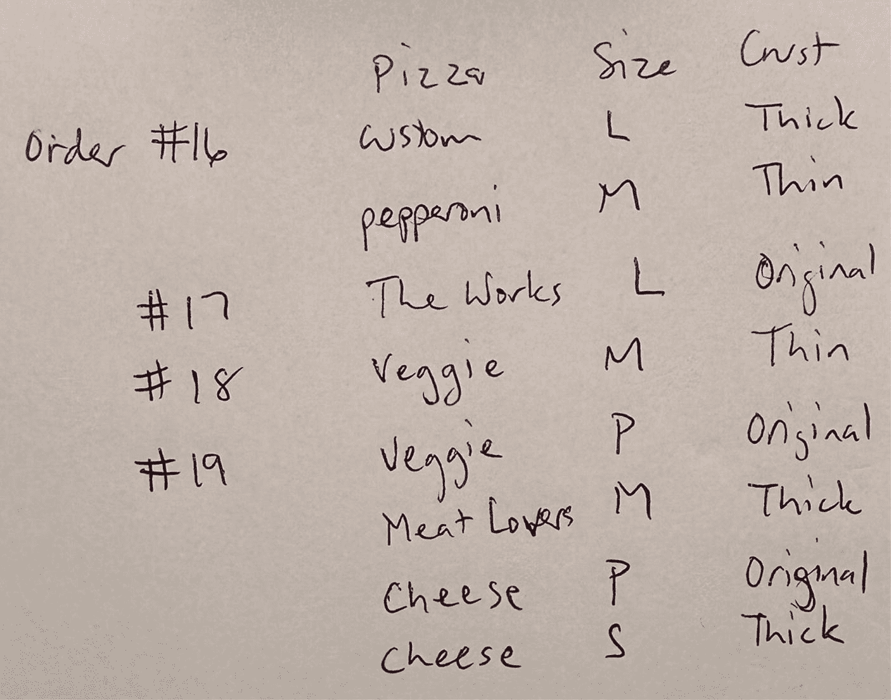
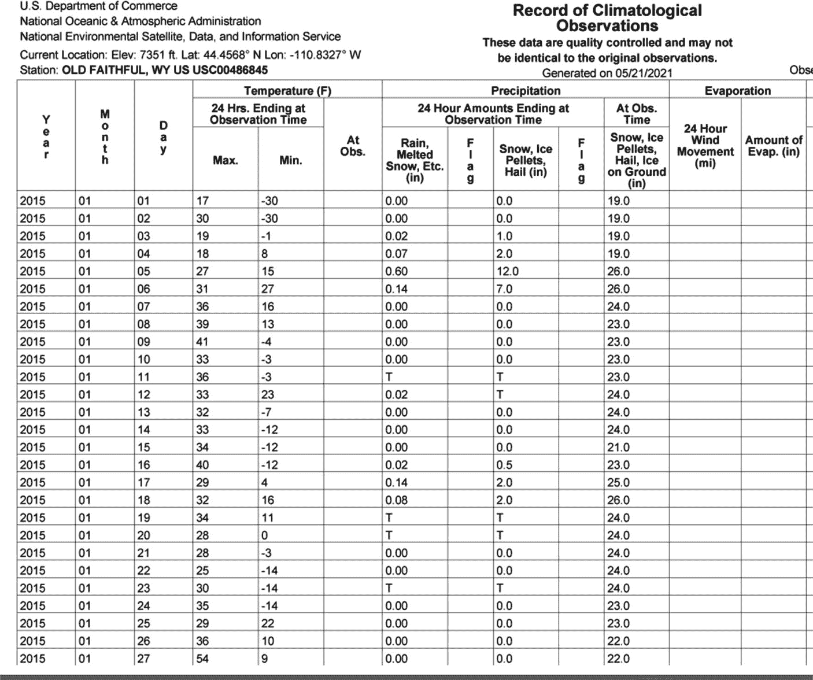

# 1. 与数字打交道：数据究竟是什么？

## 引言

任何听说过数据科学的人也都知道数据是其核心。无论他们是否了解数据科学是什么，每个人都能轻松地谈论“数据”这个词——我们都听说过关于隐私、安全漏洞以及各种团体收集、窃取和出售我们数据的事情。但数据*究竟*是什么？

从根本上说，数据是以简化方式代表现实世界中某些事物的抽象化信息。“代表”这个词是理解数据的关键。数据存在唯一的原因就是它能让事物变得更具体，这可以帮助我们以新的方式理解现实。

想象一个家庭聚会，后院里挤满了人，散布各处，聊着天，有些人在食物桌旁闲逛。你知道男性通常比女性高，而且你听说一代代人越来越高。你想知道这些规律在你的家族中是否成立，你的家族似乎有很多高个子女性，而且你一直觉得你的祖父是个巨人。你可能会试着观察每个人的身高，但大家都走来走去，很难弄清楚什么。

但如果你能把场景转换成数据，情况就不同了。你拿出笔记本和笔，在页面左侧向下列出每个人的姓名和性别栏，为年龄和身高再留出两栏。然后你四处走动收集每个人的数据（别担心，你一直是家里的怪人，所以没人会觉得奇怪）。

完成后，你可以用这些数据做很多事情，比如按年龄段分组并计算平均值，或者比较成年男性和女性的平均身高。你可以进行统计检验，制作精美的图表，确定最矮和最高的人，等等。尽管你原本只对身高感兴趣，但因为收集了年龄，你还可以算出家庭聚会的平均年龄。

这显然是一个相当愚蠢的例子，但它说明了数据的效用。你虽然能看到人们身高不同，但用一个数字来代表每个人的身高，能让你对这些信息做些仅靠观察不可能或不切实际的事情。

### 数据与数据点

“数据”这个词在技术上是“数据点”（一个信息单元）的复数形式。很多人谈论数据时将其视为复数（“这些数据是……”），但我们在这里将“数据”作为单数使用。

毫无疑问——尽管数据科学是一个相当新的领域，但数据本身并不新鲜。我们已经收集数据数千年了，最初是记录在泥板上。农民和商人在一些最早的文字中追踪他们的存货。政府产生了大量早期数据——已知最早的数据是大约公元前 3000 年古埃及人和 1000 年后的苏美尔人收集的人口普查信息。统治者利用这些及其他人口普查的数据来评估公民的税收。克利奥帕特拉时代（约公元前 50 年）的埃及人长期以来一直使用名为“尼罗尺”的结构每天测量和记录尼罗河的高度，以便与前一年进行比较，甚至确定税收和规划收成。参见图 1-1 中位于菲莱岛的伊西斯神庙中的尼罗尺示例。这些工具可能很华丽，也可能像图片中那样简陋，但通常都有向下延伸的楼梯，以便测量水在墙壁上的位置。

两张古代石结构照片。左图显示一个矩形石坑及其周围的废墟，背景是树木和河流。右图聚焦于一段向下延伸到狭窄矩形坑的石阶。两张图片都突出了石头的风化纹理和该地点的考古性质。

**图 1-1**

埃及菲莱岛伊西斯神庙中的尼罗尺

### 政府数据

所有提到的例子都涉及政府，这并非巧合，政府至今仍是大型数据收集者。人口普查通常是规模最大的数据收集工作。自 1790 年以来，美国每隔十年就会对全国进行一次完整的人口普查，获取每个家庭的具体信息。2020 年，有超过 1.4 亿个“住房单元”（基本上就是任何有地址的住所）被联系到。近代的人口普查产生了海量的数据，并且比早期的工作复杂得多，相关流程和技术也一直在演进。2020 年人口普查是首次允许家庭通过在线方式提交信息。如果你对收集的数据类型感到好奇，可以访问[`https://www.census.gov/`](https://www.census.gov/)。

在当今世界，数据更加无处不在。在计算机和互联网时代之前，数据大多以某种方式代表着物理世界的方方面面。但现在，数字世界产生了大量关于无形事物的数据。社交媒体为我们带来了海量的帖子、关注、点赞和标签。实际上，我们所有的在线活动都在某个地方被某人追踪着。公司可以访问我们的电子邮件、网络搜索、任何上传、下载和保存在云端的文件，等等。我们的点击序列也被追踪。对于公司可以追踪到我们的什么信息，实际上没有真正的限制。

## 数据量有多大？

为了有个概念，想想看数据到底有多少。在计算机出现之前，数据大多是文件柜里的纸张，或者是布满灰尘的书籍中手工记录的表格。现在，你所做的几乎每件事都会在某个地方产生某种数据，尤其是当你携带智能手机时。早在 1997 年，一位研究人员估计全球有 12,000 艾字节的数据，但那时的网络尚在萌芽阶段，智能设备也无处可寻（[`https://www.lesk.com/mlesk/ksg97/ksg.html`](https://www.lesk.com/mlesk/ksg97/ksg.html)）。为了让我们更容易理解，12,000 艾字节就是 12,000,000 太字节。到了 2010 年，数字世界已经截然不同，数据量开始以泽字节（即十亿太字节）来衡量。那一年全球大约有 2 泽字节的数据。到 2023 年，这个数字大约是 120 泽字节，预计到 2025 年将达到 181 泽字节（[`https://www.statista.com/statistics/871513/worldwide-data-created/`](https://www.statista.com/statistics/871513/worldwide-data-created/)）。直观来看，181 泽字节就是 181,000,000,000,000,000,000,000 字节。

但让我们回到简单、物理的世界，想想你去看医生的时候。他们通常会记录你的身高和体重。这些数据点勾勒出一个关于你的简单抽象表征。显然，这并非你身体状况的全貌，但这只是一个起点，并且可能足以确定你所需药物的剂量。实际上，医生会收集关于你的更多信息，以便了解你的健康状况。

值得提一下的是，虽然数据是数据科学的基础，但两者并非一回事。数据科学使用数据，几乎任何数据都可以用于数据科学，但并非所有数据都会被用到。例如，医生会收集很多关于病人的信息，但他们中的大多数并不会对数据进行科学分析。然而，保险公司则是另一回事，几十年来，他们一直利用数据科学或单纯的统计技术来分析患者数据，以预测结果并确定收费标准。但现实情况是，公司收集的数据如此之多，以至于大多数公司甚至没有用到它们所拥有数据的一半，而小公司用得就更少了。收集数据相对容易，但使用数据则更难。

本章将探讨数据是什么的所有主要方面，以便我们能够有意义地理解和讨论它。因此，我们将重点关注人们在处理数据时使用的术语和概念。

首先要学习的是`dataset`（数据集），它仅仅是一个数据的随意分组。它可以是一个单一的数据库表、一堆 Excel 表格，或者一个包含大量推文的文件。数据集通常是相对于我们正在进行的任何工作而言的，并且它与任何特定表格没有具体的含义。我们的数据集可能包含数据库中的三个表，而我们的同事 Hector 正在处理那三个表以及另外两个表，这就是他的数据集。

### 数据类型

看待数据的方式有很多种。这意味着我们经常谈论不同的数据“类型”，这里的“类型”根据我们所讨论的特性不同，在不同语境下可能有不同含义。在这里，我们将讨论最简单的数据形式——想象一下你在电子表格或学生档案中看到的那种东西。文本、媒体和其他复杂数据则是不同的类型，将在本章后续部分讨论。

术语`data type`（数据类型）通常指数据的一个特定方面，但可能有多种不同的“类型”。在经典意义上，有四种数据类型：名义型（`nominal`）、有序型（`ordinal`）、区间型（`interval`）和比率型（`ratio`）。其中两种也被归为`categorical`（类别型）或`qualitative`（定性型）数据，另外两种被称为`numeric`（数值型）或`quantitative`（定量型）数据。类别型数据的两种类型是`nominal`和`ordinal`，而数值型数据的两种类型是`interval`和`ratio`。

### 类别型或定性型数据

#### 名义数据

医生追踪的其中一项信息是你的性别。这属于最简单的分类数据——*名义*（有时也称*主格*）数据，这个词的基本意思是“名称”，因为这类数据代表的事物不具备数学属性，甚至无法进行有意义的排序。其他常见的名义数据类型包括宗教、姓名和最喜欢的颜色。这些显然不是数值，也没有自然的顺序。

你可能会惊讶地发现，数字也可能是名义数据，例如美国邮政编码这种五位数字。它们有少许规律：随着美国国土由东向西延伸，编码数字会增大。但它们并非数学意义上的数字——你不能将两个邮政编码相乘得到有意义的结论，计算它们的平均值也毫无意义。此外，规律并不一致——并非每个后续的邮政编码都比前一个更靠西（尤其是在大都市区域，编码会变得混乱，而且由于需要覆盖南北距离，顺序也并不完美）。仅凭数字无法判断其含义。请务必记住，看起来像数字并不意味着可以将其当作数字来对待。

另一种作为名义数据的数字是美国的社会安全号码。它似乎与邮政编码不同，因为它是唯一的——每个号码都是唯一的值，可用于唯一标识个人。但它仍然没有真正的数学属性。始终考虑数据中任何数字的本质特性至关重要。

值得一提的是名义数据的一种特殊情况：*二值*（或*布尔*）类型，因为它在数据科学中使用得非常频繁。过去对性别的分类可能属于此类型，但现在通常有其他选项。二值类型更常见于简单的“是/否”场景。例如，你的医生可能想追踪你是否参加某种运动。答案可能是“是，你参加运动”或“否，你不参加运动”。通常，1 表示“是”，0 表示“否”，但某些系统也可以存储 `True` 和 `False` 值。需要记住的关键点是它恰好有两种可能的值。表 1-1 展示了一个包含布尔列的学生数据示例，该列表示学生是否为未成年人。

**表 1-1** 包含布尔列的简单数据集

| 学生编号 | 年龄 | 是否未成年人？ |
| --- | --- | --- |
| 123 | 17 | `True` |
| 334 | 18 | `False` |
| 412 | 16 | `True` |
| 567 | 19 | `False` |
| 639 | 17 | `True` |

#### 有序数据

有序数据与名义数据有很多共同点，因此它们都被称为定性数据或分类数据。就有序数据而言，你可以将其视为具备一个特殊特征的名义数据：它具有自然顺序，每个值在顺序中位于其他值之前或之后。我们直观地理解，T 恤尺码具有从其数值中可以清晰看出的自然顺序。这些值会是 S、M、L、XL 等。因此存在顺序，但这些值不具备任何数值属性，并且顺序中也不存在零值。除了相对顺序之外，尺码之间不存在数学关系——也就是说，XL 不是 L 甚至 S 的两倍大。鞋码和学校的年级是其他的有序数据示例。同样，它们是数字，但不受任何数学规则约束。

图 1-2 以几张手写的比萨订单记录为例，展示了名义数据和有序数据。其名义数据以比萨名称和饼底类型体现，有序数据则以比萨尺寸体现。我们需要知道 P 代表个人装，我们知道它比小装小，因此顺序是 P、S、M、L。

*列出比萨订单的手写表格。列包括：编号（数字 16 至 19）、比萨（类型有定制、意式辣肠、全料、素食、肉食爱好者和芝士）、尺寸（选项 L、M、P、S）和饼底（选项厚底、薄底、原味）。*

**图 1-2** 包含分类数据的比萨订单示例

### 数值型或定量数据

#### 比率数据

第一种数值数据类型是比率数据，其中数据为数字，不同值之间存在数学关系，并且有一个自然的零点。回到医生测量的身高和体重，这两个都属于比率数据。你可以看到数学关系：一个 78 英寸高的人是一个 39 英寸高的人的两倍高。虽然现实中的人身高或体重永远不会为零，但我们可以理解零身高的含义，因此可以说存在一个自然零点。其他常见的比率数据包括年龄、考试的数字分数以及完成的课程学分数。

#### 间隔数据

`间隔数据` 是第二种数值数据类型，它与`比率数据`有很多共同点，但也存在一些局限。`间隔数据`没有自然的零点，因此能对其进行的数学运算非常有限。例如，温度看似属于比率数据，因为我们有数值，并且温度可以为零。但若思考华氏和摄氏温标的 0 度代表什么，会发现这两个值含义截然不同——0 度温度并不代表没有热量，因此不能将其视为真正的零点。正因如此，我们不能说 60 度是 30 度的两倍热，对温度求和也毫无意义。

值得注意的是，与华氏和摄氏不同，开氏温标上的温度可作为`比率数据`使用，因为 0 开尔文确实意味着没有热量，且不同数值之间的关系确实遵循数学规则。

`智商数据`是`间隔数据`的另一个例子，尽管乍看之下可能像`比率数据`。存在多种智商量表，但每种都定义了数值之间固定的间距。这些间距并非随意设定，这与 T 恤尺码不同——后者没有额外信息就无法量化。然而，智商数据没有有意义的零点，这意味着数学运算无法成立。

`间隔数据`最后一个常见例子是`时间戳`，即特定的日期和时间。这类数据在数据集中非常常见，通常用于指示某行数据首次添加到表格的时间。你可以测量时间戳之间的间隔，但我们不会追溯到大爆炸来获取零时间点。

图 1-3 展示了来自美国国家海洋和大气管理局的部分数值气象数据，其中温度以华氏度为单位，降水量（液态和固态）以英寸为单位。如前所述，华氏温度属于间隔数据，但降水量测量值属于比率数据。

表格标题为“气候观测记录”，来自美国商务部、国家海洋和大气管理局。其中详列了 2015 年 1 月怀俄明州老忠实泉的每日天气数据。列包括日期、温度（华氏度最高/最低）、降水量（雨、雪等）及蒸发数据。观测值包括降雨、降雪和风移的具体数值。表格说明数据已进行质量控制，可能与原始观测数据存在差异。

**图 1-3** 来自美国国家海洋和大气管理局的数值气象数据示例。来源：每日温度和降水报告——数据表格，[`https://www.climate.gov/maps-data/dataset/daily-temperature-and-precipitation-reports-data-tables`](https://www.climate.gov/maps-data/dataset/daily-temperature-and-precipitation-reports-data-tables)

## 四种数据类型

四种数据类型都很重要。理解它们之间有时微妙的差异，将有助于你在数据科学中获得更好的结果。以下是按复杂度递增顺序列出的四种类型。

**分类数据（定性数据）：**

* **名义数据：**
  * **定义：** 名称、标签或类别
  * **特征：** 代表某种事物的名称，不同取值之间没有数值关系
  * **在数据科学中的使用方式：**
    * 在大多数数据科学方法中最难使用，通常需要进行转换。
    * 我们常对不同取值的出现次数进行计数。
    * 单个名义变量可转换为多个变量，每个可能取值对应一个布尔变量，通常称为*虚拟变量*。
  * **示例：** 发色、宗教信仰、籍贯、社会安全号码

* **有序数据：**
  * **定义：** 与名义类型相似，但取值之间存在自然顺序
  * **特征：** 具有自然且有意义的顺序的数据
  * **在数据科学中的使用方式：**
    * 此类数据比名义数据稍有用，但仍然非常有限。
    * 常见做法是对不同取值的出现次数进行计数。
    * 我们还可以对数据进行排序。
  * **示例：** 字母等级、比赛中的奖牌级别、高中生或大学生的年级、T 恤尺码

**数值数据（定量数据）：**

* **间隔数据：**
  * **定义：** 与有序数据类似，但拥有在数学上更有用的额外信息
  * **特征：**
    * 具有自然且有意义的顺序。
    * 可度量取值之间的间距。
    * 取值范围内没有自然零点。
  * **在数据科学中的使用方式：**
    * 比分类数据更容易使用。
    * 可进行多种算术运算，因此能量化两个不同数据点之间的交互关系。
    * 可计算平均值等度量指标。
    * 可计算多种统计指标。
  * **示例：** SAT 分数、智商分数、鞋码、华氏或摄氏温度

* **比率数据：**
  * **定义：** 与间隔类型相似，但存在自然零点作为可能的取值
  * **特征：**
    * 具有自然且有意义的顺序。
    * 可度量取值之间的间距。
    * 存在自然零点。
  * **在数据科学中的使用方式：**
    * 被认为是数据科学中最有用的类型。
    * 可进行所有算术运算。
    * 可计算平均值等度量指标。
    * 可计算所有统计指标。
  * **示例：** 身高、体重、两点间距离、拥有的教科书数量、开氏温度

### 数据变换

不同的数据类型可以有不同的使用方式，而将数据从一种类型转换为另一种类型以便于处理，是一种常见的做法。当我们从限制最严格的类型向限制较松的类型递进时，通常会丢失一些信息——我们可以从比率型转换为其他任何类型，从间隔型转换为名义型或顺序型，以及从顺序型转换为名义型，但不能反向转换。不过，丢失信息未必是个问题——在我参与的一个项目中，我们发现将温度分类（或称*分箱*）为五个不同的温度范围组别（冰点、寒冷、温和、炎热、极热）使其变成了顺序型数据，但这比将温度作为比率型数据使用更能提升我们的预测效果。我们也可以将其划分为十度一个区间（0–9.99 度、10–19.99 度、20–29.99 度，等等），从而使其变成间隔型数据。你能对数据做什么，既取决于你拥有什么数据，也取决于数据可以如何变换。此外，在决定变换方式时，你还可以运用额外知识，比如，西雅图和迈阿密的分箱范围可能就不会相同。在佛罗里达被视为寒冷的气温，在西雅图或许会被认为是相当舒适的。

#### 数据分箱

我们使用*分箱*这一术语来描述将一个大范围的值拆分成少量数值的过程。这样做既方便，也能更准确地反映现实情况。以温度为例，我们真的在意气温是 55 华氏度还是 56 华氏度吗？这一度的差别会让人们的行为有所不同吗？通常不会，但这类温度与 30 华氏度之间的差别则会导致不同的行为。因此，“冰点”这个箱子可能包含 32 华氏度及以下的任何温度，“寒冷”箱子可能包含 33 至 45 华氏度之间，以此类推。显然，这意味着 32 华氏度和 33 华氏度之间存在巨大差异，但 40 华氏度和 41 华氏度之间则差别不大。总是存在权衡取舍，这就是为什么数据科学在就这类变换做出决策之前要先进行测试。

我将在第 14 章中更详细地讨论另一种常见的变换技术，即创建所谓的哑变量，我们将一个分类列拆分成多个独立的“哑”列，这些列都是布尔型。每一列对应原分类列的一个可能取值，每一行中，与该行实际值匹配的列记为 1，其他所有新列均记为 0。沿用温度分箱的例子，我们从一系列周日的气温数据开始，如表 1-2 所示。将温度分箱拆分成独立列后，结果如表 1-3 所示。

**表 1-3**

分箱温度变换后的数据

| 日期 | 正午温度分箱 | 是否冰点 | 是否寒冷 | 是否温和 | 是否炎热 | 是否极热 |
| --- | --- | --- | --- | --- | --- | --- |
| 2024-03-03 | 冰点 | 1 | 0 | 0 | 0 | 0 |
| 2024-03-10 | 寒冷 | 0 | 1 | 0 | 0 | 0 |
| 2024-03-17 | 寒冷 | 0 | 1 | 0 | 0 | 0 |
| 2024-03-24 | 温和 | 0 | 0 | 1 | 0 | 0 |
| 2024-03-31 | 寒冷 | 0 | 1 | 0 | 0 | 0 |
| 2024-04-07 | 寒冷 | 0 | 1 | 0 | 0 | 0 |
| 2024-04-14 | 温和 | 0 | 0 | 1 | 0 | 0 |
| 2024-04-21 | 温和 | 0 | 0 | 1 | 0 | 0 |
| 2024-04-28 | 炎热 | 0 | 0 | 0 | 1 | 0 |
| 2024-05-05 | 极热 | 0 | 0 | 0 | 0 | 1 |

**表 1-2**

分箱温度数据

| 日期 | 正午温度分箱 |
| --- | --- |
| 2024-03-03 | 冰点 |
| 2024-03-10 | 寒冷 |
| 2024-03-17 | 寒冷 |
| 2024-03-24 | 温和 |
| 2024-03-31 | 寒冷 |
| 2024-04-07 | 寒冷 |
| 2024-04-14 | 温和 |
| 2024-04-21 | 温和 |
| 2024-04-28 | 炎热 |
| 2024-05-05 | 极热 |

这种技术在许多数据科学场景中都非常有用，尤其是因为许多机器学习模型根本无法处理分类值，而这种方法为我们提供了一种在模型中使用分类数据的方式。判断何时采用这种变换，需要实践和经验。

### 关于四种数据类型的最终思考

判断某份具体数据属于哪种类型并非总是易事。人们很容易想把邮政编码当作顺序型数据来处理，因为它是一个数字，而且我们知道它存在递进规律——但这样做行不通。

最重要的事情是考虑某份数据实际包含了什么信息以及它代表了什么——例如，一个人的身高和体重并不能告诉你他的健康水平。一个体重 300 磅的人可能肥胖、身材极其高大、是肌肉发达的运动员、是健美者，或者兼而有之。请记住，数据始终是一种抽象，现实世界中的事物有许多种抽象方式。例如，如果你想让你的 T 恤数据是比率型的，那么使用常规尺码是无法做到的。但如果你改为通过测量多个尺寸（如衣长、胸宽、袖长等）来抽象 T 恤，那么这些测量值各自就属于比率型数据类型。然而，这样精细的信息在一般的 T 恤尺码中（不同品牌中同一尺码的含义各不相同）是根本不存在的。请记住，仅仅因为你理论上可以用不同的方式来表示某样东西，并不会改变它当前的表示方式，也不意味着它可以被安全地转换为另一种数据类型。

#### 判断数据类型

当你面对一些数据时，可以通过观察其特征以及你计划用它做什么来判断其数据类型。如果你按照数据需要满足的规则数量来考虑其层级结构，则会呈现如下（从最复杂的顶层开始）：

- 比率型
- 间隔型
- 顺序型
- 名义型

首先问自己它是否符合比率型数据的条件，如果不符合，再问自己是否符合间隔型，以此类推。通常，如果数据不是数字，你可以跳过比率型和间隔型，但当你确实拥有数字作为数据时，请务必检查这个层级结构以确保它确实是数值型的。这种看待数据的方式会随着经验的积累而变得更加容易。

