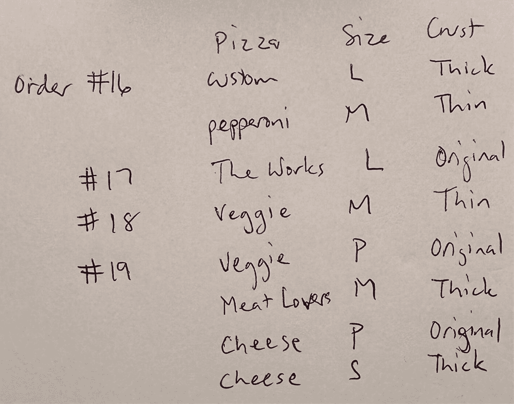
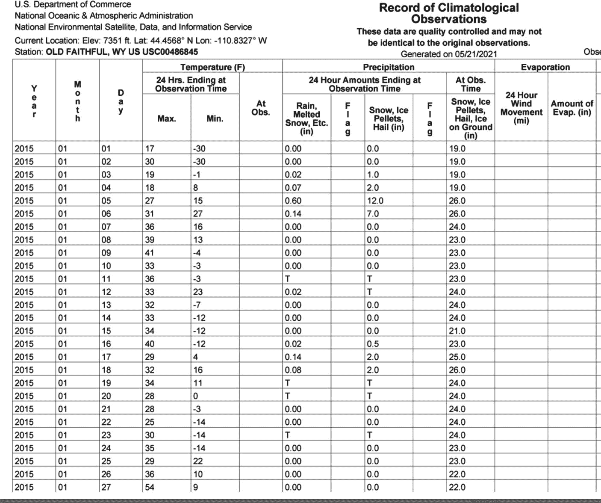
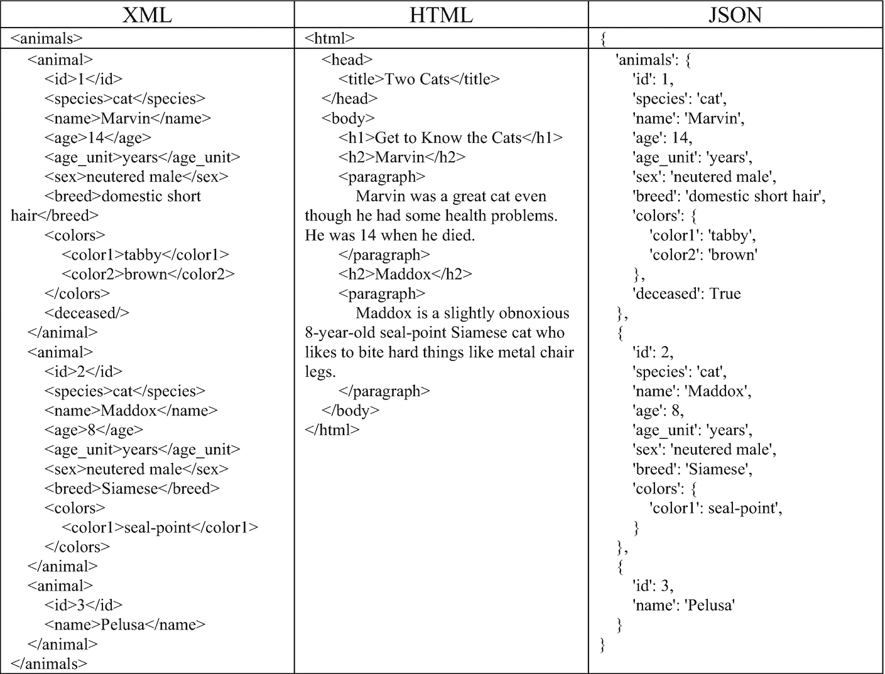

# 1. 与数字打交道：数据究竟是什么？

## 引言

任何听说过数据科学的人也都知道数据是其核心。无论他们是否了解数据科学是什么，每个人都能轻松地谈论“数据”这个词——我们都听说过关于隐私、安全漏洞以及各种团体收集、窃取和出售我们数据的事情。但数据*究竟*是什么？

从根本上说，数据是以简化方式代表现实世界中某些事物的抽象化信息。“代表”这个词是理解数据的关键。数据存在唯一的原因就是它能让事物变得更具体，这可以帮助我们以新的方式理解现实。

想象一个家庭聚会，后院里挤满了人，散布各处，聊着天，有些人在食物桌旁闲逛。你知道男性通常比女性高，而且你听说一代代人越来越高。你想知道这些规律在你的家族中是否成立，你的家族似乎有很多高个子女性，而且你一直觉得你的祖父是个巨人。你可能会试着观察每个人的身高，但大家都走来走去，很难弄清楚什么。

但如果你能把场景转换成数据，情况就不同了。你拿出笔记本和笔，在页面左侧向下列出每个人的姓名和性别栏，为年龄和身高再留出两栏。然后你四处走动收集每个人的数据（别担心，你一直是家里的怪人，所以没人会觉得奇怪）。

完成后，你可以用这些数据做很多事情，比如按年龄段分组并计算平均值，或者比较成年男性和女性的平均身高。你可以进行统计检验，制作精美的图表，确定最矮和最高的人，等等。尽管你原本只对身高感兴趣，但因为收集了年龄，你还可以算出家庭聚会的平均年龄。

这显然是一个相当愚蠢的例子，但它说明了数据的效用。你虽然能看到人们身高不同，但用一个数字来代表每个人的身高，能让你对这些信息做些仅靠观察不可能或不切实际的事情。

### 数据与数据点

“数据”这个词在技术上是“数据点”（一个信息单元）的复数形式。很多人谈论数据时将其视为复数（“这些数据是……”），但我们在这里将“数据”作为单数使用。

毫无疑问——尽管数据科学是一个相当新的领域，但数据本身并不新鲜。我们已经收集数据数千年了，最初是记录在泥板上。农民和商人在一些最早的文字中追踪他们的存货。政府产生了大量早期数据——已知最早的数据是大约公元前 3000 年古埃及人和 1000 年后的苏美尔人收集的人口普查信息。统治者利用这些及其他人口普查的数据来评估公民的税收。克利奥帕特拉时代（约公元前 50 年）的埃及人长期以来一直使用名为“尼罗尺”的结构每天测量和记录尼罗河的高度，以便与前一年进行比较，甚至确定税收和规划收成。参见图 1-1 中位于菲莱岛的伊西斯神庙中的尼罗尺示例。这些工具可能很华丽，也可能像图片中那样简陋，但通常都有向下延伸的楼梯，以便测量水在墙壁上的位置。

两张古代石结构照片。左图显示一个矩形石坑及其周围的废墟，背景是树木和河流。右图聚焦于一段向下延伸到狭窄矩形坑的石阶。两张图片都突出了石头的风化纹理和该地点的考古性质。

**图 1-1**

埃及菲莱岛伊西斯神庙中的尼罗尺

### 政府数据

所有提到的例子都涉及政府，这并非巧合，政府至今仍是大型数据收集者。人口普查通常是规模最大的数据收集工作。自 1790 年以来，美国每隔十年就会对全国进行一次完整的人口普查，获取每个家庭的具体信息。2020 年，有超过 1.4 亿个“住房单元”（基本上就是任何有地址的住所）被联系到。近代的人口普查产生了海量的数据，并且比早期的工作复杂得多，相关流程和技术也一直在演进。2020 年人口普查是首次允许家庭通过在线方式提交信息。如果你对收集的数据类型感到好奇，可以访问[`https://www.census.gov/`](https://www.census.gov/)。

在当今世界，数据更加无处不在。在计算机和互联网时代之前，数据大多以某种方式代表着物理世界的方方面面。但现在，数字世界产生了大量关于无形事物的数据。社交媒体为我们带来了海量的帖子、关注、点赞和标签。实际上，我们所有的在线活动都在某个地方被某人追踪着。公司可以访问我们的电子邮件、网络搜索、任何上传、下载和保存在云端的文件，等等。我们的点击序列也被追踪。对于公司可以追踪到我们的什么信息，实际上没有真正的限制。

## 数据量有多大？

为了有个概念，想想看数据到底有多少。在计算机出现之前，数据大多是文件柜里的纸张，或者是布满灰尘的书籍中手工记录的表格。现在，你所做的几乎每件事都会在某个地方产生某种数据，尤其是当你携带智能手机时。早在 1997 年，一位研究人员估计全球有 12,000 艾字节的数据，但那时的网络尚在萌芽阶段，智能设备也无处可寻（[`https://www.lesk.com/mlesk/ksg97/ksg.html`](https://www.lesk.com/mlesk/ksg97/ksg.html)）。为了让我们更容易理解，12,000 艾字节就是 12,000,000 太字节。到了 2010 年，数字世界已经截然不同，数据量开始以泽字节（即十亿太字节）来衡量。那一年全球大约有 2 泽字节的数据。到 2023 年，这个数字大约是 120 泽字节，预计到 2025 年将达到 181 泽字节（[`https://www.statista.com/statistics/871513/worldwide-data-created/`](https://www.statista.com/statistics/871513/worldwide-data-created/)）。直观来看，181 泽字节就是 181,000,000,000,000,000,000,000 字节。

但让我们回到简单、物理的世界，想想你去看医生的时候。他们通常会记录你的身高和体重。这些数据点勾勒出一个关于你的简单抽象表征。显然，这并非你身体状况的全貌，但这只是一个起点，并且可能足以确定你所需药物的剂量。实际上，医生会收集关于你的更多信息，以便了解你的健康状况。

值得提一下的是，虽然数据是数据科学的基础，但两者并非一回事。数据科学使用数据，几乎任何数据都可以用于数据科学，但并非所有数据都会被用到。例如，医生会收集很多关于病人的信息，但他们中的大多数并不会对数据进行科学分析。然而，保险公司则是另一回事，几十年来，他们一直利用数据科学或单纯的统计技术来分析患者数据，以预测结果并确定收费标准。但现实情况是，公司收集的数据如此之多，以至于大多数公司甚至没有用到它们所拥有数据的一半，而小公司用得就更少了。收集数据相对容易，但使用数据则更难。

本章将探讨数据是什么的所有主要方面，以便我们能够有意义地理解和讨论它。因此，我们将重点关注人们在处理数据时使用的术语和概念。

首先要学习的是`dataset`（数据集），它仅仅是一个数据的随意分组。它可以是一个单一的数据库表、一堆 Excel 表格，或者一个包含大量推文的文件。数据集通常是相对于我们正在进行的任何工作而言的，并且它与任何特定表格没有具体的含义。我们的数据集可能包含数据库中的三个表，而我们的同事 Hector 正在处理那三个表以及另外两个表，这就是他的数据集。

### 数据类型

看待数据的方式有很多种。这意味着我们经常谈论不同的数据“类型”，这里的“类型”根据我们所讨论的特性不同，在不同语境下可能有不同含义。在这里，我们将讨论最简单的数据形式——想象一下你在电子表格或学生档案中看到的那种东西。文本、媒体和其他复杂数据则是不同的类型，将在本章后续部分讨论。

术语`data type`（数据类型）通常指数据的一个特定方面，但可能有多种不同的“类型”。在经典意义上，有四种数据类型：名义型（`nominal`）、有序型（`ordinal`）、区间型（`interval`）和比率型（`ratio`）。其中两种也被归为`categorical`（类别型）或`qualitative`（定性型）数据，另外两种被称为`numeric`（数值型）或`quantitative`（定量型）数据。类别型数据的两种类型是`nominal`和`ordinal`，而数值型数据的两种类型是`interval`和`ratio`。

### 类别型或定性型数据

#### 名义数据

医生追踪的其中一项信息是你的性别。这属于最简单的分类数据——名义（有时也称*主格*）数据，这个词的基本意思是“名称”，因为这类数据代表的事物不具备数学属性，甚至无法进行有意义的排序。其他常见的名义数据类型包括宗教、姓名和最喜欢的颜色。这些显然不是数值，也没有自然的顺序。

你可能会惊讶地发现，数字也可能是名义数据，例如美国邮政编码这种五位数字。它们有少许规律：随着美国国土由东向西延伸，编码数字会增大。但它们并非数学意义上的数字——你不能将两个邮政编码相乘得到有意义的结论，计算它们的平均值也毫无意义。此外，规律并不一致——并非每个后续的邮政编码都比前一个更靠西（尤其是在大都市区域，编码会变得混乱，而且由于需要覆盖南北距离，顺序也并不完美）。仅凭数字无法判断其含义。请务必记住，看起来像数字并不意味着可以将其当作数字来对待。

另一种作为名义数据的数字是美国的社会安全号码。它似乎与邮政编码不同，因为它是唯一的——每个号码都是唯一的值，可用于唯一标识个人。但它仍然没有真正的数学属性。始终考虑数据中任何数字的本质特性至关重要。

值得一提的是名义数据的一种特殊情况：二值（或布尔）类型，因为它在数据科学中使用得非常频繁。过去对性别的分类可能属于此类型，但现在通常有其他选项。二值类型更常见于简单的“是/否”场景。例如，你的医生可能想追踪你是否参加某种运动。答案可能是“是，你参加运动”或“否，你不参加运动”。通常，1 表示“是”，0 表示“否”，但某些系统也可以存储 `True` 和 `False` 值。需要记住的关键点是它恰好有两种可能的值。表 1-1 展示了一个包含布尔列的学生数据示例，该列表示学生是否为未成年人。

**表 1-1** 包含布尔列的简单数据集

| 学生编号 | 年龄 | 是否未成年人？ |
| --- | --- | --- |
| 123 | 17 | `True` |
| 334 | 18 | `False` |
| 412 | 16 | `True` |
| 567 | 19 | `False` |
| 639 | 17 | `True` |

#### 有序数据

有序数据与名义数据有很多共同点，因此它们都被称为定性数据或分类数据。就有序数据而言，你可以将其视为具备一个特殊特征的名义数据：它具有自然顺序，每个值在顺序中位于其他值之前或之后。我们直观地理解，T 恤尺码具有从其数值中可以清晰看出的自然顺序。这些值会是 S、M、L、XL 等。因此存在顺序，但这些值不具备任何数值属性，并且顺序中也不存在零值。除了相对顺序之外，尺码之间不存在数学关系——也就是说，XL 不是 L 甚至 S 的两倍大。鞋码和学校的年级是其他的有序数据示例。同样，它们是数字，但不受任何数学规则约束。

图 1-2 以几张手写的比萨订单记录为例，展示了名义数据和有序数据。其名义数据以比萨名称和饼底类型体现，有序数据则以比萨尺寸体现。我们需要知道 P 代表个人装，我们知道它比小装小，因此顺序是 P、S、M、L。

*列出比萨订单的手写表格。列包括：编号（数字 16 至 19）、比萨（类型有定制、意式辣肠、全料、素食、肉食爱好者和芝士）、尺寸（选项 L、M、P、S）和饼底（选项厚底、薄底、原味）。*

**图 1-2** 包含分类数据的比萨订单示例

### 数值型或定量数据

#### 比率数据

第一种数值数据类型是比率数据，其中数据为数字，不同值之间存在数学关系，并且有一个自然的零点。回到医生测量的身高和体重，这两个都属于比率数据。你可以看到数学关系：一个 78 英寸高的人是一个 39 英寸高的人的两倍高。虽然现实中的人身高或体重永远不会为零，但我们可以理解零身高的含义，因此可以说存在一个自然零点。其他常见的比率数据包括年龄、考试的数字分数以及完成的课程学分数。

#### 间隔数据

间隔数据是第二种数值数据类型，它与比率数据有很多共同点，但也存在一些局限。间隔数据没有自然的零点，因此能对其进行的数学运算非常有限。例如，温度看似属于比率数据，因为我们有数值，并且温度可以为零。但若思考华氏和摄氏温标的 0 度代表什么，会发现这两个值含义截然不同——0 度温度并不代表没有热量，因此不能将其视为真正的零点。正因如此，我们不能说 60 度是 30 度的两倍热，对温度求和也毫无意义。

值得注意的是，与华氏和摄氏不同，开氏温标上的温度可作为比率数据使用，因为 0 开尔文确实意味着没有热量，且不同数值之间的关系确实遵循数学规则。

智商数据是间隔数据的另一个例子，尽管乍看之下可能像比率数据。存在多种智商量表，但每种都定义了数值之间固定的间距。这些间距并非随意设定，这与 T 恤尺码不同——后者没有额外信息就无法量化。然而，智商数据没有有意义的零点，这意味着数学运算无法成立。

间隔数据最后一个常见例子是时间戳，即特定的日期和时间。这类数据在数据集中非常常见，通常用于指示某行数据首次添加到表格的时间。你可以测量时间戳之间的间隔，但我们不会追溯到大爆炸来获取零时间点。

图 1-3 展示了来自美国国家海洋和大气管理局的部分数值气象数据，其中温度以华氏度为单位，降水量（液态和固态）以英寸为单位。如前所述，华氏温度属于间隔数据，但降水量测量值属于比率数据。

表格标题为“气候观测记录”，来自美国商务部、国家海洋和大气管理局。其中详列了 2015 年 1 月怀俄明州老忠实泉的每日天气数据。列包括日期、温度（华氏度最高/最低）、降水量（雨、雪等）及蒸发数据。观测值包括降雨、降雪和风移的具体数值。表格说明数据已进行质量控制，可能与原始观测数据存在差异。

**图 1-3** 来自美国国家海洋和大气管理局的数值气象数据示例。来源：每日温度和降水报告——数据表格，[`https://www.climate.gov/maps-data/dataset/daily-temperature-and-precipitation-reports-data-tables`](https://www.climate.gov/maps-data/dataset/daily-temperature-and-precipitation-reports-data-tables)

## 四种数据类型

四种数据类型都很重要。理解它们之间有时微妙的差异，将有助于你在数据科学中获得更好的结果。以下是按复杂度递增顺序列出的四种类型。

**分类数据（定性数据）：**

* **名义数据：**
  * **定义：** 名称、标签或类别
  * **特征：** 代表某种事物的名称，不同取值之间没有数值关系
  * **在数据科学中的使用方式：**
    * 在大多数数据科学方法中最难使用，通常需要进行转换。
    * 我们常对不同取值的出现次数进行计数。
    * 单个名义变量可转换为多个变量，每个可能取值对应一个布尔变量，通常称为虚拟变量。
  * **示例：** 发色、宗教信仰、籍贯、社会安全号码

* **有序数据：**
  * **定义：** 与名义类型相似，但取值之间存在自然顺序
  * **特征：** 具有自然且有意义的顺序的数据
  * **在数据科学中的使用方式：**
    * 此类数据比名义数据稍有用，但仍然非常有限。
    * 常见做法是对不同取值的出现次数进行计数。
    * 我们还可以对数据进行排序。
  * **示例：** 字母等级、比赛中的奖牌级别、高中生或大学生的年级、T 恤尺码

**数值数据（定量数据）：**

* **间隔数据：**
  * **定义：** 与有序数据类似，但拥有在数学上更有用的额外信息
  * **特征：**
    * 具有自然且有意义的顺序。
    * 可度量取值之间的间距。
    * 取值范围内没有自然零点。
  * **在数据科学中的使用方式：**
    * 比分类数据更容易使用。
    * 可进行多种算术运算，因此能量化两个不同数据点之间的交互关系。
    * 可计算平均值等度量指标。
    * 可计算多种统计指标。
  * **示例：** SAT 分数、智商分数、鞋码、华氏或摄氏温度

* **比率数据：**
  * **定义：** 与间隔类型相似，但存在自然零点作为可能的取值
  * **特征：**
    * 具有自然且有意义的顺序。
    * 可度量取值之间的间距。
    * 存在自然零点。
  * **在数据科学中的使用方式：**
    * 被认为是数据科学中最有用的类型。
    * 可进行所有算术运算。
    * 可计算平均值等度量指标。
    * 可计算所有统计指标。
  * **示例：** 身高、体重、两点间距离、拥有的教科书数量、开氏温度

### 数据变换

不同的数据类型可以有不同的使用方式，而将数据从一种类型转换为另一种类型以便于处理，是一种常见的做法。当我们从限制最严格的类型向限制较松的类型递进时，通常会丢失一些信息——我们可以从比率型转换为其他任何类型，从间隔型转换为名义型或顺序型，以及从顺序型转换为名义型，但不能反向转换。不过，丢失信息未必是个问题——在我参与的一个项目中，我们发现将温度分类（或称*分箱*）为五个不同的温度范围组别（冰点、寒冷、温和、炎热、极热）使其变成了顺序型数据，但这比将温度作为比率型数据使用更能提升我们的预测效果。我们也可以将其划分为十度一个区间（0–9.99 度、10–19.99 度、20–29.99 度，等等），从而使其变成间隔型数据。你能对数据做什么，既取决于你拥有什么数据，也取决于数据可以如何变换。此外，在决定变换方式时，你还可以运用额外知识，比如，西雅图和迈阿密的分箱范围可能就不会相同。在佛罗里达被视为寒冷的气温，在西雅图或许会被认为是相当舒适的。

#### 数据分箱

我们使用*分箱*这一术语来描述将一个大范围的值拆分成少量数值的过程。这样做既方便，也能更准确地反映现实情况。以温度为例，我们真的在意气温是 55 华氏度还是 56 华氏度吗？这一度的差别会让人们的行为有所不同吗？通常不会，但这类温度与 30 华氏度之间的差别则会导致不同的行为。因此，“冰点”这个箱子可能包含 32 华氏度及以下的任何温度，“寒冷”箱子可能包含 33 至 45 华氏度之间，以此类推。显然，这意味着 32 华氏度和 33 华氏度之间存在巨大差异，但 40 华氏度和 41 华氏度之间则差别不大。总是存在权衡取舍，这就是为什么数据科学在就这类变换做出决策之前要先进行测试。

我将在第 14 章中更详细地讨论另一种常见的变换技术，即创建所谓的哑变量，我们将一个分类列拆分成多个独立的“哑”列，这些列都是布尔型。每一列对应原分类列的一个可能取值，每一行中，与该行实际值匹配的列记为 1，其他所有新列均记为 0。沿用温度分箱的例子，我们从一系列周日的气温数据开始，如表 1-2 所示。将温度分箱拆分成独立列后，结果如表 1-3 所示。

**表 1-3**

分箱温度变换后的数据

| 日期 | 正午温度分箱 | 是否冰点 | 是否寒冷 | 是否温和 | 是否炎热 | 是否极热 |
| --- | --- | --- | --- | --- | --- | --- |
| 2024-03-03 | 冰点 | 1 | 0 | 0 | 0 | 0 |
| 2024-03-10 | 寒冷 | 0 | 1 | 0 | 0 | 0 |
| 2024-03-17 | 寒冷 | 0 | 1 | 0 | 0 | 0 |
| 2024-03-24 | 温和 | 0 | 0 | 1 | 0 | 0 |
| 2024-03-31 | 寒冷 | 0 | 1 | 0 | 0 | 0 |
| 2024-04-07 | 寒冷 | 0 | 1 | 0 | 0 | 0 |
| 2024-04-14 | 温和 | 0 | 0 | 1 | 0 | 0 |
| 2024-04-21 | 温和 | 0 | 0 | 1 | 0 | 0 |
| 2024-04-28 | 炎热 | 0 | 0 | 0 | 1 | 0 |
| 2024-05-05 | 极热 | 0 | 0 | 0 | 0 | 1 |

**表 1-2**

分箱温度数据

| 日期 | 正午温度分箱 |
| --- | --- |
| 2024-03-03 | 冰点 |
| 2024-03-10 | 寒冷 |
| 2024-03-17 | 寒冷 |
| 2024-03-24 | 温和 |
| 2024-03-31 | 寒冷 |
| 2024-04-07 | 寒冷 |
| 2024-04-14 | 温和 |
| 2024-04-21 | 温和 |
| 2024-04-28 | 炎热 |
| 2024-05-05 | 极热 |

这种技术在许多数据科学场景中都非常有用，尤其是因为许多机器学习模型根本无法处理分类值，而这种方法为我们提供了一种在模型中使用分类数据的方式。判断何时采用这种变换，需要实践和经验。

### 关于四种数据类型的最终思考

判断某份具体数据属于哪种类型并非总是易事。人们很容易想把邮政编码当作顺序型数据来处理，因为它是一个数字，而且我们知道它存在递进规律——但这样做行不通。

最重要的事情是考虑某份数据实际包含了什么信息以及它代表了什么——例如，一个人的身高和体重并不能告诉你他的健康水平。一个体重 300 磅的人可能肥胖、身材极其高大、是肌肉发达的运动员、是健美者，或者兼而有之。请记住，数据始终是一种抽象，现实世界中的事物有许多种抽象方式。例如，如果你想让你的 T 恤数据是比率型的，那么使用常规尺码是无法做到的。但如果你改为通过测量多个尺寸（如衣长、胸宽、袖长等）来抽象 T 恤，那么这些测量值各自就属于比率型数据类型。然而，这样精细的信息在一般的 T 恤尺码中（不同品牌中同一尺码的含义各不相同）是根本不存在的。请记住，仅仅因为你理论上可以用不同的方式来表示某样东西，并不会改变它当前的表示方式，也不意味着它可以被安全地转换为另一种数据类型。

#### 判断数据类型

当你面对一些数据时，可以通过观察其特征以及你计划用它做什么来判断其数据类型。如果你按照数据需要满足的规则数量来考虑其层级结构，则会呈现如下（从最复杂的顶层开始）：

- 比率型
- 间隔型
- 顺序型
- 名义型

首先问自己它是否符合比率型数据的条件，如果不符合，再问自己是否符合间隔型，以此类推。通常，如果数据不是数字，你可以跳过比率型和间隔型，但当你确实拥有数字作为数据时，请务必检查这个层级结构以确保它确实是数值型的。这种看待数据的方式会随着经验的积累而变得更加容易。

# 结构化数据 vs. 非结构化数据 vs. 半结构化数据

提到数据，大多数人会想到表格。很多数据可以轻松地以表格形式呈现，这也是大多数据科学家处理的数据形式，但这不是看待数据的唯一方式。`结构化数据`天然适用于表格结构，其中所有记录或行都拥有相同的属性或列。对于这类数据，部分属性可能为空，但所有数据点都具备相同的基本结构，因此得名。

与之相反，非结构化数据本质上是杂乱无章，更难于存储和处理。`非结构化数据`有多种形式，但它的核心含义是无法轻松组织成适用于所有数据点的清晰结构。文本、视频、音频和图像都是非结构化数据的常见类型。虽然可以对其中某些类型的数据强行施加表格结构，但这通常需要大量的处理工作。关键在于，这些数据缺乏一个所有项目都共有的直接、明显的组织原则——也就是没有天然结构，这就是我们之所以将这两种类型称为结构化和非结构化的原因。

请注意，数据的这种非结构化特性是指原始数据本身，例如实际的文本或图像，而非关于原始数据的`元数据`。例如，你可以用表格追踪关于视频的元数据，包含视频时长、文件格式、流派、语言、评分等列，但这并不代表视频数据本身。人工智能的几个子领域，尤其是自然语言处理，一直在尝试以多种方式为文本赋予结构。后续将会有一章专门讲解自然语言处理。其他学科则处理其他类型的非结构化数据。

还有另一种数据类型称为`半结构化数据`，它包含结构元素，但其组织方式尚未达到真正结构化数据的标准。在科技界很常见（但在现实世界中较少见）的例子是 XML 和 JSON 格式的文件。`XML` 是一种文件格式，它使用环绕文本的标签来提供关于文本含义的信息。如果你见过 HTML，那就是 XML 的一种特定类型，其中的标签提供格式化信息。`JSON`（发音为“杰森”）是另一种文本格式，其值以块的形式包含在花括号内。我将在下方提供一些这类格式的示例。

为了说明这些数据类型之间的区别，我们来看几个小数据集。首先，我们看结构化数据。表 1-4 以列表形式展示了一些病人的基本数据。

**表 1-4**

三名病人的详细信息

| 病人 1 姓名：朱莉 身高：65 英寸 体重：105 磅 年龄：16 性别：女  T 恤尺码：S 参加体育运动：是 | 病人 2 姓名：塞缪尔 身高：68 英寸 体重：165 磅 年龄：17 性别：男 T 恤尺码：L 参加体育运动：否 | 病人 3 姓名：维娜 身高：70 英寸 体重：150 磅 年龄：18 性别：女 T 恤尺码：M 参加体育运动：是 |
|---|---|---|

这些数据目前的形式并非结构化，但显然非常适合放入表格。我们甚至已经拥有了每个病人的所有数据。每个病人将用一个`行`（一个病人从左到右的所有单元格）来表示，每个特征将用一个`列`（所有病人从上到下某个特定特征的所有值）来表示。表 1-5 展示了这些数据在表格中的样子。

**表 1-5**

表格中的三名病人详细信息

| 病人编号 | 姓名 | 身高（英寸） | 体重（磅） | 年龄 | 性别 | T 恤尺码 | 参加体育运动 |
| --- | --- | --- | --- | --- | --- | --- | --- |
| 1 | 朱莉 | 65 | 105 | 16 | 女 | S | 是 |
| 2 | 塞缪尔 | 68 | 165 | 17 | 男 | L | 否 |
| 3 | 维娜 | 70 | 150 | 18 | 女 | M | 是 |

这种结构化数据很容易理解——实际上，它比表 1-4 中的列表更清晰。通过查看表格的`行`，我们可以轻松看到特定病人的所有值；我们也可以向下查看`列`，了解不同病人之间不同值的分布情况。

在数据科学中，通常用其他各种名称来指代存储在列中的数据：`特征`、`变量`和`属性`。类似地，`行`在数据科学中也有其他叫法：`记录`、`实例`、`实体`和`案例`。通常使用的术语取决于上下文或领域，但识别所有这些术语会很有帮助。

## 矩阵

从数学角度看，表格可以被视为一个 `n * m` 矩阵（复数形式为“matrices”），有 `n` 行和 `m` 列，表头行不被视为矩阵的一部分。因此，这个示例表格可以被认为是一个 `3 * 8` 矩阵。

那么非结构化数据是什么样的呢？这里有两段节选自书籍的文字。第一段来自查尔斯·狄更斯的《尼古拉斯·尼克尔贝》：

> *拉尔夫·尼克尔贝先生收到了关于他兄弟的令人悲伤的消息，但他面对传来的消息表现得极为坚强。读者将了解到他如何喜欢在此处被介绍的尼古拉斯，以及他多么好意地打算让他立刻发财致富。*

第二段来自杰弗里·S·罗森塔尔所著《被闪电击中：奇妙的概率世界》一书的第 2 章：

> *我们常常会被看似惊人的巧合所震撼。你和三个朋友共进晚餐，结果你们四个人都穿着相同颜色的连衣裙。你梦到了你的孙子，第二天他就突然给你打来了电话。*

你如何组织这些内容？没有哪种显而易见的方法能帮助我们使其更清晰。我们可以像表 1-6 那样，将其放入表格。

**表 1-6**

表格中的两段书籍节选

| 标题 | 作者 | 节选内容 |
| --- | --- | --- |
| *尼古拉斯·尼克尔贝* | 查尔斯·狄更斯 | 拉尔夫·尼克尔贝先生收到了关于他兄弟的令人悲伤的消息，但他面对传来的消息表现得极为坚强。读者将了解到他如何喜欢在此处被介绍的尼古拉斯，以及他多么好意地打算让他立刻发财致富。 |
| *被闪电击中：奇妙的概率世界* | 杰弗里·S·罗森塔尔 | 我们常常会被看似惊人的巧合所震撼。你和三个朋友共进晚餐，结果你们四个人都穿着相同颜色的连衣裙。你梦到了你的孙子，第二天他就突然给你打来了电话。 |

我们创建了一个表格，但并没有真正获得任何好处。关于书籍*本身*的数据——包括表 1-6 中的标题和作者——确实有明显的结构。然而，书籍节选内容本身没有任何固有结构。自然语言处理技术（我将在后续章节中讨论）可用于赋予文本一定的结构，但需要经过转换才能以结构化的方式存储。例如，我们可以将文本拆分成句子或单词，并将每个部分存储在单独的行中。我们可能进行的转换类型取决于我们想用这些数据做什么。

如果你放眼更广阔的世界，你可能会想到，我提到的任何非结构化数据都必须转换成计算机友好的形式才能在计算机上存储——毕竟，所有东西最终都归结为 1 和 0。这意味着必然存在某种结构，但这种结构不一定对人类有意义，也不一定对分析有用。例如，计算机可以通过存储每个像素的信息（如颜色和位置的数字）来编码图像。这种形式的数据常用于图像识别任务，但人类无法通过查看这些数据来知晓图像的样子。

人们尝试处理非结构化数据的一种方式是存储*元数据*——即我上面提到的关于书籍数据的数据。但元数据的一个有趣之处在于，即便是记录它也可能比其他结构化数据更具挑战性。想象一个由期刊上发表的科学论文组成的数据集，它存储每篇论文每个部分的字数。科学论文的组织方式有一些惯例，但也有很多灵活之处。不过，大多数论文都会有引言（`Introduction`）、方法（`Methods`）和结论（`Conclusion`）部分。其他论文可能包含多数论文中没有的章节标题，有些甚至可能缺少这三个常见部分中的一个。如果我们有大量此类文章，表格表示会很快变得难以处理。例如，为每个部分设置一列，并存储每篇论文该部分的字数似乎是合理的。假设我们开始逐篇查看论文，前四篇都包含上述三个部分。我们记录了它们的字数，结果如表 1-7 所示。

**表 1-7** 关于期刊文章元数据的简单表格

| 论文编号 | 引言 | 方法 | 结论 |
| --- | --- | --- | --- |
| 1 | 100 | 250 | 25 |
| 2 | 110 | 400 | 150 |
| 3 | 75 | 350 | 320 |
| 4 | 55 | 90 | 150 |

但是，当我们处理到第 5 篇论文时，它没有“方法”部分，而是新增了两个部分：“参与者”（`Participants`）和“流程”（`Process`）。接着，第 6 篇论文用“总结”（`Summary`）代替了“结论”部分。我们不得不将这些作为新列添加进去。或者，我们可以将“总结”部分的字数放入“结论”列，但这样我们就需要记录下这一操作，以防日后需要时遗忘。这样，表格在表 1-8 中会变得难以处理。

**表 1-8** 包含不同章节的期刊文章元数据表格

| 论文编号 | 引言 | 方法 | 结论 | 参与者 | 流程 | 总结 |
| --- | --- | --- | --- | --- | --- | --- |
| 1 | 100 | 250 | 250 | | | |
| 2 | 110 | 400 | 150 | | | |
| 3 | 75 | 350 | 320 | | | |
| 4 | 55 | 90 | 150 | | | |
| 5 | 85 | | 125 | 230 | 100 | |
| 6 | 170 | 350 | | | | 325 |

现在我们有了许多包含缺失值的列。我们将在后面讨论处理缺失数据的挑战，因为您选择的处理方式可能会对后续结果产生影响。但对于表 [1-8]，填入 `0` 可能是避免缺失数据的合理解决方案——因为论文中不存在的部分自然没有字数。但随着我们查看越来越多的论文，列的数量只会不断增加，最终变得难以处理，并且出现大量 `0` 值。与大多数结构化数据相比，这更难处理（尽管现实世界的结构化数据也存在缺失数据）。

最后，以这种方式表示数据意味着我们丢失了大量信息——例如，在给定的论文中，各个部分出现的顺序。我们将在后续章节讨论非结构化数据，但这里的关键在于，有些数据比其他数据具有更强的内在结构。

数据是否结构化通常非常清楚，但半结构化数据则介于两者之间。`XML`、`HTML` 和 `JSON` 具有一定的结构，但还不足以被视为真正的结构化数据。然而，将它们转换为表格形式比非结构化数据更容易、更直观。请参见图 1-4 了解这三种格式的示例。

**图 1-4** XML、HTML 和 JSON

图 1-4 中的 `XML` 和 `JSON` 示例以两种不同的格式表示了关于三只动物的完全相同的信息。`HTML` 是一种服务于特定目的的 `XML` 风格格式，它告诉网络浏览器如何显示内容。这些示例看起来确实有结构，但它们之所以被认为仅仅是半结构化的，是因为从格式本身来看，每个标签（在 `XML` 中）或条目（在 `JSON` 中）都是可选的。在这种情况下，一只猫可能有多种颜色，但也可能只有一种，甚至没有。`colors` 标签完全可以省略，并且它仍然是有效的 `XML`。此外，还有一个标签/元素仅在其为真时才存在，即 `deceased` 元素。它存在于第一只猫中，但不存在于第二只中。但最重要的是，对于第三只动物，我们只有 `ID` 和 `name`，并且这仍然是有效的 `XML` 和 `JSON` 格式。使用这些数据的人可能会在应用程序中对自己特定的标签提出要求，但基本格式是宽松的，因此是半结构化的。

就像将表 1-4 中的数据转换为表格形式很容易一样，从 `XML` 和 `JSON` 进行转换在一定程度上也很容易。甚至有代码包可以自动完成这项工作。但半结构化数据的一个常见问题是，尽管这里的每条动物记录看起来与其他记录非常相似，但它们并不都有相同的条目，正如我们上面讨论的那样。表 1-9 显示了从 `XML` 和 `JSON` 格式转换而来的动物数据（它们生成相同的表格）。

**表 1-9** 从 XML 和 JSON 转换得到的三个动物详细信息表格

| 动物编号 | 物种 | 名称 | 年龄 | 年龄单位 | 性别 | 品种 | 颜色 1 | 颜色 2 | 已故 |
| --- | --- | --- | --- | --- | --- | --- | --- | --- | --- |
| 1 | cat | Marvin | 14 | years | neutered male | domestic short hair | tabby | brown | True |
| 2 | cat | Maddox | 8 | years | neutered male | Siamese | seal-point | | |
| 3 | | Pelusa | | | | | | | |

与非结构化数据一样，将半结构化数据放入结构化格式时，根据元素之间的相似程度，可能会产生不同的结果。

# 原始数据与衍生数据

除期刊文章示例外，我们目前讨论的数据均为`原始`数据——即关于现实世界某事物的直接事实。这些数据可输入计算机并以某种形式存储，但仍然只是直接反映现实世界的数据。我们常说的`衍生`数据，则是指以某种方式源于其他数据的数据。

在数据科学中，衍生新数据拥有极其强大的能力且至关重要。两种常见的衍生数据方式是`聚合`与`交互`。在结构化数据中，聚合是对某一列跨行执行操作：例如，我们可以计算按性别分组的`平均`身高。表 1-10 展示了按身高聚合的数据。

**表 1-10**

按性别分组的平均身高聚合数据

| 性别 | 平均身高（英寸） |
| --- | --- |
| 女性 | 65 |
| 男性 | 69 |
| 非二元性别 | 67 |

交互则是对一行跨列执行操作：在科学论文数据集中，将空字段填充为 0 后，我们可以创建一个名为`Intro Conclusion Sum`的新列，即引言部分长度与结论部分长度的`总和`。表 1-11 展示了包含交互变量的表格。

**表 1-11**

含交互变量的期刊文章章节长度表

| 论文编号 | 引言 | 方法 | 结论 | 受试者 | 过程 | 摘要 | 引言与结论总和 |
| --- | --- | --- | --- | --- | --- | --- | --- |
| 1 | 100 | 250 | 250 | 0 | 0 | 0 | 350 |
| 2 | 110 | 400 | 150 | 0 | 0 | 0 | 260 |
| 3 | 75 | 350 | 320 | 0 | 0 | 0 | 395 |
| 4 | 55 | 90 | 150 | 0 | 0 | 0 | 205 |
| 5 | 85 | 0 | 125 | 230 | 100 | 0 | 210 |
| 6 | 170 | 350 | 0 | 0 | 0 | 325 | 170 |

当我们沿着表 1-11 的每一行移动时，很容易就能将引言列与结论列相加。由于已将空值替换为 0，这变成了一个简单的任务。

## 关于缺失数据的更多说明

如果我们保留空单元格而不填入 0，操作起来就不会这么明确。空不等于 0——它通常意味着未知，即实际上可能是一个非 0 的数字，只是未被正确记录。请务必牢记，数据本身并不会告诉你空值意味着什么，尽管人类可能会觉得“显而易见”。在数据库系统中，空值（称为`空值`）可能会严重干扰计算，因为它们缺少人类判断何时应替换为 0、忽略该数据点或采取其他措施的直觉。在很多情况下，对 100 和`null`进行求和会得到`null`，因为数据库系统无法得知`null`代表什么。

尽管交互常以新列的形式记录在原始数据集中，但聚合则会创建一个全新的数据集。该数据集的列通常与原始表格数据不同，行更是几乎完全不同。例如，在表 1-10 中按性别分组的平均身高聚合值里，仅有的列是性别和身高，而非原始表中的姓名、身高、体重、年龄、性别、T 恤尺码和是否参加体育运动。这些数据集存储的是两类不同事物——一个是对单个患者的表示，另一个是对患者群体属性的表示。

# 元数据

我之前已经提到过元数据，即描述其他数据的数据。它在数据领域可能非常重要。

## 元数据

“元”这个词常被随意使用，通常指对某种体验或事实有更高层次的认知。它在数据领域具有相同的含义——关于数据的数据，或者关于数据所代表信息的数据。

在很多方面，某样东西是元数据还是普通数据并不重要。两者都可用于数据科学。例如，假设你收集了一部电影上映一周内所有提及它的推文，因为你很想知道人们在说什么。与这些推文相关的数据中，大部分会被视为元数据，比如话题标签、推文时间戳、发布者的用户名和 IP 地址所在地，还有你通过自动语义分析得出的代表`情感`（帖子的正面或负面程度）的评分。大多数人会认为推文文本是数据，而其他一切都是元数据。但如果你正在研究话题标签及其相关的情感，你可能就会专注于此，甚至都不直接查看推文。

## 常见媒体元数据

关于媒体的数据是最常见的元数据之一。表 1-12 展示了不同媒体类型常见的元数据（绝非完整列表）。

### 表 1-12：不同媒体类型对应的元数据字段

| 电影 | 电子游戏 | 歌曲 | 书籍 | 艺术品 |
| --- | --- | --- | --- | --- |
| 标题 上映日期 导演 制片人 剪辑师 演员 配乐作曲 片长 制片厂 分级 | 标题 发行日期 工作室 游戏类型 平台 配乐作曲 艺术家 编剧 适龄范围 | 标题 专辑名 歌手名 发行日期 工作室 专辑发行日期 时长 曲目编号 制作人 | 标题 作者 插画师 编辑 系列丛书 系列丛书的册号 出版社 类型 适龄范围 ISBN | 标题 艺术家 系列 创作日期 介质 风格 尺寸 货币价值 |

我们甚至可以为上述某些元数据存储更多的元数据。例如，我们很可能会存储这些列表中所有人（导演、艺术家、作者等）的信息，如姓名、年龄、性别和经纪人。

## 元数据的存储与识别

请注意，元数据可以与数据存储在同一张表中——只要在现实意义上合理，数据和元数据可以共存。你在数据库中看到的其他一些常见元数据包括记录创建的时间戳、记录修改的时间戳以及记录的创建者。并非所有时间戳都是元数据。如果我们在收银机上记录一笔销售交易的时间，该时间戳就不是元数据，因为它代表的是现实世界中发生的事情——销售本身。但在该交易行的“最后更新”时间戳（表示该行最近一次以某种方式被修改的时间）则是元数据。例如，假设该行包含一个指向已生成 `PDF` 发票的链接，并且每天夜间运行一个进程，将文件大小添加到该行，并用执行操作的时间修改最后更新列。这是关于该表某行数据的数据，与实际交易本身没有直接关系。

# 数据收集与存储

数据如何收集和存储在数据科学乃至整个数据领域都极为重要。在当代，数据通常从某些类型的计算机系统中自动收集，并存储在不同类型的数据库系统中。这是从人工流程和存储（如电子表格）演变而来的结果。数据收集与存储将在后续章节中详细讨论。

# 数据在组织中的运用

我们常听到关于*大数据*的讨论，这是一个含义模糊的术语，通常指代海量数据。当处理数据需要耗费计算机大量资源时，数据通常被视为“大”，但这会随时间推移而变化。1995 年在计算机上算作海量的数据，今天可能微不足道。许多组织采集的数据量之大，已开始触及自身资源极限，这无疑符合大数据的定义。

大数据与“常规数据”共有的一个特点是：所有数据的存在都有其目的——增进我们对世界的理解。如前所述，数据是现实世界的抽象。一旦我们抽象了世界，就能通过数据科学或数据分析，以某种方式利用数据更好地理解世界。为便于理解，人们定义了不同层次的数据。图 1-5 中著名的 DIKW 金字塔图展示了数据从底部到顶部的演进过程，其效用逐级提升。

一张绿色金字塔图，阐释了数据处理的层级结构。从底部到顶部，各层分别标注为：“数据”、“信息”、“知识”和“智慧”。每一层级都代表了从原始数据向智慧转化的一个步骤。

**图 1-5** DIKW 金字塔

如果数据的目的是帮助我们更明智地认识世界，那么数据分析和数据科学就是实现这一目标的主要方法。尽管“信息”一词常与数据混用，但在此图表中存在一个重要区别：在这种观点下，信息是具备意义的数据。更进一步，意义显然有用，但需要将信息与理解进行整合，才能转化为*知识*。最终，知识不会立即变成*智慧*，它需要随着时间的推移逐步积累。

组织中大多数数据分析和数据科学工作，都是为了帮助领导者做出更优决策。但有时，数据本身仅仅是为了处理事务，而理解数据的各个方面，则关乎这些处理流程的成功与效率。并非所有数据都用于分析。零售公司存储每一笔交易，拥有会员的组织存储会员数据，图书馆则存储其拥有的每一本书和每种媒体资料的记录。无论是否经过分析，这些都是数据。

举个例子，我们可以回顾美国人口普查。1880 年的人口普查耗时八年才完成，原因在于数据量大且缺乏快速数据处理机器。这种规模惊人的问题显然需要某种变革才能在未来的普查中跟上节奏。作为解决方案，人口普查局委托赫尔曼·霍勒瑞斯发明了一种“制表机”。这种原始计算机使用打孔卡，使下一次普查的处理时间缩短了两年。这类机器很快在商业领域得到应用，但直到 20 世纪 60 年代，在通过将计算工作从昂贵的人力转移到相对廉价的机器来降低成本的强烈愿望推动下，计算机技术才真正开始腾飞。

企业中数据领域发生的一次重大革命是关系型数据库系统的出现，这将在后续章节讨论。尽管当时已经存在其他计算机化的数据库系统，但关系型数据库系统使分析师处理数据变得更加容易，尽管随着存储数据量的急剧增加，还需要进一步的发展才能跟上需求。数据仓库是应对数据增长的第一步，在 20 世纪 80 年代末开始流行，随后在 20 世纪 90 年代末出现了非关系型数据库系统。这些系统规定了数据库的构建方式，使大规模数据的自动处理和存储变得更加可行。大多数主流数据库系统在数十年前就开始采用关系型数据库原理，并沿用至今。这包括航空订票系统、银行交易系统、医院、图书馆、教育机构系统等等。

在数据库系统改进了数据的存储与检索的同时，进一步的发展帮助人们进行数据的处理和展示。20 世纪 60 年代，统计软件的诞生使人们能够轻松进行统计和数据分析，这又是一次革命。这些工具还使得数据可视化变得更加容易，尤其是在随后几年得到进一步开发之后。如今大多数公司都将数据分析作为日常运营的常规组成部分，这全都要归功于现今的便利性。第 5 章将在讨论数据分析时对此进行深入探讨。

## 数据为何如此重要

我们深知自己生活在一个数据爆炸的时代。几乎所有公司都在采集数据，有时甚至并无明确目的。但所有人都知道，数据——尤其是数字化数据——代表着未来。像优步、亚马逊和奈飞这样的“数字原生”公司，首先都是科技公司。这是因为它们从一开始就利用了数据。为了在当今保持相关性和竞争力，成熟的企业必须认识到，它们自身也需要成为科技公司。这实际上意味着要学会获取正确的数据，并懂得如何利用数据来改进决策。但同时，这也意味着它们必须改变商业模式，这正是新老公司境遇迥异的原因所在。并非所有公司都在尝试，而尝试的公司也并非都能成功。许多实体零售商在这方面举步维艰。但沃尔玛成功实现了现代化，模仿了亚马逊创造客户忠诚度的诸多创新，例如易用的应用程序、庞大的配送网络以及提供免费送货的会员计划（类似亚马逊 Prime）。

数据科学家是实现这一切的关键人物，他们帮助企业确立新方向。但数据科学家没有数据就一事无成，而掌握数据处理技能需要经验积累。数据科学家可以利用数据解答或解决的一些问题和难题，见表 1-13。

**表 1-13** 数据科学家可利用数据解决的业务问题

| 行业 | 业务问题 |
| --- | --- |
| 航空业 | 如何根据出行剩余天数动态调整票价以实现收益最大化？ |
| 银行业 | 新信用卡客户的最佳信用额度是多少？申请人信用卡还款违约的概率有多大？ |
| 保险业 | 哪些保险索赔更可能存在欺诈行为，需要进一步调查？ |
| 社交媒体 | 如何为所有用户实时个性化定制内容（帖子、广告等）？ |
| 零售业 | 所有产品的最佳库存量是多少，才能既避免库存积压，又能防止缺货？ |
| 电子商务 | 如何衡量可直接归因于营销的销售额的营销支出效果？ |
| 流媒体 | 哪些客户最有可能不续订其订阅服务，以及如何应对这种情况？ |

## 数据治理与数据质量

我们将提及的数据的最后一个方面是常被忽视的数据治理和数据质量领域。*数据治理*本质上是一种理念，即从宏观角度审视组织内的数据，并加以管理，以确保数据质量和实用性保持在较高水平。这意味着要建立一个涵盖策略、流程、标准及指标的全面框架，并以此管理数据。它还包括制定数据访问、使用和共享的指南。简而言之，数据治理为公司的数据提供了防护栏，而确保数据质量是其重要目标之一。

*数据质量*一词的含义相当直观——它旨在衡量数据的好坏程度。基本上就是说，数据的抽象化表达是否尽可能准确地反映了现实世界？但事实证明，这可能会比它看起来的样子要困难得多。数据有多个特定维度共同影响着整体数据质量，例如正确性、完整性和时效性。这些维度看似相似，但每个维度都考虑了数据的不同方面，在诊断问题时很有用。例如，某个列可能有很多缺失值，但已有的数据已知是正确的。那么正确性会很高，而完整性则会很低。如果我们查看缺失数据，发现它们都是最近才添加到表中的，那么可能还存在时效性问题——只有几天前的旧记录才是好的。

数据质量领域其实相当成熟，尽管大多数公司并未给予足够重视。许多公司没有正式的数据治理或数据质量团队。人们只是设法使用数据，尽己所能地应对问题。数据科学家无论数据质量好坏都必须处理数据，因此了解质量问题对于正确使用数据并得出有意义的结果至关重要。

数据治理的一部分工作是识别数据所有者，这在数据质量方面非常重要。在很多组织中，这可能会是一项出乎意料的艰巨任务。所有权本身就是一个模糊的概念，但通常意味着所有者应该是那些对数据有深入了解，并在一定程度上确保数据准确性的人。有时，与数据打交道最多的团队会拥有该部分数据的所有权——例如，管理大学宿舍的团队可能拥有所有住宿生的数据。在其他情况下，数据可能由“信息技术部”（IT）拥有，这本身也是一个比较模糊的概念，但通常指的是负责维护和管理数据存储工具及其他技术的技术人员。这通常不是一个好主意，因为他们往往不太理解数据本身所代表的现实世界的各个方面，而这始终需要业务知识。这在组织中成为一个挑战的主要原因是，人们往往抗拒成为数据所有者，因为这责任重大——甚至可能令人不知所措——而且他们不想在出现问题时承担责任。

# 关键要点与后续章节

“数据”这个词经常被随口提及，但当我们希望将其视为信息和智慧的来源时，就需要理解它的真正含义以及看待它的各种方式。围绕数据有许多术语，理解其不同的定义至关重要。数据代表着现实世界，可以以多种形式存在，但大多数时候它可以被视为结构化数据，并能很容易地用表格表示，其中列代表对象的某个方面，而行则存储着该对象的每条记录。有四种主要的数据类型，其严谨性和约束性依次递增，包括：定类数据（用于没有数字或排序特征的事物）、定序数据（用于可以排序，但无法进行真正数学运算的事物）、定距数据（数值数据，但尚未达到下一种类型的严谨程度）以及定比数据（遵循特定数学规则的数值数据）。你可以对定比数据进行最多操作，而定类数据在数据科学中往往最难处理。非结构化数据（如文本）是另一种重要类型，它很难用表格形式来表示。数据可以是原始数据（以类似最初收集时的基本形式存在）或衍生数据（经过转换、组合、求和或某种方式的聚合）。数据通常被组织成数据集（通常是一个或多个表示同类事物的表格），我们经常与元数据（关于数据的数据）打交道。数据的收集和存储非常重要，将在第 12 章详细讨论。组织会以各种方式使用数据，但其总体目的是帮助他们更好地了解业务并做出更好的、基于数据的决策。最后，围绕数据治理和数据质量有一套完整的学科体系，这对于保持数据的良好状态至关重要。

理解数据的基本性质及其与现实世界的关系至关重要，因为它支撑着数据科学中所有其他内容。下一章是阐述统计学（数据科学的另一个关键部分）的三章中的第一章。本章将介绍统计学的基础知识，并涵盖描述性统计的指标和可视化方法。

## 从业者简介：Saeed Jafari

**姓名：** Saeed Jafari

**职位：** 数据工程师

**行业：** 零售业，曾任职于能源业

**从业年限：** 3 年数据科学家，2.5 年数据工程师

**教育背景：**

*   石油工程博士
*   石油工程硕士
*   石油工程学士

*此处观点仅代表 Saeed 本人，与其现任或前任雇主无关。*

### 背景

Saeed 年轻时是个表现超群的人，兴趣广泛，尽管编程并非其中之一。到了上大学的时候，他在伊朗严格的高考中表现出色，可以追求任何他想学的专业，但他的父亲鼓励他学习石油工程，于是他照做了。在读本科期间，他再次接触编程，并发现自己非常喜欢。他成绩优异，并开始攻读硕士学位以避免面临强制性兵役。在硕士期间，他做了更多有趣的编程工作，包括用`Matlab`求解偏微分方程。完成硕士学业后，他在加拿大开始攻读博士学位，专业仍是石油工程，但那时他的兴趣已经明显拓宽。在攻读博士学位期间，他继续编程，这次学习了`Python`，并且开始听到关于人工智能和机器学习的讨论——石油和天然气领域对机器学习有兴趣，但当时还没有人真正知道如何使用它。

### 工作

当 Saeed 开始他的第一份石油工程师工作时，机器学习仍是他最关心的问题，尽管他觉得自己对此一无所知，甚至对数据也知之甚少。但他还是成功完成了一些时间序列分析工作，用于预测天然气管道的压力变化。他现在知道当时做得并不好——所有模型都过拟合了，而他当时甚至没有意识到这是个问题。但最终他学到了，他的模型也变得更好了。他吸取了足够的教训，意识到其中一个问题是公司没有足够的数据，他确实需要更多数据才能建立优秀的模型。他也真正发现自己热爱与数据打交道，因为这非常有趣。

Saeed 找到了一份新工作，再次致力于从传感器数据中预测异常情况。这项工作与向加油站运送天然气的拖车有关。生活给他制造了麻烦，因为上班第二天，数据工程师就离职了，Saeed 最终承担了许多数据工程师的职责。于是他在那时学到了一些数据工程知识，并且也喜欢上了它。但他的主要工作仍然是数据科学。他仍然只使用`Pandas`，但他的代码经常崩溃，所以他开始学习`Spark`。他自己做 ETL，结果有一天因为计算资源使用过多而惹了麻烦，真是一路学习接一路学习。总的来说，这个项目非常成功，但 Saeed 最终还是转向了更多的数据工程职责，并很快开始使用`DBT`和`Airflow`等工具。他开始看到许多数据工程师的职位空缺，并最终在新行业——零售业——找到了一份数据工程师的工作。

#### 语录

**工作中最喜欢的部分：** Saeed 喜欢看到数据从端到端流转的全过程，从一个 API 开始，进入存储桶或表，供数据科学家或商业智能人员使用。他也喜欢在合适的时候使用人工智能。数据工程的一个好处是，当你完成工作后，大部分工作就结束了（除了生产支持），这比数据科学中可能遇到的情况要好。

**工作中最不喜欢的部分：** 数据工程的一个缺点是你总是在幕后，有些孤立，没有太多的可见性或得到赏识。数据科学受到更多关注，这既是好事也是坏事。数据工程的另一个缺点是生产支持，这可能会带来很大压力。

**最喜欢的项目：** Saeed 最喜欢的项目是前面提到的拖车在加油站卸气的项目。当时涉及的加油站实际上是储气站，并非面向客户分销。在此之前，他们自己提供卸货量的数字。公司雇佣了六名工程师来检查每辆拖车的卸货量，一年后他们计算出了总量，但由于人力限制，他们只能检查部分而非全部拖车。所以他们想将其自动化，这时 Saeed 开始对压力数据进行时间序列分析。当卸货开始时，压力会下降，他们找到了检测卸货何时停止的方法，从而可以计算出实际卸货的气量。这是一个成功的项目，他们很快就能每天处理数千辆拖车的卸货量。

**最常使用的技能：** 在所有事情中，与利益相关者的沟通是最重要的，因为如果你不理解他们的需求，他们就永远不会使用你的产品。这可能会很困难，因为他们通常并不真正知道自己想要什么。此外，他每天都会用到许多技术技能。

**当前使用的主要工具：** `SQL`、`Python`、`Pandas`、`PySpark`、`Airflow`、`Google Cloud Platform`、`Snowflake`、`DBT`、`GitHub`、`Terraform`

**数据科学的未来：** 将会有大量的生成式 AI，即使在传统的机器学习模型中也是如此。它将在机器学习流水线、API 和整体编排之间进行通信。但它永远不会完美，因此我们仍然需要数据工程师和数据科学家（特别是因为我们总是需要人类的创造力来处理特殊案例）。

**优秀数据科学家的特质：** 理解问题和业务需求。解决问题的技术部分总是可以摸索出来，但首先你必须识别出问题所在。

**他给未来数据科学家的建议：** 首先，弄清楚你真正想做什么——有些工作更贴近客户。从宏观上理解数据工程和数据科学，记住数据工程非常偏向后端，而数据科学更面向客户（但并非总是如此）。持续提升你的`Python`和`SQL`技能（并且一定要给你的代码写好注释——未来的你会感谢现在的你）。

*Saeed 是一位数据工程师，在数据科学和石油工程领域拥有广泛的经验。*

