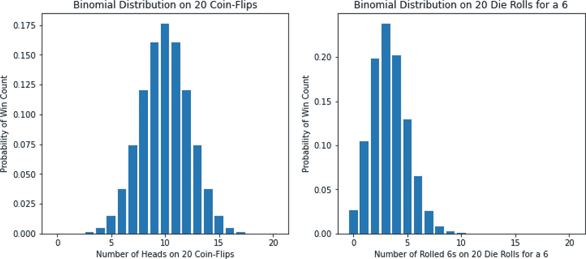
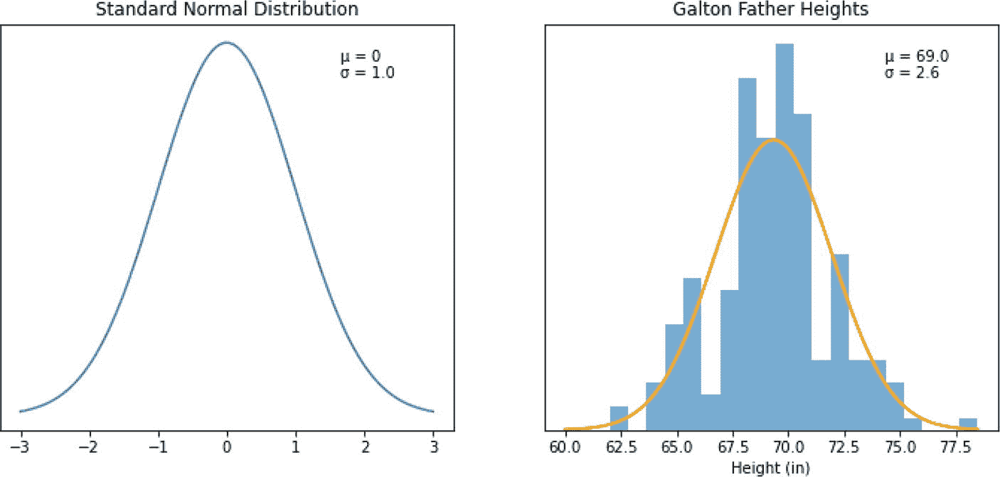
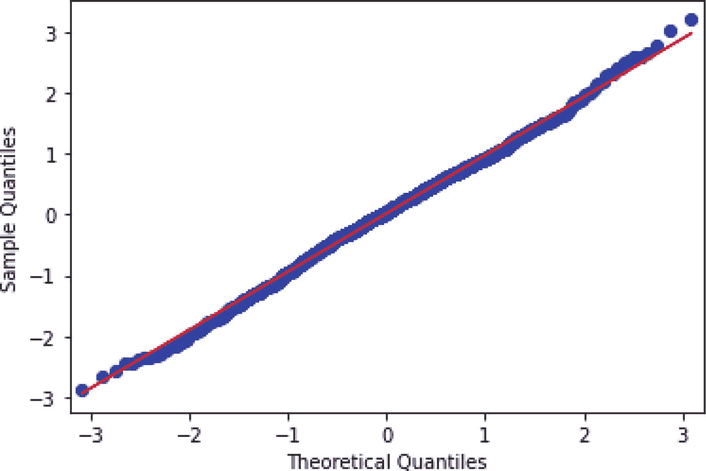
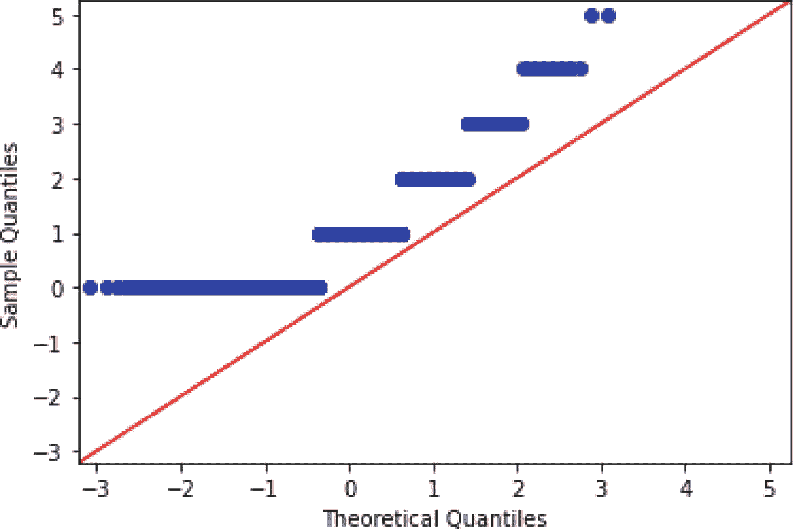
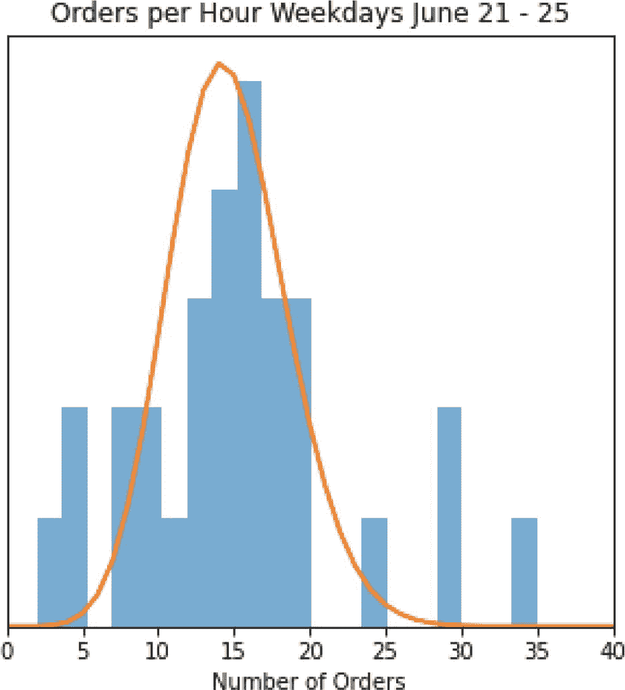
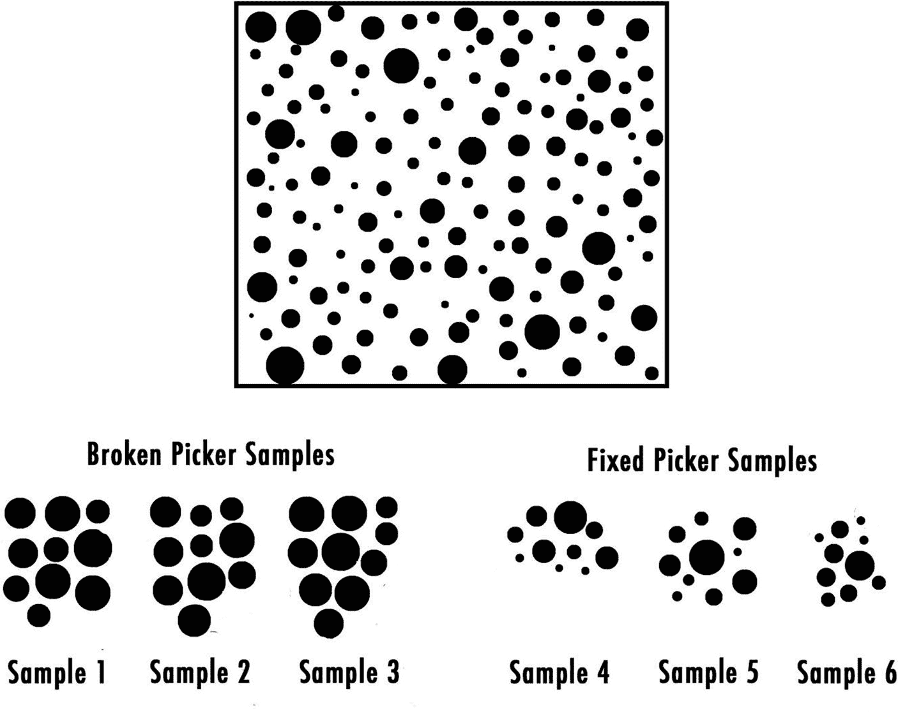
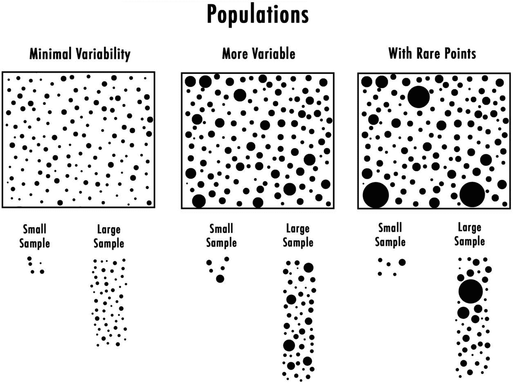

# 3. 奠定成功基础：推断性统计框架与实验

## 引言

我们知道统计学是一个多年来发展迅速的领域，但二十世纪是现代统计学取得巨大进展的时期。其中一些最大的发展发生在推断性统计领域，你可以从一个大的总体中选取一个子集（样本），对这个子集进行一些数学运算，然后将结果推广到更大的总体。这对于许多无法测量每一个单一事物的领域来说至关重要。概率、抽样和实验设计对于实现良好的推断都至关重要。19 世纪末和 20 世纪初所做的工作为我们在计算机时代处理数据奠定了基础。

本章将首先深入探讨现代统计学的一些历史，并给出一些统计学在现实生活中的有趣例子。我将介绍计数方法（这对理解概率至关重要）以及概率论。然后，我将介绍几种在统计学中广泛使用的重要概率分布。在讨论抽样（即选择数据）之前，我会简要解释中心极限定理，最后介绍实验设计。

### 现代统计学史：第一部分

二十世纪见证了概率论与统计学的最终融合，科学家们将数学形式化，创立了现代数理统计学。统计学广泛渗透到众多领域：社会科学、经济学、物理学、化学等。遗憾的是，二十世纪早期的统计学工作因许多统计学家与优生学（eugenics）的关联而蒙上污点。优生学是一种已被彻底揭穿的伪科学，它推动了纳粹主义以及本世纪头几十年中大量种族主义、性别歧视和体能歧视政策——其中许多至今仍在延续。优生学家运用统计学和科学的语言，推动并支持了这些政策的制定，以及强制绝育等不人道行为。

将种族主义及其他“主义”包裹在科学的外衣下，意味着一些人至今仍相信优生学的信条。另一些人则疑惑，如果优生学并非真知灼见，像统计学这样美好的事物又何以从中诞生？但你需要记住的是，大量科学和哲学的发展恰恰源于炼金术的徒劳探索以及试图证明上帝存在的尝试。二十世纪早期统计学真正革命性的是方法、技术及其所依托的数学基础。这些方法可应用于任何领域，包括基于恶劣前提的研究以及设计得当的实验。

二十世纪初的统计学家成果丰硕，发展了我们之前讨论过的大量描述性统计，以及重要概念如概率分布——它既可描述数据，也可用于推断。统计学家惊讶地发现，许多可测量的事物都符合正态分布（也称钟形曲线），但绝非所有事物。随着世纪推移，人们又发现了若干其他分布。

现代统计学家开发了审视实验设计的新方法，并改进了部分已有的实验设置方式，这在今天仍然极其重要。实验设计几乎影响着所有科学、医学和社会科学学科。

二十世纪发生的另一变化是看待概率的全新范式。早期，统计学家常像现代贝叶斯学派那样看待概率——他们基本认为，概率量化的是某事物可被相信的程度，这种相信基于基本信念、假设或先前实验的结果。这意味着在最终的概率计算中，会包含一个先验概率。

但当时统计学界的“大人物”们摒弃了这一范式，转而支持后来被称为频率学派（frequentist）的范式。频率学派认为，在计算中包含先验（即初始状态的附加概率）会损害任何概率计算的严谨性。如今仍有贝叶斯统计学家，也有部分基于贝叶斯原理的机器学习技术。一些统计学家还青睐其他范式。基本上，尽管大多数统计学家属于频率学派阵营，但范式的选择仍可能让他们血压升高，有些人认为不同情境需要不同的范式。

### 贝叶斯概率与贝叶斯定理

贝叶斯概率与频率学派的主要区别在于：频率学派认为概率来自对所有可能结果的计数（他们关注事件发生的频率），而贝叶斯学派认为概率是一种“合理预期”——即某人量化了一种信念（例如，某特定视频游戏玩家有 80%的几率赢得下一局比赛），或基于频率以外的知识量化了某种事物。本章后面我们会更详细地了解频率学派方法，这里我仅简要谈谈贝叶斯范式。

贝叶斯定理是贝叶斯概率的一部分，是确定条件概率（具体来说，即后验概率）的一种方法。*后验概率*本质上是指在事件 B 已发生的前提下，事件 A 发生的概率。它依赖于三个已计算出的概率：事件 A 发生的概率、事件 B 发生的概率，以及*先验概率*——即已知事件 A 发生的前提下事件 B 发生的概率。先验概率正是频率学派有所诟病之处，因为它可能基于信念而非严格计算——它与实验运行前发生的事件相关联。然后你可以将这些值代入公式，得到后验概率。它本质上允许你根据新信息更新概率。

请注意，在数据科学中使用贝叶斯定理，你不必是铁杆的贝叶斯学派——我们关心的是使用有效的方法，无论它们是否完美地代表现实世界。

现代统计学的最后一个重要领域是抽样。在一次广为人知的失败案例后，随机抽样的重要性变得清晰：1936 年美国大选中，某家主流杂志基于其严重偏向共和党的读者样本，预测了错误的获胜者。在过去一个多世纪里，抽样方法得到了极大改进，如今从事调查和民意测验的正派人士知道如何选取具代表性的样本。

现代统计学关乎严谨与合理规划，但达到今天这样良好的局面，花费了相当长的时间。

### 现实世界中的统计学示例

#### 示例 1：点数问题

我们著名的数学家费马和帕斯卡的“点数问题”是一个特定场景，涉及一场骰子游戏的中断。游戏中，两名玩家将相同金额的钱投入奖池，然后轮流掷骰子，直到其中一人先达到预定的获胜次数（即掷出最大点数）。他们会记录各自获胜的次数，率先达到指定次数者赢得整局游戏。你可以想象这样一局游戏：费马赢了六轮，帕斯卡赢了四轮，目标获胜次数是十次。如果游戏继续下去，一切都会很顺利：帕斯卡后来居上，在费马停留在八次时赢下了第十次。帕斯卡带着笑容，拿走了全部赌注。

但如果游戏被中断了呢？比如蜡烛熄灭了。这时应该怎样合理分配赌注呢？一个显而易见的答案可能是根据各自获胜的比例——在上述情景中，费马应得 60%的赌注，帕斯卡得 40%。十七世纪的数学家们相当确定这个答案不正确。在费马与帕斯卡的通信中，费马阐述了公平的解决方案、解释和所有细节。在碰运气的游戏中，重要的不是已经发生了什么，而是未来*可能*发生什么。因此，仅根据先前掷骰的结果来分赌注，并没有考虑到游戏可能结束的所有方式——比如帕斯卡后来居上获胜。但是，该如何模拟这许多种可能的未来呢？

另一位数学家已经指出，需要计算的是每位玩家可能获胜的不同方式的数量。帕斯卡首先尝试解决这个问题，并部分基于他著名的“帕斯卡三角形”得出了一个可能的解法，他将其寄给朋友费马，希望获得数学上的第二意见。但费马天赋异禀，几乎毫不费力就想出了一个更简单的解法。他们通信的大部分内容，都是费马试图让帕斯卡理解这个解法，而帕斯卡理解之后，通过简化某些步骤改进了这个方法。

这个解法有点复杂，但一个关键点是理解，从他们采用的视角来看，一个目标为 10 次、比分 6-4 的游戏，与一个目标为 20 次、比分 16-14 的游戏是等价的。在这两种游戏中，每位玩家获胜的可能方式数量是相同的：玩家 1 还需 4 胜，玩家 2 还需 6 胜。这就变成了一个统计所有可能结果的问题，其中违反直觉的一点是，费马的方法需要计入那些因为某位玩家已经达到获胜目标而实际上不会发生的情况。统计从认识这一点开始：游戏会在已知的回合数内结束——即每位玩家所需获胜次数之和减 1，在本例中为 6 + 4 – 1 = 9 轮。用 2 的该计算次数次方来计算可能结果的总数。然后，计算每位玩家获胜的可能方式数量，并除以总数，得出的比例就是每位玩家应得的赌注份额。

如果你觉得这很难理解，别担心——历史上最优秀的数学家之一也曾觉得难。本章最后一节将讨论计数问题，因为它对于我们在下一章要学习的概率论和推断统计至关重要。

#### 示例 2：职业赌博

扑克牌历史源远流长，但在近几十年，它已成为一项观赏性运动，并成为少数职业赌徒的职业，像“扑克小子”和“扑克顽童”这样绰号的著名玩家经常赢得数十万美元。所有赌博都建立在“战胜赔率”的基础上，大多数赌徒在有获得回报的可能时喜欢承担一些风险。但职业玩家的玩法比这更聪明。

职业赌徒掌握的信息不完整，因此他们处理的是确定概率、期望值和波动性。*期望值*基本上是在一组可能结果中最可能的值，通常类似于均值。它的计算方法是，考虑所有可能结果及其可能性，然后求和。玩家寻找的是期望值大于 0 的游戏，这样如果他们多次参与，总体上就能取得领先。但期望值只给出了基于结果基本可能性的结果。在现实世界中，结果波动很大。在抛硬币游戏中，玩家不会恰好有一半的几率获胜。波动性有助于量化这种变异性，因为它就是标准差，所以它能让人了解实际值的分散程度。波动性越高，损失的风险越大，但如果赢了，收益也更大。

但在赌场赌博的陷阱在于，游戏的设置通常至少是（如果不是大幅）对赌场有利的。因此，在纯粹靠运气的游戏中，玩家的期望值将小于 0。这是扑克如此受欢迎的原因之一——运气显然扮演着重要角色，但策略和心理学也至关重要。扑克在一定程度上是一场心理战。对于牌桌上的每位扑克玩家来说，其他所有玩家都在同一条船上，运气决定了他们拿到什么牌，但好的策略、准确的读人能力以及令人信服的诈唬意味着，玩家可以在牌不好时最小化损失，在牌好时最大化收益。

尽管世界扑克系列赛之类的比赛很受欢迎，但只有极少数玩家能通过打扑克赚钱，而这些玩家中又只有一小部分能赚大钱。而且，因为打扑克取胜需要高超的技巧，玩家必须学习和练习才能持续获胜。对大多数人来说，这可能不是最明智的职业选择，但它很适合拍成电视节目。

## 推断统计的术语与符号

在学习推断统计时，可能会让人困惑的一点是符号和术语。在推断统计中，我们通常会考虑两个群体。第一个是*总体*，即我们感兴趣并想了解的“全部对象”，而我们没有（也无法获得）其所有值。第二个是*样本*数据集，它是总体的一部分，我们（至少在理论上）可以获得其值。核心思想是，你可以利用所拥有样本的特征来推断总体，同时认识到你的推断估计中会存在一些误差。

在统计学和数据科学中，我们不断地讨论变量，尽管它们可能有不同的名称。*变量*就是可以用某种方式测量、量化或描述的事物。*因变量*，也称为*结果变量*，是我们关注结果中的对象。如果我们想比较一次在线广告活动的结果，我们可能会测量两个不同广告的总点击量——点击量是因变量，因为它取决于之前发生的所有事情。*自变量*，也称为*预测变量*，是影响结果（即因变量的值）的变量。在这种情况下，广告投放位置和设计属性就是自变量。变量之间的依赖关系在于，因变量取决于自变量的值，而自变量之间应相互独立。

我们还需要习惯这些符号。惯例是使用希腊字母和其他特定字母（有时带变音符号）来表示特定事物，总体趋势是使用拉丁字母表示样本参数，使用希腊字母表示总体参数。表 3-1 展示了一些符号的例子。

**表 3-1 推断统计中的符号**

| 指标 | 符号 | 读法 |
| --- | --- | --- |
| 样本均值 | `x̄` | x bar |
| 总体均值 | `μ` | 缪 |
| 样本标准差 | `s` | S |
| 总体标准差 | `σ` | 西格玛 |

# 基础概率

大多数人对概率的了解足以明白它处理的是特定事件发生的可能性，并帮助我们理解风险。但其内涵远不止于此，概率的各个方面构成了数据科学家日常使用的统计技术的基础。

## 概率论

概率论中有几个概念依赖于我们将在本文中定义的特定术语。

在日常用法中，事件就是指发生的事情，但在概率论中，它是相对于试验来定义的。试验可以被视为一次单一的尝试、一次游戏或产生某种结果的某一轮操作。例如，在掷骰子游戏中，每一轮游戏都涉及玩家掷骰子以产生一个结果。这个试验就是掷骰子，而结果——骰子数字的组合——被称为事件，即所发生的结果或事情。

我们将所有可能的结果称为样本空间。样本空间取决于我们实际追踪的内容。在掷两个骰子以求总和的场景中，总和是我们关心的结果（而不是骰子上的两个具体数字）。因此，所有可能的和构成了样本空间，尽管有多种方式可以得到其中许多和。

举例来说，想象帕斯卡在试验 1 中掷了两个骰子，得到 3 和 4，总和为 7。费马在试验 2 中掷骰子，得到 1 和 6，总和也是 7。这两个事件是相同的，尽管它们实现的方式不同。这个游戏的样本空间是 2 到 12 之间（含）的所有数字，但它们的可能性并不相等——得到 7 比得到 2 容易得多。

另一个需要理解的重要术语是独立性。如果一次试验的结果不会影响另一次试验的结果，我们就称这些试验是独立的。这对于我们讨论的骰子游戏是成立的，但通过一个试验不独立的例子可能会更清楚。假设有一个游戏，如果玩家掷出了 6，那么他们的下一次掷骰结果会翻倍。在这种情况下，第二次掷骰（试验）就不独立于前一次试验。

与独立性相关的一个概念是独立同分布变量，简称为 `iid` 变量。`iid` 变量是指彼此独立且在概率上完全相同的变量。在一个掷六个骰子并尽可能多得到 6 点的游戏中，每个骰子代表一个单一变量，且每个骰子有六分之一的机会得到 6 点。所以这些就是 `iid` 变量。

另一组对概率重要的概念来自集合论，也就是维恩图背后的数学。在集合论中，事件的并集意味着至少满足一个条件。交集意味着所有条件都满足。补集则是所需条件的反面。

假设我们关心一次试验中两个骰子的具体点数。我们关注实际的配置，不同的配置有不同的赔付。假设玩家如果掷出两个偶数（称此为事件 A）就能获得投入金额一半的赔付，而如果掷出两个 5 或两个 6（称此为事件 B）就能获得一次免费的第二轮掷骰。这些事件的并集就是 A、B 或两者都发生的情况，即所有掷出两个偶数或两个 5 的情况（两个 6 的情况同时属于两个事件）。这些事件的交集就是仅两个 6 的情况。最后，事件 B 的补集是所有不是两个 5 或两个 6 的掷骰结果，而事件 A 的补集是任何至少包含一个奇数的掷骰结果。

## 计数、排列与组合

正如我们在分点问题中看到的，计数在几个世纪前就被认为是计算概率的基础。我们必须找出所有可能的结果以及特定结果可能发生的不同方式。这是计算事物可能性的基础，但计数并不总是听起来那么简单，尤其是在可能性数量激增的时候。

通常，直观地列出所有可能的组合是很有帮助的。例如，我们可能掷两个骰子并求和。样本空间是 2 到 12 之间的每个数字，但某些和比其他和更可能出现。表 3-2 展示了列出所有不同骰子投掷结果的一种方式。

**表 3-2** 双骰子求和游戏结果

| 和 | 组合方式 | 得到该和的方式数 |
| --- | --- | --- |
| 2 | 1+1 | 1 |
| 3 | 1+2 | 1 |
| 4 | 1+3, 2+2 | 2 |
| 5 | 1+4, 2+3 | 2 |
| 6 | 1+5, 2+4, 3+3 | 3 |
| 7 | 1+6, 2+5, 3+4 | 3 |
| 8 | 2+6, 3+5, 4+4 | 3 |
| 9 | 3+6, 4+5 | 2 |
| 10 | 4+6, 5+5 | 2 |
| 11 | 5+6 | 1 |
| 12 | 6+6 | 1 |

初看之下，这似乎没问题，但我们遗漏了一项重要事实——除了和是 2 和 12 的情况外，其他所有和都可以通过多种方式得到，因为你有两个不同的骰子。如果你想要得到和为 3，你可以通过骰子 1 是 1 且骰子 2 是 2，或者反过来（骰子 1 是 2 且骰子 2 是 1）来实现。这实际上是两种不同的结果。事实证明，在双骰子求和游戏中计算不同可能性的数量很简单：骰子 1 有 6 种可能值，而每种可能值对应骰子 2 的 6 种可能值，所以总共是 36 种（骰子 1 的 6 个值 * 骰子 2 的 6 个值）。

但我们可以修改游戏规则，使得如果第二个骰子与第一个相同，就自动重掷直到掷出不同的数字（这类似于彩票抽奖）。在这种情况下，第一个骰子仍然可以是任何数字，但骰子 2 只有 5 种可能值，所以是 `6 * 5 = 30`。想象再加入第三个掷骰，且同样不能与之前重复。那就是 `6 * 5 * 4 = 120`。我们在这里计算的也称为排列，是一种在有 `n` 个可能值中选择 `k` 个事物的方式，其中顺序重要且值不能重复。

还有一个相关的计算称为组合，它与排列类似，但顺序不重要。这通常被表述为“从 `n` 个中选 `k` 个”。假设有一个篮子，里面装有五个球，每个颜色不同。组合会告诉你如果伸手一次抓出三个球，有多少种可能的结果。在这种情况下，我们不关心哪个球先被取出，因为这只是一次选择动作（而不是先掷一个骰子再掷另一个）。这里，就是从 5 个中选 3 个，结果为 10。这远小于排列的数量（`5 * 4 * 3 = 60`）。

既然我们已经完成了所有这些计数，你可能会问这到底有什么意义。计数对于计算概率至关重要。在彩色球的例子中，当你一次抓出三个球时，其中一个是蓝球、一个是红球、另一个是黄球的概率是多少？由于每种颜色只有一个，因此只有一种方式实现，所以分子是 1，分母是我们上面计算出的总组合数 10，因此概率是 0.1。在这个例子中，每一种特定的组合都是唯一的，所以每一组球出现的概率相等。但如果你问的是，你抓出两个原色（红、蓝、黄）和一个间色（这个篮子里只有绿色和紫色）的概率是多少呢？如果我们计算有两个原色的方式数，那是 3（红+蓝、红+黄或蓝+黄）。对于每一对原色，间色球都有两种可能的值，所以满足我们要求的结果数为简单的 `3 * 2` 计算，从而概率为 `6/10`，即 0.6。

无论你是用组合还是排列来得到可能性总数，概率的计算方法总是：满足条件的选择数除以物品可被选择的总方式数。选择正确计数方法的直觉需要经过练习才能获得。

### 附加示例：蒙提霍尔问题

概率论中最著名的误解之一，出自一档名为《我们来做个交易》的电视游戏节目，主持人蒙提·霍尔正是该问题的命名来源。节目中，参赛者会看到三扇门，每扇门后都藏着东西——一扇门后是汽车这样的奖品，另外两扇门后则是没人想要的羊。参赛者选择一扇门后，霍尔会打开另外两扇门中的一扇，露出一只可怜的羊（显然他会选有羊的那扇，如果有汽车则不会开）。在真实游戏中，霍尔不会给参赛者换门的机会，但在重新构思的蒙提霍尔问题中，他给了这个机会。参赛者可以选择坚持最初的选择，或者换到另一扇未打开的门。大多数人的直觉是，从概率上看，换不换门无所谓。

但在 1990 年，一位统计学家在一本杂志上提出了这个问题，并给出了一个令所有人震惊的答案，包括那些傲慢到拒绝相信的统计学家和数学家。她的答案是：参赛者应该换门，因为换门获胜的概率是三分之二，而不换门只有三分之一。这个故事引起了轰动，一万人（显然包括一千名学者）写信给杂志社说这个答案是错的。

如果你留心观察，可能会发现一些问题：概率似乎会根据新信息而变化，这看起来是贝叶斯统计的范畴；但事实上，概率并没有变化，这可以用频率学派规则来解释。那么，这究竟是怎么回事呢？

当三扇门都未打开时，每扇门后有汽车的概率恰好是 1/3。参赛者选了一扇门后，这个概率不会改变。他选的门有三分之一的可能性是奖品。这也意味着汽车有三分之二的可能性在参赛者没有选的门后面。当霍尔打开一扇没被选中的门，露出后面的羊时——这正是大多数人觉得反直觉的地方——汽车在那些没被选中的门中的概率仍然是三分之二（根据频率学派范式，这不会因新信息而改变）。但现在参赛者知道哪扇门后有羊了，这意味着那扇既没被选中也没被打开的门，仍然有（不变的）三分之二的概率是汽车所在的那扇。显然，参赛者换门是明智的，因为三分之二的概率大于三分之一。

如果你觉得这不可能对，那你不孤单——但你的想法依然错了。如果你想亲自验证，可以打开 Python 解释器尝试模拟一下。模拟证明换门策略更优。但模拟确实去除了人为因素：如果你选了一扇门又换到另一扇，最后很可能因为换了门而比坚持原选择得到羊更自责。

### 另一个附加示例：生日问题

概率论中有一个著名的场景，常常让人震惊，但它能深刻说明理解“某事发生在任何人身上”的风险与“同样的事具体发生在你身上”的风险之间的区别。“小概率事件”在广义上可能通过多种方式发生，因此很可能发生，这违背直觉。你明天死于车祸的概率微乎其微，但明天某个地方有人死于车祸的概率几乎是 100%。

这个著名场景被称为生日问题。它指出，只要一个房间里有 23 个人，其中两人生日相同的概率就略高于 50%。这就是视角重要性的体现——*你*与另一个人生日（仅月日）相同的概率仍然很低（如果你好奇的话，是 5.8%）。但如果你不关心哪两个人同一天生日，那么人越多，出现相同生日的可能性就越大。通常求解这个问题时，我们会简化条件，忽略闰年、可能存在双胞胎以及其他可能使生日集中的趋势。这意味着我们假设有 365 个可能的生日。

要理解这一点，一个简单的方法是计算所有人生日都不同的概率，然后用 1 减去这个概率，得到至少两人生日相同的概率。如果把人从 1 编号到 23，只需将每个人生日不同的概率相乘即可。第一个人（总共 1 人）生日独特的概率是 `365/365`，因为可以是 365 天中的任何一天。但当加入第二个人时，因为不能与第一个人同名，所以只有 364 个可能的日子。因此第二个人的概率是 `364/365`。以此类推，每个人可选的日子减少一个，第 23 个人的概率是 `343/365`。然后将所有这些值相乘，结果约为 `0.4927`。记住，这是没有人生日相同的概率，所以至少两人同一天生日的概率是其补数，即 `1 – 0.4927`，也就是 `0.5073`。

两人同一天生日的可能性会随着人数增加而持续上升。有 40 人时，概率超过 89%；有 70 人时，概率达到 99.9%。但从另一个角度看，在 23 人的房间里，*你*与其他人同一天生日的可能性要低得多。房间内至少需要 253 人，某个特定个体与另一人同一天生日的概率才能达到 50%——远多于 23 人。

赌场和彩票运营商正是利用人们对概率的无知来牟利。人们看到别人在老虎机上赢了几万美元，或者在新闻里举着数百万美元的巨额支票拍照，就会想：“嘿，那也可能是我。”如果你把钱投入老虎机并拉下手柄，或者在街角商店买一张彩票，从技术上讲你确实可能赢。但实际你不会赢。如果运气好，你或许能拿回本钱。

## 概率分布

概率分布是一种理论构造，表示某个特定变量的取值范围和形态。它们在推断统计中很重要，因为如果你能识别一组数据的分布，就可以推断出手中数据之外其他合理的数值。最著名的分布大概是正态分布，但它只是众多描述不同事物类型的概率分布之一。

通过具体分布来理解会更简单，因此我们将介绍数据科学中重要的几种不同分布。在后面的章节中，我们还会介绍更多与统计检验相关的分布。

请注意，分布有两种基本类型：离散型和连续型。离散型分布涵盖的结果只能取有限数量的值，比如抛硬币——只能是正面或反面。连续型分布的结果可以是连续区间上的任意值，比如人的身高。

### 二项分布

最简单的分布之一是二项分布，它是一种离散分布，用来描述一系列 `n` 次独立二元试验的行为，其中每次试验成功的概率相同（比如多次抛掷一枚硬币看正面朝上）。这里的独立意味着一次试验不会受到之前任何试验的影响，抛硬币的情况正是如此。

该分布由已知的试验次数（`n`）和已知的概率（`p`）来定义。该分布提供了一个公式，使我们能够根据 `n` 和 `p` 来计算获得特定成功次数的概率。我们也可以绘制二项分布图。图 3-1 展示了针对特定 `n` 和 `p` 的两个二项分布图。

两个条形图展示了二项分布。左侧图表显示了在 20 次抛硬币中获得特定正面次数的概率分布，峰值在 10 次正面附近。右侧图表展示了在 20 次掷骰子中获得特定“六点”次数的概率分布，峰值在 3 到 4 次“六点”附近。两个图表的 x 轴都标注为成功结果的数量，y 轴都标注为获胜次数的概率。

**图 3-1** 代表抛硬币和掷骰子的两个二项分布

左侧图表显示了连续抛硬币的分布情况，即在 20 次抛掷中获得获胜（得到某一特定面）0 到 20 次的概率。`n` 为 20，`p` 为 0.5，因为硬币是公平的。毫不意外，获胜 10 次是最常见的结果，因为这是在 `p` 为 0.5 的分布中的中点。如果你熟悉正态分布（我们接下来会讲到），你可能会注意到它看起来有点像正态分布。

但是当 `p` 不为 0.5 时，分布看起来完全不同，如图 3-1 的右侧图表所示，它显示了在 20 次掷骰子中得到特定点数的概率。在这种情况下，`n = 20`，`p = 1/6`（约 0.167），因此图表向右偏斜。但这同样合理，因为最常见的次数是 3 次，概率为 0.15，是最接近 `p` 值 1/6 的分数。

#### 现实世界中的二项分布

尽管这是一个简单的分布，但它对于观察现实世界中的许多事物很有用。例如，如果我们想评估一位特定视频游戏职业玩家的成功率，并且我们根据其评分知道成功的概率，我们就可以计算在一系列比赛中赢得特定场次比赛的概率。如果该玩家玩了 100 场比赛，成功概率为 0.75，并且赢了 90 场（输了 10 场），直觉会告诉我们这位玩家表现非常好。但我们可以量化这个好程度。如果我们想知道他们恰好赢得 90 场比赛的可能性有多大，答案是 0.0094%，非常小。一个更有趣的数字可能是他们至少赢得 90 场比赛的可能性有多大。我们必须将赢得 90 到 100 场比赛之间每一种可能性的概率相加，结果大约是 0.013%，比恰好赢得 90 场要高一些，但仍然非常低。这位玩家的表现异常出色。

既然他们的获胜概率是 0.75，你可能会好奇他们在 100 场比赛中恰好获胜 75 场的可能性有多大——结果只有 9.18%。但这是因为我们问的是他们是否*恰好*赢了 75 场，而实际上，赢 74 场和 76 场的概率也差不多，并且都会被认为是典型的成功率。事实上，他们赢得 73 到 77 场比赛的可能性是 43.6%。

关于二项分布的一个有趣事实是：对于给定的 `p`，`n` 越大，该分布就越接近满足正态分布的条件，我们将在下一节讨论正态分布。

#### 伯努利分布

伯努利分布是二项分布的一种特殊情况，其中只进行一次试验，并有两种可能的结果，通常是成功和失败。

# 正态分布

大多数人都听说过正态分布——一种连续分布，也称为钟形曲线或高斯曲线——并且能够认出它的图形：中间有一个峰值，然后向中心峰值的两侧逐渐下降至零，类似于我们在概率为 0.5 的二项分布中看到的情况。*正态分布*代表了当我们绘制某个具有自然中间高点的变量所有数值时所期望的理论形态，其数值随着远离中间点而降低。这包括像考试成绩之类的东西，大多数人的成绩处于中等水平，有些人稍差或稍好，而表现极差或极好的人较少。它是*单峰*的，因为它只有一个峰值。许多其他事物也符合正态分布，包括成年男性的身高、ACT 考试成绩、出生体重以及测量误差。

你可以在现实生活的许多方面直观地看到正态分布，尤其是在随时间推移而频繁使用的东西的磨损模式中。古老的石头或水泥台阶会逐渐变斜，中间部分磨损得最深，然后又逐渐弯曲回升到原始台阶的高度。门上被推开的区域，油漆会在某一点磨损得最厉害，离那个中心点越远磨损越少。它甚至能揭示出不同的油漆层，中心处直达裸露的木头，离中心点越远，不同的油漆层就越明显。看看健身房健身器械上的杠铃片，你会发现中间重量的杠铃片磨损最严重，而越往外，杠铃片磨损越轻。图 3-2 展示了我童年家中厨房瓷砖地板的磨损模式。

一个厨房地板，铺有网格状的方形赤陶色瓷砖，显示出磨损和变色的痕迹。瓷砖被深色的勾缝线分隔。顶部附近隐约可见一块灰色地垫，右侧是木质橱柜。场景表明这是一个使用频繁的厨房区域。

**图 3-2** 厨房瓷砖地板多年人来人往后的磨损模式

图 3-2 中较亮的外部区域显然很少有人踩踏，而有一条清晰的深红色路径，在深色和浅色之间的中间区域有一些黄色，黄色之外则零星散布着红色和棕褐色。没有人会怀疑在这地板上从右下角到左上角最常走的路线是什么。

尽管我们在现实世界中看到许多事物，但重要的是要认识到大多数事物并非真正的正态分布。但是因为事物通常足够接近正态分布，所以这个分布在统计学中极其重要。许多使用的检验和技术都要求我们假设正态性。这之所以可行，是因为事物足够接近。下一章将讨论其中几种检验方法。

正态分布由我们之前学过的两个指标来定义：均值（μ）和标准差（σ）。我们使用总体符号来表示分布参数，因此 μ 是均值，σ 是标准差。有了这两个值，我们就可以绘制出曲线。均值位于峰值的最顶端，而标准差则反映了曲线的陡峭程度和分散程度。

# 正态分布

了解某事物呈正态分布有助于你理解它。如果是正态分布，我们就知道其均值、中位数和众数都是同一个值，并且数据是对称的——分布在均值两侧互为镜像。此外，我们还知道大约有 68% 的数据会落在距离均值 1 个标准差的范围内，95% 的数据会落在 2 个标准差内，99% 的数据会落在 3 个标准差内。例如，如果一个数字距离均值超过 3 个标准差，我们就知道它相当不典型。同样，如果它距离均值不到 1 个标准差，那这就是一个非常常见的值，并不特别引人注目。

正态分布可以有多种不同的形态，因此我们通常会将数据转换为所谓的`标准正态分布`，这只是一个均值为 0、标准差为 1 的正态分布。

图 3-3 展示了两个正态分布：一个是标准正态分布，另一个叠加在我们已知呈正态分布的真实数据——男性身高（我们使用了高尔顿著名的家庭身高数据集中父亲的身高）上。我们省略了 Y 轴的值，因为它们对于理解正态分布的概念并不重要。

比较分布的双面板图。左面板显示了一条标注为“标准正态分布”的标准正态分布曲线，其均值 (μ) = 0，标准差 (σ) = 1.0。x 轴范围从 -3 到 3。右面板显示了一个“高尔顿父亲身高”的直方图，并叠加了一条正态分布曲线。均值为 69.0 英寸，标准差为 2.6 英寸。x 轴范围从 60 到 77.5 英寸。

图 3-3：两个正态分布：左侧是标准正态分布，右侧是一个经典数据集中男性身高的分布，并叠加了正态曲线

左侧的图是标准正态分布，其中`μ`（均值）为 0，`σ`（标准差）为 1。我们可以看到峰值在中间的 0 处，尾部距离中心不远，这与标准差为 1 的情况相符。众所周知，样本量足够大时，成年男性的身高呈正态分布，因此我们绘制了高尔顿著名的家庭身高数据集中父亲身高的分布。虽然数据集不算庞大且存在一些偏差，但从叠加在数据上的橙色正态曲线可以看出，它大体上是符合正态分布的，该曲线已根据此数据进行了缩放。

这些曲线看起来非常相似，理解它们的一个技巧是记住 X 轴上不同值之间包含了多少数据。我们知道大约 68% 的数据都在距离均值 1 个`σ`的范围内，即介于`μ – σ`和`μ + σ`之间。在标准正态分布图中，68% 的数据介于 -1 和 1 之间，而在身高分布图中，这个范围介于 66.4 和 71.6 之间。

## 使用正态分布

在某些情况下，这条曲线和这些数值可能就足够了，但更多时候我们会以某种应用方式来使用正态分布的特性，这通常意味着转换我们的数据，以便能够以标准化的方式讨论它。

### Z 分数

由于大多数正态数据并不完全符合标准正态分布，因此通常会对数据进行标准化，以便能相对于标准正态分布来讨论它。这是通过计算 `Z分数` 来完成的，Z 分数是指给定值距离均值有多少个标准差。计算方法很简单：用该值与分布均值的差除以分布的标准差，因此结果可以是正数或负数。在标准正态分布中，无需除以标准差，因为其标准差为 1——而这正是使用标准正态分布的全部意义所在。

`Z-score` 是一个简单但极好的度量标准，可用于识别异常情况，例如在简单的异常检测任务中，或者定义报告异常值的阈值（如欺诈检测或监控计算机系统的性能问题）。

### 正态性检验

由于许多统计技术都要求我们假设数据呈正态分布，因此检验数据是否真的符合正态分布非常重要。`QQ图` 允许你通过可视化方式进行检查。QQ 图的 X 轴显示正态分布的分位数（这是正态性的参考点），Y 轴从低到高按数值顺序显示数据集中所有的 Z 分数（这是你正在检验的值）。如果数据是正态的，你将得到一条从左下角到右上角近乎完美的对角线。你可以在图 3-4 中看到一个示例，图中的点代表检验值，红线代表数据正态时我们期望看到的结果。

比较样本分位数与理论分位数的 Q-Q 图。图中有一条代表等值线的红色对角线，蓝色的数据点紧密地沿这条线分布，表明样本数据近似服从正态分布。x 轴标注为“理论分位数”，y 轴标注为“样本分位数”。

图 3-4：使用随机正态数据的 QQ 图示例

图 3-4 展示的是我们期望数据呈正态分布时的样子，而 QQ 图也能清晰地表明数据何时完全不服从正态分布。图 3-5 展示了来自泊松分布的数据（我们将在下一节讨论），很明显数据并未排列在对角线上。

比较样本分位数与理论分位数的 Q-Q 图。图中有一条代表等值线的红色对角线。蓝色的数据点大部分位于线上方，表明偏离正态分布。x 轴标注为“理论分位数”，y 轴标注为“样本量”。

图 3-5：使用随机非正态数据（来自泊松分布）的 QQ 图示例

另一个常见的检验是`科尔莫戈罗夫-斯米尔诺夫检验`，有时简称为 K-S 检验。该检验将数据集中标准化值的实际分布与标准正态分布进行比较。它会生成一个数值，表示正态分布与数据分布之间在相距最远点处的距离。

我们已经知道，大多数事物并非完全符合正态分布，但通常它们很接近，足以让我们还能使用一些需要正态性假设的技术。这往往是一个依赖经验积累的判断，但进行检验而不是直接假设，这一点仍然很重要。

### 泊松分布

离散泊松分布之所以有趣，是因为它着眼于那些初看起来难以量化的事物。具体来说，泊松分布对反复发生的、不规律的事件或现象进行建模。典型的例子包括在时间上间隔发生的事件，比如顾客进入餐厅、有人在工作岗位请病假，以及分布在空间上的事件，比如一本印刷书页面上的缺陷。任何在餐厅或零售店工作过的人都知道，总是会出现远超正常的“客流高峰”，或是令人惊讶的萧条时段，而这一切都没有明确的解释。事情就是这样发生了。

泊松分布使用一个速率参数 `λ`（lambda），它代表在特定时间（或特定空间，例如书中的例子）内事件的平均发生次数。因此，我们确实需要了解所要建模的情形。但一家餐厅可以追踪数周内顾客的进店情况，得出这个平均值，以便将来使用该分布。请注意，`λ` 也是该分布的方差。

泊松分布的一个局限性在于，它要求 `λ` 随时间保持不变。餐厅员工都知道，午餐时间的顾客比下午 3:30 要多。我们可以通过为午餐时间使用一个 `λ`、为晚餐时间使用一个 `λ`、为这两个时段之间的时间使用另一个 `λ`、并为晚餐后的时间使用第四个 `λ` 来处理这种情况。但时间段越短，实际操作中就越困难。

我们可以看看在第 2 章中研究过的披萨餐厅数据，来判断它是否符合泊松分布。图 3-6 显示了一周内（仅工作日）午餐和晚餐时段每小时订单数量的分布，以蓝色条形表示。为了得到用橙色线绘制的泊松分布，我们通过计算前一个月中相同时间段一周内的平均值来计算 `λ`。

条形图标题为“2021 年 6 月 21 日至 25 日工作日每小时订单数量”，显示了每小时订单数量的分布。x 轴标记为“订单数量”，范围从 0 到 40，y 轴表示频数。蓝色的直方图显示了订单频数，峰值在 15 个订单左右。一条橙色线叠加在直方图上，表示一条分布曲线。

**图 3-6** 工作日内每小时订单数量的泊松分布

这相当吻合，这就是为什么泊松分布可以帮助餐厅进行规划。但正如我们最终会看到的，并非所有情况在现实世界中都能如此完美吻合。

### 指数分布与威布尔分布

指数分布和威布尔分布与泊松分布相关，但它们都是连续分布，因为它们追踪的是时间而不是有限的事件。指数分布考虑的场景与泊松分布相同，也使用 `λ` 参数，但它建模的是从一个事件到下一个事件之间的时间。因此，当一位顾客进来时，指数分布可以告诉我们，下一位顾客大概多久之后会来。

有时泊松分布似乎是正确的选择，但当某个事件随着时间的推移发生概率变得更大或更小时，威布尔分布则是更好的选择，因为它对特定事件发生前所经过的时间进行建模，同样基于时间或空间（如泊松分布）。一个典型的例子是追踪机械设备的故障。直观上，我们知道设备使用时间越长，由于持续的磨损，它就越有可能发生故障。威布尔分布基本上可以告诉我们，一台设备在指定时间内持续运行的可能性有多大，并且它需要两个参数。第一个参数称为形状参数，用 `β`（beta）表示，它代表了故障概率随时间变化的快慢。如果它大于 1，则概率随时间增加；如果它为负，则概率随时间减少。第二个参数是设备的预期寿命，用 `η`（eta）表示。威布尔分布的一个局限性在于，`β` 本身需要随时间保持恒定。

## 中心极限定理

中心极限定理是另一个涉及样本统计量的概念，即计算来自同一总体的许多样本的平均值。中心极限定理指出，如果你在适当条件下，从同一总体中抽取多个样本并计算其均值（或其他统计量），那么随着样本量（所抽取样本均值的数量）变得足够大，这些均值的分布将趋近于正态分布。

无论所抽取样本的总体分布如何，也无论所测量的统计量是什么，这个结论都成立。想象一下，有一个大垃圾桶，里面装满了各种大小不一的、不规则的弹珠。我们从中抽取一千个样本，每个样本包含一百颗随机选取的弹珠，并计算出所有这些样本的均值。这些样本的质量（即它们代表总体的程度）会有所不同，但许多样本会接近真实情况，只有少数会偏离真实情况。因此，我们会看到测得的均值聚集在一个中心点附近——那些来自能够很好代表真实弹珠的样本——而偏离中心点左右的测量值则越来越少，就像正态曲线一样。曲线的峰值很可能就是垃圾桶中弹珠平均值的准确估计。

与中心极限定理相关的一个概念是均值回归，它基本上是说，随着时间的推移，数值会变得不那么极端。因此，如果出现一个极端值——比如某个玩家在纸牌游戏中得到了一个非常高的分数——那么下一局游戏的分数很可能会更低（不那么极端）。

## 抽样

抽样是从一个更大的总体中获取数据子集的行为。根据上下文，这个术语可以表示几个相关的事情。在实验设计中，它意味着从那个更大的总体中选取成员以收集数据。在大多数情况下，我们无法获取某个事物整个总体的数据。一家市场调研公司不可能实际上与每一个美国人交谈，甚至不可能与每一位 25 至 45 岁的美国女性交谈。我们必须想办法与其中更少的人交谈，以便能够有意义地推断到整个总体。然后，我们就可以进行研究，并通过某种方式与他们互动以获取数据。我们进行抽样的事实意味着，我们如何选择总体中的成员进行数据收集，可能会产生巨大的影响。

第二种情况在数据科学中更为常见，有时我们面临的是相反的问题——数据太多。我们通常不是在进行研究，但我们可能需要从已有的数据中选择一个子集，以减轻计算负担，或为特定目的创建子集。例如，我们可能有数百万行关于服务器性能的数据，数千台服务器中的每一台都有数千行数据。我们可以选择一部分服务器，或者仅仅是选择一部分数据行，或者其他的子集。这也被称为抽样。在这种情况下，选择哪些数据点进入我们的样本，其大部分问题和考虑因素与第一种情况相同。然而，这里我们有一个优势，即可能能够更全面地了解整个总体中包含了什么（有时我们可以对完整数据集进行基本的汇总统计，只是不能进行我们想要的那种更高级的数据科学分析），这可以为我们的抽样选择提供信息。

本节的其余部分将主要关注第一种类型的抽样，这通常是作为实验或研究的一部分来进行的。

### 偏差与代表性

在推断性统计中，抽样的主要目标之一是以有意义的方式让样本代表总体，而确保代表性的最佳方法是避免抽样中的偏差。在此语境下，`偏差`特指对数据中特定子集的系统性偏好，这意味着样本因所选的抽样方法而歪曲了总体情况。测量过程中也可能出现偏差，这源于以有问题的方式进行测量。

如果我们想了解 Snapchat 和 Facebook 在美国人中的受欢迎程度，那么只对青少年进行调查，样本就会存在巨大偏差。我们选择的样本完全无法代表“美国人”整体。

心理学中有一个相当著名的系统性偏差例子。许多心理学实验都是由高校学者在其大学中，针对自愿参与的大学生（或者，如果他们正在上心理学课，是被“强制自愿”参与的）进行的。与冲动控制和决策相关的大脑区域——前额叶皮层，直到大约 25 岁才完全发育成熟，因此大多数大学生的大脑仍在发育中。在他们大脑仍在发育的阶段，就其大脑运作方式得出科学结论，会导致样本存在偏差。这些研究本身并没有本质上的错误——它们可能对设计一项针对随机选择的成年人的更大规模研究非常有帮助。问题在于，这些结果有时会以一种将其推广到更广泛的“人”群（尤其是由记者们）的方式进行报道。

为了更好地理解抽样中的偏差，让我们回到装满弹珠的垃圾箱例子。想象我们有一台机器，它会伸进垃圾箱，稍微搅拌一下，然后挤压，直到夹起一颗弹珠并将其取出。假设抓取器发生故障，无法完全闭合，因此它很少能取出较小的弹珠，因为它们会掉出来。被选中的弹珠样本将与整个垃圾箱中的情况不同。如果我们计算样本中弹珠的平均值，它会高于垃圾箱中所有弹珠的实际平均值。

如果我们把垃圾箱（假设这是个玩具屋大小的）里所有的弹珠都拿出来，放在左上角的桌子上，就能看到弹珠大小的范围。但如果我们的自动抓取器无法完全闭合，它将无法抓住较小的弹珠。当你用视觉观察时，这一点更容易理解。图 3-7 展示了这些样本可能的样子。上方的图片显示了摆放在桌子上、稍微散开一点的弹珠。如果我们把弹珠放回垃圾箱，让损坏的抓取器取出十颗弹珠，然后再重复几次，左下角的三个样本将是典型的结果。如果我们修好抓取器，重新运行这个过程，得到三个新样本，我们预计会得到类似右下角样本的结果。

气泡图显示了一个由大小不一的黑点组成的大网格。下方分为两类：“损坏抓取器样本”包含三个标记为 1 到 3 的样本，“修复抓取器样本”包含三个标记为 4 到 6 的样本。每个样本包含一组黑点，展示了分布和大小的差异。该图表说明了两个类别之间气泡排列的变化。

**图 3-7** 从一桌子弹珠中抽取的六个示例样本，其中三个来自有偏差的抓取器，三个来自公平的抓取器

损坏的抓取器无法夹住较小的弹珠，因此所有样本都只有中等大小及更大的弹珠。这些样本看起来完全不像桌子上摆放的样子。右边的样本是在抓取器修复后获取的，看起来要均衡得多。

同样重要的是要记住，在这种场景下，人类可以在一定程度上相当容易地用肉眼判断均衡性，但更有条理地进行选择至关重要，因为人类不具备所需的全局精确性。

### 有放回抽样

我们经常会讨论`有放回抽样`与`无放回抽样`。这仅在你从一个更大的、完整的数据集中抽取数据使用时才有意义。`有放回抽样`允许完整数据集中的某些数据点在抽样过程中被选中多次——基本上，就是在“选取”之后将数据点放回数据集中。因此，`无放回抽样`则正好相反，每次选择一个数据点时，它实际上就从完整数据集中被移除了。从弹珠垃圾箱中抽样的最自然方式是一次取出一颗弹珠放在旁边，然后再伸手进去取出另一颗放好，依此类推，这属于无放回抽样。但你也可以在选取后将弹珠扔回去并搅拌一下，这属于有放回抽样。让人填写问卷通常属于无放回抽样（你不会要求同一个人填写两次）。如果你想要一个真正随机的数字样本，即每个数字被选中的概率均等，那么你应当采用有放回抽样（否则，每个数字被选中的概率会改变，就不再是随机的了）。

# 样本量

与许多其他事情一样，我们试图实现的目标应该决定一项研究所需的数据量。大多数人普遍认为，数据越多越好。但情况往往相反。尤其是在大数据时代，我们常常想尽可能多地使用数据——甚至可能是整个总体。诚然，如果我们从总体中抽取一个子集，就更有可能错过特殊情况。但如果我们想了解关于英国所有成年公民的某些信息，那么使用全部总体进行分析是不可行的。令人惊讶的是，在这两种情况下，一个规模较小但精心挑选的样本，实际上往往比一个庞大的数据集更好。总的来说，使用小数据集更容易操作，尤其是在计算资源方面。

显然，有些情况确实需要大量数据，但这种情况少之又少。几个明显的例子是互联网搜索和大语言模型。在这些方面我们不能吝啬数据，因为它们需要在广度和深度上都做到完备。但如果我们想知道英国人最喜欢的爱好是什么，我们不需要询问每一个人。

有一些通用规则可以帮助确定良好的样本量。当总体变异性不大（总体中的大多数成员相当相似）时，只要抽样方法严谨，较小的样本就足够好。当总体变异性很大时，情况则相反——在这种情况下，较大的样本更可能具有代表性，因为它能捕捉到更多的差异性。此外，当研究罕见事件（如计算机故障或信用卡欺诈交易）时，首选大样本量。

# 图3-8与样本量示例

图3-8展示了三种场景以及抽样可能受到的影响。每种场景都有一个总体，以及从该总体中抽取的一个小样本和一个大样本。左侧是变异性极小的弹珠总体，因此小样本看起来仍然相当有代表性（大样本并没有给我们带来更多信息）。中间是一个变异程度大得多的总体，我们可以看到小样本的代表性不佳，因此我们需要更大的样本。最右侧的总体中有一个非常罕见的事件——大号弹珠。我们需要更大的样本来确保其中能包含一些大号弹珠。另一种可能是，我们的小样本最终可能纯粹因为随机而包含多个大号弹珠，那么该样本的代表性就会极差。

气泡图，展示了三种总体场景：“最小变异性”、“更大变异性”和“含罕见点”。每个场景显示一个由不同大小气泡组成的网格，代表不同的数据点。每个网格下方有两列，分别标有“小样本”和“大样本”，显示气泡的子集。该图突出了不同场景下的变异性差异和罕见大点的存在。

## 针对不同类型总体的不同样本量

在考虑样本量时，最后一个考量因素是工作可能带来的后果。如果后果可能具有破坏性，通常最好选择更大的样本，以确保更好的代表性。如果研究将用于制定公共卫生政策，或涉及公司做出重大财务决策，这一点可能适用。这涉及到伦理问题，我们将在后面的章节中讨论。

# 随机抽样

我们大多数人本能地知道，随机性通常是避免偏见和不公平的关键。但在实践中，这并不总是那么简单，也并不总能带来预期的结果，尤其是当我们在某种程度上与人打交道时。如果我们设法随机选择一组人进行访谈或收集数据，我们仍然需要依赖这些人实际参与——无论是否愿意报名参加访谈或填写问卷。

另请注意，要进行任何类型的随机抽样，我们必须有一种真正随机选择的方法，这意味着我们需要某种随机数生成器。这也就意味着要以某种方式使用计算机。

## 简单随机抽样

简单随机抽样名副其实——它是随机的，也是最简单的方法。在简单随机抽样中，总体中的每一个数据点都有同等的被选中机会，并且数据点被逐个选取，直到达到所需的样本量。在现有数据集中，这通常很容易实现，但如果你要选择人员或其他对象作为研究的一部分，则可能会更困难。

## 分层随机抽样

分层随机抽样与简单随机抽样类似，我们根据关心的特征将总体划分为若干组（层），然后对每个组应用简单随机抽样。例如，假设我们要研究电子游戏玩家，并试图了解男性和女性玩家的不同体验。在整个电子游戏玩家群体中，男性玩家多于女性玩家。因此，如果我们只是对整个群体进行随机抽样，我们的样本中男性人数将远超女性。但我们的问题是了解每个群体的体验，因此我们实际上需要一个男女数量大致相等的样本。在组内进行随机抽样可以确保每个层都能代表该群体，这正是我们在此关心的。显然，这种方法的一个局限性是，你必须对更大的总体有所了解，才能知道将哪个数据点归入哪个层。

## 整群抽样

整群抽样将总体划分为称为“群”的组，这与分层随机抽样类似。但不同之处在于，我们通常将总体划分为大量具有等级结构的群。然后，根据数据收集的便利性，我们选择特定的群作为重点。当使用其他随机抽样方法在后勤操作上困难时，通常采用这种抽样方式。最常见的情景是地理上的应用——例如，层级结构可以是国家、州、县、城市和社区。我们会选择数量有限的社区，并随机选择该社区内的居民。这样做的好处是，派一个人去某个特定社区收集许多人的数据，比派许多人去不同的社区收集少量数据要更实际。选择这种方法通常是出于可行性和成本考虑。

# 非随机抽样

随机性通常是在最大程度上避免偏见并确保代表性的最佳方式，但它并非总是可行，尤其是在处理像人这样具体的事物时。有时我们需要简化流程，使用那些以某种方式可以获取的数据点。

缺乏随机性并不意味着这些方法毫无价值。我们必须记住，使用非随机方法，我们不能像使用随机方法那样自信地将样本的结论推广到总体。但如果我们只是想尝试一下，比如在将调查问卷发送给更大的随机样本之前，先在问卷上测试一些问题以排除故障，那么它仍然可以是有用的。

有许多不同的非随机抽样方法，但我们这里只讨论其中的几种。

# 志愿者抽样与滚雪球抽样

`志愿者抽样`和`滚雪球抽样`是常用于人员研究的抽样方法，往往会产生极具偏差的样本。`志愿者抽样`是指邀请大量人员参与（如填写问卷），然后仅使用选择参与者的数据——这些人属于自我选择或自愿参与。`滚雪球抽样`相当于统计学中的多级营销——先选取部分个体，再要求他们提供更多参与者人选。大学期间我做过刀具销售工作，需要向熟人做产品演示，并让他们推荐其他潜在联系人。由于我并非社交达人，这份工作毫无进展，仅坚持一个月绝非偶然。`滚雪球抽样`的质量完全取决于样本成员是否愿意分享自身人际网络。由于存在自我选择倾向，`志愿者抽样`和`滚雪球抽样`都容易产生偏差，但若研究对象与研究问题高度相关，这倒是个获取积极参与者的有效方法。

## 便利抽样

顾名思义，`便利抽样`是一种基于操作便利性从总体中选取样本的方法。如果学生要研究大学生群体，可能只会调查自己班级的同学。这种抽样显然会受研究主题、课程级别、上课时段及授课形式（远程或面授）等因素影响而产生偏差。

只要谨记研究结果不能推广至其他群体（甚至不能代表全体大学生），此类研究本身并无不妥。

# 实验与研究设计

多数人都参与过在线快速调查，这类调查虽有趣味性，但因充满偏差且问题设计欠妥，几乎不具备实际意义。事实证明，设计严谨的实验或研究绝非易事，过去两百年间该领域已取得大量改进成果。

即便数据科学家不直接设计或执行实验，了解实验的设计与运作方式对理解数据特征及处理方法也大有裨益。

## 实验

实验是自然科学领域的核心方法，部分社会科学家（特别是心理学家）也热衷于此。这是因为设计良好的实验能产生可靠严谨的数据，为得出真实有效的结论提供依据。

科学意义上的实验必须满足：在控制所有其他变量的前提下测试单一变量。至少需要设置两组——无变化的`对照组`和体现变化的`实验组`。可设置多个实验组，但各组仅能在同一变量上存在差异。研究对象（无论是人类参与者还是其他）必须随机分配至各组。此外必须包含至少一个`响应变量`，即实验试图测量的指标——实验组是否表现出与对照组不同的响应？

还需考虑样本量、响应变量数量、数据分析所用的统计技术类型，以及判定统计显著性的阈值。这些要素相互关联，共同确保显著差异具有真实统计意义。根据数据分析所用的统计方法，可采用不同公式计算最小样本量。例如，若需计算特定指标的置信区间，就需要满足最小样本量要求。另一种常用计算方法是`统计功效`，用于评估给定样本量下发现显著结果的可能性。

举例而言，Meta 公司可能希望了解哪款广告在特定群体（如 25-35 岁男性）的信息流中效果最佳。首先需选定响应变量，可能包括点击次数、首次点击前的展示次数，甚至点击后的关键行为（如购买）。实验分为四组：一个无广告的对照组和三个实验组（各投放一款广告）。符合条件的男性用户被随机分配至各组。Meta 向每位参与者展示指定广告（对照组不展示），根据研究目标可能展示一次或多次（每位用户相同次数），然后测量两个响应变量——点击与购买。

### A/B 测试

`A/B 测试`可能是数据科学家最常参与的实验类型，本质上是包含一个对照组和一个实验组的实验。因其易于实施，在数字营销和网页设计中非常流行。企业可能想测试改变简报标题字体能否提高阅读完成率，于是随机向用户展示不同标题。

## 准实验

`准实验`与真实实验有许多共同点，但因至少未满足实验标准中的一项（最常见的是缺少对照组或未随机分配参与者），严谨性有所欠缺。这可能是出于实践或伦理考量，意味着即便符合其他标准，也不能视为真实实验。此类研究仍有价值，但无法像实验那样安全地推广至其他情境。

## 观察性研究

尽管实验和准实验因能减少偏差、提高准确性而被视为研究设计的黄金标准，但有时设计灵活性仍受限。由于伦理或法律约束，我们可能无法随机分配参与者。例如，要研究父母入狱对子女的影响，我们不可能真的将家长投入监狱，只能寻找现有家庭进行研究。`观察性研究`使我们能通过现有数据点，在无法控制所有参数的情况下开展研究。

此类研究中，模拟实验变量控制的一种方法是采用`病例-对照设计`，即通过确保病例组（如上述有父母入狱的家庭）与对照组（无父母入狱的家庭）在其他特征上尽可能相同或相似来实现匹配。我们会确定需要匹配的关键属性，在此案例中可能包括居住社区、子女数量、子女年龄、家庭成员种族及家庭收入等。

### 调查

对大多数人来说，一提到研究，他们可能首先想到的就是调查。我们经常听到调查，有时甚至还会参与其中。调查基本上就是一份供参与者回答的问题列表。它们也被称为民意测验或问卷，但只是同一事物的不同名称（民意测验通常与政治话题相关）。我们经常在新闻、杂志或互联网上看到调查结果。通过调查，很容易获得一些色彩鲜艳、赏心悦目的可视化图表，而且与大多数实验相比，调查既简单又快速。

随意的网络调查根本不科学，但更严谨的调查则可以精心设计，得出有意义的结论。作为起点，调查需要有明确的焦点，我们必须确定一个清晰的人群——该人群还需要是可接触和可抽样的。我们需要决定调查的交付方式，可以是网络、邮件、电话或上门拜访。有时时机也是一个重要的考量因素，尤其是在政治议题周围。

严谨的调查还需要确保在法律和道德准则范围内运作。这通常意味着要说明研究目的，提醒参与者填写是自愿的，并说明结果是匿名还是保密的。研究人员在调查中附上自己的联系方式也是个好习惯。如果调查与某个组织相关，该组织可能还会有额外要求。

为调查撰写问题是一门艺术，通过反复试错，它已变得更加科学化。措辞会极大地影响人们给出的答案，这可能导致偏差和不准确的结果。最大的风险是提出引导性问题——即那些微妙地（有时并不那么微妙）引导受访者给出特定答案的问题。引导性问题的措辞方式有很多种，但一种明显的方式是以“您是否同意……”开头。例如，“您是否同意科技行业有足够的女性？”这个提问者的偏见显而易见，可能会影响参与者的回答。更好的措辞可能是“您认为女性在科技行业是否获得了公平的代表？”确保问题质量的一个强烈推荐方法是进行一次小规模的试点研究，让少数人完成调查，并向受访者征求反馈。这可以帮助你发现令人困惑、具有误导性或存在偏见的问题。

#### 调查的抽样与回复率

一旦我们确定了目标人群，就必须获得一个好的样本，由于调查的回复率通常很低，这一点尤其困难。回复率是指收到的回复数量占发出的所有调查数量的百分比。虽然可以随机选择目标参与者，但除非调查是强制性的或有高额激励，否则很多人不会完成。因此，即使你随机选择了发送对象，最终的样本也可能不是随机的。

例如，如果我们想了解人们对那些导致交通堵塞数月之久的延期道路施工的看法，我们可以从地址列表中随机抽取一些人，并给他们邮寄调查问卷。但大多数人不会填写，因此我们最终得到的样本将是那些喜欢填写调查问卷的人群——而这并非所有人。参与始终是一个问题，即使是激励措施也可能导致样本偏差，因为相对于开奔驰的企业律师而言，低收入人群可能更愿意为了 25 美元的礼品卡而填写调查问卷。我们再次发现，这些人不一定能代表我们想要了解的人群。

此外，我们必须考虑确保结果可能具有显著意义所需的样本量。我们需要参与者的数量足够大，而不仅仅是我们发送调查的对象，这意味着我们必须预估回复率，以便向足够多的人发送调查。回复率因交付方式、目标人群和内容的不同而存在巨大差异。大多数公司员工调查的参与率远高于 50%，而网络调查的回复率可能只有百分之十几甚至更低。一个不幸的事实是，回复率越低，结果越有可能产生偏差。此外，在某些情况下，例如一些科学或医学期刊，会要求较高的回复率。

## 关键要点与下一步

本章聚焦于推断统计的基础——概率、概率分布、抽样和实验设计。所有这些内容都将在下一章的推断统计中发挥作用。概率分布，尤其是正态分布，是推断统计中许多概念和统计检验的基础。我们讨论了抽样，这极其重要，因为选择样本的方式直接影响我们能从中获取信息的质量。样本必须尽可能无偏差且具有代表性，为此我们介绍了多种不同的抽样技术。本章末尾讨论了实验设计——大多数数据科学家不会经常接触这个主题，但理解不同的设计及其局限性，有助于我们更有效地分析那些并非由我们设计的研究结果。

在第 4 章中，我们将结束对统计学的阐述，首先完成推断统计的历史概述。然后，我们将深入探讨常见统计检验所依据的概念，包括假设检验、`p`值、第一类错误和第二类错误、误差范围、置信区间、单尾检验和双尾检验。接着，我们将介绍主要的统计检验方法，包括那些需要假设数据符合某种分布的方法，如`Z`检验、`t`检验、方差分析（`ANOVA`）和卡方检验，以及那些无需假设分布的方法。

## 从业者简介：丹尼·瓦查莱克

**姓名：** 丹尼·瓦查莱克  
**职位：** 数据科学家  
**行业：** 零售业  
**数据分析和数据科学从业年限：** 8 年  
**教育背景：**  
- `MS 数据分析与数据科学硕士`  
- `BS 商业、市场营销与广告学士`  

此处表述的观点仅代表丹尼个人，与其过往或现任雇主无关。

### 背景

丹尼·瓦查莱克在大学选择了相当务实的道路，专注于获得商科学位，学习了关于市场营销和广告的方方面面。因此，他毕业后从事广告工作并不令人意外。但他当时并不知道，这第一份工作最终会将他引向截然不同的方向。

### 工作

丹尼的第一份工作大部分内容涉及对各类广告活动进行相对简单的分析，查看成功率和其他绩效指标。他充满好奇心，想要了解更多，而他的利益相关者也总是希望获得超出他能力范围的信息，但他当时可用的工具非常基础，每次只能针对一个活动分析少数几个变量。他知道自己应该能做得更多，于是研究了各种选项，并很快开始攻读数据分析硕士学位。

在攻读学位期间，丹尼发现了一个机会，与人联合创办了一家专注于品牌传播自动化的广告公司。但他很快意识到这是一条死胡同，因为大型语言模型日益成为主流且易于获取（它们很快就会让他的业务过时）。随后，他进入一家广告初创公司工作，在那里他“被扔进深水区”，学会了`SQL`，还结识了一些老派的机器学习专家，他们将他引入了更广阔的数据科学世界。这份工作收获颇丰，因为他学到了很多，也完成了一些有价值的工作，但同时也非常耗时。

在得知妻子怀孕后，丹尼换了工作，成为一名顾问。在多个任务的初期，他常常感到力不从心，并意识到在开始任何新任务前，他还有很多东西要学才能感到自如。具体来说，他需要更好地理解如何管理项目的完整生命周期，从收集需求到全面实施。他还发现，利益相关者每周都会向他提出各种毫无章法的问题，并且再次希望获得超出他主要工具能力范围的信息。每个人都想要数据科学，但所有的临时查询工作让时间总是不够用。尽管如此，他对进行更高级分析的渴望与日俱增。他大部分时间都花在攻读硕士和钻研学术理论上，但他仍然想方设法挤出时间进行更多以商业为导向和应用型的学习。

所有这些学习，加上他在一个咨询项目中因出色表现而获得的赞誉，最终帮助他在现在的公司获得了一份永久职位，他是专门的数据科学团队中的一员。从那以后，他对数据科学和软件设计的理解不断加深，并且热爱他所从事的工作。

### 观点分享

**工作中最喜欢的部分：** 丹尼喜欢与工作中各种各样的人共事并向他们学习，其中许多人有着与他截然不同的背景和视角。他尤其能从工程师那里学到东西，因为他欣赏他们的系统性思维。他也喜欢与具备不同技术专长的利益相关者打交道，并努力寻找清晰易懂的解释方式来简化复杂概念，以便大家能共同找出最佳解决方案。他还喜欢解决问题，并为重要的项目做出贡献。

**工作中最不喜欢的部分：** 媒体和华尔街对数据科学的公众认知严重偏离事实，这导致利益相关者对数据科学家的能力往往抱有非常不切实际的期望。在某些工作中，由于领导者不了解必要的技术需求，连开展日常数据科学工作的基本工具都难以获得。有时，笨拙的变通方法是完成工作的唯一途径。

**最喜欢的项目：** 他在初创公司工作时参与过几个很棒的项目。其中一个项目中，丹尼找出了与最高收入相关的产品功能标志，并发现产生最多收入的用户是那些安装了其软件多个版本的人。这一发现以及后续的分析和测试，使得在相同投入的基础上收入翻了一番。

**教育如何与现实世界接轨：** 他发现，硕士期间的项目和问题在数据质量方面与真实世界完全不同（现实中的数据质量太差），而且项目也不够真实，因为它们不是端到端的。如何将一个项目从概念和规划阶段，推进到执行并最终投入生产，这是课程似乎没有教授的内容，而在现实工作中却至关重要。

**最常使用的技能：** 分析思维和批判性思维都非常重要，但同样重要的是一个不断提出问题的好奇心。丹尼发现，特别重要的是思考那些能帮助他理解利益相关者试图解决的真正问题是什么，然后知道有哪些真正的解决方案可供选择。同样重要的是能够识别出，因数据或基础设施（工具）限制而确实不存在可行解决方案的情况。

**目前主要使用的工具：** `SQL`（含`CTE`）、`Snowflake`、`Python`、`JupyterHub`、`VS Code`、`GitHub`、`DBT`

**数据科学的未来：** 丹尼认为，由于当今数据收集和处理的方式，以及数据科学的实践方法，隐私、安全（和伦理）方面存在很大风险。他担心在人们推动加强监管（他认为这是必要的）之前，会发生一些不好的事情。他认为，如果数据科学家必须获得某种执照或认证，并要求接受伦理培训等，那将会是件好事。

**优秀数据科学家的特质：** 区分优秀和卓越数据科学家的，是提出有趣且深刻问题的能力，这些问题能够深入挖掘重要的业务需求。领域知识极其强大。

**给未来数据科学家的建议：** 尽早找到你的专注领域（你想要专攻的领域）。基本上，选择一个行业，然后尽可能多地了解它，这样你就能在众多初级候选人中脱颖而出。

丹尼是一名在零售业工作的数据科学家，拥有扎实的市场营销背景。

