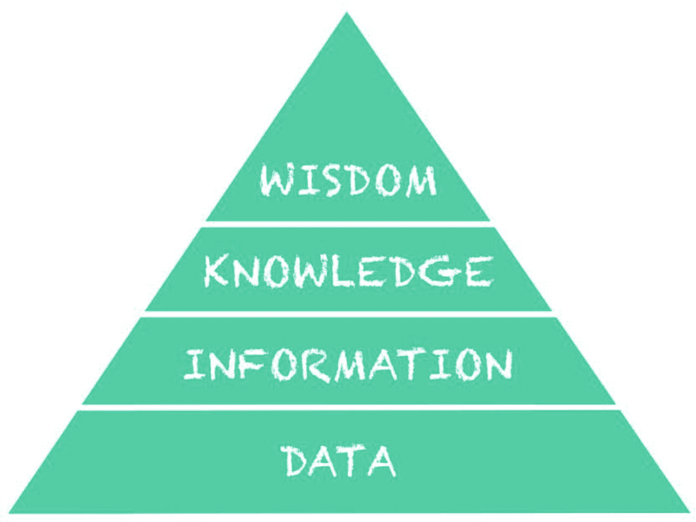

# 数据在组织中的运用

我们常听到关于*大数据*的讨论，这是一个含义模糊的术语，通常指代海量数据。当处理数据需要耗费计算机大量资源时，数据通常被视为“大”，但这会随时间推移而变化。1995 年在计算机上算作海量的数据，今天可能微不足道。许多组织采集的数据量之大，已开始触及自身资源极限，这无疑符合大数据的定义。

大数据与“常规数据”共有的一个特点是：所有数据的存在都有其目的——增进我们对世界的理解。如前所述，数据是现实世界的抽象。一旦我们抽象了世界，就能通过数据科学或数据分析，以某种方式利用数据更好地理解世界。为便于理解，人们定义了不同层次的数据。图 1-5 中著名的 DIKW 金字塔图展示了数据从底部到顶部的演进过程，其效用逐级提升。

一张绿色金字塔图，阐释了数据处理的层级结构。从底部到顶部，各层分别标注为：“数据”、“信息”、“知识”和“智慧”。每一层级都代表了从原始数据向智慧转化的一个步骤。

**图 1-5** DIKW 金字塔

如果数据的目的是帮助我们更明智地认识世界，那么数据分析和数据科学就是实现这一目标的主要方法。尽管“信息”一词常与数据混用，但在此图表中存在一个重要区别：在这种观点下，信息是具备意义的数据。更进一步，意义显然有用，但需要将信息与理解进行整合，才能转化为*知识*。最终，知识不会立即变成*智慧*，它需要随着时间的推移逐步积累。

组织中大多数数据分析和数据科学工作，都是为了帮助领导者做出更优决策。但有时，数据本身仅仅是为了处理事务，而理解数据的各个方面，则关乎这些处理流程的成功与效率。并非所有数据都用于分析。零售公司存储每一笔交易，拥有会员的组织存储会员数据，图书馆则存储其拥有的每一本书和每种媒体资料的记录。无论是否经过分析，这些都是数据。

举个例子，我们可以回顾美国人口普查。1880 年的人口普查耗时八年才完成，原因在于数据量大且缺乏快速数据处理机器。这种规模惊人的问题显然需要某种变革才能在未来的普查中跟上节奏。作为解决方案，人口普查局委托赫尔曼·霍勒瑞斯发明了一种“制表机”。这种原始计算机使用打孔卡，使下一次普查的处理时间缩短了两年。这类机器很快在商业领域得到应用，但直到 20 世纪 60 年代，在通过将计算工作从昂贵的人力转移到相对廉价的机器来降低成本的强烈愿望推动下，计算机技术才真正开始腾飞。

企业中数据领域发生的一次重大革命是关系型数据库系统的出现，这将在后续章节讨论。尽管当时已经存在其他计算机化的数据库系统，但关系型数据库系统使分析师处理数据变得更加容易，尽管随着存储数据量的急剧增加，还需要进一步的发展才能跟上需求。数据仓库是应对数据增长的第一步，在 20 世纪 80 年代末开始流行，随后在 20 世纪 90 年代末出现了非关系型数据库系统。这些系统规定了数据库的构建方式，使大规模数据的自动处理和存储变得更加可行。大多数主流数据库系统在数十年前就开始采用关系型数据库原理，并沿用至今。这包括航空订票系统、银行交易系统、医院、图书馆、教育机构系统等等。

在数据库系统改进了数据的存储与检索的同时，进一步的发展帮助人们进行数据的处理和展示。20 世纪 60 年代，统计软件的诞生使人们能够轻松进行统计和数据分析，这又是一次革命。这些工具还使得数据可视化变得更加容易，尤其是在随后几年得到进一步开发之后。如今大多数公司都将数据分析作为日常运营的常规组成部分，这全都要归功于现今的便利性。第 5 章将在讨论数据分析时对此进行深入探讨。

## 数据为何如此重要

我们深知自己生活在一个数据爆炸的时代。几乎所有公司都在采集数据，有时甚至并无明确目的。但所有人都知道，数据——尤其是数字化数据——代表着未来。像优步、亚马逊和奈飞这样的“数字原生”公司，首先都是科技公司。这是因为它们从一开始就利用了数据。为了在当今保持相关性和竞争力，成熟的企业必须认识到，它们自身也需要成为科技公司。这实际上意味着要学会获取正确的数据，并懂得如何利用数据来改进决策。但同时，这也意味着它们必须改变商业模式，这正是新老公司境遇迥异的原因所在。并非所有公司都在尝试，而尝试的公司也并非都能成功。许多实体零售商在这方面举步维艰。但沃尔玛成功实现了现代化，模仿了亚马逊创造客户忠诚度的诸多创新，例如易用的应用程序、庞大的配送网络以及提供免费送货的会员计划（类似亚马逊 Prime）。

数据科学家是实现这一切的关键人物，他们帮助企业确立新方向。但数据科学家没有数据就一事无成，而掌握数据处理技能需要经验积累。数据科学家可以利用数据解答或解决的一些问题和难题，见表 1-13。

**表 1-13** 数据科学家可利用数据解决的业务问题

| 行业 | 业务问题 |
| --- | --- |
| 航空业 | 如何根据出行剩余天数动态调整票价以实现收益最大化？ |
| 银行业 | 新信用卡客户的最佳信用额度是多少？申请人信用卡还款违约的概率有多大？ |
| 保险业 | 哪些保险索赔更可能存在欺诈行为，需要进一步调查？ |
| 社交媒体 | 如何为所有用户实时个性化定制内容（帖子、广告等）？ |
| 零售业 | 所有产品的最佳库存量是多少，才能既避免库存积压，又能防止缺货？ |
| 电子商务 | 如何衡量可直接归因于营销的销售额的营销支出效果？ |
| 流媒体 | 哪些客户最有可能不续订其订阅服务，以及如何应对这种情况？ |

## 数据治理与数据质量

我们将提及的数据的最后一个方面是常被忽视的数据治理和数据质量领域。*数据治理*本质上是一种理念，即从宏观角度审视组织内的数据，并加以管理，以确保数据质量和实用性保持在较高水平。这意味着要建立一个涵盖策略、流程、标准及指标的全面框架，并以此管理数据。它还包括制定数据访问、使用和共享的指南。简而言之，数据治理为公司的数据提供了防护栏，而确保数据质量是其重要目标之一。

*数据质量*一词的含义相当直观——它旨在衡量数据的好坏程度。基本上就是说，数据的抽象化表达是否尽可能准确地反映了现实世界？但事实证明，这可能会比它看起来的样子要困难得多。数据有多个特定维度共同影响着整体数据质量，例如正确性、完整性和时效性。这些维度看似相似，但每个维度都考虑了数据的不同方面，在诊断问题时很有用。例如，某个列可能有很多缺失值，但已有的数据已知是正确的。那么正确性会很高，而完整性则会很低。如果我们查看缺失数据，发现它们都是最近才添加到表中的，那么可能还存在时效性问题——只有几天前的旧记录才是好的。

数据质量领域其实相当成熟，尽管大多数公司并未给予足够重视。许多公司没有正式的数据治理或数据质量团队。人们只是设法使用数据，尽己所能地应对问题。数据科学家无论数据质量好坏都必须处理数据，因此了解质量问题对于正确使用数据并得出有意义的结果至关重要。

数据治理的一部分工作是识别数据所有者，这在数据质量方面非常重要。在很多组织中，这可能会是一项出乎意料的艰巨任务。所有权本身就是一个模糊的概念，但通常意味着所有者应该是那些对数据有深入了解，并在一定程度上确保数据准确性的人。有时，与数据打交道最多的团队会拥有该部分数据的所有权——例如，管理大学宿舍的团队可能拥有所有住宿生的数据。在其他情况下，数据可能由“信息技术部”（IT）拥有，这本身也是一个比较模糊的概念，但通常指的是负责维护和管理数据存储工具及其他技术的技术人员。这通常不是一个好主意，因为他们往往不太理解数据本身所代表的现实世界的各个方面，而这始终需要业务知识。这在组织中成为一个挑战的主要原因是，人们往往抗拒成为数据所有者，因为这责任重大——甚至可能令人不知所措——而且他们不想在出现问题时承担责任。

