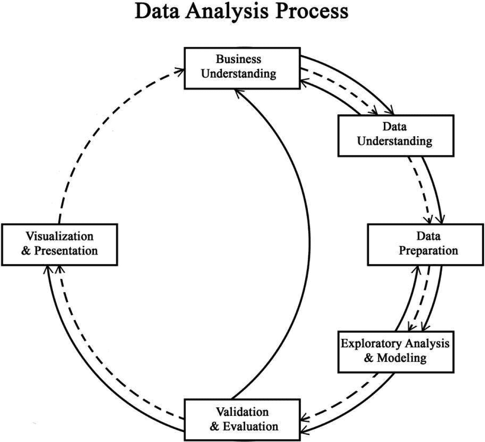

# 5. 弄清问题：数据分析

## 引言

在之前的章节中，我们讨论了数据分析和数据科学中最基本的东西——数据本身，以及统计学，它是数据科学中其他一切的基础。没有数据，你显然无法在数据科学中做任何事情。但你也不能只拿一些原始数据就开始从中挖掘出迷人的见解或预测。在数据能够产生有价值的信息之前，需要执行许多步骤。事实上，数据可以通过多种方式进行探索，而数据分析领域致力于理解和处理数据。数据分析主要涉及以明智的方式对数据进行切分和剖析，利用分析工具从中提取意义。这些工具包括编程语言、电子表格以及我们在前三章中介绍的统计学技术，尤其是图表和其他可视化工具。数据分析师通常只使用描述性统计，但有些人会深入研究更高级的统计学。数据分析师已经存在很长时间了，他们观察过去发生了什么，解释其含义，有时利用这些信息帮助我们理解世界并预测未来。

这听起来很像数据科学能做的事情，这并非巧合。很难说清楚数据分析在哪里结束，数据科学又从哪里开始。我认为两者处于一个连续体上，有大量的重叠。几乎总是如此，一个数据科学项目会涉及数据分析，尤其是在项目初期。大多数数据分析师的工作不会深入到更高级的数据科学领域，但许多数据科学家一直都在做数据分析。事实上，要成为一名优秀的数据科学家，你首先需要成为一名优秀的数据分析师。

“数据分析”是一个含义丰富的术语，在商业世界中对不同的人意味着许多不同的东西，但最简单的定义是：它是调查和分析数据以便更好地理解数据所代表内容的过程。我们将在第 [7] 章中详细讨论这一点，但“分析”这个更通用的标签分为四种类型：描述性分析、诊断性分析、预测性分析和规范性分析。正如你所猜测的，描述性分析基本上只描述数据中包含的内容，而诊断性分析则试图通过深入数据来解释事物。这两者是数据分析的基本领域，而数据科学则更侧重于后两种。

因此，数据分析工作可能涉及极其广泛的技术，如果你查看标题为“数据分析师”的职位列表，你会看到令人惊讶的技能范围要求。在许多情况下，他们实际上是在寻找数据科学家，要求具备高级编程技能、机器学习知识等等。也许他们试图通过使用另一个标签来避免支付数据科学家的薪水，或者（更可能的是）他们不知道自己想要或需要什么。在其他情况下，他们寻找的是具备基本数学技能、懂或能学会使用 `Excel` 的高中毕业生。大多数情况下，这个头衔意味着介于两者之间的东西。本章将聚焦于这种“恰到好处”的数据分析师——通常被认为拥有大学学位以及若干其他技能，但不像典型的数据科学家那样技术性那么强。

你可能会想，如果数据分析是一个独立的领域，为什么它会在数据科学的书中占据一章？正如我上面提到的，成为一名优秀的数据科学家需要能够进行良好的数据分析。那些职位头衔是数据分析师的人可能在可视化或其他方面比数据科学家更熟练，但在几乎任何数据科学项目早期进行的良好数据分析，对于项目的成功都至关重要。这是因为数据科学的一个基本事实：如果你不理解数据，就无法做好数据科学。数据分析有一套能够带来这种理解的方法。

虽然本章是关于数据分析的，并且将从事这项工作的人称为数据分析师，但这只是他们当前角色的名称，同样适用于在执行其整体流程中数据分析部分的数据科学家。此外，数据分析可能涉及许多不同的方法和工具，包括那些属于统计学范畴的内容。本章将重点介绍数据分析的概念、过程和基本技术。它将以该领域的历史以及现实世界中两个数据分析的例子开始。然后，我将介绍成为一名优秀数据分析师所需的四个关键技能领域。最后，我将介绍进行数据分析工作通常遵循的过程，这个过程被称为 `CRISP-DM`（跨行业数据挖掘标准流程）。

## 数据分析的历史

数据分析已经存在很长时间了，基本上和数据本身一样久。数据的全部意义通常在于更好地理解它所代表的内容，而这正是数据分析帮助你所做的事情。当然，古代苏美尔人和埃及人所做的分析类型与我们现在所做的相比，简直难以置信地简单，但它仍然很重要。图 [5-1] 展示了一份大约公元前 2500 年的古代苏美尔泥板上的商品账目。这块泥板记录了小麦、面粉、面包和啤酒的数量。统治者利用这些以及其它泥板上的数据来评估其公民的税收。

图 5-1：大约公元前 2500 年的古代苏美尔泥板，记录了几种商品（小麦、面粉、面包和啤酒）的数量。来源：`Sumerian economic tablet IAM Š1005.jpg`，[`commons.wikimedia.org/wiki/File:Sumerian_economic_tablet_IAM_%C5%A01005.jpg`](https://commons.wikimedia.org/wiki/File:Sumerian_economic_tablet_IAM_%C5%A01005.jpg)

虽然对数据进行基本操作已有很长的历史，但数据分析作为一个现代领域，其最初的萌芽实际上是在 17 世纪，直到 20 世纪才真正学会走路。数据分析中的许多重要工作在于以帮助人们更好地理解数据和情况的方式对数据进行可视化。19 世纪出现了一些非常酷的可视化作品（尤其是地图和图表），我们将在本书后面看到，下面有一个简单的原始可视化示例（图 [5-2]）。本书后面有一整章专门介绍可视化。

我接下来将谈谈计算机以及它如何彻底改变了数据分析，但在我们理解如何进行分析之前，也值得看看数据分析能做什么。我将分享几个现实世界中数据分析工作的例子。其中一个非常近期，但另一个完成于 150 多年前，至今仍令人印象深刻。

### 计算机的出现

早期，数据分析总是在相当少量的数据上进行。数据量可能多到人们无法完全记在脑中，这也是可视化能派上用场的原因，但数据量仍然足够小，可以手动完成计算。数据量达到多少会变得过于繁重，是有明确界限的。我们在之前关于统计学的章节中看到过这一点，当时样本量为 30 就足以使用要求更高的 Z 检验而非 t 检验。对现代数据科学家来说，30 个数据点听起来很可笑，但随着计算机的出现，情况发生了改变。

计算机彻底改变了许多事物，数据处理也不例外。它在数据分析中带来的最大变化是能够处理大量数据。这不一定指的是“大数据”，我们在第 1 章提到过这个术语，稍后也会再次讨论。它仅仅意味着不再需要事事都手动计算，因此我们可以使用更多的数据。早期的数据分析通常涉及收集数据点，并通过简单的统计技术进行处理，也许首先通过将数字在纸上相加（后来借助简单的计算器）来求和。即使只处理几百个数据点，这种方式也会变得难以掌控，随着数据增长，这些计算很快就变得不可行了。

#### 美国人口普查制表机

到了 19 世纪最后几十年，美国人口普查变得非常复杂。人工清点人数既过于昂贵又容易出错。有人发明了一种机器，帮助加快了 1870 年美国人口普查的进程，但这在很大程度上仍然是一项人力工作。1880 年的美国人口普查非常困难且耗时，直到 1887 年才完成。他们需要不同的方法。第一个出现的解决方案被称为制表机，该机器的各种变体一直使用到 1940 年，之后人口普查局终于转向了真正的计算机。

对普通人来说，这种转变的主要标志是统计学和分析工具的出现，这些工具让人们能够对手动工作难以处理的更大数据集进行自己的分析。最早的工具之一是名为 `SAS` 的产品，一些统计学家（尤其是在保险行业）至今仍在使用它。这是一种具有自定义专有界面的编程语言。它最初开发于 20 世纪 60 年代下半叶，并且仍在不断演进。另一个早期推出的产品是 `SPSS`，其主要目标用户是从事社会科学研究的人员，因此在学术界被广泛使用。到了 20 世纪 70 年代，大量统计工作是用当时的主力通用编程语言 `FORTRAN` 完成的，这对于不太懂技术的统计学家来说很困难。`S` 编程语言应运而生，旨在作为直接使用 `FORTRAN` 的一种替代方案。人们开始使用它，随后在 20 世纪 80 年代末推出了 `S` 的一个版本，称为 `S-PLUS`。总的来说，`S` 已被 `R` 所取代，后者是一种基于 `S` 的现代开源免费统计语言，最初开发于 20 世纪 90 年代初。如今，`R` 被统计学家、数据科学家和一些数据分析师使用，尽管大多数数据科学家正在转向 `Python`，这是一种通用编程语言，拥有大量统计库，因其易用性和性能通常被认为优于 `R`。

#### 开源工具与专有工具

除了 `R` 和 `Python`，上述产品都是专有的，因此它们非常昂贵，大多数个人无法使用。随着人们转向开源的 `R` 或 `Python`，专有工具正逐渐失宠。但还有几件事让专有产品得以留存：它们包括有保障的安全性和合规性，这在许多行业至关重要；另外，那些有代码用这些语言或工具编写的公司，将不得不把所有内容用他们选择的开源语言重写。这既昂贵又耗时，而且并非没有风险（有人可能会意外引入新的错误），因此这些工具被淘汰还需要一段时间（如果它们真会被淘汰的话）。组织有时坚持使用专有软件的另一个原因是，由于他们为此付费，他们有权获得客户支持，并且还能影响软件的未来开发。任何曾因为代码无法按预期工作而陷入困境的人，都能理解只需拿起电话求助某人，而不是上互联网上最好的免费技术问答网站 `Stack Overflow` 寻求帮助的价值。然而，值得注意的是，通过一些私营公司（当然，需要付费），开源工具也可以获得客户支持。

## 现实世界中的数据分析实例

数据分析的例子比比皆是，但我挑选了几个有趣且截然不同的例子在此探讨。第一个涉及将棒球带入数据时代，第二个则是公共卫生领域的一次早期胜利。

### 示例 1：点球成金（Moneyball）

几十年来，美国棒球队的人员配置依靠的是那些“直觉敏锐”的球探，他们会前往北美的高中和大学，通过口口相传来寻找年轻球员。球探们有着悠久的传统，即凭直觉并考虑这些年轻人的潜力，同时参考一些传统统计数据，比如击球率、本垒打数或打点（RBIs）。他们会与球队的其他官员合作，为选秀制定优先名单，意图将这些球员招致麾下，并将其培养成出色的球员。球探在这个过程中至关重要。

20 世纪 90 年代中期，奥克兰运动家队（Oakland A’s）的老板去世了。他一直以慈善心态为昂贵球员提供资金支持，但新老板更为务实，不想在球队身上花费太多。结果，最昂贵——也就是最优秀的——球员都跳槽到了待遇更好的地方。球队开始输球，没人喜欢这样。过了一段时间，球队组织内有人提出了一个不同的想法——如果他们不试图猜测球员的潜力，而是关注他们在当前球队中更详细的数据，会怎么样？一些非常热心的棒球球迷已经收集并分析了二十年的非传统统计数据，但运动家队是第一个认真对待这种方法的官方棒球组织。

这种新方法在迈克尔·刘易斯（Michael Lewis）撰写相关书籍后被命名为“点球成金”（Moneyball），得到了包括经理比利·比恩（Billy Beane）在内的组织内多位决策者的采纳。他们开始深入挖掘更冷门的统计数据，如上垒率（on-base percentage）和长打率（slugging percentage），研究哪些数据能真正转化为比赛中的成果。这使他们能够识别出联盟中那些被低估和未被充分利用的优秀球员，以及更有潜力的选秀人选，并且只需极少的投入就能将他们招入队中。随后，比恩利用进一步的数据分析来指导其他决策，比如击球手出场顺序的最佳安排，最终以慈善时代微不足道的花费，再次打造出一支强大且常胜的球队。举个例子，这支预算有限的球队在 2002 年连续赢了 20 场比赛，打破了美国联盟（American League）的纪录。

棒球界的其他球队注意到了这一点，不久之后，其他预算充足的球队也开始打造自己的阵容。人们普遍认为“点球成金”彻底改变了这项运动，并且这仍然是一场军备竞赛，每支球队都在想方设法以新的方式利用数据来获得微小的优势。如今，不以这种方式研究球员数据被认为是一种风险。

### 示例 2：1854 年在伦敦阻止霍乱

我们回到伦敦，来看一个数据分析解决实际问题的著名案例——约翰·斯诺在 1854 年席卷伦敦的霍乱疫情期间所做的工作。当时，人们并不了解疾病是如何传播的，因为细菌的概念尚未出现。相反，人们相信“瘴气”是疾病在人与人之间传播的主要原因。斯诺在很多方面都走在了时代前列，甚至通过推广在外科手术中使用氯仿作为第一种麻醉剂，革新了医学。但他对数据分析的重大贡献在于，他绘制了一张 1854 年疫情期间的伦敦地图，并在每个家庭住址处添加了一个代表该处霍乱死亡人数的条形。从这张地图上可以清晰地看出病例集中的地点，基于此，他确定了宽街上的一个特定水泵为源头，因为大多数受害者都从这个水泵取水。你可以在图 5-2 中看到斯诺所用地图的放大视图，聚焦于宽街水泵周围的区域。相当令人惊讶的是，他说服当局立即封锁了该水泵，此后疫情很快便平息了。

一张历史区域的地图，显示了街道和建筑物，标有宽街、大马尔伯勒街和马歇尔街等名称。著名地点包括一个济贫院和几个水泵。黑色条形表示沿街道的数据点，可能代表历史数据或事件。地图详细显示了街道和建筑的网格状布局。

图 5-2：约翰·斯诺绘制的显示 1854 年霍乱疫情死亡情况的地图。来源：裁剪自文件 `File:Snow-cholera-map-1.jpg`，[`commons.wikimedia.org/wiki/File:Snow-cholera-map-1.jpg`](https://commons.wikimedia.org/wiki/File:Snow-cholera-map-1.jpg)

在地图上，所有较深的黑色标记都是表示受害者的小条。有些分布较分散，但从这张地图上可以很明显地看出，靠近宽街的某个地方使人们暴露于疾病之中。在宽街上标有 `PUMP` 的点旁边，有一大堆死亡标记。住在附近的人们从那个水泵取水。这就是我们所说的领域知识，即关于数据来源世界的基本知识，它使得斯诺得以得出结论：起因是水泵，而不是某种原因笼罩在该地区的“瘴气”云团。斯诺是一位医生和科学家，尽管细菌理论还要过几年才能建立，但专家们已经对瘴气理论产生了怀疑。斯诺思考了居住在该地区人们的日常生活，意识到他们都会取水，因此那是一个潜在的源头。当他们关闭宽街水泵时，没有人确信疫情会停止。但疫情确实停止了，而水可能携带疾病这一认识，增加了科学家对疾病及其传播方式的理解。

## 数据分析师的基本技能

我已经谈了一些数据分析涉及的内容。数据分析师必须具备某些技能和特质才能成功。虽然有些人具有数据分析的天赋，但这是一个大多数人如果思想开放、培养数据思维并努力掌握我将在本节中讨论的技能，就能学好的领域。一名优秀的数据分析师需要一系列的技能——功能性技能、技术技能和软技能。此外，领域知识对于做好数据分析至关重要。下面我们将探讨主要技能。

### 功能性技能

功能性技能是相当高层次的技能，能帮助你决定如何着手解决问题。它们既涉及天赋，也涉及在科学和数学等课程中学到的高层次概念和技能。最明显的功能性技能是逻辑性和系统性思维。你需要能够按照逻辑步骤进行推理，得出重要结论，并能够为其提供支持。这其中的一部分是意识到自己的偏见，以免影响工作。虽然这在一定程度上是一种软技能（下文讨论），但你需要能够倾听他人意见，并理解他们的观点，即使与自己的不同。与此相关的是组织能力和遵循流程的能力。所有数据分析师都需要具备良好的数学基础，有些职位还需要统计学知识。一名优秀的数据分析师还应具备天生的创造力。你经常会听到关于跳出固有思维模式或求知欲的价值，确实，最激动人心的见解往往来自于以新视角看待事物的人。从事数据分析和数据科学工作的人经常提到的一个特质是数据思维——这基本上是指思想开放，不急于下结论，理解数据是某事物的表示，并尊重任何形式的数据。

### 技术技能

虽然主要技术技能取决于具体职位，但所有数据分析师都需要对计算机有基本的熟悉程度，以便能够学习其职位所需的任何特定软件。至少，需要熟悉 Microsoft Excel 和 Word（或其谷歌等效软件），并且大多数数据分析师应具备相当丰富的 Excel 使用经验，包括许多更高级的功能，如数据透视表和`vlookup`。许多分析师需要了解他们将操作的数据库系统，并且通常需要使用结构化查询语言（SQL）与这些数据库交互。虽然对于数据分析师来说不如数据科学家那么常见，但许多分析师也会进行计算机编程，通常使用 Python 或 R（这一趋势也在上升）。有时，数据分析师甚至会在 Excel 工作中使用 VBA（Visual Basic for Applications，一种嵌入在 Microsoft Office 产品中的编程语言）进行编码。

### 软技能

除非你正在开展一个完全独立、不打算与他人共享的项目，否则软技能也同样重要。“软技能”通常指为完成工作而与他人互动所需的一系列不同能力。这些技能中的大部分几乎是任何工作都必需的，但对于数据分析师和数据科学家所从事的技术工作，还有一些特定的技能。

其中一些技能更多与心态或态度相关，而非具体技能。具备普遍的适应性至关重要，因为在数据分析项目中情况时常变化。拥有成长型思维，即理解自己需要不断发展数据分析技能，这一点很重要。这个领域在不断变化，你必须使自己的知识和技能保持更新。此外，牢记你的工作可能产生的影响，将有助于确保你的行为合乎道德。

时间管理涵盖了一系列重要技能。你通常需要同时处理多项事务。你必须能够理解哪些任务最重要，对每件事需要多长时间以及真正的截止日期有合理的认识，这样才能知道在任意给定时间应该做什么。在大多数工作中，优先排序的能力是必要的。数据分析工作的一个特点是，有时你无法着手某项工作，要么是因为你在等待他人，要么是你困在了某个步骤，该步骤必须先完成，才能进行后续步骤（例如，你可能正在运行需要一小时才能完成的代码，而没有结果你就无法继续该项目）。因此，你需要具备同时处理多个项目的能力。你需要了解每项任务是如何运作的，这样才能有效地确定优先级，并为每项任务分配适当的时间，以满足截止日期。

另一类软技能涉及与不同类型人员的沟通。通常，项目的所有预期用户或受益者被称为利益相关者。这包括技术人员，比如你技术功底深厚的数据分析师同行，也包括那些你一提到“p 值”这个词大脑就会宕机的非技术人员，以及介于两者之间的所有人。通常，你所做的工作最终是为非技术人员服务的，因此你需要能够以他们能理解的方式解释你的工作和结论。你经常会发现，除非人们觉得能够理解你的发现，否则他们不会信任你或你的发现。他们通常意识到自己无法理解所有“花哨的数学”正如我们常说的，但他们仍然希望了解你所呈现信息背后的基本概念。这也是数据分析师和数据科学家经常倾向于选择更简单、更易于解释的方案，而非更复杂、更花哨的方案的原因之一。这种策略将在本书后续章节讨论。

你与他人互动的一种常见方式是通过演示，因此能够创建易于理解的演示文稿非常有价值。沟通技巧也不是单向的——能够倾听和接受反馈同样重要，这些反馈可能来自你的客户或领导。不幸的是，与客户和领导有时会产生冲突，你需要保持冷静，进行协商，或者仅仅是倾听以理解必要信息，即使你不同意对方的观点。有时候，坚持你认为正确的事情很重要，但其他时候，保持沉默（有时是永远沉默）更为明智。在某些环境中，兴风作浪会让你陷入麻烦，甚至遭到报复，因此当你与主流意见相悖时，应始终考虑自己所处的情况。

公司有时会有特定的文化来定义沟通风格——例如，一些公司可能希望避免冲突，通过避免直接表达来优先考虑人们的感受，而另一些公司则更倾向于保持一切清晰公开，因此直截了当的沟通备受青睐。在第一种情况下，懂得如何在不伤害他人感情的同时传达你的信息很有价值；在第二种情况下，能够直截了当、清晰表达且不刻薄则很有价值。事实上，研究发现，那些推崇直接沟通、不回避冲突，同时仍能尊重他人感受并找到建设性方法解决问题的组织更为成功，但间接的沟通风格更为常见。

# 领域知识

数据分析另一个重要领域称为领域知识，它基本上就是指你所处理数据类型的专业专长。我们将在第 10 章中更深入地讨论，但目前需要知道的是，领域知识被视为数据科学的三大支柱之一，并且在数据分析中也极为重要。它本质上是对特定“领域”（例如金融数据、游戏数据、网站使用数据、医疗数据、零售数据等）的专业知识和实践理解。通常，这还意味着对这些领域中更具体的数据类型有深入的了解。如果你对所处理的数据没有足够的理解，就无法做好数据分析——或者说，无法做好数据科学。

## “免费”的领域知识

大多数人如果拿到一堆关于欧洲风车的数据，可能都不知道从何入手。但很多时候，我们因为曾经涉足某个领域而对其有所了解。例如，大学生都会对关于学生、课程和教师的数据感到熟悉。我们知道，可以有一门课程，比如`ENG 301 American Literature 1`，它实际上更像一个概念，例如作为大学课程目录中的一门课程描述存在。而更具体的课程则是在特定学期的课程表中实际安排的课程。`American Literature 1`的`Section 002`安排在 2022-2023 学年的秋季学期，每周二和周四下午 3:30 上课，由`Alex Thorne`担任讲师，最终还会有一份具体注册学生的名单。通常，学生和教师都会关联多门课程，并且这些课程必须安排在时间表上，以避免时间冲突等等。这些事情对我们大多数人来说似乎显而易见，但这正是领域知识的本质。当你拥有它时，它显得如此自然和明显，以至于你常常甚至没有意识到你所知道的东西是真正的知识。在处理合适类型的数据时，这能让你在通往高质量数据分析的道路上走得很远。

领域知识必须有来源。在课程的例子里，它显然来源于生活经验。但在很多时候，你并不会事先拥有它，需要去培养。这在商业世界中尤其如此。有时你可以在网上或书籍中找到材料来学习所需知识，但通常学习所需知识的唯一方法是找到已经拥有该知识并能帮助你学习的人。这些人通常被称为`主题专家`，或`SMEs`。诚然，有时你可以纯粹通过研究数据来弄清问题，但你必须非常谨慎，并且必须始终与专家一起验证你的假设。

与主题专家合作的一个挑战是，他们往往不知道自己知道什么。如果他们要描述一个流程或系统，他们很可能会遗漏一些步骤或假设，因为这些对他们来说是不假思索或本能反应，所以他们觉得不值得提。例如，在上述课程的例子中，想象一下他们忘了提到教师教授多门课程。如果你完全不了解课程安排是如何运作的，你可能会错误地假设每位教师只教一门课，或者一位教师教授某门课程的所有部分。似乎不可能有人会这么想，但一个没有中学或高等教育经验的人可能确实不知道。这类错误的假设在数据分析中可能是毁灭性的，会导致你走上完全错误的方向。

好的一面是，领域知识通常在一定程度上是可迁移的。如果你在一家公司的零售领域工作，然后转到另一家零售公司，你会发现你并不是从零开始。

# CRISP-DM：数据分析流程

尽管数据分析项目都略有不同，但管理此类项目有一个通用的流程。我们通常称之为数据分析生命周期。不同的数据分析师可能使用略有不同的流程，但许多团队都使用名为`CRISP-DM`（跨行业数据挖掘标准流程）的流程来进行数据分析和数据科学，两者之间只有细微差别。它包含以下六个步骤：

1. 业务理解
2. 数据理解
3. 数据准备
4. 探索性分析与建模
5. 验证与评估
6. 可视化与呈现

虽然这些步骤看似线性，但流程中存在大量迭代。我们不会完成一个步骤就进入下一个步骤，然后再也不回头。图 5-3 展示了该流程可能具有的迭代性。

  
流程图标题为“数据分析流程”，展示了循环的步骤序列。流程始于“业务理解”，接着是“数据理解”、“数据准备”、“探索性分析与建模”、“验证与评估”，最后是“可视化与呈现”。箭头指示了每个步骤之间的流向，强调了流程的迭代特性。  
图 5-3 — CRISP-DM 数据分析流程

我们将在此处概述每个步骤的基础知识，但有关该流程的更多详细信息，请参阅第 21 章。

## 业务理解

我们总是必须从业务理解开始，这意味着理解你的客户试图了解什么，并定义你的研究问题。换句话说，他们试图解决什么业务问题，你将如何调查这个问题？例如，一支橄榄球队可能想知道应该交易掉他们的哪名防守球员。这意味着你需要查看所有球员的一些表现指标。你必须与业务方合作来识别和定义这些指标，并且还需要确定你是否拥有这些指标的数据。这个步骤通常与下一步骤（数据理解）同时进行，你可能会发现在一开始你会在这两者之间反复摸索。与客户交谈以试图提出研究问题被称为需求收集，这在许多不同的学科中都会进行。但这不仅仅是快速询问他们想要什么那么简单。在此过程中，如果你尚未具备相关的领域知识，则必须开始培养它。

### 数据理解

在充分理解客户需求后，下一步是理解可用的数据。这通常也隐含着首先要找到数据。大多数数据分析工作由能够访问既定数据源的团队完成，因此你很可能已经能获取这些常见的数据源。在确定要使用哪些具体数据源之前，你需要从宏观层面了解：为了回答上一步提出的研究问题，你需要哪些数据。假设在我们的示例中，你和业务方已确定要追踪防守球员的四项数据：擒抱、擒杀、抄截和掉球。

一旦明确了所需数据，你就要寻找包含这类信息的数据源，并开始调查具体的数据源。若运气好，可能有数据工程团队能直接提供你需要的内容，或者存在类似数据字典的文档来辅助理解数据源。但更多时候你并没有这么幸运。此外，哪些字段至关重要并不总是显而易见的，因此这可能是一个迭代的过程。值得注意的是，即使获取了所需数据，你可能会发现这些数据并不足以回答你提出的研究问题。这时你或许会调整问题，但很可能需要与业务方确认，确保新问题仍能满足他们的需求。

在橄榄球的示例中，假设我们找到了包含每位球员的擒抱、抄截和掉球数据的数据源，但唯独没有专门记录擒杀的数据（擒杀特指针对四分卫的一种擒抱）。然而，你发现另一个数据表记录了带时间戳的擒抱信息，以及被擒抱球员的位置，却没有记录执行擒抱的球员。你重新查看原始的擒抱数据，发现其中包含部分时间记录。你推断或许可能将这两个数据源对应起来，但不确定能否实现以及需要多少时间。这时就需要与业务相关方讨论：擒杀数据的重要性如何？是否值得投入时间进行提取？在进入下两个阶段前你未必能给出答案，但先与相关方沟通是合适的做法。他们或许会告诉你，对于当前问题，擒杀数据并不那么重要。

请注意，正如示例所示，在此阶段你会对数据进行一些处理，但真正的深入分析要等到数据准备阶段才会开始。

### 数据准备

当你对业务需求有了充分理解，并确信手头有正确数据后，下一步就是数据准备。这一步在整个流程中可能占据极大比例。后续会有专门章节讨论这一主题，但数据准备涉及诸多方面：清理包含尾部空格的混乱文本字段、确保数值字段的数据均在预期范围内、识别并处理缺失值或空值等等，不一而足。我们将在第 13 章和第 14 章中深入探讨。

如果你的公司有数据工程师，他们已提前为你准备了干净整洁的数据，那你可真是幸运。这种情况下，你或许能跳过部分准备工作，但很可能仍需在此处完成一些工作。

如果项目涉及建模，你还需要进行特征工程——基于现有数据源创建新特征，以改进建模或分析效果。知道要创建什么特征通常依赖于下一步的发现，因此这两个步骤之间也存在反复交互。在数据科学中，特征工程几乎总是必要的——即使数据工程团队提供了干净数据也是如此，但在数据分析中则不一定常用。确定需要哪些特征本身就是一个流程，它既取决于数据的具体形态，也取决于后续将使用的技术。

值得一提的是，这一步与下一步（探索性分析与建模）之间可能存在大量反复，因为你在下一步中可能会发现需要补充数据准备或调整已完成的工作。

在我们的橄榄球示例中，部分数据准备工作可能是：创建一个包含球员姓名及所有基本统计数据的新数据表，并根据业务相关方确认的合理业务逻辑，将空值替换为 0。同时需确保所有数值字段以数值数据类型保存。你可能仍在思考能否从两个数据源中推导出擒杀数据——但此时知识储备尚不足以完成这件事，需要依靠下一步的发现来判断是否可行且必要。

### 探索性分析与建模

在准备好数据之后，就该开始做你一直想做的事情了：深入研究数据。探索性分析与建模通常是另一个重要步骤。其重要性程度取决于你钻研的深度。但如前所述，在发现之前粗略调查时遗漏的数据问题或小陷阱后，你很可能会多次回到数据准备步骤。在其他情况下，你甚至可能不得不一路回溯到数据理解阶段。你可能会发现需要寻找全新的数据。这完全正常，并不意味着你做错了什么。

*探索性数据分析*（EDA）始终是“查看数据”的首要步骤。这不是在 Excel 中随意打开数据文件并随便看看的过程。探索性数据分析提供了一个以开放心态调查数据的框架。它不是一套必须严格遵循的僵化步骤，但它有助于指导你完成初步分析。统计学家约翰·图基在 20 世纪 70 年代提出了这一过程，自此数据分析师们一直遵循他的指导原则。EDA 也可以被视为一种心态或态度。我们应以充满好奇、摒弃假设和预期的心态来审视数据，因为我们永远不知道会发现什么。

所以，我们知道了 EDA 很重要且相对简单，但它具体涉及哪些内容呢？基本上，EDA 就是第 2 章介绍的描述性统计。我们生成汇总统计数据和基本图表。汇总统计数据告诉我们关于“位置”和“分布”的信息，涉及均值、中位数、众数以及标准差/方差等指标。典型的图表包括散点图、条形图、直方图、箱线图和饼图。

我们进行的初步 EDA 通常侧重于单个字段。汇总统计是针对单个字段进行的，但使用多个字段来制作图表的情况也并不少见，尤其是线图和散点图。在进行 EDA 时，各种相当简单的图表都很有用。这通常仅仅是以可视化方式查看位置和分布度量的方法，便于解释。很多时候，在纯数字数据中难以发现的东西，在可视化后可能会变得一目了然。我们可以制作一个字段值按另一个字段值细分的折线图（用不同的线条表示细分字段），或者通过直方图查看字段值的分布情况。异常值可能会一下子跳到你的眼前。

值得注意的一点是，当你在 EDA 过程中创建图表时，可能不会非常讲究地添加坐标轴标签和图标题。如果这些图表仅供你自己查看，那没问题；但任何时候你要与他人分享图表，即使只是另一位同事，也最好至少标出坐标轴，并且添加图标题总是一个好主意。如果包含超过一种数据类型，则应添加图例。你在创建图表时可能觉得坐标轴和图表组件代表什么显而易见，但其他人——甚至几个月后的你——未必能一眼看出。

EDA 至关重要，并且取决于我们正在从事的项目类型，可能需要进行更深入的分析（例如数据分析项目），或者我们可能直接着手进行建模（例如数据科学项目）。或者，更有可能的是，在开始更多的 EDA 之前，我们可能需要先回到数据准备步骤。了解你的数据通常是一个迭代过程。

对于橄榄球数据，你会查看我们拥有的指标（擒抱、拦截和掉球）的分布情况，寻找在数据准备期间未发现的异常值或其他异常情况。但我们仍然存在从两个来源推导出擒杀次数的问题。你需要仔细研究这个问题，看看是否能找出如何对齐两个文件中不同时间戳的方法。你可能需要做相当多的工作才能弄清楚这个问题，这就是为什么你需要向利益相关者确认这样做是否值得。但如果弄清楚如何操作，你就会回到数据准备步骤，并将这个衍生特征添加到你的表格中。

完成 EDA 后，你可能会有更大的问题需要回答，而此时你应当已经对数据中可用哪些变量有了清晰的认识。你大概会了解哪些特征可靠且准确，以及它们的局限性。因此，你会清楚你的数据在回答问题时能发挥多大作用，尤其是当问题变得更复杂时。回顾你的问题并尝试提出更多问题，是 EDA 完成后一个好的第一步。

完成 EDA 后你将要遵循的探索性分析步骤，完全取决于项目的目标。你可能有一些尚未得到解答的研究问题，或者你可能有来自客户的新需求，这两者都会指导你的方向。接下来的步骤通常涉及更复杂的数据切分和聚合方式，以便更侧重于研究不同字段如何相互影响，并深入挖掘以理解与特定研究问题相关的数据。此阶段的部分工作可能是在为可视化和展示步骤做准备，但通常还不会创建最终交付物。

虽然以上讨论的所有步骤在大多数数据分析项目中都很常见，但一些数据分析师会使用一些重要的高级技术。其中一些技术与人们通常认为的数据科学的主要技术有显著重叠，这也是为什么它们在此被视为高级技术。我们不会在此介绍它们，因为它们将在后续章节中逐一讲解。

数据分析师最常用的高级技术包括相关性检验、基本假设检验、显著性检验，以及其他诸如 t 检验和卡方检验等，所有这些都是统计学的一部分。要理解这些，需要具备概率以及分布的基本知识，从大多数人听说过的正态分布（也称为钟形曲线）开始。你在第 3 章和第 4 章中已看到所有这些内容。

另一种常用技术是线性回归，同样基于统计学。从视觉上看，这很像在散点图的点之间绘制最佳拟合线，但实际创建起来要复杂得多。它通常涉及两个以上的变量，这使得它难以可视化，但理解起来仍然比许多其他技术容易。尽管它相对简单，但被认为非常有价值，因为它易于解释，并且对大多数人来说相当直观。

如果你的利益相关者提供了更多信息，你或许可以进行线性回归（或其变体逻辑回归）。假设他们对一些球员进行了 1 到 10 分的评分。你可以创建一个基于你所处理的指标进行训练的线性回归模型，来计算其余球员的评分。他们或许可以用它来选择一个阈值，任何评分低于该阈值的球员将被交易。

任何数据分析项目（以及大多数数据科学项目）都会包含探索性分析步骤和某些更深入的分析，但只有少数项目包含建模。建模在数据科学项目中最为常见，但一些更高级的数据分析项目也可能涉及建模，特别是像线性回归这样的方法。有时甚至可能涉及使用机器学习的建模。数据分析与数据科学之间的这种重叠正是该领域的本质——不同工作、不同项目之间的期望和工作内容差异巨大。

### 验证与评估

完成分析后，你需要验证自己的工作，如果创建了模型，还需对其进行评估。这一步就是“检查你的工作”，这是绝不能敷衍了事的环节。你必须确保没有出现任何计算错误，也没有以任何可能导致对现实世界产生误解的方式使用数据。这并非易事，通常需要花费大量时间。

验证侧重于确保所尝试的工作准确无误地完成，而评估则要求我们思考所做的工作是否恰当，以及是否回答了利益相关者的问题。评估有不同的方法，同行评审员也会在评审过程中评估你的方法。在*同行评审*中，同事们会互查彼此的工作，以便在问题固化之前发现它们。同行评审员会审视你进行分析所采取的步骤以及编写的任何代码，帮助你识别任何可疑的假设、错误的逻辑或编码错误。

尽管有时验证和评估会在工作“完成”之后才进行（在确认正确之前，工作并未真正完成），但沿途检查也是常见做法，许多团队会在工作仍在进行时就互相评审。征求同事的意见往往是确保自己方向正确的明智之举。即使是最优秀的数据分析师和数据科学家，也会在过程中犯错——错误通常很小，但并非总是如此。同行评审是避免陷入死胡同的好方法。数据科学尤其是一个需要高度协作的领域。

你需要验证在数据准备步骤中对足球数据所做的所有转换，以及你在上一步中创建的任何图表或运行的任何测试。

### 可视化与呈现

最后，我们来到了最后一步。这一步在图表左侧独自占据一席之地，因为它与大多数其他步骤截然不同。这是你汇总所有结果并向客户展示的环节。可视化通常是数据分析师工作中很重要的一部分。在探索性分析和建模步骤中准备大量图表是标准做法，但这一步的重点是向利益相关者进行展示。可视化很重要，但通常数量不宜过多，因为你不想用过量信息淹没利益相关者。

可视化是呈现的重要组成部分，但通常不止于此。不同公司、不同展示对象以及项目的正式程度，都会导致操作方式大相径庭。如果这是一个一次性项目，你或许可以直接展示探索阶段创建的一些可视化图表。有些公司希望所有内容都以幻灯片形式呈现，因此你可能会创建一个突出显示发现成果（包括你创建的图表）的演示文稿。其他公司可能更喜欢 Word 文档。很多人对 Excel 情有独钟，喜欢查看原始数据，因此你可能会创建一个包含所有数据和图表的 Excel 表格。（`Excel` 是许多数据专业人士的眼中钉。）更具技术性的公司可能会使用 Python 笔记本或创建 Web 应用程序。本书后面有一章专门讨论可视化和呈现，届时会更深入地探讨这些主题。

如果这项工作是为持续向利益相关者提供信息奠定基础，那么可能涉及创建一个仪表板，该仪表板会按一定周期自动刷新最新数据。有些数据分析师确实会使用 `Tableau` 或 `Power BI` 等工具创建仪表盘并设置自动数据刷新，但在许多公司，会有另一个团队根据你提供的要求来完成这项工作。

对于你的足球比赛结果，一个合乎逻辑的展示方式是为玩家评分及其其他指标创建一个表格，从高到低排列。在探索过程中，很容易发现其他有趣的趋势或视角。

# 关键要点与后续章节

本章介绍了数据分析，它本身是一个独立领域，也是大多数数据科学家工作的一部分。我们涵盖了数据分析所需的主要技能类型，包括功能性技能和技术性技能（如思维方式与特定工具或技术）、软技能（如沟通与其他人际交往能力），以及领域知识，即对给定数据所代表的世界拥有广泛的知识。良好的数据分析具有系统性，通常遵循一个名为`CRISP-DM`的过程模型，该模型概述了六个主要步骤：业务理解、数据理解、数据准备、探索性分析与建模、验证与评估，以及可视化与呈现。我们涵盖了每个步骤中的主要任务，不过我们将在后续章节中更深入地探讨每一个步骤。

接下来是数据科学章节，我们将讨论它作为一个相对较新的领域是如何发展的，阐述定义数据科学的价值，探讨组织如何看待数据科学，最后讨论数据科学家的素质和角色。

# 从业者简介：桑迪普·坦基

**姓名：** 桑迪普·坦基
**职位：** 数据科学家
**行业：** 学术界
**经验年限：** 13 年
**教育背景：**
*   物理学与天文学博士
*   物理学与天文学硕士
*   物理学与天文学学士

*此处的观点仅代表桑迪普个人，与其过去或现在的任何雇主无关。*

## 背景

桑迪普·坦基是一位天文学方向的物理学家，接受了一系列教育并最终获得物理学与天文学博士学位。他研究恒星，并以教授身份开始了职业生涯。在成为系主任后，他的一位同事是一位经常处理数据的院长。他经常为这位院长提取数据，并因好奇心而开始独立处理数据。之后他转向另一个需要更多数据工作的岗位，并且他非常热爱这一工作。

## 工作内容

尽管桑迪普最初是以学术管理人员的身份处理学生数据，但他认为自己是一名真正的数据科学家。他开玩笑说，这跟他之前在天文领域工作时没什么不同——工作内容跟那时一样，只是数据表的属性变了——现在行是学生，列是`GPA`、课程学分和助学金状态，而以前行是恒星，列是亮度和体积。但这份工作也有不同之处，因为他实际上可以通过工作改善学生的生活，这让他感到非常有成就感。

他的工作涉及许多不同的活动，包括撰写大量报告，以及应对来自各种利益相关者的临时查询。虽然可能不明显，但他的工作往往风险很高，因为通过资助申请书和其他具有法律影响的报告，可能涉及数十万甚至数百万美元的资金。他总是小心谨慎、有条不紊，但对于这些项目，他更是会再三检查自己的工作。

## 语录

**工作中最喜欢的部分：** 桑迪普喜欢自己的工作能够对人们的生活产生积极影响。他还喜欢每天的工作内容都不同，而且永远不知道人们会向他提出什么有趣的问题。

**工作中最不喜欢的部分：** 他发现一些收到的查询很无聊，而且当它们仅仅被用来完成一些常规检查时，基本上毫无意义。比如生成不同种族的百分比，以填充到某个报告中，而不是为了推动改善弱势学生机会的努力。

**最喜欢的项目：** 桑迪普有许多相对较小的项目令他自豪。其中一个项目是深入挖掘数据，以识别那些虽然在校期间成绩优异且接近毕业，但已停止上大学的辍学学生。他运行了一个简单的`SQL`查询，在外联工作帮助部分学生重返校园并毕业之后，这将改变他们的人生。

**教育与现实世界的联系：** 他之前处理的天文数据并非完全干净，但与学生数据相比，那简直可以说是纯净。对于学生数据，有太多分解方式，且数据出错的可能性要大得多。

**最常用的技能：** 人际交往技能极其重要。数据科学部门常常令人望而生畏，因此乐于助人——尤其是即时响应和透明沟通——确实有助于建立信任。通常利益相关者并不清楚自己需要什么。他学会了在人们向他索要信息时，挖掘出真正的需求——他知道如何提出正确的问题，以便他们反过来也能向他提出正确的问题。最后一个关键技能是条理清晰的思维和行为，比如做好记录、将工作文档化以及整理好所有东西。能够参考甚至重用之前的工作，能极大地节省时间。

**当前主要使用的工具：** 日常使用`SQL`，每周使用`Tableau`，偶尔使用`R`和`Python`。

**数据分析与数据科学的未来：** 桑迪普认为，数据目前尚未被充分利用，一旦我们找到更好的匿名化方法，未来将有更多数据用于造福人类。例如，或许可以警告司机，一个不稳定的驾驶员正在接近他们。

**优秀数据分析师的特质：** 耐心、牢记目标、高度有条理。

**给未来数据分析师和数据科学家的建议：** 他的两个首要建议是 (1) 始终将利益相关者放在心上，(2) 重视简单而非复杂。只在仪表盘上放少量图表，分享的电子表格也仅包含少量工作表。人们常常会被复杂性拒之门外。

*桑迪普是一位在学术界工作的数据科学家，帮助教职员工了解如何最好地帮助学生取得成功。*

