# 弄清数据中的情况：描述性统计

## 引言

许多人听过马克·吐温推广的名言："世上有三种谎言：谎言、该死的谎言和统计数字。"统计学并非一个备受喜爱的领域，而且这个词本身对不同的人、在不同的语境中可能有不同的含义——对于大多数研究人员和数据专业人士来说，它不是一个贬义词。但二战前几个世纪的现代统计学巨匠曾用它来推动毁灭性的伪科学优生学，这无疑无助于改善它的声誉。

诚然，对于许多统计学家、数据分析师、数据科学家和学者而言，推断性统计才是关键，即利用数据子集来概括其所来自的更大群体，我们将在第 3 章和第 4 章中深入探讨这一点。

然而，对大多数人来说，"统计学"指的是描述性统计，主要涉及表格、图表以及平均值等少量计算，所有这些都用于通过描述事物的各个方面使其更易理解。这是统计学的合法组成部分，也是本章将要讨论的内容。我们将首先了解统计学的起源，因为这有助于我们理解它如今的应用方式。本章的其余部分将深入探讨描述性统计，介绍均值和中位数等几个基本度量，然后介绍行业中常用的六种不同基本图表。

## 统计学的起源

大多数人不会想到，像现代统计学这样有价值且严谨的学科，竟源于一些好奇的人试图找出最有效的赌博方法。但事实正是如此——1654 年，两位著名的法国数学家布莱兹·帕斯卡和皮埃尔·德·费马就骰子和其他概率游戏的数学问题交换了一系列信件，其中费马对"点数问题"提出了一个简单而清晰的解决方案，这本质上涉及当一场公平游戏在完成前被打断时，如何分配奖金。帕斯卡在此基础上提出了我们现在称之为期望值的第一个计算方法，这至今仍是统计学的基础。我们将在下一章详细讨论他们研究的问题，但首先，我们将涵盖整个统计学领域的起源。

### 早期统计学

统计学作为一门公认的学科存在于数百年前，涵盖了政府的数据收集实践——"统计学"一词甚至源于这种用法，源自"state"（国家）一词。工业革命在对人口和经济数据已有的兴趣基础上，推动了更快节奏的数据收集。但到了 18 世纪，概率论与统计学的关联仍然很小，那时的统计学实际上是我们现在所称的数据分析。几个世纪以来的发展最终成就了现代统计学这一严谨的学科。

统计学发展成为一门关于测量和经验主义的科学。正如上一章所述，数据是对现实世界中某些事物的表示，但要在现实世界中完美地测量任何事物都很难。例如，即使在激光测量设备出现之前，测量一面墙这样简单的事情也很困难。如果你有一把足够长的卷尺，并且有人帮你按住末端，你可以得到相当精确的测量结果——误差可能很小，比如几毫米，对于一面 15 英尺长的墙来说，这不成大问题。但如果你的工具是一把 12 英寸的尺子，且零刻度从左边一点开始，那么测量过程就更容易出错。测量误差可能会迅速累积，或者，反过来，所有微小的误差可能会相互抵消；你无法确定误差有多大——或者有多重要。在讨论结果时，你如何考虑这一点？

处理观察中产生的误差推动了 18 世纪统计学的许多进步，从而产生了中位数和正态分布等概念。在量化统计显著性（如今天的 p 值）方面也取得了一些进展。18 世纪末，一位统计学家发明了几种至今仍用于描述性统计的图表，首次引入了标准化可视化。

到了 19 世纪，统计学开始真正成为一门数学学科，为推断性统计奠定了基础。但这也是一个越来越多的学科开始以某种方式使用统计学来为其数据增加严谨性和理解的时期。天文学家在 19 世纪初就已经经常使用概率和统计技术，并贯穿整个世纪。但天文学家处理的是被充分理解且有明确规律和基本假设的问题，而涉及人类的科学则更难量化。尽管如此，心理学家仍能够开始利用实验设计的发展来得出更准确的结论。社会科学家则因可用数据（以及收集方法）的限制而面临更多困难。19 世纪末取得了一些进展，但直到 20 世纪，社会科学家才真正学会如何使他们的科学真正严谨。

20 世纪不仅带来了描述性统计的进一步发展（如中位数、标准差、相关性、皮尔逊相关系数和皮尔逊卡方检验，所有这些将在下文或接下来两章中解释），还带来了计算机，随着该领域的发展和完善，计算机被证明是无价之宝。

**精算科学**

*精算科学*，简单来说就是在保险及类似领域中使用统计和定量方法来评估和管理金融风险及预期结果，可以看作是传统统计学的一个应用分支，它在现代统计学领域仍在发展之际就已出现，但两者已演变为相对独立的领域。精算科学是一门与保险和金融最密切相关的学科，它运用数学和其他领域的严谨技术来评估风险。它最初是因需要有人处理未来的大额支出而出现的，保险就是解决方案。但了解个人需要支付多少并不容易，因此他们必须通过预测未来事件（如死亡）以及如何处理已缴纳的资金来开发量化风险的方法。

一位名叫约翰·格朗特的伦敦人在 17 世纪中期制作了第一批预期寿命表（关于他的工作，下文会有更多信息），精算科学由此发展而来。此后这方面的发展缓慢，但直到 18 世纪中期，才有一家人寿保险公司根据基于被保险人人均预期寿命的现代计算来设定其费率。这些计算基于确定性模型，但在该行业仍具有革命性。

该领域在 20 世纪得到了巨大发展，获得了与统计学类似的严谨性。随着计算机的出现，精算师的预测能力得到了显著提升。

### 现实世界中的统计学示例

### 示例 1：十七世纪伦敦的人口统计学

创建了首批预期寿命表的约翰·格朗特，在 17 世纪中叶的伦敦经营着一家布料店。但他头脑敏锐，对布料之外的诸多事物充满好奇。这促使他研究《伦敦死亡记录》，这是一份记录伦敦英国国教徒葬礼的档案。你可以在图 2-1 中看到 1606 年的一份示例。这份数据源并不完美，因为它记录的是葬礼而非实际死亡人数，所以如果伦敦人在市外下葬，就不会被记录。此外，它也不包括非英国国教信徒，而且记录的信息属性非常有限。在那个世纪，死因会被记录，但年龄却不会。格朗特清楚这一点，但这并未成为他的障碍。他只是简单地研究了《死亡记录》，并利用其他信息来确定每次葬礼的死亡年龄，然后将其记录在自己的表格中。格朗特对《死亡记录》兴趣中一个有趣之处在于，他仔细审视了这些记录是如何创建的，以此了解数据的质量。他认为死亡原因经常被误报。这种对细节的关注即使在今天的数据分析工作中也极其宝贵。尽管存在障碍，格朗特仍然能够利用这些数据发现引人入胜的见解。

他被广泛认为是第一位人类人口统计学家，也是最早期的流行病学家之一。他创建了第一张生命表，该表显示了活到特定年龄的概率。通过研究记录中的死因，他得以确定报告中常见疾病的基本发病率和死亡率，尽管他知道数据并非完全准确。这项研究使他得出结，论城市地区的死亡率高于农村地区。他还观察到女婴出生率高于男婴，且男性的死亡率高于女性。

他的工作尤其令人感兴趣，因为他处理了所有数据处理者都会面临的问题——极其混乱的数据。但他运用才智和创造力绕开了这些困难，仍然得出了重要的发现，而这正是数据分析师（和科学家）经常需要具备的能力。

**图 2-1** 1664 年伦敦的一份《死亡记录》示例。来源：“1664 年 2 月 21 日至 28 日死亡记录”，[`https://commons.wikimedia.org/wiki/File:Bills_of_Mortality_Feb_21_-_28_1664_Wellcome_L0043358.jpg`](https://commons.wikimedia.org/wiki/File:Bills_of_Mortality_Feb_21_-_28_1664_Wellcome_L0043358.jpg)，来自惠康收藏，[`https://wellcomecollection.org/search/works`](https://wellcomecollection.org/search/works)，由总部位于英国的全球慈善基金会惠康信托运营。

### 示例 2：一个被忽视的绝望警告

我当时正在上五年级的阅读课，老师离开教室去观看美国航天飞机*挑战者*号发射的一部分。她回来时，脸色惨白，那是我第一次看到一个成年人如此震惊。她告诉我们航天飞机爆炸了，所有宇航员都遇难了，其中包括那位备受宣传的“太空第一教师”。20 世纪 80 年代，航天计划承载着巨大的欢乐和民族自豪感，这一事件摧毁了国家的信心。

这场灾难可以避免吗？像许多技术或工业灾难一样，那天的灾难是 100%可以避免的。但这件事之所以突出，是因为虽然大多数灾难是由于疏忽造成的——例如，有人在安全规程上懈怠——但当时有几位工程师知道天气太冷不适合安全发射，他们恳求管理层取消发射。然而管理层置若罔闻，执意进行。发射已经被推迟过一次，有一种感觉是举国上下都在指望美国国家航空航天局（NASA）。

很多人写过这场灾难，包括常常语带讥讽的诺贝尔物理学奖得主理查德·费曼。归根结底，问题出在两个橡胶 O 型圈上，它们的职责是将每个火箭助推器内炽热的高压气体保持在应有的位置。人们已知 O 型圈失效可能是灾难性的，但系统实际上有两个，因此被认为有内置的故障安全措施。但尽管有两个，它们是相同的。工程师们知道，如果其中一个因环境因素失效，另一个也可能失效。

发射那天早晨预计会很冷。在此前几天，有四位工程师对 O 型圈的失效深感忧虑。他们观察到 O 型圈在低温下会失去弹性，甚至在华氏 60 多度（约 15 摄氏度）时也是如此。这可能会让高温气体接触到 O 型圈并进一步加剧其劣化。发射当天早晨，气温实际上低于冰点，这与他们有数据的任何测试和实际发射的条件都极端不同。工程师们拼命试图说服决策者，但他们未能成功地传达出自己为何如此担忧。

一份关于这场灾难的政府报告指出了问题所在之处。工程师们向管理层展示了一张显示温度与 O 型圈失效次数的特定图表，但这张图表根本没有传达出最关键的信息。工程师们理解其中的含义，却无法让管理层理解。这基本上是技术人员与非技术人员之间的沟通失败。

工程师习惯于查看数据并明白，缺乏某事物的证据并不意味着它绝对不存在。图 2-2 就是发射前分享的那张图表。

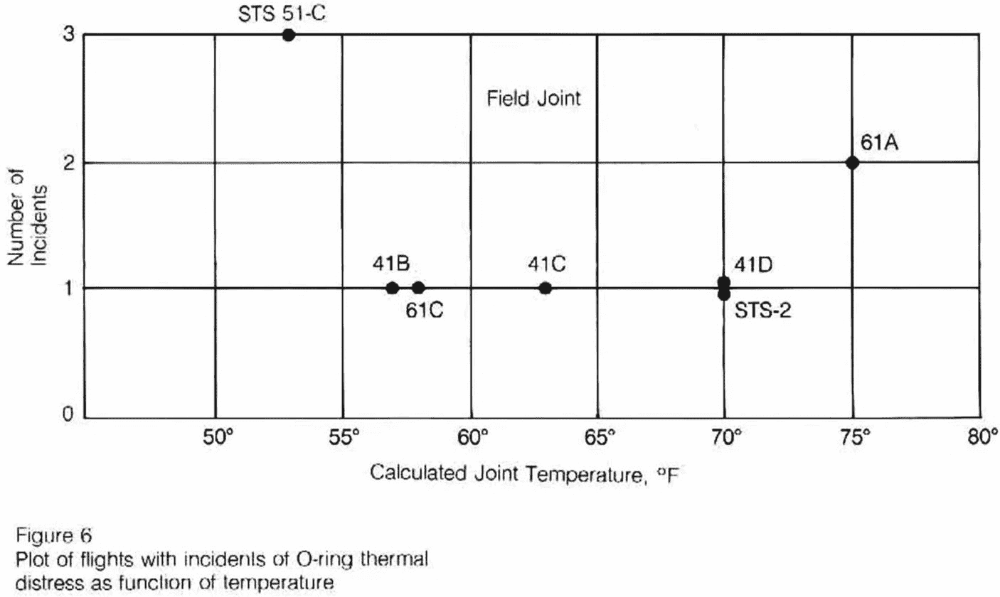

**图 2-2** 20 世纪 80 年代发生 O 型圈热事件的美国航天飞机飞行任务。来源：“关于挑战者号航天飞机事故的总统委员会报告”，[`https://www.nasa.gov/history/rogersrep/v1p146.htm`](https://www.nasa.gov/history/rogersrep/v1p146.htm)

每个黑点代表一次实际飞行中经历过热应力的 O 型环的飞行，显示了事故发生的温度（X 轴）以及与之相关的事故数量（Y 轴）。敏锐的观察者会注意到，图表中任何事故的最低温度约为 53°F。没有任何接近冰点的事故。在那之前，没有低于该温度的发射。这让工程师们感到紧张，但并未引起管理层的担忧。然而，有一点即使是管理层也应该明白——大多数事故发生在较低温度下，这很可能并非巧合。

但他们并未意识到在未知条件下飞行的严重风险。后来，在关于这场灾难的政府报告中，作者提出了一张图表，这张图表能让任何人（无论是否具备技术背景）都更清楚地理解问题。图 2-3 展示了相同的图表，并附加了一些信息——所有无事故发射的数据点。

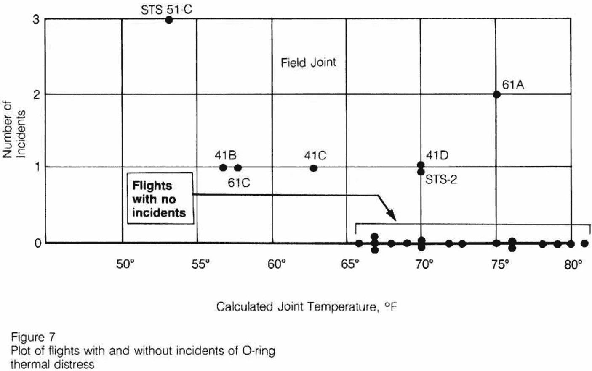

散点图显示了事故数量与以华氏度计算的预计接头温度之间的关系。X 轴表示温度范围（从 50°F 到 80°F），Y 轴表示事故数量（从 0 到 3）。数据点标有飞行编号，例如 `STS 51-C`、`41B`、`41C`、`61C`、`41D`、`STS-2` 和 `61A`。一个标有“无事故飞行”的框突出显示了较高温度下事故数量为零的数据点。该图说明了温度与 O 型环热应力事故之间的关系。

图 2-3

20 世纪 80 年代美国航天飞机有无 O 型环事件的飞行。来源：“关于挑战者号航天飞机事故的总统委员会报告”，[`https://www.nasa.gov/history/rogersrep/v1p146.htm`](https://www.nasa.gov/history/rogersrep/v1p146.htm)

这张图表清楚地表明，所有无事故的发射都发生在 66°F 或更高温度下。你无需成为火箭科学家就能得出结论：较低的温度固有地更具风险。尽管通常会将图表的轴限制在数据范围之外，但也许如果他们当时将 X 轴起始于 30°F，并强调 66°F 与 31°F 之间有多么巨大的差距，他们的警告就会得到重视。然而相反，七名宇航员丧生，无数观看现场直播的民众受到精神创伤，美国太空计划由此陷入低谷。

## 描述性统计

*描述性统计*是理解数据集一般特征并识别其中任何特殊或异常情况的艺术与科学。描述性统计是数据分析与数据科学的核心部分，几乎在开展任何项目时，我们都会首先进行描述性统计（在数据分析与科学中称为 EDA，即探索性数据分析）。一个简单的事实是：如果你不理解数据，就无法对数据进行有意义的工作。描述性统计能帮助你做到这一点。

描述性统计主要涉及计算一些基本指标并创建一些图表和其他可视化，这能让你对数据有一个良好的概览。它的优点在于，一旦你学会了如何执行，它就相当直观。在本节中，我们将查看一些不同的数据集，以了解可以进行的指标计算和可视化。我们将使用一个视频游戏评分数据集来查看不同的指标，并使用其他一些数据集进行可视化。

同样重要的是要意识到，描述性统计中几乎所有的指标和可视化都需要数值型数据——要么是间隔数据，要么是比率数据。虽然也可以对分类数据进行一些描述性统计，但这很少见且信息量较少。

### 初始观察与直方图

通过查看一些图表来初步了解数据是很常见的做法。这可以帮助你理解数据的某些方面，这些方面可能会影响你后续的决策。我们经常谈论数据的分布，这通常指的是单个字段的几个特征。例如，如果我们有一些关于视频游戏的数据，并且好奇所有游戏的评分情况，我们可以制作一个图表来查看评分的分布。第一直觉可能是像图 2-4 那样，在一个条形图中绘制所有数值，该图显示了每个单独评分对应的柱形，Y 轴为评分值。

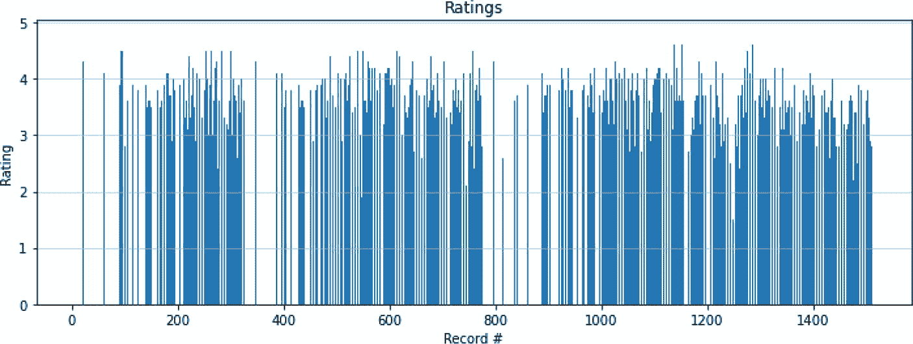

标题为“评分”的条形图，显示了 1500 条记录的数据。X 轴标记为“记录编号”，Y 轴标记为“评分”，范围从 0 到 5。图表显示评分分布密集，大部分值介于 2 和 5 之间，表明各记录的评分存在差异。

图 2-4

任意排序的视频游戏评分

X 轴仅仅是记录编号，因此顺序与实际评分无关。我们稍后会详细讨论条形图，但此图清楚表明的主要问题是，除了评分似乎分布广泛但偏向较高值之外，根本无法了解数据的任何情况。我们澄清问题的第一直觉可能是添加一些顺序。对数据进行排序可以帮助你更好地理解它，如图 2-5 所示。

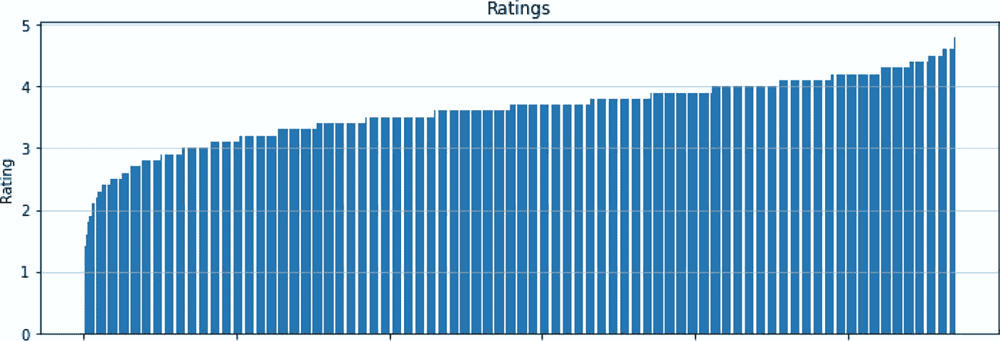

标题为“评分”的条形图显示了一系列垂直的蓝色条形，代表评分（范围从 0 到 5）。条形的高度从左到右增加，表明评分呈上升趋势。Y 轴标记为“评分”，X 轴未标记。该图直观地展示了评分的分布和变化。

图 2-5

按数值顺序排列的视频游戏评分

图 2-5 让你可以很快地看到，只有少数评分低于 3，大多数评分在 3 到 4 之间。这很有用，但并非超级有用，因为面对所有这些单独的值，仍然很难真正说出整个数据集的情况。

幸运的是，有一个简单的解决方案：直方图。我们将在本章后面的章节中介绍如何创建直方图，但作为快速介绍，*直方图*通过显示分箱数据的频数计数来总结数据的形状或分布，在这种情况下，这基本上意味着我们将查看每个平均评分有多少个（评分可以是 0 到 5 之间的任何值，包括小数）。它揭示了很多有助于我们理解下面将要讨论的统计计算的信息，但图 2-6 展示了评分数据的一个简单直方图。

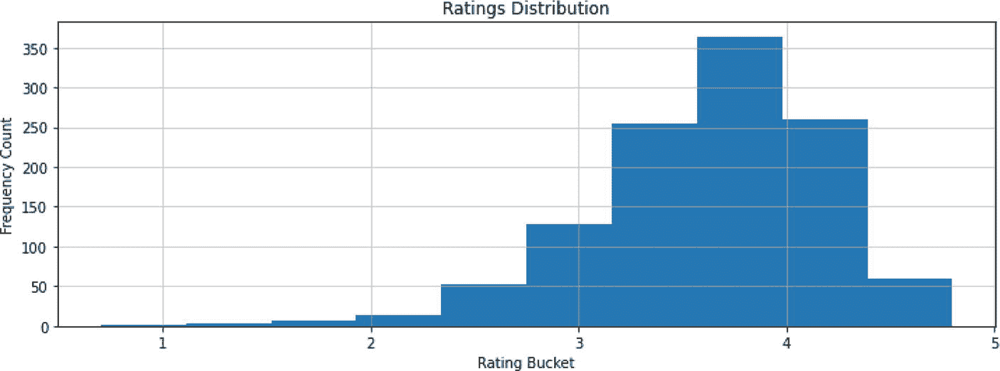

标题为“评分分布”的条形图，Y 轴显示频数，X 轴显示评分区间（范围从 1 到 5）。图表显示了一个右偏分布，最高频数出现在评分 4 附近，峰值超过 350 个计数。

图 2-6

视频游戏评分直方图

这次，X 轴显示了每个区间内的评分范围（区间通常由我们使用的软件自动确定），Y 轴显示了每个对应区间内的总数量。这清楚地表明大多数评分在 3.5 到 4.5 之间，这一点在图 2-5 中较难看出。

这个分布实际上看起来有点像我们很多人之前见过的熟悉的正态分布（也叫钟形曲线）。但由于中位数相对较高，且分数上限为 5，右侧的延伸程度不如正态分布。我们将在下一章更多地讨论正态分布，但现在我们对评分有了更好的理解，这些评分大多处于量表的较高端。

在我们接下来计算众多统计指标时，请尝试记住这个直方图。

## 指标

我们可以在数据集中衡量多种事物，从描述性统计开始，它又可以细分为位置度量和离散程度度量。描述性统计能让我们了解数据集中某一特定列的情况。在这些计算中，我们绝不会包含多个列。

### 位置度量

*位置度量*也常被称为中心趋势度量，因为它们实际上试图告诉我们数据的“中心”在哪里，这有助于我们理解数据集的典型特征。如果我们有一些美国人的身高数据，而均值大约为 4 英尺，我们很可能会猜测这些数据记录的是儿童而非成人的身高。

主要的位置度量包括均值（及其变种切尾均值）、中位数和众数。除了众数，所有这些都要求数据是数值型的。众数可以针对数值型或分类型数据确定，但在数值型数据的情况下，处理起来会更困难，通常需要分桶。我们将在下面看到原因。

大多数人都知道如何计算*均值*（或*平均数*），它只是所有数据点的总和除以数据点的总数。这确实能让我们对数据的中心位置有所了解，但它可能会被*异常值*（即与其余大部分数据不同的值）扭曲或偏斜。*切尾均值*是一种经过调整的计算方法，它会移除两端一定比例的极端值，旨在防止异常值给出非代表性的均值。例如，5%的切尾均值会切掉所有数据中顶部 5%和底部 5%的值，这意味着只使用中间 90%的数据。我们也可以在两端切掉特定数量的数据点——例如，在评委的奥运评分中，他们会在计算均值之前去掉最高分和最低分（这有时也称为*修正均值*）。

**异常值**

通俗地说，异常值基本上就是与绝大多数其他数据截然不同的数据点。例如，我们都知道，一名 7 英尺 2 英寸高的篮球运动员绝对是人类身高中的异常值。但一个 6 英尺 4 英寸的人呢？如果你来自一个身高较矮的家庭，这可能算是极端情况，但也有很多高个子家庭，其中有几个成员就长这么高。尽管在统计学上对于如何定义异常值没有普遍共识，但有一些技术可以用来识别它们。不过，有时当数据集很小，或者存在一些与其他值相差极其悬殊的值时，仅仅观察这些值就足以识别出异常值。

*中位数*是另一个关键的位置度量，因为它有时能比均值更真实地展现数据集的中心，尤其是在数据非常偏斜的情况下（偏斜将在下一节讨论）。中位数简单来说就是将数据按数值排序后位于正中间的那个数。如果数据点数量是奇数，它就是正中间的那个数据点；否则，它就是中间两个数据点的均值。人们认为中位数比均值更能容忍异常值。

*众数*就是数据集中出现次数最多的那个值。这是一个既适用于数值型数据也适用于名义型数据的度量。它是另一种让我们了解数据典型特征的方式。对于分类数据和有序数据，以及任何等间距的数值型数据（如整数），计算众数都很简单。如果我们处理的数值型数据有很多可能的值且彼此接近，那么在计算众数之前，通常需要对它们进行分桶或截断处理。例如，如果学生成绩可以是任何计算值，那么将 92.1、92.25、94.0、94.25 和 94.33 这样的值通过截断小数部分归为两个桶可能更有价值，这样你就得到两个 92 分和三个 94 分，其中 94 就是众数。

虽然选择使用哪种位置度量并不总是至关重要，但不同度量在不同情况下可能各有所长。均值适用于数据分布相当对称且没有太多异常值的情况。像人类身高这类数据往往具有这种特征。中位数适用于数据向某一方向偏斜的情况。房价可能就是如此，因为大多数房子价格相对较低，但房子贵起来确实没有上限。如果你有以下五个房价：12.5 万美元、15 万美元、17.5 万美元、20 万美元和 1700 万美元，那么你的数据集就非常偏斜。尽管大多数价格要低得多，但均值却超过 300 万美元。这里的中位数是 17.5 万美元，这显然更符合实际数值的直观感受。

**计算位置度量**

我们将从包含以下十个数据点的考试成绩子集开始：

*   67, 11, 93, 53, 79, 60, 74, 93, 99, 78

我们首先要做的是将它们排序：

*   11, 53, 60, 67, 78, 79, 74, 93, 93, 99

我们可以看到中间的两个值是 78 和 79，并且有一个直观上明显的低值异常点 11。

我们可以通过求和所有值并除以数量来计算***均值***，得到`70.7`。

如果我们想计算***切尾均值***，我们可以通过去掉顶部和底部的值（各占总值的 10%）来得到一个 10%的切尾均值，即`74.6`。

***中位数***很容易计算，正如我们上面观察到的，中间的两个值是 78 和 79，因此中位数是这两个值的平均数，即`78.5`。

***众数***在这里也很容易计算，因为我们处理的是少量整数。唯一出现多次的数字是 93，所以这就是众数。如果这里没有重复值，那么就没有众数。

数据分析师和数据科学家很少需要手动计算这些东西，因为我们使用软件或代码，但理解这些标签的真实含义很重要。

### 离散程度的度量

了解数据的中心位置固然有用，但你也需要掌握数据的离散程度。此外，如果数据中存在大量位于标尺两端的数值，那么“均值”就完全不具备典型性。想象一个家庭，其中男性非常高而女性异常矮——如果我们计算他们身高的平均值，会得到中间的一个数值，这完全不能代表任何一位典型的家庭成员。

关注中心度量之外的信息能帮助我们理解各个数据点之间的差异程度。*离散程度的度量*在这方面很有帮助，它包括了：全距、四分位距（IQR）、方差、标准差、偏度和峰度。

在处理离散程度时，你通常首先会注意到*最小值*（最低数据点）和*最大值*（最高数据点）。最基本的离散程度度量是*全距*，它就是用最大值减去最小值。

数据还可以通过排序并以中位数为界分成两半，再分别通过各自的中位数将每一半一分为二，从而划分为四个相等的部分，这就是*四分位数*。值得注意的是，我们以特定方式指代四分位数，即通过每个部分的最高点来指代。因此，第一四分位数位于约 25% 的数据点处，第二四分位数位于 50%（即中位数），第三四分位数位于 75%，而第四四分位数则是顶部的 100% 处。注意，第二四分位数就是整个数据集的中位数。一个相关的度量称为*四分位距*，它就是第三四分位数减去第一四分位数。如果你见过箱线图，就会对四分位数有一些熟悉感。下文会有更多关于箱线图的信息。

注意，我们还有一种与四分位数类似的度量，叫做百分位数。这些是介于 0 和 100 之间的整数，表示有多少百分比的数据低于该值。第 90 百分位数表示有 90% 的数据值都低于该数值。四个四分位数分别对应第 25、50（中位数）、75 和 100 百分位数。

另外两种离散程度的度量是方差和与之相关的标准差。*方差*是一个单一数值，它反映了数据围绕均值离散的程度。计算它需要先求出每个数据点与均值的差值的平方和，然后将总和除以数据点的个数。平方操作确保了与均值方向相反的差值不会相互抵消。*标准差*就是方差的平方根。它通常更受欢迎，因为它的单位与数据点相同，所以更直观。

另外两个在实践中不太常用的度量是偏度和峰度。当数据分布不对称时，即均值和中位数相差很大时，数据被认为是**偏斜**的。数据偏斜时，直方图的顶部不会居中。估计*偏度*的一种简单方法是计算均值和中位数之间的差值，将该值除以标准差，最后再乘以 3。如果中位数大于均值，则数据呈负偏态；如果中位数小于均值，则呈正偏态。只有当均值和中位数相等时，才能说数据是无偏的。

*峰度*也关注尾部，但它关注的是直方图上尾部（低计数区域）延伸的远近，因此有时被称为“尾重”的度量。计算它需要几个步骤。首先，对每个数据点，求出该点与均值之差的四次方。然后对这些值求平均值，再除以标准差的四次方。有时，当我们希望用正态分布作为背景来看待峰度时，会从这个数值中减去 3（正态分布的峰度），从而得到*超额峰度*，它表示该分布与正态分布差异的贡献程度。

### 计算离散程度的度量

我们可以从与上文相同的考试成绩数据开始，包含以下十个已排序的数据点：

- 11, 53, 60, 67, 78, 79, 74, 93, 93, 99

我们可以清楚地看到***最小值***是 11，***最大值***是 99。

***全距***就是最小值与最大值之间的差值，即 88。

用这个数据集计算***四分位数***并不困难。首先，我们以中位数 78.5（如上文计算）为界将数据分成两半。然后，每一半再根据其中位数分成两半，得到以下四分位数：第一四分位数位于 60，第二四分位数位于 78.5，第三四分位数位于 93。

***四分位距***（IQR）就是第三四分位数减去第一四分位数，即 33。

***方差***的计算需要对每个值与均值（上文计算的 70.7）之差的平方求和，然后将该总和除以值的个数 10，得到 583.1。这个数字显然很难直观理解，因此我们取平方根得到***标准差***，即 24.2。由于单位与考试分数相同，它更容易理解。

偏度是较不常见的数值之一，但我们仍然可以计算它：取均值与中位数的差值，除以标准差，再乘以 3，得到***偏度***为 –0.97。

峰度同样不常见且不太直观，但我们仍然可以计算它。我们计算每个点与均值的差值，然后将每个差值四次方，再对这些值求平均值，最后除以标准差的四次方，得到***峰度***为 4.1。

所有这些度量都能让我们更好地了解数据的离散情况。

## 可视化

有多种图表和其他可视化形式被视为描述性统计的一部分。其中一些有助于直观理解位置和离散程度的度量，而另一些则可以揭示不同字段之间的关系。

### 散点图

尽管散点图是最基础的图表之一，但它却极为有用。它将一个变量与另一个变量进行对比绘制，其中一个位于 X 轴，另一个位于 Y 轴。这种图表仅适用于两列数值型数据。根据两列中的数值，每一行数据都对应图上的一个点。图表看上去可能像是一堆随意散布的点，但有时也能观察到模式，例如相关性。而寻找相关性或其他模式，正是查看散点图最常见的原因之一。

理解散点图最简单的方法之一，就是观察一幅具有相关性的图表。我们有一个数据集，包含一组患有哮喘的儿童的身高、体重和性别，以及一些与他们的气道相关的测量数据（气道在不同条件下的工作情况）。这个数据集虽然无法告诉我们这些儿童的身高体重与未患哮喘的儿童相比有何差异，但我们可以探究数据集中各个数值之间的相互关系。

如果我们根据他们的年龄和身高绘制散点图，可以在图 2-7 中看到一个清晰的模式。

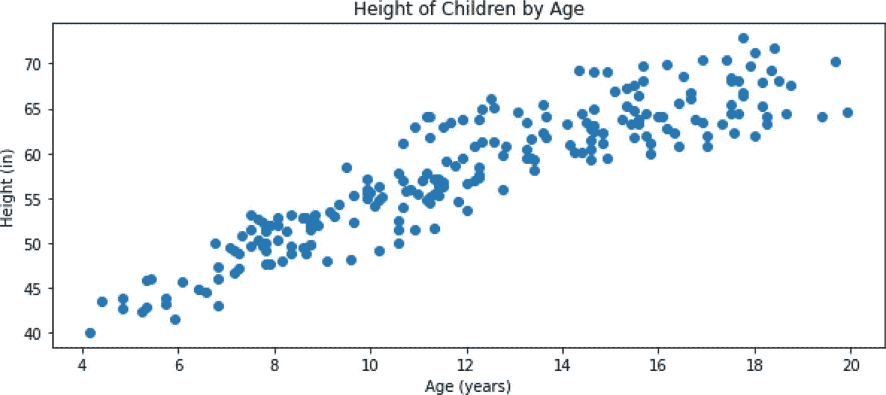

散点图，标题为“按年龄划分的儿童身高”，显示年龄（x 轴，单位：岁）与身高（y 轴，单位：英寸）之间存在正相关关系。数据点分散，表明存在变异性，但总体趋势是从 4 岁到 20 岁向上递增，身高从 40 英寸增加到 70 多英寸。

**图 2-7** – 一组儿童身高的散点图

很容易看出，随着年龄增长，孩子们的身高也在增加。这两个变量之间存在一个非常明显的共同增长趋势，当我们说变量之间存在相关性时，这就是变量之间的一种关系。我们将在本章后面讨论相关性及其测量方法，但这种快速的视觉检查正是我们使用散点图的主要原因之一。

然而，虽然基本的散点图非常适用于识别相关性和其他模式，但一次只能绘制两个变量这个事实，在我们拥有多个变量时（这很常见），会成为一个显著的局限性。有几种方法可以解决这个问题：我们可以在同一张图表上用不同颜色绘制不同类别，还可以通过改变点的大小来对应第三个变量，从而将第三个变量纳入图表。

以我们的数据集为例，其中还有性别信息。众所周知，男孩和女孩的身高普遍存在差异。通过根据性别将点设置为不同颜色，就可以轻松创建一张展示这一差异的图表，如图 2-8 所示。

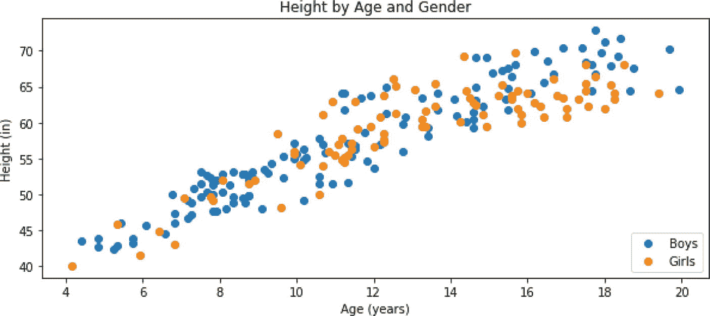

散点图，标题为“按年龄和性别划分的身高”，显示了男孩和女孩的年龄与身高关系。x 轴代表年龄（岁），范围从 4 到 20；y 轴代表身高（英寸），范围从 40 到 75。蓝色点代表男孩，橙色点代表女孩。数据点呈现总体上升趋势，表明两个性别的身高都随年龄增长而增加。右下角的图例标识了男孩和女孩的颜色。

**图 2-8** – 一组儿童身高与性别的散点图

这个简单的修改揭示了一个现象——女孩似乎比男孩更早达到最大身高并停止增长，而男孩的生长时间则更长。

另一种添加变量的方法是通过改变点的大小，创建出如今称为气泡图的图表。在气泡图中，通常会让气泡略带透明，因为较大的气泡可能会遮盖住其他气泡。我们的数据集包含一些与哮喘相关的测量值，因此我们加入了其中一个指标，该数值表示每个儿童的气道从工作状态转变为工作不佳时受到的测量共振频率，如图 2-9 所示。

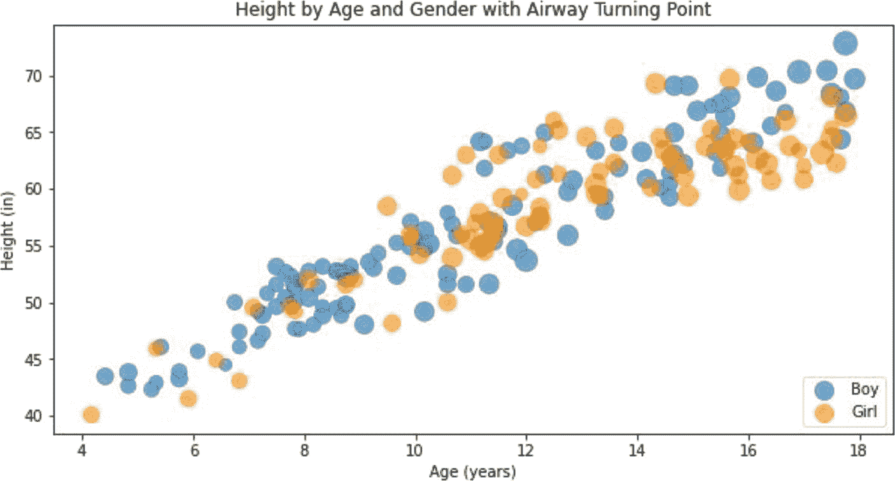

气泡图，标题为“按年龄和性别划分的身高与气道转折点”。x 轴代表年龄（岁），范围从 4 到 18；y 轴代表身高（英寸），范围从 40 到 75。蓝色气泡代表男孩，橙色气泡代表女孩。图表显示，两个性别的身高都随年龄增长呈总体上升趋势，两组之间存在一些重叠。右下角的图例说明了男孩和女孩的颜色编码。

**图 2-9** – 一组儿童身高、性别与哮喘指标的气泡图

尽管在本例中气泡大小差异并不巨大，但仍可明显看出有些气泡比其他的更大。气泡大小的差异取决于该变量的取值范围。气泡图之所以有价值，主要是因为与基本散点图相比，我们可以在图表上呈现更多的数值。结合颜色的使用，我们就能在一张二维图表中展示四个变量。

#### 条形图

*条形图*是另一种简单的可视化图表，因其直观性，常被媒体广泛使用。我们在图 2-4、2-5 和 2-6 中见过一种类型，但当时主要关注评分分布的规律，而条形图能展示的内容远不止于此。它最常用于名义数据，通常显示单个变量中各类别的计数。如上文所述，直方图是条形图的一种类型，但它是针对连续数据的，将在下文单独讨论。最简单的条形图可以在 X 轴上显示某个变量的值，在 Y 轴上显示计数或百分比。条形图的柱子可以垂直或水平放置，但垂直放置最为常见。

我们再次审视电子游戏数据集，可以看到自 2015 年以来每年的平均评分，如图 2-10 所示。

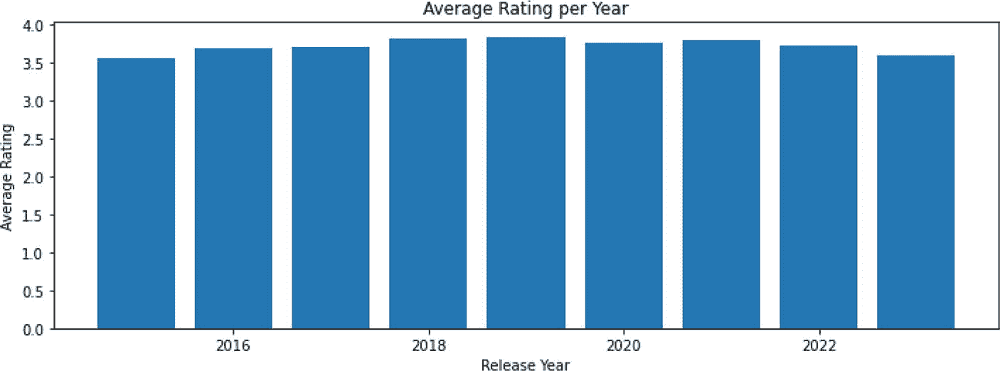

标题为“各年平均评分”的条形图，展示了 2016 年至 2022 年的平均评分。Y 轴表示平均评分，范围从 0 到 4，X 轴表示发布年份。每个柱子代表一个年份，评分稳定在 3.5 到 4 之间。

图 2-10
展示九年电子游戏平均评分的简单条形图

可以看出，评分在年际间变化不大，但在 2019 年之前有小幅上升趋势，随后又小幅回落。巧合的是，这一变化非常对称。

这种图表仅提供极少的信息，而我们的数据集中包含更多内容，例如每款游戏的开发公司。也许任天堂想知道相比于 EA，自己的表现如何，而所有其他公司则归为第三组。我们可以轻松地对此进行观察。*分组条形图*将多个相关的柱子并排显示。图 2-11 是一个分组条形图，展示了与图 2-10 相同的数据，但按公司进行了细分。

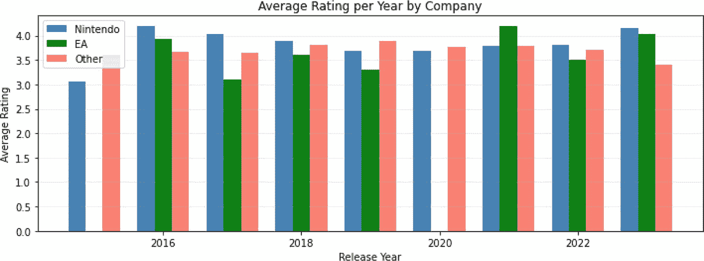

标题为“各公司年平均评分”的条形图，展示了 2016 年至 2022 年任天堂、EA 和其他公司的平均评分。Y 轴表示平均评分，范围从 0 到 4.5，X 轴表示发布年份。任天堂用蓝色表示，EA 用绿色表示，其他公司用粉色表示。图表显示了各公司评分随时间的变化。

图 2-11
按公司划分的九年电子游戏平均评分分组条形图

图 2-11 让我们看到任天堂和 EA 有着不同的趋势，而“其他”组仍然遵循我们在图 2-10 中观察到的所有公司合并在一起时的趋势。但如果只观察代表任天堂的柱子，我们可以看到 2015 年是一个异常值，评分略高于 3。第二年平均评分飙升至 4 以上；随后几年评分下降，然后又开始回升。EA 的评分则波动较大，在这段时间内，有两年该公司没有任何有评分的游戏发布。

还有另一种重要的条形图，称为*堆叠条形图*，它非常适合观察不同值之间的比例关系。这种图将同一年的不同公司对应的柱子堆叠在一起，因此组合后柱子的高度等于该年所有柱子之和。这用于评分数据没有意义，但我们还有每款游戏的总评论数，因此我们制作了图 2-12，用堆叠条形图展示任天堂和 EA 的数据。

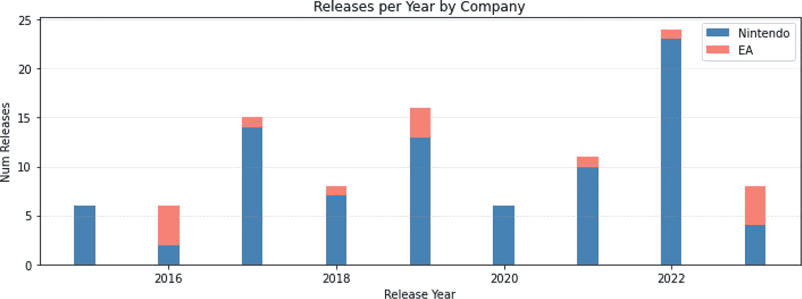

标题为“各公司每年发布数量”的条形图，展示了 2016 年至 2022 年任天堂和 EA 的发布数量。Y 轴表示发布数量，X 轴表示年份。任天堂的发布量用蓝色表示，EA 的发布量用红色表示。2018 年和 2022 年出现显著峰值，其中任天堂在 2022 年的发布量最高。右侧的图例用颜色标识了各公司。

图 2-12
任天堂和 EA 每年电子游戏发布数量的堆叠条形图

我们可以清楚地看到，任天堂发布的游戏数量远多于 EA，并且任天堂在两者总发布量中通常占据更高的比例。最后一种条形图能让具体比例更加清晰。*分段条形图*显示与堆叠条形图相同的数据，但表示为绝对比例，即所有完整柱子的总和为 100%。图 2-13 显示了与图 2-12 相同的数据，但已转换为百分比。

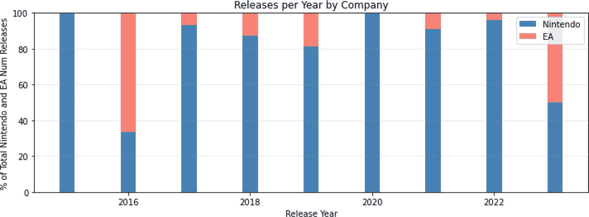

标题为“各公司每年发布数量占比”的条形图，展示了 2016 年至 2022 年任天堂和 EA 在总发布量中的百分比。Y 轴表示任天堂和 EA 总发布量的百分比，X 轴表示发布年份。任天堂用蓝色表示，EA 用红色表示。图表显示，与 EA 相比，任天堂每年的发布数量占比始终更高。

图 2-13
任天堂和 EA 每年电子游戏发布数量占比的分段条形图

如上所示，除 2016 年外，任天堂每年发布的游戏所占比例都远高于 EA。如果我们在数据中查看所有公司，而不仅仅是这两家，这种图表会更有趣，但也会很快变得难以处理。届时会出现许多细线，但产量最高的公司会清晰地凸显出来。

#### 直方图

我们之前简单提到了直方图。*直方图*是一种特殊类型的柱状图，用于处理定距或定比数据。它之所以被视为一种独立的图表类型，是因为它能提供数据的特定视图，并且需要一个称为*分箱*的额外步骤，该步骤将数字划分为具有相似值的批次。这也意味着我们不会有太多列，因为每个分箱只有一列。直方图显示的是发生次数，尽管我们通常将其称为频率而非计数。

我们可以再次查看电子游戏数据，这次重点关注评论数量。游戏评论数在 0 到大约 4000 之间，如果我们再次查看所有数据，如图 2-14 所示，就能发现大量的评论很少见，大多数评论数都在 1000 以下。

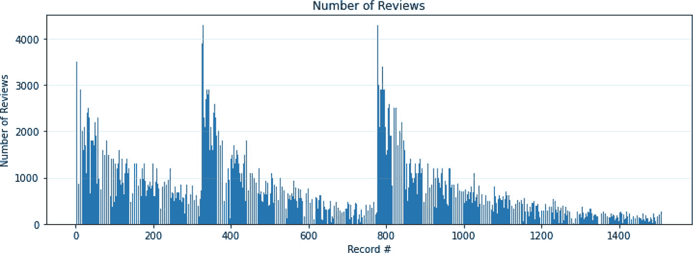

标题为“评论数量”的柱状图，展示了不同记录编号下的评论频率。x 轴代表“记录编号”，范围从 0 到 1500；y 轴代表“评论数量”，数值高达 4000。该图显示了几个峰值，表明在特定记录编号处评论数量较高，整体呈现下降趋势。

**图 2-14** – 按任意顺序排列的每个游戏及其评论数量的柱状图

直方图能更清晰地展示最常见的评论数量，因为从图 2-14 中很难真正理解这一点。我们可以创建一个自动设定分箱的直方图，如图 2-15 所示。

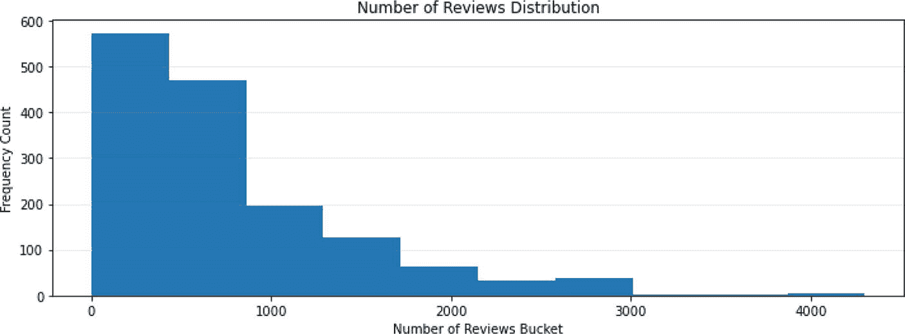

标题为“评论数量分布”的柱状图，y 轴显示频率计数，x 轴显示评论数量区间。该图呈现下降趋势，最低评论区间的频率最高，约为 500，随后随着评论数量的增加逐渐降低。

**图 2-15** – 按评论数量划分的电子游戏直方图

图 2-15 清晰地表明，拥有超过 1000 条评论是多么罕见。由于如此多的游戏评论数低于 1000，我们认为有必要查看评论数在 1000 条及以下时的分布情况。我们可以在图 2-16 中看到这一点。

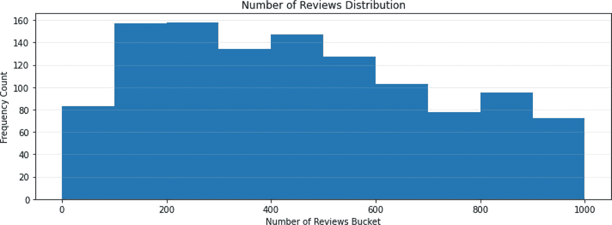

标题为“评论数量分布”的柱状图，y 轴显示频率计数，x 轴显示评论数量区间。该图显示各柱状条高度不一，表明了不同区间内评论数量的分布，最高频率出现在约 160 条评论处。

**图 2-16** – 按评论数量划分的电子游戏直方图（显示评论数在 1000 条及以下的游戏）

图 2-16 的一个优点是分箱很清晰，因为总共有 1000 条评论，分成了 10 个区间，因此每个区间的宽度为 100。这个分布很有趣——它看起来并不像一个正态分布，因为尾部与中间部分的差异并不大。评论数在 100 到 700 之间的出现次数更多，但除此之外，每个游戏的评论数量似乎没有太大的变化。

需要记住的是，我们用来创建直方图的大多数软件都可以自动确定分箱宽度，但有时不同的宽度可能会产生外观迥异的直方图。尝试不同数量的分箱，看看是否有有趣的现象出现，这总是一个好主意。这也很好地提醒了我们，在进行探索性数据分析时，尝试不同方法的重要性。有时你制作一个图表可能毫无发现，但对该图表稍作改动就可能揭示出有价值的信息。

这里我们只看了具有等宽分箱的直方图，这是最常见的类型，但它们也可以有不同的宽度。例如，有一种称为“贝叶斯分块”的方法，可以基于特定标准创建大小最优的分箱。了解这些方法是好的，但我们通常并不需要用到它们。

### 箱线图

你可能以前见过*箱线图*，这是一种带有矩形的图表，矩形中间附近有一条线，并且从矩形两端延伸出线条（“须”）。箱线图由几种不同的散布度和位置度量构建而成，你在进行汇总统计时应该已经计算过这些度量。一个典型箱线图的组成部分包括：

-   第一四分位数
-   中位数
-   第三四分位数
-   最小值
-   最大值

一些箱线图还会考虑异常值，并相应地调整须的长度。如果要显示异常值，传统的方法是将须的长度限制为不超过四分位距（`Q3 – Q1`）的 1.5 倍，然后异常值用圆圈表示，位于须的末端之外。

作为一个箱线图的示例，我们可以回到上面关于儿童身高和体重的数据，查看图 2-17 中不同年龄段男孩和女孩的身体质量指数。健康的身体质量指数会随着孩子的年龄而变化，因此年龄分组是根据美国疾病控制与预防中心提供的范围确定的。

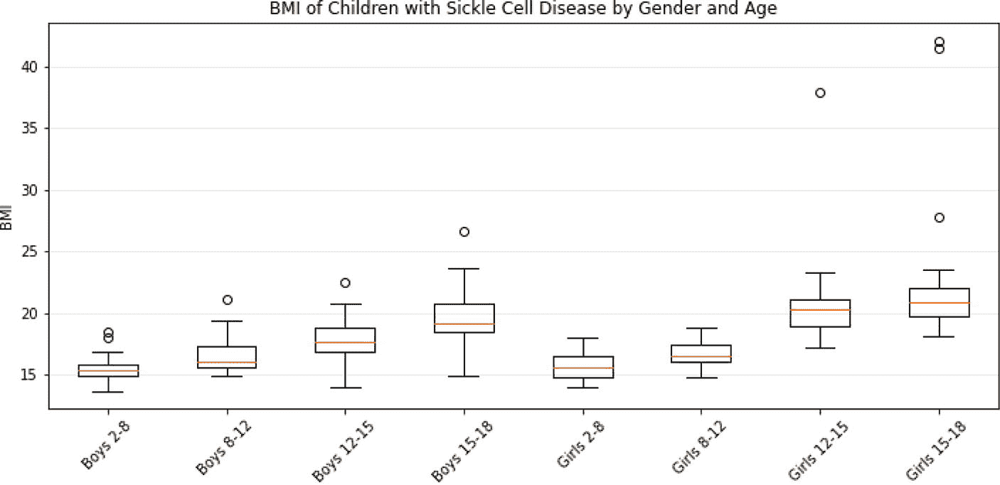

箱线图展示了患有镰状细胞病的儿童按性别和年龄组划分的身体质量指数分布。类别包括 2-8 岁、8-12 岁、12-15 岁和 15-18 岁的男孩和女孩。该图突出了每组的中位身体质量指数值、四分位距和异常值。标题为“按性别和年龄划分的镰状细胞病儿童身体质量指数”。

**图 2-17** – 按性别和年龄划分的镰状细胞病儿童身体质量指数箱线图

在这个箱线图中，每组的箱体以橙色显示中位数，第一四分位数作为主体箱体的下边界，第三四分位数作为箱体的上边界。底部水平线是最小值，顶部水平线是最大值（在`1.5 * 四分位距`范围内的最大值）。最后，最大值上方的点是异常值。

这张图表上一个引人注目的点是，女孩的异常值比男孩的极端得多。此外，女孩的身体质量指数在进入青春期典型年龄后似乎迅速增加，而男孩的身体质量指数则倾向于更稳定地增长。另外，女孩和男孩的身体质量指数大多都在健康范围内（根据美国疾病控制与预防中心指南），实际上还处于偏低水平。患有镰状细胞病可能让孩子身体不适，导致他们不像同龄的其他孩子那样生长发育。

