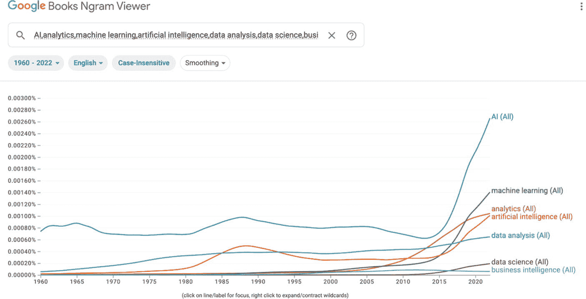
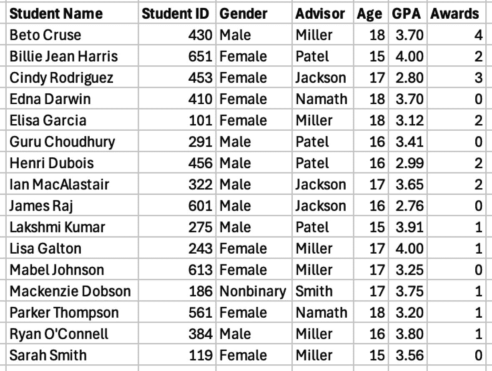
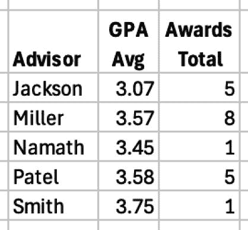
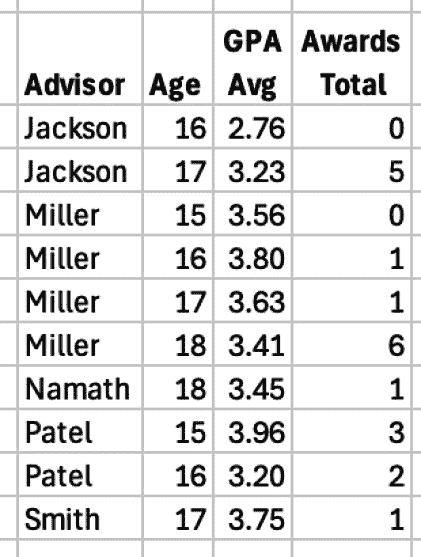
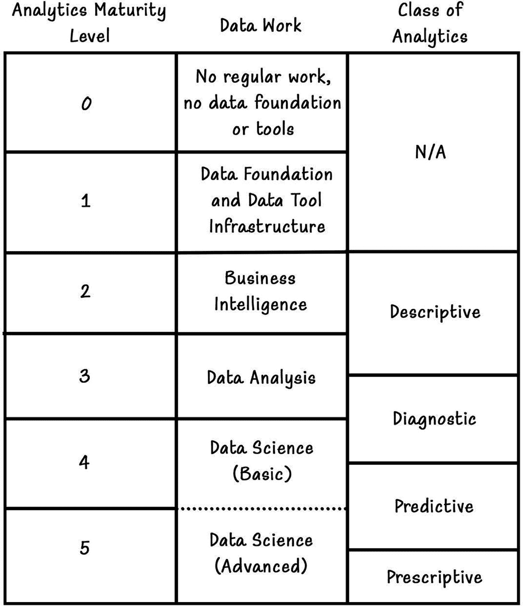

# 7. 全新视角：新一代数据分析

## 引言

我们之前已经了解到，数据科学与许多其他术语相关——数据分析、人工智能、机器学习等等。这里再介绍一个：分析。

`数据分析`作为一个概念已经存在了一段时间，但这个术语开始被更多地用作一个统称，用来描述精明的公司正在采用的一种全面的数据驱动方法。一个成功的分析计划涉及许多学科，但最重要的是商业智能、数据分析、数据科学、数据库管理、数据工具管理以及数据工程（其中日益出现一个称为分析工程的专门分支）。所有这些都为一个有助于公司实现其目标的分析计划做出贡献。分析计划中经常包含的其他领域包括机器学习工程和生产化支持。

我之前在前几章已经讨论过数据分析和数据科学，我将在后面的章节中更多地讨论商业智能和机器学习。现在，我将快速解释我们尚未讨论过的术语。`商业智能`基本上是商业报告——图表和仪表板——帮助人们做出明智的决策。`数据库管理`特指对数据库和其他一些数据存储的管理。`数据工具管理`是管理数据科学家和其他数据工作者使用的各种工具。`数据工程`涉及为`数据工作者`（使用数据的人，包括 `BI`、数据分析师和数据科学家）捕获和准备数据，而`分析工程`是数据工程的一个子集，其中的工程师拥有更多的分析专业知识，可以更好地准备数据，以便数据工作者更容易使用。`机器学习工程`涉及实施数据科学家创建的机器学习模型，以使它们更高效并准备好投入生产。`生产`指的是在“现实世界”中运行的软件——该软件依赖于真实数据，由实际客户使用，自动运行以为仪表板等创建新数据。将诸如预测模型之类的东西投入生产通常是开发它的全部意义所在，但数据科学家也会编写大量代码，这些代码仅用于生成要直接与利益相关者分享的结果。数据科学家有时确实需要自己进行生产部署，因此其他`生产或部署支持或工具`会协助完成这些任务。一些数据科学家可能会发现自己要执行许多——甚至全部——这些任务，但在更大、更成熟的组织中，这些任务是被分开的。

为了说明所有这些角色在一个拥有不同人员担任这些角色的成熟组织中可能如何互动，考虑一家公司，它托管客户图像文件并自动为其添加标签和分类，允许用户相互关注和分享图像，并为新用户提供关注建议。会有数据库存储图像文件、标签、标签、相关元数据和其他数据，这些由数据库管理员管理。数据工程师将负责收集额外的数据，可能涉及客户使用和行为、额外的图像元数据以及系统行为。他们和分析工程师还将负责为 `BI` 工程师和数据科学家等数据工作者准备这些数据以供使用。`BI` 工程师将创建仪表板，供领导层和其他人员用于了解他们感兴趣的网站方面的持续趋势和行为，例如用户数量、存储的图像数量以及分享数量。数据科学家将查看数据并进行调查，以回答业务利益相关者的问题，但他们还要负责确定推荐引擎是否需要修改。他们还可能准备一些用于内部报告的数据。机器学习工程师将负责实施数据科学家中将投入生产的任何流程，例如对推荐引擎的更改或自动化数据科学家用于报告的数据，他们将与数据工程师或分析工程师合作，使这些数据可供 `BI` 工程师使用。

这种成熟度概念——即不同组织处于不同的分析成熟度水平——也将在本章中讨论，同时还有四类分析，它们通常需要不同的成熟度水平才能实现。

### 分析术语杂烩

我们在上一章中已经通过谷歌 Ngram Viewer 查看了数据科学相关许多术语的使用情况，但看看“分析”这个词排在什么位置很有趣。在图 7-1 中，你可以看到它排在“AI”和“机器学习”之后，但早于其他所有术语。请记住，这只是在统计截至 2022 年的所有著作中这些单独术语出现的次数。

**图 7-1**

谷歌 Ngram Viewer 显示的“AI”、“分析”、“机器学习”、“人工智能”、“数据分析”、“数据科学”和“商业智能”从 1960 年到 2022 年的使用频率。来源：访问日期 2025 年 1 月 17 日，网址：`https://books.google.com/ngrams/graph?content=AI%2Canalytics%2Cmachine+learning%2Cartificial+intelligence%2Cdata+analysis%2Cdata+science%2Cbusiness+intelligence&year_start=1960&year_end=2022&case_insensitive=true&corpus=en&smoothing=3`

事实上，分析这个术语在 21 世纪 10 年代末被如此广泛使用是一个积极的信号，因为如果组织采取高层次的、全局的分析视角，而不是关注模糊的 `AI` 或其他特定的学科，它们会做得最好。不幸的是，“机器学习”正在流行起来。然而，我再次尝试搜索，加入了“数据基础”、“数据工程”和“分析工程”，结果前两个出现的频率低于其他所有术语，而“分析工程”几乎没有任何记录。尽管更新近的数据可能会改善这些数字，但这仍然是个问题，因为它们都对任何分析计划至关重要。没有由数据工程师和分析工程师构建的坚实基础，你根本无法进行任何分析工作。许多关于分析的讨论都停留在表面，并不了解其真正涉及的内容。

数据科学和 `AI` 仍带有新鲜感的光环，人们听说了它们能提供的深刻见解，承诺着通往财务成功宝库的钥匙。但它们并非许多人认为的灵丹妙药。毫无疑问，这些领域强大且真实，但炒作被夸大了，除非一个组织致力于一个真正的分析计划，而非拼凑起来的零散部分。

## 数据分析在现实世界中的应用实例

在前几章中我们已经看到了一些分析案例，但换个角度，从分析项目的宏观层面而非具体项目入手来观察会更有帮助。首先，我们将关注一家批发商如何努力降低成本并改善与客户和供应商的关系，然后再看一支职业篮球队如何利用分析技术来提升球迷参与度。

### 案例一：降低成本、改善客户与供应商关系的数据分析项目

一家总部位于英国的批发供应公司使用了一套内置报表功能的 `CRM`（客户关系管理）软件套件，但发现其功能过于局限。他们希望更深入地了解客户需求、提高客户留存率、优化库存流程，并缩短客户的付款周期。他们与一家咨询公司合作，实施了一套新系统，目标是在上线后八个月内将收入提升 20%。从根本上说，他们希望转向以数据驱动的战略和决策方式。

该公司当时仅运营一个仓库，且只向企业客户发货，但他们拥有 3000 种办公相关产品，客户超过 1000 家。他们面临的挑战包括：保持合理的库存水平（这需要预测客户需求），以及高效管理客户付款以确保按时到账。同时，他们也在寻找合适的交叉销售和向上销售机会，以推广利润更高的产品。公司明白自身的数据能够为这些挑战提供有价值的信息，因此聘请了咨询公司来帮助他们实现这一目标。

显而易见，他们首先需要的是一个商业智能系统，能够为管理者提供良好的报表和仪表盘。咨询公司帮助他们从 `CRM` 系统及其他来源中识别出可用的数据，将这些数据迁移到另一个可由自定义报表访问的系统中，并构建了商业智能基础设施。这使得他们的运营效率得以提升，因为随手可得的额外信息能帮助他们做出更明智的决策。

数据在加载到 `SQL` 数据仓库之前，经历了多个准备步骤，包括基础处理和更高级的数据转换。随后，为了方便使用，创建了包含多种维度的数据立方体和数据集市。数据准备工作确保了各类用户——从自助服务用户到 `BI` 报表构建者——都能使用这些数据。良好的数据安全保障也是数据处理和存储管理的一部分。

数据准备就绪后，创建了多项关键绩效指标（`KPI`）和报表。其中包括：多维度客户细分分析；应收账款分析（包括客户分类及优劣客户识别）；供应商分析（涉及定价、交货时间、信用期限和利润率）；以及有助于降低库存成本的库存补货分析。

该项目被认为取得了巨大成功，因为它使高利润产品的收入增长了 15%，付款周期缩短了 18%，库存费用降低了 17%。同时，公司也得以与部分供应商进行更好的谈判并获取更有利的条款。公司认为，如果没有齐心协力地实施一个专注于数据、高级报表和 `KPI` 的综合分析项目，这些成果是无法实现的。

### 案例二：一支篮球队通过数据与球迷互动

一支职业篮球队受困于遗留的 `IT` 系统，这些系统既无法支持他们想要的分析功能，也妨碍了以有效方式与球迷沟通。一项新的数据分析项目使他们得以增加收入、提高营销转化率、提升球迷参与度并增加球迷现场观赛人数。

该球队原有的 `CRM` 系统过于陈旧，虽然能够与球迷沟通，但缺乏良好的定制选项，导致球迷可能会收到与其兴趣和购买历史无关的信息。与球迷的大部分互动都是通过他们的移动球迷 `APP` 完成的，他们深知这款 `APP` 在功能扩展方面潜力巨大。

该球队有两个关键但并非直接相关的目标。首先，他们希望用现代化的 `CRM` 系统替换原有系统，以提升球迷参与度。其次，他们还想增加更先进的数字化工具，以激励销售代表达到更高绩效水平。与上一家公司类似，他们认为内部缺乏相关专业技能，因此聘请了一家咨询公司来帮助他们实现这些目标。

他们创建了新的 `CRM` 系统并增强了移动球迷 `APP` 的功能，使两者完全集成，为球队提供了大量关于球迷的信息，同时为球迷带来了更好的体验。具体来说，球队能够追踪球迷的观赛行为模式（如到场情况）和购买模式（如食品、饮料和商品）。球队可以分析这些数据并做出相应的调整，例如通过调整票价来填补空座。该 `APP` 还为球迷提供了有价值的信息，包括停车详情以及如何找到距离最近的餐饮和洗手间排队位置。

球队还为销售团队创建了多个仪表盘，例如按周、月和季度目标设置的排行榜，这激发了良性竞争，并显著提升了门票销售。`APP` 的一些增强功能简化了商品和季票的购买流程。这些改变使 `APP` 内的商品和季票销售量均提升了 50%。尽管这是一项浩大的工程，但球队对取得的成果非常满意。

## 分析学总览

要成功创建一个分析项目涉及很多方面，企业需要有组织、有明确意图才能取得成功。本节将讨论从旧式分析方法的转型，以及分析项目内部的不同专业领域。

### 从“传统”分析到“新型”分析

许多公司已经从事分析工作多年甚至数十年，但“新型分析”指的是将其视为一个全面的项目，而非这里做一点 `BI`、那里做一点分析。一个全面的项目通常会将工作集中到一定程度，并为工作制定更多标准和最佳实践，使其更像传统的软件开发，从而增加严谨性。

不同的数据工作者角色通常从事软件开发（尤其是制作报告的 `BI` 开发人员和创建实时运行模型的数据科学家），因此可以应用软件和其他系统开发流程。该流程通常会将工作环境至少分成两种：开发环境和生产环境。`开发环境`用于进行所有开发工作——包括编写新代码和修改现有代码。这些环境彼此严格隔离，但开发环境通常会尽可能模拟生产环境。在开发和生产环境之间，可能还存在另一个环境，通常称为 `test`，这是通向生产环境的一个步骤，可以在此对代码进行更严格的测试。

影响数据分析师和科学家的问题之一是，有时开发环境无法访问真实的生产数据。这在软件领域乃至 `BI` 开发中都是合理的。报告和仪表盘可以在虚假或不完整的数据上进行开发，然后部署时再切换显示生产数据。最终仍需进行测试以确保没有发生异常，但这工作量相对较小。

相比之下，数据分析师和数据科学家从一开始就必须访问真实数据，这在那些不了解数据分析和数据科学是什么或如何进行的公司中，可能成为一个争论焦点。包括探索性数据分析在内的流程早期阶段，需要访问真实数据。诸如创建特征和选择最佳特征等工作也需要真实数据。基于不完整或虚假数据构建模型是毫无意义的。这就好比给你医生完全捏造的症状而隐瞒真实症状，却期望他们能给出准确的诊断。

在那些拥有真正数据分析计划的企业中，这些问题都得到了理解并妥善处理。事实上，一些组织非常有条理，甚至遵循一种相对较新的范式，称为 `DataOps`（有关 `DataOps` 的更多信息，请参见侧栏）。

#### DataOps

在 `DataOps` 中，从数据准备到报告和展示的数据产品整个生命周期，都通过自动化以及借鉴自技术界其他三种范式（`敏捷`、`DevOps` 和精益制造）的原则，使其尽可能严谨。`敏捷`是一种软件开发方法论，我们将在后面章节详细介绍。它本身并不完全适用于数据科学项目管理，但其部分原则是有用的。我们稍后也会更详细地讨论 `DevOps`，它同样用于软件开发中，以实现测试和部署的自动化（从而形成所谓的持续集成和持续部署（`CI/CD`））。其原则构成了 `DataOps` 的一部分。最后，精益制造是制造业中的另一种范式，强调统计过程控制，这在 `DevOps` 中体现为对现有数据进行持续监控，一旦出现任何异常迹象，就会发送通知。

### 数据工具与基础设施

数据工程师需要工具来构建数据基础，而 `BI` 开发人员、数据分析师和数据科学家需要工具来完成工作。可选的工具几乎数不胜数。这些工具可能包括任何云环境及其各种数据相关工具、可能存储在公司基础设施内部的“本地”解决方案、需要安装在个人电脑上的工具，等等。所有这些工具都需要一种机制来访问公司存储在任何位置的数据。理想情况下，应由数据工作者以外的人员来管理这些工具和基础设施，但实际情况并非总是如此。如果 `BI` 开发人员、数据分析师和数据科学家将时间花在管理基础设施上，他们就无法高效地完成富有成效的工作。

### 数据基础

如引言所述，`BI`、数据分析与数据科学都依赖于一个坚实的*数据基础*——经过清洗、准备并可随时使用的数据——作为起点。存储数据的方式有很多，我们将在后面的章节中更详细地讨论各种类型的数据存储。但现在，可能用来描述数据组织和存储方式的一些术语包括：`数据库`（`SQL` 或 `NoSQL`）、`数据仓库`、`数据湖`以及`数据集市`。与这些数据源交互的方式也会有所不同。

数据基础最重要的方面通常不是数据的存储方式，而是数据的质量和实用性。数据应能以人们期望的粒度提供（请参阅侧边栏中关于粒度的解释），这通常意味着要以最低的粒度存储数据，以便人们能够根据需要合并和汇总数据。还需要有有效的数据组合方式——例如，人们想知道客户正在购买什么商品，因此，除非有办法将购买信息表和客户信息表关联起来，否则这两张表格单独存在是没有用的。

虽然理想情况下，数据使用者不应自己开发这个基础，但在成熟度较低的组织中，他们可能不得不这样做。但如果他们没有时间进行全面投入，只能以项目为基础准备数据，那这就不是真正的数据基础。

**聚合与粒度**

在处理数据时，通常需要进行聚合，通常是跨列求和或求平均值，从而获得更少的行，因为聚合后的数据粒度与原始数据不同。例如，考虑下面图 7-2 中的内容，该图展示了一些包含 `GPA` 和奖项的学生数据。

表格展示了学生信息，列包括学生姓名、学生 ID、性别、导师、年龄、`GPA` 和奖项。表格包含 15 名学生的数据，年龄范围从 15 到 18 岁，`GPA` 范围从 2.76 到 4.00，奖项数量从 0 到 4。所列导师包括 `Miller`、`Patel`、`Jackson`、`Namath` 和 `Smith`。

图 7-2 一些示例学生数据

如果我们想汇总这些数据以了解不同导师所带学生的整体情况，我们可以按`导师`粒度对 `GPA` 和`奖项`进行聚合，这样每位导师只会得到一行数据，包含该导师名下所有学生 `GPA` 的平均值和`奖项`的总和。结果将如图 7-3 所示。

表格展示了导师绩效指标。列包括“导师”、“`GPA` 平均值”和“奖项总数”。行列出了导师：`Jackson`（`GPA` 3.07，5 个奖项）、`Miller`（`GPA` 3.57，8 个奖项）、`Namath`（`GPA` 3.45，1 个奖项）、`Patel`（`GPA` 3.58，5 个奖项）和 `Smith`（`GPA` 3.75，1 个奖项）。

图 7-3 仅在导师粒度上聚合后的相同数据

在这个表中，除了仅指导一名学生的 `Smith` 外，原始的 `GPA` 和`奖项`数值完全看不到。`Jackson` 指导了三名学生，因此表中的 `GPA` 是这三名学生 `GPA` 的平均值，而`奖项`是这三名学生获奖的总数。这很有趣，但也许我们还想考虑学生的年龄。我们可以改为按`导师-年龄`粒度进行汇总，如图 7-4 所示。

表格展示了学生数据，列包括导师、年龄、`GPA` 平均值和奖项总数。表格包含导师 `Jackson`、`Miller`、`Namath`、`Patel` 和 `Smith` 的记录，年龄范围从 15 到 18 岁，`GPA` 平均值从 2.76 到 3.96，奖项总数从 0 到 6。

图 7-4 按年龄-导师粒度聚合的示例学生数据，包含平均 `GPA` 和总奖项数

这个表的行数更多，因为大多数导师都有不同年龄段的学生，只有 `Namath` 和 `Smith` 例外。任何时候当你聚合或查看聚合数据时，都必须考虑粒度。

日期是一种在不同粒度下经常调整的常见数据，因为我们通常希望以周或月粒度查看销售额等数值，而不是查看每日数值。

数据基础理想情况下应由数据工程师（或在某些地方，由分析工程师）创建，但现实情况是，有时其他人最终不得不构建它。这些人在某种程度上可能包括数据链末端的任何人，比如数据分析师、数据科学家或商业智能工程师。

### 商业智能

商业智能 (`BI`) 实际上就是报表——创建各种类型的报告，范围从 Excel 表格到摘要文档，再到包含图表、表格和其他数字的仪表板。`BI` 报告通常是持续性的，会定期刷新和查看，而不是一次性报告。领导者和员工利用这些报告来了解业务各个方面的状况，这有助于他们做出决策。许多公司长期以来一直在做这项工作，即使它们在分析方面的其他能力可能还不够成熟。通常，商业智能团队也负责准备他们将在报告中使用的数据，无论是在像`Tableau`或`Power BI`这样的工具内，还是在数据库中（可以独立完成，也可以与数据工程师和/或数据库管理员合作）。

`BI`开发人员——即报告创建者——通常不从事任何可被称为“数据分析”的工作。他们所做的“分析”仅仅是为了理解和准备数据，以便制作报告，与决策者分享。尽管如此，他们为了理解数据而进行的许多分析，与数据科学家和数据分析师为了解数据所做的分析是相似的，但他们在理解了数据内容之后就会停下来。而数据科学家和数据分析师则利用这些信息进行更深入的工作。

`BI`的重点几乎总是放在过去和当前的业务上，而不是未来。如果显示了任何未来的数据，那也只是他人创建的表格中的数字，或者是一个与人共享的简单公式的结果，绝不是 `BI` 团队自身通过任何算法生成的内容。

#### 自助式报表

公司可能难以满足所有的`BI`需求，因此许多公司会创建自助式分析程序，允许非技术背景的业务人员自行创建报告。人们通常喜欢这种方式，因为他们不必等待别人来构建报告，而且他们还可以通过反复试验自己找出需要什么，而不是等待开发人员提供进行中的仪表板进行检查。这种程序的成功完全取决于用户可获得的数据质量。全自动报告——即设计为按需运行，但其字段和值由`BI`或数据分析师预先编程的公式确定——是安全的，但很多自助式服务涉及非技术人员自行设计报告、选择字段和聚合方式。数据必须既干净又易于使用，才能实现这一点。具体来说，当所有数据尚未合并到一张表中时，用户很难知道如何组合数据——正确地连接多个数据源通常需要技术知识。如果数据没有准备好，他们可能会生成包含不准确信息的图表，这会影响决策，并可能造成对分析团队的信任问题。数据分析师进行分析后，发现结果与由非技术人员生成的自助式报告相矛盾的情况并不少见。他们需要额外的工作来证明数据分析了没有错误，错误出在自助式报告中。总之，成功的自助式程序需要精心设计的数据、防护栏和良好的培训（用户需要理解他们能做什么和不能做什么）。

# 数据分析

我们在第 5 章已全面学习了数据分析的相关知识，但概括来说，数据分析包含以下任一内容：通过探索性数据分析审视数据并发现洞察，用不同方式对数据进行切片和切块以展现数据的各个层面，制作图表和其他摘要来说明数据特征，以及进行统计分析以揭示更多数据信息。最终目标是更好地理解业务，这需要对数据有深入的理解，而商业智能开发人员可能并不需要这种深度。

根据组织不同，数据分析师的部分工作可能涉及商业智能，但人们期望他们做的不仅仅是生成仪表板。不过，数据分析师构建仪表板来总结他们完成的真实数据分析工作也很常见，因此部分技能经常重叠。经验更丰富的数据分析师也可能涉足数据科学领域，尤其是使用线性回归等较简单的机器学习技术时。

数据分析师通常也关注过去和现在，但一些更资深的数据分析师还可能参与一些基础的预测工作。

# 数据科学与高级分析

如第6章所述，数据科学家比数据分析师更进一步。他们使用的技术通常比数据分析师更复杂，包括机器学习、自然语言处理及其他统计高级技术。然而，在一些公司，数据科学家做大量数据分析甚至商业智能工作的情况非常普遍，尤其是在组织规模较小、成熟度较低且没有强大的分析举措时。数据科学家根据业务需求和问题，处理来自过去、现在或未来任何时间框架的数据。

此处的“高级分析”仅仅是数据科学的另一个术语。不过，有时采用整体分析方法论的组织更倾向于使用这个术语，因为它能比“数据科学”更好地传达上下文，因为“数据科学”暗示着与其他领域的分离。

## 分析成熟度与分析类别

如果你查阅分析成熟度模型，通常会看到展示四种不同分析类别的图表，它们被呈现为一种成熟度模型。这些类别按复杂度从低到高依次为：描述性分析、诊断性分析、预测性分析和规范性分析，下面将对它们进行描述。这些是值得理解的实用类别，我们将在下文讨论它们，但我认为，根据组织拥有的数据、工具和数据能力来判断其成熟度，比根据它们所做的分析类别来判断更有益。组织做它们需要的分析，没有做最复杂的分析并不意味着它们能力不足。

### 成熟度模型

分析成熟度模型描述了组织在分析方面的五个基本成熟度级别，这取决于组织能够胜任的分析选择。如上所述，一些人认为级别由他们所做的分析类型决定，数据科学是最高级别。但事情并没有那么简单。在最低级别，即成熟度0级，组织根本没有组织化的分析举措。这并不意味着没有人处理数据，只是没有一个能够导向成功的综合项目。

理想情况下，组织会在层级中逐步提升。在成熟度1级，他们至少拥有了数据基础的开端——即商业智能、数据分析师和数据科学家可以在工作中使用的数据——以及供这些数据工作者使用的正确工具。这两点都至关重要，但两者也都可以处于建设中——该成熟度级别的关键要求是，领导层完全理解数据和工具的需求，并已承诺投入资源来创建这个数据基础和配套的数据工具。

处于成熟度2级的组织将拥有扎实的商业智能工作——通常是一个或多个团队，每年为不同的利益相关者生成多份报告，所有这些报告都基于使用数据基础中的数据。如果随后他们扩大分析举措以纳入数据分析，这将使他们进入成熟度3级。将数据科学纳入其技能范围将使他们进入成熟度4级。通常，组织最初开展的数据科学相对基础，数据分析和数据科学之间的界限不如高度成熟的组织那么分明。成熟度5级适用于能够从事更高级数据科学项目的组织。因此，一个5级组织拥有一个完全实现、成熟的分析项目，该项目涉及所有三个学科中不同复杂程度的项目，以响应业务的不同需求。

现实情况是，许多组织完全是在草率行事，陷入人工智能和数据科学的热潮中，并在没有任何其他分析或通常只有商业智能的情况下组建数据科学团队。这些组织通常甚至没有准备好可供使用的数据（有时甚至根本没有数据）。在没有数据基础或其他类型分析的情况下尝试做数据科学，往往是徒劳的。优秀的数据科学家善于解决问题并找到应对众多挑战的方案，所以他们或许仍能设法做出一些成绩。但这将花费比必要时间长得多的精力，而且范围依然有限。在这种情况下，组织的成熟度级别仍然是0级，因为他们不知道如何系统地开展工作。

每个级别中还有一个不那么明显但隐含的要求：不仅该阶段的分析工作正在进行，而且团队拥有足够的工具来完成工作。例如，做商业智能需要BI工具，而做数据科学需要大量具有足够计算能力和内存来处理大量数据的工具。组织也常常在这方面遇到困难，导致员工没有足够工具，不得不浪费时间寻找变通方法，或者因为上次运行超时而不得不重新执行。如果一个组织似乎处于4级，即拥有在坚实数据基础上开展商业智能、数据分析和数据科学的团队，但数据科学家除了Excel外没有任何工具，那它就不是一个4级组织。Excel不足以满足数据科学的需求。假设商业智能开发人员和数据分析师拥有合适的工具，那么该组织实际上应该是处于3级。

# 分析成熟度模型

成熟度等级范围为 0 到 5，对应他们在分析项目中达到的级别，并且每个后续级别都建立在之前级别的基础上。`表 7-1`总结了这些级别，并附带了关于移动的类比。

`表 7-1` 成熟度模型等级及分析项目的已实施部分

| 成熟度等级 | 已实施的分析阶段 | 移动方式 |
| --- | --- | --- |
| 0 | 无数据基础 | 原地踏步 |
| 1 | 数据基础 + 工具 | |
| 2 | 数据基础与商业智能 + 所有工具 | 爬行 |
| 3 | 数据基础、商业智能和数据分析 + 所有工具 | 行走 |
| 4 | 数据基础、商业智能、数据分析以及基础数据科学 + 所有工具 | 奔跑 |
| 5 | 数据基础、商业智能、数据分析、基础与高级数据科学 + 所有工具 | 飞翔 |

不同公司的成熟度水平差异很大，尽管可以大致概括不同类型公司可能达到的水平（但显然，这些概括存在许多例外）。大多数初创公司和科技公司至少达到第 3 级，许多甚至达到第 4 级，因为它们从早期就开始利用这些信息来驱动决策。它们从一开始就理解数据的空间和价值。成立时间较长的非科技大型公司通常处于第 2 级或第 3 级，因为它们投入了时间和精力试图了解自己的业务，这意味着通过商业智能甚至数据分析来查看数据。因此，它们的数据基础通常已经到位，尽管可能还不完全适合数据科学工作。较小的组织通常成熟度要低得多，因为它们没有投入时间和精力来构建坚实的数据基础，即使它们试图从现有的杂乱数据源（如孤立存在的电子表格）中提取信息。

请注意，这并非完全非黑即白的尺度——例如，如果某些数据基础仍在建设中，那么拥有它总比没有好。但是，一个制作了大量仪表板却没有时间做其他事情的数据分析师，不应该被认为真正达到了数据分析级别，因为他们所做的仅仅是商业智能工作，即使他们拥有不同的职位头衔。

## 四类分析

这四类分析呈层级结构，因为每种类型的挑战性都在递增。第一类是描述性分析，其次是诊断性分析、预测性分析和规范性分析。成熟度为 1 级或 2 级的组织能够完成第一类（描述性分析），但可能无法完成第二类。其他类型的分析仅仅需要更高的成熟度才能实现。第二类（诊断性分析）需要数据分析师，而预测性分析和规范性分析通常需要数据科学家。

### 描述性分析

`描述性分析` 是关注过去发生了什么以及现在（或至少是刚刚过去）正在发生什么的数据工作。这是商业智能和数据分析的主要领域。它可以表现为商业智能报告的形式，也可以是数据分析中的探索性和描述性统计。例如，商业智能创建的一份报告，显示一家视频游戏公司截至昨天每款游戏的每日销量，并附有月度汇总，这就是描述性分析的一个例子。数据分析师的工作可能会更深入一些，但仍然是在描述过去，例如分析该公司最新游戏发布的新在线营销活动 A/B 测试的点击结果。

### 诊断性分析

`诊断性分析` 的工作不仅仅是描述发生的事情，还旨在*解释*这些事情发生的原因。理解发生了什么很重要，因此描述性分析是其中的一部分，但这不是最终目标。这通常是数据分析师，有时也是数据科学家的领域。例如，显示每日游戏销量的仪表板可能允许用户将鼠标悬停在某一天的销量数字上，以查看关于该天的更多信息，包括营销、广告、促销、节假日以及亚马逊 Prime Day 和选举日等重大国家事件的信息。再次点击，这些信息就会叠加在图表上，从而可以看到整个销量图表的趋势。例如，某款游戏每日销量的多线图可以包含销量数据、投放的广告数量、游戏价格（反映常规价格变动或折扣），以及节假日或重大事件所在日期的竖线。

### 预测性分析

`预测性分析` 顾名思义——重点是预测未来趋势。这主要是数据科学家的领域，因为预测通常需要机器学习方法。最常见的预测性分析任务之一是预测未来短期内的销量。这可能会出现在“诊断性分析”部分描述的同一种图表上——用户可以看到历史数据、叠加的解释性项目，以及未来 14 天的预测。这种图表非常强大，因为一个地方就汇集了大量信息。

### 规范性分析

最后一类是`规范性分析`，旨在帮助告诉决策者他们可以——甚至应该——做什么。这是相当高级的，属于数据科学家的领域，尽管很多数据科学家可能从未从事过这类工作，因为与其说是为决策者提供信息，不如说是直接告诉他们该做什么。然而，这并不像听起来那么强硬。我们可以有一个系统来研究价格变动和促销对销量的影响，并建议何时进行促销或调整价格。这些信息通常还会包含解释，例如是哪些特征导致了该建议。决策者不必强制执行，但这是一种基于以往信息的建议，这些信息在复杂的分析中被用于考虑比人脑所能处理的更多的因素。

## 分析成熟度与类别结合

一个组织的分析成熟度取决于许多因素，但这些因素决定了它通过分析改进业务所能取得的成功程度。`图 7-5`显示了每次前进一个级别时，成熟度、所进行的分析工作类型以及四类分析之间的关系。

`图 7-5` 分析成熟度级别及对应的数据工作和分析类别，展示了一个有组织的分析项目的传统发展轨迹

说明分析成熟度级别的表格。该表格有三列：“分析成熟度等级”、“数据工作”和“分析类别”。等级范围从 0 到 5。0 级表示“无常规工作，无数据基础或工具”，分析类别为`N/A`。1 级涉及“数据基础与数据工具基础设施”。2 级是“商业智能”，分析类别为“描述性”。3 级是“数据分析”，分析类别为“诊断性”。4 级是“数据科学（基础）”，分析类别为“预测性”。5 级是“数据科学（高级）”，分析类别为“规范性”。

如你所见，第 1 级仅仅是分析开始前的设置和准备，但直到第 2 级，才真正开始进行分析。在第 2 级，商业智能产出描述性分析。诊断性分析在第 3 级成为可能。第 4 级将预测性分析纳入了组织的技能库中。最后，在第 5 级，规范性分析成为可能。

# 构建分析计划

如前所述，有一种方法可以制定分析计划，即依次完成成熟度模型中从 1 到 5 的各个阶段。但这并非单凭一人或一个小团队就能独立完成。关键在于领导层必须理解其必要性、具体内容，并全力支持。显而易见，多数分析计划的目标是获得竞争优势或提升组织绩效。但领导者必须明白，在实现这一价值之前，需要完成大量工作，并耗费大量时间。

我已经强调了数据基础的重要性，这需要有人担任数据所有者并管理数据。如果过早招聘了数据科学家，他们可能既没有数据也没有工具，因此必须说服领导层认识到这些资源的必要性。之后，他们应与构建数据基础的人员合作，帮助设计一个可用的系统。但这一过程还需要其他人的参与。

成熟度第 1 级的另一个要求是，数据工作者必须拥有完成工作的工具，而这需要资金支持。资金可能是个挑战。组织往往不愿为计算资源（物理或云端的处理器和内存）和存储付费，尽管足够强大的计算能力是开展任何工作所必需的。如果只有一台笔记本电脑，你只能对较小的数据集进行基础的数据分析和数据科学工作。

## 告诫

尽管创建扎实的数据分析计划有一条合乎逻辑的路径，但许多公司试图在没有其他条件的情况下推进更高级的任务，这往往会引发问题。一种常见情况是，在数据尚未准备就绪时就开始组建数据科学团队。这种情况颇具挑战性，但并非无法补救。那么如何补救呢？通常，这需要新入职的数据科学家来解决问题。

最重要的是确保数据基础已存在，并且数据科学家拥有可用的工具（第 1 级）。如果足够幸运，这些敢于冒险的数据科学家能向领导层阐明这一点，但领导层未必会听从。有些组织根本不愿承认自己操之过急，也无法理解在没有达到更早的成熟度级别（即便只是拥有可用数据这一最基本要求）时，就无法开展高质量的数据科学工作。有时，你唯一能做的就是继续前行。

然而，一旦数据基础建立起来，数据科学家应努力说服领导层组建商业智能和数据分析团队。但这很可能不会很快实现，因此数据科学家可能不得不自行承担这些角色。这对这些数据科学家来说可能非常令人沮丧，因为这通常意味着他们无法从事自己真正想做的数据科学工作。

## 关键要点与下一步

构建一个全面的分析计划在商业界相对较新，但这正是成为数字化公司的一部分，而这也是当今大多数公司的目标。能够利用数据做出决策，对于组织保持相关性并取得领先地位至关重要。但许多人并未意识到，要建立一个能让领导者找到洞察并辅助决策的分析项目，需要付出多少努力。在本章中，我们讨论了成功分析计划的不同组成部分，还探讨了组织的分析成熟度等级以及在不同等级下可实施的不同分析类别。

在第八章中，我将深入探讨数据安全与隐私——这些话题许多数据科学家并不特别感兴趣。但理解一些基础知识非常重要，本章将讨论这些部分及其原因。我会涵盖数据安全的不同领域、作为人权的数据隐私以及个人身份信息（`PII`）。接着，我会介绍当前存在的各种类型的安全入侵及其规避方法。我还会涉及一些数据安全与隐私相关的法律法规。

## 实践者简介：泰勒·哈金

**姓名：** 泰勒·哈金
**职位：** 商业智能分析师/数据顾问
**行业：** 咨询
**经验年限：** 1 年数据科学家经验，15 年技术领域经验
**教育背景：**
* 加尔文数据科学强化训练营
* 心理学学士
* 心理学副学士

*此处观点仅代表泰勒本人，与其现任及前任雇主无关。*

### 背景

获得学位后，泰勒曾从事一些毫无发展前景的工作。于是，他研究了各种选择，包括攻读`MBA`、再读一个硕士学位以及参加训练营。在一次工作中，由于小公司的数据库管理员离职，他接手了部分数据库工作，并对此产生了兴趣，但他意识到需要学习编程。这些兴趣在他寻找合适选择时发挥了作用，他最初关注的是数据科学及其他高薪的信息类职位。他对所有选项进行了分析——实际上，他做了一次非正式的`ROI`（投资回报率）研究，认为训练营是最具价值的选择。训练营既紧凑又短期，因此他能比任何研究生学位更快地开始赚钱。训练营强度确实很大，他尝试了好几次才被录取，但一旦入学，他就知道这是个明智之举。他虽然并非顶尖学员，但学到了大量知识并疯狂拓展人脉。他在训练营结业展示后获得了多次面试机会。

### 工作经历

泰勒在一家分析咨询公司找到了工作，并全身心投入其中。他与另一位优秀的数据科学家共事，后者成为了他的良师益友，让他受益匪浅。尽管他享受数据科学工作，但他渴望在技术领域体验更多角色，于是在咨询公司内部转岗，尝试了项目管理和销售等职位。这些工作既有趣又充满挑战，但最终因高压咨询工作而感到疲惫。他在科技销售领域待了一段时间，随后转向产品管理。这些岗位仍然压力较大，于是他转行进入科技教育领域，负责编写文档和学习模型，却不幸遭遇裁员。在求职过程中，他决定专注于那些与他曾经喜欢且工作过的公司处于同一细分领域的公司，并很快找到了现在的理想职位。

### 语录集锦

**工作中最喜欢的部分：** 泰勒热爱编程，尤其喜欢完成复杂任务后，仍能向非技术人员清晰解释的过程。他也享受与更懂行的人合作学习的过程——这是最佳学习方式。此外，他也无法抗拒这份工作带来的“光环”——当你说自己是数据科学家时，人们会对你刮目相看。

**工作中最不喜欢的部分：** 通过咨询公司做数据科学最糟糕的一点是，你通常无法看到项目的长期走向。此外，虽然他很享受向领导者解释复杂事物，但有时他们傲慢且不接受建议——而且往往远没有他们自己认为的那么博学。从那些根本不知道自己想要什么的人那里收集需求，总是令人痛苦。

**最喜欢的项目：** 他在咨询公司最早参与的数据科学项目之一是与一家大型零售商合作。他与公司另一位资深数据科学家共事，在一个涉及预测该零售商特定门店销售额的迷人项目中学到了大量知识。他们创建了一个相当复杂的集成机器学习模型，依赖于最前沿的算法。他喜欢他们通过知识结合试错来构建解决方案的方式。这可不是那种能直接`Google`一下复制粘贴代码就能完成的事。

**教育如何与现实挂钩：** 泰勒认为他的训练营比一些硕士学位更好，因为他接触的是真实数据，并且每天有两次现场编程练习，这让他习惯了在时间压力下处理杂乱数据。许多硕士课程甚至不涉及这些内容——他在与学分析专业的毕业生共事后才了解到这一点。他们往往缺乏紧迫感，也不重视数据准备的重要性。

**最常用的技能：** 沟通、认真做笔记以及多提问。技术技能固然重要，但与软技能相比仍显逊色。

**当前主要使用的工具：** `GitHub`、`Python`、`SQL`（`SQL Server`）、`Google`和`ChatGPT`

**数据科学的未来：** 我们正处于一个奇怪的阶段，人们认为生成式`AI`能解决所有数据科学问题。但它太不可靠且容易产生幻觉——泰勒把它比作打字飞快但经验不足的青少年。没错，它们能生成东西——但这是我们需要的吗？我们很可能会回归过去可靠的方法。银行仍在用`FORTRAN`并非偶然——因为它管用。

**优秀数据科学家的特质：** 最重要的三项技能是沟通、同理心和好奇心。同理心实际上是沟通的一部分，因为它能帮助你更好地理解他人；好奇心则驱动着发现。同时，牢记伦理与安全、关注最佳实践也同样至关重要。你必须持续学习，这意味着要敢于犯错，并在经验不足时坦然承认，以便向同事学习。

**给有志于从事数据科学的人的忠告：** 拓展人脉，拓展人脉，再拓展人脉。即使感到不自在，也要观察别人是如何成功做到的，并尝试模仿。如果有人考虑参加训练营，一定要仔细审查——最好是与参加过的人聊聊。有些训练营质量不佳。泰勒推荐他参加过的那个。

*泰勒是一位商业智能与数据专业人士，在技术岗位上拥有丰富的多元化经验。*

