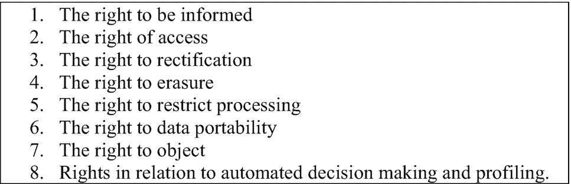
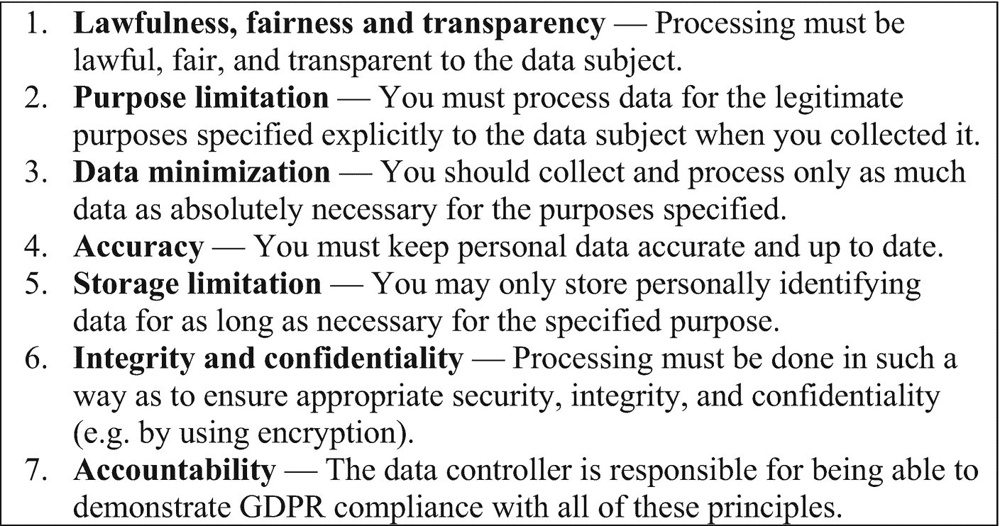

# 8. 守护每个人：数据安全与隐私

## 引言

我们或多或少都听说过大型企业发生的骇人听闻的数据泄露、勒索软件或其他涉及数据安全的事件。这些事件的发生往往源于流程中的某个环节出现人为失误，而黑客和诈骗分子的手段也日益高明。坦白说，大多数人在谨慎行事方面做得并不好，而要完成保护数据与信息安全所需的所有操作，其难度也远超预期。我们——所有使用计算机的人——必须做到这一点。但对于数据科学家以及任何与数据打交道的人来说，关注安全与隐私尤为重要。对数据科学家而言，隐私之所以至关重要，是因为他们处理的数据可能具有敏感性，而并非所有组织都具备良好的隐私保护实践，因此数据科学家个人可能需要承担起相应的责任。

我们大多数人对于"安全"和"隐私"的普遍含义都有良好认知。安全关乎保障，基本意思是让我们远离危险。如果房子有锁，能阻止心怀不轨者进入，那它就是安全的。隐私与之类似，但基本意思是免于被他人观察的状态。显然，安全与隐私都是相对的——普通的家用锁无法阻止所有人，入侵者总可以简单地打碎窗户进来。窗户也会带来隐私风险——如果不加遮挡，别人就能看到屋内。

数据安全与隐私不过是这些概念在数据领域的应用。它们显然相互关联，这两个词偶尔也被混用，但它们确实有不同的含义。`数据安全` 涉及保护数据免受那些企图利用数据损害公司或个人的恶意行为者侵害，这意味着将数据存储在安全的地方，仅允许合适的人员访问，并采取保护措施阻止所有其他人。从某种角度来说，`数据隐私` 是数据安全的一个子集，因为它特指保护人们数据的安全，但它也带有一个视角：即人们有权控制自己的数据，并控制谁能看到它，即使没有明确的风险损害。例如，很多人希望自己的购物历史保持私密，即使最明显的风险不过是在浏览器中看到与自己购买物品相关的广告。而另一些人则不在乎，甚至可能喜欢这样，因为如果收到的广告更有针对性，他们更有可能发现自己感兴趣的商品正在促销。

这不仅仅关乎浏览器广告——在处理安全和隐私时，我们往往会权衡便利性与风险，以确定我们所感知并感到舒适的安全与隐私级别。人们对什么才是合适的级别意见并不统一，而且因人而异。大多数人并不想把窗户封死，即使这样会让家更安全、更私密。我们在数据安全与隐私问题上进行的那种便利性与风险的心理权衡，正是如果我们未能认清自己的选择及其后果时，可能带来极大危险的因素之一。

人类在大多数领域都不擅长评估风险，而安全与隐私绝对是其中几个典型领域。那些看不见摸不着的东西，人们很难将其纳入风险评估中。有些人收到陌生人邮件里的链接时会本能地产生怀疑，但对另一些人来说，这并不会引起任何警觉。链接常常通往有趣或好玩的东西，所以，如果一个轻信他人的人出于好奇，且没有任何警钟提醒他们：自己对发送链接的实体一无所知，包括发送者是否意在通过某种方式窃取他们的信息，他们就可能点击。

显然，诈骗分子指望的就是这种场景。他们不需要每个人都点击——只需要让几个"对的人"点击就行。这种人性的弱点——即有人泄露凭证，或点击了一个会安装软件、从而让黑客获得访问权限的链接——几乎是黑客和诈骗分子针对个人和企业时惯用的基本途径。

在本章中，我们将看几个安全漏洞的例子。我会讨论数据安全和数据隐私的各个要素，以及公司如何管理安全与隐私。我会深入探讨数据和隐私受到侵害的各种类型，并讨论个人在这些努力中应承担的责任。然后，我们将介绍一些与数据安全和隐私相关的法律。

## 数据安全与隐私的现实案例

安全与隐私的本质在于，与之相关的有趣故事往往都是关于失败案例的。如果安全措施做得好，我们永远不会知道黑客险些犯下多么可怕的罪行。本节第一个例子展示了一家不负责任、本应做得更好的公司出现的重大安全失误，而第二个例子则是个人因点击一个恶意链接犯下"小错误"而可能引发后果的案例。

# 示例 1：Equifax 大规模安全漏洞事件

2017 年，史上最大规模的数据泄露事件之一发生，黑客攻破了 Equifax 的系统，并从当年 5 月到 7 月持续访问。Equifax 直到 7 月 28 日才发觉，此时已有近 1.65 亿美国人、英国人和加拿大的数据遭到泄露。被窃取的数据包括：全名、地址、社会安全号码、出生日期、驾照号码、信用卡号码以及包含更多个人身份信息的争议文件。^(⁴)

这次漏洞是一个本可轻易避免的典型案例。Equifax 在 2015 年内部审计后就已知道自身存在严重安全漏洞。他们有许多已知的安全漏洞需要修补，但却未能按自身计划完成修补工作。补丁的安装杂乱无章，缺乏监管，也没有考虑每个补丁对具体系统或数据的重要程度。

最终导致他们失守的特定漏洞存在于一个名为 Apache Struts 的软件中，这是一个用于 Java 编程语言的网络框架。5 月初，Apache 发布了一个补丁，称所有使用该框架的网站必须立即安装。补丁发布仅数天后，安全专家就已发现黑客在试图寻找许多公司未更新的 Struts 网站。由此可见，这明显是一个重大漏洞，但 Equifax 并未安装该补丁。^(⁵)

2017 年 5 月 12 日，黑客通过 Equifax 使用了 Struts 且未打补丁的信用争议网站入侵了系统。在入侵初期，他们就获取了内部员工凭证，从而能够搜索更多内部系统，进而访问更多系统，且看起来像是内部用户的合法搜索。Equifax 直到 7 月下旬才发现这次入侵。

即便是这次发现也是偶然的，并且是 Equifax 进一步不负责任的结果。他们一个应用程序上的网络安全证书已过期九个月，直到 7 月 29 日才更新。更新后的证书能够检测可疑活动，并发现了黑客的行动，Equifax 员工这才收到通知。他们第二天就阻止了漏洞，但直到 9 月 7 日才通知公众。

事后，这次漏洞被调查，发现 Equifax 安全状况中的众多弱点至少应承担部分责任。显然，最重要的问题是没有按指令立即更新 Apache Struts 网站，但对补丁安装的漠不关心态度以及流程不足是主要原因。其他因素还包括：设计糟糕且不安全的内部网络、缺乏良好的漏洞检测系统，以及对个人身份信息的加密不足。

Equifax 对漏洞的整体处理方式受到广泛批评，他们向消费者提供的服务也不达标。他们创建了两个网站，允许消费者查询自己的信息是否泄露。这两个网站在安全工具的检测中都看起来像钓鱼网站。这两个网站都不在 Equifax 的域名下，因此消费者无法判断自己访问的是真实网站，还是误入了精心设计的仿冒钓鱼网站。此外，其中一个网站甚至无法正常工作，测试时返回随机结果。

这些批评严重损害了 Equifax 的声誉，公司股价大幅下跌。首席信息官和首席安全官均被解雇。Equifax 还聘请了一家外部安全公司进行调查。他们不得不与联邦调查局（FBI）和联邦贸易委员会（FTC）合作。各种罚款在美国超过数亿美元，在英国超过 1100 万英镑。该公司还遭到个人起诉，并有一项集体诉讼被提起。一个外部的全国消费者信用保护组织展开了调查（后终止），但宾夕法尼亚州总检察长领导了由美国 50 个州总检察长组成的联盟，与 Equifax 达成和解，要求其向个人和各州支付 6 亿美元。^(⁶) 尽管这是一个胜利，但这笔钱对 Equifax 来说似乎并不算多，它仍在继续运营。

# 示例 2：勒索软件攻击导致运营中断数周

勒索软件对我来说一直有点离奇，直到我有个朋友在疫情期间她的公司遭受了攻击，她描述了在业务中挣扎求存的噩梦，更不用说像往常一样运营了。

我的朋友在一家大型欧洲跨国集团下属公司的会计部门管理一个团队。她在美国太平洋西北地区工作，负责为制造业切割原材料。同一业务在美国和加拿大还有大约十个地点，从西海岸延伸到东海岸。

一月初的那个早晨，大家在寒假后纷纷回到家庭办公室，朋友发现她无法登录工作笔记本电脑的远程桌面。她无法访问电子邮件或团队使用的任何其他软件。很快，她整个团队的短信乱飞——没人能登录，当他们向团队外求助时，得知并非只有他们有问题。显然出了状况，但几个小时后他们才知道发生了什么。

大约中午时分，他们终于收到了IT部门的通知：公司遭受了勒索软件攻击，所有人原地待命。IT部门从当天早上就开始忙乱。虽然一些细节后来才公布，但起因是一名员工点击了一个恶意链接，无意中让黑客进入了公司的许多系统。当IT部门开始收到无法登录的报告时，他们进行了调查，并很快意识到问题严重，于是关闭了所有其他系统。由于无法立即访问员工记录，公司电子邮件也无法使用，就连向员工发出中午那条通知都很困难。但唯一的好消息是，由于集团的结构，一些系统未受攻击影响，包括人力资源和薪资系统，这让许多员工松了一口气。

但在基层，会计部门当天本应是月末流程的开始，所有财务记录都要最终确定以结算12月份。他们显然无法做到这一点，也做不了任何其他事情，因为他们无法访问发票系统。他们也无法向供应商付款，并且由于无法访问系统甚至电子邮件，也无法联系他们。第二天，部门让每个人都创建了包含自己姓名和公司名称的`outlook.com`电子邮件地址，这样他们至少可以互相沟通，但显然无法用`jane_acmepress@outlook.com`这样的邮箱给供应商发邮件。

IT部门正在努力逐一恢复系统访问权限。但优先处理的实际上是那些应该进行金属切割的分支机构，因为他们完全被阻断了。虽然切割系统本身未被入侵，但他们无法访问任何订单，因此没有切割规格说明。他们积压的时间越长，核心业务受到的影响就越大。

第三天，我朋友的团队重新获得了对`SAP`的访问权限，这是主要的企业软件，由于托管在另一个国家而未被攻破。他们仍然无法访问网络驱动器上的任何内容，但逐渐找到了一些可以做的事情。他们使用的几个系统是第三方或基于Web的，因此是安全的。他们能够监控公司的银行账户，从而看到资金流入，但无法将之与内部的任何账户或文档关联起来。几天后，我朋友被要求起草一封措辞非常谨慎的实体信件，发送给他们的供应商（至少是那些他们能凑齐邮寄地址的供应商），解释他们遇到了一些“技术问题”，并将尽快支付发票。

然而，金属切割工作仍处于停滞状态，没有人能做任何事。他们也无法就备份事宜联系客户。直到第二周，这些订单才最终被释放，切割工作才重新启动。同一周，我朋友的团队能够登录他们的远程桌面并访问电子邮件，但除此之外别无他法——而且他们所有的归档电子邮件都无法访问。他们直到四月份才能访问电子邮件档案。到第三周时，会计部门的情况基本恢复正常。他们为十二月的结账创建了一个变通方案，并且幸运地基本能够像往常一样处理一月底的结账，而由于十二月结账异常产生的差异则被上报给总部。

员工们并未被告知最终损失了多少钱，但损失肯定高达数百万美元。公司避免了支付赎金，这一点很重要，因为尽管他们必须承担损失，但黑客并未从中获利。公司开始强制要求进行更多、更好的安全培训，并制定流程，以避免人们落入像“CEO发来的要求立即付款的紧急邮件”这类情感操控骗局。

## 数据安全

数据安全非常重要，几乎所有公司都有一个通常称为“信息安全”的团队来管理它。该团队对公司的数据安全以及所有确保数据安全的政策和技术解决方案负有最终责任。他们职责的另一个重要部分是教导与数据打交道的个人，让他们认识到保护公司数据是每个人的个人责任。

信息安全部门之所以必须教导人们他们在保护公司数据中的作用，原因之一是大多数人对于外界的危险只有模糊的认识。这属于“眼不见，心不烦”的问题。人们经常听说暗网，但不一定知道它是什么。暗网是万维网的一部分，只能通过能保证用户匿名性和隐私的特殊工具访问，并且与非法活动以及获取被盗数据的场所高度关联。

通常将那些试图窃取数据或以不良方式利用数据来伤害公司或个人的人称为不良行为者。这些人包括黑客、诈骗者，甚至垃圾邮件发送者。黑客是指未经授权访问系统的人，无论是黑帽（意图造成伤害）还是白帽（受雇于公司以识别弱点并加以修复的人）。诈骗者是指在现实世界和计算机世界中通过欺诈或其他方式骗取他人钱财或信息的人。垃圾邮件发送者是指向人们发送大量电子邮件或其他未经请求消息的人，通常怀有恶意，但总是试图从人们那里获取某些东西。令许多人感到震惊的是，这些不良行为者并非孤独地待在母亲地下室的年轻男子——他们背后有一个完整的犯罪网络，这些人经常在某些国家普通的办公楼里运营，甚至举办公司圣诞派对。

信息安全部门负责将所有这些通常通过机器人和其他软件运作的人挡在公司的系统之外。他们通过一系列政策和工具，遵循该行业一些最重要的原则来做到这一点。

数据安全通常被认为包含三个要素：机密性、完整性和可用性。这些要素构成了所谓的`CIA`三元组，如图8-1所示。机密性意味着只有正确的人才能访问数据，这包括阻止外部黑客入侵，同时也管理内部访问权限。例如，并非每个人都需要访问人力资源数据或产品成分。完整性意味着数据处于其应有的状态——没有被任何人无意或恶意修改。这涉及到明智地管理访问权限，这也是数据科学家和其他数据用户通常只被授予数据源读取权限的原因之一——数据科学家没有理由更改源表中的数据，而没有写入权限可以防止他们意外修改。最后，可用性意味着在正确的人需要时，数据是可用的。

CIA安全三元组示意图，以三角形表示。三角形的三条边分别标注为“机密性”、“完整性”和“可用性”。三角形中心包含文字“CIA安全三元组”。该图说明了信息安全的核心理念。

**图 8-1**
CIA安全三元组

# 数据安全领域

## 基础设施安全
信息安全涉及几个主要安全领域：基础设施、网络、应用程序和云。基础设施和网络安全涉及物理和数字层面的设备和软件，而公司仅负责应用程序和云端的数字安全。

`基础设施安全`涉及保护公司拥有的、与网络不直接相关的任何硬件。过去，大型公司会有巨大的服务器机房，里面装有数百台计算机，通常称为`数据中心`。这些设施需要大量工作来维持运行和安全，包括昂贵的冷却和通风系统，以及物理安全措施，如带钥匙锁的门、保护存放扁平薄型计算机的物理机柜（称为`机架`）。这种“本地部署”模式随着公司转向云端而变得越来越不常见，部分原因是这意味着在基础设施安全方面可以减少很多工作。但公司仍然拥有基础设施设备，例如员工笔记本电脑和会议室的音视频设备。基础设施安全通常由信息安全部门负责，但也依赖员工妥善处理自己的设备。

## 网络安全
`网络安全`涉及保护对网络设备的物理访问（例如，给存放设备的房间上锁，或使用防止访问非机房内设备的机箱），以及软件和固件保护，如`防火墙`和`VPN`（`虚拟专用网络`）。它关注的是阻止不良行为者以任何可能的方式访问网络，无论是直接从设备访问，还是通过计算机的 `Wi-Fi` 连接。直接安装在网络设备上的保护措施称为`固件`，但安装在用户笔记本电脑上的 `VPN` 则被视为`软件`。这也主要由信息安全部门管理，但也依赖于个人遵守规定。

## 应用程序安全
`应用程序安全`是指存在于个人计算机或其他服务器上运行的软件中的任何类型的保护，这些保护不专门涉及基础设施或网络安全。它通常侧重于防止对数据的访问，无论是直接通过数据库或其他数据源，还是通过 Excel、客户关系管理软件或其他访问公司数据的应用程序。应用程序安全对信息安全很重要，信息安全部门管理其中的一些方面，例如公司系统的登录，但员工对这方面的影响比其他类型的安全要大得多。数据库通常由另一个团队——数据库管理团队——管理，他们主要负责数据库安全及所有相关事务，但他们通常与信息安全部门合作。编写在笔记本电脑或其他计算机上运行的软件的人员（包括数据科学家）负有编写安全代码的责任，尤其是当他们编写的软件与公司网站或 `API`（应用程序编程接口，即允许其他人编写代码从公司数据源下载数据的系统）相关时。即使是完全存在于公司基础设施内部的软件，也必须安全地编写。

## 云安全
`云安全`与前三种类型相关，但它专门用于保护公司的云基础设施，这涉及虚拟“设备”，如虚拟计算机或数据库、功能类似于网络设备的虚拟通信工具，以及在这些设备或生态系统其他部分上运行的软件。通常有一个指定的团队来管理云的安全和其他方面，但与数据库管理员一样，他们与信息安全部门合作。

# 数据安全技术与方法

有几种用于数据安全的方法和技术。第一种与控制谁可以访问数据和系统有关。`用户认证`涉及为每个用户创建账户，使他们能够登录系统，并且系统会跟踪谁在何时登录以及其他一些信息。`用户授权`是下一步，即向每个用户账户分配适当权限的过程。访问权限通常可以细粒度地授予，例如，某些用户可能只能访问数据库中的特定表，甚至被限制查看某些特定列或行。管理这种级别的访问权限很繁琐，因此许多组织在更高级别上进行管理。

`监控`也很重要，包括对网络、数据库和软件的访问与使用、物理站点访问日志进行实时和定期监控，任何异常情况都应自动标记并发出警报。应定期对包括计划在内的所有内容进行审计，以确保没有遗漏。

能够在发生不良事件时进行恢复也很重要。`数据备份`是所有关键数据的副本，这样如果因安全故障甚至只是存储故障导致数据丢失，就可以恢复。这些备份通常每天进行，甚至可能仍然是每天存放在不同地点的物理磁带，因此回滚到备份会导致数据丢失，但这样做旨在避免灾难性后果。

规划和策略也很重要。应制定策略和计划来定义如何管理数据、备份计划和方案，以及如何决定哪些用户有权访问哪些内容。应进行风险评估并将其纳入计划。

最后，一些最显而易见的数据安全方法专门涉及数据的存储和传输方式。`加密`是一种用代码修改数据的方法，使得在没有解密密钥的情况下，如果数据在存储位置被访问或在传输过程中被截获，则无法使用。数据也可以通过某种方式进行修改以保护特定字段或行。

一种常见的数据修改技术是`掩码`，即用不同的、无意义的值替换真实值。最简单的方法就是`置空`真实值，基本上就是留空。通常，数据的大致形式会被保留。最基本的是`替换掩码`，其中每个字符或数字都被替换为相同的值，因此社会安全号码在每一行都会显示为`XXX-XX-XXXX`。还有其他几种掩码类型。通过`乱序`，值只是被重新排列，因此社会安全号码`123-45-6789`可能最终变成`831-96-2457`。在`混洗`中，会使用来自同一列但不同行的真实值。通过`替换`，会使用一个虚假但看起来真实的值，例如，某人的名字和姓氏可以被替换为随机的名字和姓氏。有时，对于特别敏感的特定字段或行，也会在此处使用加密。

请注意，掩码和其他修改可能在原地进行——数据可能被永久更改——但通常会创建一个新表，该表显示原始表中的所有内容，但修改仅在新表中生效。只有极少数人能够访问原始表，大多数人只能看到新表。其他时候，更改可能根据查看者的访问权限在显示时应用，而不是实际物理地修改表中的数据。例如，一个权限较高的查看者在使用公司数据查看器时可能会看到真实底层表中某列的内容，但另一个用户访问同一表时，可能在同一列看到乱序的数据。不同的数据库系统允许不同类型的控制。

具体的脱敏类型取决于具体情况。例如，公司往往拥有`生产`（即真实）数据和`开发`数据，后者与生产数据相似但不完整或不完全相同。如第 7 章所述，开发数据对于报表开发至关重要，报表只有在完成后才会推送到生产环境。在开发过程中，报表构建者通常不需要完整、准确的数据，但他们需要这些数据在行为和外观上像生产数据。如果报表要显示薪水并对其进行操作，那么 `salary` 列中的值就需要在下拉框或数字筛选框中表现正常，以便他们测试这些功能是否正常运行，但他们并不关心实际值是否“正确”。报表构建者通常要到报表投入生产环境后，才会看到包含真实值的报表。适当的脱敏能让这个过程无缝衔接。

在其他情况下，数据科学家可能使用类似的数据，但他们需要的核心字段是不脱敏的。不过数据科学家通常不需要姓名、地址等个人信息，因此这些信息可以轻松脱敏。不同的用户需要不同级别的访问权限。

## 数据隐私

如上所述，数据隐私在很大程度上可以被视为数据安全的一个子集，而确保数据隐私的大部分工作与确保数据安全的通用方法相似。

### 隐私作为一项人权

隐私的一个突出特点是它高度关注人类本身。大多数以人为本的实体都将隐私视为一项人权。联合国在其《世界人权宣言》第 12 条中包含了以下内容：“任何人的私生活、家庭、住宅或通信不得被任意干涉，其荣誉和名誉亦不得被攻击。人人有权受到法律保护，免受此类干涉或攻击。” ^(⁷)

这与大多数人的感受是一致的。总体而言，人们认为他们应该能够控制谁了解自己的哪些信息，尽管社交媒体极大地改变了这一局面。年轻人更乐于被外界了解，对个人信息的保护意识不如年长者强。然而，当他们的个人信息被用于对其造成损害的方式时，哪怕只是轻微的损害，人们就会意识到他们确实希望知道谁掌握了自己的数据。

从历史上看，随着数据革命的兴起，大多数公司出于对利润的重视，并未认同这一观点。他们有动力去尽可能多地了解客户，并且多年来许多公司一直在不加限制地收集客户数据。但人们越来越意识到自己应有的权利，情况正在开始改变。各国政府正在通过新的法律来应对这种观念的转变，其中领头的有欧盟的《通用数据保护条例》（GDPR）、加利福尼亚州的《消费者隐私法案》（CCPA）和《加利福尼亚州隐私权法案》（CPRA）。下文将进一步讨论这些法律。

由于关于我们的数据存在严重的不准确性，这些法律正变得愈发重要。数据聚合商从所有未承诺不销售用户数据的公司那里购买数据，然后将它们整合在一起，作为产品出售给其他公司。问题在于，这些数据是一团乱麻。不同的人被混淆在一起，他们的电话号码、电子邮件和其他数据相互混杂、错位。许多聚合商认为我住在父母的地址，尽管我已有数十年未曾居住在那里，甚至不在同一个州。我会收到原本发给我母亲的地方选举短信。我的父母多次收到写着我名字的传单，邀请我卖掉他们的房子，因为我快退休了（实际上差得远）。还有一次，他们收到了一把剃须刀和一份征兵邀请函，因为我刚高中毕业（而且是个男人）。全错了。另一次，他们收到了寄给我的婴儿配方奶粉样品。这些事情表面上看起来很可笑，但已经有无数案例表明，无辜的人与完全不相干、已被定罪的罪犯混淆，从而在求职或贷款时被拒绝，且毫无补救办法（这意味着每次他们申请时，这种情况都会重演）。他们无法纠正错误，而招聘或贷款申请的审核方也大多不会给他们解释的机会。保护人们不因他人的罪行和糟糕选择而受到惩罚，这确实应该被视为一项人权。

### 与隐私相关的数据类型

由于隐私主要涉及人，我们通常提及“个人数据”，即任何以某种方式代表人的数据。通常认为，这类数据总体上是潜在最敏感的。这包括姓名、年龄、性别、地址、电话号码和电子邮件等显而易见的信息，但也包括与个人相关的任何其他信息，如银行信息、病史和购物记录。

个人数据有许多类型。表 8-1 总结了其中许多类型。这绝非详尽列表；某些类型的数据可能同时属于多个类别。

**表 8-1 几种个人数据类型**

| 数据类型 | 示例 |
| --- | --- |
| 生理数据 | 身高、体重和发色 |
| 个人数据 | 姓名和年龄 |
| 位置数据 | 国家和邮政编码 |
| 医疗数据 | 诊断结果和实验室检查结果 |
| 财务数据 | 银行余额和信用评分 |
| 工作经历 | 曾任职公司和职位头衔 |
| 教育经历 | 就读大学和攻读学位 |
| 犯罪记录 | 定罪记录和交通罚单 |
| 身份信息 | 护照号码和姓氏 |
| 账户信息 | 账户用户名和借书证号码 |
| 安全信息 | 密码和母亲的娘家姓 |
| 政治信息 | 政党注册和投票记录 |
| 主观信息 | 观点和信仰 |
| 行为数据 | 上网浏览记录和驾驶记录 |

“敏感”数据是指任何可能以某种方式（无论有意无意）被用来伤害个人或组织的数据。公司持有的许多敏感数据与人员无关。许多事物都可能被视为敏感，即使其危害方式并不明显。显然，商业机密（如产品的成分和配方）是高度敏感的，大多数财务数据也是如此。就个人数据而言，几乎所有内容都被视为敏感，即使像最喜欢的颜色或爱好这样看似无害的信息，因为无法预知别人获取这些数据后会如何利用它。

当系统管理员授予人们数据访问权限时，敏感性始终是一个考量因素。例如，大多数公司不会公开薪资信息，因此只有少数人有权访问这些值——通常人力资源部门可以访问，管理人员（至少是其直接下属）和高层领导也可以。

另一个需要考虑的重要因素是，即使在同一家公司内部，上下文也可能改变数据的敏感性。例如，在很多情况下，性别是相当普通的信息，但评估音乐学院面试的人员不需要知道面试者的性别（几年前改变面试方式后，使面试者的性别不被知晓，结果揭示了音乐界长期存在对女性的巨大偏见）。同样，使用性别来确定新信用卡持有人的信用额度是违法的，因此最好让做决策的个人（或系统）甚至无法看到这项信息。但对于分配小屋和床铺的儿童夏令营来说，性别信息则更为重要。

#### 个人身份信息（PII）

任何以某种方式处理与人相关数据的工作者都会经常听到 PII 这个词。`个人身份信息（PII）`指的是可用于在现实世界中识别特定个体的数据。许多类型的个人数据都属于 PII，例如姓名、社会安全号码和电子邮件。

单独来看，像账号和国家这类信息并不一定是 PII，但这也要视具体情境和上下文而定。例如，如果考虑某人地址中的邮政编码或邮编，每个邮编对应着许多人，所以直觉上这似乎不会透露任何个人信息。但 PII 最重要的一个方面是，你必须考虑它可能如何被利用，而不仅仅是孤立数据集里有什么。如果你是一家销售医疗用品和药品的小公司，并且有一个表格记录了每个邮编区域的胰岛素购买总量，这看起来完全与个人信息无关。但是，如果存在其他包含邮编信息的 PII 表格，人们就可以将不同的表格关联起来。如果某个邮编区域只有一个人，我们就能知道这个人正在购买胰岛素。公司内部有很多人应该有权访问这些数据，但很可能不是每个人都需要访问权限，因此公司应考虑如何确保只有合适的人才能获取这些信息。

正是这类漏洞，被恶意行为者利用，而普通人却从未想到其可能性。大多数情况下，这类风险并不为人所知，因为大多数日常使用数据的人并不会到处偷偷关联表格，想看看自己能发现什么敏感信息。这就是为什么在存储任何新数据时都要时刻牢记隐私的重要性。负责人员不仅需要考虑新数据，还需要考虑现有表格以及它们与新数据之间的关联方式。

有一些广为人知的案例，说明了看似无害的数据和用途如何导致了隐私侵犯。零售巨头塔吉特（Target）曾通过识别孕妇购买的产品，决定向她们发送定向广告。其中一位收件人是一名少女，她的母亲知道她怀孕并帮助她购买怀孕相关产品，但女孩的父亲却不知情。当女儿收到带有怀孕产品广告的邮件时，父亲非常愤怒。他联系塔吉特表达了不满。这位父亲就这样得知了女儿怀孕的消息，这是一次巨大且可能具有危险性的隐私侵犯。考虑到他对女儿“错误地”收到孕妇宣传单都如此愤怒，不难想象他对女儿真的怀孕这件事会有多生气。孕妇应该有权利按照自己的意愿分享这一信息，而不是被一家零售店揭露。

另一个例子中，美国在线（AOL）在 2006 年发布了一些“匿名化”的搜索历史记录日志。一位《纽约时报》记者将此视为一项挑战，他从 AOL 的数据入手，挖掘了各种来源，最终找到了几个具体个人，并将他们与其真实的搜索历史联系起来。该文章确认了一位乔治亚州女性的身份，她允许记者分享她的故事，从而让所谓的匿名数据有了真实的面孔。这最终导致 AOL 有人辞职和多人被解雇，但在某些方面，这不过是数据世界早期一个无心之失。这就是为什么隐私如此重要，并且考虑到数据可能被关联的所有方式至关重要。

## 安全与隐私泄露

恶意行为者试图伤害个人和组织的方式有无数种，原因也多种多样。大多数情况下是盗窃——他们想要你的钱，或者更常见的是，想要可以卖钱的数据。但在某些情况下，他们想通过破坏目标声誉来伤害目标。我们将在本节中探讨他们采取的主要方式。

### 社会工程学

`社会工程学`是黑客使用的一种技术，通过欺骗真实人员以某种方式授予他们访问权限，从而进入系统。这可能是物理访问，例如在所有人都应该刷卡进入时，一名员工为某人扶住门；也可能是虚拟访问，例如通过电子邮件操纵某人向诈骗者汇款。大多数人当面拒绝关门会感到尴尬，所以如果有人就在你身后并且看起来很友好，我们大多数人很难不为他们扶住门。如果他们再编造一个忘记带门卡、三分钟后还有重要会议的悲惨故事，那就更难拒绝了。诈骗者经常利用捏造的紧迫感或公司高层人员的威胁，说服人们不经核实就采取行动。

另一种社会工程学也涉及人与人之间的互动，但它涉及说服某人授予他们虚拟访问权限，例如通过提供密码，甚至其他员工的名字或其他个人信息。

关键点在于，黑客善于操纵人心，他们利用人的本性和行为来获取系统或场所的访问权限。他们的一些行为也可以被视为`网络钓鱼（phishing）`，我们将在下一节讨论。其他类型还包括`借口（pretexting）`（例如冒充技术支持人员欺骗他人）和`诱饵（baiting）`（例如将受感染的`USB`驱动器等物理设备放在显眼位置，希望有人将其插入电脑）。

### 网络钓鱼

`Phishing`是一种黑客行为，黑客通过说服人们提供信息来试图获取系统凭证、登录详情或`PII`（个人身份信息）等。它通常依赖于社会工程学。`Phishing`通常以电子邮件或网站的形式出现，但还有另一种称为`vishing`（语音钓鱼）的类别，人们通过电话进行这种活动，而通过短信进行钓鱼也越来越常见。

`Phishing`电子邮件通常冒充某人或某公司，并要求提供敏感信息。它们可能声称来自一位上级，而这位上级又声称无法立即访问某些所需信息，利用社会工程学制造一种紧迫感，并利用公司层级（人们不想拒绝比自己职位高的人）或现有关系。请记住，黑客利用公司通常有相当标准化的电子邮件地址这一事实，例如`firstname.lastname@company.domain`，并且这些信息可能在`LinkedIn`上公开获取。

这些电子邮件有时会引导用户点击一个网站，该网站通常看起来像用户可能认识的真实网站。但它实际上是一个模拟网站。如果用户试图登录，他们将输入用户名和密码，黑客现在拥有了用户的详细信息，并可以使用这些详细信息登录真实网站。

有时，钓鱼网站可能出现在网络搜索或来自不良网站的链接中。在`Equifax`数据泄露事件期间，`Equifax`自己的`Twitter`账户无意中发布了一个指向模拟网站的链接。人们需要时刻保持警惕，并始终检查`URL`栏，以确保他们访问的是真实网站。这就是为什么`Equifax`创建两个不在其自有域名（`Equifax.com`）下的域名是一个非常糟糕的决定。

重要的是要认识到，钓鱼黑客正变得越来越老练。过去，钓鱼电子邮件相对容易识别，因为其英文水平较差（拼写错误、语法问题、语言不自然）、偶尔使用奇怪的随机字符代替常规字母，以及存在的低质量图像。但现在已经不是这样了。如今，你需要保持警惕，查看电子邮件中的链接`URL`（它们是否指向与电子邮件关联的合法域名，例如`amazon.com`而不是`amazonk.com`），并思考看到像你收到的那种请求是否合理（会计部的`Sally`真的会向你索要那些登录信息吗？）。此外，它们变得越来越有针对性。`Spear-phishing`（鱼叉式钓鱼）是指针对特定个人或组织的钓鱼电子邮件，而一种更高级的类型称为`whaling`（鲸钓），其目标是为高管这类的高级员工。

### 密码猜测

`Password guessing`（密码猜测）顾名思义——黑客试图通过“暴力”猜测密码、尝试大量不同的密码来进入账户。这可以由个人手动输入完成，就像电影中人们试图破解他人电脑那样，但更常见的是通过使用一个程序来自动化完成，该程序以极快的速度一个接一个地尝试密码。在这种情况下，一旦他们成功进入，程序就会告诉黑客密码是什么，这为他们提供了可能用于该用户其他系统的信息。

黑客可能会尝试几种不同的策略。第一种策略是仅仅尝试非常常见（且非常不安全）的密码，比如`password`或`1234`。很多人从不更改默认密码（尤其是在调制解调器等设备上），或者使用简单易记的密码。

第二种策略涉及利用对某人生活的了解来尝试不同的东西。他们可能会尝试某人生日、电话号码、社会安全号码、宠物名字、孩子名字的变体，以及实际上任何他们能从黑市或人们的社交媒体上找到的信息。

请注意，密码猜测通常依赖于拥有用户名，尽管也可以尝试不同的用户名。但由于如今大多数用户名都是电子邮件地址，他们通常可以相对容易地获取到用户名。并且如前所述，在企业界，存在公司使用的通用电子邮件结构，并且员工在其他公司资源中使用的用户名通常与他们的电子邮件中`@`符号之前的部分相同。

### 物理盗窃

基本的盗窃是人们获取他们不应拥有的信息的一种久经考验的方法，而`physical theft`（物理盗窃）涉及黑客窃取笔记本电脑、智能手机、外置硬盘、`U`盘和其他硬件。在某些情况下，这需要进一步的工作，比如破解密码或解密设备，但通常硬盘和`U`盘没有安全措施，或者很容易破解。

显然，物理盗窃涉及黑客在现实世界中接触到这些设备。一台放在汽车座椅上或咖啡店桌子上而用户去洗手间的笔记本电脑或手机，对恶意行为者来说就是唾手可得的目标。他们也可以潜入企业或住宅，并以这种方式窃取信息或设备。潜入企业通常可以通过社会工程学实现，比如当有人让黑客在没有扫描的情况下通过安全门时。

### 恶意软件与攻击

计算机病毒和蠕虫是两种众所周知且令人畏惧的`malware`（恶意软件），即以某种方式造成危害的软件。其他恶意软件包括间谍软件、擦除型恶意软件和勒索软件。所有这些都可能对企业乃至个人系统（无论是物理的还是虚拟的）造成严重破坏。

大多数此类攻击在某种程度上都依赖于社会工程学，至少在一开始是这样，因为需要有人中计，才能将恶意软件带入公司网络。在任何安全计划中，人始终是最薄弱的环节。

在大多数计算机系统中，反恶意软件至关重要。

#### 病毒与蠕虫

`Computer viruses`（计算机病毒）是安装在计算机或系统上的软件，它会控制计算机上的某些软件，甚至整个计算机。病毒的关键在于，用户被诱骗自行安装病毒软件，因为网络流量无法在未经许可的情况下安装软件。这种不需要的软件可以做各种事情，比如加密或破坏数据、文件或软件。用户可能不知道它的存在，尽管它通常会通过减慢系统速度而导致问题。

`Worms`（蠕虫）与病毒相关，并且能做很多相同的事情，但它们的行为不同，会自我复制并传播到其他计算机。它们在组织中尤其常见，因为一旦用户将蠕虫带入他们的计算机，它就可以轻松地通过网络传播。

#### 间谍软件

`Spyware`（间谍软件）是一种恶意软件，旨在获取对系统的访问权限后收集信息。一种常见的是`keylogger`（键盘记录器），它安装在某人计算机上，并记录每一次键盘敲击。这在人们使用公共`Wi-Fi`网络时很常见。另一个用户可以访问网络上的计算机，并记录计算机用户键入的所有内容，包括他们输入用户名和密码登录网站的情况。这就是为什么始终建议在公共`Wi-Fi`上使用`VPN`（虚拟专用网络）的原因。但键盘记录器可以收集的信息远不止用户名和密码，因为它们收集所有键入的内容——包括`URL`以及在电子表格和其他程序中输入的信息。

`Trojan horses`（特洛伊木马）是另一种间谍软件，它涉及用户认为某软件是合法的而将其安装在计算机上，但实际上是恶意软件。特洛伊木马通常隐藏在一个在其他方面合法的文件中。然后，它可以在用户不知情的情况下继续其活动。

### Wiper 恶意软件

`Wiper`恶意软件与病毒类似，但其主要目的是删除数据和文件或关闭系统。这类攻击旨在阻止运营而非窃取信息，因此通常由国家（政府或个人）用于攻击另一国家的基础设施、军事目标等。另一类可能使用`Wiper`恶意软件的群体是`黑客行动主义者`，这些黑客认为自己通过破坏那些其不认同的组织活动是在"行善"。

### 勒索软件

`勒索软件`也与病毒和蠕虫类似，但它的首要操作是加密数据和文件，使其无法被访问。随后黑客会索要赎金，如果公司在截止日期前未支付要求的金额，他们可能会删除或永久损坏公司的数据和文件，甚至可能将部分信息发布到暗网上。勒索软件的攻击目标通常与`Wiper`恶意软件类似，但其目的是获取金钱。通过攻击供应链或医院等关键目标，黑客希望受害者会因无法运营的后果极其严重且影响深远而选择屈服并支付赎金。

## 其他网络攻击

还有一些类型的系统攻击无需直接访问系统。常见的一种是`拒绝服务（DoS）攻击`，攻击者向系统（如网站或`API`）发送大量请求，以压垮系统并阻止合法用户访问，甚至可能导致网站或服务瘫痪。这些攻击通常涉及一些网络欺骗手段。`DoS`攻击的一种特定变体是分布式`DoS`攻击，即多个系统同时攻击同一目标。在这种攻击中，攻击者经常劫持其他系统形成僵尸网络，甚至租用他人创建的僵尸网络访问权限来发送所有请求。僵尸网络可以不断扩展，甚至可能呈指数级增长。使用僵尸网络还使得识别攻击者变得更加困难，因为组成僵尸网络的计算机本身已被攻陷，其所有者可能毫不知情。

尽管`DoS`攻击永远无法完全预防，但仍有方法可以检测它们。制定应对计划——并在检测到攻击时立即执行该计划——至关重要。

## 诈骗

诈骗是另一个领域，它不一定与技术安全或隐私直接相关，但同样会造成严重影响个人和企业的恶劣体验。世界上有许多恶意行为者通过各种诈骗手段利用天真的人，这些手段通常依赖社会工程学来操纵人们做出诸如从银行取钱并寄给他人等行为。这通常对个人的影响大于组织，但有时诈骗者会利用社会工程学技巧冒充组织中的员工，诱骗其"同事"动用公司或个人的资金或资源提供帮助。

诈骗者的手段日益高超。过去，人们很容易识破像臭名昭著的"尼日利亚王子"电子邮件诈骗，但如今的诈骗者已经改进了语法和操控技巧。他们开始冒充警察局、国税局等令人心生畏惧的机构。现在，他们甚至使用语音深度伪造技术，诱骗人们以为电话那头是自己的亲戚或朋友。与处理其他事情一样，我们需要保持警惕，对任何异常情况心存疑虑。如果有人试图说服你汇款，停下来问问自己这是否合理。如果电话中声称是认识的人，请回拨电话或发送信息核实。请记住，`IRS`（美国国税局）不会打电话要求你寄送现金礼品卡到某个地址。

保持警惕是保护组织、计算机和我们自身安全，远离那些企图不劳而获之徒的关键。

# 数据安全与隐私法律

我们看到的与数据安全和隐私相关的问题都相对较新，因为计算机和互联网使得那些在现实世界中本是小问题的事情——比如有人捡到一张信用卡——放大并大规模发生。在互联网出现之前，持有偷来的信用卡的人必须亲自去不同的商店——或者至少打电话给不同的商店——才能使用这张卡。而现在，他们可以迅速出售卡号，成千上万的人可以同时使用它，直到信用卡公司检测到欺诈行为并冻结卡片。但在早期，欺诈检测并非那么顶尖。多年来，这一技术一直在进步。

就像信用卡公司不断改进欺诈检测一样，法律也需要跟上这个新世界。我们已经朝着正确的方向迈出了一些重要步伐，尤其是在隐私领域。但政府也越来越普遍地要求企业承担责任——主要是通过罚款——当它们的疏忽导致数据泄露并影响公民时。同样，恶意行为者实施的攻击是违法的，如果能被识别出来，他们将面临罚款甚至监禁。

各国和各州近年来制定的法律主要涉及隐私而非通用数据安全，但有些法律试图两者兼顾。欧盟在这方面走在前列，其全面的隐私与安全法律《通用数据保护条例》（`GDPR`）^(⁸)于 2018 年全面生效。它规定了欧盟公民数据的收集和管理方式，这意味着在全球任何地方运营的公司，如果以任何方式处理欧盟公民的数据，都必须遵守该条例。公司可能面临巨额罚款，最高可达 2000 万欧元，对于大型企业，则可达其全球营收的 4%。

用户同意和公民访问自身数据的权利是`GDPR`的核心部分。组织必须在“自由给予、明确、知情且毫不含糊”的情况下获得同意，并且要用“清晰直白的语言”进行解释。图 8-2 展示了`GDPR`中定义的欧盟公民隐私权。

**图 8-2** `GDPR`中定义的欧盟公民隐私权。来源：[`https://gdpr.eu/what-is-gdpr/`](https://gdpr.eu/what-is-gdpr/)

即使处理了上述所有事项，数据保护仍有诸多要求，如图 8-3 所示。

**图 8-3** `GDPR`中定义的组织数据保护要求。来源：[`https://gdpr.eu/what-is-gdpr/`](https://gdpr.eu/what-is-gdpr/)

组织必须能够证明自己遵守了这些数据保护规则，以及在数据安全方面采取了额外的“适当的技术和组织措施”。大型组织需要指定一名数据保护官（`DPO`），但大多数小型企业如果仍努力理解和实施`GDPR`的要求，则可以免于设立。此外，组织必须在三天内向政府当局和数据泄露涉及的人员报告数据泄露事件。

所有公司均需在 2018 年完全遵守`GDPR`，此后美国出台的许多法律也纷纷以此为参考。但美国的情况有所不同，联邦层面没有一部全面的法律，而是由针对特定情境和特定州的法律拼凑而成。

美国第一部现代法律是 2019 年的《加州消费者隐私法案》（`CCPA`），它规定了任何处理加州公民数据的公司需遵守的法规。2023 年，该法案被新法律《加州隐私权法案》（`CPRA`）修正并取代。加州法律最著名的部分涉及用户同意、公民选择退出数据收集以及访问自身数据的权利。与`GDPR`类似，公司必须纠正不准确的信息，并且对数据泄露承担严格责任，同时面临罚款。

美国多个州也纷纷效仿并通过了自己的法律，包括弗吉尼亚州、科罗拉多州以及近 20 个其他州。不幸的是，公民权利在美国是一个政治问题；因此南部大部分地区和其他一些地区没有任何隐私法律。

## 与信息安全部门的冲突

值得一提的是，信息安全（`InfoSec`）部门通常是公司里最不受欢迎的部门之一。尽管每个人都知道他们工作的重要性，但他们通常过于热心地维护安全和隐私，有时甚至阻碍了其他部门的工作。获取数据可能需要完成一系列繁琐的流程，通常涉及大量文档审批和多重授权，尤其是高层领导的批准。有时这个过程可能需要数周时间，这对于正等待开始一个项目的人来说非常令人沮丧，而且一位完全不了解你工作方式的高级副总裁需要签字批准你的访问权限，这毫无道理。他们的规定对于那些只想好好完成本职工作的人来说，常常显得严苛。由于`InfoSec`部门不了解其他部门的工作方式，他们往往会把事情变得困难甚至不可能。有一个场景一直让我抓狂：强制性的电脑更新。他们通常会在夜间安排个人电脑的更新，以为那时没人使用。但数据科学家经常运行需要数小时才能完成的模型或数据转换，因此夜间运行是最理想的——你可以在下班前启动它，第二天早上回来时它就已经准备好了。除非你的公司强制在夜间进行系统更新，导致你丢失了所有进度，不得不等待一整天才能重新开始……话虽如此，他们的出发点是好的，而且最好还是尽量和`InfoSec`部门做朋友，因为如果他们没有把你视为敌人，他们就更有可能听取你的意见。

## 关键要点与下一步

数据安全与隐私至关重要，关注并遵守相关良好实践是每个人的责任。安全领域主要涵盖四个范畴：基础设施、网络、应用和云。企业（以及部分个人）会采取若干标准措施来保护其数据和系统。数据隐私同样重要，并日益被视为一项人权。个人身份信息（`PII`）是指任何可用于识别个人的数据，而敏感数据则指可能被用来伤害个人或其他实体的个人数据或其他数据。人们需要警惕多种安全和隐私威胁，包括社会工程学攻击、网络钓鱼、密码猜测、物理盗窃、病毒、蠕虫、间谍软件、勒索软件、拒绝服务攻击以及各类诈骗。最后，我们还探讨了一些即将出台的与安全和隐私相关的法律法规。

第 9 章将深入探讨职业道德，它与安全和隐私有一定关联，但运作方式有所不同。我将定义职业道德以及它如何与为组织工作、处理他人及组织数据的人员相关联。我将阐述我们信赖计算机系统、认为其比人类偏见更少的种种方式。我将介绍数据科学职业道德守则的理念，然后探讨进行合乎道德的数据科学的框架和指南。最后，我将讨论个人如何成为道德文化的一部分。

## 从业者档案：达柳斯·戴维斯

**姓名：** 达柳斯·J·戴维斯

**职位：** 高级安全工程师，蓝队，兼 Southside CHI Solutions 创始人/首席技术官

**行业：** 计算机安全

**经验年限：** 在技术领域从业 15 年，从系统管理员到安全工程师

**教育背景：**

* 自学成才

*此处表达的观点仅代表达柳斯本人，与其任何现任或前任雇主无关。*

**背景**

达柳斯小时候对一切事物的运作方式充满好奇。坐在车后座看着父母开车时，他开始思考事物是如何运作的——引擎盖下的汽车是如何工作的？*一切*是如何运作的？这份好奇心一直伴随着他。在想要弄清楚电子游戏是如何运作之后，他第一次开始学习编码和技术。十几岁时，他通过一个名为`Scriptlance`的网站学习代码和网页设计，并找到了大量编写`HTML`、构建表单以及从事其他网络工作的自由职业。通过这些工作建立的作品集，使他得以进入企业技术领域。

**工作**

达柳斯的第一份企业技术工作让他感到有些畏惧，因为他觉得自己作为来自芝加哥的年轻黑人男性有些格格不入，尤其是他没有学位就进入了这个行业，但他的社交能力帮助他学习并逐渐适应。他的早期职位是 IT 支持，但他不断提升自己的编程和数据库技能，很快在一家小公司担任了软件开发和数据管理的职务。几位优秀的经理帮助他更加熟练地适应企业环境，他作为软件工程师不断成长，最终领导了一个平台集成团队。从那里，他转向安全领域，并在这一领域工作了相当长一段时间。他的软件和管理背景让他对技术有了广阔的视野，而该职位也让他能够深入了解网络安全和更高层次的安全问题，如数据保护策略和保护敏感信息。

**精粹语录**

**工作中最喜欢的部分：** 达柳斯热爱修复和解决问题，尤其是在运用通过经验获得的知识时。作为领导者，带领团队解决问题同样令人满足，即使他并非具体找出答案的那个人。他也喜欢在一个不断变化和发展的行业中工作（并适应它）。

**工作中最不喜欢的部分：** 有时很难让人们听从你的意见，你必须真正努力才能让他们理解事情背后的原因。此外，同事的表现并不总是一致——上次合作时他们可能做得很好，但下一次可能就完全不同了。最后一点与治理、风险和合规有关，它定义了人们应该如何开展工作以最小化安全风险的某些方面，而人们通常不喜欢这样。与此相关的是，人们常常将安全视为障碍或只是一个“成本中心”，因为如果安全措施有效，其成果往往是看不见的。人们应该记住，很少听到或看到安全部门的消息通常是件好事。

**最喜欢的项目：** 达柳斯最喜欢的项目之一是在他的第一份编程工作中构建一个数据摄取和报告服务。该公司与数控机床打交道，这些机床在铝板上钻孔，然后作为“真空工作台”出售。这些板材必须达到极高的精度标准，因为它们用于处理需要完美平坦表面的精密材料。达柳斯开发了一个系统，直接从机器的串行端口获取数据，进行分析，并生成一份全面的“平整度”报告。这有助于向客户保证他们购买的板材的精度和质量。他喜欢这个项目，因为它既具有技术挑战性，又对企业产生了巨大影响。他既要解决技术难题，又要考虑客户方面的问题，这让他看到了支持业务目标和解决问题的重要性。

**最常使用的技能：** 依次为：解决问题的能力、沟通能力和技术技能。沟通很重要，因为技术领域的许多人可能会非常孤立，从而失去更宏观的视角。总体而言，社交技能是关键，往往是成功人士与其他人之间的区别。学会专业且得体地沟通对达柳斯的职业生涯至关重要。

**当前主要使用的工具：** `Python`用于自动化任务；多种安全工具，如`CrowdStrike`、`Prowler`、`Kali Linux`；以及来自 Discord 和暗网资源的情报

**数据科学的未来：** 从科学角度来看，人工智能的未来是美好的，但对人类来说却不一定。既然我们已经将人工智能交到普通人手中，就必须警惕其后果。我们有了人工智能，而人们已经受到启发，用它去做坏事。我们需要关注此事，并开始着力培训人们，尤其是年轻人，要负责任地使用它。此外，它还会开始自我衍生，比如人工智能基于 AI 生成的内容进行训练。公司和开发者在向公众发布内容时应保持谨慎。

**优秀技术工作者的特质：** 解决问题的能力和沟通能力。显然技术技能很重要，但这些因角色而异，而解决问题的能力和沟通能力则是跨领域的核心要求。

**给有志于技术工作者的建议：** 每个人都需要一个作品集。这不一定是充满代码的`GitHub`——当然可以是，这也很好，但并非必需。在你的作品集里，确保重点突出你学到了什么、如何学到的，以及你将如何将这些知识应用到你想为之工作的组织中。尽管学习与你所在领域相关的技术很重要，但你不应该*过于*关注技术本身——而应更侧重于如何使用它来解决业务问题。但是，当你选择要学习的技术时，请尽力确保该技术或类似工具确实在你想要进入的领域中被使用，否则可能就是白费力气。

*达柳斯是一名具有软件工程背景、拥有广泛技术经验的安全工程师，同时也是总部位于芝加哥的安全咨询公司 Southside CHI Solutions 的联合创始人。*

脚注

