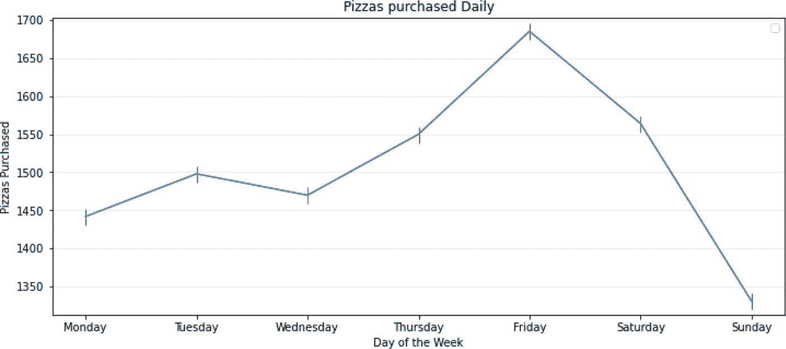
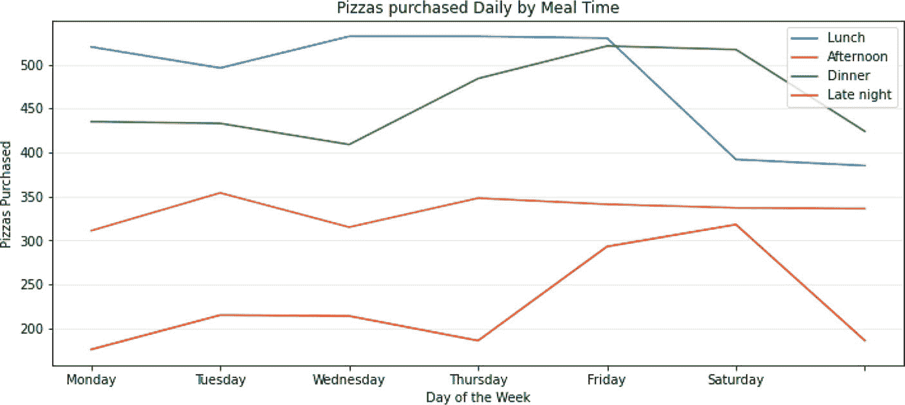
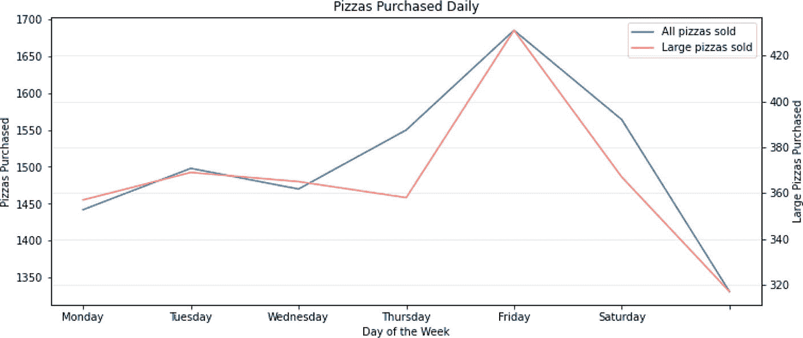
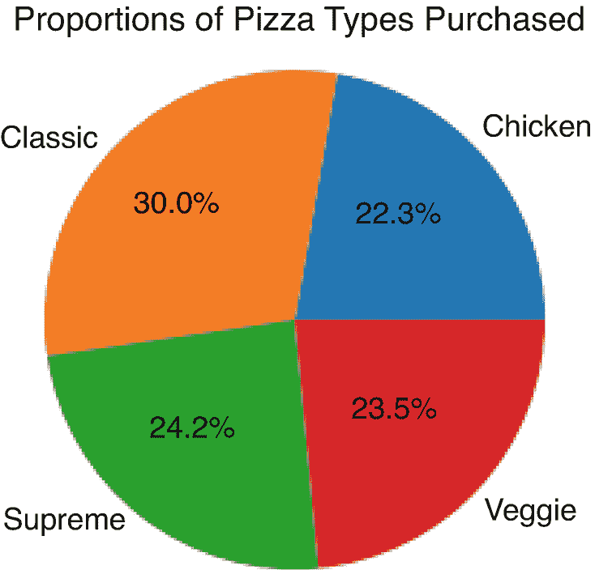

# 折线图

当数据包含时间要素时，最常见的图表之一就是折线图。虽然折线图也可以用不同类型的数据绘制，但它实际上只适用于数值型数据，并且数据之间应当存在自然的关联方式。通常，X 轴代表时间，Y 轴代表数值。折线图有多种变体，我们将通过一些披萨销售数据来了解其中的几种。图 2-18 显示的是数据集中按星期几统计的披萨订购总数。

*折线图标题为“每日披萨购买量”，展示了从周一到周日的披萨购买数量。Y 轴表示披萨购买数量，范围从 1350 到 1700。X 轴列出了星期几。图表显示，购买量从周一到周五总体呈上升趋势，在周五达到峰值，随后在周六和周日下降。*

*图 2-18 — 按星期几统计披萨购买数量的折线图*

我们可以看到，周四、周五和周六是销量最高的日子。但除此之外，这张图提供的信息并不算最多。折线图的一大优点就是可以轻松地添加多条折线。当然，在图表变得难以驾驭之前，能添加的折线数量是有限的，通常建议控制在两到四条之间。图 2-19 展示了相同的数据，但按用餐时间（根据订单的时段划分）进行了细分。

*折线图标题为“按用餐时间统计的每日披萨购买量”，展示了从周一到周六的披萨购买数量。图表包含四条折线，代表不同的用餐时间：午餐（蓝色）、下午（橙色）、晚餐（绿色）和深夜（红色）。Y 轴表示披萨购买数量，范围从 200 到 600。午餐和晚餐的购买量较高，在周中达到峰值，而下午和深夜的购买量较低，趋势更稳定。*

*图 2-19 — 按用餐时间和星期几统计披萨购买数量的折线图*

毫不意外，午餐和晚餐是最繁忙的时段，同时也很明显，这两条折线在一定程度上此消彼长——午餐在周一至周五最忙，但周末销量放缓；晚餐则在周初销量较低，但到了周中后期销量回升。下午的销售额相当稳定，而深夜时段在周末购买的披萨比工作日更多。

图表中的多条折线可以提供很多信息，通常能揭示出两个绘制变量之间的关系。但折线图还有另一种基础但强大的功能：添加第二个 Y 轴。当你想绘制两个变量，但它们的量级完全不同时，这个方法很实用。图 2-20 中，左侧 Y 轴显示披萨的总销售数量，右侧 Y 轴显示仅大份披萨的总销售额。两者的走势非常接近，这并不太令人惊讶，但有趣的是，周四的数据点偏离了所有披萨销量的趋势线。

*折线图标题为“每日披萨购买量”，展示了从周一到周六的披萨购买数量。图表有两条折线：一条是所有披萨的销量（蓝色），另一条是大份披萨的销量（红色）。两条折线都在周五达到峰值，并在周六显著下降。X 轴表示星期几，左侧 Y 轴表示披萨总购买量，右侧 Y 轴表示大份披萨的购买量。*

*图 2-20 — 双轴折线图，分别显示按星期几统计的所有披萨销量和按星期几统计的大份披萨总销售额*

所有这些图表都为我们提供了良好的信息。对于这类图表，添加恰当的标签尤为重要，这样就能清楚地知道每条折线代表什么，并且如果使用了第二个 Y 轴，也能知道哪条折线对应哪个坐标轴。

### 饼图

大多数数据分析师和数据科学家不太喜欢饼图，认为它过于简单。但有时饼图能非常快速且直观地展示比例关系，尤其是对于非技术背景的利益相关者。虽然我们并不总是与利益相关者分享探索性数据分析（EDA）的结果，但有时也会这样做，因此使用饼图可能是有必要的。饼图展示的数值数量也应有所限制，通常三到六个是一个合适的范围。否则，它和折线图中添加太多折线一样，也会很快变得难以阅读。图 2-21 展示了售出的四种不同类型披萨的构成比例。

*饼图标题为“购买披萨类型的比例”，展示了四个扇区：经典款占 30.0%（橙色），鸡肉款占 22.3%（蓝色），素食款占 23.5%（红色），至尊款占 24.2%（绿色）。*

*图 2-21 — 按披萨类型统计购买比例的饼图*

这张图清晰地展示了几个比例。显然，经典披萨的销量最高，但其他几类的销量比例非常接近。然而，从这张图表中也得不到太多其他信息。虽然它在视觉上可能很有冲击力，但信息量不大，而且如果数值类别过多，甚至会难以辨认。饼图通常对展示给非技术人员看比用于你自己的探索性数据分析更有用。不过，偶尔快速制作一张饼图也能让某些情况一目了然。

## 关键要点与下一步

在本章中，我们探讨了描述性统计，它在数据分析和数据科学中至关重要，因为它有助于我们理解数据并了解其局限性。它主要涵盖位置度量、离散度量和可视化。位置度量告诉我们数据的中心位置在哪里，或者说数据的典型特征是什么。离散度量有助于我们理解数据的变异程度——大多数值是接近中心值，还是分布得很分散？可视化是观察数据的另一个窗口，使我们能够看到重要的关系、趋势以及其他揭示性的信息。理解我们所处理的数据对于做好数据分析和数据科学至关重要。

我们将在下一章继续讨论统计学，进而探讨推断性统计的基础知识。首先，我们将回顾该领域的历史，然后介绍概率与概率分布、抽样以及实验设计。所有这些主题对于为进行推断性统计奠定基础都至关重要，我们将在第 4 章中讨论推断性统计。

