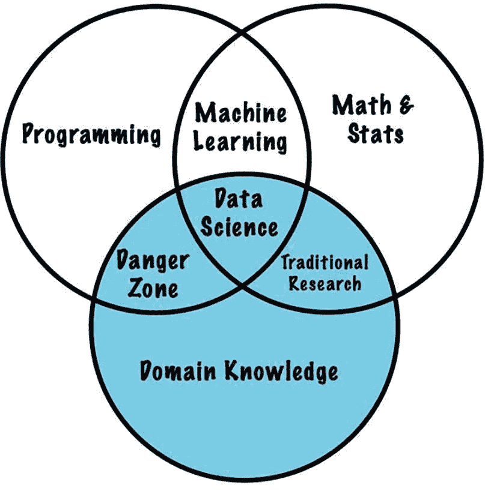
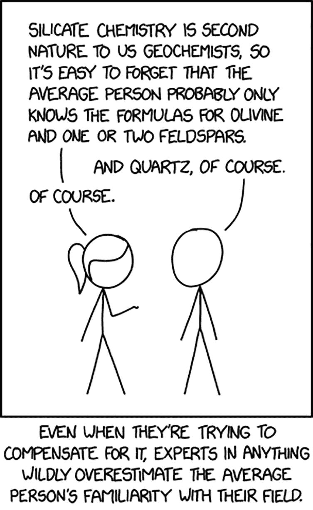

## 10. 把握大局：领域知识

### 引言

我已在本书中多次提及领域知识，因为它在数据科学中至关重要。需要提醒的是，`领域知识`是指某种专门化的知识，与通用知识相对。人们常声称自己拥有某个行业或领域的知识，但几乎任何领域都可能存在专家——医疗保健、西班牙语、电子游戏、17 世纪的骑术、温馨奇幻题材、农场动物管理、遥控飞机、宝可梦卡牌游戏，以及几乎所有你能想象到的事物，无论是职业、爱好、个人兴趣、生活经验还是其他方面。你几乎肯定在多个领域拥有知识，即便可能达不到专家水平。

好了，你拥有领域知识。但这意义何在？在生活中，了解自己觉得有趣或享受的事物有时本身就是一种乐趣。但更多时候，这些知识可能具有无可估量的价值——即便它仅仅源于一项爱好或热忱。对于一家希望深入了解自家产品与竞争对手的电子游戏公司而言，理解玩家围绕游戏的行为模式会很有帮助。一家披萨餐厅如果能理解顾客行为与餐厅销售规律，就能更好地分析自身数据。不了解一天中存在高峰时段以及工作日与周末的差异，就难以知道如何对数据进行细分。

# 现实世界中的领域知识示例

几乎每一份工作都或多或少涉及领域知识，而在科技世界中这一点尤为重要——技术人员正是在为不同领域的非技术人员构建各类系统（不仅仅是数据科学系统）。它在商业理解与需求收集方面尤为关键，虽然你可以在工作中掌握大量此类知识，但若一开始缺乏它，可能会带来负面后果。我们将先看一个例子：独特的领域知识如何催生了一项新业务；再看另一个例子：领域知识不足如何导致项目失败。

## 示例 1：为大众着装

Stitch Fix 公司向希望轻松购买合身服饰的顾客提供定制化时装。他们售卖内含五件服装或配饰的盒子，这些物品由自动化推荐系统为每位顾客挑选，再由公司造型师人工调整。这是一个不寻常的创意，而公司早期的成功完全取决于创始人兼首席执行官卡特里娜·莱克对女性购买时尚服饰的理解——这正是领域知识。她指出，大多数在线时装公司试图通过更快的配送或更低的价格来差异化，而她则选择了个性化。^(²²) 早期，她在为公司募集资金时遇到困难，因为大多数风险投资家是男性，无法像莱克那样理解服装购物世界。关键的区别在于个性化元素，以及算法能比个人考虑更多选项的能力。数据科学基于每位顾客注册时填写的问卷结果以及每次收到盒子后提供的反馈。算法会生成五件物品的独特组合，但随后造型师会对其进行评估，必要时修改，并最终批准。数据科学的作用是让整个企业变得可扩展——如果让造型师从零开始搭配盒子是不可能的，但如果他们只需调整预选物品，就远没有那么耗时。这个概念的成功完全基于莱克深知人性化元素在服装购物中的重要性。

## 示例 2：临阵退缩

我曾参与过一个并不成功的项目，其主要原因是我们没有足够的领域知识来设计正确的解决方案。这一定程度上也是需求收集的失败，但如果我们拥有更多领域知识，就会意识到我们提出的方案并非利益相关者真正需要的。我们的任务是预测多家商店的烤鸡销售量。我们从一个外部供应商那里接手了这个项目，该供应商已研究了数月，且预测是按日级别进行的。接手后，我们首先查看了数据，还参观了其中一家烹饪和展示烤鸡的熟食店，这让我们对该业务环节有了很多了解。由于我们能够复用另一个项目的代码，三周内就建立了一个能给出高精度预测的优秀模型。但项目仍然失败了，部分原因在于他们对准确度有不切实际的期望（尽管我们的表现超越了他们的手动预测和行业标准精度，他们仍追求更高的精度），同时也因为我们没有理解他们需求中的某个关键点（而他们也并不清楚我们能做到什么程度，以致于无法提出正确的要求）。

尽管参观了现场，我们仍未完全掌握时间安排的重要性。烤鸡必须首先被烹制，且保质期有限，所以一段时间后，未售出的鸡必须被丢弃。显然，他们不能早晨把所有鸡都烤好然后摆放一整天。他们真正需要的是每小时级别的预测。但因为我们是从一个做日预测而非小时预测的第三方接手项目，就延续了那种方法。我们对自己的快速成果感到满意，还做了一个精美的可视化，展示持续预测、准确度以及每个日预测所涉及的具体特征。但最终，客户失去了兴趣。我仍然认为部分原因是我们实际上并未给他们真正需要的东西——即小时级预测。理解客户及其需求的重要性怎么强调都不为过，而理解他们的领域是做到这一点的最佳途径。

# 什么是领域（Domain）

前文提到，领域几乎可以是任何东西。它可以是技术领域——比如数据科学、生成式 AI、软件开发——也可以是像医疗或电子游戏这样的主题。显然，数据科学家应该具备数据科学领域的专业知识，但其他领域的经验也同样宝贵。我特别发现，我的软件开发背景在数据科学中非常有用，因为很多数据科学家接受的编程训练不够严谨，知识也局限于数据科学中主要使用的代码库；而更广泛的编程知识在处理通用编程、设计和最佳实践时会很有帮助，尤其是在生产化部署时。

通常，将领域视为“主题”而非“学科”最为有用。在商业世界中，数据科学家最常接触的领域包括零售、保险、银行和医疗。很多时候，招聘信息会要求应聘者拥有该公司的领域经验，这仅仅是因为，当你在某个领域工作时，你会开始理解一些细微之处。不同领域的数据截然不同。医疗领域拥有大量关于患者的数据，这些数据显然高度敏感。根据岗位所处的具体医疗环节，还可能涉及保险、诊断以及公共卫生相关的宏观数据等其他类型的数据。零售领域可能拥有客户数据，但大部分数据与销售和库存相关，因此涉及的个人身份信息（PII）较少。

熟悉法律法规也是领域知识的一部分。例如，银行和保险行业有大量法规，如果员工在入职时就已经理解并了解一些具体细节，会非常有帮助。同样，如果人们在医疗领域开始工作时已经熟悉 HIPAA 法规（HIPAA 是美国关于医疗患者数据的法律），也会很有帮助。在高等教育领域工作时，熟悉 FERPA 法规（FERPA 法律涵盖美国高校的学生数据隐私）也同样有用。

但正如我前面提到的，领域也可以非常具体。电子游戏行业规模庞大，雇用了数百万人，他们通常更倾向于招聘本身就是玩家的员工，这样他们就能理解公司里讨论的一切。如果有一个项目涉及不同的游戏类型，那么了解各种电子游戏类型以及哪些可能具有跨界吸引力，对员工来说会很有帮助。一个从未玩过任何游戏的人一开始不会知道这些，他们也不会理解到底是什么驱动一个人去玩游戏。

同样，领域也可以具体到公司本身。我曾经参与过一个项目，创建一套系统来处理西班牙语文本，为其分配阅读难度等级，该系统基于公司已有的处理英语文本的同类系统。我的同事曾参与过英语系统的开发，对其运行机制了如指掌。我没有参与过英语系统的开发，但事实证明，我的中级西班牙语水平在处理西班牙语系统时非常有用。他关于英语分析器的领域知识，加上我关于西班牙语的领域知识，让我们成为了完美的团队。

# 领域专家与主题专家

非常了解某个领域的人被称为领域专家。成为领域专家并不需要对某个领域了如指掌，而是意味着他们拥有丰富的知识，并且在该领域工作期间不断学习积累。即使只有一点点领域知识也可能非常有价值，比如我在处理西班牙语文本分析器时掌握的西班牙语知识。

对于数据科学家来说，领域知识之所以宝贵，还因为他们熟悉该领域中常见的数据科学工作类型。例如，预测零售店的销售额与预测信用卡欺诈并不相同。但更重要的是，不同领域有某些特定方法，在其他领域可能完全讲不通。例如，在零售领域，有一些量化定价和促销弹性的技术，你可以计算出描述价格变动时会发生什么的数值（例如，价格提高 10%，销售额下降 4%；或者价格临时降低 15%，销售额跃升 25%）。这种具体方法无法直接应用于其他领域。类似地，有一种技术用于计算新产品上市时的所谓“增量销售额”，即考虑其他产品本应产生的销售额（进行预测），然后计算新产品的总销售额中有多少是新增的，而非从原有产品中抢走的（将自己的一个产品销售额转移到另一个产品上，称为“蚕食效应”）。

在这个语境下，你还会听到另一个重要的术语：主题专家，通常缩写为"SME"，发音类似"smee"。主题专家和领域专家一样，都是在特定领域拥有专门知识的人。这两个术语大致相通，但通常出现在不同的语境中。SME 这个术语使用得更广泛，通常指非常了解数据和业务流程的人，且经常是在特定公司的背景下。这基本上就是拥有对公司流程和数据的领域知识。可能会有这样一个 SME，他对公司的库存管理系统了如指掌，包括存储的数据以及创建和管理数据所采用的流程。SME 通常存在于公司的业务端而非技术端，数据科学家在开展新项目时向他们请教是极为常见的情况。一些 SME 可能也具备一些与数据相关的技术深度——例如，他们可能知道数据库中的源表名和列名——但他们通常只拥有较高层级的数据知识。这两种情况都很有价值，但数据科学家可能需要另寻他人来弥合高层知识与数据库层级知识之间的鸿沟。

你通常不太会听到用"SME"来称呼那些在相同领域已经成为专家的数据科学家本人。我们更可能称他们为领域专家（甚至不给他们任何特定称谓，而只是认可他们的专业能力）。在公司里，一位身为领域专家的数据科学家，很可能对数据本身以及该公司在该领域开展的数据科学类型有深刻理解，但对于 SME 所精通的那些精确业务细节，了解可能较少。这就是为什么数据科学领域专家和 SME 能够合作得如此之好，因为他们共同覆盖了该领域的所有方面。

# 为什么领域知识至关重要

你在第 6 章首次看到了数据科学维恩图，但如果你再看一次（图 10-1），并关注下方高亮的圆圈，就能发现领域知识对数据科学的关键作用。这三个领域都很重要，但领域知识是优秀数据科学的核心组成部分。那么它究竟有何价值呢？

**图 10-1** 高亮领域知识的数据科学维恩图

到了这一步，你可能已经认同领域知识在数据科学中至关重要。我在前几章谈到过，理解数据在现实世界中代表什么非常重要，而领域知识能确保你拥有这种理解。我们来探讨几个最需要领域知识的特定领域。

## 理解利益相关者

作为领域专家，数据科学家能更好地理解利益相关者所处的世界，从而更容易理解他们面临的问题并提出更优解决方案，这主要得益于更顺畅的协作——而协作的顺畅来自相互理解带来的**更好沟通**。即使只掌握部分领域知识也能带来巨大帮助。当你与从未和数据科学家合作过的利益相关者打交道时，任何领域知识都尤为宝贵，因为他们往往不清楚该期待什么或需要分享哪些重要信息，而你的领域知识能帮你提出正确的问题。请记住，利益相关者常常不知道自己掌握了哪些知识，但你的知识可以避免由此产生的问题。图 10-2 以有趣的方式提醒我们，无论是在科学界还是商界，人们常常意识不到自己掌握的知识。

**图 10-2** 《平均熟悉度》，`xkcd` 漫画。来源：Average Familiarity, `xkcd.com`，采用[知识共享署名-非商业性使用 2.5 许可证](https://creativecommons.org/licenses/by-nc/2.5/)。

领域知识发挥作用的另一个领域是**可信度**。这实际上在所有技术领域都存在——利益相关者通常不信任为他们构建系统的技术人员。原因在于他们经常遭遇技术团队交付方案偏离目标的糟糕体验。我的一位朋友在餐饮业从事销售点系统安装工作（即服务员输入顾客订单的收银系统），作为工作的一部分，她需要培训员工使用系统。她很快就学会了在培训开始时提及自己多年担任服务员和餐厅经理的经历，因为这能让受训者信任她。在安装和配置系统时，她的经验也能派上用场，因为她完全理解这些系统的实际使用方式。而她的多数同事只有技术经验，往往理解得不够透彻。

类似地，在我曾经任职的一家零售数据科学公司，公司文化认为除非从门店基层做起（最好是推过购物车），否则没人能真正理解业务。奇怪的是，他们不认可在其他公司的类似经验。遇到这种情况，我们往往无能为力。当团队遇到持这种心态的利益相关者时，我们的应对方法是让一位**确实**从门店基层起步的同事参与进来（这位同事同时也是优秀的数据工作者，所以对我们来说并非牺牲）。

## 数据准备与理解

领域知识在数据处理本身也至关重要。理解数据的真实含义具有不可估量的价值，而这有时离不开领域知识。诚然，没有专门知识似乎也能理解数据，但你会发现，如果缺乏相关经验，就可能会做出无效假设或误解某个字段。

例如，我曾在一家零售公司工作，几乎所有购买都由持有公司会员卡的顾客完成，因此每笔交易都存储了会员编号。但偶尔会有非会员交易，这些交易都被分配了一个虚拟会员编号（始终相同）。由于全球有大量门店，如果按会员编号拆分购买数据，这个虚拟会员编号的总订单量甚至比最豪爽的真实会员还要高出几个数量级。如果不了解这个特殊会员编号的含义，就可能错误地将这些交易纳入分析。当你在会员层面（如计算平均消费额）进行分析时，这会造成极大误导。

在同一家公司，我参与过一个项目：预测某熟食产品的销量，以帮助熟食经理决定全天各时段的产品制作量。项目初期，我们发现某些早晨会出现大量订单，但并非每天如此。我们一时无法理解，后来从领域专家那里得知，这些是提前下单、在营业前取走的订单，因此将其排除在建模之外是合理的。熟食经理会提前知晓这些订单。如果没有这个认知，我们可能会将这些订单纳入模型，从而降低预测的准确性和价值。

领域知识在数据预处理和特征工程中也至关重要。我们将在后续章节讨论数据准备，但其中一个核心问题是**处理缺失数据**。如果没有领域专业知识，几乎不可能知道处理缺失数据的正确方法。领域知识同时指导特征创建和特征选择，这两者我们后续都会深入探讨。它还能帮助识别多个特征实际代表同一事物、不应全部纳入模型的情况。举个例子：如果你正在为某大学开发一套系统，用于每学期优化教师的课程分配，那么会有一些基本假设，弄错这些假设可能引发问题。例如，如果忽略教师可以教授多门课程甚至同一课程的多个班级这一事实，就会导致结果出错。你需要考虑众多参数，包括他们的专业领域、教师可承担的总课时量，以及是否应安排连堂课等。

# 开发优秀的解决方案

拥有领域知识能让数据科学家更轻松地提出有意义的解决方案，确保其结果对利益相关者具有价值和实用性。如果你理解利益相关者的业务运作方式以及他们如何使用现有工具，就更容易弄清楚数据科学解决方案如何融入他们的工作流程。这有助于你避免向他们提供不需要甚至可能造成混淆的信息。我发现，有时对数据科学家来说看似极其有价值的信息，在利益相关者眼中可能并不那么重要。接下来的例子严格来说并非领域知识，而更多是关于理解客户视角（但在某些情况下，理解特定类型的客户也能起到领域知识的作用）。我们曾对一个项目进行了预测，并且严谨地计算了每个预测的统计显著性。我们原以为向利益相关者展示我们对每个预测的信心程度会有帮助，但实际上却适得其反——“p 值”这个术语让他们感到畏惧，而且他们并不习惯结果可能具有不同质量水平的想法。他们习惯了与第三方供应商打交道，后者往往无论结果是否显著，都直接给出数字。

领域知识还能帮助我们在项目真正启动之前，识别并减轻潜在的问题和风险。它也有助于解决项目推进过程中出现的意外问题。最近处理零售数据时遇到的挑战之一就是新冠疫情的影响。2020 年的销售模式相当怪异，尤其是早期阶段，但随后出现的严重供应链问题几乎影响了所有人。通常，当你预测销售额时，需要几年的销售数据，其中必然包含疫情年份。理解 2020 年并非典型年份，以及大多数地方存在的库存问题，意味着你能更好地处理这些异常情况，而不是忽略它们，导致模型表现异常。

最后，领域知识在衡量模型性能方面也能发挥巨大作用。衡量模型性能有许多标准指标，但为你的特定问题选择最佳指标通常并非易事。在许多情况下，特定领域会使用某些特定指标。了解假阳性是否优于假阴性（或反之）也很重要，这会影响你选择哪个指标。在医学领域，将未患病的人标记为可能患病（假阳性）远比漏掉真正患病的人（假阴性）更可取。有了领域知识，就更容易处理这类问题。

同样重要的是要认识到，在处理与人相关的领域时，领域知识可能更为重要。诸如医疗保健、客户服务和市场营销等领域，由于数据的复杂性以及（通常）稀疏性，建模往往更加困难，导致准确率较低，因此你能纳入的任何领域知识都能产生显著影响。而在制造业和电子商务等领域，情况不那么复杂，无需特殊知识也更容易定义。

# 安全、隐私和伦理考量

领域专家能提供的另一项宝贵价值是，对可能出现的潜在或实际安全问题、隐私顾虑以及伦理问题具有前瞻意识。其中一部分源于对相关数据类型所涉及的安全或隐私通用法律法规的理解，有时也源于对公司特定规则和标准的了解。这还能使人们意识到特定领域如何影响员工、客户或公众。这意味着可以避免或减轻伦理困境，而不是让它们意外出现并造成混乱（可能从重大项目延误到公关灾难不等）。

# 成为领域专家

毫不意外，获取领域专长主要有两种途径：经验积累和学习。通常，要成为真正的领域专家，两者都是必需的。如果你在从未涉足的领域找到工作，你肯定会开始从同事和利益相关者那里学习东西。提出问题和尽量避免想当然都很重要。数据科学家与利益相关者一起工作一天或几个小时（通常称为“影子工作”）也很常见，目的是观察他们如何度过工作日以及如何完成工作。

尽管实践经验和观察很有价值，但仅仅通过在该领域工作就能学到足够知识的可能性很小。明智的做法是寻找其他资源来学习。互联网上可能没有你所在组织处理数据的具体信息，但会有关于该领域的通用信息。根据你的学习方式，你可以找到书籍、博客、视频和文章来了解相关概念。当然，并非所有资源都质量相同。例如，`Medium.com` 上有许多涵盖各种领域的优秀数据科学文章。并非所有文章都优秀，但如果留心，你通常能识别出可靠的来源。

如果你刚毕业正在寻找工作，或者想转到与自身经验不同的领域，学习仍然是获取领域知识的完全有效方式。有时，寻求证书来证明你已达到某种知识水平会很有用，但这通常不是必需的。

还有一点非常重要：即使你已经达到专家级别，一旦拥有了领域知识，也必须持续学习。领域在不断发展，你必须跟上步伐。

# 领域知识总是最佳的吗？

需要提及的一个重要且非常反直觉的点是，有些情况下领域知识反而会损害机器学习模型的性能。其中一种情况是，当专长包含偏见观点时，领域知识会将人类偏见引入其中。这方面的一个例子是众所周知的困难棋类游戏围棋。谷歌 `DeepMind` 的系统 `AlphaGo` 曾击败人类冠军。它是利用许多围棋专家的领域知识训练的。这在当时是一件大事。但随后，一个仅基于数据和游戏规则（没有领域知识）训练的新版系统发布——它以 100 比 0 的成绩彻底击败了原版。

还有一些情况是，看似领域知识的东西实际上是错误的。我曾参与一个销售预测项目，商店经理们坚持认为某些因素对销售额至关重要，但我们的模型并没有捕捉到这些因素，因为它们并不重要。这对商店经理们来说本应是一个教学时刻，但他们反而无视了这些信息，并不信任预测结果。这其实又只是偏见，即使没有对任何人造成伤害。这可能被认为对经理们及其有效管理商店的能力有害，但这有时就是商业世界的运作方式。

请记住，领域知识只是一种工具——在绝大多数时候它是有价值的，但如果你始终记得从伦理角度思考，那么考虑它是否可能是错误的，或者领域知识本身是否嵌入了偏见，是值得的。

# 关键要点与下章预告

本章探讨了领域知识的重要性。领域是指任何有人能够了解的事物。领域知识对于理解利益相关者及其需求非常有价值，也能在数据准备和创建优质解决方案时提供巨大帮助。它对于在风险、安全、隐私或伦理问题发生之前识别它们也至关重要。要成为领域专家，基本上需要学习并在可能的情况下积累经验。最后，我们讨论了领域知识并非总是最重要的这一议题——它有时可能存在偏见或错误。

在下一章中，我们将继续探讨进行数据科学工作的重要组成部分。数据科学家工具箱中最重要的工具之一就是编程语言，通常是`R`或（越来越流行的）`Python`，因此我们将从较高层面讨论这些语言。

## 从业者简介：郑梦华（Momo Jeng）

**姓名：** 郑文华（Momo Jeng）

**职位：** 数据科学家

**所属行业：** 软件

**从业年限：** 从事数据科学工作 10 年，更早担任软件工程师

**教育背景：**

*   物理学博士
*   数学与天文学学士

*此处表达的观点仅代表郑梦华个人，与他的任何雇主（无论现任或前任）无关。*

### 背景

郑梦华的职业生涯始于学术界，担任物理学研究员和教授。在物理学研究工作中，他进行了一些编程工作，尤其是运行模拟程序。他渴望离开学术界，申请了软件开发工程师职位，并在微软开启了新的软件职业生涯。他从事纯粹的软件开发工作几年后，开始怀念研究工作，于是与同事交流，了解自己可能从事的其他职位。他了解到在线实验领域，并加入了一个从事该工作的团队，在那里工作了大约五年。他喜欢这项工作，但也想尝试不同的领域，于是转到了一个从事自然语言处理的团队。之后他又转到另一个从事在线实验的团队，并一直工作至今。

### 工作内容

郑梦华的大部分数据科学工作都涉及在线实验，测试不同的内容，比如必应搜索引擎的页面布局或广告设计。与传统软件开发相比，这类工作更具研究性质，他也很享受这一点。他处理大量数据，这意味着要琢磨如何从中提取信息。他曾处理过搜索历史这类数据，考虑了不同的有意义的分组方式，并尝试检测用户是否对搜索结果感到满意。他喜欢想方设法巧妙提取数据含义所带来的挑战。此外，在他的角色中，实验设计非常重要，他的团队常常需要发挥创意来找到获取信息的方法。这意味着要精确设计实验，以便他们从中获得的数据能提供所需信息。有时结果与预期完全不同，他们必须深入探究，看看是研究本身有问题，还是确实发现了意想不到的东西。有时实验会很有挑战性，因为你无法控制所有变量。例如，在研究社交媒体时，将用户分为对照组和实验组，但你无法保证这些组别之间不会互相影响，这可能会影响研究结果（取决于研究的具体内容）。

### 语录

**工作中最喜欢的部分：** 郑梦华喜欢深入挖掘数据，尤其是在早期阶段，仅仅试图理解数据。他也喜欢设计新颖实验和分析结果带来的挑战。

**工作中最不喜欢的部分：** 开会

**最喜欢的项目：** 他的团队开展了他所谓的“反事实实验”，没有进行传统的 A/B 测试，而是预测实验结果。他们通过运行几个虚拟实验，然后运行一些真实实验来进行验证，发现虚拟实验的准确性相当高。为了创建这个框架，他们使用了一些有趣的统计学思想，如倾向性评分加权。这使他们能够快速获得许多反事实实验的结果。在真实数据上运行真实实验非常耗时，这意味着在给定时间内，针对有限的用户群体，他们能尝试的模型数量是有限的。而模拟实验让他们能够尝试更多的模型，从而可以在真实实验中使用表现最佳的模型。

**最常用的技能：** 最重要的是对细节的高度关注。数据科学工作 90%的时间都在检查数据并确保其合理性，包括数据清理、数据验证等等。他还大量运用传统统计学知识。以及沟通、理解层级关系、与人协作等企业通用技能。

**当前主要使用的工具：** `Python` 和一种类似 `Hadoop` 的内部 map-reduce 系统（用于处理他们拥有的大量数据）

**数据科学的未来：** 他希望不会，但 20 年后人工智能将完成大部分数据科学工作的可能性并非不存在。

**优秀数据科学家的特质：** 对细节的关注最为重要。他说，真正有帮助的是成为那种当数据中出现不对劲之处时，会感到非常困扰，直至找出原因才能罢休的人。

*郑梦华是一位从事实验工作的数据科学家，拥有深厚的软件工程背景。*

脚注 1 2

