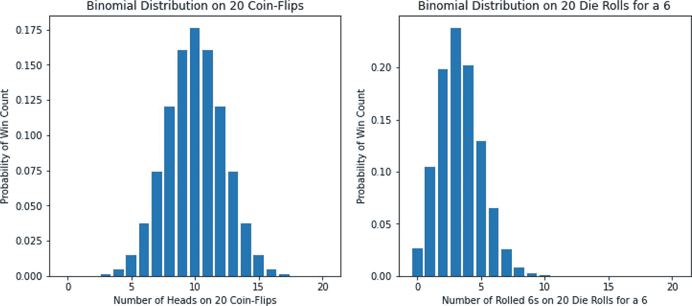

# 基础概率

大多数人对概率的了解足以明白它处理的是特定事件发生的可能性，并帮助我们理解风险。但其内涵远不止于此，概率的各个方面构成了数据科学家日常使用的统计技术的基础。

## 概率论

概率论中有几个概念依赖于我们将在本文中定义的特定术语。

在日常用法中，事件就是指发生的事情，但在概率论中，它是相对于试验来定义的。试验可以被视为一次单一的尝试、一次游戏或产生某种结果的某一轮操作。例如，在掷骰子游戏中，每一轮游戏都涉及玩家掷骰子以产生一个结果。这个试验就是掷骰子，而结果——骰子数字的组合——被称为事件，即所发生的结果或事情。

我们将所有可能的结果称为样本空间。样本空间取决于我们实际追踪的内容。在掷两个骰子以求总和的场景中，总和是我们关心的结果（而不是骰子上的两个具体数字）。因此，所有可能的和构成了样本空间，尽管有多种方式可以得到其中许多和。

举例来说，想象帕斯卡在试验 1 中掷了两个骰子，得到 3 和 4，总和为 7。费马在试验 2 中掷骰子，得到 1 和 6，总和也是 7。这两个事件是相同的，尽管它们实现的方式不同。这个游戏的样本空间是 2 到 12 之间（含）的所有数字，但它们的可能性并不相等——得到 7 比得到 2 容易得多。

另一个需要理解的重要术语是独立性。如果一次试验的结果不会影响另一次试验的结果，我们就称这些试验是独立的。这对于我们讨论的骰子游戏是成立的，但通过一个试验不独立的例子可能会更清楚。假设有一个游戏，如果玩家掷出了 6，那么他们的下一次掷骰结果会翻倍。在这种情况下，第二次掷骰（试验）就不独立于前一次试验。

与独立性相关的一个概念是独立同分布变量，简称为 `iid` 变量。`iid` 变量是指彼此独立且在概率上完全相同的变量。在一个掷六个骰子并尽可能多得到 6 点的游戏中，每个骰子代表一个单一变量，且每个骰子有六分之一的机会得到 6 点。所以这些就是 `iid` 变量。

另一组对概率重要的概念来自集合论，也就是维恩图背后的数学。在集合论中，事件的并集意味着至少满足一个条件。交集意味着所有条件都满足。补集则是所需条件的反面。

假设我们关心一次试验中两个骰子的具体点数。我们关注实际的配置，不同的配置有不同的赔付。假设玩家如果掷出两个偶数（称此为事件 A）就能获得投入金额一半的赔付，而如果掷出两个 5 或两个 6（称此为事件 B）就能获得一次免费的第二轮掷骰。这些事件的并集就是 A、B 或两者都发生的情况，即所有掷出两个偶数或两个 5 的情况（两个 6 的情况同时属于两个事件）。这些事件的交集就是仅两个 6 的情况。最后，事件 B 的补集是所有不是两个 5 或两个 6 的掷骰结果，而事件 A 的补集是任何至少包含一个奇数的掷骰结果。

## 计数、排列与组合

正如我们在分点问题中看到的，计数在几个世纪前就被认为是计算概率的基础。我们必须找出所有可能的结果以及特定结果可能发生的不同方式。这是计算事物可能性的基础，但计数并不总是听起来那么简单，尤其是在可能性数量激增的时候。

通常，直观地列出所有可能的组合是很有帮助的。例如，我们可能掷两个骰子并求和。样本空间是 2 到 12 之间的每个数字，但某些和比其他和更可能出现。表 3-2 展示了列出所有不同骰子投掷结果的一种方式。

**表 3-2** 双骰子求和游戏结果

| 和 | 组合方式 | 得到该和的方式数 |
| --- | --- | --- |
| 2 | 1+1 | 1 |
| 3 | 1+2 | 1 |
| 4 | 1+3, 2+2 | 2 |
| 5 | 1+4, 2+3 | 2 |
| 6 | 1+5, 2+4, 3+3 | 3 |
| 7 | 1+6, 2+5, 3+4 | 3 |
| 8 | 2+6, 3+5, 4+4 | 3 |
| 9 | 3+6, 4+5 | 2 |
| 10 | 4+6, 5+5 | 2 |
| 11 | 5+6 | 1 |
| 12 | 6+6 | 1 |

初看之下，这似乎没问题，但我们遗漏了一项重要事实——除了和是 2 和 12 的情况外，其他所有和都可以通过多种方式得到，因为你有两个不同的骰子。如果你想要得到和为 3，你可以通过骰子 1 是 1 且骰子 2 是 2，或者反过来（骰子 1 是 2 且骰子 2 是 1）来实现。这实际上是两种不同的结果。事实证明，在双骰子求和游戏中计算不同可能性的数量很简单：骰子 1 有 6 种可能值，而每种可能值对应骰子 2 的 6 种可能值，所以总共是 36 种（骰子 1 的 6 个值 * 骰子 2 的 6 个值）。

但我们可以修改游戏规则，使得如果第二个骰子与第一个相同，就自动重掷直到掷出不同的数字（这类似于彩票抽奖）。在这种情况下，第一个骰子仍然可以是任何数字，但骰子 2 只有 5 种可能值，所以是 `6 * 5 = 30`。想象再加入第三个掷骰，且同样不能与之前重复。那就是 `6 * 5 * 4 = 120`。我们在这里计算的也称为排列，是一种在有 `n` 个可能值中选择 `k` 个事物的方式，其中顺序重要且值不能重复。

还有一个相关的计算称为组合，它与排列类似，但顺序不重要。这通常被表述为“从 `n` 个中选 `k` 个”。假设有一个篮子，里面装有五个球，每个颜色不同。组合会告诉你如果伸手一次抓出三个球，有多少种可能的结果。在这种情况下，我们不关心哪个球先被取出，因为这只是一次选择动作（而不是先掷一个骰子再掷另一个）。这里，就是从 5 个中选 3 个，结果为 10。这远小于排列的数量（`5 * 4 * 3 = 60`）。

既然我们已经完成了所有这些计数，你可能会问这到底有什么意义。计数对于计算概率至关重要。在彩色球的例子中，当你一次抓出三个球时，其中一个是蓝球、一个是红球、另一个是黄球的概率是多少？由于每种颜色只有一个，因此只有一种方式实现，所以分子是 1，分母是我们上面计算出的总组合数 10，因此概率是 0.1。在这个例子中，每一种特定的组合都是唯一的，所以每一组球出现的概率相等。但如果你问的是，你抓出两个原色（红、蓝、黄）和一个间色（这个篮子里只有绿色和紫色）的概率是多少呢？如果我们计算有两个原色的方式数，那是 3（红+蓝、红+黄或蓝+黄）。对于每一对原色，间色球都有两种可能的值，所以满足我们要求的结果数为简单的 `3 * 2` 计算，从而概率为 `6/10`，即 0.6。

无论你是用组合还是排列来得到可能性总数，概率的计算方法总是：满足条件的选择数除以物品可被选择的总方式数。选择正确计数方法的直觉需要经过练习才能获得。

### 附加示例：蒙提霍尔问题

概率论中最著名的误解之一，出自一档名为《我们来做个交易》的电视游戏节目，主持人蒙提·霍尔正是该问题的命名来源。节目中，参赛者会看到三扇门，每扇门后都藏着东西——一扇门后是汽车这样的奖品，另外两扇门后则是没人想要的羊。参赛者选择一扇门后，霍尔会打开另外两扇门中的一扇，露出一只可怜的羊（显然他会选有羊的那扇，如果有汽车则不会开）。在真实游戏中，霍尔不会给参赛者换门的机会，但在重新构思的蒙提霍尔问题中，他给了这个机会。参赛者可以选择坚持最初的选择，或者换到另一扇未打开的门。大多数人的直觉是，从概率上看，换不换门无所谓。

但在 1990 年，一位统计学家在一本杂志上提出了这个问题，并给出了一个令所有人震惊的答案，包括那些傲慢到拒绝相信的统计学家和数学家。她的答案是：参赛者应该换门，因为换门获胜的概率是三分之二，而不换门只有三分之一。这个故事引起了轰动，一万人（显然包括一千名学者）写信给杂志社说这个答案是错的。

如果你留心观察，可能会发现一些问题：概率似乎会根据新信息而变化，这看起来是贝叶斯统计的范畴；但事实上，概率并没有变化，这可以用频率学派规则来解释。那么，这究竟是怎么回事呢？

当三扇门都未打开时，每扇门后有汽车的概率恰好是 1/3。参赛者选了一扇门后，这个概率不会改变。他选的门有三分之一的可能性是奖品。这也意味着汽车有三分之二的可能性在参赛者没有选的门后面。当霍尔打开一扇没被选中的门，露出后面的羊时——这正是大多数人觉得反直觉的地方——汽车在那些没被选中的门中的概率仍然是三分之二（根据频率学派范式，这不会因新信息而改变）。但现在参赛者知道哪扇门后有羊了，这意味着那扇既没被选中也没被打开的门，仍然有（不变的）三分之二的概率是汽车所在的那扇。显然，参赛者换门是明智的，因为三分之二的概率大于三分之一。

如果你觉得这不可能对，那你不孤单——但你的想法依然错了。如果你想亲自验证，可以打开 Python 解释器尝试模拟一下。模拟证明换门策略更优。但模拟确实去除了人为因素：如果你选了一扇门又换到另一扇，最后很可能因为换了门而比坚持原选择得到羊更自责。

### 另一个附加示例：生日问题

概率论中有一个著名的场景，常常让人震惊，但它能深刻说明理解“某事发生在任何人身上”的风险与“同样的事具体发生在你身上”的风险之间的区别。“小概率事件”在广义上可能通过多种方式发生，因此很可能发生，这违背直觉。你明天死于车祸的概率微乎其微，但明天某个地方有人死于车祸的概率几乎是 100%。

这个著名场景被称为生日问题。它指出，只要一个房间里有 23 个人，其中两人生日相同的概率就略高于 50%。这就是视角重要性的体现——*你*与另一个人生日（仅月日）相同的概率仍然很低（如果你好奇的话，是 5.8%）。但如果你不关心哪两个人同一天生日，那么人越多，出现相同生日的可能性就越大。通常求解这个问题时，我们会简化条件，忽略闰年、可能存在双胞胎以及其他可能使生日集中的趋势。这意味着我们假设有 365 个可能的生日。

要理解这一点，一个简单的方法是计算所有人生日都不同的概率，然后用 1 减去这个概率，得到至少两人生日相同的概率。如果把人从 1 编号到 23，只需将每个人生日不同的概率相乘即可。第一个人（总共 1 人）生日独特的概率是 `365/365`，因为可以是 365 天中的任何一天。但当加入第二个人时，因为不能与第一个人同名，所以只有 364 个可能的日子。因此第二个人的概率是 `364/365`。以此类推，每个人可选的日子减少一个，第 23 个人的概率是 `343/365`。然后将所有这些值相乘，结果约为 `0.4927`。记住，这是没有人生日相同的概率，所以至少两人同一天生日的概率是其补数，即 `1 – 0.4927`，也就是 `0.5073`。

两人同一天生日的可能性会随着人数增加而持续上升。有 40 人时，概率超过 89%；有 70 人时，概率达到 99.9%。但从另一个角度看，在 23 人的房间里，*你*与其他人同一天生日的可能性要低得多。房间内至少需要 253 人，某个特定个体与另一人同一天生日的概率才能达到 50%——远多于 23 人。

赌场和彩票运营商正是利用人们对概率的无知来牟利。人们看到别人在老虎机上赢了几万美元，或者在新闻里举着数百万美元的巨额支票拍照，就会想：“嘿，那也可能是我。”如果你把钱投入老虎机并拉下手柄，或者在街角商店买一张彩票，从技术上讲你确实可能赢。但实际你不会赢。如果运气好，你或许能拿回本钱。

## 概率分布

概率分布是一种理论构造，表示某个特定变量的取值范围和形态。它们在推断统计中很重要，因为如果你能识别一组数据的分布，就可以推断出手中数据之外其他合理的数值。最著名的分布大概是正态分布，但它只是众多描述不同事物类型的概率分布之一。

通过具体分布来理解会更简单，因此我们将介绍数据科学中重要的几种不同分布。在后面的章节中，我们还会介绍更多与统计检验相关的分布。

请注意，分布有两种基本类型：离散型和连续型。离散型分布涵盖的结果只能取有限数量的值，比如抛硬币——只能是正面或反面。连续型分布的结果可以是连续区间上的任意值，比如人的身高。

### 二项分布

最简单的分布之一是二项分布，它是一种离散分布，用来描述一系列 `n` 次独立二元试验的行为，其中每次试验成功的概率相同（比如多次抛掷一枚硬币看正面朝上）。这里的独立意味着一次试验不会受到之前任何试验的影响，抛硬币的情况正是如此。

该分布由已知的试验次数（`n`）和已知的概率（`p`）来定义。该分布提供了一个公式，使我们能够根据 `n` 和 `p` 来计算获得特定成功次数的概率。我们也可以绘制二项分布图。图 3-1 展示了针对特定 `n` 和 `p` 的两个二项分布图。

两个条形图展示了二项分布。左侧图表显示了在 20 次抛硬币中获得特定正面次数的概率分布，峰值在 10 次正面附近。右侧图表展示了在 20 次掷骰子中获得特定“六点”次数的概率分布，峰值在 3 到 4 次“六点”附近。两个图表的 x 轴都标注为成功结果的数量，y 轴都标注为获胜次数的概率。

**图 3-1** 代表抛硬币和掷骰子的两个二项分布

左侧图表显示了连续抛硬币的分布情况，即在 20 次抛掷中获得获胜（得到某一特定面）0 到 20 次的概率。`n` 为 20，`p` 为 0.5，因为硬币是公平的。毫不意外，获胜 10 次是最常见的结果，因为这是在 `p` 为 0.5 的分布中的中点。如果你熟悉正态分布（我们接下来会讲到），你可能会注意到它看起来有点像正态分布。

但是当 `p` 不为 0.5 时，分布看起来完全不同，如图 3-1 的右侧图表所示，它显示了在 20 次掷骰子中得到特定点数的概率。在这种情况下，`n = 20`，`p = 1/6`（约 0.167），因此图表向右偏斜。但这同样合理，因为最常见的次数是 3 次，概率为 0.15，是最接近 `p` 值 1/6 的分数。

#### 现实世界中的二项分布

尽管这是一个简单的分布，但它对于观察现实世界中的许多事物很有用。例如，如果我们想评估一位特定视频游戏职业玩家的成功率，并且我们根据其评分知道成功的概率，我们就可以计算在一系列比赛中赢得特定场次比赛的概率。如果该玩家玩了 100 场比赛，成功概率为 0.75，并且赢了 90 场（输了 10 场），直觉会告诉我们这位玩家表现非常好。但我们可以量化这个好程度。如果我们想知道他们恰好赢得 90 场比赛的可能性有多大，答案是 0.0094%，非常小。一个更有趣的数字可能是他们至少赢得 90 场比赛的可能性有多大。我们必须将赢得 90 到 100 场比赛之间每一种可能性的概率相加，结果大约是 0.013%，比恰好赢得 90 场要高一些，但仍然非常低。这位玩家的表现异常出色。

既然他们的获胜概率是 0.75，你可能会好奇他们在 100 场比赛中恰好获胜 75 场的可能性有多大——结果只有 9.18%。但这是因为我们问的是他们是否*恰好*赢了 75 场，而实际上，赢 74 场和 76 场的概率也差不多，并且都会被认为是典型的成功率。事实上，他们赢得 73 到 77 场比赛的可能性是 43.6%。

关于二项分布的一个有趣事实是：对于给定的 `p`，`n` 越大，该分布就越接近满足正态分布的条件，我们将在下一节讨论正态分布。

#### 伯努利分布

伯努利分布是二项分布的一种特殊情况，其中只进行一次试验，并有两种可能的结果，通常是成功和失败。