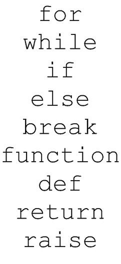
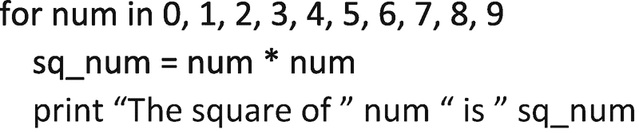
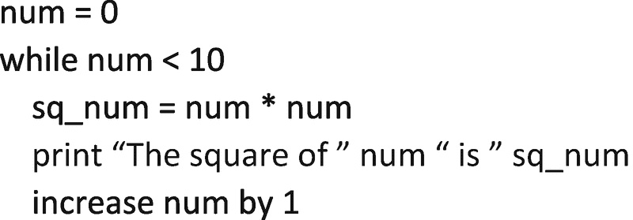
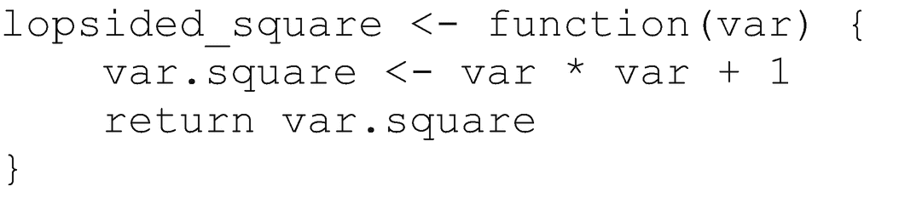

# 11. 行业工具：Python 与 R

## 引言

学习一门编程语言是大多数数据科学职位的必备步骤。数据科学家通常不进行所有类型的软件开发——大多数不会从事前端工作（如网页开发）。相反，数据科学家通常最常处理的是单文件脚本或笔记本。如果你必须自己将模型部署到生产环境，你可能还需要偶尔设计多文件软件来执行建模，并可能使用其他工具将你的代码投入生产。`Python`和`R`是数据科学家最常用的两种语言，本章将介绍像它们这样的常见语言的基本编程知识，并探讨一下这两种语言的区别。

# 数据科学编程史

编程语言和其他计算工具在数据科学领域已有悠久历史，但当今主流语言——`Python`和`R`——的主导地位是近期才形成的。我们在第四章讨论了统计工具的发展，以及`R`如何作为专有语言`S`的开源替代品脱颖而出。在此之前，统计工作主要使用专有统计语言`SAS`和传统语言`FORTRAN`（后者以高数值精度支持科学和工程编程，可实现精确的数学与统计计算）。`SAS`在金融和保险业应用较多，而`FORTRAN`则更为广泛。但`FORTRAN`对非技术背景的统计学家来说略显复杂，这促使`S`被专门为其开发。该语言虽一度流行，但因专有属性限制了使用群体。`R`最初于 20 世纪 90 年代开发用于统计学教学，运行在`S`之上。许多用`R`编写的程序无需修改即可在`S`中运行。它至今仍是学习统计学和编程的绝佳语言，但很快便从教学领域如火如荼地蔓延至整个统计界，至今仍被统计学家和数据科学家广泛使用。

`Python`进入数据科学领域稍晚，但在数据科学家中的普及度已开始超越`R`。`Python`最初作为通用语言问世，在文本处理和高效语法方面表现突出（能以更少代码行实现更多功能）。它吸引了一批近乎狂热的追随者，社区成员自称“Pythonista”，官方最佳实践指南命名为“Python 之禅”，并将最初开发者称为“终身的仁慈独裁者”（BDFL）——因其在 2018 年前一直承担主要维护职责。直到 2009 年`Pandas`包（核心语言扩展包）和 2010 年`scikit-learn`（主流机器学习包）发布后，`Python`才真正用于数据科学。`Pandas`通过引入数据框（`R`的主要数据结构）使`Python`的编程风格更接近`R`。彼时数据科学刚刚兴起，已在使用`Python`的程序员在涉足数据科学时自然转向`Pandas`和`scikit-learn`，由此推动了它的普及。

尽管`SAS`仍在某些企业中存续，但当前主流已是`R`或`Python`（具体选择取决于个人偏好）。除非工作需要`SAS`，否则初期只需学习`R`或`Python`即可。这两种语言对数据科学的学习和开发都完全适用，只是各有所长——具体选择取决于应用场景。多数数据科学家对偏好哪种语言持有强烈观点，团队也常以其中一种为主。但完全没必要二选一——许多团队同时使用两者。我们将在后续章节详细讨论它们的异同。`R`在统计、可视化和学术领域尤为出色，而`Python`则在机器学习、通用编程（包括构建生产系统）方面表现卓越。

# `Python`与`R`在现实数据科学中的应用实例

第一个案例很好地说明：你无需在`R`和`Python`之间做选择，而是可以根据各自优势搭配使用。随后我们将探讨`Python`在金融科技领域的应用。

## 示例 1：兼用两者进行对冲

对冲基金公司 Amadeus Investment Partners 通过采用包含`Python`、`R`、`SQL`及其他工具的技术栈（团队完成工作的技术工具组合）取得了成功。其跨学科团队设有多个角色，每个角色使用特定工具。技术专家使用`R`、`Excel`等工具探索数据；数据工程师则使用`R`、`SQL`和`C++`（注重性能的传统编程语言）；数据科学家用`R`进行探索性数据分析（EDA），用`Python`专门处理机器学习和深度学习；用户界面开发人员也同时使用`R`、`Python`及其他工具。

在大多数数据分析任务（包括数据探索和可视化）中，Amadeus 偏好使用`R`，该语言拥有出色的相关包。但`Python`在机器学习等计算密集型任务中表现更优——尤其当处理公司使用的大规模数据集时。值得注意的是，他们明确规定了各岗位应使用的工具。许多企业允许数据科学家自由选择工具（这种做法虽受欢迎），但会导致代码库分散、难以维护和复用。而通过要求数据科学家用`R`进行 EDA，后续工作便能更轻松地基于前期成果展开。

该公司的另一独特之处在于：他们不走寻常路，直接招聘商学院顶尖毕业生并培训成数据科学家，而非招录有技术背景的人员。他们发现这些毕业生能较快掌握`Python`和`R`，同时兼具学位赋予的通用软技能和商业知识。这正说明了这两种语言相对易于学习。

## 示例 2：快速灵活的金融科技

金融科技咨询与定制软件开发公司 djangostars 在所有工作中都偏好使用`Python`。他们认为`Python`是金融科技领域的最佳语言（尤其对新兴公司），原因众多：其一，数学家和经济学家已习惯使用该语言，因此从他们那里获得的系统需求在“正式编码”前就已完成了大半准备。虽然金融科技涉及大量数据科学工作，但其内涵远不止于此——`Python`作为多用途语言的优势得以凸显。他们指出，`Python`结合`Django`（成熟的`Python`网络框架）是快速将产品推向市场的绝佳组合。此外，这套工具组合灵活性极强且易于修改——这对金融科技而言至关重要（与传统银行业不同）。他们还发现，由于`Python`相对易学，开发人员和数据科学家能更顺畅地向客户解释技术、促进协作和知识转移。`Python`已非常成熟，几乎任何可想象的功能都有对应的免费包提供支持。

好的，作为一名高级文档工程师和翻译员，我将严格遵循您的注意事项和示例格式，将给定的英文文本翻译成中文。

## 计算机编程基础

编程语言实际上和人类语言很相似，只是简单得多得多。我有一位教授，他在 20 世纪 80 年代获得了计算机科学学位，并说服他的大学将 Pascal（另一种传统编程语言）算作他的外语必修课。这在今天不会发生，但就像人类语言一样，编程语言有语法（特定的单词、运算符以及它们的书写顺序）和语义（遵循语法规则所写的特定文本的含义）。它们还有随着时间的推移而形成的惯用语，即程序员之间约定俗成的完成特定任务的方式，即使这并不是唯一可以编写的方式。少数语言还有相当严格的格式规则来规定风格——Python 就是其中之一，Python 爱好者们坚信这是编写美观代码的唯一方式。

计算机代码基本上就是用特定编程语言的语法编写的“菜谱”。几乎所有编程语言都使用英语单词，并且有几个单词和运算符在大多数语言中通用。一些最常见的运算符包括表 11-1 中列出的那些。这些大多是我们从基础数学中熟悉的元素。它们在代码中的使用方式也大致相同。下面我也会对这些运算符进行更多阐述。

**表 11-1** 多种语言（包括 R 和 Python）中的常见运算符

| 赋值与控制 | 比较运算符 | 数学运算符 |
| --- | --- | --- |
| `=``:` | `>``<``>=``<=``==``!=` | `+``-``/``*``^``%` |

一些常见的关键字如图 11-1 所示。*关键字*是指在语言中始终具有特定含义的单词，除了按定义好的方式使用外，不能（或不应该）在代码中的任何其他地方使用。图 11-1 中的所有关键字都用于控制程序流程，我们将在下面讨论。



**图 11-1** 多种语言（包括 R 和/或 Python）中的常见关键字

一旦你掌握了语法的基础知识，你就走上了学习如何用代码完成几乎所有事情的道路。编程非常系统性，但一旦你深入其中，你就会发现在寻找解决问题的好方法时，创造力有多么重要。

有几种不同的高水平编程方法，称为范式。我们在此重点关注的是过程式和函数式，但你还会听到另一种常见的范式叫*面向对象编程*，它侧重于某种模块化设计，并且可以在 Python 和 R 中实现（在 Python 中很容易，但在 R 中稍复杂一些），尽管许多数据科学家可能永远不会使用它。*过程式编程*涉及一个一个按顺序执行的步骤序列。*函数式编程*涉及函数的使用（我们将在下面进一步定义），但基本上包含更小的代码单元，这些代码单元可以被定义，并使用不同或不使用值来重复调用，以实现有效的复用。

请注意，本章讲的是代码，但你不必期望在本章中就学会编写代码。各节中有一些 Python 和 R 代码的示例，但它们仅仅是为了说明概念并展示这两种语言之间的差异。然而，如果你是一个动手型学习者，那么进入 Python 或 R 解释器并尝试一下也无妨。这是一个很好的学习方式。附录 A 详细说明了如何安装它们并开始使用。

## 传统编程

一个计算机程序就是一系列代码行，利用语法和其他文本来告诉编译和/或运行代码的东西该做什么。有些语言使用编译器进行编译，这意味着它们被处理并转换成可运行的文件，或者由解释器实时运行。R 和 Python 都使用解释器。

代码的格式化通过使用换行、空白（包括缩进/制表符）以及控制结构（如花括号 `{` 和 `}`）来实现，使其既能被人阅读，也能被编译器或解释器读取。除此之外，编写代码还有许多要素，我们将在下面的小节中介绍。

我在图 11-2 中包含了一些示例 Python 代码，以防你从未见过代码。这段代码没有做任何特别有趣的事情，但它展示了我们将在下面讨论的一些基础知识。当我们下面讨论到它时，我也会指出这段代码中的相关部分。左侧是行号。请注意，代码是带有颜色编码的——这在大多数代码编辑器中是标准做法。


**图 11-2** 一些示例 Python 代码

### 注释

所有编程语言都允许你在代码中包含注释。编写注释的具体语法因语言而异，但 Python 和 R 都使用井号 `#`。每当你在某行代码上看到这个字符时，`#` 之后的所有内容都是注释，不会被解释器运行；而 `#` 之前的所有内容都是将要被运行的常规代码。

关于如何以及应该在代码中添加多少注释，有很多不同的看法，但大多数人都认为应该有一些注释。有些人几乎叙述正在发生的每一件事，而另一些人则只包含 TODO 或标记他们认为非常令人困惑的内容。在实践中，你会发现当你稍后回过头来看代码时，你会忘记代码中那些棘手部分的作用，所以强烈建议添加注释。

### 变量

变量是在代码中存储数据和值的方式。你可以将一个值赋给一个*变量*，变量就是一个用于保存该值的名称。变量用于存储数字、文本或其他更复杂的数据类型等值。在包括 R 和 Python 在内的一些语言中，几乎任何东西都可以存储在变量中，甚至函数也可以。变量是一种占位符，代表其他东西。当你将要重复做某件事，又不想每次都重新输入一个值时，通常会使用变量，尤其是当这个值以后可能改变的时候。

#### `Python`

和几乎所有语言一样，`Python` 使用等号来赋值变量。例如，代码 `my_number = 7` 将值 7 存储在变量 `my_number` 中，因此每当你在代码中看到 `my_number` 时，都可以在心里用值 7 来代替。如果你看到 `my_number + 5`，结果将是 12。

在 `Python` 中命名变量时有几条规则。变量名中只能使用字母（大写或小写）、数字和下划线（`_`），并且名称不能以数字开头。你可以用字母或下划线开头来命名变量，但在 `Python` 中，以下划线开头的变量用于指示特定场景，因此对于常规变量，你应该以字母开头。

图 11-2 中示例 `Python` 代码的第 2-8 行是变量赋值，行尾的注释表明了 `Python` 当前会分配给该变量的数据类型。

## `R`

`R` 允许在变量名中使用与 `Python` 略有不同的字符。它允许所有与 `Python` 相同的字符，但也允许使用句点（句点在 `Python` 中是运算符，因此不能使用）。实际上，在 `R` 变量名中使用句点相当常见。名称必须以字母开头。

`R` 在赋值运算符的使用上与其他语言不同，它使用`<-`而不是等号。等号也可以工作，但大多数 `R` 程序员更喜欢`<-`。它的写法如下：`my.number <- 7`。这就像 `Python` 一样，每当在代码中看到该名称，它就代表 7。

### 数据类型

*数据类型*就是给定语言中允许的数据类型，即你可以存储并且语言知道如何处理的内容。最常见的基础类型（通常称为*原始数据类型*）包括：*整数*（整数）、*小数*（小数）、*布尔值*（false/true 或 0/1）、*复数*（包含复数的值，即–1 的平方根）和*字符串*（包含在标记内，通常是引号内的文本）。不同的语言会对每种类型有不同的尺寸版本。

还有更高级的类型可以原生支持、自定义定义或通过语言的其他包（插件）使用。这些包括*数组*或*列表*（值的序列）、*映射*（一种键指向值的键值对序列）以及*集合*（像没有重复值的数组或列表）。

还有更多存储数据的方法，这些方法更加高级，几乎从不内置于语言中（因此你必须使用外部包）。这些通常被称为*数据结构*，这是一个更抽象的术语，表示基于数据存储方式的部分行为和关系。这些包括*栈*（后进先出，就像餐厅里的一摞盘子）、*队列*（先进先出，就像小吃摊前排的队）和*树*（就像家谱）。有一些处理这些更复杂数据结构的方法，使它们在某些情况下非常方便，尽管这些在数据科学编程中很少出现。

最后，不同语言在处理数据类型和变量方面存在一些重大差异。在静态类型语言（如 `Java` 和 `C++`）中，变量的类型必须在创建时定义，并且永远只能保存该类型的数据。`Python` 和 `R` 都是动态类型语言，这意味着你不需要在创建变量时声明类型，而且一个变量可以在不同时间保存不同类型的数据（它可能先保存字符串，然后保存数字）。动态类型导致更简洁的代码，但意味着你必须小心更改变量。

在强类型语言（大多数流行语言都是）中，不同数据类型之间的混合方式有限制。`Python` 和 `R` 都是强类型语言，因为当代码运行时，解释器会跟踪所有数据类型并禁止某些操作。例如，一种流行的弱类型语言允许你“添加”一个字符串值（或变量）和一个数字值（或变量）。在 `JavaScript` 中，`"X" + 9`会得到`"X9"`（一个字符串），但 `Python` 和 `R` 都会抛出错误。

注意，`Python` 和 `R` 都根据赋值给变量的值来记录其数据类型。因此，如果你将一个变量赋值为 7，`Python` 和 `R` 会将其视为`int`，直到它被重新赋值给其他内容。

#### `Python`

`Python` 拥有所有基础数据类型，外加两种类似的列表类型（分别称为`list`和`tuple`），以及映射类型（称为`dict`，字典的缩写）。列表和元组从 0 开始索引，因此第一个元素在位置 0，第二个在位置 1，依此类推。在当前流行版本中，`Python` 只有一个整数数据类型`int`（早期版本有一个更大的整数类型`long`）。它也只有一种小数数据类型`float`（以前有一个更大的小数类型`double`）。当前的`int`和`float`与之前的`long`和`double`一样大，这就是为什么现代代码中不再需要它们。布尔类型称为`bool`，复数类型称为`complex`。字符串存储在`str`数据类型中。你可以通过调用`type()`函数并将变量名放在括号内来查找数据类型。

## `R`

`R` 也拥有所有基础数据类型。它有两种类似的列表类型：`vector`和`list`。与 `Python` 不同，两者都从 1 开始索引。整数数据类型称为`integer`，小数类型称为`numeric`。复数类型简称为`complex`。字符串使用`character`数据类型构建。最后，布尔类型称为`logical`。你可以通过调用`class()`函数并将变量名放在括号内来检查任何值的数据类型。

### 运算

运算就是编程语言中对所执行动作的指令。例如，若想在代码中进行数学运算，可以使用如表 11-2 所示的运算符。这些运算符在 `Python` 和 `R` 中的工作原理完全相同，虽然取模运算符在两者间略有差异。图 11-2 中示例 `Python` 代码的第 11 至第 16 行展示了这六种数学运算符的用法。

**表 11-2** `Python` 和 `R` 中的数学运算符

| 用途 | 数学符号 | `Python` | `R` | `Python` 示例及结果 |
| --- | --- | --- | --- | --- |
| 两数相加。 | n + m | `+` | `+` | `6 + 2` 得到 8。 |
| 两数相减。 | n – m | `-` | `-` | `6 - 2` 得到 4。 |
| 两数相乘。 | n × m | `*` | `*` | `6 * 2` 得到 12。 |
| 两数相除。 | n ÷ m | `/` | `/` | `6 / 2` 得到 3。 |
| 求幂运算。 | n^m | `^` `**` | `^` `**` | `6 ^ 2` 得到 36。`6 ** 2` 得到 36。 |
| 计算模（余数）。 | n % m | `%` | `%%` | `6 % 2` 得到 0。`7 % 2` 得到 1。 |

数学运算中一个重要的概念是*运算顺序*，它决定了数字和运算符的组合会先执行哪一个。这与常规数学中的规则相同，可以使用括号强制优先计算某些部分。手写数学表达式时，通常会加上括号以确保清晰明了；但在代码中，只有当运算顺序确实需要时，才会使用括号。例如，表 11-3 展示了一些代码、中间概念步骤以及最终结果。如果你对数学中的这一概念不太熟悉，刚开始可能会觉得有些复杂，但经过一段时间的实践，它就会变得自然而然。

**表 11-3** 运算顺序示例

| 运算 | 步骤 1 | 步骤 2 | 步骤 3 | 结果 |
| --- | --- | --- | --- | --- |
| `6 + 2 * 3 – 1` | 6+2 × 3–1 | 6+6–1 |   | 11 |
| `(6 + 2) * 3` | (6+2)×3 | 8×3 |   | 24 |
| `2 ^ 3 * 5 – 3` | 2³×5–3 | 8×5–3 | 40–3 | 37 |
| `2 ^ (3 * 5 – 1)` | 2^((3 × 5) – 1) | 2^(15 – 1) | 2¹⁴ | 16384 |
| `2 ^ (3 * 5) – 1` | 2^((3 × 5))–1 | 2¹⁵–1 | 32768–1 | 32767 |

另一种比数学运算更常用的运算是比较运算。我们想要知道某事物是否与另一事物相同、不同、更大或更小。这些可以在表 11-4 中看到。这些运算的结果总是返回一个布尔值。它们在 `Python` 和 `R` 中的工作原理完全相同。

**表 11-4** `Python` 和 `R` 中的比较运算符

| 用途 | 数学符号 | `Python` | `R` | `Python` 示例及结果 |
| --- | --- | --- | --- | --- |
| 小于 | n < m | `<` | `<` | `6 < 2` 得到 False。 |
| 小于或等于 | n ≤ m | `<=` | `<=` | `6 <= 2` 得到 False。 |
| 大于 | n > m | `>` | `>` | `6 > 2` 得到 True。 |
| 大于或等于 | n ≥ m | `>=` | `>=` | `6 >= 2` 得到 True。 |
| 等于 | n == m | `==` | `==` | `6 == 2` 得到 False。 |
| 不等于 | n ≠ m | `!=` | `!=` | `6 != 2` 得到 True。 |

还有一些与条件判断密切相关的重要运算符：`not`、`and`和`or`。`not`对其前置的值取反：如果值为 True，取反后为 False，反之亦然。`and`和`or`用于将多个条件连接起来，产生一个单一的布尔值：对于`and`，仅当所有部分都为 True 时，结果才为 True；对于`or`，只要至少有一个部分为 True，结果即为 True。例如，`6 > 2 and 2 > 6` 结果为 False，而 `6 > 2 or 2 > 6` 结果为 True。

这些是 `Python` 和 `R` 中最常用的运算符。还有其他一些不常用的运算符，包括位运算符，但你在数据科学中可能不需要用到它们。

### 程序控制流与迭代

编程的一个重要方面是让代码按正确的顺序执行你的意图，并且经常需要重复执行某些操作。从微观层面看，运算顺序正体现了这一点，但更重要的是控制流功能。有两种常见的控制机制可以让你随心所欲地控制程序流程：if–else 条件和循环。

# If–Else 块

If–else 结构允许你表达：如果条件成立，则执行一件事；否则，执行另一件事。你还可以嵌套这些结构，例如：如果条件一成立，做一件事；如果条件二成立，做另一件事；如果条件三成立，再做另一件不同的事；否则，做其他事。如果我们将这种逻辑详细描述出来，结果如表 11-5 所示。这种书写方式被称为 `伪代码`（不过通常你会有像右侧那样的实际值），它是一种类似于代码的写法，不特定于任何编程语言，但能清晰地表达正在发生的事情。

**表 11-5** 包含三个条件的 if–else 块框架

| 流程概念 | 伪代码 |
| --- | --- |
| 如果条件 1 <br>那么执行操作 A <br>否则如果条件 2 <br>那么执行操作 B <br>否则如果条件 3 <br>那么执行操作 C <br>否则执行操作 D | ```<br>if var1 > 0<br>then print("positive")<br>else if var1 == 0<br>then print("zero")<br>else if var1 < 0<br>then print("negative")<br>else print("something's wonky")<br>``` |

表 11-5 左侧的代码检查条件 1，如果条件 1 为真，则执行操作 A。否则，继续检查条件 2 是否为真，以此类推。请注意，这些块的工作方式是，一旦满足第一个条件就会“跳出”。如果条件 1 满足，该块将执行操作 A，然后跳转到整个块之后的下一段代码，而不会再去检查条件 2。只有当条件 1、2、3 都不为真时，才会执行操作 D。右侧代码展示了当我们想要打印一个名为 `var1` 的数值变量的方向（正或负）时的流程。

Python 使用三个与 if–else 语句相关的关键字：`if`、`elif` 和 `else`。它使用冒号来引出每个条件。R 只使用 `if` 和 `else`，在必要时使用 `else if` 组合，并且需要使用花括号来划分不同的代码块。参见表 11-6，其中展示了表 11-5 中的代码在 Python 和 R 中的表现形式。你也可以在图 11-2 的第 19 至 24 行看到 if–else 块的示例。

**表 11-6** Python 和 R 中的 if–else 代码示例

| Python | R |
| --- | --- |
| ```python<br>if var1 > 0:<br>    print("positive")<br>elif var1 == 0:<br>    print("zero")<br>elif var1 < 0:<br>    print("negative")<br>else:<br>    print("something's wonky")<br>``` | ```r<br>if (var1 > 0) {<br>    print("positive")<br>} else if (var1 == 0) {<br>    print("zero")<br>} else if (var1 < 0) {<br>    print("negative")<br>} else {<br>    print("something's wonky")<br>}<br>``` |

# 循环

在代码中，我们经常需要重复执行某个操作，每次仅使用略有不同的值。这类操作通常不止是基础操作，但概念上相当简单，我们可以通过一个示例来观察：为几个不同的值打印一些数学计算结果。首先，让我们看看如图 11-3 所示的伪代码。



用于计算并打印 0 到 9 数字平方的 Python 代码片段。该代码遍历每个数字，计算其平方，并以“The square of [number] is [square]”的格式打印结果。

**图 11-3** 一个简单 `for` 循环的伪代码，用于打印前十个数字的平方

这里展示的循环类型是 `for` 循环，其基本结构是“对于值列表中的某个值”，循环运行的次数与列表中元素的数量相同，每次运行时，该值都取列表中的一个值。我们始终知道这种循环会运行多少次。

另一种循环类型是 `while` 循环，它会反复运行，直到预先定义的条件不再满足为止。其伪代码大致如图 11-4 所示。在这个例子中，我们从名为 `num` 的变量开始，每次循环运行时增加其值，直到数字达到 10 才停止。只要 `while` 后面的条件为真，循环就会继续。此外，你也可以使用关键字 `break` 在代码中的该点退出 `while` 循环。



一段演示循环的伪代码片段。它将变量 `num` 初始化为 0。在 `num` 小于 10 的条件下循环继续。循环内部，通过将 `num` 乘以自身来计算 `num` 的平方，赋值给 `sq_num`，并打印语句 “The square of `num` is `sq_num`”。然后变量 `num` 递增 1。

**图 11-4** 一个 `while` 循环的伪代码，用于打印前十个数字的平方

请注意，大多数程序员更倾向于使用 `for` 循环而非 `while` 循环，因为 `while` 循环很容易出现导致其永远运行的 bug（例如，如果在图 11-4 的例子中忘记将 `num` 增加 1，它将永远不会退出）。这显然很容易修复，但第一次运行带有这个 bug 的代码时仍然会很麻烦。

## 伪代码与代码逐步执行

伪代码本质上是算法的步骤，是使用人类语言编写的代码。在你刚开始学习编程时，先用这种方式写出来通常非常有益，这样你就能理解其中的逻辑和流程。

同时，记录伪代码每一步使用实际值时发生了什么也非常有用。例如，对图 11-4 中的代码进行逐步执行，起始过程如下：

| **`num` 的值** | **结果** |
| --- | --- |
| 0, 1, 2, 3, 4, 5, 6, 7, 8, 9 | 0 的平方是 0。1 的平方是 1。2 的平方是 4。3 的平方是 9。4 的平方是 16。5 的平方是 25。6 的平方是 36。7 的平方是 49。8 的平方是 64。9 的平方是 81。 |

这可以帮助你理解发生了什么，并发现问题，尤其是在处理更复杂的代码时。

Python 有 `for` 循环和 `while` 循环。`for` 循环使用关键字 `for` 和 `in` 来设置，而 `while` 循环使用 `while`。R 语言有相同的关键字，但还有另一种类似于 `while` 循环的循环，它使用关键字 `repeat`。这种循环就像一个 `while` 循环，但它没有条件，只有在循环内部使用关键字 `break` 时才会停止运行。因此，它总是运行到 `break` 关键字首次出现的位置。而 `while` 循环如果初始条件不满足，可能永远不会运行。参见表 11-7，其中展示了用于实现图 11-3 中功能的 `for` 循环在 R 和 Python 中的代码示例。在 Python 中，获取从 0 到 9 每个数字列表的方法是 `range(10)`（不是 1 到 10），所以你会在代码中看到它。在 R 语言中，你可以使用代码 `0:9` 获得相同的结果。

**表 11-7** Python 和 R 中的 for 循环代码示例

| **Python** | `for num in range(10):`<br>`    sq_num = num * num`<br>`    print("The square of " + num + " is " + sq_num)` |
| --- | --- |
| **R** | `for (num in 0:9) {`<br>`    sq_num <- num * num`<br>`    print(paste0("The square of ", num, " is ", sq_num))`<br>`}` |

表 11-8 展示了使用 `while` 循环完成相同功能的代码。注意，在 Python 中，有一种给数字加 1 的简写方式：`num += 1`。

**表 11-8** Python 和 R 中的 while 循环代码示例

| **Python** | `num = 0`<br>`while num < 10:`<br>`    sq_num = num * num`<br>`    print("The square of " + num + " is " + sq_num)`<br>`    num += 1` |
| --- | --- |
| **R** | `num <- 0`<br>`while (num < 10) {`<br>`    sq_num <- num * num`<br>`    print(paste0("The square of ", num, " is ", sq_num))`<br>`    num <- num + 1`<br>`}` |

你可以在图 11-2 的第 27–29 行和第 32–35 行的 Python 示例代码中看到另一个 `for` 循环和 `while` 循环。

## 函数

到目前为止我们讨论的所有内容都适用于过程式编程，但引入函数将带我们进入函数式编程领域，并且如果我们反复执行相同或相似的任务，函数可以极大地改进代码。`函数` 是一段完成特定任务的代码块，它可以接收变量并使用，也可以返回一个值。在不同的语言和上下文中，函数可能有不同的名称，包括方法、过程和子例程（这些术语并非完全同义，但在此节中足够相似）。函数被认为是可调用的，这意味着你定义它一次，然后通过在代码中包含其名称来稍后运行它。

一个函数有两个高级组成部分：函数定义和函数体。这些在不同语言中可能看起来不同，但第一行总是函数定义，并包含函数名称以及输入变量（如果需要的话）。输入变量被称为实参或形参。函数体从下一行缩进开始，或者包含在花括号（或其他符号）内。

函数可以很小——甚至只有一行——也可以长达数百行。通常，更短的函数更受欢迎，因为最佳实践是让一个函数主要做一件事（即使完成这一件事需要许多、许多步骤），而不是做几件不同的事情。当你调用 Python 或 R 语言原生函数或已安装的某个包中的函数时，你会广泛地使用函数。但你也会经常创建自己的函数，这是非常强大的能力。

### Python

In Python, a function is called a `function`, unless it’s used in a specific context of object-oriented programming, but we don’t have to worry about that just yet. They are defined using the keyword `def`, followed by the function name and opening and closing parentheses, with the variables in the parentheses if they are to be included when the function runs. The function in lines 38–40 of the code in Figure 11-2 is a simple one that returns a modified square of a number. Line 38 is the definition, containing the keyword `def`, the function name, an opening parenthesis, one parameter, a closing parenthesis, and a colon that signals the definition is closed and indicates the function body is next. The function body begins on the next line in Python. The first line calculates the new value, and the last line returns the value with the keyword `return`. We can call the function later with the function name followed by parentheses, with the same variable order/sequence as in the function definition. The parentheses are required regardless of whether a variable is passed. The call is shown in line 42 of the example code in Figure 11-2, with the function name and a parameter in parentheses. The parameter can be hard-coded values or variable names.

Python also has a less common type of function. You can use the keyword `lambda` to define an anonymous function. This creates a block of code that works like a function but is called only once where it is defined because it has no name. One of the more common uses is to sort data in some nonstandard way. Suppose you have a list of lists with two numbers (row number and height), such as `[[4, 60], [8, 69], [3, 62], [1, 67], [2, 65], [9, 72]]`. If you called Python’s `sort()` function on the whole list, it would be sorted as you might expect – by the first number in each sublist for all two-element lists. But if we wanted it to be sorted by the second number, we could create a simple `lambda` function in the call to sort to instruct it to sort by the second number.

### R

Functions in R are similar to Python in the way they are defined and used, but they look a little different. The `lopsided_square` function from the Python version in Figure 11-2 above is written in R and shown in Figure 11-5. In the definition, the name is placed first, followed by the assignment operator, the keyword `function`, parentheses with the parameter name, and finally a left curly brace that indicates the start of the function definition. The function definition follows for two lines, and it is closed with a right curly brace. R also uses the same keyword `return` as Python to return values.



> Code snippet for defining a function in R programming language. The function is named `lopsided_square` and accepts a single variable `var` as input. It calculates `var.square` by multiplying `var` by itself and adding 1. The function returns `var.square`. Keywords: R, function, variable, multiplication, return.

**Figure 11-5**
> An example function defined in R.

If we include `lopsided_square(3)` in the code, we will get a return of 10.

### Libraries and Packages

# 代码组织与数据科学编程

## 库与包

组织代码的一个重要部分是使用按用途分组的库和包。在 Python 中，*library* 一词有时会被使用，但 *package* 通常更受青睐。该语言的基础安装包含许多默认包，但你可以安装更多。例如，虽然基本数学已包含在 Python 中，但有一个包含更高级数学函数的特殊包。在数据科学代码中，也有许多第三方包可用。要在 Python 和 R 中使用这些类型的包，必须先导入它们。

### Python

在 Python 中，有几种不同的方式导入包。通常是在代码顶部导入。包包含你想使用的类或函数，导入方法决定了你之后如何引用这些内容。表 11-9 展示了导入名为 `Pandas` 的包的不同方式，以及如何使用该导入方式来引用其中的函数。

**表 11-9**
> Python 中导入包的常见方式

| 包导入语句 | 从包中调用函数 |
| --- | --- |
| `import pandas` | `pandas.to_csv()` |
| `from pandas import to_csv` | `to_csv()` |
| `import pandas as pd` | `pd.to_csv()` |

你如何引用一个导入的包与一个叫做 `namespace` 的概念有关，它定义了变量和其他名称应用的层次结构。第一种方式是最基本的，第三种方式与之相同，只是你为 `pandas` 包创建了一个别名 `pd`。当你想使用前两种方式之一导入的包中的函数或引用类时，必须在函数或项目前加上包名（或别名）和一个点。如表格第二列所示。因此，第二种方式有时很方便，因为你不必在每次调用函数时都指定包，但它也有缺点。如果你使用了第二种方式并编写了自己的名为 `to_csv()` 的函数，你将无法同时使用这两个函数——最后定义的那个才会被实际调用。这可能会引起混淆。`Pandas` 是数据科学中的一个关键包，常规的导入方式是第三种，使用别名 `pd`。

## R

在 R 中，导入包有几种关键方式。第一种是使用 `library()` 函数，第二种是使用 `import` 包。在 R 中也可能遇到 `namespace` 挑战。默认情况下，包中的所有函数都可以直接通过其函数名使用，但你也可以通过使用包名后跟两个冒号来引用特定包中的函数。参见表 11-10 中的示例导入。

**表 11-10**
> R 中导入包的常见方式

| 包导入语句 | 从包中调用函数 |
| --- | --- |
| `library(dplyr)` | `filter()` 或 `dplyr::filter()` |
| `import::from(dplyr, select, filter)` | `filter()` |
| `import::from(dplyr, select, dplyr_filter = filter)` | `dplyr_filter()` |

第一种方式最常见，你可以直接通过函数名引用函数，或者如所示指定包名。第二种方式类似，但它只导入指定的函数（在本例中是 `dplyr` 包中的 `select` 和 `filter`）。第三种方式允许你重命名特定函数，当不同包具有相同的函数名时，这可能很重要。在第三种情况下，`select` 正常导入，但包函数 `filter` 被赋予了别名 `dplyr_filter`。还有更多方式可以指定导入哪些函数；你可以查阅在线 R 文档以获取更多细节。

### 组织与格式

代码的组织方式和风格多种多样，观点也层出不穷。有些观点涉及注释。我曾与一位同事共事，他坚持认为，在写得很好的 Python 代码中不需要注释，因为代码本身已经非常易读。我不同意这种观点，但确实不必为所做的每一件事都加上注释。对于许多程序员（尤其是 Pythonistas）来说，代码的外观很重要。目标是让代码尽可能易读，这通常意味着适当的空白和偶尔的注释。在 R 语言中，花括号用于定义不同的代码块，通常左花括号位于代码块的第一行，右花括号则单独位于代码块的末尾一行。Python 不使用像花括号这样的代码块封闭符，而是用冒号标记一个块，并依靠缩进来定义代码所属的块。下面我将介绍一些已发布的 Python 和 R 语言风格指南。

### 错误处理

通用编程的一个重要部分是恰当地处理代码中的错误，尤其是在代码投入生产或需要被其他人运行时。当你编写的代码将在团队内或其他程序员之间共享时，后一点尤其重要。如果你只是编写 Notebooks 来运行自己的数据科学分析，则无需特别处理代码中的错误，因为你自己会看到错误并立即进行适当的修正。

但设想一下，你创建了一个函数，它位于一个核心代码位置，供人们对某个值进行特定的转换。他们会导入你的函数并运行它，而无需了解其内部代码——但如果你做得对，用户凭借你优秀的文档就会确切知道如何使用该函数。假设该函数需要几个参数，并应返回一个转换后的数字。然而，如果函数内部出现问题并产生错误，用户将无法对函数内部进行故障排查——他们甚至可能看不到函数内部。因此，你需要预见可能出现的错误类型，捕获它们，并向用户返回有意义的错误消息。常见的会引发错误的场景包括除以 `0` 或提供错误的数据类型。在 R 和 Python 中都有很好的错误处理方式，如果你开始编写需要此功能的代码，就可以学习这些方法。

### 安全性

程序员并不总是会考虑到安全性。虽然与编写代码直接相关的隐私或伦理问题不多，但编写的代码可能存在安全性不足的问题。对于只处理内部系统的数据科学家来说，这通常不是什么大问题，但如果你通过将系统投入生产或创建 `API`（应用程序编程接口，一种在你的网络上运行并允许其他代码查询它的软件，你的代码会生成响应并发送回去）将代码暴露到互联网上，这就很重要了。

程序员应该关注的一些安全领域包括：身份验证、加密、错误处理、输入验证、输出验证以及第三方包的选择。我们已经在第 8 章讨论过身份验证和加密，但这里的关键是确保在必要时进行身份验证，并在代码中正确设置，以及在必要时包含加密。输入验证和输出验证对于确保不会引发任何不良行为至关重要。一种常见的网络攻击称为 `SQL` 注入，即有人在填写表单时，在文本框中放入 `SQL` 代码（比如请求用户名的字段，或者任何其他字段）。如果攻击者编写了能删除数据库中所有表的代码，并且文本框没有进行任何输入验证，那么这段 `SQL` 代码就可能在该系统的数据库中执行。输入验证可以阻止这种情况。输出验证则确保没有代码或其他问题结果会导致网页浏览器渲染错误或显示冒犯性图像等。我之前提到过错误处理，它可以与输入和输出验证结合使用，以处理检测到的问题。我还提到了包的选择，因为像 R 和 Python 这样的开源语言的一个美好之处在于，任何人都可以创建并分享一个包。但这并非总是阳光与彩虹，因为可能会发布有不良意图（无论是有意还是无意）的包，不过它们最终会暴露出来。因此，建议坚持使用成熟的包，而不是贸然使用全新的包。

# 数据科学编程

在大多数数据科学和统计编程中，最具标志性的事物就是数据框，它是分别在 `R` 语言中和 `Python` 语言下使用 `Pandas` 来存储表格数据的基本结构。数据框在 `R` 中实际上是一种内置数据类型，但在 `Python` 中，我们必须使用一个名为 `Pandas` 的包，它为我们提供了类似 `R` 语言的功能。

数据框以便捷且有意义的方式存储表格数据。表 11-11 展示了一个典型的数据框。

**表 11-11 示例数据框**

| 宠物编号 | 物种 | 名称 | 性别 | 出生日期 | 品种 | 颜色 _1 | 颜色 _2 | 死亡日期 |
| --- | --- | --- | --- | --- | --- | --- | --- | --- |
| 1 | 猫 | Chica | 已绝育雌性 | 2023-05-10 | 家养长毛猫 | 黑色 |  |  |
| 2 | 猫 | Zephyr | 已绝育雄性 | 2020-01-15 | 家养短毛猫 | 橙色虎斑 |  |  |
| 3 | 猫 | Darwin | 已绝育雄性 | 2014-06-11 | 暹罗猫 | 海豹色重点色 |  |  |
| 4 | 猫 | Misha | 已绝育雄性 | 2012-05-06 | 家养中毛猫 | 棕色虎斑 | 白色 |  |
| 5 | 猫 | Tank | 已绝育雄性 | 2012-08-25 | 家养短毛猫 | 橙色虎斑 |  | 2023-12-25 |
| 6 | 猫 | Callie | 已绝育雌性 | 2011-04-30 | 家养短毛猫 | 玳瑁虎斑 |  | 2023-07-19 |
| 7 | 猫 | Virginia | 已绝育雌性 | 2000-05-27 | 家养短毛猫 | 虎斑 |  | 2014-03-15 |
| 8 | 猫 | Maggie | 已绝育雌性 | 2006-09-18 | 家养短毛猫 | 三花猫 |  | 2016-11-05 |
| 9 | 猫 | Ash | 已绝育雄性 | 2010-3-27 | 家养中毛猫 | 黑色 |  | 2011-03-20 |
| 10 | 猫 | Newton | 已绝育雄性 | 2006-06-01 | 家养短毛猫 | 棕色虎斑 |  | 2018-08-10 |
| 11 | 猫 | Vixen | 已绝育雌性 | 2007-04-17 | 家养短毛猫 | 棕色虎斑 | 白色 | 2023-09-12 |
| 12 | 猫 | Isolde | 已绝育雌性 | 1996-03-19 | 家养长毛猫 | 灰色 | 白色 | 2010-07-23 |
| 13 | 猫 | Winston | 已绝育雄性 | 1995-05-13 | 家养长毛猫 | 黑色 |  | 2009-06-30 |
| 14 | 狗 | Buddy | 已绝育雄性 | 1984-06-11 | 混种犬 | 黑色 |  | 1996-09-04 |
| 15 | 狗 | Barbie | 已绝育雌性 | 1983-10-04 | 可卡犬 | 棕褐色 |  | 1994-01-13 |
| 16 | 豚鼠 | Rufus | 雄性 | 1982-11-01 |  | 黑色 | 白色 | 1984-12-08 |
| 17 | 仓鼠 | Hammie | 雄性 | 1981-07-18 |  | 棕褐色 |  | 1982-10-02 |

数据框之所以方便，是因为它们允许我们通过单个命令对行、列甚至整个数据框执行操作。添加新列和新行也很容易。分组数据和聚合操作可以在一步内完成。例如，仅用一行代码，即可在 `Python` 和 `R` 中，根据其他列中的出生和死亡日期添加一个 `Age` 列。在 `Python` 中，它看起来像这样：

```python
pets_df["Age"] = pets_df["Date_died"] - pets_df["Birth_date"]
```

根据数据类型以及你希望 `Age` 列所在的单位，可能还需要一些额外操作，但从概念上讲，你只需要这样做。它知道要去获取整个列，将行对齐后的另一列相减，然后将结果作为新列添加到数据框的末尾。这比过去处理表格数据的方式（通常是在循环中逐行处理，每次循环都进行计算，这比使用数据框操作花费的时间多得多）要容易得多。

数据科学家喜欢用数据框处理大量表格数据，但他们如此偏爱 `Python` 和 `R` 的另一个原因是两种语言都提供了统计学、可视化和机器学习相关的包。表 11-12 展示了数据科学家在 `Python` 和 `R` 中使用的众多包中的一部分。有些是内置的，但大多数需要安装（幸运的是，这很容易做到）。详细讨论如何使用这些包超出了本书的范围，但我们将在后续章节中讨论机器学习。

**表 11-12 数据科学家使用的数据科学包。`ML` 代表机器学习，`NLP` 代表自然语言处理**

| `Python` |  | `R` |
| --- | --- | --- |
| 包 | 用途 |  | 包 | 用途 |
| --- | --- | --- | --- | --- |
| `pandas` | 数据框 |  | `data.table` | 更多的数据框操作 |
| `numpy` | 数值数据操作 |  | `dplyr` | 数据操作 |
| `scipy` | 基于 `numpy` 构建 |  | `lubridate` | 日期操作 |
| `datetime` | 日期操作 |  | `ggplot2` | 可视化 |
| `plotly` | 可视化 |  | `stats` | 统计学 |
| `matplotlib` | 可视化 |  | `e1071` | 机器学习建模 |
| `seaborn` | 可视化 |  | `xgboost` | 机器学习建模 |
| `statsmodels` | 统计学 |  | `randomForest` | 机器学习建模 |
| `scikit-learn` | 机器学习建模与性能评估 |  | `tensorflow` | 机器学习建模 |
| `tensorflow` | 机器学习建模 |  | `naivebayes` | 机器学习建模 |
| `torch` | 机器学习建模 |  | `metrics` | 机器学习性能评估 |
| `nltk` | 自然语言处理建模 |  | `tidymodels` | 机器学习支持 |
| `spacy` | 自然语言处理建模 |  | `shiny` | 演示与展示 |

如果你在云平台上编码，可能会用到其他能显著提升性能的包。例如，如果你能访问 `Spark`，你会使用 `Spark` 数据框而不是 `Pandas`，这将需要使用不同的机器学习库。有时也会有一些特定于平台的包可用。这些包可能非常有用，但在从一个平台切换到另一个平台时，有时也会带来困难。

数据科学编程另一个比较独特的特点是使用笔记本，或者说那些允许你运行单行代码而不是整个文件的系统。在过去，你所有的代码都在一个文件中，要运行它，你需要运行整个文件。每次都必须运行所有步骤，因为在两次运行之间，上次运行创建的所有内容都会丢失。笔记本的工作方式不同，它允许你一次运行一个单元格，并保留你已经创建的变量和其他对象。这是一项伟大的创新，尤其在数据科学领域，因为当你处理大量数据时，你不想重复那些耗时的步骤，比如读取和转换一个给定的数据集。这种笔记本风格选项的其他几个优点是，你可以将笔记本格式化为易于演示的形式，并且与同事分享也非常棒。

## 约定与习惯

编程领域，特别是软件工程中，存在许多约定、标准和最佳实践。但很多数据科学家并未学习这些，因为他们通常使用较短的代码段来解决特定问题。这会导致整体代码混乱，尤其难以复用，而当多个团队成员都编写混乱代码时，问题会更加严重。强烈建议你尝试遵循良好的实践，因为一旦掌握，它们就会成为本能，你无需刻意思考就能写出优质代码。

我在上文已经简单提到了注释。这绝对是一个值得培养良好习惯的领域。你未来的同事会因此而感激你，甚至可能从你这里习得这一习惯。但更重要的是，未来的你也会感激现在的自己。写代码后却不记得其工作原理或当初为何这样写，这种情况极其常见。一些注释便能起到很大作用。

大多数语言都发布了相关的标准和最佳实践，`Python` 和 `R` 也不例外。`Python` 的主要风格指南被称为 `PEP 8`，次要指南是 `PEP 257`，这两者都已沿用超过 20 年。此外，还可以通过包或编程平台来自动格式化代码。`R` 语言没有如此高级的风格指南，但谷歌发布了一份被广泛使用的指南，内容相对简短。许多新手程序员认为风格并不重要，的确，不遵循它也能学习编程，但尽早养成好习惯非常有益。风格指南的存在是为了让代码更易于维护（即可读性和可理解性）。有意识地遵循一段时间，你便能很快将其内化，从而使编写清晰、高可读性的代码成为你的第二天性。

编程中你会遇到的一个问题是：如何命名变量和表列。风格指南确实涉及了这一点，但通常来说，变量名不能包含空格或以数字开头；虽然列名在技术上可能允许这两者，但应遵循惯例而避免使用。关于多词变量名中如何大写和分隔单词，存在一些争论。历史上，常用 `camelCase`（除第一个单词外，其余单词首字母大写），这常与 `ProperCase`（所有单词首字母大写）混淆；但 `Python` 中一个较新的趋势是使用 `under_case`（全小写或全大写，单词间用下划线分隔）。在 `Python` 中，函数和变量通常使用 `under_case`，而类则使用 `ProperCase`。在 `R` 语言中，即使允许使用下划线，也通常用句点代替下划线。

还有许多其他可以遵循的约定，具体取决于语言和团队的偏好。在某些语言中，常见做法是用单个字母 `v` 或 `var` 开头来命名所有变量，有时甚至会在变量名中包含数据类型。你可以对此有自己的看法，但通常你会遵循所在团队的风格。

一开始遵循所有这些规则可能会显得有些繁琐，但老实说，这对于生成更易读的代码是值得的——无论是他人编写的，还是几个月前你自己写的。许多数据科学团队都有自己的标准，你需要适应并遵循这些标准；但如果你加入的团队没有这些标准，拥有自己的标准仍然对你更有利。

## 选择语言

如果你正在决定学习哪种语言，有许多因素会影响你的选择。如果你在读学位课程，该课程可能有一种贯穿始终使用的语言。显然，学习那门语言至关重要。如果你已经对某门语言有一定经验，那么继续使用它也是合理的。如果你是自学，可以两种都尝试一下，看看更喜欢哪种。如果你预计主要从事统计方面的工作，并且可能不需要部署机器学习模型，那么 `R` 可能是合适的选择。它在纯统计领域比 `Python` 稍强一些。基于同样原因，如果你真想深入学习统计学，它也或许是一个不错的选择。如果你想在涉及其他语言开发的工作中具备竞争力，那么一定要选择 `Python`。与 `R` 相比，`Python` 与其他流行语言（如 `Java` 和 `C#`）有更多共同点。总的来说，`Python` 在工业界更受欢迎，而 `R` 则在学术界更常见。最后，如果你完全不知道该选哪个，也没有任何因素指向某一特定语言，我建议选择 `Python`。它在受欢迎程度上正开始超越 `R`，而且从 `Python` 转向其他编程语言比从 `R` 转向更容易。你还可以调查一下数据科学职位，看看有多少要求 `R` vs. `Python`。

你可能会想两门语言都学，但我建议至少将一门学到中高级水平后，再开始学习另一门。它们之间有很多相似之处，但也存在一些可能导致混淆的差异。此外，如果你在学习 `Python`，我强烈建议也学习数据科学家不常使用的那些部分。如果你在网上查找 `Python` 教程，那些不提及数据科学的教程很可能不会教你 `Pandas` 和 `scikit-learn`，但它们对于学习其他领域很有帮助。而如果你查找 `R` 教程，你将直接进入数据框和统计学习。

当你在寻找数据科学工作时，即使团队偏好某一种语言，他们通常也不关心你已掌握的是哪一种，因为如果你在一种语言上已经很出色，学习另一种语言会被视为相对简单的事。这就像人类语言一样，一旦你学会了一门外语，学习第二门外语就会更容易。

# 核心要点与下章预告

本章首先回顾了统计学与数据科学领域的编程历史。两种最流行的数据科学语言——`R` 和 `Python`——均自 21 世纪初问世，至今仍被广泛使用。随后我们深入探讨了与传统编程相关的多个主题，发现 `R` 和 `Python` 之间存在许多相似之处，但也存在一些重要差异。代码中的注释非常重要。变量让我们能够用名称表示值，便于复用。`R` 和 `Python` 提供了多种不同的数据类型，包括整数、浮点数（小数）、字符串、布尔值、列表和数据框。我们可以通过代码轻松完成多种操作，包括数学运算和比较操作。编程最有价值的几种能力包括条件行为和代码重复执行，例如对多个样本重复运行某段代码。这类操作通过我们所谓的编程控制流来处理，例如 `if`–`else` 结构（允许你在满足特定条件时执行一种操作，不满足时执行另一种操作）和循环（对一系列值重复运行同一段代码）。另一种提升代码效率和复用性的重要方法是函数，即可以通过特定参数调用的代码块。代码的格式化和组织同样重要，遵循最佳实践和标准具有不可估量的价值。在 `Python` 和 `R` 中，编程存在一些数据科学特有的方面，最显著的是名为数据框的数据结构，它是一种高效存储和处理表格化数据的方式。最后，在决定学习哪种语言时，需要考虑多个因素，包括你的职业目标。

在第 12 章中，我们将探讨数据收集与存储。首先，我们将了解除了第 1 章讨论过的数据类型之外的其他数据类型。数据收集有两种方式：手动收集和自动收集，但这两种方式内部存在多种可能场景。我们将讨论数据收集过程中面临的各种风险及其缓解方法（或至少了解这些风险）。我们还会探讨数据的所有权归属，以及无论数据存储在哪里，由谁负责管理。我们将深入讨论数据库和其他数据存储方式，包括电子表格和文本文件。最后，我们将了解数据科学家通常如何参与数据收集与存储工作——这在行业中差异极大。

## 从业者访谈：玛吉·沃尔夫

**姓名：** 玛吉·沃尔夫  
**职位：** 数据科学家，产品分析  
**行业：** 旅行科技  
**从业经验：** 4 年数据科学家，8 年分析领域  
**教育背景：**

- 数据科学硕士
- 传播学学士

*此处观点仅代表玛吉本人，不代表其过去或现任的雇主。*

### 背景

玛吉从小就热爱数学，甚至在高中时参加过数学竞赛。她也在高中时开始学习编程，具体是 `HTML` 和 `Pascal`。她在互联网泡沫时期毕业，大学主修计算机科学，立志成为一名网页开发者。但第一堂课就让她望而生畏，她觉得这条路不适合自己。于是她转专业到传播学，希望这能带来更令人兴奋的职业生涯。

玛吉大学毕业后第一份工作是在会计会议的市场营销部门。她很快转职到一家医院的“草根市场营销部门”，在那里她兼顾网站管理，最重要的是学会了网络分析。她不喜欢市场营销的一点是它往往过于主观，但处理数据则感觉完全不同。她热爱与数据打交道——团队里没有其他人对此感兴趣，但她不断使用 `Excel` 和其他基本工具深入挖掘。她曾想过自己或许能成为一名分析师，但当时觉得这遥不可及，于是这个念头便搁置了。

## 工作

几年后，一位副总裁看到了她对数据和分析的兴趣，将她调到一个数据分析岗位，她非常喜欢这份工作。她学习了 `R` 和 `Power BI`，并对正确工具带来的可能性感到兴奋，于是开始攻读数据科学硕士学位。之后，她对市场营销感到厌倦，便转岗到产品分析部门，并一直工作至今。

### 金句

**工作中最喜欢的部分：** 需要逻辑思维和分析能力。这与市场营销截然不同，现在她可以更客观地专注于数据本身。这是一个更加非黑即白的世界。她特别喜欢与产品经理合作，因为他们比许多利益相关者更懂数据。她还热爱总有新东西可学，没有人无所不知，但我们总能从彼此身上学到东西。

**工作中最不喜欢的部分：** 除了分析和数据科学之外的所有额外工作，比如安装程序、编写文档。处理极其混乱的数据也是一件苦差事。此外，“持续学习”的状态也有其弊端——有时你需要拼命跟上步伐，这会让人应接不暇（而且你偶尔要做别人没做过的事，需要花时间去摸索）。

**最喜欢的项目：** 在某个工作中，玛吉创建了一个名为“用户努力指数”的新指标，用于衡量用户在网站上预订行程时遇到的阻力。提出这个需求是因为利益相关者想通过 A/B 测试来评估用户的努力程度，但当时缺乏一个能代表努力程度的良好指标。于是她开始在网上搜索，但相关资源很少。她自行识别了多个表明用户遇到阻力的信号。她坚持推进，并使用机器学习来预测何种程度的阻力会导致用户放弃预订。这项成果很有价值，并已在公司内部推广使用。

**最常用的技能：** 量化思维，以及天生对数字敏感的心态。好奇心至关重要，因为你需要渴望发现数据中的真实情况，而不是寻找你预想的东西。时间框定很重要，尤其是在进行探索性数据分析时（很容易钻牛角尖）。良好的沟通能力至关重要，因为你处理的是复杂的概念，而你的听众可能不理解，你需要为他们进行转化以获得支持。

**当前主要使用的工具：** `SQL`、`Snowflake`、`Python` notebooks、`Adobe Analytics`、`Tableau`、一些 `Power BI`

**数据科学的未来：** 事情似乎充满不确定性，但玛吉认为人工智能会让我们更高效，但很可能不会取代我们。她希望人们继续追求多学科发展，并理解行业和背景——这是人类比人工智能做得好的地方。

**优秀数据科学家的特质：** 量化直觉、乐于学习、扎实的沟通能力。另一个重要技能是理解没有人无所不知，不完美也没关系。人们往往因为害怕失败而不敢开始，但正如许多圈子里常说的，“快速失败”，从而更快地变好。

**她对有志于成为数据科学家的人的建议：** 尝试找一位导师，帮助你了解不同类型的行业和工作。有时一旦开始工作，转换赛道会变得很困难。

*玛吉是一名数据科学家，在市场营销和产品开发与管理方面拥有丰富经验。*

脚注 1   2   3   4   5   6

