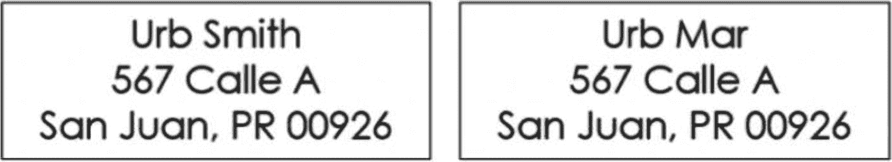
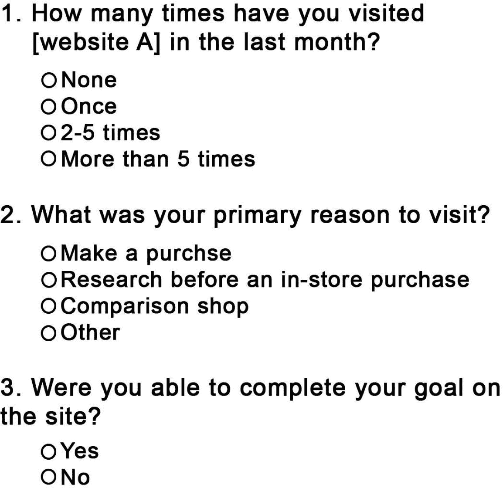
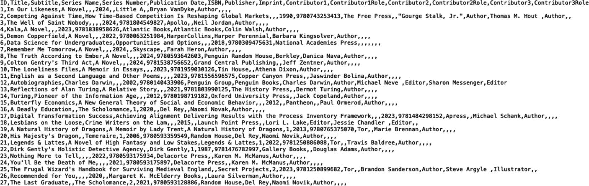
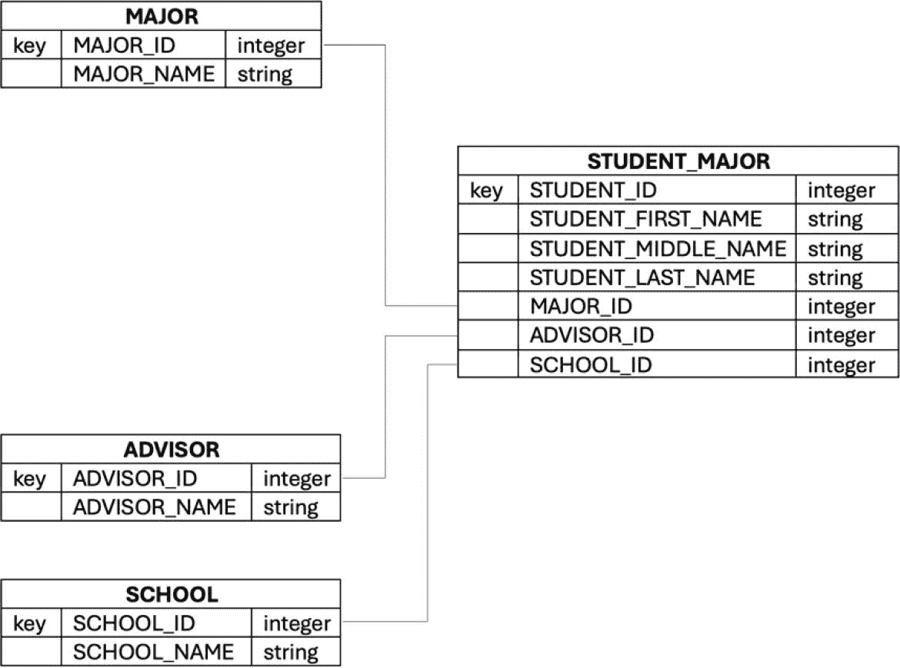
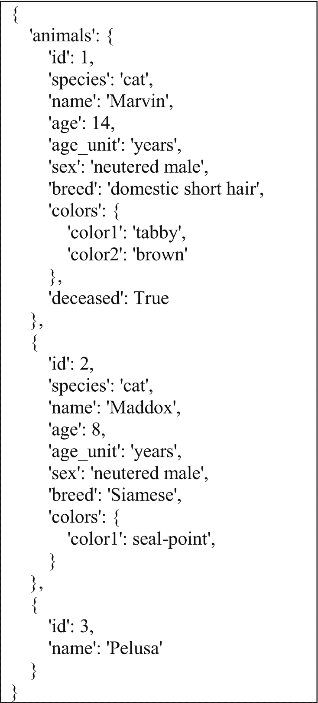
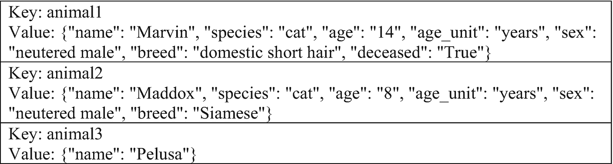
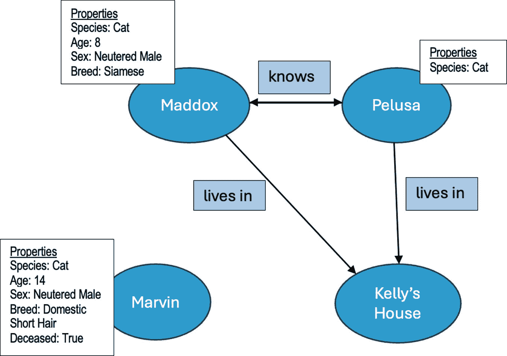

# 12. 尽量不要搞砸：数据收集与存储

## 引言

数据的两个重要方面——数据收集和数据存储——尽管常常未得到充分重视，却至关重要。数据由谁获取？他们如何获取？随后又将数据存放在何处以便访问？古埃及人和苏美尔人派遣官员前往其领土，将数据记录并存储在泥板上。中世纪的税吏也采用类似方法，只不过他们使用的是 parchment 纸或普通纸张上的墨水。

如果你正在阅读本文，你显然知道如今的数据收集量比某人骑马挨家挨户记录数字时要多得多，且速度更快。同时，你也清楚数据必须存放在某台计算机上，供任何想要进行数据科学工作的人使用。但仅仅说数据“存储在电脑里”并不够具体——数字化存储数据的方式有很多种。我们将探讨数据存储的几种方式，以及数据是如何被收集的。

## 现实世界中的数据收集与存储案例

经过深思熟虑的数据收集与存储所带来的强大效益，其案例比比皆是，且往往与更大的基础设施（例如迁移至云端或网络硬件）相契合。但以下两个案例展示了在应对复杂且本质上混乱的信息时，改进数据收集与存储方法的价值，以及跳出传统数据库系统之外寻找方案的重要性。正如许多事情一样，打破常规的思维能够改变游戏规则。

### 案例一：波多黎各地址危机

2017 年，波多黎各接连遭遇飓风袭击，导致电力中断数周，大部分基础设施被毁，许多人受困。这是一场巨大的灾难，美国通过多个机构做出响应。民众申请援助，机构需要审批申请，然后将援助物资送达民众手中^(³⁰)。为此，他们使用了联邦机构（包括美国人口普查局）拥有的地址。这些特定地址是由人口普查员收集的。但他们很快发现，申请人在申请表格上填写的地址很难与机构档案中的官方地址匹配上。他们需要将援助对象与已知记录对应起来，因为他们无法将物资寄给身份不明的人。人口普查员和居民对地址应该如何书写往往有着不同的想法。如果你只在美国郊区生活过，可能很难想象这种情况。但很多地方都有非标准化的地址，尤其是包括美国在内的许多国家的农村地区。也许现在还有些地方，你只需在给雷诺兹奶奶的信封上写上她的名字、城镇和州名，信就能寄到。然而，波多黎各的这种不一致性给当地救援物资的分发带来了极大的困难。

数据质量低下的主要原因有两个：一是收集方法可能不足以获取居民自己书写地址的格式；二是数据本身很可能存在一些真实的不一致性。人们有时会在不同时间以不同方式书写自己的地址，可能会根据特定情况下分享地址的特定目的而改变。无论数据收集过程中设置了怎样的保护措施，这都会带来问题。

显然，当时对于数据质量已无能为力，各机构只能尽力设法应对并送达援助物资。他们利用当地人作为向导，并借助航拍照片，但这仍然极其困难。第二年，多个联邦机构联合起来，寻求更好的办法来存储波多黎各的地址，最终成立了一个工作组来解决这个问题。其中的挑战之一在于，岛上的地址包含一个名为 *urbanización*（城市化社区）的组成部分，有时这可能是区分两个地址的唯一要素，因为存在大量重复的道路名称。这个要素在美国其他地址中并不存在，因此各机构通常不需要处理它。图 12-1 显示了几个（虚构但符合现实的）地址，其中第一行就是 *urbanización*。这些地址的唯一区别在于第一行“Urb”之后的内容。这些地址地理位置上并不邻近——它们只是具有相同的街道名称。



两块相邻的标牌，显示着地址。第一块标牌上写着“Urb Smith, 567 Calle A, San Juan, PR 00926”。第二块标牌上写着“Urb Mar, 567 Calle A, San Juan, PR 00926”。两块标牌具有相似的布局和字体样式。

**图 12-1** 两个不同但相似的波多黎各地址

该工作组最终通过对数据收集和存储方式进行微调，改善了局面，一些机构还开展了实地工作以核实地址。另一些机构则开始使用第三方、开源或定制工具或数据来验证、标准化和清理其数据。所有这些举措对于克服数据收集的局限性都是必要的，这些局限性既包括人工收集数据所面临的挑战，也包括地址本身固有的非标准化问题。

### 案例二：Shutterfly 对 `SQL` 说“不”

`Shutterfly` 拥有海量数据——由数百万用户上传的数十亿张照片，这些用户会存储、分享并购买印有这些图像的产品。他们的数据存储基础设施至关重要。与大多数公司一样，他们最初也使用关系型数据库。我在第 1 章中提到了这些数据库，但我们将在本章后面讨论关系型数据库和其他数据库。只需知道，传统和经典的数据库系统是关系型的，并且在各组织中仍被广泛使用。这些系统使用的语言（`SQL`）是数据科学家的一项关键技能。最近，新型数据库系统被创建出来，其中大多数被统称为 `NoSQL`，因为它们不是关系型的。

`Shutterfly` 发现，在使用关系型数据库时，当人们访问其网站时会出现瓶颈。^(³¹) 众所周知，扩展这些数据库的成本很高，通常需要增加存储空间等方式。他们决定脱离关系型数据库领域，最终选择了文档数据库方法 `MongoDB`。我们稍后也会讨论这种类型数据库的工作原理，但关键点在于，他们在数据库基础设施以及人们处理数据的方式上做出了重大转变。好处之一是，开发人员不再需要设计和遵循严格的关系型规则，而是可以“按照头脑中的样子”存储数据，这是一个巨大的变化。`MongoDB` 的最大优势在于其极高的灵活性，这与关系型数据库截然相反。如果他们在某些 `MongoDB` 中存储数据的方式被证明不是最佳方案，他们可以轻松更改。例如，可以通过这种方式来提升查询或写入数据库的性能。与扩展关系型数据库相比，这使得扩展至越来越大的系统变得微不足道。

结果确实是积极的，而且过渡并不困难。`Shutterfly` 拥有数 `TB` 的数据，他们使用一些迁移工具，在几分钟内就将数据从关系型数据库迁移到了 `Amazon Web Services (AWS)` 上的 `MongoDB`，并且（重要的是）没有中断其网站和服务。扩展（或缩减）的能力尤为重要，因为 `Shutterfly` 在节假日和其他关键日期会看到使用量的高峰和低谷。缩减规模的能力本身在一定程度上是独特的，因为通常公司需要确保在最繁忙时有足够的存储空间，以便在达到峰值时拥有足够的存储空间。但采用这种方法，他们在其他所有时间都会拥有超出需求的存储空间。转向 `MongoDB` 意味着 `Shutterfly` 立即开始节省成本，其成本比其关系型基础设施低约 20%。图 12-2 展示了 `Shutterfly` 的主页，在他们从关系型数据库迁移到 `MongoDB` 的过程中，该页面完全未受影响。


`Shutterfly` 网站主页截图，展示了一个促销活动，内容为“10 张免费卡片，包括节日贺卡”，使用代码“10CARDS”。该优惠有效期至 10 月 6 日，使用代码“SHIP79”可享受订单满 79 美元免运费。页面包含各类产品类别的导航链接，如相册、节日、卡片与文具等。页面显示节日贺卡的视觉展示，部分卡片上印有“节日快乐”和“亲爱的圣诞老人”字样。顶部可见搜索栏和购物车图标。

**图 12-2** `Shutterfly` 使用 `MongoDB` 支持其基础设施。来源：[`https://www.shutterfly.com/`](https://www.shutterfly.com/)

## 数据收集

# 数据收集

在糟糕的旧时代，数据收集总是手动的。有人出去与人交谈，或观察工厂活动等事物，或走进大自然并记录所见之物。但如今，收集到的绝大部分数据都是通过数字化方式获得的。这可能意味着自动进行（比如跟踪你点击的网站或收集天气数据的物联网（IoT）设备），或通过在线表单等方式手动进行。有时手动是唯一的方法，而且这些数据通常更有价值，因为它可以获取到其他方式难以获得的信息，例如研究人员采访有特定经历的个人，比如住院经历或参加某个特定活动。我们将在接下来的两个小节中讨论不同类型的数据收集。

数据收集通常是研究设计的一部分，第 3 章讨论了这一点以及抽样，因此如果你要作为研究或实验的一部分收集数据，请务必回顾那一章。但数据也经常独立于任何类型的研究进行收集，因此研究设计并不总是相关的，本章侧重于那些事后以及在存储背景下必须考虑的收集方面。

## 手动收集

手动收集数据有许多方法。所有方法都涉及一个人——数据收集者——做一些事情来获取数据并以某种方式记录。许多方法涉及与现实世界中的人打交道（或至少通过电话或虚拟电脑）。这些方法包括访谈和焦点小组、面对面调查/问卷。这些通常用于市场营销和政治评估。

还有其他方法，数据收集者仍以某种方式在现实世界中，但并非直接与人打交道。他们仍然可以记录关于人的数据，例如观察法。例如，一位社会学家可能会观察看护者在公园里看护孩子玩耍时如何互动，或者在寒冷冬日里数一数学校里穿短裤的青少年男生人数。此外，他们可能观察与人类无关的事物，比如记录大猩猩的行为或评估树木上真菌生长的程度。

手动数据收集可以收集定性或定量数据。对人的观察通常涉及对行为的定性评估，但通常即使在那里，目标也是获取一些可供处理分析的 `numbers`。焦点小组和访谈也可以同时收集两种类型的数据，但通常会有更多定性数据，供分析师稍后解析以量化其中一部分。调查和问卷通常产生更多定量数据，但它们通常包含一些部分，人们可以在其中留下自由文本回复，这些回复也可能随后被分析以进行量化。图 12-3 显示了一个典型的手动填写的问卷。


一个带有“焦虑和抑郁检查表（K10）”表单的剪贴板放在一张玻璃桌上。表格中包含一系列与焦虑和抑郁感相关的问题，并带有频率回复选项。一支黑色钢笔放在表格上，表明它已准备好填写。环境看起来像是诊所或办公室。

图 12-3

一份用于手动数据收集的问卷。来源：Alex Green 照片的裁剪版，可在 [`https://www.pexels.com/photo/crop-woman-in-office-with-clipboard-5699437/`](https://www.pexels.com/photo/crop-woman-in-office-with-clipboard-5699437/) 获取，并根据 Pexels 许可使用 ([`https://www.pexels.com/license/`](https://www.pexels.com/license/))

## 自动化与半自动化采集

如今，自动化数据采集是主流趋势。你几乎做任何事都可能留下被追踪的痕迹。今天我正坐在星巴克工作，从离开家门起就被一路追踪——我的汽车保险通过手机应用监控我的驾驶习惯，谷歌记录了我去过的每一个地方，我先前在墨西哥餐厅用餐的消费记录由于使用信用卡支付并短信接收了小票而被保存，而我在星巴克购买印度奶茶的记录既存在于他们的交易系统中，也出现在我的支付应用里。如果你不想被这样追踪，就得费些周折才能避免。

因此，这一类别既包括全自动化采集，也包括半自动化追踪。全自动化采集就像大型农场周围布设的天气与环境传感器持续监测环境数据，以及谷歌通过手机追踪每个人的位置。关键在于，数据采集的双方都无需为数据记录做任何额外操作，只需完成初始设置（将传感器接入网络，或有人手机中安装了相应应用）。这还包括网站上的点击行为追踪（用户只是像平常一样使用网站）。参见图 12-4 中自动采集环境读数的气象传感器示例。


蓝天白云下，草地上的气象监测设备。装置包括一根高高的白色杆子，上面装有传感器和一个标有"SII"的控制箱。背景中有建筑物和机场跑道。设备通过电缆连接，安装在碎石地面上。

图 12-4 —— 采集环境读数的气象站示例。来源：来自 Famartin 的“File:2017-06-06 10 45 14 Present weather sensor on the Automated Surface Observing System (ASOS) at Ronald Reagan Washington National Airport in Arlington County, Virginia.jpg”，可在[`https://commons.wikimedia.org/w/index.php?curid=63842646`](https://commons.wikimedia.org/w/index.php?curid=63842646)获取，采用知识共享署名-相同方式共享 4.0 国际许可协议（[`https://creativecommons.org/licenses/by-sa/4.0/deed.en`](https://creativecommons.org/licenses/by-sa/4.0/deed.en)）授权使用。

有许多工具可以实现或简化自动化与半自动化采集，包括条形码扫描仪（扫描商店中的 UPC 码）、RFID 读取器（从带有 RFID 标签的设备获取信息）、光学字符识别软件（扫描贷款申请以提取字段）、智能手机（手机 GPS）以及物体识别（车牌扫描仪）。这仅仅是冰山一角，新的数据采集方式层出不穷。

半自动化数据采集主要是指自动化程度较高，但需要有人执行少量特殊操作的过程，例如使用条形码扫描仪或在特定的销售点系统中输入数值。例如，零售交易追踪就是半自动化的，因为收银员需要逐一扫描顾客的每件商品（手动过程），但所有产品详情都能从现有数据库中检索，此后交易数据会自动存入数据库。表单是另一个半自动化的例子：需要有人创建表单，有人填写表单，但其他所有环节都是自动化的。图 12-5 展示了一个典型的、用于调查或研究的网络多选题表单。


包含三个问题的调查图片。
1. "上个月您访问[网站 A]多少次？" 选项：无、一次、2-5 次、超过 5 次。
2. "您访问的主要目的是？" 选项：购买商品、到店购买前调研、比价、其他。
3. "您是否在网站上完成了目标？" 选项：是、否。
注意："购买"（Purchase）拼写错误为"purchse"。

图 12-5 —— 半自动化数据采集表单示例

## 数据采集中的质量

我们讨论过数据如何是对现实的抽象，以及我们的目标是如何让数据有意义地反映现实。这意味着数据需要准确，而这又意味着实际的数据采集过程——无论是人工采访并记录答案，还是在某个区域架设气象传感器网络——都必须执行到位。

### 手误、笔误与拼写错误

这些错误仅发生在手动数据采集过程中。与任何涉及输入的操作一样，数据中可能出现笔误和其他小错误。*手误*是人们用于指代诸如打字错误等无意识错误的术语。还可能存在转录错误，例如有人根据手写表单录入时无法辨认字迹，从而在输入电脑时引入错误；或者记录错误，即最初记录信息的人拼写错误或以其他方式写下错误信息（可能填错了表单的字段）。

应对方法之一是让数据采集者从现有选项中选择，而不是总是使用自由文本字段。此外，根据上下文，可以进行拼写检查。另外，让第二个人复核他人录入的数据也并不罕见。

### 数据不一致

另一种主要发生在手动操作中的问题，是不同记录中对同一字段的使用方式不统一。例如，两个收集宠物信息的人可能在"姓名"字段中填入不同的信息——一个填入主人名字，另一个填入宠物名字。当有不同人员采集数据时，这种情况尤其容易出现，因此对工作人员进行每个字段含义的培训是预防此问题的最佳方法。同样，如果由受试者直接为自己填写表单，为每个字段提供清晰的说明可以大大减少此类情况的发生。

### 数据缺失

*数据缺失* 指的就是空白字段，本质上是不完整的记录。这在手动和自动数据采集中都可能发生，但在手动采集中更为常见。原因可能是数据从未被采集过（受访者未回答采访者的问题，或在表单中留空），也可能是在将纸质记录转录到电脑时无意遗漏，或类似的手动填写过程出错。自动采集中也可能缺失数据，例如用户匿名浏览网站时，我们无法获取用户名；或者某个特定的天气传感器发生故障，我们将丢失来自该传感器的数据。数据缺失后续总会带来麻烦，因此我们应尽可能确保数据的完整性。

对于手动采集场景，培训数据采集人员理解完整数据的重要性，将有助于他们尽力填写所有字段。

### 采集、录入与存储之间的不匹配

这通常是手动采集中存在的问题。有时数据存储方式的限制会导致采集到的数据难以保存。例如，如果团队只能使用关系型数据库，但采集的数据并非很好的表格形式，则可能难以录入电脑。如果系统预期某个字段只包含一个值，但实际获得了两个值，那么如何同时添加两者，或者如何选择其中一个？如果能提前了解这些限制，数据采集过程就可以根据数据存储和数据录入的约束条件来进行设计。

### 数据存储

如今，数据通常以某种方式进行数字化存储，但仍有一些内容保存在纸张甚至缩微胶片上，这是互联网时代前图书馆的主要载体（缩微胶片是一卷透明胶片，上面印有文本等的微型版本）。数字存储的选择更多，包括一些不用于日常用途但用于存档的旧式存储方式。一些较旧的类型包括磁带（盒式磁带和录像带）、闪存盘和光盘（CD、DVD 和蓝光光盘）。所有旨在常规使用的现代数据最终都存储在硬盘驱动器或固态驱动器上，但这些驱动器可能位于组织内部的本地服务器中，也可能位于云端的某处，与你工作地点相距甚远，存放在由亚马逊、谷歌、微软甚至组织本身运营的数据中心的服务器上。当使用磁带或其他类型时，通常用于存档（用于备份目的的数据和系统快照，通常是每日进行）。我曾在一家公司工作，我们每晚都会制作备份磁带，然后每周一次将物理磁带运送到另一个地点。

在数字领域，有多种不同的数据存储方式，但对于数据科学家使用的数据而言，通常存储在数据库、文本文件或电子表格中（主要是数据库）。这些都有许多类型或格式。我将先讨论电子表格，然后是文本文件，接着将进行更深入的数据库系统讨论。

### 电子表格

电子表格是一种常见的数据存储方式，财务部门和其他许多部门几十年来一直用它来存储和处理数据。它们功能相当强大，因为表格结构是存储许多数据集的自然方式。当电子表格首次出现时，它们凭借图表和数据透视表、`VLOOKUP` 等数字运算工具，革新了数据分析的某些方面。尽管技术已经进步，但许多电子表格用户却没有跟上。因此，数据科学家经常会发现他们从电子表格中提取数据，尽管使用起来可能很笨拙。大多数数据专业人士认为像 `Excel` 这样的电子表格是其职业存在的祸根，因为它有许多限制且使用不当。此外，电子表格在处理大数据时毫无用处——最流行的电子表格软件 `Excel` 无法处理超过一百万行的数据。

`Excel` 是最常见的电子表格程序，但也有一些其他的程序。`Python` 和 `R` 中都有用于读取 `Excel` 工作表的包。如果一个工作表不仅仅是顶部有标题行、其余行向下排列数据的简单结构（比如有人在顶部添加了标题并合并了单元格），它仍然可以通过编程方式读取，但这会更困难。通常，如果你遇到了一个不规则的电子表格，将相关部分复制粘贴到一个新文件中并单独保存可能会更容易。在这种情况下，你甚至最好将其保存为逗号分隔值（`CSV`）文件，我们将在下面讨论这一点。图 12‑6 展示了一个包含图书数据且难以处理的电子表格。乍一看它像是一个常规表格，但仔细看你会发现，对于有多位作者的图书，在该图书下方多出了一行，其中只有 `Contributor` 列有数据，其他列均为空。对于许多电子表格用户来说，这似乎是一种自然的数据存储方式，但它存在很多问题。

```
images/628533_1_En_12_Chapter/628533_1_En_12_Fig6_HTML.jpg
```

表格列出了图书及其列：ID、标题、副标题、贡献者、贡献者角色、系列名称、系列编号、出版日期、ISBN、出版商和印记。条目包括 Bryan VanDyke 于 2024 年由 Little A 出版的《In Our Likeness》，以及 Gourge Stalk, Jr. 和 Thomas H. Mout 于 1990 年由 The Free Press 出版的《Competing Against Time》。其他贡献者包括 Neil Jordan、Colin Walsh 和 Barbara Kingsolver。该表格提供了各种书籍、作者和出版细节的结构化概览。

图 12‑6

一个难以处理的示例电子表格，因为第 15-17 行的“额外行”实际上属于第 14 行

这使得这个工作表难以处理。通常，每个“事物”（无论代表什么，此处指单本图书）应该只有一行。如果必须将所有信息放在一个电子表格中，更好的组织方式如图 12‑7 所示。在这种情况下，有多个 `Contributor` 列，因此每位作者都可以添加到一个单独的列中（部分贡献者超出了图像范围）。这种方法在这里可行，但如果有 20 位作者，就会显得笨拙。这些也是我们在设计数据库和表时需要考虑的因素，我们稍后会讨论。

```
images/628533_1_En_12_Chapter/628533_1_En_12_Fig7_HTML.jpg
```

一个表格，列出了各种书籍及其列：标题、副标题、系列名称、系列编号、出版日期、ISBN、出版商、印记、贡献者 1、贡献者 1 角色、贡献者 2、贡献者 2 角色。该表格包含了诸如《In Our Likeness》、《Competing Against Time》和《The Well of Saint Nobody》等图书详情，以及它们各自的作者、出版年份和出版商。该表格提供了图书信息的结构化概览，包括多个贡献者及其角色。

图 12‑7

来自图 12‑6 的相同数据，但针对单个电子表格进行了更好的组织

还有一点关于电子表格值得提及。有时，利益相关者过于习惯和依赖电子表格，以至于他们期望结果也以电子表格的形式呈现，即使图表或其他可视化方式会好得多。这常常让数据科学家抓狂，他们通常会尝试温和地向利益相关者介绍图表，有时是有效的。但……有时则不然。

### 文本文件

纯文本是指可以在微软记事本或苹果文本编辑等文本编辑器中打开且仍可阅读的文件。这是一种常见的数据存储方式，其中逗号分隔值（`CSV`）格式在数据世界中一直都被广泛使用。

一个 `CSV` 文件其实就是一个纯文本文件，其格式以逗号表示列分隔符。如果保存的文本中包含逗号，则该字段文本会用双引号括起来。如果文本中包含双引号，则会在其前面再添加一个双引号。如果文本中包含双双引号……嗯，你懂的。总有一种方法可以处理任何情况。好处在于，你通常无需担心这些细节，因为有程序可以正确地读写 `CSV` 文件。如果某个不怀好意或粗心大意的人给你一个没有正确处理所有这些特殊字符的 `CSV` 文件，可能会很难处理，但终究还是可以搞定的。

`Excel` 可以轻松打开 `CSV` 文件，你通常可以安全地在那里编辑并保存它们（假设行数不超过一百万行）。然而，`CSV` 只是文本，因此它不会保存你在 `Excel` 中添加的任何格式，比如加粗的列标题。如果你用 `Excel` 打开图 12-7 中书籍数据的 `CSV` 版本，它看起来是一样的，只是没有加粗的标题或不同大小的列。如果你想真正看清 `CSV` 的真实面貌，可以在文本编辑器中打开它。该书籍数据的 `CSV` 文件看起来会像图 12-8 那样。空白值会被完全省略，所以你会看到一连串的逗号连在一起，就像图 12-8 中大多数记录末尾那样，因为大多数书籍没有多位作者。



一个表格列出了各种书籍，列包括 ID、书名、副标题、系列名称、系列编号、出版日期、ISBN、出版社、印记和贡献者。每一行都提供了特定书籍的详细信息，包括书名、作者和出版信息。该表格包含小说、散文和科学著作，出版社包括 Little A、The Free Press 和 HarperCollins。著名作者包括尼尔·乔丹、芭芭拉·金索沃和娜奥米·诺维克。

图 12-8

在文本编辑器中查看书籍 CSV 文件

### 序列化文件及其他文件格式

还有其他存储数据的方式，但在 `Python` 中使用 `Pandas` 以及在 `R` 中使用它们通常很简单，因为你只需使用相应的库来读取这些文件，然后一两行代码就能搞定。有时数据或其他对象会被序列化并以 `Python` 中称为 *pickle* 的格式存储。任何内容都可以通过这种方式保存，并且保存机器学习模型时常用此方法。

另一种在云平台中越来越流行的格式是 *parquet*，这是一种存储大量数据的好方法，因为它可以拆分到多个文件中。Parquet 文件还能很好地与那些可将耗时操作拆分开以便并行执行的工具配合使用（这称为 *分布式计算*，在处理云平台上的大量数据时很常见）。

用于存储数据的文件类型层出不穷，因此保持与时俱进是件好事。

### 数据库

对于几乎所有数据科学家来说，数据库系统是日常工作的一部分。出于多种原因，数据库通常比电子表格和文本文件更好，包括存储管理方面的优势以及易于操作。数据库管理系统是一种软件，负责处理数据库中所有信息的存储。用户通过几种不同的方式与之交互，通常是通过数据库托管的界面，该界面允许编写和运行 `SQL`。数据科学家也使用这个界面，但很多时候，他们通过在其他环境中编写的 `Python` 或 `R` 代码来与系统交互。

在技术领域，术语 *database* 本身基本上意味着可以通过数据库管理系统访问的相关数据集合。你经常会看到这些系统本身被简称为 *DBMS*（数据库管理系统），它可以是任何类型的数据库。大多数 `DBMS` 在高层级上将事物组织成它们所谓的数据库，这是一个可以包含其他对象（如表或其他层级对象）的对象。一个典型的例子是，Oracle `DBMS` 拥有数据库，每个数据库可以有多个模式，模式内部包含表和其他对象。这里的模式只是一个组织对象（例如，可以在模式级别授予权限，这些权限将应用于其中的所有对象）。在 Oracle 的设定中，引用一个特定的表需要数据库名、模式名以及表名本身。

#### 模式（SCHEMA）

术语“模式”在数据库世界中还有另一种用法，指的是数据库的整体逻辑结构，通常意味着其可视化表示。在大多数情况下，它会包括表名、表列以及表之间的关系。对于非关系型数据库，它会显示不同的对象。开发人员和数据科学家经常查看这些模式，以了解如何在特定数据库中处理数据。图 12-9 展示了我们将在下文“关系型数据库系统”部分中看到的一些表的模式。



图示展示了一个包含四个表的数据库模式：`MAJOR`、`STUDENT_MAJOR`、`ADVISOR`和`SCHOOL`。每个表列出了其字段和数据类型。`MAJOR`包含`MAJOR_ID`（整数）和`MAJOR_NAME`（字符串）。`STUDENT_MAJOR`包含`STUDENT_ID`、`STUDENT_FIRST_NAME`、`STUDENT_MIDDLE_NAME`、`STUDENT_LAST_NAME`（均为字符串），以及`MAJOR_ID`、`ADVISOR_ID`、`SCHOOL_ID`（均为整数）。`ADVISOR`包含`ADVISOR_ID`（整数）和`ADVISOR_NAME`（字符串）。`SCHOOL`包含`SCHOOL_ID`（整数）和`SCHOOL_NAME`（字符串）。线条连接了不同表中相关的字段，表明它们之间的关系。

图 12-9

一个小型数据库的简化模式示例

该图显示了四个表。`STUDENT_MAJOR`表存储学生姓名以及他们的专业、顾问和学校。其他三个表只保存了专业、顾问和学校的 `ID` 和名称值。线条显示了表之间的关系。`STUDENT_MAJOR`存储一个链接到`MAJOR`表的专业 `ID`，对于顾问和学校也是如此。

这个示意图过于简化，通常会传达更多信息，尤其是关于字段之间关系的信息。另外请注意，这种示意图在关系型数据库世界中也被称为`实体-关系（ER）图`。

从历史角度来看，大多数数据库系统采用关系型组织范式，并使用一种称为 `SQL` 的语言与之交互。近年来，采用 `NoSQL` 范式的非关系型数据库系统已经变得更加普及，因为它们非常适合某些特定类型的数据。正如我们所见，Shutterfly 在上面的例子中就使用了 `NoSQL` 数据库系统。然而，尽管 `NoSQL` 已可用，但大多数数据仍然存在于关系型数据库系统中。我将在下文讨论这两种类型。

处理数据库中数据的数据科学家主要通过编写代码来查询数据库，以从表中获取特定数据，但他们也会创建、修改和管理表。每个 `DBMS` 都有某种机制来以某种方式与数据库交互。

# 关系型数据库系统

关系型数据库管理系统（通常缩写为 `RDBMS`）非常适合处理结构化数据，并依赖于关系数据模型（详情请见侧边栏）。这些以及其他数据库系统在几乎所有组织中都无处不在，`SQL` 也是如此，`SQL` 是一种让人们与数据交互的语言。

## 关系数据模型

关系数据模型是一种处理表格数据相当直观的方法。它定义列并存储单独的行，每一行都有一个与每列对应的值。通常，每个表代表一个特定的事物（学生、销售交易、产品等），并且它们通过链接在一起来建立数据之间的关系。它描述了多个表如何被虚拟地连接在一起，并通过一种名为 `SQL` 的语言来定义，这种语言使人们能够轻松地对表进行操作，例如检索特定数据、向表中添加行或合并多个表。它还在 1970 年代早期彻底改变了数据存储方式，并且在其他方法出现之前的几十年里，一直是数据存储的方式。

## `SQL`

`SQL`——Structured Query Language（结构化查询语言）的缩写——是一种允许你与 `RDBMS` 交互的简单语言。一些最常见的 `RDBMS` 包括 `MySQL`、`PostgreSQL`、`Microsoft SQL Server` 和 `Oracle`。每个系统使用的 `SQL` 都略有不同，但大多数语法在系统之间是一致的。

学习 `SQL` 的最佳方法是边处理数据边学习，这样你就可以尝试不同的操作。它与其他大多数语言非常不同，因此学习 `Python` 或 `R` 并不能直接帮助你，尽管 `R` 和 `Python` 库 `Pandas` 的某些方面使用了类似 `SQL` 的概念来处理数据。

`SQL` 技能对于几乎所有数据科学家来说都至关重要，但你还需要对另外一件事表明立场：该语言的发音。大多数人把它读作 “sequel”，但有些人读作 “es-cue-el”。两种发音都是正确的，但人们对自己偏爱的发音有些自以为是，所以你最好想清楚自己的立场，以便在被要求选边站队时有所准备。

`RDBMS` 支持多种类型的操作，但数据科学家最常用的是数据定义语言（`DDL`）、数据操纵语言（`DML`）和数据查询语言（`DQL`）。数据科学家使用 `DQL` 和 `DML` 比使用 `DDL` 更多。`DDL` 包含允许用户通过创建、修改和删除数据表来定义和描述数据结构及关系的命令。创建和修改表涉及定义列，包括数据类型和唯一标识符。`DDL` 还允许用户定义表之间的关系，通常通过称为“键”的标识符来完成。`主键`是表中的唯一标识符，在该键列（或列组合）中，任意两行的值都不能相同。最佳实践是每个表都有一个主键，通常只是一个整数值，每个新行递增 1，例如记录 `ID`。外键定义表之间的关系。`外键`是一个表中的列，该列连接到另一个表中的键（通常是主键），从而将这些表联系在一起。

对于数据科学家来说，`DML` 和 `DQL` 操作更为常见。`DML` 包含数据修改命令，这基本上意味着使用 `INSERT` 命令向表中添加行，使用 `UPDATE` 修改行，或使用 `DELETE` 删除现有行。还有一些其他命令，但这些是核心命令。`DQL` 只有一个命令，即 `SELECT`，用于查询数据库或从数据库中提取数据。这是迄今为止数据科学家最常用的命令。

关系数据模型中与数据库设计相关的一个重要概念是`规范化`，这是一种将数据分解到多个相关表中，而不是全部存储在一个大表中的实践。将所有内容存储在一个大表中通常会导致大量数据冗余或重复数据，这会极大地增加存储在计算机磁盘上的数据的物理大小。`规范化`的主要目标是减少存储的数据的大小。它确实增加了处理数据的复杂性，但这种权衡被认为是值得的。当你查询数据库时，理解这一点也很有帮助。

为了理解数据库规范化，想象一所大学存储其学生信息。他们可能以表 12-1 所示这种简单方式存储，这通常被称为平面表，因为所有内容都在一个地方。

**表 12-1**
一个包含一些基本学生专业数据的小型“平面表”

| 学生 `ID` | 名字 | 中间名 | 姓氏 | 专业 | 导师 | 学院 |
| --- | --- | --- | --- | --- | --- | --- |
| 123 | 莎拉 | Dawn | 摩根 | 历史学 | 玛丽亚·内特尔斯 | 文理学院 |
| 456 | 维贾伊 |   | 雷迪 | 历史学 | 玛丽亚·内特尔斯 | 文理学院 |
| 789 | 勒罗伊 | N. | 史密斯 | 计算机科学 | 杰克·麦克尔罗伊 | 工程学院 |
| 850 | 维娜 | Swati | 斯里尼瓦桑 | 计算机科学 | 杰克·麦克尔罗伊 | 工程学院 |
| 1000 | 马文 |   | 加西亚 | 工业工程 | 琳达·马洛 | 工程学院 |
| 1111 | 泰德 |   | 罗 | 英语 | 玛丽亚·内特尔斯 | 文理学院 |

但请注意冗余数据：“历史学”、“计算机科学”、“玛丽亚·内特尔斯”、“杰克·麦克尔罗伊”、“文理学院”和“工程学院”这些值都出现了不止一次。这一点并不总是很明显，但在计算机存储领域，文本总是比数字占用空间更大。在这样一个小表里，这无关紧要，但如果有成千上万名学生，所需的额外空间就会开始累积。规范化要求将此表拆分为多个表。

考虑到哪些值重复了，规范化的第一步是将专业、导师和学院提取到单独的表中，为每个值分配一个数字，然后将该数字存储在此表中。这三个主要的表将类似于表 12-2 到 12-4。

**表 12-4**
规范化后的学院表

| 学院 `ID` | 学院名称 |
| --- | --- |
| 1 | 文理学院 |
| 2 | 工程学院 |

**表 12-3**
规范化后的导师表

| 导师 `ID` | 导师姓名 |
| --- | --- |
| 1 | 玛丽亚·内特尔斯 |
| 2 | 杰克·麦克尔罗伊 |
| 3 | 琳达·马洛 |

**表 12-2**
规范化后的专业表

| 专业 `ID` | 专业名称 |
| --- | --- |
| 1 | 历史学 |
| 2 | 计算机科学 |
| 3 | 工业工程 |
| 4 | 英语 |

新的部分规范化后的表如表 12-5 所示。所有的专业、导师和学院都被替换为指向新表中值的 `ID`。`ID` 仍然是重复的，但在数据库中，数字比文本小，因此它们占用的空间更少。

**表 12-5**
学生专业表规范化的第一次尝试

| 学生 `ID` | 名字 | 中间名 | 姓氏 | 专业 | 导师 | 学院 |
| --- | --- | --- | --- | --- | --- | --- |
| 123 | 莎拉 | Dawn | 摩根 | 1 | 1 | 1 |
| 456 | 维贾伊 |   | 雷迪 | 1 | 1 | 1 |
| 789 | 勒罗伊 | N. | 史密斯 | 2 | 2 | 2 |
| 850 | 维娜 | Swati | 斯里尼瓦桑 | 2 | 2 | 2 |
| 1000 | 马文 |   | 加西亚 | 3 | 3 | 2 |
| 1111 | 泰德 |   | 罗 | 4 | 1 | 1 |

如果这个表存储了数千名学生，它将比之前的版本小得多。但正如上面提到的，它也需要外键，表中“专业”、“导师”和“学院”列下的那些数字就是外键。这些数字在每列中出现不止一次并不太令人担忧，因为它仍然占用更少的空间，并且仍然减少了基于冗余的存储空间。

那些目光敏锐的读者可能已经注意到，`student_major`表仅部分实现了规范化，因为仍然存在一些冗余。每一行中，只要`Major ID`为`1`，`School ID`也必定为`1`，因为历史专业始终隶属于文理学院。（实际上，你需要确认这一点，但通常情况确实如此。）此外，如果我们假设每个专业只有一位特定的顾问，我们可以将这些信息提取到另一个表中，然后在`student`表中仅保留`Major`列。我们可以修改`Major`表来存储所有这些信息，并使用外键引用`Advisor`表和`School`表。修改后的表如表 12-6 所示。进一步规范化后的`student_major`表则如表 12-7 所示。

**表 12-7**
进一步规范化后的`student_major`表

| Student `ID` | First Name | Middle Name | Last Name | Major |
| --- | --- | --- | --- | --- |
| 123 | Sarah | Dawn | Morgan | 1 |
| 456 | Vijay |   | Reddy | 1 |
| 789 | Leroy | N. | Smith | 2 |
| 850 | Veena | Swati | Srinivasan | 2 |
| 1000 | Marvin |   | Garcia | 3 |
| 1111 | Ted |   | Rowe | 4 |

**表 12-6**
进一步规范化后的`Major`表

| Major `ID` | Major Name | Advisor `ID` | School `ID` |
| --- | --- | --- | --- |
| 1 | History | 1 | 1 |
| 2 | Computer Science | 2 | 2 |
| 3 | Industrial Engineering | 3 | 2 |
| 4 | English | 1 | 1 |

规范化结构还有其他优点。假设历史专业的顾问换成了另一个人，那么只需在`Major`表中更新（指向`Advisor`表中另一位顾问）。或者，如果顾问的姓名发生了变化，也只需在`Advisor`表中更新。在这两种情况下，更改都会在所有地方得到反映。要查找某位学生对应的顾问，我们可以通过`student`表中的`Major ID`查找，然后查看`Major`表中的`Advisor ID`，最后在`Advisor`表中找到具有该 `ID` 的行。

请注意，我们在本表中所采用的结构并非完美无缺。在`student`表中存储专业信息可能并非最佳选择。如果学生是双专业怎么办？任何标准的数据库系统都不允许在同一列中存储两个不同的 `ID`。因此，逻辑上的下一步是将专业信息从`student`表中移除——仅将`student`表用于学生的个人信息（或许包含出生日期、住址、永久地址等）。然后，我们将创建一个全新的表，仅存储`Student ID`和`Major ID`——如果学生有多个专业，则只需用该学生的 `ID` 对应不同的`Major ID`，创建两行记录即可。这种方法的另一个优点是能够跟踪学生专业的变更时间戳——例如，他们曾是化学工程专业，一年后才转到历史专业。我们可以跟踪每个专业的开始和结束日期，而如果所有信息都放在一个表中，这是不可能做到的。这些都是数据模型设计时可以考虑的选项。

还有一点值得一提：注意，顾问信息存储为全名。你几乎不应该以这种方式存储姓名。最佳实践通常是像我们对学生姓名所做的那样，将姓氏、中间名和名字分别存储在不同的列中。事后进行这种拆分并不总是那么容易，因为并非总能明确如何拆分全名——有些人有两个姓氏，且其中第一个被视为主要姓氏，此外还存在其他文化特定的命名习惯。在我们的示例中，理想的做法是创建一个包含名字、中间名和姓氏的表。然后，该表存储顾问 `ID`，如表 12-8 所示。

**表 12-8**
一个更好的`Advisor`表

| Advisor `ID` | First Name | Middle Name | Last Name |
| --- | --- | --- | --- |
| 1 | Maria |   | Nettles |
| 2 | Jack |   | McElroy |
| 3 | Linda |   | Marlowe |

仅凭这张表，我们无法得知某个学生关联的顾问或学院，但通过运行查询将这些表连接起来非常容易。同样，我们可以通过正确连接所有表，运行查询来生成原始平面表中的所有信息。这正是数据科学家们一直在做的事情——运行查询，将不同数据源拼接在一起，以获取完成工作所需的数据。

这是一种极其常见的数据处理方式，因此理解关系模型非常重要——但这绝对是一件熟能生巧的事情。

### `NoSQL` 数据

近年来，其他数据存储方式的普及度日益增长。`NoSQL` 这个统称常用于强调它们不使用关系型数据模型。这些系统是为应对关系型数据库模型在可扩展性、性能及灵活性方面的局限而开发的。这是一个处于积极发展中的数据存储领域。`NoSQL` 常见于云端而非“本地”（存储在公司自有计算机系统内）部署，但也可在任何地方搭建。

`NoSQL` 数据库的一个有趣之处在于，许多 `NoSQL` 数据库管理系统尽管数据并非以关系模型存储，却在系统之上构建了类似 `SQL` 的语言。因此，使用 `NoSQL` 数据库的体验往往与使用关系型数据库系统无异，所有差异都隐藏在底层。这得益于 `SQL` 的广泛普及以及 `NoSQL` 系统作为新生事物这一事实（大多数专业人士熟悉 `SQL`，但学习一门新的查询语言需要时间）。

`NoSQL` 数据库主要有几大类：文档存储、键-值存储、宽列存储和图数据库。*文档存储*保存半结构化的“文档”，通常采用 `JSON` 或 `XML` 格式。它们非常灵活，且文档之间不必相互匹配，但不适用于复杂事务。示例中提到的`MongoDB`数据库就是一种文档存储。我们之前在书中看到的一些 `JSON` 数据可以存储在文档存储中，如图 12-10 所示，该图展示了文档存储中的三条动物记录。



一个列出动物信息的 `JSON` 数据结构。它包含了三只猫的详细信息：Marvin、Maddox 和 Pelusa。Marvin 是一只 14 岁、已绝育的雄性家养短毛猫，毛色为虎斑棕，已故。Maddox 是一只 8 岁、已绝育的雄性暹罗猫，海豹重点色。Pelusa 的条目仅包含名字。

**图 12-10** 文档存储中三条记录的示例

*键-值存储*包含的每个键在数据库中仅出现一次，每个键指向一个值。其巧妙之处在于，值本身可以包含键-值对。它们灵活且适用于非结构化数据。在顶层，存储一个键，它指向一个值，该值可以包含许多内容。图 12-11 展示了键-值存储中三条动物记录的示例，与文档存储相似。



展示动物数据的表格。每个条目包含一个键和一个值。

- 键：`animal1`，值：名称：`Marvin`，物种：`Cat`，年龄：`14` 岁，性别：`Neutered male`，品种：`Domestic short hair`，已故：`True`。
- 键：`animal2`，值：名称：`Maddox`，物种：`Cat`，年龄：`8` 岁，性别：`Neutered male`，品种：`Siamese`。
- 键：`animal3`，值：名称：`Pelusa`。

**图 12-11** 键-值存储中的数据示例

*宽列存储*表面上与关系模型相似，因为它们也将数据存储在表和行中；然而，列并非在表级别严格定义，不同的行可以拥有不同的列。这既提供了关系型结构的优势，又避免了其僵化性。如表 12-9 所示，其表示形式基本类似于一个稀疏的关系表，但在底层，那些看似“空”的值实际上根本不属于该行。

**表 12-9** 宽列存储中一张表的三条记录示例

## NoSQL 数据库：图数据库

最后一种 `NoSQL` 数据库是**图数据库**，它通过节点和边（连接节点的线）来存储数据。节点通常存储名词，如人物、地点或事物，并且可以拥有额外的属性。它们在视觉上通常用椭圆形表示。边定义了节点之间的关系（常使用动词）。图 12-12 展示了三个动物和一个房屋，均为节点，以及三条关系（边），定义为节点之间的连线。



描述实体之间关系的流程图。Maddox，一只 8 岁的已绝育雄性暹罗猫，认识 Pelusa，另一只猫。Maddox 和 Pelusa 都住在 Kelly's House。图中还显示了 Marvin，一只 14 岁已故的已绝育雄性家养短毛猫。箭头表示关系：Maddox 和 Pelusa 之间的“认识”，以及 Maddox 和 Pelusa 指向 Kelly's House 的“居住于”。

**图 12-12** 图数据库中的数据示例

NoSQL 数据库可能与关系型数据库管理系统 (RDBMS) 有很大不同，并且通常有特定的用例。你可能永远不会在关系型数据库管理系统之外处理数据，但了解其他选项有朝一日可能会派上用场。

## 数据与信息组织

尽管数据库管理系统确保数据以特定方式组织，但在跨多个系统时还有其他组织数据的方式。在这一领域有许多术语，包括数据湖、数据仓库、数据孤岛和数据市集。

### 数据维护与保养

我已经提到过数据清洗和准备工作，但无论怎么强调它们的重要性都不为过。下一章将深入探讨面向数据科学家的数据准备工作，但同时，在数据存储层面也有数据清洗和准备的工作。当由不同团队管理数据时，这一点更为明显，例如由分析工程师或数据工程师负责将数据导入数据科学家使用的标准位置。他们通常会进行一些基本的转换并应用简单的业务规则，以便数据可供使用。

这些数据团队应确保数据的基本质量，例如确保唯一键在数据中真正唯一、不存在重复项，以及在不允许为空的地方没有空字段。数据科学家通常不必关心这些，但现实情况是，在许多公司，数据工程师可能不存在或未能尽职尽责。因此，除非数据科学家对数据工程师的工作极为信任，否则做好准备检查所使用数据的质量至关重要。这种信任通常只有在数据被广泛使用且所有问题都得到解决之后，或者数据工程团队非常成熟时才会建立。

### 数据孤岛

*数据孤岛*是指被锁定、仅限预期用户访问，其他领域和系统无法触及的数据集合。这通常并非有意为之——数据孤岛往往是某个特定领域的需求逐渐积累而成的。例如，随着时间的推移，人力资源部门积累了大量不对外共享的数据。对于大部分数据而言，这可能是合适的，但其中某些数据在不损害隐私和合规的情况下，可能对其他部门有益。此外，不同领域独立发展的数据孤岛会存储基本相同的数据，但往往形式各异。这些数据可能完全相同，导致效率低下且占用不必要的存储空间；也可能略有差异，从而在不同领域间产生不同的结果。总的来说，企业希望避免数据孤岛，因为它们会增加存储成本，并且“重复但不同”的数据可能导致使用不同孤岛版本的分析产生巨大差异。请注意，这与访问权限无关——没有人希望整个公司都能访问人力资源数据，但其部分数据应酌情提供给其他领域和系统，而数据孤岛阻碍了这种可能性。

### 数据仓库

*数据仓库*是一个集中化且高度结构化的系统，它将来自多个领域的数据汇集到一起，以支持报告和分析。其目标用户是商业智能。数据仓库的组织组件是事实表和维度表。维度通常是“事物”，事实是“行为”。例如，在一个视频游戏商店的数据仓库中，会有一个关于商店产品的维度表，包含名称、主机、价格、类型等信息。可能还有一个客户维度表，包含每位客户的信息，如姓名、会员编号和地址。然后会有一个表示商店所有交易的事实表——即不同客户购买不同产品的记录。

请参阅表 12-10、12-11 和 12-12，了解这样一个小型数据仓库。所有产品都存储在一个名为 `Products` 的维度表中（表 12-10），其中包含每个产品的基本信息。然后有一个名为 `Orders` 的事实表（表 12-11），存储通常所说的订单头信息——即使一笔订单可能包含多个购买项，每笔订单也只占一行。该表包含多个列，用于记录该高级别的各种信息。`Orders` 表完全没有提及游戏，因为游戏是在订单行项目级别销售的，这些信息存储在 `Ordered Items` 事实表中（表 12-12）。该表与 `Orders` 表中的订单相关联，显示订单中每个项目的信息。它包含两个外键：`Order ID`（指向 `Orders` 表）和 `Game ID`（指向 `Products` 表）。

**表 12-12** 小型数据仓库事实表 (`Ordered Items`)

| 订单项 ID | 订单 ID | 游戏 ID | 小计 | 地方税 | 州税 | 折扣 | 交易时间戳 |
| --- | --- | --- | --- | --- | --- | --- | --- |
| 1 | 1 | 3 | 29.99 | 1.05 | 1.95 | 10.00 | 2024-01-15 15:03:45 |
| 2 | 2 | 4 | 49.99 | 1.60 | 3.37 | 0.00 | 2024-01-18 02:14:42 |
| 3 | 2 | 5 | 49.99 | 1.60 | 3.37 | 0.00 | 2024-01-18 02:14:42 |
| 4 | 3 | 1 | 39.99 | 1.20 | 2.29 | 0.00 | 2024-01-18 17:58:41 |
| 5 | 3 | 3 | 19.99 | 0.60 | 1.15 | 20.00 | 2024-01-18 17:58:41 |
| 6 | 3 | 2 | 49.99 | 1.49 | 2.86 | 0.00 | 2024-01-18 17:58:41 |
| 7 | 4 | 4 | 49.99 | 1.87 | 3.25 | 0.00 | 2024-01-18 21:47:48 |
| 8 | 4 | 4 | 49.99 | 1.87 | 3.25 | 0.00 | 2024-01-18 21:47:48 |
| 9 | 5 | 2 | 49.99 | 1.17 | 3.50 | 0.00 | 2024-01-19 01:39:51 |
| 10 | 6 | 1 | 39.99 | 1.24 | 2.20 | 0.00 | 2024-01-19 09:01:00 |

**表 12-11** 小型数据仓库事实表 (`Orders`)

| 订单 ID | 收款机编号 | 小计 | 地方税 | 州税 | 订单总额 | 总折扣 | 运费 | 实收金额 | 发货日期 | 交易开始时间戳 | 交易结束时间戳 |
| --- | --- | --- | --- | --- | --- | --- | --- | --- | --- | --- | --- |
| 1 | 1 | 29.99 | 1.05 | 1.95 | 32.99 | 10.00 | 5.99 | 28.98 | 2024-01-17 | 2024-01-15 15:03:17 | 2024-01-15 15:03:45 |
| 2 | 4 | 99.98 | 3.20 | 6.75 | 109.93 | 0.00 | 7.99 | 117.92 | 2024-01-19 | 2024-01-18 02:14:31 | 2024-01-18 02:14:42 |
| 3 | 1 | 109.97 | 3.29 | 6.30 | 119.56 | 20.00 | 7.99 | 107.55 | 2024-01-19 | 2024-01-18 17:58:19 | 2024-01-18 17:58:41 |
| 4 | 2 | 99.98 | 3.74 | 6.50 | 110.22 | 0.00 | 7.99 | 118.21 | 2024-01-19 | 2024-01-18 21:47:30 | 2024-01-18 21:47:48 |
| 5 | 1 | 49.99 | 1.17 | 3.50 | 54.66 | 0.00 | 5.99 | 60.65 | 2024-01-20 | 2024-01-19 01:39:42 | 2024-01-19 01:39:51 |
| 6 | 3 | 39.99 | 1.24 | 2.20 | 43.43 | 0.00 | 5.99 | 49.42 | 2024-01-20 | 2024-01-19 09:00:34 | 2024-01-19 09:01:00 |

**表 12-10** 小型数据仓库维度表 (`Products`)

| 产品 ID | 标题 | 主机 | 标价 | 类型 | 发布日期 | 平均评分 |
| --- | --- | --- | --- | --- | --- | --- |
| 1 | 星酿物语 | Wii | 39.99 | 冒险;解谜 | 2018-05-16 | 3.45 |
| 2 | 竞速狂飙 | Wii | 49.99 | 竞速;体育 | 2019-02-01 | 4.01 |
| 3 | 终审法庭：首案 | Xbox | 39.99 | 角色扮演;回合制策略 | 2020-07-14 | 2.98 |
| 4 | 松景庄园 | PlayStation | 49.99 | 冒险;角色扮演 | 2021-10-31 | 3.90 |
| 5 | 松景庄园：后台区 | PlayStation | 49.99 | 冒险;角色扮演 | 2022-01-08 | 3.99 |

数据仓库设计有不同方法，但数据科学家通常不参与创建过程。数据仓库的表通常是“扁平化”的（规范化程度较低），这就是它们方便商业智能的原因（用户无需为了创建报表而连接多个表）。在数据仓库中，也常见聚合表。它们的目的相对聚焦，但仍可能变得非常庞大。另一方面，*数据市集*则是一个更小、更聚焦的数据仓库，通常局限于特定领域。

### 数据湖

*数据湖*是一个集中化且高度可访问的不同类型数据存储库，基本上与数据孤岛截然相反。其内容可以来自其他数据库、数据仓库以及任何其他类型的数据。数据湖旨在让数据易于处理，因此对数据科学家有很多好处。一个需要注意的问题是，数据湖在集中数据时几乎不进行（或很少进行）转换。其理念是数据已被提供，用户可以根据自身特定需求来决定如何进行转换。数据湖需要精细管理（尤其是在数据完整性和安全性方面），否则可能沦为“数据沼泽”。

## 存储选择的后果

所有不同的存储选择都各有利弊，通常取决于数据的预期用途。例如，高度规范化的数据库从存储角度来看效率很高，但查询它们的成本可能很高，因为需要连接许多表才能获取所有信息。这也是数据仓库被用于商业智能的原因之一——获取一条信息需要连接的表更少。每当有人打开报表时，商业智能报表都会查询数据库，如果用户等待报表完全加载的时间超过几秒钟，这通常被认为是不好的体验。

安全性也因存储选择而变得更容易或更难管理。如果整个公司的数据都进入一个数据库，安全团队将不得不管理那个庞大数据库中的所有对象。这也是为什么更常见的是存在许多数据库，每个数据库都有特定用途的原因之一。可以为团队授予对不同数据库的访问权限，这使得访问管理稍微简单一些。

## 数据所有权与管理

我相当抽象地谈论了管理数据的“其他人”，而非数据科学家本人。不同公司的情况各不相同，但与数据收集和存储相关的常见角色包括 `数据工程师`、`分析工程师` 和 `数据库管理员`。`数据工程师` 通常负责在数据存入数据库或其他预定位置之前，进行数据移动、转换、清理等工作。`分析工程师` 是专业化的数据工程师，他们对分析需求有更深入的了解，旨在做出良好的转换选择，从而为数据科学家和其他分析用户简化工作。最后，`数据库管理员` 负责管理数据库基础设施本身，包括（但不限于）数据库软件、有时是安装该软件的机器、性能与优化，以及安全性与访问权限。

我还提到了数据质量和数据治理的重要性。这是一个重要但常常未被实施或实施不当的领域。虽然数据库管理员管理数据的物理存储位置，数据工程师负责数据的移动，但数据到底归谁所有，谁又为其质量负责？这始终是一个难以回答的问题。数据治理旨在回答这个问题，并控制数据管理的其他方面。

数据治理是一项数据管理职能，旨在确保数据具有高质量、可用性、安全性和高完整性。其中一些是高层面的，涉及数据法规等问题，但我们更关心它与数据科学家工作的关联。通常，数据治理人员会与安全团队和数据库管理员合作，但不与数据科学家合作。他们所做的工作之一是试图确定数据所有者。数据所有者有时可能被期望非常懂技术，但也存在寻求业务数据所有者的案例——即对数据有业务专长的人，也就是领域专家。例如，人力资源部门的人应该拥有人力资源数据。这不应该是数据科学家、数据工程师或数据库管理员。但让业务人员拥有数据很困难，因为人们并不真正想要这个责任，因为这看起来任务繁重。数据所有者的概念也相对较新，人们还不习惯这个想法。业务数据所有者可能不知道所有字段名等等，因此还需要其他更懂技术的人员来弥合业务与数据科学家、商业智能等人员（那些需要实际查询表的人）之间的差距。实际上，有时数据科学家自己必须填补这个角色。

## 数据科学家在数据收集与存储中的角色

在数据的收集和存储方面，数据科学家扮演着不同的角色。大多数人不会经常处理数据收集工作。市场营销和其他领域的数据科学家可能会运行 A/B 测试或其他实验，这些实验可能涉及数据收集的规划。数据科学家通常也不需要就核心数据做出存储决策。然而，他们会发现自己需要创建自己的数据源，以便与其他数据科学家共享或在项目内重复使用。了解所有选项对此可能很重要。通常，这很简单，只需将表存储在团队数据库中即可，但有时会更复杂。只要记住存储选择总是存在取舍，你就已经领先一步了。

## 主要收获与下一步

在本章中，我们探讨了数据收集与数据存储。我提到了手动收集与自动收集：手动收集指像填写表单这样需要人工将数据录入计算机的操作；自动收集则指无需人员直接参与即可将数据存入数据库。如今大多数情况介于两者之间，比如填写数字表单——你手动填写，但点击提交后，数据就会自动进入数据库。数据产生错误的途径有很多，包括拼写错误、记录间数据不一致以及数据缺失。

我介绍了当前数据存储的三种主要方式：电子表格、文本文件和各类数据库。我们深入研究了关系型数据库系统，并讨论了规范化这一数据库设计风格。几十年来，关系型数据库一直是数据存储的中流砥柱，但我也谈到了几种不同类型的 `NoSQL` 数据库，即关系型数据库的替代方案。

在下一章中，我们将通过探讨数据预处理来开启数据准备的讨论。数据预处理主要侧重于清理数据，确保数据能准确反映其应代表的内容。它涉及处理缺失值、重复行、格式不一致的数据以及异常值等问题。

## 从业者简介：肖里亚·梅塔

**姓名：** 肖里亚·梅塔

**现任职位：** BI 工程师

**当前行业：** 零售

**从业年限：** 在数据分析、数据科学和 BI 领域拥有 5 年经验

**教育背景：**

*   分析学专业研究硕士
*   信息技术学士

*此处表达的观点仅代表肖里亚本人，与他的任何现任或前任雇主无关。*

### **背景**

肖里亚对计算机感兴趣，因此他进入大学攻读信息技术专业。他最初从事软件测试工作，测试软件的功能和性能，其中很多是手动测试，所以他学会了如何处理数据。他尤其喜欢处理大量数据的软件，在进一步研究有哪些类型的工作岗位后，他意识到自己想要从事数据领域的工作。他开始自学，但最终决定攻读该领域的学位。他来到美国攻读硕士学位。

### **工作**

在读研期间，肖里亚在一家大型零售商那里获得了一份数据科学实习机会，他非常喜欢这份工作。他学到了很多东西，毕业后留在了同一家公司。他的技能在多个领域得到了发展。疫情期间，他所在的公司出现了供应链问题，他对供应链管理产生了浓厚兴趣，于是在该领域找到了一份新工作。过了一段时间，他又转入了另一个有趣的领域，对该零售商网站的数据进行数据分析和 BI 工作。他喜欢这份工作，因为观察数据随时间的变化很有趣，并且能帮助网站团队进行改进。

### **语录集锦**

**工作中最喜欢的部分：** 肖里亚觉得挖掘数据很有趣，因为他总能发现有趣的东西，但这同时也意味着要了解数据，这样他以后就能用数据做更多事情。所有这些都提升了他解决利益相关者问题的能力，当他帮助公司节省资金或提高运营效率时，也很有成就感。

**工作中最不喜欢的部分：** 依赖其他团队有时会令人沮丧，因为他们常常没有时间帮助你或完成你需要的事情，他们有自己的优先事项，这可能导致你的工作受阻，进而导致项目延期。

**最喜欢的项目：** 肖里亚有几个他非常喜欢的项目。在一个项目中，交货经常延迟，公司想了解原因。他致力于理解产品从发货到送达的整个生命周期，包括在仓库的时间以及实际发货时间。然后，他通过查看承运商和配送服务本身（如 UPS、USPS 等）的数据，深入分析了运输步骤。他最终成功找出了延迟的原因，公司据此进行了改进。在另一个项目中，他研究了仓库中的物品处理流程以及参与处理的人数。通过查看数据，他发现当处理的物品数量较多时，实际工作人员反而较少，反之亦然，这让所有人都感到惊讶。这一发现带来了流程变革和巨大的财务节省。

**最常用的技能：** 对数据有敏锐的洞察力，并且有好奇心去了解更多。这可能很耗时，但你需要仔细审阅数据，了解其中包含什么，以及它如何与现实世界关联。另一个重要技能是在处理数据和与人打交道时要有耐心。在数据中发现故事也非常重要。如果你找不到故事，就需要提出不同的问题。

**目前主要使用的工具：** SQL、Databricks、用于 Azure 的 SSMS、Excel/Google Sheets、Power BI

**数据科学的未来：** 人工智能领域还会有更多发展。但我们仍然需要人类，因为只有人类才能真正拥有业务知识。理想的情况是，人们利用 AI 来加速工作。这不是二选一的问题。

**优秀数据科学家的特质：** 最重要的事情是对数据有洞察力。仅仅知道算法是远远不够的——这大概只占你需要理解内容的 10%。你需要独立自主，愿意主动出击并抓住机会。拥有扎实的计算机科学背景也是一个巨大的优势，因为它能帮助你编写更高效的代码。此外，理解你所在公司的业务——当然还有数据——也非常重要，因为只有这样，你才能为你的机器学习模型提出有意义的特征。

**给未来数据科学家的建议：** 在你找工作之前，就要选定一个细分领域并培养你的技能。花时间研究那个领域，尽可能多地学习。但也要有耐心——有时候事情需要时间。始终保持成长型思维，提升编码和分析两方面的技能。

*肖里亚是一位经验丰富的零售数据专业人士，在数据分析、数据科学和商业智能领域拥有丰富经验。*

脚注 1 2

