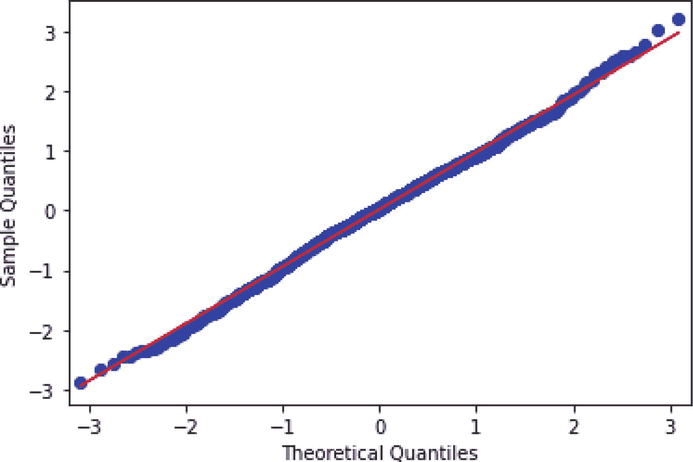

# 正态分布

了解某事物呈正态分布有助于你理解它。如果是正态分布，我们就知道其均值、中位数和众数都是同一个值，并且数据是对称的——分布在均值两侧互为镜像。此外，我们还知道大约有 68% 的数据会落在距离均值 1 个标准差的范围内，95% 的数据会落在 2 个标准差内，99% 的数据会落在 3 个标准差内。例如，如果一个数字距离均值超过 3 个标准差，我们就知道它相当不典型。同样，如果它距离均值不到 1 个标准差，那这就是一个非常常见的值，并不特别引人注目。

正态分布可以有多种不同的形态，因此我们通常会将数据转换为所谓的*标准正态分布*，这只是一个均值为 0、标准差为 1 的正态分布。

图 3-3 展示了两个正态分布：一个是标准正态分布，另一个叠加在我们已知呈正态分布的真实数据——男性身高（我们使用了高尔顿著名的家庭身高数据集中父亲的身高）上。我们省略了 Y 轴的值，因为它们对于理解正态分布的概念并不重要。

比较分布的双面板图。左面板显示了一条标注为“标准正态分布”的标准正态分布曲线，其均值 (μ) = 0，标准差 (σ) = 1.0。x 轴范围从 -3 到 3。右面板显示了一个“高尔顿父亲身高”的直方图，并叠加了一条正态分布曲线。均值为 69.0 英寸，标准差为 2.6 英寸。x 轴范围从 60 到 77.5 英寸。

图 3-3：两个正态分布：左侧是标准正态分布，右侧是一个经典数据集中男性身高的分布，并叠加了正态曲线

左侧的图是标准正态分布，其中 μ（均值）为 0，σ（标准差）为 1。我们可以看到峰值在中间的 0 处，尾部距离中心不远，这与标准差为 1 的情况相符。众所周知，样本量足够大时，成年男性的身高呈正态分布，因此我们绘制了高尔顿著名的家庭身高数据集中父亲身高的分布。虽然数据集不算庞大且存在一些偏差，但从叠加在数据上的橙色正态曲线可以看出，它大体上是符合正态分布的，该曲线已根据此数据进行了缩放。

这些曲线看起来非常相似，理解它们的一个技巧是记住 X 轴上不同值之间包含了多少数据。我们知道大约 68% 的数据都在距离均值 1 个 σ 的范围内，即介于 μ – σ 和 μ + σ 之间。在标准正态分布图中，68% 的数据介于 -1 和 1 之间，而在身高分布图中，这个范围介于 66.4 和 71.6 之间。

## 使用正态分布

在某些情况下，这条曲线和这些数值可能就足够了，但更多时候我们会以某种应用方式来使用正态分布的特性，这通常意味着转换我们的数据，以便能够以标准化的方式讨论它。

### Z 分数

由于大多数正态数据并不完全符合标准正态分布，因此通常会对数据进行标准化，以便能相对于标准正态分布来讨论它。这是通过计算 *Z 分数* 来完成的，Z 分数是指给定值距离均值有多少个标准差。计算方法很简单：用该值与分布均值的差除以分布的标准差，因此结果可以是正数或负数。在标准正态分布中，无需除以标准差，因为其标准差为 1——而这正是使用标准正态分布的全部意义所在。

`Z-score` 是一个简单但极好的度量标准，可用于识别异常情况，例如在简单的异常检测任务中，或者定义报告异常值的阈值（如欺诈检测或监控计算机系统的性能问题）。

### 正态性检验

由于许多统计技术都要求我们假设数据呈正态分布，因此检验数据是否真的符合正态分布非常重要。*QQ 图* 允许你通过可视化方式进行检查。QQ 图的 X 轴显示正态分布的分位数（这是正态性的参考点），Y 轴从低到高按数值顺序显示数据集中所有的 Z 分数（这是你正在检验的值）。如果数据是正态的，你将得到一条从左下角到右上角近乎完美的对角线。你可以在图 3-4 中看到一个示例，图中的点代表检验值，红线代表数据正态时我们期望看到的结果。

比较样本分位数与理论分位数的 Q-Q 图。图中有一条代表等值线的红色对角线，蓝色的数据点紧密地沿这条线分布，表明样本数据近似服从正态分布。x 轴标注为“理论分位数”，y 轴标注为“样本分位数”。

图 3-4：使用随机正态数据的 QQ 图示例

图 3-4 展示的是我们期望数据呈正态分布时的样子，而 QQ 图也能清晰地表明数据何时完全不服从正态分布。图 3-5 展示了来自泊松分布的数据（我们将在下一节讨论），很明显数据并未排列在对角线上。

比较样本分位数与理论分位数的 Q-Q 图。图中有一条代表等值线的红色对角线。蓝色的数据点大部分位于线上方，表明偏离正态分布。x 轴标注为“理论分位数”，y 轴标注为“样本量”。

图 3-5：使用随机非正态数据（来自泊松分布）的 QQ 图示例

另一个常见的检验是*科尔莫戈罗夫-斯米尔诺夫检验*，有时简称为 K-S 检验。该检验将数据集中标准化值的实际分布与标准正态分布进行比较。它会生成一个数值，表示正态分布与数据分布之间在相距最远点处的距离。

我们已经知道，大多数事物并非完全符合正态分布，但通常它们很接近，足以让我们还能使用一些需要正态性假设的技术。这往往是一个依赖经验积累的判断，但进行检验而不是直接假设，这一点仍然很重要。

### 泊松分布

离散泊松分布之所以有趣，是因为它着眼于那些初看起来难以量化的事物。具体来说，泊松分布对反复发生的、不规律的事件或现象进行建模。典型的例子包括在时间上间隔发生的事件，比如顾客进入餐厅、有人在工作岗位请病假，以及分布在空间上的事件，比如一本印刷书页面上的缺陷。任何在餐厅或零售店工作过的人都知道，总是会出现远超正常的“客流高峰”，或是令人惊讶的萧条时段，而这一切都没有明确的解释。事情就是这样发生了。

泊松分布使用一个速率参数 `λ`（lambda），它代表在特定时间（或特定空间，例如书中的例子）内事件的平均发生次数。因此，我们确实需要了解所要建模的情形。但一家餐厅可以追踪数周内顾客的进店情况，得出这个平均值，以便将来使用该分布。请注意，`λ` 也是该分布的方差。

泊松分布的一个局限性在于，它要求 `λ` 随时间保持不变。餐厅员工都知道，午餐时间的顾客比下午 3:30 要多。我们可以通过为午餐时间使用一个 `λ`、为晚餐时间使用一个 `λ`、为这两个时段之间的时间使用另一个 `λ`、并为晚餐后的时间使用第四个 `λ` 来处理这种情况。但时间段越短，实际操作中就越困难。

我们可以看看在第 2 章中研究过的披萨餐厅数据，来判断它是否符合泊松分布。图 3-6 显示了一周内（仅工作日）午餐和晚餐时段每小时订单数量的分布，以蓝色条形表示。为了得到用橙色线绘制的泊松分布，我们通过计算前一个月中相同时间段一周内的平均值来计算 `λ`。

条形图标题为“2021 年 6 月 21 日至 25 日工作日每小时订单数量”，显示了每小时订单数量的分布。x 轴标记为“订单数量”，范围从 0 到 40，y 轴表示频数。蓝色的直方图显示了订单频数，峰值在 15 个订单左右。一条橙色线叠加在直方图上，表示一条分布曲线。

**图 3-6** 工作日内每小时订单数量的泊松分布

这相当吻合，这就是为什么泊松分布可以帮助餐厅进行规划。但正如我们最终会看到的，并非所有情况在现实世界中都能如此完美吻合。

### 指数分布与威布尔分布

指数分布和威布尔分布与泊松分布相关，但它们都是连续分布，因为它们追踪的是时间而不是有限的事件。指数分布考虑的场景与泊松分布相同，也使用 `λ` 参数，但它建模的是从一个事件到下一个事件之间的时间。因此，当一位顾客进来时，指数分布可以告诉我们，下一位顾客大概多久之后会来。

有时泊松分布似乎是正确的选择，但当某个事件随着时间的推移发生概率变得更大或更小时，威布尔分布则是更好的选择，因为它对特定事件发生前所经过的时间进行建模，同样基于时间或空间（如泊松分布）。一个典型的例子是追踪机械设备的故障。直观上，我们知道设备使用时间越长，由于持续的磨损，它就越有可能发生故障。威布尔分布基本上可以告诉我们，一台设备在指定时间内持续运行的可能性有多大，并且它需要两个参数。第一个参数称为形状参数，用 `β`（beta）表示，它代表了故障概率随时间变化的快慢。如果它大于 1，则概率随时间增加；如果它为负，则概率随时间减少。第二个参数是设备的预期寿命，用 `η`（eta）表示。威布尔分布的一个局限性在于，`β` 本身需要随时间保持恒定。

## 中心极限定理

中心极限定理是另一个涉及样本统计量的概念，即计算来自同一总体的许多样本的平均值。中心极限定理指出，如果你在适当条件下，从同一总体中抽取多个样本并计算其均值（或其他统计量），那么随着样本量（所抽取样本均值的数量）变得足够大，这些均值的分布将趋近于正态分布。

无论所抽取样本的总体分布如何，也无论所测量的统计量是什么，这个结论都成立。想象一下，有一个大垃圾桶，里面装满了各种大小不一的、不规则的弹珠。我们从中抽取一千个样本，每个样本包含一百颗随机选取的弹珠，并计算出所有这些样本的均值。这些样本的质量（即它们代表总体的程度）会有所不同，但许多样本会接近真实情况，只有少数会偏离真实情况。因此，我们会看到测得的均值聚集在一个中心点附近——那些来自能够很好代表真实弹珠的样本——而偏离中心点左右的测量值则越来越少，就像正态曲线一样。曲线的峰值很可能就是垃圾桶中弹珠平均值的准确估计。

与中心极限定理相关的一个概念是均值回归，它基本上是说，随着时间的推移，数值会变得不那么极端。因此，如果出现一个极端值——比如某个玩家在纸牌游戏中得到了一个非常高的分数——那么下一局游戏的分数很可能会更低（不那么极端）。

## 抽样

抽样是从一个更大的总体中获取数据子集的行为。根据上下文，这个术语可以表示几个相关的事情。在实验设计中，它意味着从那个更大的总体中选取成员以收集数据。在大多数情况下，我们无法获取某个事物整个总体的数据。一家市场调研公司不可能实际上与每一个美国人交谈，甚至不可能与每一位 25 至 45 岁的美国女性交谈。我们必须想办法与其中更少的人交谈，以便能够有意义地推断到整个总体。然后，我们就可以进行研究，并通过某种方式与他们互动以获取数据。我们进行抽样的事实意味着，我们如何选择总体中的成员进行数据收集，可能会产生巨大的影响。

第二种情况在数据科学中更为常见，有时我们面临的是相反的问题——数据太多。我们通常不是在进行研究，但我们可能需要从已有的数据中选择一个子集，以减轻计算负担，或为特定目的创建子集。例如，我们可能有数百万行关于服务器性能的数据，数千台服务器中的每一台都有数千行数据。我们可以选择一部分服务器，或者仅仅是选择一部分数据行，或者其他的子集。这也被称为抽样。在这种情况下，选择哪些数据点进入我们的样本，其大部分问题和考虑因素与第一种情况相同。然而，这里我们有一个优势，即可能能够更全面地了解整个总体中包含了什么（有时我们可以对完整数据集进行基本的汇总统计，只是不能进行我们想要的那种更高级的数据科学分析），这可以为我们的抽样选择提供信息。

本节的其余部分将主要关注第一种类型的抽样，这通常是作为实验或研究的一部分来进行的。

### 偏差与代表性

在推断性统计中，抽样的主要目标之一是以有意义的方式让样本代表总体，而确保代表性的最佳方法是避免抽样中的偏差。在此语境下，*偏差*特指对数据中特定子集的系统性偏好，这意味着样本因所选的抽样方法而歪曲了总体情况。测量过程中也可能出现偏差，这源于以有问题的方式进行测量。

如果我们想了解 Snapchat 和 Facebook 在美国人中的受欢迎程度，那么只对青少年进行调查，样本就会存在巨大偏差。我们选择的样本完全无法代表“美国人”整体。

心理学中有一个相当著名的系统性偏差例子。许多心理学实验都是由高校学者在其大学中，针对自愿参与的大学生（或者，如果他们正在上心理学课，是被“强制自愿”参与的）进行的。与冲动控制和决策相关的大脑区域——前额叶皮层，直到大约 25 岁才完全发育成熟，因此大多数大学生的大脑仍在发育中。在他们大脑仍在发育的阶段，就其大脑运作方式得出科学结论，会导致样本存在偏差。这些研究本身并没有本质上的错误——它们可能对设计一项针对随机选择的成年人的更大规模研究非常有帮助。问题在于，这些结果有时会以一种将其推广到更广泛的“人”群（尤其是由记者们）的方式进行报道。

为了更好地理解抽样中的偏差，让我们回到装满弹珠的垃圾箱例子。想象我们有一台机器，它会伸进垃圾箱，稍微搅拌一下，然后挤压，直到夹起一颗弹珠并将其取出。假设抓取器发生故障，无法完全闭合，因此它很少能取出较小的弹珠，因为它们会掉出来。被选中的弹珠样本将与整个垃圾箱中的情况不同。如果我们计算样本中弹珠的平均值，它会高于垃圾箱中所有弹珠的实际平均值。

如果我们把垃圾箱（假设这是个玩具屋大小的）里所有的弹珠都拿出来，放在左上角的桌子上，就能看到弹珠大小的范围。但如果我们的自动抓取器无法完全闭合，它将无法抓住较小的弹珠。当你用视觉观察时，这一点更容易理解。图 3-7 展示了这些样本可能的样子。上方的图片显示了摆放在桌子上、稍微散开一点的弹珠。如果我们把弹珠放回垃圾箱，让损坏的抓取器取出十颗弹珠，然后再重复几次，左下角的三个样本将是典型的结果。如果我们修好抓取器，重新运行这个过程，得到三个新样本，我们预计会得到类似右下角样本的结果。

气泡图显示了一个由大小不一的黑点组成的大网格。下方分为两类：“损坏抓取器样本”包含三个标记为 1 到 3 的样本，“修复抓取器样本”包含三个标记为 4 到 6 的样本。每个样本包含一组黑点，展示了分布和大小的差异。该图表说明了两个类别之间气泡排列的变化。

**图 3-7** 从一桌子弹珠中抽取的六个示例样本，其中三个来自有偏差的抓取器，三个来自公平的抓取器

损坏的抓取器无法夹住较小的弹珠，因此所有样本都只有中等大小及更大的弹珠。这些样本看起来完全不像桌子上摆放的样子。右边的样本是在抓取器修复后获取的，看起来要均衡得多。

同样重要的是要记住，在这种场景下，人类可以在一定程度上相当容易地用肉眼判断均衡性，但更有条理地进行选择至关重要，因为人类不具备所需的全局精确性。

### 有放回抽样

我们经常会讨论有放回抽样与无放回抽样。这仅在你从一个更大的、完整的数据集中抽取数据使用时才有意义。*有放回抽样*允许完整数据集中的某些数据点在抽样过程中被选中多次——基本上，就是在“选取”之后将数据点放回数据集中。因此，*无放回抽样*则正好相反，每次选择一个数据点时，它实际上就从完整数据集中被移除了。从弹珠垃圾箱中抽样的最自然方式是一次取出一颗弹珠放在旁边，然后再伸手进去取出另一颗放好，依此类推，这属于无放回抽样。但你也可以在选取后将弹珠扔回去并搅拌一下，这属于有放回抽样。让人填写问卷通常属于无放回抽样（你不会要求同一个人填写两次）。如果你想要一个真正随机的数字样本，即每个数字被选中的概率均等，那么你应当采用有放回抽样（否则，每个数字被选中的概率会改变，就不再是随机的了）。

