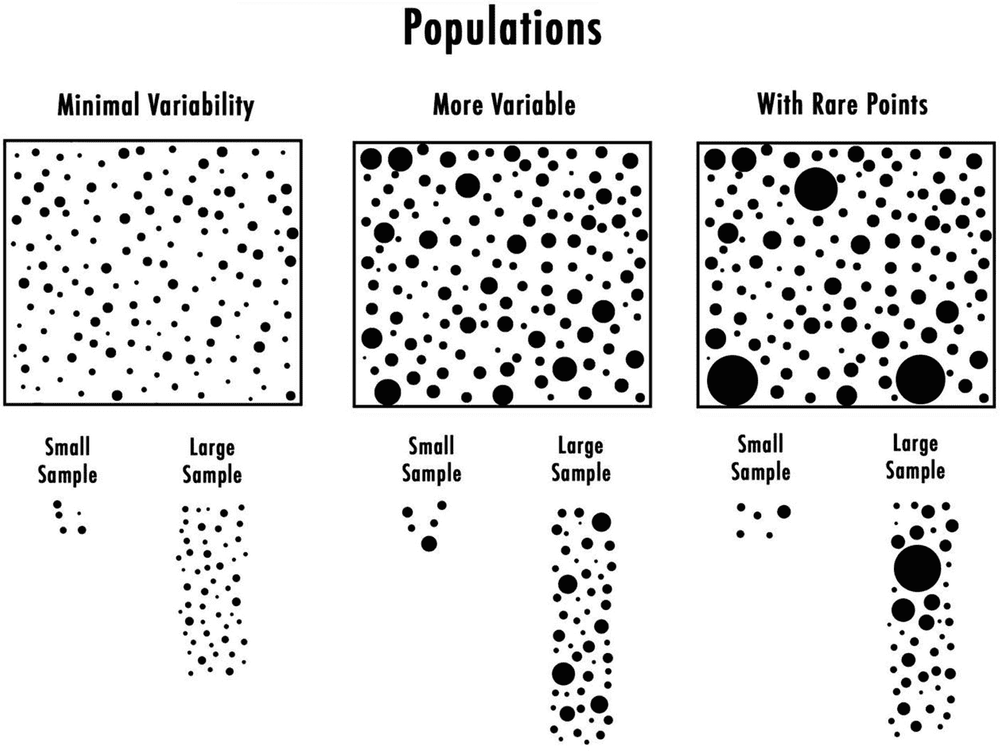

# 样本量

与许多其他事情一样，我们试图实现的目标应该决定一项研究所需的数据量。大多数人普遍认为，数据越多越好。但情况往往相反。尤其是在大数据时代，我们常常想尽可能多地使用数据——甚至可能是整个总体。诚然，如果我们从总体中抽取一个子集，就更有可能错过特殊情况。但如果我们想了解关于英国所有成年公民的某些信息，那么使用全部总体进行分析是不可行的。令人惊讶的是，在这两种情况下，一个规模较小但精心挑选的样本，实际上往往比一个庞大的数据集更好。总的来说，使用小数据集更容易操作，尤其是在计算资源方面。

显然，有些情况确实需要大量数据，但这种情况少之又少。几个明显的例子是互联网搜索和大语言模型。在这些方面我们不能吝啬数据，因为它们需要在广度和深度上都做到完备。但如果我们想知道英国人最喜欢的爱好是什么，我们不需要询问每一个人。

有一些通用规则可以帮助确定良好的样本量。当总体变异性不大（总体中的大多数成员相当相似）时，只要抽样方法严谨，较小的样本就足够好。当总体变异性很大时，情况则相反——在这种情况下，较大的样本更可能具有代表性，因为它能捕捉到更多的差异性。此外，当研究罕见事件（如计算机故障或信用卡欺诈交易）时，首选大样本量。

图 3-8 展示了三种场景以及抽样可能受到的影响。每种场景都有一个总体，以及从该总体中抽取的一个小样本和一个大样本。左侧是变异性极小的弹珠总体，因此小样本看起来仍然相当有代表性（大样本并没有给我们带来更多信息）。中间是一个变异程度大得多的总体，我们可以看到小样本的代表性不佳，因此我们需要更大的样本。最右侧的总体中有一个非常罕见的事件——大号弹珠。我们需要更大的样本来确保其中能包含一些大号弹珠。另一种可能是，我们的小样本最终可能纯粹因为随机而包含多个大号弹珠，那么该样本的代表性就会极差。

气泡图，展示了三种总体场景：“最小变异性”、“更大变异性”和“含罕见点”。每个场景显示一个由不同大小气泡组成的网格，代表不同的数据点。每个网格下方有两列，分别标有“小样本”和“大样本”，显示气泡的子集。该图突出了不同场景下的变异性差异和罕见大点的存在。

图 3-8

针对不同类型总体的不同样本量

在考虑样本量时，最后一个考量因素是工作可能带来的后果。如果后果可能具有破坏性，通常最好选择更大的样本，以确保更好的代表性。如果研究将用于制定公共卫生政策，或涉及公司做出重大财务决策，这一点可能适用。这涉及到伦理问题，我们将在后面的章节中讨论。

