# 15. 并非水晶球：机器学习

## 引言

尽管生成式人工智能 `GenAI`（它依赖于特定类型的机器学习算法，即下文将要讨论的神经网络）当下风靡一时，但机器学习作为我们世界的一部分已有多年，并广泛应用于各个领域。它被嵌入银行和信用卡公司的欺诈检测系统中。亚马逊几十年来一直用它来推荐产品。同样长久以来，它一直在帮助我们控制垃圾邮件的泛滥。它决定了我们在社交媒体网站上看到的内容，并且多年来一直应用于医疗保健领域。语音识别让我们远离人工客服代表的时间比我们希望的还要长。当然，企业早已用它来预测销售额以及几乎所有其他能想到的事物。市场营销人员，尤其是网络营销人员，很早就接受了它。地图应用用它来提醒你注意意外的交通拥堵。它在法庭上被用来为对被告的判决提供信息。你懂的。

其中一些应用对人类确实有益，而另一些则非常糟糕，还有很多介于两者之间。在本章中，我将介绍作为数据科学家实践的一门学科——机器学习的重要方面。我们将从几个例子开始，然后讨论机器学习的五种类型。关键的类型是监督学习和无监督学习，但还有其他一些有用的方法（半监督学习、集成学习和强化学习）。接着，我们将深入探讨几种监督学习技术，随后是无监督学习技术，之后再讨论模型解释器以及机器学习的编码和实现。本章最后，我们将探讨数据科学家在执行机器学习时面临的一些挑战，包括维数灾难、数据泄露、过拟合与欠拟合，以及偏差-方差权衡。

# 现实世界中的机器学习示例

我们知道机器学习在现实世界中已经存在了一段时间，但我们的第一个例子——`Netflix Prize`，比以往任何事物都更能将机器学习带入主流关注，这可能与那悬而未决的 `100` 万美元奖金有关。第二个例子是医学领域的一个应用，其成果已在显著改善患者的生活质量。

## 示例 1：Netflix Prize

`2006` 年，`Netflix` 设立了一个奖项，面向任何非 `Netflix` 关联人士（还有其他少数排除条件），只要能以一定幅度击败 `Netflix` 内部预测用户评分的系统（他们使用了性能指标均方根误差，我们将在下一章讨论）。这将有助于他们改进向用户提供的推荐。如果系统预测某位用户会对一部电影给出高分，那么如果该用户还未观看过此片，推荐给 ta 就是合理的。同时，他们也会避免推荐预测用户会给出低分的电影。

参赛者获得了超过 `1` 亿条包含四个字段的训练集记录，分别是`用户 ID`、`电影 ID`、`评分日期`和`评分`。这并非海量数据，但在比赛启动后的六天内，就有一个团队已经击败了 `Netflix` 的内部预测器。又过了一周，又有两个团队做到了。这件事在蓬勃发展的数据科学领域引起了轰动，几个领先团队每次提交新结果时，排行榜的排名都会发生变化。在接下来的几年里，向团队颁发了两次进度奖，许多团队进行了合并，最终奖项由三个早期表现优异且后来合并的原始团队共同获得。另有团队的成绩与获胜团队持平，但获胜者比对方早提交了 `20` 分钟，因此这七人小组带走了 `100` 万美元（这 `20` 分钟可真昂贵）。

获胜团队被要求公开其方法，实际上该方法通过三篇独立的论文发表。三个原始团队各自发表了一篇关于其解决方案的论文，而最终的解决方案是这三种模型的线性组合。这些论文是：

- 《2008 年 `Netflix Prize` 的 `BigChaos` 解决方案》^(³⁷)，作者：Andreas Töscher 和 Michael Jahrer
- 《2008 年 `Netflix Prize` 的 `BellKor` 解决方案》^(³⁸)，作者：Robert M. Bell、Yehuda Koren 和 Chris Volinsky
- 《Netflix Grand Prize 的 `BigChaos` 解决方案》^(³⁹)，作者：Andreas Töscher 和 Michael Jahrer

解决这个问题涉及复杂的建模。由于数据非常简单，且没有明显的方法将其与其他数据关联，因此实际上并不需要任何数据预处理。所以团队能够直接进行建模。但是，有超过 `40,000` 个团队参与竞争，显然需要相当高超的技术才能击败所有其他团队。在此过程中尝试了许多方法，但发现有必要结合多种不同模型的结果（机器学习中称为集成学习的技术），并且需要对集成解决方案进行大量调整才能达到最终版本。该奖项被认为推动了机器学习领域的发展，因为如此多的不同技术和方法直接在同一个问题上进行了比较，这是一种真正的苹果对苹果的比较。

关于整个事件，有一件有趣的事：`Netflix` 原本计划举办第二届比赛，但因为隐私问题被起诉而取消了。尽管诉讼后来被撤销，但这强烈提醒我们，几乎不可能真正匿名化任何与人相关的数据。尽管数据中只有四个字段，且仅包含人员和电影的 `ID`，但还是有人通过将 `IMDB`（互联网电影数据库网站）上的用户和评分进行匹配，从而识别出了数据集中的一些人。

## 示例 2：放射学中的机器学习

分析医学影像（患者身体的扫描图）对人类来说仍然是一项极其容易出错的任务，因为它除了需要专业知识外，还需要极其专注的细节注意力。各种涉及机器学习的解决方案通过帮助人类捕捉图像中指示问题的细微之处，极大地改善了这种情况。

乳腺癌是全球最常见的癌症。它可能影响任何人，但在 `40` 岁以上的女性中最为常见。医疗保健领域已普遍认为女性一旦达到该年龄就应该开始每年进行乳房 `X` 光检查，这意味着有很多机会甚至在早期阶段发现癌症。但这仍然依赖于放射科医生来检测。每个人的身体都不同，一些情况如致密乳腺组织使得识别癌症更加困难。

# Lunit 公司工具与机器学习类型

Lunit 公司有一款名为`INSIGHT MMG`^(⁴⁰)的工具，该工具基于深度学习（我们将在下文讨论的神经网络），专门用于解读乳房 X 光片。他们声称癌症检测准确率达到 96%，这显然很好，但他们提供的另一个好处是加速了从图像中检测癌症的过程。这个工具尤其擅长在致密乳腺组织中检测癌症。通过一些回顾性研究（回顾后来被诊断出癌症的早期乳房扫描图像），他们发现该系统正确检测出了那些早期扫描中 40%的案例——而这些案例曾被人类漏诊。

这正是机器学习应该被使用的完美领域，因为它只带来积极影响。它不会取代人类专业知识，但在没有癌症时能显著加快速度，同时也有助于标记出更复杂的病例，让医生可以花更多时间进行研究，从而提高患者的生存率。

## 机器学习类型

机器学习与传统编程有着根本性的不同，其区别在于已编写程序的输入和输出内容。在大多数传统编程中，我们编写代码时已知输出结果，因为这正是我们编写代码所要实现的目标。我们可以对过程中的每一步进行测试，因为同样清楚中间步骤及其应有的输出。图 15-1 展示了传统编程的流程。输入的规则集是我们在代码中编写的预期行为，由计算机执行。许多程序还会依赖输入的数据，这些数据可以是记录，也可以是一些简单的配置细节。可以将图中的“计算机”方框视为我们根据规则编写的软件程序。运行程序会生成输出，即“计算结果”。在有数据输入的情况下，我们仍然知道每个数据输入或数据输入组合所对应的输出应该是什么，而我们对“计算结果”所做的任何测试都将基于已知的输入和输出。这类软件也被称为`确定性`软件，这意味着每次使用特定输入集运行时，输出结果都将完全相同。

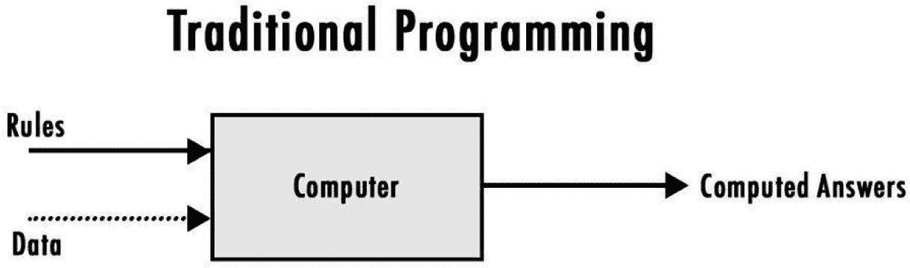

流程图展示了传统编程。该图显示了一个过程，其中“规则”和“数据”作为输入进入“计算机”方框，进而产生作为输出的“计算结果”。箭头指示了从输入到输出的流向。

**图 15-1** 传统编程流程。规则是必需的，但是否需要数据则取决于程序的需求。

此类软件的一个例子是计算比萨餐厅总销售额的代码。程序员编写计算数据的规则，输入所有交易数据以及任何其他需要包含的值，然后计算机生成汇总结果。如果每次都以完全相同的输入运行，那么生成的输出汇总结果也将完全相同。另一个例子是，在 1999 年夏天人们对千年虫问题感到恐慌时，我编写了一个 Java 小程序——千年倒计时时钟，它运行在公司的内部网上，倒计时显示距离 1999 年 12 月 31 日午夜还有多少天、小时、分钟和秒。该程序中使用的唯一数据就是当前的系统时间。

传统编程中已知输出和确定性有一个例外，那就是当我们使用随机性编写任何代码时。编程语言可以生成随机数，这些随机数可用于控制由代码中生成的数字决定的不同行为。想象一下，你想要根据不同的数值随机生成一个《龙与地下城》角色。一个角色由一组特定的基本身份（如种族和职业）以及代表各种事物（如技能和能力）的数字来定义。例如，如果有九个可能的角色种族，你希望程序随机选择一个，并且希望它随机为角色的敏捷属性选择一个介于最小值和最大值之间的数值。每次运行这个程序时，你想要的输出都是不同的且未知的。然而，你了解输出的参数——所有能力和技能分数都将在定义的最小值和最大值之间，并且你知道角色可能拥有哪些种族、职业和背景，因为它们来自一个特定的列表。随机性的另一个常见用途是在模拟中，科学家们可能希望定义一个起点，然后观察事物随时间如何演变，而这至少会部分地由随机事件驱动。混沌理论正是源自以这种方式运行的气象模拟。

请注意，在编程语言中，这种随机性被视为`伪随机`，因为对于一个特定的起点，随机数生成器会以相同的顺序生成相同的数字，因此在这种情况下它实际上是确定性的——每次结果相同——即使程序仍然在使用“随机”值运行。有时这正是期望的行为，例如，当你在运行一个实验并希望它具有可重复性时。这通过在代码中创建随机数生成器时设置一个称为`种子`（即起点）的数字来控制。如果你希望每次运行的结果相同，就将种子设置为相同的数字。相反，如果你想要非确定性的行为，则需要将种子设置在某个变化的量上，例如将当前日期和时间转换为一个数字，并将种子设置为该值。这样每次运行的输出都会不同。

请注意，即使是许多使用了随机性的程序，仍然被视为传统编程。这是因为输入是已知的，输出基于规则和已知的输入，仅此而已。在机器学习领域，情况则有所不同，因为你不会预先提供规则，也永远不知道输出会是什么。机器学习的两种主要类型是监督学习和无监督学习。下面我将用图 15-2 和图 15-3 展示这两种类型，并在图 15-4 中展示另一种类型——半监督学习。我们将在下文中一一讨论它们。

但首先，我们需要了解机器学习试图解决的两种问题类型：`分类`和`回归`。`分类`的目标是通过预测目标变量值来为数据打标签——例如，确定一款电子游戏的类型，判断某人是否患有疾病，或确定某个数据点属于哪种花。可能的标签数量各不相同——我曾参与过一个项目，其中包含二战期间个人经历的叙述，我们想根据主要话题为它们打标签，这是一个多类问题，因为有七个可能的话题。最终，我们将它们视为标签来处理，这样每段叙述可以包含多个话题，因此我们对每个标签进行独立分析，并为每个标签建立一个二元模型来判断它是否符合该话题。这种方法并不罕见，因为衡量多类模型的性能可能很困难。

`回归`是机器学习用于解决的另一种问题类型，我们称之为对数值数据进行预测。像销售预测——预测比萨餐厅未来七天的销售额——是一个非常常见的回归任务。其他例子可能包括预测电子游戏的下载量或急诊科每天的患者数量。

每种问题都有不同的算法，但有些技术存在变体，允许它们同时处理这两种问题。我将在下文中讨论它们。

### 监督学习

在`监督机器学习`中，我们向计算机提供数据，以便它能够找出数据中的模式和规则（这一步称为训练模型），然后计算机将这些计算出的规则输出到我们所谓的模型中。监督机器学习有一个最低要求——我们必须在输入数据中包含目标值，这使得数据成为`标记数据`。正是因为我们提供了目标变量，所以才称之为“监督”——即我们提供了指导。

监督学习通常用于两种类型的任务，这两种任务都需要已训练好的模型：预测和推断。我们将在下文中详细讨论每一种。监督学习在商业世界中非常重要，也是组织机构中最常见的机器学习类型，其中预测是最常见的任务。

#### 预测

一旦我们有了训练好的模型，就将它连同第一步中未包含的新数据输入计算机，然后计算机输出与新数据相关的预测结果。请注意，这些新数据必须具有与模型训练时相同的特征。这对新手数据科学家来说可能是一个容易出错的地方。在本节末尾，我将进一步详细讨论预测生成运行过程具体需要包含哪些内容。

在第一步中，我们并非完全没有向计算机提供任何“规则”，这有两个原因。第一个原因是，我们提供的是经过专门准备的数据，这些数据包含我们认为重要的特征。这就是数据准备和特征工程如此关键的原因。第二个原因是，我们提供了目标值。图 15-2 展示了预测性监督机器学习的两个步骤。

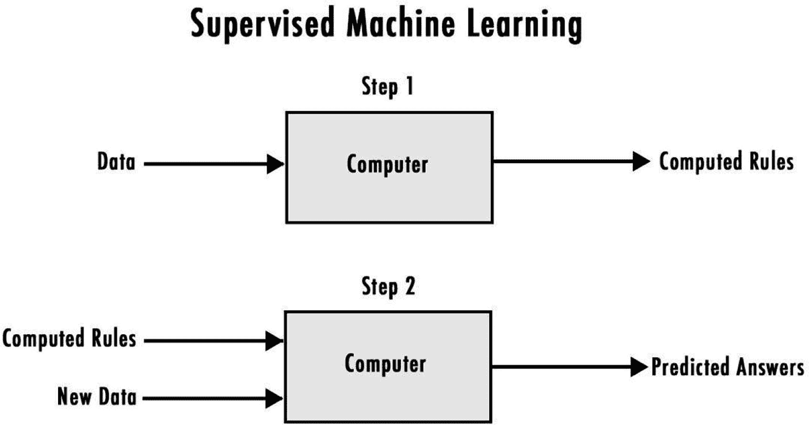

说明监督机器学习的流程图。该过程分为两个步骤。步骤 1：将数据输入计算机，计算机输出计算出的规则。步骤 2：将计算出的规则和新数据输入另一台计算机，该计算机输出预测的答案。箭头表示数据和结果的流向。

**图 15-2** 预测性监督机器学习流程。第一步训练模型，第二步输出预测结果。

图中的步骤 1 包含几个具体部分。总体而言，这是训练模型的过程，但在监督机器学习中，“训练”在最终确定模型之前还包括测试。准备数据后的第一步是将数据拆分为训练集和测试集，有时还会拆分为一个额外的验证集，这被称为训练-测试拆分。有关训练-测试拆分的更多信息，请参见侧边栏。

**训练-测试拆分**

将数据拆分为训练集和测试集（如果需要的话还有验证集）本身是一门艺术。常见的拆分方式是按数据百分比进行，例如 80-20 的训练-测试拆分，或 70-20-10 的训练-验证-测试拆分。但如何选择那 80%的数据呢？当你不处理基于时间的数据时，有多种方法可以选择训练集和测试集。通常可以随机选择，使用与第 3 章讨论的抽样技术相同的方法。这种方法意味着你会有良好的覆盖率，并且你的测试集将测试模型在训练数据中学习到的尽可能多的模式。

如果你处理的是基于时间的数据，尤其是使用时间序列方法时，你通常会选择后 20%的数据作为测试集，并使用前 80%的数据作为训练集。这样做的一个缺点是，你的测试数据可能无法覆盖模型中检测到的所有模式。例如，如果你有两年的数据，你可能只能测试五个月的数据，这刚好超过 20%。如果一年中某些部分比其他部分更容易预测呢？如果这些日期恰好落在夏季和初秋，模型可能表现得非常好。但是，当时间推移，你在深秋和冬季运行模型时，它的表现可能就不那么好了，而你最初的测试并没有发现这个问题。反之亦然。

这些训练集、测试集和验证集中的每一个都应该完全独立于其他集合，没有任何数据点出现在多个集合中。此外，所有这些数据必须具有我们关心的特征以及目标值，无论这个目标值是一个标签（例如“患有糖尿病”或“未患糖尿病”）还是一个数字。步骤 1 将获取所有这些信息，并找出广义规则，以便从特征的组合得到特定的目标值。这就是模型，也就是图 15-2 中的“计算出的规则”。

高级流程基本上是：基于训练数据集训练模型（步骤 1），然后在测试数据集上对其进行测试，以查看其表现如何（步骤 2）。我们将使用各种指标来衡量性能，我将在下一章中介绍这些指标。我们会在训练集上训练许多不同的模型，并在测试集上进行测试，尝试不同的算法或每种算法中的不同设置。请注意，训练最佳模型的一部分工作不仅是尝试不同的算法，还要进行所谓的超参数调优。

在`R`或`Python`中，用于训练算法的多数函数都有超参数，这些参数需要在运行时设置，当你在代码中调用该函数时，它们作为参数传递。这些参数定义了所使用的机器学习算法的各个方面。当我们下面讨论算法时，会涉及其中一些参数，例如对于决策树，它会控制树的深度。这些超参数通常有默认值，但这并不意味着这些默认值对你的特定问题是最优的，因此这是一个必要的步骤。

`超参数调优`是寻找能产生最佳性能模型的最佳超参数组合的过程。有不同的方法可以实现这一点，但目前只需理解，这就是验证集的用途。调优通过选择超参数并在训练集上进行训练，然后用验证集进行测试，并重复此过程直到找到性能最佳的模型来实现。然后，使用这些超参数对训练集进行最后一次训练，并在测试集上进行测试，从而得出模型的最终性能。还有一种方法称为交叉验证，它涉及将训练集分成几个不同的训练集和验证集拆分，而不是使用专门的验证集。当试图避免过拟合（即模型构建得过于针对训练集，无法泛化）时，这种方法特别有价值。我将在下面进一步讨论超参数调优和交叉验证的方法。有一些便捷的工具允许你仅用几行代码就进行多次不同的运行。

在我们多次迭代步骤 1 和步骤 2，识别并测试了性能最佳的模型之后，该模型就可以用于新的、未见过的数据，以获取这些数据的预测结果。这意味着要用新数据重新运行步骤 2。监督机器学习的一个典型例子是预测销售量之类的东西。一家披萨店可能想知道在晚班开始前需要准备多少面团，因此他们可以根据历史销售数据以及其他数据（如天气、体育赛事、节假日和其他日期信息（已知数据））创建一个模型。然后，他们可以将未来日期（未见数据）的这些信息提供给模型，并获得预期销售披萨总数的预测。这将帮助他们知道需要准备多少面团。预测是监督机器学习的最终目标。

#### 进行预测所需的条件

有时，新入行的数据科学家会困惑于需要向训练好的模型提供什么才能获得预测结果。正如前文所述，我们需要提供模型训练时所用的所有特征值。假设我们有一个用于预测商店每日销售额的模型。今天是 2 月 1 日，我们有一个基于截至 1 月 31 日过去三年数据训练好的模型，并且想要预测未来七天的每日销售额。我们使用了多种特征，包括星期几、月份中的第几周、节假日以及若干历史销售特征。我们必须拥有接下来七天所有这些特征的数据。想象一张包含七行数据的表格，每一列对应上述的一个特征。有些人会惊讶于我们需要“未来的数据”——但模型正是基于每一天的这些特征值运行的，因此它们是必需的。

这意味着我们需要能够获取这些未来的特征值。使用无法体现未来情况的特征是新手的常见错误。例如，如果你有一个特征“`昨天的销售额`”，用这个特征训练模型没有问题。但当你进行预测时，你无法提供这个特征值，因为你根本不知道第七天的“`昨天的销售额`”是多少——我们还没有第六天的销售额数据。一种处理方法是使用第六天的预测值作为第七天预测中的“`昨天的销售额`”，但由于存在不确定性，这并不总是正确的解决方案。

#### 推断

监督学习的另一个不那么常见但仍然有价值的用途是推断，即通过生成模型并对其进行检查。其理念是查看模型指定的特征和数值，从而理解模型中哪些因素是重要的。这可能意味着将所有数据直接投入图 15-2 中的步骤 1，观察输出的特征和数值；也可能涉及在多个模型上同时运行步骤 1 和步骤 2，选出性能最佳的那个，然后仅检查该模型。为了使这种方法有效，我们需要使用透明的算法或模型解释器，以便理解哪些特征对输出有贡献。在这种情况下，我们可能甚至不需要将数据拆分为训练集和测试集。相反，我们直接训练模型，如果算法能够揭示其所用的特征和数值，我们就检查该模型。像线性回归和决策树这类透明方法非常适合此目的，因为它们能精确告诉我们哪些特征是重要的。但另一种树方法——随机森林——只能输出对整个模型最重要的特征，而不会提供任何数值信息。

另一种选择是使用模型解释器，这种工具能够揭示非透明算法的重要特征（我们将在下文详细讨论）。使用模型解释器时，我们实际上是通过模型运行训练数据来生成“`预测值`”——即模型基于所提供的特征生成的数值。然后，我们可以使用模型解释器获取每个特定预测的最重要特征并进行研究。在这种情况下，我们可能会重点关注那些准确率较高的预测，但那些不准确的预测也可能很有研究价值。

机器学习中一个相对较新且正在发展的领域是因果推断，它专门致力于寻找变量之间的因果关系。例如，如果你想了解改变价格对销售额的影响，你需要将其他变量归一化，然后仅关注这两个变量。

### 无监督学习

无监督学习在某些方面与监督学习相似，但关键区别在于我们不向它提供目标值，这也是其被称为“无监督”的原因。`无监督机器学习`在没有指导的情况下（数据准备阶段完成的特征工程除外）识别数据中的模式，而非像监督学习那样找出如何从特定特征得到特定值。我们并非主动“教”它。

在无监督学习中，不要求进行训练-测试拆分。它可以是一个或两个步骤的过程。第一步基本上是在准备好的数据上运行算法，从而生成两样东西：(1) 你向算法请求的“`答案`”，以及 (2) 一个训练好的模型，你可以将该模型应用于新数据，并应用算法在运行期间确定的规则。最常见的无监督机器学习是聚类，它简单地将数据分为不同的组，因此输出的是附有组别标签的原始数据。这让你能够看到哪些数据点被分到了一起，从而可以深入挖掘并发现这一组与其他组的不同特征。这可能就是你当前工作的终点，但你同时也获得了一个训练好的模型。通过可选的第二步，你还可以将新的、未见过的数据输入模型，从而为这些数据也生成分组标签。图 15-3 展示了这一流程。

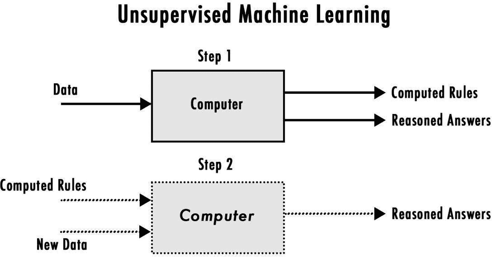

流程图展示了无监督机器学习的两个步骤。第一步：数据输入计算机，计算机输出计算得出的规则和推理得出的答案。第二步：将计算得出的规则与新数据输入计算机，产生推理得出的答案。箭头表示数据和结果的流向。

**图 15-3** 无监督机器学习流程图。第一步训练模型并输出标签（如分组）。可选第二步允许模型为新数据标注标签。

### 半监督学习

`半监督机器学习`是监督学习和无监督学习的结合，因为我们同时提供了有标签和无标签数据。有时，有标签数据非常昂贵或难以获得，尤其是在机器学习通常需要大量数据的情况下。如果无监督学习不足以解决当前问题，那么有一种方法可以增强现有数据，以获得更多可用于监督学习模型的“有标签”数据。这种方法可能效果不错，但并不总是奏效。这绝对是一种“因人而异”的方法，取决于你的领域和数据。

使用这种方法存在一些普遍的限制。一个关键的方面是，无标签数据在内容上需要与有标签数据相似。如果我们试图识别歌曲的流派，并且我们有一个包含已标注的摇滚、流行和雷鬼歌曲的数据集，那么在加入除了这三类之外还包含乡村和说唱的无标签歌曲，就不会产生好的结果。这很直观，但有时很难判断无标签数据是否与有标签数据相似。一些探索性数据分析通常可以回答这个问题。

半监督学习有几种不同的技术，但我只打算讨论自训练方法，这是一个三步过程。自训练半监督学习首先从创建一个`基础模型`开始，该模型仅在小量有标签数据上进行训练。然后，我们将无标签数据输入模型以获得预测结果——即无标签数据的标签，通常称为`伪标签`。这第二步的一个要求是，每个预测都要生成一个置信度。然后，你可以取出所有具有高置信度（通常在 80%左右）的伪标签数据，将这些数据（也就是无标签数据中具有高置信度伪标签的子集）与原始有标签数据合并，并用这个规模大得多的数据集训练一个新的监督模型。图 15-4 展示了整个流程。

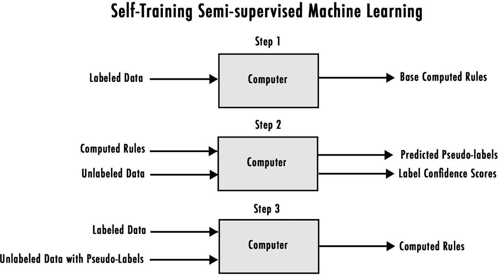

图 15-4：基本的自训练半监督机器学习流程。

你可能已经猜到，这通常不是一种非常稳健的技术，并且在很大程度上取决于伪标签的质量。因为我们使用的伪标签数据远多于真实数据，如果生成过程中出现任何问题，整个模型都会出错。如果原始训练集中的某个特征被赋予了比其实际重要性更高的权重，那么该特征在伪标签数据集中就会被过度强调，从而可能导致这种情况发生。这并不意味着你不应该尝试它，但你需要小心谨慎，并用放大镜仔细检查你的结果。请注意，当这种方法效果良好时，通常是因为特征空间中彼此接近的点往往具有相同的标签，因此与其他点接近的伪标签很可能具有正确的值。

### 强化学习

强化学习被认为是继监督学习和无监督学习之后的第三种机器学习范式。它不提供训练数据，但会指定一些行为规则。强化学习通常被描述为一个“智能体”探索陌生环境并朝着目标努力的过程。想象一个机器人在房间里探索，试图找到一个需要关闭柜门的柜子（目标）。仅凭目标它无法成功——它还必须有一个策略来决定如何选择要做的事情，以及在执行期望的动作后获得奖励。这些目标、策略和奖励都是预先指定好的。

# 强化学习与集成学习

强化学习的基本挑战之一是找到探索（如机器人探索所在的房间）和利用（利用它学到的关于房间的知识）之间的平衡。强化学习方法的一个有趣之处在于，它们并不总是选择局部最优选项（即在特定时刻能带来最大奖励的选项），而是可以处理延迟满足，为了更大的回报而做出小的牺牲。强化学习最大的优势是优化——寻找最优路径，无论是物理路径还是虚拟路径。

它在数据科学中的使用不如在其他人工智能领域那么广泛，但在营销领域与推荐系统结合时可能很有用。它还被用于`AlphaGo`，该系统击败了最优秀的围棋选手，如第 10 章所述。

## 集成学习

其核心而言，`集成机器学习`与其说是一种机器学习的“类型”，不如说是一种将不同机器学习模型结合起来以获得比任何单个模型都更好性能的方法。有时人们称之为基于委员会的学习，因为它组合结果的方式。这个想法相当直观——例如，众所周知，当人们猜测一个大罐子里的弹珠数量时，许多猜测的平均值会比大多数个人的猜测更接近正确数字。高估和低估往往会相互抵消，互相弥补对方的不准确性。即使是最好的机器学习模型也有一些局限性，比如误差、偏差和方差（我们稍后会讨论这些），但是当我们组合多个模型时，这些问题会被其他模型中的值所弥补。

训练和组合不同模型主要有两种方法：顺序式或并行式。在并行方法中，多个模型在训练数据的不同部分上独立训练，要么所有模型使用相同的算法（同质），要么使用不同的算法（异质）进行训练。在顺序方法中，每个模型被训练，然后其训练结果被输入到下一个模型的训练中。最后，在分类问题中使用多数投票法（选择在多个模型中出现次数最多的预测）以及在回归问题中取所有模型输出的平均值来组合最终的模型输出。

还有另外三种技术可以使用：装袋、堆叠和提升。`装袋`这个词是“自举聚合”的合成词，它涉及通过对训练集进行重采样来创建新的数据集，并在每个新生成的数据集上使用相同的算法训练单独的模型。然后将这些模型的结果进行组合以获得最终预测。

`堆叠`使用异质并行方法，训练多个模型，然后在第一轮模型的输出上训练另一个模型。这种创建最终模型的方法被称为`元学习`，因为它是在其他模型的输出结果上进行训练，而不是在原始数据上。最终的模型生成最终预测。

`提升`是一种顺序集成方法，通过专注于在后续模型中对错误预测进行处理以改进差的预测。首先在一个训练数据集上训练一个模型，但它会将结果分为正确和错误两大类，然后创建一个包含错误预测记录的新数据集，但在此基础上做一些调整（例如在新数据集中为它们赋予权重）。这个过程在多个模型上重复进行，最后通过计算权重将它们组合起来。

# 监督技术

本节将介绍几种流行的监督技术。实际可用的技术比这里提到的要多，但很多时候，数据科学家的工作都集中在最常用的几种方法上。当你的常规工具箱不够用时，上网搜索一下也是完全正常的做法。

## 时间序列分析

时间序列分析是一种古老的统计方法，由于许多其他机器学习技术表现更优，它已有些失宠，因此我不打算过多介绍。但了解一下仍有好处，因为它在某些情况下确实有效。时间序列分析依赖于基于时间的数据，例如某款特定电子游戏在商店的周下载量。其局限性之一是，经典的时间序列分析无法像其他机器学习算法那样使用特征。我们只有时间单位以及被追踪的数值，比如销售额或下载量。图 15-5 展示了一个我们在时间序列分析中常见的典型图表。

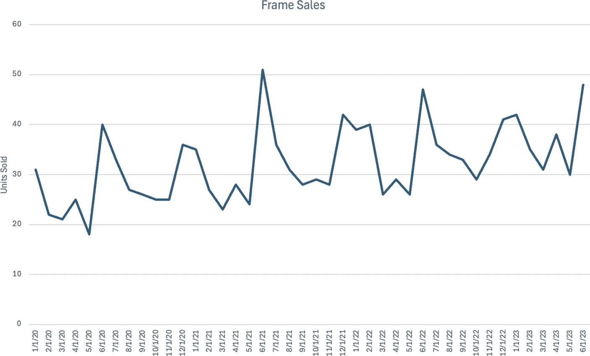

折线图标题为“画框销量”，展示了从 2020 年 1 月到 2023 年 5 月期间的销售量。X 轴以月为间隔表示日期，Y 轴表示销售量，范围从 0 到 60。数据显示出销量波动，有高峰和低谷，表明该期间画框销量存在变化。

图 15-5

一个适用于时间序列分析的示例图表，展示了一家虚构的小型画框店数年间每月的销售额

图 15-5 清晰地显示了数据的上升趋势。在时间序列分析中，这被称为*趋势*，即长期内持续一致的总体增长或下降。我们还可以看到*季节性*，这是一种有规律重复出现的增长或下降模式，例如图 15-5 中每年六月和十二月的销量激增。

这些模式肉眼很容易识别，但也有工具可以自动识别趋势和季节性（或周期性），以及其他一些模式。这些工具允许我们*分解*原始时间序列，以查看显示趋势和季节性等模式的各个子图。这之所以有用，一方面是因为有时图表中这些模式并不像我们希望的那样清晰，另一方面是因为我们可以利用这些特征进行预测。

我们还可以使用工具，根据时间序列中的历史数据生成预测。还有其他基于时间序列的算法能做更多事情。其中一种流行的算法是*自回归积分滑动平均模型*（`ARIMA`），它从三个不同角度审视时间序列。第一个是*自回归*（`AR`），关注一个数据点与其先前（或滞后）点之间的关系。第二个是*积分*（`I`），它使用差分方法有效地去除趋势和季节性。第三个是*滑动平均*（`MA`），它考虑数据点以及过去几个观测值的滑动平均值。所有这些都是在运行`ARIMA`时可以指定的参数。请注意，使用`ARIMA`需要满足一些假设，最重要的是数据必须是*平稳的*，这意味着均值和方差不会随时间发生剧烈变化。

尽管时间序列方法并不总能产生最佳结果，但尝试一下并观察其表现并不难。然而，由于我们通常只使用一个“特征”——即我们试图预测的同一个变量的历史值——数据的模式必须局限在该变量本身。换句话说，时间序列假设除了月份、星期几等时间特征之外，没有其他外部因素决定未来的数值。请注意，也存在一些允许包含外部值的选项，特别是名为`ARIMAX`的`ARIMA`变体。它允许引入一个额外变量，这个变量可以是单个特征，也可以是多个特征的组合（在技术中表现为一个变量）。

## 广义线性模型

### 线性回归

线性回归是一种非常流行的技术，既可用于理解数据，也可用于进行预测。它也是统计学家和数据分析师最早使用的、超出纯统计检验范畴的技术之一。其优点是直观透明，并且易于向利益相关者解释。从概念上讲，*线性回归*特指取一组数据——想象一个散布着许多点的散点图——并在其中画一条线。画这条线有特定的技术，我们将在下面讨论。这条线代表了两个变量之间的关系，也就是该图中预期值的位置——如果我们观察图中已有数值以外的范围，就会看到预期值在该范围之外是怎样的。预测，即观察我们构建模型所用数据范围之外的数值，被称为*外推*。

线性回归是一种广为人知的特定技术，但它实际上归属于统计回归技术家族，属于*广义线性模型*。这个名称可能具有误导性，因为其中的一些技术会产生非线性模型，如多项式回归和泊松回归，但该名称仍然沿用。最常见的两种广义线性模型是线性回归和逻辑回归。线性回归用于回归——生成数值型输出，而逻辑回归通常用于二分类——生成非数值型标签。两者都将在下面进行讨论。

线性回归是回归方法中最直接、最直观且最简单的技术。术语“线性回归”从技术上讲，涉及仅基于一个其他变量（即特征预测变量`X`）对一个变量（目标变量，或称`Y`）进行建模，但这在大多数情况下并不那么有用，因为单个变量能够很好地预测另一个变量的情况非常罕见。

仅用两个变量就能得到一个不算太差的模型，最常见的例子之一是体重与身高的关系，其中身高是`X`，体重是`Y`。图 15-5 显示了一个较大数据集中 75 个身高和体重测量值的样本。

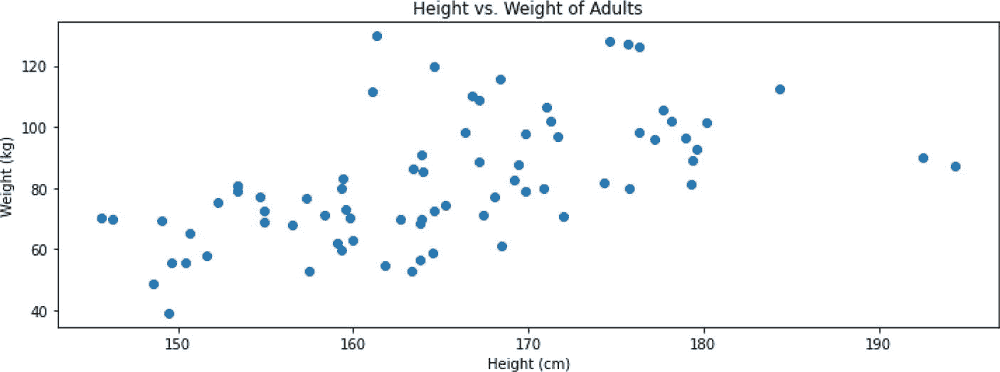

散点图标题为“成年人身高与体重”，显示身高（x 轴，单位厘米）与体重（y 轴，单位公斤）之间呈正相关。数据点分散分布，表明存在变异性，身高范围从 140 厘米到 200 厘米，体重范围从 40 公斤到 130 公斤。

图 15-6

成年人的身高与体重

要使线性回归有效，必须满足几个假设。其中最重要的三个是：线性关系、强相关性，以及如果存在多个`X`值时，`X`变量的独立性。我们需要确保散点图中的数据点看起来接近一条清晰的直线，并且`X`和`Y`变量之间存在相当强的相关性（通常大于 0.5 或小于 –0.5）。人们常常懒得进行这些检查，但如果不满足这些条件，回归分析就无法提供可靠的结果。进行任何回归分析的另一个重要步骤是理解模型中固有的误差（没有任何模型能够做到完美精确）。

观察图 15-6，我们可以看到数据点有些分散，并没有一条所有测量值都聚集在其周围的直线，但存在明显的上升趋势。从视觉上看，这大致呈线性。我们还可以计算身高与体重之间的相关性。使用 Python 对这个样本进行计算，得出的皮尔逊相关系数为 0.565，超过了 0.5 的阈值。（需要说明的是：原始的完整数据集的相关性并不高于 0.5，但这个特定的随机样本确实如此，所以我用它来举例说明。）接下来是独立性问题：很明显身高和体重并非相互独立，因为一个身高 6 英尺 6 英寸的人不可能仅重 100 磅，除非极不正常。对于身材较矮的人体重较重的情况也是如此。但为了便于理解线性回归，我们可以暂且忽略这一点。老实说，几乎没有哪两个不相互依赖的变量组合能产生好的回归结果，所以我们只能先用这个例子。

线性回归的核心在于它用来确定直线应如何穿过图表上各点的方法。我们将讨论这一点，但图 15-7 展示了上面那个散点图加上回归直线后的效果。凭直觉，这感觉很对。如果你仅根据图 15-6 自己画一条线，很可能也会画成这样。但它究竟是如何计算出来的呢？

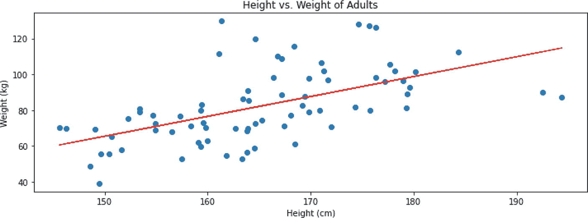

散点图标题为“成年人身高与体重”，显示身高（x 轴，单位厘米）与体重（y 轴，单位公斤）之间呈正相关。蓝色点代表单个数据点，红色趋势线指示整体趋势。图表表明，随着身高增加，体重也趋于增加。

图 15-7

带有回归直线的成年人身高与体重

线性回归通过最小化每个数据点的所有平方误差之和来计算这条直线。误差是数据点到直线的垂直距离，但在回归中，这通常被称为`残差`。计算总体误差有不同的方法，但传统的线性回归，即`普通最小二乘回归`，使用的是所谓的`误差平方和`（`SSE`），其计算方法是先对每个残差进行平方，然后将所有这些平方值相加。注意，我们对其进行平方是因为我们不希望过高的值与过低的值相互抵消——如果直接求和就会发生这种情况。这种方法几乎不可能手动完成，因为它实际上会尝试大量不同的直线，计算每条直线的误差平方和，然后选出和最小的那条。我们可以通过查看数据集中前 15 个数据点的残差来理解其工作原理，如图 15-8 所示。黑线连接了原始数据点与回归直线，残差值就是图表中黑色线段的长度。

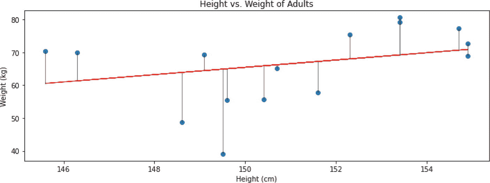

散点图标题为“成年人身高与体重”，显示身高（x 轴，单位厘米）与体重（y 轴，单位公斤）之间的关系。蓝色数据点代表各测量值，红色趋势线指示正相关。身高范围从 146 厘米到 154 厘米，体重范围从 40 公斤到 80 公斤。

图 15-8

显示残差的身高与体重数据中的前 15 个数据点

这就是那条直线的生成方式，但我们还需要知道实际模型是什么样的。幸运的是，这是一个可以追溯到高中数学的简单方程。它基本上就是我们学过用来绘制直线的`y = mx + b`公式。请记住，`y`是绘制在Y轴上的值；`m`是`斜率`，或者说量化后的直线角度，乘以`x`（绘制在X轴上的值）；`b`是`截距`，即直线与Y轴相交的点。这正是单变量线性回归输出的公式形式，其中各项被赋予了具体的拟合值。在线性回归中，还假设存在误差（每个模型都有误差，因为我们知道，除非变量之间完全相关，否则模型不可能完美），用公式中的`e`表示，并且截距通常被写在前面，作为一种“零”`X`值。因此，在回归中，我们这样写：`Y = X[0] + mX + e`。如果你好奇，图 15-8 中直线的公式是`Y[体重] = –101 + 1.11 × X[身高] + e`。

### 多元线性回归

大多数情况下，当数据科学家提到线性回归时，他们实际指的是*多元线性回归*，即用一个变量`Y`与多个`X`变量建立线性回归模型。在身高/体重的例子中，我们知道体重的影响因素远不止身高。有很多不同因素可能会影响体重，包括性别、健康水平、年龄等等。仅前三个因素就能使我们的模型比之前大幅改进。

要运行多元线性回归，上述提到的要求对所有纳入的特征都成立，这意味着每个特征都必须与目标变量相关，并且与其他特征相互独立。我们还需要检查每个特征与目标变量之间的线性关系。如果特征数量不多，我们仍然可以通过绘制每个特征与目标变量的散点图来直观地检查线性关系，确保其呈现线性趋势。实际上，检查这些条件有比我们上面提到的方法更系统的方式，但我将留给你自己去探索。

普通最小二乘回归还有一些额外的假设，这些假设可以在模型生成后进行检验。其中之一是残差的均值接近 0。残差还应服从正态分布，并且不存在自相关性，自相关性意味着数据中存在某种模型未能捕捉到的模式。你也可以自行查阅这些内容。

学习多元回归的一个挑战是，由于涉及两个以上的变量，我们无法绘制图表来可视化完整的回归过程（上面提到的三个额外特征将需要五维图表）。但好消息是，理解它并不需要可视化——我们只需查看公式就能了解其原理。多元回归所做的仍然是找到一条使残差（即直线与每个`Y`值之间的差值）最小化的直线。多元线性回归只是增加了更多的`X`特征，因此其形式为`Y = X[0] + m[1]*X[1] + m[2]*X[2] + … + m[n]*X[n] + e`。

这个公式就是回归的输出结果，我们可以与利益相关者分享。它很容易解释。在我们的例子中，用身高、健康水平和年龄来预测体重，若要与利益相关者分享该公式，我们会重命名`X`值，最终得到类似这样的公式：`Y[体重] = X[0] + m[身高]*X[身高] + m[健康水平]*X[健康水平] + m[年龄]*X[年龄] + e`。不过，在实际展示公式之前，我们可能会让它看起来不那么数学化。特征的值需要确定，但假设身高以英寸为单位，健康水平是 1 到 5 的评分，年龄以年为单位（允许有小数）。这个公式的意思是，我们将每个这样的数值乘以回归计算出的特定乘数，然后将它们全部相加，得到以磅为单位的`Y[体重]`。要预测一个新个体的体重，只需将其`X[身高]`、`X[健康水平]`和`X[年龄]`的值代入公式即可。

普通最小二乘法的原理与单特征回归相同，但它构建的直线位于多维空间中。如果你对此感到难以理解，首先尝试想象它在三维空间中如何运作——距离不再仅仅是“垂直”的，因此残差线不会像单特征回归那样都朝着同一个方向。从二维到三维的跳跃增加了复杂性，因此从三维到四维空间的跳跃则增加了更多我们无法可视化的东西。但它仍然是穿过该空间的一条“直线”。

#### 回归中的权重

在实践中，回归有时过于简单，我们需要进行调整才能使其良好运作。一种常见的技术是对某些项添加数值权重，这样在运行回归之前，加权的`X`值会乘以一个权重值。例如，想象一个模型，其`X`值的测量方式可能不同。这意味着，比如所有的`X[1]`测量值都比所有的`X[2]`测量值的精确度低。也许哈维尔用一把旧尺子测量某物的长度，不得不将测量值四舍五入到四分之一英寸，而莎拉测量高度时有一把更好的尺子，她的记录精确到 1/16 英寸。在这种情况下，哈维尔的测量值精确度较低，可以赋予较低的权重，以防止该特征在模型中产生过大的影响。

### 逻辑回归

逻辑回归使用一种称为logit模型的特定统计函数作为回归的基础。你不需要完全理解它就能进行逻辑回归，但其基本工作原理是：如果你取特征的线性组合（基本上是上述回归公式的右侧部分，如`X[0] + m[1]*X[1] + m[2]*X[2] + … + m[n]*X[n] + e`），该值将等于一个涉及目标变量的特定分数的自然对数。我不展示具体的数学推导，但这会导致回归生成一条介于两个二值变量之间的曲线。

与其他技术一样，逻辑回归也有一些要求和假设。我们这里讨论的是二元逻辑回归，因此数据必须是二值的。另一个要求是数据集不能太小（这取决于你的数据，但通常几百条记录配上几个特征就足够了）。特征之间需要相互独立。

逻辑回归的运作方式与线性回归有些相似，它通过使用特定技术最小化某个函数，来确定一个目标值与另一个目标值之间的决策边界。它使用额外的数学计算来得出公式中的系数：`logit(Y) = X[0] + m[1]*X[1] + m[2]*X[2] + e`。模型会为每条记录分配属于类别 1 和类别 2 的概率（类别 2 的概率等于 1 减去类别 1 的概率），然后使用一个阈值（默认为 0.5）来应用适当的标签。概率高于 0.5 的归为类别 1。

如果我们再看一个实际例子，我们有另一个数据集，这次是关于儿童身高的。我们拥有性别、身高和年龄数据，并希望根据其他两项来预测性别。虽然男孩确实比女孩高，但仍有大量重叠，因此仅凭这两个特征，我们的模型不会很理想，但应该比随机猜测要好。我建立了模型，然后绘制了仅身高（在二维图中我只能绘制目标变量和一个特征）的值以及所谓的逻辑曲线，即决策边界。如图 15-9 所示，曲线为红色。在数据划分更清晰的数据集中，曲线更呈 S 形，顶部和底部更平坦，中间对角线更陡峭。

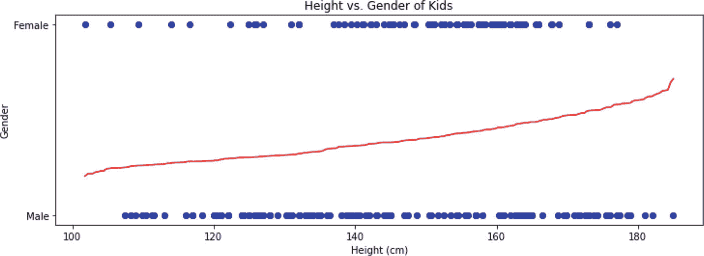

标题为“儿童身高与性别”的散点图，x 轴为身高（厘米），y 轴为性别。蓝色点代表男孩和女孩的个体数据点，女孩在上方，男孩在下方。一条红线表示整个数据集的趋势或平均身高。

`图 15-9` – 儿童数据集中身高与性别的逻辑曲线

### 非线性回归

非线性回归是一种生成非线性函数的回归方法，该函数以非线性组合的方式结合了模型参数。某些数据可能并不呈直线分布，但仍能拟合出可识别且可量化的模式。非线性回归有多种类型，因为只要拟合函数能适配数据，它几乎可以是任意形式。然而，并非所有包含非线性函数的模型都算作非线性回归；因为如果该函数可以表示为模型参数的线性组合，那么它仍被视为线性回归。

将非线性函数线性化的一种常用方法是：如果至少有一个预测变量是自然常数 `e` 的幂次方，则对函数两边同时取自然对数。不必完全理解这一点。只要知道存在这种技术，就能在需要时找到它——即便你使用的大多数回归方法很可能是线性回归。

## 树

树是另一类非常流行、通用且实用的监督式机器学习算法。它们不需要数据呈线性，并且可用于分类和回归。更棒的是，它们还能处理类别型特征。树算法的基本原理是反复使用“如果-那么-否则”的场景对数据进行分割：从顶部包含所有数据开始，根据规则将数据分成多个组，然后沿着每个分支继续向下，直到达到某个停止点，并为当前这批数据赋予一个标签（在分类任务中）或一个数值（在回归任务中）。所生成的逻辑在可视化图中极为直观，看起来就像一棵家谱树。

我首先要介绍最简单的树算法，即所谓的决策树。从技术上讲，有几种不同的算法可被视为决策树，因此我只介绍最常见的一种。在讨论完决策树后，我还会介绍随机森林，它通过构建多棵决策树并将所有不同结果进行组合以得出单一结果，从而实现了对决策树的扩展。

### 决策树

决策树很可能是目前最直观的机器学习方法。线性回归虽然易于解释，但仍需思考数学问题，这可能会让一些利益相关者思维停滞。而决策树可以被绘制出来，并且任何人都能直观理解。它之所以如此实用，还有另外几个原因：它不要求数据呈线性，并且能够处理类别型特征。我将展示一个基本的决策树示例，代表一个简单的垃圾邮件过滤器（严格来说是垃圾邮件标记器），供参考（图 15-10）。

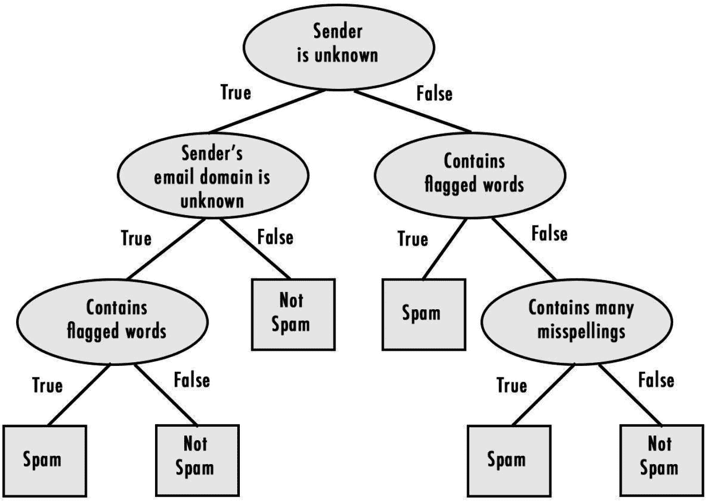

流程图描述了一个用于识别垃圾邮件的决策过程。流程图从“发件人未知”开始，分支为“真”和“假”。如果为真，则检查“发件人邮箱域名未知”，接着引导至“包含标记词”，并最终判定为“垃圾邮件”或“非垃圾邮件”。如果为假，则检查“包含标记词”，引导至“垃圾邮件”或“包含大量拼写错误”，并最终判定为“垃圾邮件”或“非垃圾邮件”。

`图 15-10` 一个用于标记邮件是否为垃圾邮件的简单决策树

决策树由节点和叶节点组成。`节点`表示对一组数据应用的分割点：我们有一批数据，要在节点处应用一个“如果-那么-否则”的问题，并根据答案将数据发送到两条（或多条）路径上。节点通常用椭圆表示。在图 15-10 中，所有椭圆都是节点，每个节点都包含在该点处用于将数据分割成两个不同组的问题。`叶节点`是任何分支的终点，表示一个被赋予特定标签或数值的组，它们通常用矩形显示。图中所有标注为“垃圾邮件”或“非垃圾邮件”的矩形都是叶节点。从一个节点到另一个节点，或从一个节点到叶节点的路径用单线表示。每个节点问题的答案显示在相应路径线旁边。以图中的树为例，所有问题都是二元的，因此它们都显示为“真”或“假”。还有一个特殊的节点——位于顶部的第一个节点，称为`根节点`（简称根）。图中的根节点是顶部的“发件人未知”。我们把从根节点到任意叶节点的完整路径称为`分支`。请注意，相同的问题可能出现在树的不同分支中，就像图中的“包含标记词”一样。

这是一个直观的展示。理解如何对一条新记录使用已构建好的决策树的方法是：首先根据该记录的值，询问并回答根节点中的问题；如果答案为真，则沿左侧路径向下；如果为假，则沿右侧路径向下。然后询问新节点的问题，并根据答案沿着正确的路径继续。依此类推，直到到达一个叶节点，无法再继续前进。该叶节点就是将被分配给这条记录的标签或数值。

以上就是如何使用已有的决策树，但如何创建它呢？如前所述，实际上有几种不同的算法用于训练决策树。它们有很多共同点，但我将描述其通用方法。基本概念是：对于给定的一批数据，你需要决定哪种分割最为有效。这意味着目标是找到一个能完美分割数据的问题，使得一个叶节点中的所有记录都拥有一个目标标签，而另一个叶节点中的所有记录都拥有与第一个叶节点不同的目标标签。这在理想情况下是叶节点形成时发生的；但在过程中，当找不到那个完美问题时，它必须对数据进行分割。因此，它会查看所有可能被询问的特征，并根据数据将如何被分割来计算一个指标。你不需要真正理解这些指标是什么，但熵（来自信息论）和信息增益是常用的指标。

我们将通过查看一小部分电子邮件数据集样本，来了解图 15-10 中的树是如何构建的。用于训练该决策树的数据见表 15-1。实际上，训练这个模型需要更多的数据，但我们仍然可以看到如何利用数据和问题来构建一棵树。我将沿着一个分支向下，逐步进行分析。

`表 15-1` 示例电子邮件数据集

| 邮件 ID | 发件人未知 | 邮件域名未知 | 包含被标记词汇 | 包含拼写错误 | 是否为垃圾邮件 |
| --- | --- | --- | --- | --- | --- |
| 1 | 是 | 否 | 是 | 否 | 否 |
| 2 | 是 | 是 | 是 | 是 | 是 |
| 3 | 是 | 是 | 否 | 否 | 否 |
| 4 | 是 | 是 | 是 | 是 | 是 |
| 5 | 是 | 是 | 否 | 是 | 否 |
| 6 | 否 | 是 | 否 | 是 | 是 |
| 7 | 否 | 否 | 是 | 是 | 是 |
| 8 | 否 | 是 | 否 | 否 | 否 |
| 9 | 否 | 否 | 是 | 否 | 是 |
| 10 | 否 | 否 | 否 | 否 | 否 |

首先询问发件人是否未知，数据被分成两个集合，分别如表 15-2（发件人未知 = 是）和表 15-3（发件人未知 = 否）所示。然后，算法会计算一个度量分数（无论它使用何种度量标准），并在考察其他分裂方式后，选择得分最高的那个。

`表 15-3` 第一个节点分裂后：发件人未知 = 否

| 邮件 ID | 发件人未知 | 邮件域名未知 | 包含被标记词汇 | 包含拼写错误 | 是否为垃圾邮件 |
| --- | --- | --- | --- | --- | --- |
| 6 | 否 | 是 | 否 | 是 | 是 |
| 7 | 否 | 否 | 是 | 是 | 是 |
| 8 | 否 | 是 | 否 | 否 | 否 |
| 9 | 否 | 否 | 是 | 否 | 是 |
| 10 | 否 | 否 | 否 | 否 | 否 |

`表 15-2` 第一个节点分裂后：发件人未知 = 是

| 邮件 ID | 发件人未知 | 邮件域名未知 | 包含被标记词汇 | 包含拼写错误 | 是否为垃圾邮件 |
| --- | --- | --- | --- | --- | --- |
| 1 | 是 | 否 | 是 | 否 | 否 |
| 2 | 是 | 是 | 是 | 是 | 是 |
| 3 | 是 | 是 | 否 | 否 | 否 |
| 4 | 是 | 是 | 是 | 是 | 是 |
| 5 | 是 | 是 | 否 | 是 | 否 |

现在，算法有两个不同的数据集需要考虑，每个数据集中都混合了不同的标签。我只沿着左侧分支（表 15-2）继续，因此我们需要对该表中的数据进行分裂，因为并非所有标签都相同。它会尝试不同的问题并计算每个问题的度量分数，发现询问邮件域名能获得最佳分数。我们据此在“发件人的邮件域名未知”这一特征上进行分裂。沿着`True`路径的数据见下表 15-4，沿着`False`路径的数据见下表 15-5。

`表 15-5` 第二个节点分裂后：发件人的邮件域名未知 = 否

| 邮件 ID | 发件人未知 | 邮件域名未知 | 包含被标记词汇 | 包含拼写错误 | 是否为垃圾邮件 |
| --- | --- | --- | --- | --- | --- |
| 1 | 是 | 否 | 是 | 否 | 否 |

`表 15-4` 第二个节点分裂后：发件人的邮件域名未知 = 是

| 邮件 ID | 发件人未知 | 邮件域名未知 | 包含被标记词汇 | 包含拼写错误 | 是否为垃圾邮件 |
| --- | --- | --- | --- | --- | --- |
| 2 | 是 | 是 | 是 | 是 | 是 |
| 3 | 是 | 是 | 否 | 否 | 否 |
| 4 | 是 | 是 | 是 | 是 | 是 |
| 5 | 是 | 是 | 否 | 是 | 否 |

此时，如表 15-5 所示，该分支上的所有数据只代表一个标签，因为它只有一行。这意味着应该有一个叶节点，其标签为“非垃圾邮件”。而在“发件人的邮件域名未知”这个分裂点上，数据仍然包含不同的标签，所以我们需要再次进行分裂。算法再次尝试不同的问题并评分，最终决定在“包含被标记词汇”上进行分裂。这次分裂的结果见表 15-6 和表 15-7。

`表 15-7` 第三个节点分裂后：包含被标记词汇 = 否

| 邮件 ID | 发件人未知 | 邮件域名未知 | 包含被标记词汇 | 包含拼写错误 | 是否为垃圾邮件 |
| --- | --- | --- | --- | --- | --- |
| 3 | 是 | 是 | 否 | 否 | 否 |
| 5 | 是 | 是 | 否 | 是 | 否 |

`表 15-6` 第三个节点分裂后：包含被标记词汇 = 是

| 邮件 ID | 发件人未知 | 邮件域名未知 | 包含被标记词汇 | 包含拼写错误 | 是否为垃圾邮件 |
| --- | --- | --- | --- | --- | --- |
| 2 | 是 | 是 | 是 | 是 | 是 |
| 4 | 是 | 是 | 是 | 是 | 是 |

现在，这次分裂产生了两个集合，每个集合中只包含一种标签，这意味着它们可以成为带有相应标签的节点。然后，如果我们对根节点的右侧分支重复此过程，我们就得到了一个训练好的决策树，可以用来对传入的新电子邮件进行分类。

当使用真实数据构建决策树时，分裂永远不会是完美的，大多数叶节点都会包含一些具有不同标签的记录。控制树构建的方式有很多种，这也是我们在训练中最终可能出现错误分类记录的主要原因。实际上，我们不希望树变得太深，而如果我们坚持每个叶节点只包含具有相同标签的记录，就会发生这种情况。同时，我们还会得到一些只有一个或极少量记录的叶节点。这些情况基本上就是过拟合（我们将在下面详细讨论）。因此，我们会施加一些限制，例如最大深度、分裂一个节点所需的最小记录数（一旦到达某个节点，对其进行分裂会导致节点规模过小，我们就会将其视为一个叶节点，并赋予最常见的标签）。

回归树的构建方式类似，但由于没有单一的标签，其过程并非那么直接。它会尝试将数值相近的值分组，而不是要求所有值都具有相同的标签。

## 随机森林

随机森林是一种基于决策树算法构建、通常能创建出性能更优模型的方法。它实际上是一种集成学习方法，归属于装袋方法。从根本上说，随机森林按照上述基本方法创建一组决策树，但其中有一些额外的技巧使其更加有效。由于它基于决策树，因此同样灵活且强大。它能完成分类或回归任务，并且除了数值型数据外，也能处理分类型数据。

与大多数机器学习方法一样，随机森林确实需要大量数据，但只要噪声是随机分布的，这些数据可以有相当的噪声。所创建的众多决策树需要彼此独立且平衡。在标准方法中（我将在下面描述），这两点都能得到保证。

随机森林方法的两个关键组成部分是：装袋——对原始数据进行随机抽样（有放回）；以及对每个样本的特征进行随机子集抽取。然后针对这些组合中的每一个训练单独的决策树，通常有数百棵。装袋部分生成了许多不同的数据子集。由于这些是有放回的随机样本，它们对数据具有很强的代表性，并且方差较低。这是基本的装袋方法，但随机森林还加入了特征子集抽取的技巧——通常包含的特征数量是总特征数的平方根。这个技巧确保了众多树不会过于相似或彼此高度相关。因此，数据的每个子集也只包含部分特征。这之所以强大，是因为它意味着结果不会只受最具影响力特征的主导——相反，不同的特征可以在更多的树中显示出重要性，从而能够捕捉更微妙的趋势。

在所有树都训练完成后，数据会通过所有树进行运行，输出结果要么通过多数投票（分类问题）决定，要么通过取平均值（回归问题）决定。

我之前提到的团队预测日门店销售额的项目，就是实践中决策树与随机森林差异的一个很好的例子。我们拥有超过 450 个特征和几千条记录，因此这非常适合使用随机森林。我们的特征包括针对美国七个主要节日的总共 18 个特征。这些特征类似于“圣诞节前 10 天”、“圣诞节前 9 天”等等，一直到“圣诞节当天”，然后从“圣诞节后 1 天”一直到“圣诞节后 7 天”。每个节日在产生影响的类型上都有不同的模式——圣诞节前的消费巨大，但之后会逐渐减少。但由于我们分析的是全年数据，一年中只有 18 天这些特征可能为真（即圣诞节特征可能为真的 18 天，对比 347 天均为假值，占比不到 5%）。因此，一棵普通的决策树不太可能捕捉到任何圣诞节特征——对于大部分数据而言，其他特征会重要得多——除非这棵树非常非常深。但深度决策树不是一个好主意，所以单纯的决策树方法效果不佳。而随机森林*确实*捕捉到了圣诞节及其他节日特征，并且表现非常出色。在针对同一问题的早期工作中，我们用时间序列方法取得了相当不错的结果，但随机森林优于我们测试过的所有算法。

随机森林的主要缺点是解释性较弱。通常，最好的方法是先解释决策树方法，以便人们能理解。然后你可以解释，数百棵这样的树在略有差异的数据上进行训练，最终的标签由多数投票或取平均值决定。根据我的经验，人们大多对此能够接受。

另一种解释方式是讨论重要的特征。随机森林算法会输出模型中总体最重要的特征，但这并不能告诉我们很多信息，尤其是针对特定预测。我之前提到过模型解释器，我们在日销售额预测中使用了其中一个，并获得了关于每次预测非常有用的信息。正是通过这种方式，我们才得知与节日相关的特征在一年中那些它们可能相关的极少数日子里变得重要。

## 朴素贝叶斯

`朴素贝叶斯` 是一种仅用于分类的方法，在早期的垃圾邮件过滤工作中崭露头角，因为它识别垃圾邮件的效果非常好。它不是某个特定的算法，因为可以使用多种算法，但它们都遵循相同的基本步骤。所有方法都依赖贝叶斯定理及其条件概率公式（其中各项可以互换）。它们还要求所有特征彼此独立，并且每个特征对结果的贡献相等。这些就是它被称为“朴素”的原因。这种方法的一个优点是它不需要大量的数据来进行训练。

这里遵循的基本方法是计算每个特征的后验概率（贝叶斯公式的一部分）。例如，在一个仅通过考虑单个单词或短语是否存在来判断垃圾邮件状态的分类器中，后验概率（例如，给定邮件中包含单词 `w`，则该邮件是垃圾邮件的概率）是基于任何邮件是垃圾邮件的概率（训练集中垃圾邮件的比例）和先验概率（给定邮件是垃圾邮件，单词 `w` 出现的概率）计算得出的。然后，可以合并该邮件中每个单词的后验概率，以确定其整体标签是否为垃圾邮件（根据定义的阈值）。

与其他方法相比，`朴素贝叶斯` 的一个缺点是我们无法获得关于单个特征的信息（请记住，其假设是所有特征同等重要）。这与回归方法和树方法明显不同。但它很简单，并且在许多领域都能很好地工作。

## 神经网络

神经网络（有时称为人工神经网络）是另一类主要为监督学习算法（也有一些用于无监督问题的变体）的模型。它们已经存在了很长时间，其流行度也经历了起伏。近十年来，由于许多新型神经网络的开发及其非常成功的应用，它们变得非常重要。当然，生成式人工智能也基于先进的神经网络（通常称为深度学习），因此它们的流行度呈爆炸式增长。你常会听到神经网络是通过模仿神经元和突触的结构与功能而受到人脑启发，这确实是真的，但这并不意味着神经网络就比其他机器学习算法更接近人类智能。许多从业者不喜欢这种比较，因为它有误导性的暗示，但神经网络确实源于此。不过，一种采用现代神经网络风格的简单网络早在 18 世纪就被用来预测行星运动（远在我们对动物大脑运作方式有任何了解之前）。

一个`神经网络`具有输入层、隐藏（中间）层和输出层的一般结构。参见图 15-11 了解神经网络的一般结构。这里有大量的连接，随着我们添加内部层，连接数量也会暴增。内部层是不透明的，并且由于数量众多，很难解释为什么网络将特定输出分配给某个输入。它们在许多领域都能非常强大，并且仍然被经常使用。注意，具有两个或更多隐藏层的神经网络被称为`深度神经网络`，这也是术语`深度学习`的由来。神经网络的优势之一是从错误中学习，这使得它们具有很强的适应性。

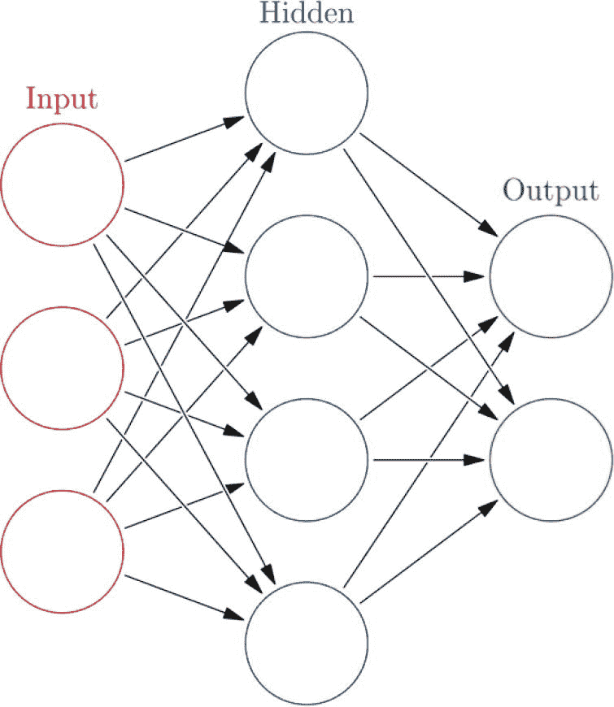

一个三层的神经网络流程图。左侧标有红色“输入”的层包含三个节点。中间标有蓝色“隐藏”的层有四个节点。右侧标有绿色“输出”的层包括两个节点。箭头表示从每个输入节点到所有隐藏节点，以及从每个隐藏节点到所有输出节点的连接，说明了信息在网络中的流动。

图 15-11

神经网络的一般视图。来源：来自“File:Colored neural network.svg”，可在 [`commons.wikimedia.org/wiki/File:Colored_neural_network.svg`](https://commons.wikimedia.org/wiki/File:Colored_neural_network.svg) 获取，根据知识共享署名-相同方式共享 3.0 未本地化版本许可协议使用（[`creativecommons.org/licenses/by-sa/3.0/deed.en`](https://creativecommons.org/licenses/by-sa/3.0/deed.en)）

如前所述，神经网络有许多类型。我们不打算深入研究任何一个，但会讨论每种类型的基本知识，如果你想了解更多，可以去谷歌搜索。最早的现代神经网络是单层感知器，但它用处不大；接下来出现的是多层感知器，也称为前馈神经网络。前馈意味着数据仅沿一个方向流经网络，从输入层到下一层，再到下一层，最终到达输出层。这意味着数据在每一层只会到达一个节点。每个节点都有一个权重和阈值，用于决定是否将数据继续传递下去，但这些权重和阈值在训练过程中会被调整，它们最初是从随机值开始的。由于节点数量庞大，随机起点是最佳选择，调整会持续进行，直到网络输出的数据与每个标签对应，网络据此知道如何进行调节。一种常见的权重调整技术是`反向传播`，它从输出端开始，针对特定的输入-输出对，向后遍历不同的层，利用关于每个权重如何影响输出的知识来调整损失函数。这个过程使得权重得以改善。

另一个重要的神经网络是`卷积神经网络`（`CNN`），它是一种通过特定优化方式来确定特征的前馈神经网络。它是帮助改进图像处理和计算机视觉的主要创新，并且至今仍在使用，尽管有一些其他方法正在取代它。它之所以如此有价值，是因为它使用了一些技巧来显著减少网络中节点之间的连接数量，这使得它效率更高，并且不太容易出现过拟合——而这种情况在全连接前馈神经网络中可能发生。但它们仍然会消耗大量的计算资源。

`循环神经网络`（`RNN`）是一种不同类型的神经网络，适用于序列数据（如基于时间的数据和语言数据），其中每个输入并非相互独立——当前序列中先前的元素会通过一个传递下去的隐藏状态被“记住”，这会影响后续的权重。与我们讨论过的其他类型不同，这里的权重并非在每个节点上都不同。相反，同一层中节点上的权重具有相同的值。标准 `RNN` 在处理较长的序列时会出现问题，但在处理诸如句子中的单词或时间序列数据中的数值等较小规模数据时表现良好。一种具有更好且更长期“记忆”能力的 `RNN` 变体被称为`长短期记忆`（`LSTM`）神经网络。它们效果很好，但需要大量训练。

还有一种类型的神经网络是`Transformer`，这是一种新型网络，在某种程度上已经取代了 `RNN` 和 `CNN`，因为它没有同样的局限性，特别是在资源使用方面。它是生成式人工智能（`ChatGPT` 中的 `GPT` 代表“生成式预训练 `Transformer`”）的主要工具。这类模型在处理词语的方式上有一些创新。在输入时，一个句子会被转换为一个嵌入（`embedding`），它表示每个单词的语义（含义），然后每个单词被分配一个数字，表示其在序列中的位置。会使用一些函数来发现单词之间的关系。网络会对各层进行一些调整，然后像一个前馈神经网络那样工作。`Transformer` 仍然需要大量训练，但它们比 `RNN` 更高效，并且在处理新数据时运行速度更快。

## 生成对抗网络（GAN）

我要提及的最后一种神经网络是`生成对抗网络`（`GAN`），它实际上是由两个以特定方式相互交互以生成输出的神经网络组成。整体结构如图 15-12 所示。其中一个网络称为`生成器`，它基于随机数据生成数据。生成器的主要目标是生成合理的输出。这些生成的数据会作为负训练样本输入到第二个网络，即判别器。`判别器`是一个分类器，它也会接收真实数据作为输入，因此其任务是学会区分真实数据与来自生成器的虚假数据。生成器的输出直接馈送到判别器的输入中。

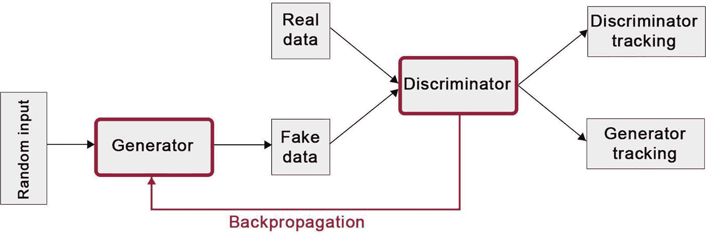

流程图展示了生成对抗网络（`GAN`）的过程。该图表显示“生成器”接收“随机输入”以生成“虚假数据”。这些数据连同“真实数据”被输入到“判别器”中。判别器输出至“判别器追踪”和“生成器追踪”。一个标记为“反向传播”的反馈回路将判别器连接回生成器。关键术语：生成器、判别器、虚假数据、真实数据、反向传播。

图 15-12 生成对抗网络的结构与训练行为

`反向传播`从判别器的输出一直回溯到生成器，并利用计算结果调整生成器的权重（注意，为了行为的一致性，只有生成器的权重以这种方式被改变）。整个系统的目标被称为`收敛`——当判别器对其输入是真实还是虚假进行猜测（基本上是抛硬币决定）时，就是生成器表现最佳的时刻。这个系统的训练很棘手，因为很难知道收敛的确切点。如果生成器在收敛点之后还继续向判别器发送数据，那么判别器可能会开始表现异常，其（基本上是）随机的通过`反向传播`的反馈会对生成器产生负面影响。

一旦系统训练完成（达到并识别出收敛），生成器就可以用来生成数据。你仍然需要向生成器输入数据，但随机噪声就能生成图像。

## k近邻算法

`k`近邻算法（`k`-NNs）是一种监督式机器学习算法，它在多个维度上观察数据，识别每个点的 `k` 个“最近邻”（`k` 可以是任意值，包括 1），并可用于分类和回归。它可以使用多种测量“邻近”距离的方法，而高维数据（即具有大量特征的数据）可能需要特殊方法。`k`-NNs 可以用于非线性数据，以及数值型和类别型数据。使用 `k`-NNs 时需要注意的一个重要事项是，数据必须进行标准化，使其全部处于同一尺度。

`k`-NNs 的一个有趣之处在于，它实际上并没有像我们之前看到的其他监督算法那样有一个真正的“训练”步骤。你仍然需要一个“训练”数据集，但这基本上只是一个参考集。该算法的工作方式意味着非常大的数据集处理时间可能会长到无法接受。请看图 15-13，这是我们之前看过的儿童数据集中的数据。它有 15 个标记的数据点，只有两个特征：身高和年龄，其中蓝色代表男孩，红色代表女孩。

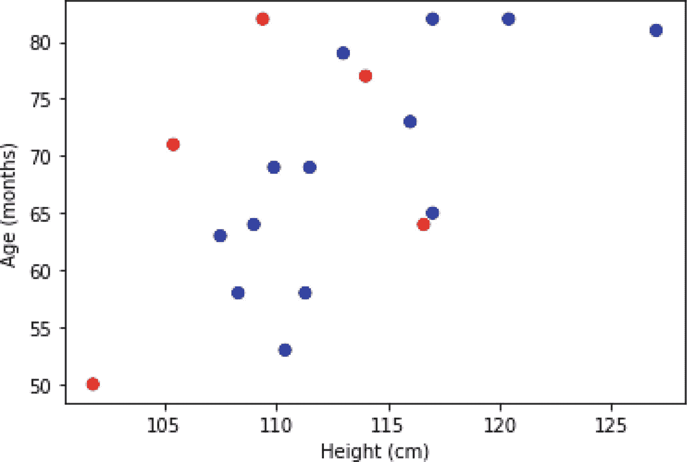

散点图展示了以厘米为单位的身高（x 轴）和以月为单位的年龄（y 轴）之间的关系。图表中包含红色和蓝色的数据点，表示两个不同的类别或分组。身高范围从 100 到 130 厘米，年龄范围从 50 到 80 个月。

图 15-13 提供给 `k`-NNs 的儿童身高数据集样本，其中蓝色代表男孩，红色代表女孩

如果我们将这个数据集作为“训练集”提供给 `k`-NNs，它将作为我们的参考集。我们将 `k`（即在分类中要考虑的近邻数量）设置为 3（这是一个常用值）。现在，如果我们有两个如图 15-14 所示的新数据点，我们可以看到分类是如何工作的。第一个新数据点是左上角的紫色点，第二个是新数据点是中上方的绿色点。我们可以通过肉眼识别出哪些三个参考点最接近紫色点和绿色点，并用黑线标记。对于紫色点，三个近邻点中有两个是红色，一个是蓝色，因此我们将紫色点分类为红色（女性）。绿色点有四个相当接近的点，虽然最近的那个是红色，但接下来两个都是蓝色，因此这个点会被分类为蓝色（男性）。

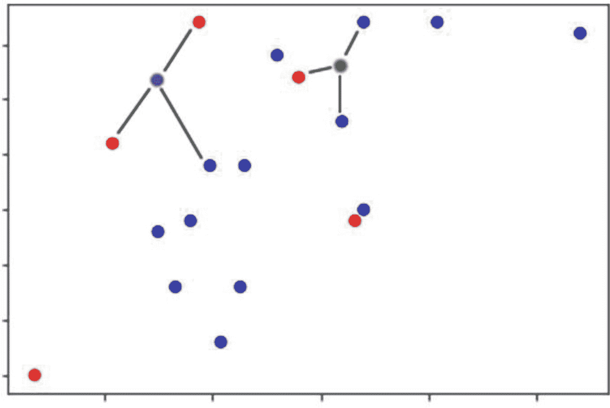

散点图展示了由线条连接的不同颜色的节点。红色、蓝色、绿色和紫色的节点分布在图表各处。一些节点由黑色线条连接，形成小的簇。该图没有具体的轴标签或数值数据。主要关注点是节点的排列和连接。

图 15-14 基于我们“训练”好的 `k`-NNs 对两个新数据点进行分类

`k`-NNs 在技术上是一个分类器，但也可以计算某个点最近的 `k` 个近邻的平均值用于回归。对于上面的新数据点，如果标签是数值而不是类别，我们只需取三个最近点的平均值。这也相当直观，且易于实现。通常，找到合适的 `k` 需要一些工作，但它在很多情况下都表现良好，尤其是当特征超过两个时。为了找到最佳的 `k`，你通常会创建多个具有不同 `k` 值的 `k`-NNs 模型，并在每个模型上运行测试集，以找出哪个 `k` 值效果最好。

`k`-NNs 现在不如以前那么常用了，但当特征数量不多时，它仍然是一种强大且简单的算法。它仍被用于许多领域，包括金融市场预测、某些推荐系统和图像处理。

# 支持向量机

`支持向量机`（`SVM`）是另一种主要用于分类的监督式机器学习算法，它可以找到一种将数据分组的方法。该算法能够处理线性和非线性数据，尽管针对这两种用途存在不同的变体。在线性变体中，它能在具有许多特征的问题中找到一个线性超平面。

## 超平面

超平面是穿过空间的一条“线”的通用名称，其维度比所在空间少一维。例如，在二维图表上，你可以在此空间内画一条线，它只是一条直线（直线被认为是一维的）。类似地，二维平面可以放置在三维空间中。在四维空间中，它就会是一个三维物体（一个长方体，像立方体但边长不同）。你可以想象出长方体，但无法想象那个空间。但由此开始就完全是抽象的概念了。只需将超平面想象成一条划分超空间的线，而这个超空间只有二维，从此往后都只是类比了。

超平面的作用在于划分空间以分离不同类别的物体。图 15-15 展示了 `SVM` 试图通过创建一条作为类别间边界的线来达到的目的。在标准 `SVM` 中，这条线是线性的，因此必须是一条直线，但存在其他可以生成非线性超平面的 `SVM` 变体。请注意，在图 15-15 中，存在一些被错误分类的点：一个蓝色点混入红色点中，两个红色点混入蓝色点中。有时这可以通过非线性超平面来解决，但错误在机器学习中是不可避免的。

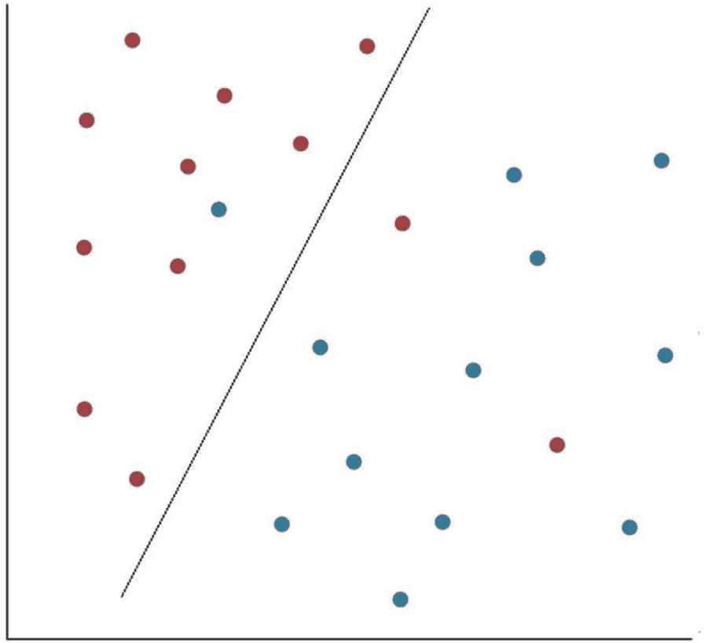

散点图显示了两个数据点组，一组为红色，另一组为蓝色，由一条对角线分隔开。红色点主要分布在左侧，而蓝色点分布在右侧，展示了分类边界。

图 15-15 `SVM` 在具有两个特征的数据中分离类别目标的示例

`SVM` 非常强大，但与其他算法一样，当特征数量过多时，由于维度灾难（我们将在下面讨论），它们可能会过拟合。它们被用于许多任务，包括文本分类和图像目标检测。同样值得一提的是，存在可以进行回归的 `SVM` 变体，尽管这种做法不太常见。

# 无监督技术

在无监督学习中，你只是想看看数据本身能告诉我们什么。你并非提供训练数据让其学习规则以应用于新数据。相反，你提供精心策划和准备的（数据）特征，告诉它放手去做，让它自行其是。它会返回关于它在数据中发现的信息给你。

在数据科学中，有两种主要的无监督学习类型被频繁使用：聚类和关联分析。在聚类中，方法会识别出彼此相似的数据组。而通过关联分析，这些技术会为你提供相互关联的更小的事物组。我将在下面分别讨论这两种类型，并提到它们各自的一些不同算法。

## 聚类

聚类是一种用于识别数据中相似点的流行方法。例如，一家零售店可能希望识别不同类型的顾客，以便对他们进行差异化营销。如果我们已经有一些标有类型的顾客数据，我们可以将这个问题视为一个监督问题进行解决。我们可以先在这些数据上训练一个模型，然后用它处理其余未标记的顾客数据。但这需要满足三个条件：知道有多少个组、这些组是什么、以及拥有标有这些组的数据。如果没有这些信息怎么办？聚类就来救场了，因为它不需要这些条件中的任何一个（从技术上讲，有一种方法确实要求你指定组的数量，但你可以通过实验来找到正确的数量）。

### k-均值聚类

`k`-均值是数据科学家通常最先学习和使用的聚类方法。`k`-均值聚类通过将每个数据点分配到与其最近的簇（由该簇的中心定义，即簇内所有点的均值）中，来识别预先指定数量的簇。但是，既然这些簇事先没有标记，它们是如何得到分组的呢？`k`-均值采用自上而下的方法，首先查看所有数据，并将其划分成所谓的泰森多边形（参见图 15-16，了解数据被分解成泰森多边形的示例）。

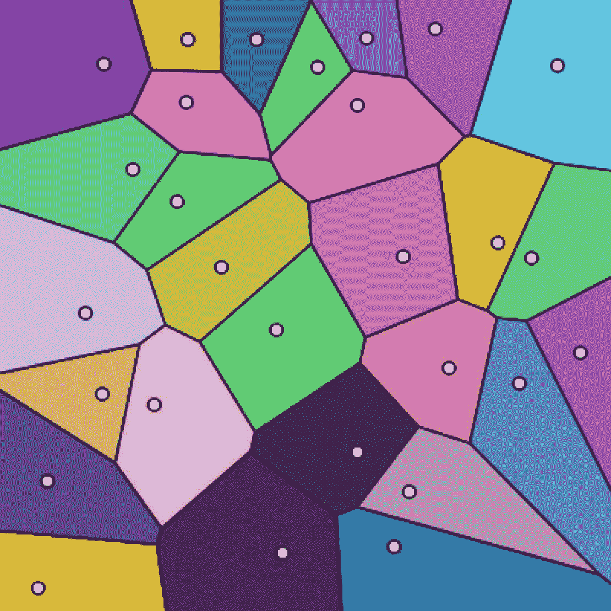

一幅彩色的泰森多边形示意图，展示了各种不同颜色的多边形区域，每个区域中心有一个白色点。这些区域形状不规则，共同铺满整个空间，说明了基于到一组点的距离来划分平面的概念。

图 15-16 针对一个包含 28 个点的随机数据集的泰森多边形

白点代表我们的数据集，多边形就是泰森多边形。请注意，它们并非随意确定的。要生成它们，你需要先在每个点与其直接相邻点之间画一条线，然后在每两个点之间的中点处画一条垂直于该线的线。将这条垂直线延伸直至碰到另一条线，最终你就会得到这些带有尖角的形状。

这是一个概念上的起点。如果你将 `k` 设置为 28，并且每个这些点都是你的簇中心，那么这个空间内的任何新点都将被分配到对应每个泰森多边形的簇中。计算 `k`-均值最常用的算法速度较慢但直观，被称为朴素 `k`-均值。你首先指定 `k`，然后算法会先分配 `k` 个随机的簇中心。接着，数据集中的每个点都被分配到最近的这 `k` 个簇中心之一。这时泰森多边形就发挥作用了，因为任何泰森多边形内的数据点都被分配给了该随机簇中心。

在此之后，我们开始调整簇。对于每个簇，我们计算该簇内所有点的均值，这个均值就成为该簇调整后的中心。这是一轮迭代。这个两步过程不断重复：先将每个点重新分配到最近的簇，然后重新计算中心。有一个衡量每个簇中心及其点距离的指标，称为`簇内平方和`，每次中心重新计算后都会计算该值。这个过程反复进行，直到簇内平方和停止变化，此时我们称算法已收敛。

关于 `k`-均值的一个有趣之处是它总是会收敛，尽管不能保证一定能找到最优的簇。这是因为起始点是随机选取的。通常的做法是运行几次，看看这些簇是相似的、不同的还是截然不同的。此外，除了上述方法之外，还有其他衡量“邻近度”的方式，但它们不像这种简单方法那样保证能收敛。

请注意，除了完全随机赋值之外，还有一些分配初始簇中心的方法（例如随机分区法和 Forgy 法）。你可以通过谷歌搜索了解这些方法。

我们已经讨论了如何运行 `k`-均值，但还没有讨论如何知道你的 `k` 到底应该取多少。有时你可能对数据中可能存在什么有所了解，因此你可能会有一些看起来值得尝试的数值。如果你试图识别一家商店的不同类型顾客，将 `k` 设为 50 可能是不合理的——公司如何为 50 种不同类型的顾客制定差异化的营销或其他服务？此外，你的 `k` 值越高，算法所需的数据就越多。

幸运的是，你无需事先知道正确的`k`值，因为有一些方法可以帮你系统地挑选出一个合适的值。这类方法有多种，在此我将介绍肘部法和轮廓系数法，更多信息可以自行搜索。

肘部法简单且常用，但由于难以明确界定“肘部”的位置，它被认为并非极其可靠。使用*肘部法*时，你需要确定可能的聚类数量，例如 2 到 10 个。然后对每个候选值运行 `k` 均值算法，并计算每次运行后最终的聚类内离差平方和，接着以聚类数量为横轴、该值为纵轴绘制图表。我们需要寻找的点是，随着聚类数量增加，聚类内离差平方和从快速下降转为显著减缓或趋于平稳的转折点。图 15-17 展示了几种可能的图表示例。

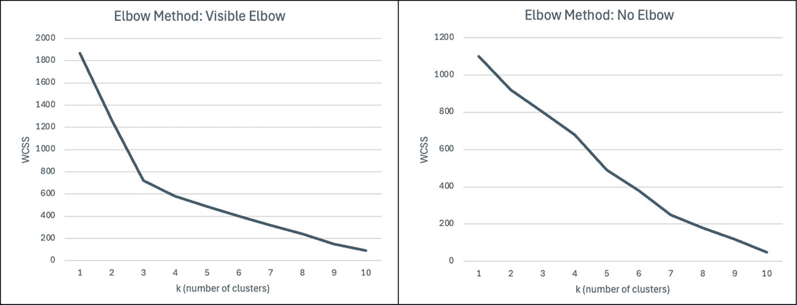

两个用于比较肘部法确定 `k` 均值聚类最佳聚类数量的 X-Y 图表。左侧图表标题为“肘部法：可见肘部”，在 `k=3` 处有一个明显的弯曲点，表明这是最佳聚类数。右侧图表标题为“肘部法：无肘部”，曲线下降较为平缓，没有明显弯曲点，表明没有清晰的最佳聚类数。两个图表均以聚类数量 (`k`) 为横轴、聚类内离差平方和 (`WCSS`) 为纵轴。

图 15-17 用于确定最佳 `k` 值的两个肘部图。左侧图表有可检测到的肘部，而右侧图表则没有。

在图 15-17 的图表中，左图在 `k = 3` 时出现了我们寻找的转折点——即聚类内离差平方和下降速度发生改变的节点。但右图中并不存在这样的点。这就是该方法并非总被使用的原因。它被认为是主观的，如果你改变图表的比例或尺寸，肘部看起来可能会或多或少像“肘部”。不过，你总能快速生成这张图表，如果运气好，或许能看到一个明显的肘部。

另一种确定合适 `k` 值的常用方法是轮廓系数法。使用*轮廓系数法*时，通过衡量每个数据点与其所在聚类内其他点的相似程度，以及与相邻聚类内点的差异程度，来评估每个点的聚类效果。这需要计算每个点的得分，再综合整个结果，得分范围在 -1 到 1 之间，高分表示聚类效果好，低分则反之。该方法在特征数量较少的数据集上表现良好，但当特征数量众多时，维度灾难问题便会再次凸显。

事实上，如同许多机器学习算法一样，这里通常也需要反复试验。由于需要预先指定聚类数量，该方法需要花费一些功夫，但在识别有意义的群体方面，它可能极其强大。

## 层次聚类

还有其他一些聚类方法被称为层次聚类，主要有两种类型：凝聚层次聚类和分裂层次聚类。凝聚法采用自底向上的方式构建聚类，每个数据点初始时各自为一个簇，然后逐步向上合并合理的簇。分裂法则是自顶向下，我们从包含所有数据的一个大簇开始，根据每个簇的特征将其逐步分裂。所有层次聚类方法都会生成一个名为树状图的树形结构，该结构展示了从每个数据点为一个簇到所有数据点合为一个簇（凝聚法）或反之（分裂法）的层次关系。

这两种方法都使用距离度量来指导分裂或合并的决策。距离度量通过比较数据集中的单个数据点，来衡量所谓的相异性。另一种称为簇间链接的度量，则考察不同数据集合之间的差异。

在最常见的凝聚法中，每一步都会将两个簇合并。有趣的是，这个过程会一直持续到所有数据点最终合并成一个簇。待算法运行完毕后，你可以在树状图中选择一个层次进行“剪枝”，并将该层次下的簇作为最终的聚类结果。图 15-18 展示了这样一个例子。它演示了在鸢尾花数据集上执行的凝聚层次聚类，该数据集是一个著名的公开数据集，许多人在初学机器学习时都会使用它。该数据集包含了三种鸢尾花的标注数据。

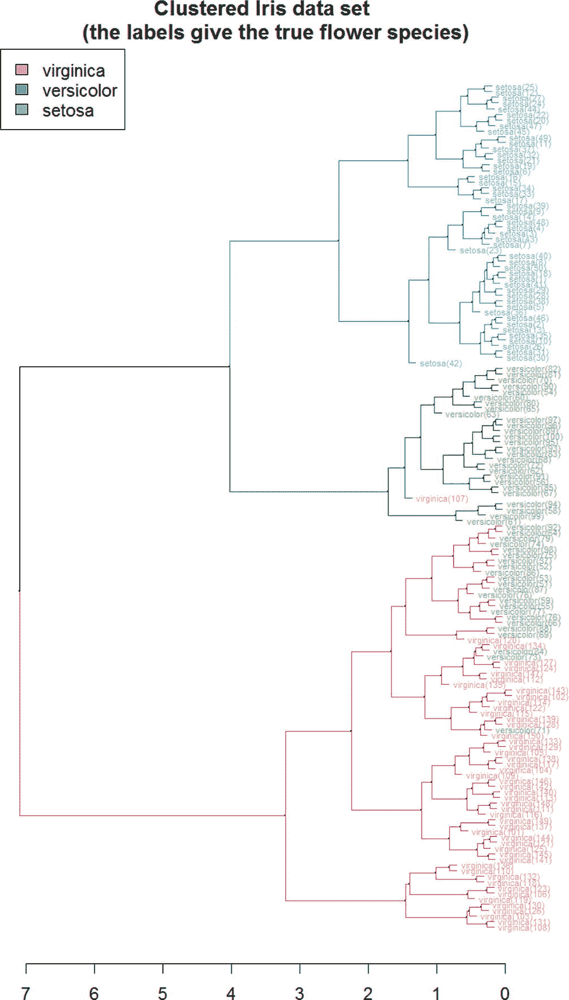

聚类后的鸢尾花数据集树状图，展示了三个物种（维吉尼亚鸢尾、杂色鸢尾和山鸢尾）之间的层次关系。每个物种用不同颜色标记——维吉尼亚鸢尾为粉色、杂色鸢尾为绿色、山鸢尾为蓝色。树状图结构展示了单个样本的聚类过程，标签指示了真实的花卉物种。x 轴代表用于聚类的距离度量。

# 机器学习算法与实践

## 图表说明

**图 15-18**
花卉数据集的凝聚层次聚类树状图。来源：“File:Iris dendrogram.png”，可从 [`commons.wikimedia.org/wiki/File:Iris_dendrogram.png`](https://commons.wikimedia.org/wiki/File:Iris_dendrogram.png) 获取，基于知识共享 署名-相同方式共享 4.0 国际许可协议 ([`creativecommons.org/licenses/by-sa/4.0/deed.en`](https://creativecommons.org/licenses/by-sa/4.0/deed.en)) 使用。

该算法从右侧开始，每个单独的花朵数据点自成一个簇，其类别用颜色表示。接着，算法开始逐一合并这些簇，每次合并两个，并向上移动以生成树状图的各个层次。你可以看到颜色变化之处，许多*杂色鸢尾*样本开始被聚在一起，最终与*维吉尼亚鸢尾*样本合并为一个簇。但你可以选择在树状图的某个位置进行剪枝，以查看具体的聚类情况。假设我们决定在 x 轴刻度为 3 的位置剪枝。想象一条从该点向上延伸的垂直线，它会穿过四条水平分支线，每条分支线代表一个不同的簇。此时可以观察花朵样本是如何被分组的。在垂直线右侧、该分支线之下的所有样本都属于同一个簇。因此，你可以看到有两个簇分裂了*维吉尼亚鸢尾*样本，而杂色鸢尾和*山鸢尾*各有一个簇，其中部分样本被分到了错误的簇中。

分裂层次聚类的工作原理与凝聚法基本相反，它从一个包含所有数据的簇开始，最终以每个数据点各自为一个簇结束。从视觉上看，它也会生成类似图 15-18 的树状图，只是构建方式不同。更多详情可自行搜索。

## 关联规则学习

关联规则学习是另一类无监督机器学习。你可能听说过啤酒与尿布的故事：男士们周五下班后会顺路去商店买尿布，并在去收银台的路上顺手拿一箱啤酒。这听起来像是个传闻，但显然并非虚构——曾有一个团队在药店进行关联规则挖掘，确实发现啤酒与尿布之间存在强关联，此外还有超过 20 种产品对。^(⁴¹)

关联规则学习（有时也称挖掘）着眼于项集——即成对或更大集合的物品组合——以识别那些会促使购买另一物品的商品。啤酒与尿布的故事之所以相关，是因为零售业是其典型应用场景。它甚至常被称为购物篮分析，因为我们分析的是某人购物车中的商品。规则本身包含方向性，基本可以理解为“如果-那么”的组合理念：如果他们买了一包尿布，那么他们也常会买一箱啤酒。

关联规则学习的主要方法是`Apriori`算法。我们曾在其他语境（包括朴素贝叶斯在内的贝叶斯统计）中听过这个术语，但在这里，它提出了一种利用特定概率进行关联规则学习的具体方法。该算法首先通过观察购物篮（即单次交易中的所有商品）来识别规则，然后创建由至少两个商品组成的项集。对于每个项集，会计算一个名为`支持度`的分数，即该潜在项集在所有交易中出现的百分比，并保留所有超过特定选定阈值的项集。支持度足够高的项集被称为`频繁项集`。然后从精简后的集合中生成所有可能的规则。请注意，如果频繁项集的数量不止几个，那么规则的数量将会极其庞大。规则写作形式如`{牛奶} ⇒ {面包}`或`{牛奶, 面包} ⇒ {黄油}`，我们将左侧称为`前件`，右侧称为`后件`。

下一步是计算每个可能规则的`置信度`分数，即同时包含前件和后件的交易百分比。置信度能很好地指示商品配对的显著性。正如我们丢弃支持度低于特定阈值的项集一样，我们也会丢弃置信度低于另一个定义阈值的规则。

这些信息很有用，但有时置信度本身可能具有误导性，因此我们还需要计算另一个分数，称为提升度。`提升度`基于支持度计算，它能告诉我们三种可能关系的存在性（及强度）：（1）第一件商品的出现是否会导致第二件商品的购买，（2）两者之间是否存在关联，或（3）两者是否具有相反效果（第一件商品的出现反而降低了第二件商品出现的可能性，这意味着替代关系）。提升度分数告诉我们第二件商品与第一件商品同时出现的概率提高了多少（提升度为 4 意味着比总体概率高四倍）。还有一个能让我们更深入了解关联有效性的分数，`确信度`，它也可以基于支持度和置信度计算得出。

还有其他一些用于计算关联规则的算法，但`Apriori`算法使用广泛且效率相当高。

## 模型解释器

与机器学习相关的一个领域是相对较新、仍在大力发展的模型解释器。`模型解释器`是一种工具，它接收一个已训练的模型以及针对未见数据的预测，并确定在已训练模型中哪些特征对每个单独预测的贡献最大。这在黑箱模型中，或者当模型可解释性较低时，具有无可估量的价值。正如我们讨论过的，决策树在可解释性方面表现出色，但它们存在一些缺点，而当我们改用随机森林时这些缺点可以得到缓解。然而，随机森林在很大程度上是不可解释的。你可以获得整个模型的特征重要性分数，但它无法告诉你关于某个特定预测的任何信息。我的团队曾为一个销售预测模型制作了可视化工具，你可以将鼠标悬停在某一天的预测值上，它会显示对该天预测贡献最大的前十项特征。这对利益相关者来说价值巨大，同时也让我们对自己的模型更有信心，因为模型从我们提供的众多特征中，为每一天捕捉到了有意义的特征。

目前市面上有几种模型解释器，各有优缺点。有些仅适用于线性数据，有些适用于任何模型，还有些仅适用于特定模型（算法）。我使用过且效果不错的一个叫做`LIME`（局部可解释模型无关解释），Python 和 R 语言中都有相应的库。你可以谷歌搜索这个主题来探索更多工具，从`SHAP`（沙普利加性解释）开始就是一个不错的选择。

## 机器学习的实现与编码

我已经介绍了一系列非常重要且实用的机器学习技术，以及它们的训练或运行方式。但当我们实际去实现它们——也就是编写代码时——还有一些其他非常重要的技巧。上面讨论的所有方法在 R 和 Python 的某些库中都能找到，这很棒。但你不能简单地把数据扔给一个机器学习函数，就期望得到良好的结果。

我在上面谈到了超参数调优的重要性，以及如何通过使用验证集或交叉验证来操作。有一些库可以帮助你完成这项工作。你需要提供数据、所使用的模型，以及你希望为每个参数尝试的所有可能值。网格搜索会尝试所有参数的所有组合，并追踪每次的表现。如果你尝试的参数超过几个，且每个参数的取值也很多，这显然会花费大量时间，因为这些值的组合数量会非常庞大。幸运的是，有一些库允许你从所有可能的参数组合中选择一个子集，只运行这些组合。这些工具会使用每种组合运行算法，存储性能，并报告表现最佳的参数集。

通过验证集上的网格搜索进行超参数调优很棒，但如果你只是在整个训练集和验证集上运行所有内容，最终得到的模型可能并非最适合处理新数据的模型。由于数据科学的很大一部分在于创建一个能够处理前所未见的数据并返回有意义结果的模型，这一点非常重要。一种称为*交叉验证*的技术会自动将你的数据分解成更小的训练子集，并在每个子集上运行所有内容（包括超参数调优）。这使得模型更加健壮，并有助于防止过拟合和偏差（我们将在下文讨论这两点）。R 和 Python 中也有用于此目的的库，使其相对容易实现。

与数据科学中的其他所有内容一样，有几种不同的交叉验证技术可供选择。你可以向谷歌询问更多关于这些技术以及它们何时最佳的信息，但一种常见的技术称为*k 折交叉验证*，即将训练数据集分成 `k` 个（通常为 10）子集。然后，你总共运行模型 `k` 次，每次使用不同的子集进行测试。这代替了使用特定的验证集。

最后值得一提的是，数据科学中的科学性有时会比其它方面更为突出。这并不意味着我们要严格遵循科学方法，但有些数据科学团队会尽可能系统化。而其他团队则可能会更随意一些。当我们测试不同类型的算法时，通常会说进行实验。当我们在研究一个解决方案，并知道我们将尝试不同的算法时，先运行一个我们预期表现不如其他算法（但仍比随机猜测要好）的算法，也是很常见的。我们称之为基线，在许多回归预测中，这通常是一个时间序列模型。拥有基线为我们尝试的所有其他算法提供了一个参考点。这可能是一种很有收获的工作方式，因为我们可以非常清晰地了解正在发生的事情。

## 建模中的挑战

机器学习有很多活动部件，也充满了出错或运气不佳的可能性。通过了解一些常见的陷阱，以及如何识别、处理甚至完全避免它们，可以减轻这些问题。我将讨论过拟合，即模型与特定训练数据过于紧密，导致泛化能力不佳；欠拟合，即模型遗漏了重要的模式；不平衡数据，即某一标签的数量远多于其他标签；维度灾难，即拥有过多维度导致难以获得良好结果；以及数据泄露，即给了模型一个它无法持续的不公平优势。

### 过拟合与欠拟合

过拟合和欠拟合都是模型表现不佳的情况，只是方式不同。我将讨论它们以及偏差-方差权衡，这是一种平衡模型以避免过拟合和欠拟合的方法。

*过拟合*是指模型学习了训练数据（和测试数据）中非常具体的特征，而这些特征在未来数据中可能不存在，因此模型无法很好地泛化。当数据质量低下且包含大量噪音时，也可能发生过拟合。如果模型“学习了噪音中的模式”，那就是过拟合了（而且也就是错的）。看看图 15-19，它与图 15-15 的数据相同。在图 15-15 中，我们有一条简单的直线，将图中的数据分成蓝色和红色标签，有三个数据点（两个红色和一个蓝色）被错误分类。与图 15-19 相比，我们有一条弯曲的线，代表模型的训练分隔器，它过于专注于这三个可能的异常值。当我们对未来的数据进行分类时，这会产生负面后果。

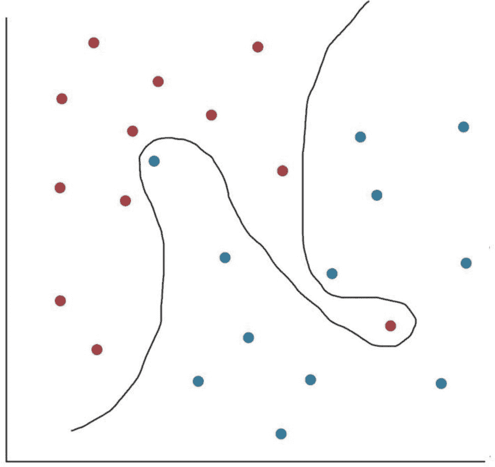

散点图显示了分布在 XY 轴上的两组数据点，一组为红色，另一组为蓝色。一条曲线将这两组分开，表示决策边界或分类线。红色点大多在线的一侧，而蓝色点在另一侧。该图说明了分类或聚类分析。

**图 15-19**

使用过拟合模型的数据

不难看出，这个模型很奇怪，而且很可能是错误的。假设有两个新点需要分类，如图 15-20 所示。图中显示了两个新数据点，其正确类别标记在绿色圆环的中心。但是，由于它们恰好位于迂回决策边界内的错误位置，因此会被错误分类。那个靠近许多其他红点的新红点会被标记为蓝色，而那个紧邻一个正确分类的蓝点的新蓝点会被标记为红色。很明显，这不是我们希望模型做到的事情。

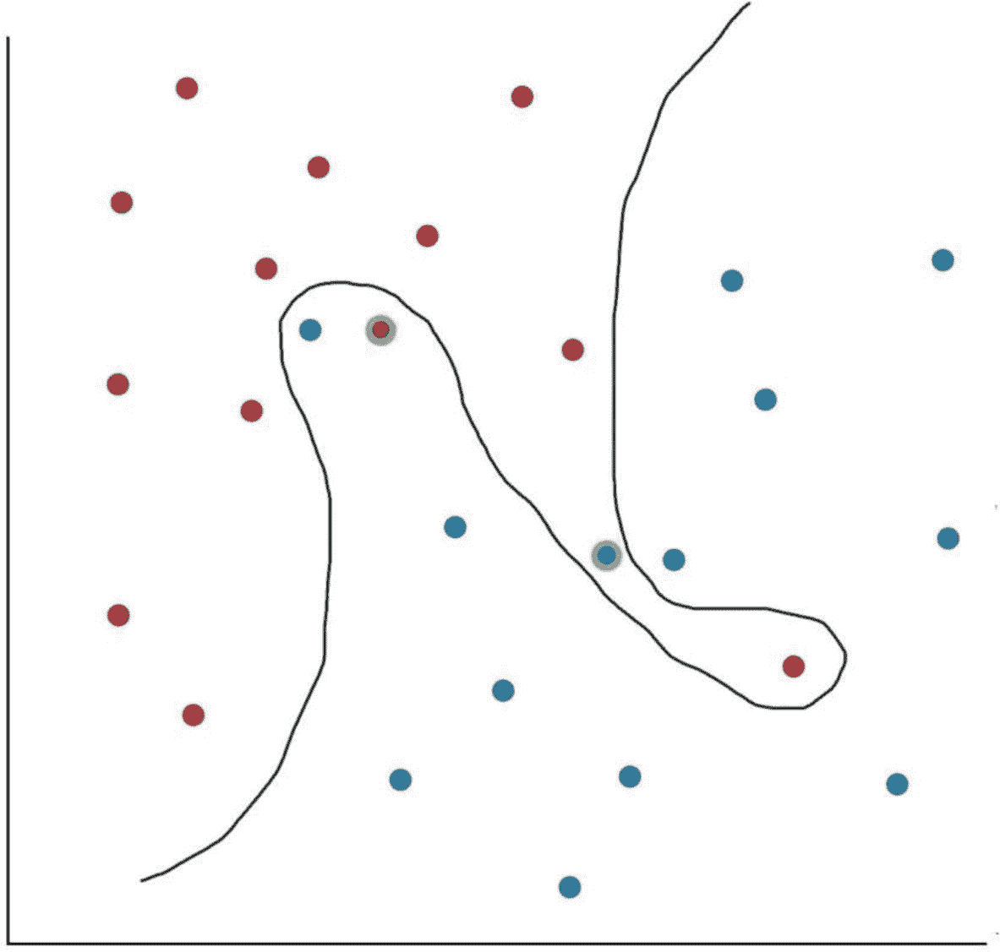

散点图显示了由决策边界分隔的两个数据点聚类，一个为红色，另一个为蓝色。边界由一条曲线表示。两个绿色高亮显示的点位于边界附近，表示潜在的支持向量。该图说明了一个分类场景，可能使用了支持向量机（`SVM`）模型。

**图 15-20**

两个需要由这个过拟合分类器分类的新数据点，正确类别在中心标示

过拟合的产生有很多不同的原因，包括维度灾难（下文讨论），其中特征过多会导致过拟合。模型也可能因为算法特定的特征或倾向而过拟合。例如，如果你让决策树变得过深，它可能会严重过拟合，因为它试图解释训练数据的每一个微小特征。随机森林不太容易出现这种情况，因为并非每个数据点都会出现在每棵构建的树中（在成百上千棵树中）。全连接前馈神经网络和 `SVM` 都容易随着特征数量的增加而出现过拟合。通常，仅仅训练时间过长（比如深度决策树）也会导致过拟合。基本上，如果你不了解算法是如何合理工作的，那么很容易最终导致过拟合。

防止过拟合有多种方法。如前所述，不要训练模型太久——**早停法**会很有帮助。如第 14 章中此前讨论过的，特征选择确实有效（既能减少特征数量，又能剔除那些贡献不大、可能混淆算法并导致对其重要性得出错误结论的特征）。**正则化**是另一种有用的技术，同样在第 14 章中讨论过。其他集成机器学习方法也很有价值，当不同模型开始陷入特征细节的死胡同时，它们可以相互抵消过拟合的倾向。

过拟合是一个问题，但相反的欠拟合问题也需要避免。*欠拟合*是指模型未能捕捉到数据中的模式。它可能由于模型训练时间不足、数据量不够或数据不具有代表性而导致。第一个问题的解决方案显然是训练更长时间（但不要*过*长）。第二个问题通常可以通过半监督技术来增加数据量，或通过其他方法（如下文"数据不平衡"小节所述）创建合成数据来缓解。但如果数据不具有代表性是因为我们没有足够的不同特征的样本，这些技术就帮不上忙了。我们只能寻找更多数据以获得更好的代表性。

可以看到，过拟合和欠拟合处于光谱的两端。我们实际上将管理这个光谱称为*偏差-方差权衡*。欠拟合模型存在*偏差*，因为它们做出了过于简单的假设，导致在训练集和测试集上的表现都很差。过拟合模型在训练集和测试集之间存在*方差*，这意味着它们在训练集上表现良好，在测试集上（或其他未见过的数据上）表现很差，因为它们对训练数据过于敏感。之所以称之为权衡，是因为某些用于减少偏差的方法实际上可能会增加方差，反之亦然。例如，特征选择可以降低方差，因为它使模型更简单，但也可能导致偏差增加。某些线性模型中的正则化会降低方差但增加偏差。在决策树中，树越深，方差越大。虽然有一些计算偏差和方差的方法，但它们相当复杂，对大多数日常工作来说并非必需。

### 数据不平衡

在分类问题中，我们特别容易遇到的另一个问题是数据不平衡，即不同标签的出现次数不均衡。例如，在异常检测中，绝大多数数据（根据定义）是正常的，因此我们只有相对较少的异常标签样本，而更多的非异常标签样本。这在训练模型检测异常时可能会带来问题。

异常标签场景是极端不平衡的一个例子，即一个标签占总数据量的比例不到 1%。但即便不那么严重的不平衡，在二分类问题中也可能产生影响。当标签出现比例仅为 20%时被认为是中度不平衡，比例达到 40%时为轻度不平衡。

处理不平衡有几种方法。一种是对多数类（出现频率高的标签）进行**下采样**并**提高权重**。*下采样*是指从多数类中抽取样本，以减少少数类与多数类之间的差距。例如，如果我们有 1 个异常样本对 100 个非异常样本，我们可以抽取 5%的多数类，这样最终只有 5 个非异常样本对 1 个异常样本，比例从 0.9%变为 17%。这种方法的下一个步骤是*提高权重*下采样后的多数类，即标记这些样本在训练过程中需要被更重视地对待。

另一种许多人常用的技术叫做*SMOTE*（合成少数类过采样技术），它与上述技术相反——它增加少数类样本的数量。它通过创建新的（合成的）具有异常标签的样本来用于训练，从而使数据集达到更好的平衡。该技术使用*k*-近邻法识别给定真实样本周围的区域，然后选择一个邻居，并在原始样本与邻居之间创建一个新的合成数据点。

### 维数灾难

我在上文已经提到了这个问题。*维数灾难* 指的是由于特征过多而引发一系列问题的情形。其中最明显的问题是，特征越多，数据就越难以可视化。显然，我们无法真正在三维以上空间中对数据进行可视化，但通常可以通过一些技巧来包含三个以上的特征，例如在散点图中使用颜色和点的大小。此外，有时我们可以通过解析数据，一次只查看少量特征；如果只有 10 个或 20 个特征，这还行得通，但特征越多，这种方法就越不实用。

第二个问题是*数据稀疏性*，即数据分布非常分散，数据点之间（有时只是部分数据点之间）存在大量空白区域。从图 15-21 和图 15-22 中，我们可以看到增加维度如何导致稀疏性。如果我们从一个虚构的祖孙群体中，以受教育年限数据的一维视图开始，只有一个轴上的一个特征，如图 15-21 所示，我们可以看到数据分布在一个小范围内，尽管 20 年那个点是一个异常值。（注意，我添加了抖动，这使得数值有轻微偏移，因此具有相同数值的点不会完全重叠。）

散点图显示了沿 x 轴（标记为“受教育年限”）的数据点，范围从 0 到 25。数据点均匀分布在 5 到 20 年之间。

**图 15-21**

一组人的总受教育年限的一维视图

但是，我们的数据集拥有的特征不止总受教育年限这一个。我们可以将年龄添加到图表中，创建一个标准的二维散点图，如图 15-22 所示。一旦我们这样做，就可以看到两个点距离所有其他点以及彼此之间都非常远。

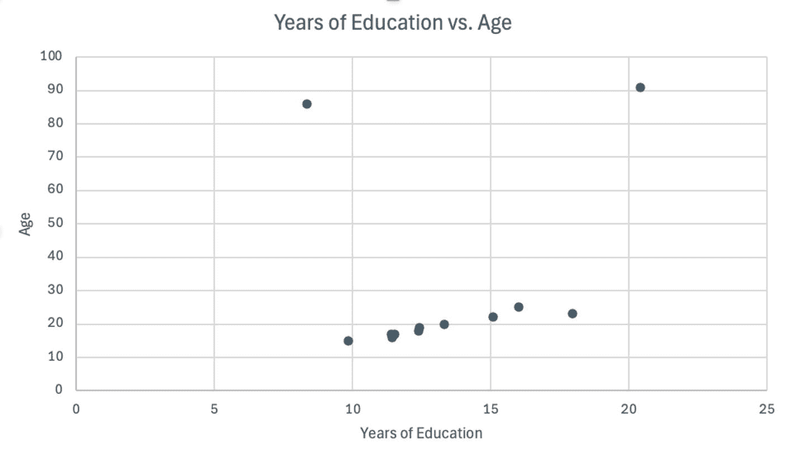

标题为“受教育年限与年龄”的散点图。x 轴表示受教育年限（范围 0 到 25），y 轴表示年龄（范围 0 到 100）。数据点分布散乱，大部分集中在受教育年限 10 到 20 年、年龄 10 到 30 岁之间。存在两个异常值：一个位于受教育年限约 10 年、年龄 90 岁处，另一个位于受教育年限 20 年、年龄 90 岁处。

**图 15-22**

将数据维度从一维增加到二维的影响

图 15-22 中的这些点距离如此之远，以至于很难将它们纳入模型而不会引发其他问题，例如过拟合。此外，这些距离较远的点恰好是整个数据集中的最低值和最高值。看起来，如果我们在模型中使用年龄，模型会无所适从——年龄较大与高学历还是低学历相关？那么，在大部分数据点聚集的区域与那两个较远的点之间的所有空间里，又发生了什么？我们完全不知道，因为我们没有足够的数据来支撑这么多的维度。如果仅增加一个维度数据就开始分散，想象一下在 10 个维度、50 个维度甚至更多维度下会发生什么。我们拥有的特征越多，就需要越多的数据来表现每个特征及其与其他特征之间关系的真实多样性。

如图所示，过拟合是维数灾难带来的另一个问题，这主要源于数据稀疏性。第四个问题是，特征越多，“距离”的概念就越模糊。因此，当我们处理高维数据时，一些用来衡量距离的典型指标就不再有效了。

另外两个问题与随着特征数量增加而必须进行的计算量有关。它会开始消耗越来越多的计算资源，运行时间也越来越长。根据特征的数量，这可能会达到完全不切实际（或成本过高）而无法运行的地步。

### 数据泄露

`Data leakage` 源于建模中最容易犯的错误之一——意外地将不应包含的数据放入了训练集中。这可能来自测试集中的行（很容易发生），或是任何关于目标变量的信息，而这些信息在进行真实预测时是无法获取的。

另一个容易犯的错误，尤其是在你刚开始时，就是意外地将训练集（和测试集）中存在的、但当你对未见/未来数据运行模型时不会存在的特征包含了进来。例如，假设你要预测一家餐厅未来一周（周一至周日）的每日披萨销量。你创建了一大堆很棒的特征，包括前一天的销量和上一周的销量。这在你的测试集中是可行的，因为你拥有完整的数据，可以计算所有这些特征。但当你要对即将到来的一周进行真正的预测时，你可能直到周日晚间才能获得所有销量数据，然后你会在周一清晨运行下一周的特征更新和预测。这没有问题，因为你已经有了前一天的销量。那周二呢？周一清晨你还没有周一的销量数据，因为餐厅甚至还没开门。如果你试图基于这些数据运行模型，你的特征生成或预测很可能会失败，因为它会缺失这些信息。但更糟糕的情况是，你的模型直接使用了空值（其影响未知，但肯定不好）。

数据科学要求注重细节，并始终思考你正在做什么。如果你得到了非常高的准确率或性能得分，那你很可能遇到了`数据泄露`。任何时候，当你在测试集上取得惊人好的性能时，都要检查这种错误。首先，检查训练集和测试集之间是否有重叠。然后，检查是否存在不合理的特征。此外，如果你在处理基于时间的数据，你几乎总是希望将测试集放在数据的时间序列末尾，而将训练集放在其前面。如果你包含了依赖于先前值的特征（例如上个月的销量），那么这就是一个必要条件。

# 关键要点与下章预告

本章我们涵盖了大量机器学习主题。首先重点定义了机器学习的三种关键类型：监督学习、无监督学习和强化学习，同时也介绍了半监督学习和集成学习，这两者对机器学习领域贡献颇多。随后我们深入探讨了几种监督学习算法，包括时间序列分析、广义线性模型、决策树、朴素贝叶斯、神经网络、`k`-最近邻和支持向量机。接着讨论了两种关键的无监督学习技术：聚类和关联规则挖掘，并涉及了`k`-均值和层次聚类两种聚类类型。我介绍了能够帮助解释黑箱模型预测结果的模型解释器，以及在代码中实践机器学习时的一些实用要点。最后，我阐述了进行机器学习建模时面临的主要挑战，包括过拟合与欠拟合（即模型泛化能力不足或遗漏重要模式的情况）、不平衡数据（不同标签的样本数量差异巨大）、维数灾难（模型中特征过多引发的问题）以及数据泄露（训练模型中混入了本不该存在的信息）。

下一章我们将探讨如何评估模型训练后的表现。由于分类任务和回归任务的评估方式差异较大，我们将介绍多种可用于衡量这两类模型性能的指标。同时也会探讨一些用于评估聚类算法性能的指标。

## 实践者简介：杰夫·埃尔莫尔

**姓名：** 杰夫·埃尔莫尔

**现任职位：** 首席高级数据科学家

**所属行业：** 能源行业，也曾涉足教育科技、读写能力研究和写作领域

**从业年限：** 技术领域 20 年，其中数据科学领域 13 年

**教育背景：**

*   应用数学理学学士

*此处观点仅代表杰夫本人，与其现任及历任雇主无关。*

### 背景经历

杰夫 12 岁时便迷上计算机，这份热爱从未消退。高中毕业后他成为程序员并乐在其中，但最终决定攻读学位。起初主修计算机工程，学习微积分后发现自己更热爱数学，于是转专业至应用数学。他痴迷于这种体验：面对棘手问题时，只需应用数学变换，难题便迎刃而解。他通过大学学习和经验丰富的上司接触了机器学习。当时所在公司提供了大量机遇，他开始探索机器学习的实际应用场景。

### 工作实践

他在公司的首个重大项目是与一位研究员合作改进一款产品——该工具通过分析书籍为其分配阅读难度评分，从而帮助孩子匹配适合的读物。为理解儿童阅读学习过程，他意识到自己缺乏相关领域知识，于是开始自学，但进程缓慢。最终他与研究员共同开发出解决该问题的产品。工作中他收获良多，尤其认识到集成学习在机器学习中的宝贵价值——它能从全局视角审视问题。他继续在该公司开发创新产品，但许多工作未被理解，看到成果被闲置令他沮丧，于是决定离职。他与几位伙伴共同创办公司，开发了一款辅助作家撰写小说的工具。这次创业未能成功，令人失望。但这段经历改变了他的观念，使他更重视工作与生活的平衡。如今他找到了热爱却不侵占生活的新工作，过得很愉快。他仍对用 AI 帮助他人充满兴趣，但觉得自己更像一名 AI 爱好者。

### 精彩语录

**工作最爱部分：** 数据科学是桥梁型角色，极具成就感。杰夫乐于解决他人无法自行解决的问题。他还喜欢将新工具（如机器学习）引入从未涉足该领域的行业，从而提升行业工作效率。

**工作最烦部分：** 人类创造并存于电子表格中的数据——质量通常堪忧。他也不满数据科学工作中 80%的时间仍耗费在数据清洗上——他疑惑为何现状难以改变，但事实如此。此外，当工作受限于特定范式或框架时，也会令人感到挫败。

**最得意项目：** 他开发了一套新的口语朗读评估系统，该项目有趣之处在于需融合多个领域知识：心理测量学教育评估（效度与信度）、读写能力发展（学习阅读）、计算语言学和机器学习。他成功找到了阅读能力与口语朗读之间的有效评估关联——能够基于默读能力高精度预测朗读者的每分钟正确字数。他对这项成果深感自豪，但遗憾的是公司不理解其价值也未能实现商业化。

**常用核心技能：** 深思数据——通过思考解决问题。沟通能力至关重要。可视化技能，包括概念构思和创建具体图表等。一张图能传递大量信息，尤其适合互动交流。他还学会了为重复性工作创建可复用的流水线，避免手动重复劳动。

**当前主要工具：** `Python`、`Jupyter Notebooks`、`LLMs`、`Retool`（拖拽式 UI 构建工具），通常使用大型开源生态系统

**数据科学未来：** AI 新进展正在彻底改变人们实现工作自动化的方式。随着越来越多人掌握自动化能力，这一趋势将持续发展。但 AI 很少达到完美，因为模型总可能遗漏更多信息——时间永远不够用，知识也常有缺失。

**优秀数据科学家特质：** 谦逊，善于倾听并暂缓判断，尤其是在进入陌生领域时。若不能保持开放心态，就无法理解事物并做出错误假设。同时需要具备灵活性。可视化能力，包括技术层面和非技术层面。

**给准数据科学家的建议：** 不要将自己局限于仅限商业使用的工具，因为优秀的开源工具比比皆是。总的来说，除了自身经验，永远要从他人的工作中学习。即使不打算写学术论文，也要学会阅读论文——至少能快速浏览以了解可行方向。有时解决问题只需借鉴他人已有的成果。

*杰夫是一位经验丰富的数据科学家，在读写能力研究和心理测量学领域有深厚积累。*

脚注 1 2 3 4 5

