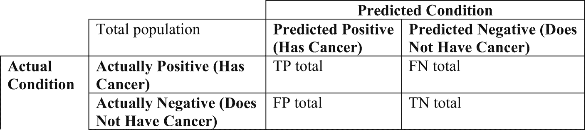
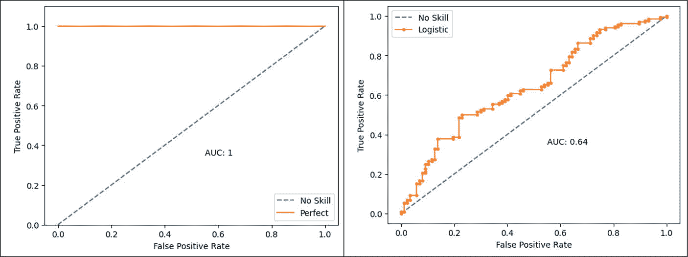
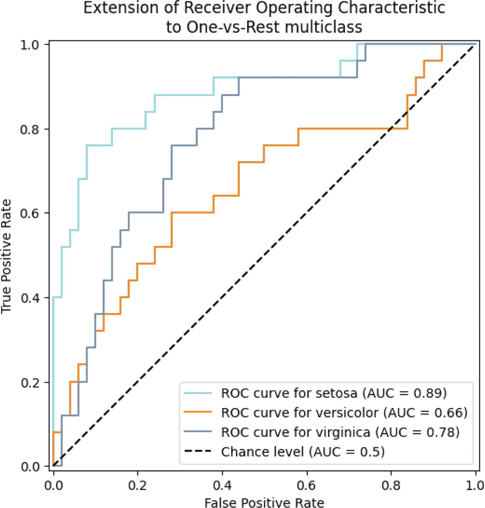

# 16. 做得如何？衡量机器学习技术的性能

## 引言

进行机器学习、构建模型、获取预测结果以及发现有趣的关联固然令人兴奋，但我们如何判断所做的一切是否真正正确？这时，性能指标便派上用场了。有多种方法可以衡量机器学习模型的特性，这些特性有助于我们理解模型是否按预期运行、其结论是否准确。如果结果实际上没有意义，我们就不应使用它们。有时，人们很容易只看表面结果就认为这些结果是好的。关于这种不良习惯，请参阅侧边栏了解更多。

模型性能的衡量主要通过计算特定的指标分数来完成。针对三类机器学习任务（分类、回归和聚类），存在不同的指标。我将逐一介绍目前各类任务中使用的各种指标。请注意，我们讨论过的另一种无监督方法是关联规则，但并没有用于全面评估生成规则的指标，因为每条规则在创建过程中已由特定指标评判，因此事后无需再衡量。

当我们谈论评估模型性能时，通常是指在监督学习中，模型在训练集上训练完成后，在测试集（以及验证集，如果使用了的话）上计算指标。在无监督学习中，尽管无法用所有指标衡量“正确性”，但仍有一些可计算的指标能让我们了解模型的质量。当我们使用了无监督算法但同时也拥有标签时，还可以使用额外的指标。

我将首先通过几个例子说明指标在现实场景中的重要性。然后，在讨论模型构建后需要关注的分类、回归和聚类指标之前，我会先概述内部模型构建指标。

## 未能评估机器学习结果

大多数专业数据科学家都足够负责，能确保他们的模型表现良好。但经常有刚入门的数据科学从业者可能不知道评估模型的正确方法（这正是本章内容如此重要的原因）。始终理解模型的表现如何至关重要。同样重要的是，通过检查工作来确保没有犯错误。我曾与一位经验不足的数据科学家共事，他在使用的工具中将论证周期设置为数天而非要求的数月，但他并未发现这个错误。一次快速的检查本应能告诉他，他的预测值比预期大了 30 倍。

经验不足的数据科学家犯的另一个错误是，他们确实会使用性能指标来评估模型，但却没有意识到其优异结果是源于数据泄露，而非模型本身神奇。任何时候，当你获得非常高的准确率或其他指标值时，都需检查是否存在这个错误。

但更大的问题是，许多公司实际上并不会去评估其结果在长远来看是否良好。他们可能会进行一些聚类以识别客户类型，但两年后却并未真正检查这能否以任何方式帮助到他们（特别是看它是否比旧方法有所改进）。他们可能会利用机器学习来帮助决定新店的选址，但若干年后，却可能不会比较由模型推荐的店铺与其他未被推荐店铺的业绩表现。造成这种情况的部分原因是，很难跟进多年前发生的事情，而且你也无法立即评估重大决策。

此外，源于技术沙文主义（认为机器学习本质上公平、正确，且通常优于人类工作的观念，详见第 9 章）的态度，意味着人们甚至不会质疑结果。数据科学可以非常强大，但结果真的具有价值吗？要确定这一点还需要付出一些努力。

# 现实世界中性能评估的例子

很多时候，数据科学家都有自己偏好的指标，但考虑不同的指标以及它们如何适配当前问题总是有益的。以下两个例子展示了指标的重要性，尤其是选择正确指标的重要性。

## 示例 1：指标驱动开发

客户关系管理（CRM）平台 `Salesforce` 拥有成千上万的客户。这些客户有不同的需求和用例，其中许多人希望在其 `Salesforce` 数据上进行机器学习。如果能在该平台内直接完成操作，对他们来说是最简单的，但五花八门的用例给 `Salesforce` 带来了难题。有时公司会为客户提供定制化帮助，但这成本高昂，且能帮助的客户数量有限。因此，`Salesforce` 创建了一个名为 `Einstein Builder` 的工具，允许客户生成定制的自助预测服务。^(⁴²) 该工具需要支持所有不同的用例，同时又要易于使用，因此 `Einstein Builder` 是一个无需编码的 Web 应用，但仍支持可实现自动化的机器学习管道。他们提供了用于回归、二分类和多分类的工具，这涵盖了多种情况。

你可能会想，在没完成我们花了数章学习的那些数据准备工作的情况下，他们如何进行建模？这是一个两难困境——除非用户自己知道如何做数据准备并且你提供了数据准备工具，否则你无法提供进行此类数据准备的自助服务工具。而自助服务工具的全部意义就在于用户不具备这些技能。现在你应该知道，这意味着结果不会太好。由于数据科学的普及，市场上出现了各种自助式机器学习工具，这是一个普遍存在的现实问题。

因此，他们面临一项艰巨的任务：让客户无需进行数据准备就能进行有用的机器学习。他们确实有一个不错的解决方案，该方案依赖于有效利用不同的性能指标。另外，请记住，客户使用的数据是 `Salesforce` 自有系统中的数据，因此他们了解这些数据的外观和结构。客户可能还有额外的自定义表，但至少部分数据是已知的实体。

尽管如此，他们解决方案的核心是衡量客户构建的模型的性能，以便根据需要对其进行调整。系统会观察模型的特性，看是否有可能进行改进。例如，在线性回归中，系统可以通过查找接近零的系数或变量过多的案例来检查过拟合。然后，他们可以添加正则化以减少特征空间。他们还能够使用不同的特征和参数（特征选择和超参数调优）进行实验，衡量每个实验模型的性能，并仔细跟踪所有内容。他们能做到的一件事是在实验的不同步骤计算各种指标，这在我们日常的数据科学工作中并不常见。这些实验中观察到的指标和整体结果有助于他们微调模型。

`Einstein Builder` 通过观察模型试图达成的目标以及所涉及数据的特性，来确定需要监控的正确指标。所有这些都推动了这款自助式机器学习工具的改进。

## 示例 2：模型测试与质量保证

在大多数公司中，质量保证（QA）通常应用于软件和报告，而很少涉及数据科学代码或模型本身。人们逐渐意识到这或许并不理想，一些公司正试图纠正这一情况。咨询公司 `Scott Logic` 已将机器学习模型测试整合到其流程中。^(⁴³) 该公司的一名测试工程师在一篇面向测试工程师的文章中阐述了他们的流程与方法，旨在帮助测试工程师理解如何从软件测试转向模型测试。

她提到模型测试与软件测试的诸多不同之处，包括：机器学习模型的输出无法预先得知，且完全依赖于数据中的具体内容。此外，模型的输出会随每次新数据运行而变化，但其性能通常会随时间推移而下降（由于模型漂移）。最后，传统的通过或失败简单测试的软件测试方法已不再适用，他们需要依赖各种机器学习性能指标，这也是本章对此感兴趣的原因。

对于这类测试，他们必须非常深入地了解所使用的数据。数据需要被分析和验证，尤其要检查是否存在缺失数据、重复数据以及任何偏见。他们进行的是模型测试，而非模型评估。模型评估是数据科学家在构建模型时，通过在测试集上进行测试来筛选最佳模型的过程。但在质量保证中，他们试图观察模型在现实世界中的表现。在测试中，他们会使用交叉验证。如果可能，他们会结合其他已知解决方案进行 A/B 测试。但最关键的是他们对性能指标的选择，他们会根据问题类型（分类或回归）来选取指标。他们的一贯做法是不依赖单一指标，而是使用多个指标以获得更全面的视图。并非所有指标都适用于所有数据。

## 分类指标

当人们谈论机器学习中的分类时，通常指的是二分类，通常被理解为对或错——是的，患者患有癌症，或者不，他们没有；是的，这是一封垃圾邮件，或者不，它不是——但也存在多标签分类问题。我们将在此讨论两者的衡量指标。

在二分类中，性能衡量的核心是混淆矩阵，这是一种直观展示模型性能的方法。大多数主要指标都以某种方式与混淆矩阵相关，因此我们将首先介绍混淆矩阵，然后介绍基于矩阵的指标。我们将讨论二分类中使用的另外几个指标，然后讨论多分类中使用的指标。

### 二分类指标

大多数分类问题都是二分类，即有两个可能的标签。它们可以是任何内容，但通常我们将一个视为正类，另一个视为负类。我们将讨论可用于二分类的各种指标。下一节将介绍如何处理多分类问题的性能衡量。

#### 混淆矩阵

对于二分类问题，每次预测都会出现四种情况之一，每种情况都有其名称：

-   **真正例（`TP`）**：预测标签为真，且由于实际实例也为真，因此预测正确。
-   **真负例（`TN`）**：预测标签为假，且由于实际实例也为假，因此预测正确。
-   **假正例（`FP`）**：预测标签为真，但由于实际实例为假，因此预测错误（统计学中也称为第一类错误）。
-   **假负例（`FN`）**：预测标签为假，但由于实际实例为真，因此预测错误（统计学中也称为第二类错误）。

通常，我们显然希望`TP`和`TN`的值高，而`FP`和`FN`的值低。但将这些值转化为矩阵视图，可以让我们更容易看清状况。*混淆矩阵*展示了这四个值的计数，以及预测和实际的标签。图 16-1 显示了癌症诊断的基本结构，其中“患有癌症”为正类，“未患有癌症”为负类。

说明癌症预测结果的混淆矩阵表。该表分为实际条件和预测条件。实际条件包括“实际阳性（患有癌症）”和“实际阴性（未患有癌症）”。预测条件包括“预测阳性（患有癌症）”和“预测阴性（未患有癌症）”。交点处显示了真正例的“TP 总数”、假负例的“FN 总数”、假正例的“FP 总数”和真负例的“TN 总数”。左上角单元格表示“总人口”。

图 16-1

基本的混淆矩阵结构

通常，在创建矩阵时，我们仅在顶部和侧边标注“真”和“假”，并且我们知道顶部代表预测，侧边代表实际。在这种视图下，我们通常希望看到从左上角到右下角对角线上的数值高，而其他角的数值低。

请注意，在数据集不平衡（正类样本稀少）的情况下（例如欺诈检测或疾病诊断），我们会看到`TP`框中的数值很低，而`TN`框中的数值非常高。我们仍然希望`FP`和`FN`的数值低。

请记住，虽然我们总是希望`FP`和`FN`低，但在某些情况下，我们更希望尽量减少假正例的数量。例如，在欺诈检测这类情况下，高`FN`意味着我们遗漏了一些欺诈案例，那么该笔交易将不会被调查。我们宁愿处理更多的`FP`，也不愿面对高`FN`。在很多领域都存在这种情况，包括疾病检测（`FN`意味着患者不会被送去进一步检查，并且其疾病将得不到治疗）和安全检查（`FN`可能意味着有人将炸弹带入大楼）。另一方面，也存在`FP`代价极高而`FN`影响不大的情况，因此我们宁愿漏掉正类，也不愿错误地将负类标记为正类。例如，在商品推荐中，如果没有向用户推荐他们可能喜欢的商品（`FN`），并不会造成实际损害；但如果推荐了太多他们不喜欢的商品（`FP`），用户就会对推荐失去信任。其他高`FP`危害严重的案例包括死刑判决（错杀无辜远比放过有罪之人糟糕得多）和垃圾邮件检测（收到少量垃圾邮件（`FN`s）比错过一封重要邮件（`FP`）要好）。

混淆矩阵是二分类问题的良好起点，但仅凭它本身并不能给我们提供太多切实的信息。相反，我们会根据矩阵中的数值计算各种衡量指标。

## 基于混淆矩阵的指标

人们首先想到的指标通常是准确率，这个术语常被泛泛地用于表示“模型表现如何”，但它本身也是一个简单而具体的指标名称。*准确率*就是所有正确标记的数量除以总记录数。然而，这可能会是一个非常偏斜的指标，尤其是在数据集不平衡的情况下，即实际正例的总数与实际负例的总数不同。在极度不平衡的数据集中，即使将所有实际正例都错误分类，我们也可能获得非常高的准确率。例如，如果我们有 10,000 个信用卡交易实例，其中只有 50 个是欺诈性的，如果分类器简单地将每一个都分类为负例（非欺诈），那么分类器的准确率将达到 99.5%。这显然荒谬地具有误导性且毫无用处。

*精确率*是另一个重要的衡量指标，它关注分类器对其正例标签的处理效果，或者说，在其标记为正例的预测中，实际为正例的比例。因此，它侧重于假正例（`FP`）。当假正例代价高昂而假负例（`FN`）不那么严重时，这是一个重要的指标，例如在推荐系统中。但当假负例具有危险性时，它就不是最佳指标了。

`召回率`被认为是精确率的反面，因为它强调的是假负例。`召回率`这个术语衡量的是在整个数据集中被检测出来的总正例的比例。这是在欺诈检测和疾病检测等情况下我们关心的衡量指标。召回率有时也被称为灵敏度或真正例率。具体计算公式见表 16-1。

**表 16-1** 二分类中准确率、精确率、召回率和 F1 分数的计算

| 指标 | 基于混淆矩阵的计算公式 |
| --- | --- |
| 准确率 | `(TP + TN) / (TP + TN + FP + FN)` |
| 精确率 | `TP / (TP + FP)` |
| 召回率 | `TP / (TP + FN)` |
| F1 分数 | `2*TP / (2*TP + FP + FN)` |

精确率和召回率通常呈反比关系，我们常常希望在这两者之间找到平衡。此外，如果我们的模型表现非常糟糕，我们可能会得到误导性的结果。例如，如果一个欺诈检测器将每一笔交易都标记为欺诈，那么我们会得到非常高的召回率，但精确率（和准确率）会非常低。同样，在推荐系统中，如果我们只推荐了极少量的产品，但这些都是好的推荐，那么我们会获得很高的精确率——但与此同时，我们也错过了所有那些未被推荐产品的销售机会。你可以在表 16-1 中看到计算方法。

因此，无论在何种场景下两者中哪一个被认为最重要，我们仍然需要了解它们之间的平衡。幸运的是，我们正好有这样一个指标——`F1 分数`，它本质上是精确率和召回率的修正平均值（调和平均数）。它的计算比其他指标稍微复杂一些，但你可以在表 16-1 中看到计算方法。所以，当精确率或召回率更为重要时，常见的做法是查看该指标，同时还要查看 `F1 分数`，以确保模型没有做无用功。

尽管 `F1 分数`不错，但它在处理真负例（`TN`）方面存在局限性，因此有时会使用另外几个衡量指标，即马修斯相关系数或科恩卡帕系数。这两个指标的计算都稍微复杂一些，但都可以通过混淆矩阵的值来计算。你可以通过谷歌搜索找到更多信息。

我已经讨论过最常见的一些基于混淆矩阵的分类指标，但在实践中还有其他一些有用且常用的指标，包括假正例率和特异度（真负例率）。维基百科上关于精确率和召回率的页面有一个出色的扩展混淆矩阵，总结了所有这些指标。

# 其他指标

尽管混淆矩阵及其相关指标是二分类测量的核心，但数据科学家也会使用一些其他衡量指标。最常见的是相关的受试者工作特征曲线（`ROC`）和曲线下面积（`AUC`）。

`ROC` 曲线绘制了真正例率（召回率）和假正例率的对比关系，在一个完美的分类器中，绘制的曲线将是一条横跨图表顶部的水平线，就像你在图 16-2 左侧看到的那样。分类器永远不会完美，所以在右侧可以看到一个更真实的图形，它既展示了随机猜测模型的结果，也展示了一个真实模型在儿童身高数据上的表现。

`图 16-2` 两个并排的 XY 图表，比较 `ROC` 曲线。左侧图表显示一个完美模型，橙色线到达左上角，表明 `AUC` 为 1。右侧图表显示一个逻辑回归模型，橙色线位于对角线蓝色“无技能”线上方，表明 `AUC` 为 0.64。两个图表的 Y 轴均为“真正例率”，X 轴均为“假正例率”。图例区分了“无技能”模型和“逻辑回归”或“完美”模型。

`AUC` 字面上就是 `ROC` 曲线下的面积。它已包含在图 16-2 的图表中。当比较同一数据上模型的不同运行时，`AUC` 值较高的模型被认为是更好的。

另一个在模型中很有用的指标是当预测给出一个概率时，这个概率表示预测正确的可能性有多大。例如，在逻辑回归中，我们得到一个概率，并通常取一个阈值——通常是 0.5——高于该阈值的标记为 `True`，低于该阈值的标记为 `False`。有一个称为 `对数损失` 的指标，它直接利用这个概率，并根据每个实例的概率和实际值之间的差异来计算分数（实际计算涉及一些对数值，可以在线查找）。使用这个指标时，我们希望它的值较低。

### 多分类指标

上述所有指标都可以适用于多分类问题。可以创建混淆矩阵，但由于其顶部和侧面包含的标签不止于 `True` 和 `False`，因此该矩阵会有超过四个区域。

`Accuracy`（准确率）的计算方式相同，即所有正确预测结果除以所有预测结果。其他大多数指标则需要进行一些修改，特别是通过计算宏平均、加权平均或微平均版本。使用宏平均方法时，您通过每次仅关注单个类别，并计算所有这些指标的平均值。使用加权平均方法时，类似地，您会将每个单独的指标乘以具有该标签的样本总数所占的比例。

使用微平均方法时，您通过汇总所有单个类别的数值来生成整体的 `TP`（真正例）、`FP`（假正例）等，然后使用这些汇总值代入常规指标计算。但这种方法有一个问题：`accuracy`（准确率）、`precision`（精确率）、`recall`（召回率）和 `F-score`（`F1 分数`）都将得到相同的值。这是因为对于任何给定的类别，`TP` 仅是该类别的总数，但任何被正确标记为不属于该类别的样本都是该类别的一个 `TN`（真负例）。因此，最终所有汇总值都相同。

您也可以为多分类问题生成 `ROC`（受试者工作特征曲线）和 `AUC`（曲线下面积），常见的做法是将每个类别作为 `ROC` 图上的单独曲线进行绘制。然后可以为每个类别计算一个 `AUC`。图 16-3 展示了一个针对鸢尾花数据的此类 `ROC` 图。

一对多（One-vs-Rest）多分类的受试者工作特征（`ROC`）曲线。图表显示了三条曲线：绿色代表山鸢尾，其 `AUC` 为 0.89；橙色代表变色鸢尾，其 `AUC` 为 0.66；蓝色代表维吉尼亚鸢尾，其 `AUC` 为 0.78。x 轴表示假阳性率，y 轴表示真阳性率。虚线表示随机分类水平，其 `AUC` 为 0.5。

`图 16-3` 一个多分类问题的 `ROC` 图

### 回归指标

衡量回归结果的性能是不同的，因为输出是数值型的，并且在大多数模型中可以是任意值。因此，一个给定值不能简单地判断对错——我们想要衡量的是它与正确数值的接近程度。

关于回归指标，首先要了解的是，回归问题不存在所谓的准确率指标，因为 `accuracy`（准确率）是分类问题特有的。虽然我们有时也会谈论回归中的准确率，但此时使用的是该词的一般含义（即“准确性”），而非一个特定的技术术语。

一个在广义线性模型中常见的指标是 `R-squared`（R 方）分数。从技术上讲，这是一个拟合优度指标——`R-squared` 分数表示生成的模型与数据的拟合程度，以及目标变量中的方差有多少是由特征解释的。在线性模型中，它有效地将实际的回归线与均值线进行比较，均值线是穿过图表上数据中所有 Y 值的平均值在 Y 轴上的点的一条水平线，但它也可以用于一些非线性模型中。在线性情况下，一个糟糕的模型会有一条接近均值线的回归线，并且 `R-squared` 分数非常低。对于在相同数据上构建的不同模型，`R-squared` 可能是一个良好的指标，因为它被认为是相对的。这意味着它不太适合跨不同数据集进行比较。

`R-squared` 的一个缺点是它假设所有特征对模型都很重要。此外，增加一个特征往往会提高 `R-squared` 值，这可能导致人们增加不必要的特征，最终得到一个过拟合的模型。有一种修改版的 `R-squared` 分数能更好地处理不同价值的特征。`Adjusted R-squared`（调整后 R 方）分数会评估每个特征带来的附加值，只有当特征对模型的改善程度超过了随机水平时，分数才会增加。由于这种改进，调整后的 `R-squared` 几乎总是小于 `R-squared`。

还有其他几个指标经常被用来替代 `R-squared` 和调整后的 `R-squared`，因为它们并不总是适合用来确定模型在测试集上的最佳性能。

一个流行的回归指标是均方误差（`MSE`），它涉及计算实际值与预测值之差的平方，求和，再除以总预测次数，从而得到一个“平均”值。对差值进行平方处理对于防止负值抵消正值很重要，但它也有一个问题，即由于平方运算，数值很容易变得非常大。一个完美的模型其 `MSE` 为 0，但也可能变得非常大。此外，该值可能难以解释，因为其单位是目标变量单位的平方。

`MSE` 的一个变体是均方根误差（`RMSE`），它仅仅是 `MSE` 的平方根，这使得指标的度量单位恢复到了与目标变量相同，因此更容易解释。在对差值进行平方运算之后再进行开方，可以避免正负误差相互抵消的问题。与 `MSE` 一样，完美的 `RMSE` 值为 0，但它也可能变得很大。

另一个流行的指标是平均绝对误差（`MAE`），它类似于 `MSE`，但为了处理正负值抵消效应，它采用差值的绝对值而非平方。与 `MSE` 一样，将这些值求和后除以总预测次数。但这种方法避免了 `MSE` 通过平方运算而导致的误差膨胀（尤其是较大的误差），因此通常被认为更真实，更受青睐。此外，它像 `RMSE` 一样，使用目标变量的单位。同时，像 `RMSE` 和 `MSE` 一样，一个完美的模型其 `MAE` 为 0，也可能变得很大。

另一个经常使用的指标是平均绝对百分比误差（`MAPE`），它是 `MAE` 的一个变体，将误差表示为百分比，使其能被广大受众立即理解。`MAPE` 先计算实际值与预测值的差值，除以实际值，然后取绝对值，再进行求和（再除以总预测次数）。百分比非常直观，我们无需考虑目标变量单位的含义。需要注意的一点是，当模型表现很差时，“百分比”也可能爆炸式增长，远高于 100%。另一点是，在计算误差百分比时，如果实际值为 0，则无法计算，因为这意味着除以零（尽管存在一些变通方法）。此外，该指标是相对于实际值而言的。如果实际值为 125，预测值为 100，我们得到误差 25，这将转化为 25%；但如果实际值为 75，预测值为 100（与前一个示例的误差差值相同），百分比则为 33%。因此，高于实际值的预测比低于实际值的预测会受到更大的惩罚。

### 聚类指标

由于聚类通常是无监督的，因此大多数指标都是内部指标，主要寻找聚类的一般特征，而不是将结果与已知值进行比较。然而，有时聚类是在已知标签的情况下进行的，并且有一些针对这种情况的特定指标（这些被视为外部度量）。我们将在此介绍这两种类型。

### 内部指标

内部聚类指标是指那些无需知道真实标签的评估方法。由于这些指标仅关注聚类的特征，比如各簇之间分离得如何以及簇内数据有多紧凑，这并不能说明聚类结果是否准确。它们只能告诉我们这些聚类看起来是一个不错的模型。

一种常用于评估聚类结果的指标称为轮廓系数，它衡量的是簇之间的分离度和簇内部的凝聚度。这些特性在聚类模型中至关重要，因为我们希望各簇之间能清晰分开（分离度），同时每个簇内的数据点之间差异不大（凝聚度）。其计算涉及每个数据点的两个平均值：该点与同一簇内其他点之间的平均距离，以及该点与不同簇中数据点之间最小的平均距离。该值的范围在 –1 到 1 之间，数值越大表示聚类效果越好（因为数据点与自身簇匹配良好），数值越小则表示簇之间存在重叠和模糊性。

第二种聚类指标是戴维森-堡丁指数，它衡量每个簇与其最相似簇之间的相似程度。该指标基于对所有簇的平均值计算，其中每个簇会与被认为最相似的另一个簇进行不相似性度量。该指标数值越小越好。

另一种名为卡林斯基-哈拉巴斯指数的指标则同时考虑了簇内方差和簇间方差。其计算涉及簇间与簇内的平方和、簇的数量以及数据点的总数。该指标数值越大越好。

我要提及的最后一个内部指标是惯性，它关注的是簇内平方和。该指标计算每个数据点位置与其所属簇质心之间的平方距离之和。分数越低越好，但如果分数过低，则可能表明过拟合。此外，随着簇的数量增加，惯性往往会减小，这就是为什么选择最佳簇数量非常重要。

### 外部指标

到目前为止我们讨论的所有指标都只是评估聚类结果（如同在无监督学习中那样），但还有一些外部指标，因为它们仅适用于拥有数据标签的情况（如同在监督学习中）。聚类本身仍然是无监督运行的，但名为兰德指数及其变体调整兰德指数的两个指标能让我们将聚类算法的输出与拥有的标签进行比较。兰德指数的计算涉及标签对的一致总数与总对数，其取值范围为 0 到 1，数值越高越好。调整兰德指数则利用计算出的 `RI` 值，并通过预期 `RI` 值进行机会校正。其取值范围与 `RI` 相同。

当标签已知时，另一个可用的指标是互信息（`MI`）。互信息衡量的是数据点的真实标签与预测标签（即所属簇）之间的相似度。其计算涉及真实标签、预测标签以及一些概率值。最低可能得分为 0，表示毫无关联；数值越高，则表明预测结果与已知标签越吻合。

## 要点总结与下章预告

本章我们讨论了分类、回归和聚类模型的性能度量方法。这三类机器学习模型所使用的评估指标截然不同。在分类问题中，大多数度量指标都基于混淆矩阵，它用来表示真正例、假正例、真负例和假负例的数量。在二分类中，“正例”与“负例”表明我们所测试的标签（例如，正例表示可能是欺诈交易，负例则表示可能不是欺诈交易）。“真”和“假”则用来指示预测标签是否与实际标签相符。其中一些指标包括：`accuracy`（预测正确比例）、`precision`（是否过度热衷于做出正例预测）、`recall`（成功识别出真正例的比例）以及 `F-score`（`precision` 和 `recall` 之间的平衡）。我还介绍了 `ROC` 曲线和 `AUC` 计算，它们关注的是真正例率和假正例率。

接着，我讨论了多种回归指标。`R-squared` 用于线性模型，它指示模型对数据的拟合程度。`MSE` 衡量实际值与预测值之间的误差，并通过平方消除正负号。`RMSE` 取该值的平方根，使单位恢复到与目标变量相同。`MAE` 取实际值与预测值之差的绝对值进行计算，其单位也与目标变量相同。`MAPE` 是 `MAE` 的百分比形式，对于非技术人员来说通常更直观。

最后，我们探讨了几种聚类指标，其中一些用于在不知道真实标签的情况下量化聚类模型的总体质量，另一些则可以在已知标签的情况下评估模型。第一组指标包括：`silhouette score`（考察簇的凝聚度和分离度）、`Davies–Boulding index`（衡量一个簇与其最相似邻簇的相似程度）、`Calinski–Harabasz index`（考察簇间方差与簇内方差）和 `inertia`（另一种对簇内平方和的度量）。后一类型的两个指标，`RI`（正确标记的对数与总对数之比）和 `MI`（衡量实际标签与预测标签之间的相似度），也都有其用武之地。

在下一章中，我们将探讨如何与语言打交道。数据科学家并非总是要涉足自然语言处理或语音处理，但这正变得越来越普遍，尤其是在大语言模型流行之后。我们将首先介绍 `NLP` 的基础知识，包括语言解析、句子分割、将文本转换为称为词元（token）的词片段、词干提取（将单词还原为其常见的基本形式）以及词性标注。接着，我们将涵盖语言理解与生成。最后，我们会花一点时间来探讨语音处理（包括识别与合成）。

# 从业者简介：迭戈·坦加西

**姓名：** 迭戈·坦加西

**现任职务：** 高级分析经理

**现任行业：** 零售业

**经验年限：** 8 年数据科学家经验，此前在精算与金融领域工作

**教育背景：**

*   精算科学学士学位

*此处表达的观点仅代表迭戈个人，与其过去或现在的任何雇主无关。*

## 背景

迭戈一直热爱工程、机器人以及各种系统。自从他拥有第一台个人电脑后，他就下载各种东西来捣鼓，开始摆弄软件，甚至越狱了他的 iPhone。他原本计划在大学学习机电一体化，但当他去学校参观时，负责接待他的教授毫无激情，这让他改变了主意，开始寻找其他方向。他发现了另一个让他着迷的领域——精算科学——并在大学里学习了这个专业。第一个学期后他就深爱上了它。在选修了一门由一位经验丰富的迷人教授教授的金融课程后，迭戈确信自己想在金融领域工作。

## 工作

迭戈如愿以偿地在金融领域找到了一份工作，在一个金融风险部门（处理养老金相关事务），但结果发现这份工作很无聊。日复一日，每天只是重复相同的步骤——获取输出，将其输入另一个模型，如此循环。六个月后他就感到极度厌倦。当一家咨询公司找到他，寻找具备统计和数学技能的人时，他果断跳槽。他非常享受这段经历，包括学习了更多关于数据和数据工程的知识，如 `ETL`、数据库、信息立方体和系统保证。他还更深入地了解了数据科学这个领域以及营收组合模型（一种确定哪些产品应该获得推广的方法）。他当时使用的工具非常基础，比如用 Microsoft Excel 求解器来优化方程，但利益相关者仍然印象深刻。工作大致分为两个阶段：首先是进行数据科学分析，其次是沟通结果。在咨询公司，他喜欢的一点是能够与零售公司的高层人士合作，这让他变得非常善于沟通。由于这些沟通技巧，他经常被“点名”委以重任。他后来离开了咨询业，但仍留在零售业担任现在的职位，并且仍然热爱这份工作。

## 精彩片段

**工作中最喜欢的部分：** 迭戈热爱数据科学工作中需要不断学习的一切。学习各种知识让他充满活力。他也喜欢与形形色色的人共事。最后，任何编码工作中最令人满足的事情之一，就是当你编写了一些有挑战性的代码，并且它成功运行了。

**工作中最不喜欢的部分：** 官僚主义。有时完成工作会遇到重重障碍，以至于利益相关者都失去了兴趣。有时公司文化也会令人感到棘手。

**最喜欢的项目：** 在他做咨询期间，曾有一个政府机构要求建立一个墨西哥毒品缉获案例数据库。他们需要大量细节，包括事发地点、涉案贩毒集团、涉案人数和车辆数、毒品藏匿地点等。他们必须创造性地解决问题，使用了多种数据源，但主要是报纸。他们抓取新闻网站的内容，进行 `NLP` 处理以提取所有细节，并将其存储到数据库中。这是一个非常令人满意且成功的项目。

**最常用的技能：** 分析性思维。能够将技术语言转换为商业语言，反之亦然。善于自学。

**当前主要使用的工具：** `R`、`Python`、`SQL`、`Snowflake`、`GitHub`、`Google Suite`（API 等）、`Visual Studio`

**数据科学的未来：** 过去，大多数数据科学家需要承担非常广泛的工作，包括数据工程、数据管理等。但现在分工更加明确，数据科学家可以专注于更典型的数据科学工作，而其他任务则由拥有特定职位头衔的人来完成。这种专业化、精细化的趋势将会持续下去。

**优秀数据科学家的特质：** 要明白数据科学确实包含技术内容，但最大的精力需要花在与非技术人员沟通、理解他们的需求以及告知他们可以期待什么结果上。

**他对准数据科学家们的建议：** 尝试为自己的职业生涯制定一个关于你想专注领域的计划，这样你就能了解不同的领域，以及你希望在何处工作。

*迭戈是一位经验丰富的数据科学家，在金融和零售领域拥有深厚的专业知识。*

脚注 1 2 3

