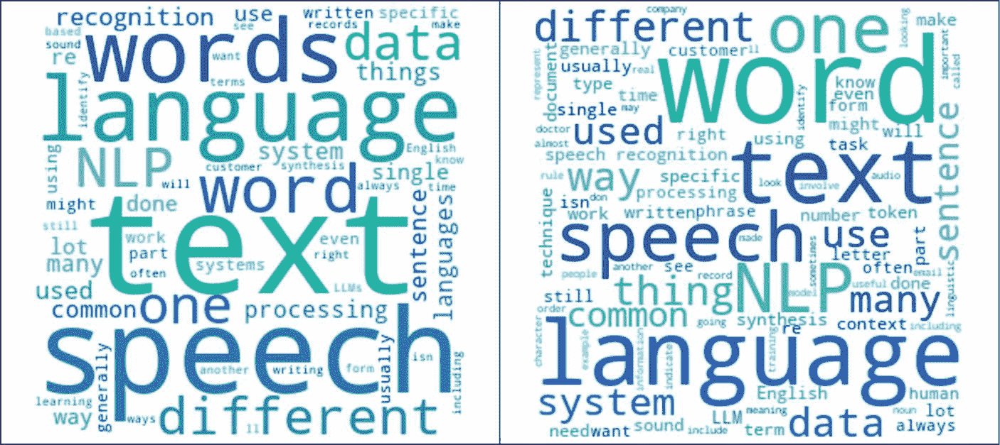

# 17. 让计算机具备读写能力：文本与语音处理

## 引言

近来，每个人都在语言语境下对人工智能有了切实的认知，这主要得益于与 ChatGPT 等大语言模型（LLM）相关的工作。这便是真正的自然语言处理（`NLP`），并且它在过去几十年间蓬勃发展。如今，计算机在语言处理方面能做到的事情令人惊叹不已，现在正是投身该领域的激动人心的时刻。

我们中的许多人也知道，在过去几十年里，语音技术取得了进步，尤其是那些曾致电公司寻求帮助的人对此感触颇深。我个人还是想回到按数字键的时代，因为我打电话要咨询的事情似乎总与选项对不上，但这种情况不会再出现了。

多年来，语音处理工作主要由电气工程师承担，因为它被视为一个信号处理问题。因此，在此类工作中融入的语言学知识并不多。相比之下，自然语言处理（`NLP`）通常与计算语言学（一个类似的学科，但更侧重于语言学理论）一同设立在语言学系，有时也与计算机科学结合，因此文本处理涉及语言学知识的历史要长得多。但语音处理领域已经发生了变化，因为他们最终认识到，语音不仅仅是声音——我们说话和听到词语的方式取决于诸多因素，包括上下文、语气以及其他语言学特征。

围绕自然语言处理和语音处理，尤其是语言学领域，存在大量术语。请参阅侧边栏，了解与之相关的许多语言学领域的解释。下文还会出现更多术语。

# 语言学分支

## 语音学
研究语音，包括其生理机制和声学特性。

## 音系学
研究语音，通常比语音学层级更高。

## 语义学
研究语言中的意义。

## 句法学
研究词语和短语如何排列才能符合语法且有意义。

## 韵律学
研究语言中更高层次的语音特性，包括语调、重音和节奏。

# 现实世界中自然语言处理（NLP）与语音处理的实例

自然语言处理（NLP）在工业界应用日益广泛，这里我们将看两个例子，一个来自苏格兰的鞋业公司，另一个来自法国医院，该医院使用语音识别来口述病历。

## 示例 1：自然语言处理（NLP）填补大空缺

苏格兰公司 schuh 是一家在英国和爱尔兰广为人知且正在扩张的鞋业公司，它在管理客户互动方面遇到了困难，试图加快并改善这一流程。^(⁴⁵) 他们以拥有良好的客户支持而自豪，并特别寻求处理客户投诉的方法，以期让客户满意，并使其仍然是未来的客户。

他们开始使用 Amazon Comprehend 的自然语言处理（NLP）和机器学习（ML）工具来识别客户电子邮件中的情感。该系统会判断一封新邮件是否包含正面或负面情感，这有助于将全新的邮件正确地分派给支持团队。不同的客户支持代理擅长不同类型的支持，因此将邮件更快地路由给正确的人可以节省宝贵的时间。这种优先级排序和分派以前是手动完成的，非常耗时。他们还使用这些工具分析外发邮件，以确保代理回复的质量。

他们发现该系统带来了巨大好处，主要体现在节省时间以及改善与客户的互动质量与及时性上，这意味着他们更有可能留住客户。

## 示例 2：口述病人病历

医生是出了名的忙碌，文书工作是他们最不喜欢的任务之一，但及时更新病历至关重要。2016 年，巴黎的圣约瑟夫医院以尽可能实现无纸化而自豪。作为这项努力的一部分，他们开始使用 Nuance 公司的语音识别系统，这是一家已在语音识别领域深耕近三十年的公司。^(⁴⁶) Nuance 拥有多种针对医疗保健的专业产品，巴黎医院使用了其产品 Dragon Medical Direct，并将语音识别集成到他们的电子病历系统中。

他们试图通过此解决方案解决的主要问题是完成和交付医院病历的速度。一家医疗监管机构要求他们在病人出院时提供病历，并在出院后一周内将病历送到其全科医生（GP）手中，而这一要求并未始终得到满足。病历的处理流程是医生做笔记，然后交给秘书，秘书必须重新录入所有内容。这需要大量的来回沟通，而且让第二方录入数据充满了出错的风险。阅读别人匆忙记下的笔记总是很困难，医生打的任何错字都极易被另一个人误解（即使医生自己能识别并纠正自己的错误）。但最重要的是，这个过程太慢了。如果他们能在不增加医生额外工作量的情况下，省去秘书重新录入的环节，那对每个人来说都将是一个胜利。

当他们开始测试时，遇到了阻力（任何系统变更都难免如此）。医生们认为它行不通，也不愿意改变他们的流程。然而，早期参与测试的医生对口述软件印象深刻，因为它既准确又快速。很快，该软件部署到了许多科室，其他科室也纷纷要求使用。他们发现，每个医生需要几周时间才能适应系统。例如，大多数医生选择在病人面前口述病历，这有点尴尬。但一旦习惯了，他们就很喜欢能在就诊期间完成这项工作，而不必在数小时或数天后与秘书协作处理，病人也有机会纠正任何错误。

该医院认为该项目取得了巨大成功。在采用该软件之前，有 32% 送到全科医生（GP）的病历错过了两周的截止日期。采用口述系统后，这一比例降至 5%，这是一个巨大的改进。近三分之一的病历在一天内发送。他们收到全科医生（GP）的反馈，称收到的病历清晰准确，部分原因是使用口述系统使医生说话更清晰、更简洁。患者也对这种新的透明度表示赞赏，因为他们清楚自己的病历里写了什么。所有医生都同意这节省了时间。

# 语言数据来源

我最初在第 1 章讨论非结构化数据时谈到了语言数据。来自新闻文章、推文和客户投诉邮件等文本数据都符合这个范畴。但我们不能简单地将这些数据输入到任何机器学习（ML）系统中，就能期望得到有用的输出。我们必须以某种方式准备数据。我们将在下一节中讨论可以采取的各种方法。

## 文字系统

语言的书写方式极为重要。历史上，自然语言处理领域的大量工作都集中在英语和其他欧洲语言上，但针对汉语及其他语言的研究也日益增多。原因之一在于处理不同类型的文字系统所面临的挑战。

英语并非唯一的游戏规则制定者，即便在自然语言处理领域它目前仍是主流。本节中我将使用一些语言学术语，请参考侧边栏查看相关定义。英语和大多数西欧语言属于所谓的音素文字系统，这意味着它包含代表（通常）特定发音的字母，这些字母组合成单词。严格来说，情况并非如此简单，因为发音和拼写可能取决于上下文和语言起源，但从概念上讲，音素文字系统使用代表发音的字母来构成单词。这类系统包含辅音和元音。类似的一种系统是音节文字，它通常用一个字符代表一个特定的音节，即一个辅音和一个元音的组合。大多数印度语言都采用这种书写方式。现代语言中最后一种文字系统是语素文字，它用一个单独的字符代表一个完整的单词（或短语）。目前仍在使用中的唯一代表是汉字，但它已被东亚地区的多种语言所吸纳。音素文字和音节文字在书写时都包含了发音信息，但语素文字系统则不然。有趣的是，大多数东亚语言也拥有次要的书写系统，该系统确实代表发音，并在与主要系统不同的语境中使用。

不同语言文本的另一个重要元素是字母表系统。英语和大多数欧洲语言使用拉丁字母横向从左到右书写。其他音素文字字母表包括西里尔字母（俄语等）、古希腊字母和阿拉伯字母（阿拉伯语、乌尔都语等）。使用阿拉伯字母的语言是横向从右到左书写的。一些类似音素文字的语言包括仅使用不同字母表的辅音，例如希伯来语，也是横向从右到左书写。大多数印度语言使用音节文字，横向从左到右书写。东亚语言通常竖向书写，从上到下阅读。

语言书写方式的最后一个重要方面是各种辅助要素，如标点符号（逗号、句号等）、变音符号（字母修饰符，如分音符或重音符号）以及空格。我们常常认为这些东西理所当然，但古拉丁文单词之间是没有空格的。当我们尝试进行自然语言处理时，所有这些因素都将发挥作用。

> **文字系统的语言学术语**
>
> `文字系统`：用于以书面形式传达特定语言单词的任何系统
> `字母表`：语言书面部分的样式（多种语言可以使用同一种字母表）
> `字母`：音素文字系统中一个单独的书写符号（`"alpha"` 包含五个字母）
> `数字`：一个单独的书写数字（`"973"` 包含三个数字）
> `元音`：可以发出并保持的可发音语言音素，通常张嘴（英语中的元音包括由 `"a"`、`"e"`、`"i"`、`"o"` 和 `"u"` 发出的各种音素）
> `辅音`：通常部分或完全闭嘴发出的可发音语言音素（英语中，`"t"`、`"m"`、`"f"`、`"s"` 和 `"k"` 都是辅音）
> `吸气音`：一种特定类型的辅音，由不同的舌头配置产生，通常包含爆破音或吸气音（在一些非洲语言中很常见）
> `音节`：单个可发音的语言单位，包含一个元音，可选地包含一个辅音
> `单词`：语言中一个独立的意义单位，无论它是由单个字符还是一系列字母或音节表示
> `语素文字`：代表一个单词或短语的单个字符、符号或标记（例如汉字、埃及象形文字和英语中的速记符号）
> `变音符号`：添加在字母上方或下方的符号，用以指示发音差异（常见的是重音符号和软音符）
> `字符`：书面语言中任何单一且独立的单位，如果存在变音符号，通常也包含在内（在西方语言中，每个字母、数字和标点符号都是一个单独的字符；在汉语这样的语素文字语言中，它可以是一个由许多笔画构成的单独单词，或一个代表发音的单词组成部分；在其他语言中，它可以代表一个音节）

## 文本数据

实际的文本数据来源几乎是无穷无尽的。这是我们在第 1 章中讨论的一种非结构化数据。它只是任何经过数字化的、任何形式的文本。我曾在一家公司工作，我们分析书籍文本，因此我们扫描了整本书，每本书都作为一个字段存储在 SQL Server 数据库的某一行中。它可能是存储在服务器文件夹中作为文件的学生论文全文。它可能是实时涌入的推文。任何人类语言并以文本形式数字化呈现的内容都符合条件。

需要注意的是，无论文本数据是什么，几乎可以肯定在开始任何自然语言处理之前都需要进行一些预处理。这包括处理任何字符编码问题（接下来讨论），以及可能调整换行符和任何残留的杂乱字符（例如，如果从 Word 文件转换为纯文本，可能会产生奇怪的格式字符或其他残留物）。

文本数据的一个令人头疼的问题是编码（尽管这已经不像以前那么困难了）。有几种不同的文本编码（适用于所有文本文件，不特定于人类语言文本），其中 `UTF-8` 是最受欢迎的。对于西方语言，你仍然会看到的其他常见编码是 `Windows-1252` 和 `Latin-1`。大多数编程语言现在都能相当优雅地处理这个问题，但是当你查看代码从你提供的文件中读取的内容时，如果发现输出乱码，那几乎肯定是编码问题。你需要去搜索一下相关方案。

## 来自音频的文本数据

语音处理甚至更复杂，因为它实际上在自然语言处理的基础上增加了一层复杂性。通常，语音识别涉及将录制的语音转录成文本，然后可以使用与处理文本相同的自然语言处理技术来处理这些文本。即使系统从语音输入到语音响应从未生成中间文本文件，这在概念上也是成立的。自动转录过程容易出错。

语音合成通常也使用文本来创建音频，因为这是生成的起点。它还使用一些自然语言处理技术来确定发音。我们进行的许多语音数据准备工作将与文本数据类似，我们将在下面讨论这一点。

# 自然语言处理

自然语言处理本质上是一门（也是艺术）科学，它处理的是带有公认书写系统的文本语言数据，并将其分解成小块，以便作为数据进行处理。我们就拿前面那句话来看看如何将其转化为数据。请参阅侧边栏了解本节将提到的一些定义。

## NLP 术语

- `文本`：使用公认书写系统书写的人类语言版本（在计算机世界里，这也指没有 Word 或其他文字处理软件中格式的最简单文本数据，例如在微软的记事本或 Mac 的 TextEdit 中找到的文本）
- `文档`：包含一个连贯文本单元的单个对象，将被作为一个整体处理（在推文分析中，通常每条推文就是一个文档；而在处理学生论文时，每篇完整的论文就是一个文档）
- `语料库`：多个文档的集合

NLP 包含许多不同的技术，其中很多可以结合使用。我将会介绍其中的大多数，但你还可以做很多其他事情，这些可以在网上找到。还有一种在处理语言时经常使用的技术，叫做正则表达式。严格来说它不属于 NLP，但非常有用，你可以在侧边栏中了解它。

## 正则表达式

文本处理的内容远不止 NLP，大部分只是使用不同编程语言的文本处理库。但有一个基本的文本处理工具，它不属于 NLP，但在合适的场景下却非常有用，并且经常与 NLP 项目一起使用，所以了解它是很有好处的。*正则表达式*（通常缩写为 *regex* 或简写为 *re*）允许你指定要在文本中匹配的字符串模式。常见的用途是创建匹配 URL 或电子邮件的模式，以便在你处理的文本中查找它们。实际上，它们可能很快变得相当复杂，但你只需知道足够的知识来查找如何编写所需的模式即可，而不必记住所有语法。

举个例子，下面是一个匹配电子邮件标识符的模式可能的样子：

```
\b[\w.\-]+@\w[\w]*\.[a-zA-Z]+\b
```

这是你在使用它们之后才会学到的东西，所以不必因为它看起来很吓人而担心。我们将逐部分进行分解。理解反斜杠是一个转义字符，它会改变下一个字符的含义，这有助于理解。这里，`\b` 确保开头有一个单词边界。方括号内的值表示括号内列出字符中的任意单个字符。`[\w.\-]` 匹配三种可能情况中的一种：

- 任意字母或数字（即 `\w`）
- 句点（`\.`）
- 连字符（`\-`）

`+` 表示前面字符出现一次或多次（在这里，指方括号组中指定的任一字符）。`@` 仅匹配该字符一次。`\w` 匹配单个字母或数字。然后 `[\w]*` 匹配零个或多个字母或数字（与前面的 `\w` 以及紧接其后的 `\w` 结合，意味着 `@` 符号后面必须至少有一个字符）。`\.` 匹配单个句点。`[a-zA-Z]+` 匹配一个或多个字母。最后的 `\b` 再次表示一个单词边界。

我知道这看起来很不美观，但如果你开始使用正则表达式，你会惊讶地发现自己会逐渐记住这一切。即使你记得，你也可能会发现自己总是需要去查找具体细节，这也没关系。

### 解析语言

大多数人都凭直觉知道语言有规则，即使他们无法明确指出这些规则是什么。然而，他们在说话时遵循大部分规则，在写作时也遵循大部分规则，尽管很少有人能始终完全正确。关于语言规则，唯一的通用规则就是总会有例外。例外情况使得学习语言变得困难，而像英语这样的语言尤其困难，因为它借鉴了许多不同的语言，因此“规则的例外”极为常见。此外，在不同语境下也有不同的规则适用，例如当某种方言使用与该语言其他方言不同的词汇和发音时，或者当不同的群体（如青少年与退休人员）以不同方式使用语言时。即使在同一种语言内部，其书写方式在不同语境下也可能大相径庭。想想看，学术期刊上的文章与推文之间的区别。

尽管存在这些重要的差异，但所有形式的语言仍有一些共同的方面。有几种标准的语言分解方法。请参阅侧边栏中我将在此使用的一些更详细的语言学定义。将语言分解成具有语言学意义的部分通常称为解析语言。请参阅侧边栏中我将讨论的一些语言学和 NLP 术语。

### 更多 NLP 术语

- `词元`：正在处理的文本中任何独立的单元，如单词、语素、数字（包括多位数）或标点符号（可以是相对的，像 `$25.78` 这样的可以算作一个词元）
- `词缀`：前缀（加在单词开头的子词部分，如“un-”构成“unreliable”）、后缀（加在单词末尾的子词部分，如“-ness”构成“completeness”）或中缀（插入单词中间的词缀，在英语中不太常见）
- `词干`：去掉一些词缀后的单词基本形式（并不总是对应一个实际存在的单词）
- `词元`：去掉某些词缀等形态特征后的根词规范形式（总是对应一个实际存在的单词）
- `标点符号`：表示语法方面的标记（如逗号、句号、分号和引号）
- `词性`：单词在句子中所起的句法功能类型（常见的有名词（命名词）、动词（动作词）和形容词（描述词））
- `句子`：作为一个有意义单元的一系列单词，包含一个名词和一个动词以及其他类型的词汇

解析有一个流程，通常大致按相同的顺序进行，但并非总是如此。此外，并非所有分析都需要每一个步骤。我在此概述基本任务，并在下面进行解释。第一个解析任务通常是分词（基本上是将文本分解成更小的部分，通常是“单词”和标点符号）或句子分割（识别一个句子在哪里结束，另一个句子在哪里开始）。接下来是词性标注，我们识别单词在句子中的语法角色（例如，名词与动词）。然后我们进行词干提取或词元化，这基本上涉及在单词可以以不同形式出现时，将其（词元）转换为基本形式。这些步骤的执行顺序并非固定不变，但我将按一种常见顺序介绍它们，并说明何时可能需要采用不同的顺序。

`R` 和 `Python` 都有专门的库来完成这里讨论的大部分任务。根据你的领域和上下文，你很可能可以直接使用它们，或者可能需要进行一些调整。

### 分词（Tokenization）

大多数情况下，当数据科学家谈论分词时，他们指的是将文本拆分成我们通常所说的“单词”和标点符号。当我们处理语言并希望理解其含义时，这是有意义的。但有时，出于某些原因，可能需要将其拆分成其他片段。例如，将名词短语（如 `the green tree`）识别为一个独立的单元是很常见的做法。或者，从事语音研究的人可能希望将单词拆分成音节，或者将前缀和后缀分开。他们也可能想要将一个句子划分为不同的从句。分词的类型完全取决于后续的分析方式。其中大多数情况比数据科学家通常需要处理的情况更复杂，但了解现有各种可能性是好的。

对于单词级别的分词，我们思考时看似显而易见的事情，在实际操作中并不总是那么清晰，就像句子分割一样。最粗糙的分词是依据空白字符进行分割，但这会留下像 `there;` 这样的结果——其中的分号不应该和单词连在一起。因此，我们还需要将标点符号分离出来。但是，考虑像 `don't` 这样的单词，我们知道它是 `do not` 的缩写形式。它应该被当作一个词元（`don't`），还是两个词元（`do` 和 `n't`，或者 `do` 和 `not`），甚至三个词元（`do`、`'` 和 `not`）呢？答案很大程度上取决于你接下来要对这些词元做什么。有时，将“not”单独区分出来非常有价值，因为它会使其所修饰的单词含义相反。举个例子，如果我们试图理解文本的大致内容，某个词是否被否定可能并不那么重要。然而，如果我们试图弄清楚作者想要表达的确切含义（比如在情感分析中，我们想知道它是正面还是负面的），那么否定就至关重要了。

### 句子分割（Sentence Segmentation）

句子分割仅仅是指识别出一个句子的开始和结束。对于大多数有读写能力的人来说，这似乎非常简单。但在处理真实文本时，结果却并非那么显而易见。句号（`.`）是句子断句最常见的标志，但它并非总是如此。以下面这段文字为例：“That will be $6.32\. Cash or credit?” 这里有两个句号，但只有一个表示句子结束。这个特例处理起来并不太难，因为我们可以识别出那些两边（或者可能只是右边）带有数字，且数字与句号之间没有空格的句号。但一旦你开始深入研究，你会发现很多这样的特定情况不断涌现。此外，你如何处理像这样的文本：“I went to the bookstore…they didn’t have it… so I left.” 一个有经验的英语使用者会凭直觉认出这实际上是三个不同的句子。但这是某个群体在短信和在线帖子中对省略号的一种特殊用法，而在大多数其他文本中，省略号（`…`）通常不表示句子结束（它通常是同一个句子的延续）。此外，许多社交媒体上的文字是非正式写作的极端体现，其中可能根本没有可以通过可检测方式识别的句子断句标志。

### 停用词移除（Stop Word Removal）

停用词是指在特定上下文中无关紧要的词（词元）。一旦我们完成分词，移除它们是非常常见的做法。几乎总是被视为停用词的词元包括冠词，如 `the` 和 `an`；连词，如 `and` 和 `or`；介词，如 `of`、`by` 和 `in`；以及各种修饰词，如 `just` 和 `so`。正如上文所暗示的，否定词（`no`、`not` 及其缩写形式）可以被视为停用词，也可能至关重要。网上有通用目的的停用词列表。像大多数事情一样，停用词是相对的，但你几乎总是想要至少移除一些词，即使你需要根据你的特定领域自行微调你的停用词列表。

### 处理其他特殊词元（Processing Other Special Tokens）

# 文本预处理与非单词内容

许多真实文本包含非单词的内容。数字、电子邮件地址、URL、表情符号和颜文字，以及标点符号，都是我们必须处理的一些文本类型。处理它们每一种都需要考虑我们的具体目的，因为每种情况都不只有一种处理方法。例如，看看数字，它们对我们来说可能重要，也可能不重要。如果我们正在分析餐厅菜单以判断这是否是一家“高档”餐厅，那么价格对于识别就很重要。但如果我们正在浏览书评，试图找出被评论书籍的体裁，我们就不关心他们提到了哪些页码。

可能出现的特定类型的非单词词元也取决于我们正在处理的文本类型。例如，在学术写作中我们很少看到表情符号或颜文字（除了讨论它们的文章），但在短小的社交媒体帖子中我们会看到很多。而标点符号则很可能相反。

因此，如何处理这些内容取决于你的上下文和目的。通常存在一些既定的处理方法，稍微谷歌一下就能找到。有时，这需要在比分词器更高的层级上操作，因为分词器可能会将某些文本拆分成多个词元。例如，文本`$65.70`可能被拆分成四个词元：`$`、`65`、`.`和`70`，而我们可能希望将其视为一个整体。有时，你甚至需要在分词之前就进行这种处理。

## 词性标注（Part-of-Speech Tagging）

词性标注（POS tagging）是识别文本中每个单词的语法词性的过程。句子中的每个单词都承担着特定的语法功能。因此，词性标注通常需要知道句子的断点在哪里。词性标注会返回传递给它的每个词元的词性。请参见表`17-1`，了解几个关键词性标注的示例。请注意，同一个单词可以是不同的词性，这取决于它在句子中的位置。

### 表 `17-1` 常见的词性标注

| 词性 | 作用 | 示例 |
| --- | --- | --- |
| 名词 | 表示名称的词 | `apple`, `book`, `training`, `beers`, `David` |
| 代词 | 名词的一般性替代 | `I`, `you`, `me`, `it`, `they`, `her` |
| 动词 | 表示动作的词 | `crash`, `running`, `races`, `read` |
| 形容词 | 修饰名词 | `green`, `funny`, `tiny`, `expensive` |
| 副词 | 修饰动词 | `often`, `happily`, `very`, `slowly`, `never` |
| 介词 | 定义与名词的关系 | `by`, `of`, `in`, `across`, `until` |
| 连词 | 连接两个想法或从句 | `and`, `but`, `or`, `although`, `where` |

词性标注可能非常有价值，具体取决于你在做什么。例如，如果你正在查看一家视频游戏公司的客户投诉，想知道人们抱怨得最多的东西，你可能只需要关注被标注为名词的词元。但如果你想知道人们对特定游戏的看法，你可能希望看看他们在谈论这些游戏时使用了哪些形容词。

## 词干提取与词形还原

许多单词本质上都是同一基础词的不同形式。添加前缀、后缀以及一些拼写变化，都属于形态变化，这些变化可以表示动词时态的变化（例如，从`run`变为`ran`以表示从现在时变为过去时，或从`run`变为`running`以表示现在进行时），也可以表示单词的复数形式（如`book`变为`books`，或`goose`变为`geese`）。这些规则中的大多数都是相当可预测的，但并非万无一失。以单词`running`为例，它可以是动词（如“我正从洪水中*奔跑*”），也可以是名词（如“实验的*进行*很顺利”）。这时，通过分析句子来确定词性就显得很有价值了。

将单词分解为基础形式有两种略有不同的方法。*词干提取*主要是通过切除后缀来实现，比如去掉单词末尾的`-ing`和`-ed`，从而得到基础形式。这个基础形式，称为*词干*，是一个共同的概念基础，但其本身不一定是一个有效的单词。例如，我们可以将`bluffing`词干提取为`bluff`。但是，许多词干提取器会将`running`提取为`runn`，这显然不是一个真实存在的单词。此外，最常见的词干提取器也会犯一些严重错误，比如将`nothing`变成`noth`。它们也无法处理像`to be`这样的不规则动词，因为词干提取不会将`is`、`was`、`are`和`be`这些形式变成同一个词。

*词形还原*则是将不同形式的单词处理并返回其*原形*（*lemma*）的过程，原形是一个在语言学上有效的单词。它通常被认为更好，因为其基础形式是真实的单词。`Running`、`runs`和`ran`都会返回`run`。

虽然词形还原通常被认为更优，但它实现起来可能更困难，并且通常计算成本较高，而词干提取器则更简单、更快。如同本章其他所有内容一样，选择哪种方法取决于你的具体上下文。无论你选择哪一种，市面上都有多种词干提取器和词形还原器供你选择。以词云（一种最流行的 NLP 任务）为例。它通过按单词在数据集中出现的频率比例来调整单词大小，从而表示词频。请参考图`17-1`，对比进行了一些归一化处理（本例中，是去除了复数单词末尾的`s`）前后的词云效果。



**图 `17-1`** 处理复数前后的两个词云对比

左侧的词云包含一些“重复词”，因为它将`word`和`words`视为不同的词。在左侧词云中出现的其他成对词还有`language`和`languages`、`system`和`systems`。在左侧词云中，`words`和`word`都比`text`和`speech`小，但仍然很大。但在右侧词云中，它们被合并统计为`word`，并且成为了该词云中最常见的词。

## 常见的自然语言处理表示与任务

上述所有预处理步骤都有助于将文本转化为可输入机器学习算法以完成各种任务的数据。在本节中，我将介绍人们可以利用自然语言处理完成的许多不同任务。但首先，简单提一下通用工具。大型语言模型已经彻底变革了自然语言处理。在此之前，人们使用多种技术来处理文本数据并完成各种任务。如今，由于种种原因，大型语言模型并非总是被使用，许多从事自然语言处理工作的人仍然会用到大量的“传统”技术，因为它们依然极其有用，有时甚至是特定领域的唯一选择——而且它们所需计算资源远少于大型语言模型。我将在下面专门用一个部分详细讨论大型语言模型，但请记住，**大型语言模型**是在海量数据上训练出来的语言模型。它们可用于多种目的，包括生成新的“原创”语言。

### 量化与表征单词和短语

在自然语言处理中，有很多表示语言的方法，但一些最有用的技术涉及如何有意义地表示单词或短短语。我首先要介绍的是**词嵌入**，这是一类将单词或文档以有意义的方式表示为数字的方法。最基本的方法是**词袋模型**，它会获取文档中的所有单词，并追踪每个独立的单词及其出现的次数（频率），但忽略单词的顺序。这有助于我们理解文档的主题。

**词频-逆文档频率** 是另一种词嵌入方法，它也计算文档内的词频。它将单个文档的词频与所有文档中单词的频率关联起来。它有助于识别那些能将不同文档区分开来的词汇。如果你的数据库是有关电子游戏评论的，像`gameplay`或`world`这样的词可能信息量不大，因为它们会出现在许多文档中；但那些只出现在部分文档中的词，比如特定游戏名称或像`bug`、`glitch`这类词，出现频率较低，在识别特定文档时会很有用。

一种较新的词嵌入方法叫做**Word2Vec**，它会扫描一组文档，并将单词量化为多维空间中的向量（线段）。由此，它可以测量两个向量之间的“角度”，以了解它们的相关程度。这是一种很好的技术，可以用来识别那些含义不同但在意义层面仍然存在关联的词，比如`cat`和`kitten`，或者`bag`和`purse`。词嵌入可以帮助我们理解`king`与`queen`之间的关系，类似于`man`与`woman`之间的关系。

**N 元语法**是指连续出现的*n*个单词（或短语）的组群。最常讨论的是二元组（两个连续词）或三元组（三个连续词）。在查找常被提及的事物时，二元组和三元组可能非常有用。有时，单个单词的信息量并不大，而查看更长的序列则能提供更多信息。像`ceiling fan`和`cracker jack`这样的术语，其含义都不同于其组成部分的单个词义。在其他情况下，这种词组可以表示其中某个词的非常特定的类型，比如`popcorn ceiling`或`soy milk`。因此，分析 N 元语法可以提供单个词语无法提供的信息。然而，大多数二元组和三元组并不那么有意义，要么是因为它们在语料库中出现得过于频繁，要么是出现得过于稀少，以至于没什么帮助。如果你没有移除停用词，一个非常常见的二元组可能会是`in the`或`she said`之类的，这对大多数目的来说都无法提供有用信息。

## 常见自然语言处理任务

上述讨论的单词和语言的不同表示方法可用于多种任务。通常，仅仅统计词频并没有太大价值。一个例外是*词云*，正如你之前所见，它是文档或语料库中单词及其频率的可视化表示。频率越高的词在显示中越大，因此你可以快速了解数据集中最重要的主题。虽然词云通常基于单个词，但你也可以包含其他内容，如二元词组或命名实体（下文将描述）。

# 自然语言处理与语音处理概览

## 自然语言处理任务

最早且相当基础的自然语言处理任务之一是`命名实体识别`，即识别出被“命名”的单词或短语。这些包括人名、公司名、地名以及其他在英语中通常首字母大写的术语。实体也可以是其他内容，如货币金额或特定领域的项目，例如订单号或账号。实体可以预先定义（这是基于规则的系统在特定术语出现时进行识别的必要条件），但如今命名实体识别通常是一项监督学习任务，模型会根据提供的实体进行训练。模型不仅要学会识别提供的实体，还要识别出使其成为命名实体而非普通单词的模式。命名实体识别通常不是最终目标，而是被广泛应用于其他自然语言处理任务中。

`情感分析`是另一项常见的自然语言处理任务，涉及识别文本中的情感（感受）。这通常被分为正面或负面，但也可以包含中性。一个典型的应用是查看客户反馈，识别哪些是负面（投诉）、正面（赞扬）或中性（可能是在询问或提供信息）。这常用于监控品牌声誉和话题热度等。在这两种情况下，也可能用到命名实体识别。一些情感分析基于规则的系统，仅识别具有已知情感的特定词汇，如“expensive”（昂贵）、“broken”（损坏）或“high-quality”（高质量）。但大多数方法利用监督式机器学习。

共指是指一个词指向另一个词的现象，例如当代词指代之前提到的被命名的人。它也可能指隐喻中一个名词指代某种在缺乏上下文时不明确的具体事物。`共指消解`能识别出某个词指向另一个词的情况，比如`she`指代前一句中的单词`Mary`。`实体链接`则涉及识别后一个单词或短语指代的是哪个先前概念。与几乎所有自然语言处理任务一样，执行共指消解有基于规则和机器学习两种方法。监督学习需要所有共指关系都被标注的数据，但也有不依赖标注数据的聚类技术。此外，还有大语言模型等方法。

`词义消歧`（`WSD`）是在特定上下文中识别单词具体含义的任务。这对于在主流方言中有多重含义的单词很重要，尤其是在非常非正式的语言中更为关键，例如你在社交媒体上看到的内容。这是因为这类语言往往大量依赖俚语和反讽，它们常常以非标准甚至颠覆性的方式使用单词和短语。词义消歧可以通过基于规则和机器学习的方法实现。理想情况下，有一些标注的训练数据用于监督学习，但也可能使用半监督或无监督技术。

`文本分类`是给一段文本应用标签的任务，例如识别文本的主题。我们可能尝试在高中英语作文数据库中标注每篇作文的类型（如记叙文、说明文、议论文、描述文或辩论文）。这与主题建模有关，主题建模有时被用作分类过程中的一个步骤。`主题建模`会识别出能够表征一个或多个文档中不同主题组的关键词或短语。它们之间的主要区别在于，文本分类通常是作为监督任务执行的，而主题建模是无监督的。

另一项已存在一段时间的常见任务是`文本摘要`，它涉及将一段较长的文本缩短而不丢失核心含义。这一领域已被大型语言模型彻底变革。目前遵循几种不同的范式。抽取式摘要已存在一段时间，它提取文本中最有意义的句子并原样使用。有多种方法可以对句子重要性进行评分，然后根据评分决定保留哪些句子。而生成式摘要则是在大型语言模型出现后产生的。它根据原始文本生成新的文本，从而有效地进行摘要。生成式摘要主要通过三种方式生成新文本：句子压缩（使用基于规则的技术或监督学习来缩短长句）、信息融合（融合多个句子的观点）以及信息排序（将生成的文本按正确顺序排列）。

`机器翻译`，即将文本从一种人类语言自动翻译到另一种语言，同样历史悠久，并且也被大型语言模型彻底变革。最早的努力使用基于规则的系统，效果不佳，但随后的统计方法利用了海量文档取得了一定进展。监督学习技术被用于大量的训练数据。大型语言模型是当前的主流，但要做好这项任务仍然极其困难。

问答系统也已存在一段时间，同样被大语言模型彻底改变。最初，`问答系统`相当简单，目标是用自然语言回答简短的问题，这包括识别问题在问什么、找到答案（通常是一项信息检索任务）以及用答案形成文本回复。在监督学习方法被使用之前，这些最初是通过基于规则的系统实现的。它还需要在包含答案的数据上训练系统，因此使用了维基百科和整个网络等资源。如今，该领域的努力在客户服务和技术支持等领域非常有用。

`聊天机器人`是交互式系统，人类可以与之进行“对话”（更具体地说，是与机器人对话）。它们已经存在了一段时间，从最初基于规则的方法，到后来过渡到统计方法，再到如今的大语言模型。这涉及许多独立的组成部分。这与问答系统类似，都需要理解人类说的一段文本，然后制定出合适的回复。聊天机器人的一个目标是让对话“感觉”像真实的交谈，这通常意味着要识别何时轮到聊天机器人回应，并包含一些礼貌用语，例如“谢谢”。

### 大型语言模型

许多人并不认为大型语言模型（`LLM`）属于自然语言处理（`NLP`）的范畴，而更倾向于将其视为一个姊妹领域。我把 `LLM` 看作一种专门化的 `NLP`，只是比标准 `NLP` 技术要先进得多。大多数 `NLP` 使用监督学习（但并非全部），而 `LLM` 则主要采用半监督学习，因为其所需的数据量极为庞大，不可能拥有足够多的标注数据。

关于 `LLM` 的讨论热度很高，这也不无道理——它们所产出的结果，其令人印象深刻的程度远超 `NLP` 领域数十年来取得的任何成就。虽然它们在许多方面都很有用，但并非总能达到我们期望的实质性效果。事实上，`幻觉`——即模型凭空捏造并当作事实呈现的信息——非常普遍，以至于在许多应用场景下几乎无法使用。我认为这不会（也不应该）阻止我们使用它们，但它们并非万能解决方案。

使用其他公司训练好的现有 `LLM` 还存在一些严重的伦理问题。它们用于训练的大量数据都是未经许可使用的。目前有多起诉讼正在进行以解决这一问题。我认为在美国，这些诉讼可能不会导致任何法律上的改变，但在许多其他国家/地区情况可能并非如此。欧盟非常重视数据隐私和安全，我预计最终会出台与 `LLM` 相关的法律。根据你的具体用例，使用商用 `LLM` 可能存在法律风险。或者你可能只是不想使用来源存疑的模型。

对于拥有大量自有文本的大型公司来说，一个选择是训练自己的 `LLM`。还有许多其他数据源可以购买或免费获取，以补充公司的数据。但对于大多数中小型公司来说，这并不可行。训练 `LLM` 已经变得更容易，因为曾经的语言处理黄金标准——循环神经网络——已被前一章提到的新型神经网络架构——变换器（`Transformer`）所取代。它显著减少了训练时间。（但对大量训练数据的需求依然存在。）

主要的结论是，`LLM` 可能非常有用，但你在考虑使用它时，应保持谨慎，并思考其后果。

### 关于人类语言的最后思考

我们都知道人类语言有其规则，但所有语言中的首要规则就是：规则总有例外。某些语言形式比其他的更容易处理。学术写作非常正式，大多数作者都严格遵守语言规则——几乎没有人会以新颖的方式使用语言。但推文或短信呢？那完全是另一回事了。社交媒体和所有非正式交流中都充斥着错误和对语言规则的漠视，俚语随处可见，而且我们有各种各样的表情符号，它们对 X 世代、千禧一代和 Z 世代意味着不同的东西。歧义无处不在——他们是否在使用你不了解的一种方言特有的短语？当有人说喜欢你的帽子时，是讽刺、是阴阳怪气，还是真心实意？许多人类都分辨不清，对于计算机来说这几乎是个无解的问题。再加上母语者与非母语者之间的相互交流，情况就更加棘手了。微妙的讽刺对非母语者来说更难察觉。有时非母语者会将他们母语中的习语以不符合英语习惯的方式翻译成英语，但所有说那种语言的人都能识别并理解。在人类创造的所有系统中，语言一定是最复杂的——也是最强大的。

## 语音处理

如果说 `NLP` 是研究文本的学科，那么语音处理就是研究口语——即音频——的学科。语音识别旨在分析口语并试图识别其内容，而语音合成则负责生成语音。我将对它们进行进一步的介绍。

语音识别和语音合成通常都涉及文本，无论是作为输入还是输出。因此，根据所采用的方法，大量针对文本进行的 `NLP` 工作也会在语音处理中进行。最好将语音处理视为文本处理之上的一层。

### 语音识别

`语音识别`接收音频并试图理解其内容，从历史上看，这通常意味着转录——将语音转化为文本。首先，需要明确的是，语音识别和声纹识别并非同一回事，尽管它们都处理语音音频。语音识别识别的是所说的内容——即词语；而`声纹识别`则将声音识别为个体独有的生物特征标识，从而识别说话者。像 `Alexa` 这样的常见语音助手两者都会用到——它们利用声纹识别来区分家庭中的不同说话者，以防他们有不同的需求——但助手的主要功能是识别语音。

语音识别的第一步是以某种方式将音频数字化。这些技术源于信号处理，这是电气工程的一个分支。我不打算讨论这部分过程，因为大多数处理语音数据的人所做的工作是在音频被转换为数字表示形式之后进行的。

早期的一些语音识别工作依赖于语音学知识，语音学是关于语音的科学（基本上，是我们如何使用舌头、嘴唇和声带改变从肺部呼出的空气来发出语音，以及不同组合所能产生的特定音素）。但在隐马尔可夫模型出现之前，进展甚微。隐马尔可夫模型是一种概率模型，允许研究人员将各种语言信息及其他信息纳入其模型中。这些模型被使用了数十年，基本上直到 21 世纪初神经网络的出现，我们至今仍在使用神经网络。

如今，大多数语音识别都是通过一种名为`长短期记忆网络`（`LSTM`）的高级神经网络完成的，这是一种循环神经网络，它允许对许多步骤之前发生的事情具有“记忆”能力。一般而言，语音和语言都需要这种更长期的记忆，因为人类在说过一段时间后再次提及先前提到过的事物是非常自然的。`LSTM` 使得语音识别的性能取得了重大进步，现在人们也开始关注变换器（`Transformer`），这是一种已成功应用于文本处理的神经网络。

大多数语音识别系统包含多个组件，从数字化语音输入本身开始。特征提取和特征向量创建是接下来的两个步骤。提取的具体特征可能有所不同。一旦特征准备就绪，它们就会被送入解码器，解码器进而生成词语输出（文本）。

语音识别用途广泛，包括语音助手、转录、听写、自动客服以及实时语言翻译。正如上文所述，声纹识别通常被集成到系统中。

语音识别（`speech recognition`）的性能在过去几十年中取得了巨大进步，但通常仍未达到两人交谈的水平。适用于所有人、谈论任何内容的通用语音识别系统仍遥遥无期。我可能不是唯一一个在语音电话系统中反复重复单词“representative”，直到被转接给真人而感到沮丧的人。许多人在使用标准语音识别系统时会遇到困难，包括：语言的非母语使用者、使用系统未训练过的方言的人、有语言障碍的人，以及语速慢于常人的人。大多数英语系统都是基于白人、中产阶级美国男性的语音进行训练的，因此有时即使是使用相同方言的女性也可能难以被系统理解。此外，大多数人类语音都包含可变因素，这些因素取决于语境、情绪、语气以及许多其他会影响发音的因素，例如为了强调而延长元音、加重音节，或者仅通过升调来表示疑问。我们在自然说话时所做的所有“额外”的声音元素统称为`韵律`（`prosody`），处理它非常困难。

## 语音合成

`语音合成`（`speech synthesis`）实际上是语音识别的反向过程，我们从文本出发，生成音频。文本转语音（`Text-to-speech`）系统最为常见，它处理常规文本。还有其他合成器可以处理特定方式编码的文本，例如音标转录或其他专门指令。生成最终音频文件的步骤属于信号处理领域，此处不再赘述其细节。

由于合成器从文本开始处理，它会进行一些与自然语言处理（`NLP`）类似的预处理，包括分词（`tokenization`）和其他分析。这对于正确发音至关重要，因为同一个单词在不同语境下可能有不同的发音（例如“read”）。如果系统试图正确把握语调和其他韵律，这一点尤其重要。

该过程的下一步是确定如何组合声音单元。有不同的实现方法。最基本的是`拼接合成`（`concatenation synthesis`），它本质上是将预先录制的声音单元一个接一个地串起来。这些单元可以是音素（`phonemes`，如“o”或“ee”这样的元音，或“n”、“s”这样的辅音）、音节（`syllables`，包含一个节拍的多个音素，如“tree”、“cup”或“ah”），甚至可以是整个单词、短语或句子，具体取决于用途。

还有其他几种合成方法。另一种生成语音音频的方法称为`共振峰合成`（`formant synthesis`），它通过遵循声学模型的加法合成来生成语音，产生精确但机械的语音。另一种合成类型称为`调音合成`（`articulatory synthesis`），它基于对人类口腔和喉咙发音方式的理解来生成音频，因此是一种基于物理的模型。我要提到的另一种类型是`基于深度学习的合成`（`deep learning–based synthesis`），它使用在大量录音语音及相关文本和标签上训练的神经网络。

在自然度方面，拼接合成往往表现最佳，但在处理不常见组合时可能会产生瑕疵。共振峰合成通常会产生机器人般的语音，但通常具有很高的可懂度，所需计算资源较少，且生成速度快。基于最后这些原因，这种合成方式被用于视障人士的屏幕阅读器中。调音合成无疑有生成自然语音的潜力，但模拟人类声道并非易事，仍有很大的进步空间。深度学习合成在听起来自然方面能取得相当不错的效果，但当要求它处理缺乏足够训练样本的情况时，仍然存在问题。

## 要点回顾与下章预告

本章我们讨论了自然语言处理的多个主要方面，其内涵远不止预构建的 `LLM`。我们探讨了人类语言及其书面和口头形式，随后深入介绍了通过 `NLP` 解析语言的各种方法，包括分词、句子分割、去除停用词、处理特殊标记、词性标注，以及词干提取和词形还原。接着，我们讨论了在语言数据解析完毕并可供使用后可以进行的诸多操作，包括词频统计、多词术语分析、命名实体识别、情感分析、指代消解、词义消歧、文本分类、文本摘要、机器翻译、问答系统和聊天机器人。随后我介绍了 `LLM`，它近来已成为 `NLP` 的重要组成部分，尽管这并非 `NLP` 的全貌。随着对话系统日益普及，语音识别和语音合成都是重要的研究领域。

在下一章中，我们将探讨可视化和演示。在第二章中我们查看描述性统计时已经见过一些可视化内容，但第十八章将进行更深入的探讨。我们将讨论多种可视化类型，以及在何种情况下各类特性表现优劣。然后，我们将超越可视化本身，更广泛地探讨演示技巧。

## 从业者简介：安德拉·辛佩洛

**姓名：** 安德拉·辛佩洛

**职位：** 软件开发者/语言学专家，现任校对/编辑

**当前行业：** 问答软件与写作

**从业年限：** 软件/语言学领域 12 年，编辑领域 4 年

**教育背景：**

*   机器学习证书
*   语音与语言处理理学硕士
*   现代语言与语言学文学士

*此处观点仅代表安德拉个人，与其现任及历任雇主无关。*

### 背景

安德拉一直热爱语言并对此颇有天赋。她在高中学习了法语和德语，但大学主修政治学。她发现自己并不喜欢这个专业，因此转修语言学便顺理成章。她获得了现代语言与语言学学位，期间还学习了意大利语。毕业后她未能在该领域找到工作，当听说计算机在语言处理方面取得了开创性进展时，她产生了浓厚兴趣。她开始研究这个方向，与朋友讨论这个迷人的新领域，最终发现了一个相关主题的学位课程。同年晚些时候，她开始攻读语音与语言处理理学硕士。尽管大部分内容对她而言是全新的，但她热爱学位课程中学习的一切，尤其是语音学。她至今仍喜欢观察语音的波形图。她的论文是关于提高说话人识别（生物识别中专注于声纹识别而非语音识别的领域）的计算效率。该学位课程涉及大量编程和语言学内容。

### 工作

获得语音与 `NLP` 学位后，她搬回家乡，开始寻找与语言相关的工作。起初非常艰难，因为家庭责任使她只能在一个都市圈内求职，但她最终在当地一家问答公司找到了一份软件开发工作，专攻语言学领域，这堪称完美。初期工作涉及大量软件开发，同时也包含众多语言学任务，她负责算法及其他 `NLP` 相关工作。但公司被收购后，企业文化变得有害，她的工作只剩下修复漏洞，于是她辞职并专注于家庭。随着孩子们长大，她逐渐重返职场，现在是一名自由职业的校对和编辑——依然从事她热爱的语言工作。

### 金句摘要

**工作中最喜欢的部分：** 处理语言并运用自己的专业知识开发产品和完善写作。她也热爱在问答工作中努力提高答案相关性的过程，因为这充满挑战，但找到改进答案的方法时又极富成就感。

**工作中最不喜欢的部分：** 在公司里，政治斗争和有害的工作环境令人沮丧，因为你无法改变。自由职业在这方面更好，但也压力很大，因为你必须不断寻找工作机会。

**最喜欢的项目：** 其中一个最喜欢的项目是在问答公司时，团队专门致力于提高答案的相关性。基本流程是用户提问，系统基于关键词查询知识库寻找答案。安德拉能够深入分析这一过程，通过研究真实的查询和答案来改进它。她识别出其他可用于改进答案的重要方面，包括为任何系统生成的答案制定评分。在另一个很酷的项目中，经过一个通宵编码时灵光一现，她成功找到了一个绝佳的方法来可视化共现词汇，客户对此非常满意，皆大欢喜。

**最常用技能：** 在问答公司工作时，她主要运用编程技能，`NLP`/语言学知识用得较少（但在必要时很有帮助）。在目前的工作中，她通用的语言专长非常有价值。软技能在任何地方都很重要，自由职业尤其如此。另一个重要技能是时间管理。

**当前主要使用的工具：** 过去使用 `Java`、`JSP`、`JavaScript`、`NLTK`（自然语言工具包）和 `WordNet`。目前使用 `WordPress`、`Google Docs` 和 `Microsoft Office`。

**`NLP` 的未来：** 现在技术发展如光速般迅猛，一天比一天令人印象深刻，但也日益令人担忧。安德拉担心人工智能的快速发展速度，以及这对整个社会意味着什么。如今，我们查看任何东西时都必须谨慎，思考其真伪——但大多数人对此毫不在意。我们经常看到名人出面澄清某些照片是假的，但所有人原本都相信那些图像是真的。这令人担忧。

**优秀 `NLP` 从业者的特质：** 保持求知欲，这将是贯穿职业生涯的持续需求。事物总是在变化和进步。

**给未来 `NLP` 从业者的建议：** 找工作时不要过于狭窄地限定在一个领域。任何时候同时开放的这类职位数量都有限，你可能需要保持灵活性，在个人最感兴趣的领域之外寻找机会。在你的整个职业生涯中都需要不断学习，所以请放宽眼界去寻找。

*安德拉是一名自由职业编辑和撰稿人，拥有 `NLP` 和软件开发背景。*

脚注 1 2

