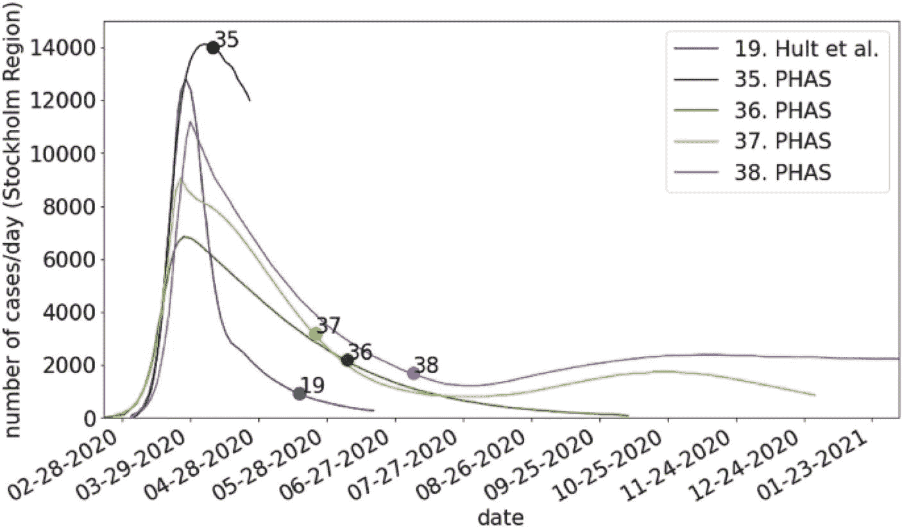
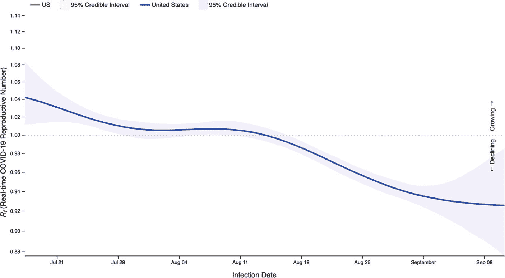

# 4. 得出复杂结论：推断性统计与统计检验

## 引言

实验设计、良好抽样和概率的重要性不言而喻，但二十世纪也为统计检验以及我们评估估计质量的能力带来了巨大进步，这两者共同推动了推断性统计学的发展。相关性和协方差是二十世纪发展出的其他重要概念。计算机将我们从小型数据集带入"大数据"时代。人们在"统计学"这一范畴下学到了许多不同的应用方法，数据科学家在日常工作中严重依赖这些新技术，尽管他们也从事许多超出统计学范畴的工作。

本章将涵盖现代统计学的剩余历史。我们将研究统计学在现实世界中的两个例子，一个来自第二次世界大战，另一个来自 COVID-19 建模。然后，我们将介绍现代统计检验的基础知识，为学习具体检验方法奠定基础。这包括假设检验、`p` 值、第一类错误和第二类错误、检验功效、误差范围、置信区间以及单尾检验和双尾检验。接着，我们将深入探讨一些最常见的统计检验——`Z` 检验、`t` 检验、`ANOVA`、卡方检验以及一些非参数检验。我们将了解显著性检验的工作原理，然后研究相关性和协方差。

## 现代统计学史：第二部分

统计检验方法在二十世纪蓬勃发展。随着概率分布被发现，许多预测和假设检验方法应运而生。正态分布和学生 `t` 分布（与正态分布相关）在早期都至关重要，许多检验都源于这些分布，包括 `Z` 检验、`t` 检验的多种变体、`ANOVA` 和卡方检验。但由于这些检验的局限性（我们必须假设数据呈正态分布，而统计学家知道并非在所有情况下都能如此假设），另一种称为非参数检验的方法也被开发出来。

另外几个重要的技术和概念被定义——第二类错误、置信区间和检验功效，这些都与检验假设相关——我们将在下文讨论它们。随后，极大似然估计 (`MLE`) 和线性判别分析 (`LDA`) 技术被开发出来。`MLE` 使我们能够根据一些已知数据点来估计一个分布（总体）的参数。`LDA` 使我们能够找到一条分隔两个不同数据组的直线。接着，`t` 分布得到了更多关注和发展，另一种衡量相关性的方法也被定义出来。我们稍后也会谈到这一点。所有这些对于该领域的发展都至关重要。

本世纪上半叶的大部分工作都是在相对较小的数据集上完成的。现在学生学习统计学时，他们仍然在处理小数据集上的计算，通常这些数据集小到可以手工完成计算。计算机的出现显然给该领域带来了巨大变革，使得那些手工永远无法完成的、更复杂且耗时的计算成为可能。一些统计软件程序，如 `SPSS`、`Minitab` 和 `Statistica` 被开发出来并沿用至今，尤其受到社会科学家的青睐，而数据科学家、许多精算师以及大量其他计算科学家则在使用 `Python`、`R` 或 `SAS`。

数据分析师和数据科学家的工作并非全部依赖统计学，但其中很大一部分确实如此。该领域仍在不断发展，预示着未来将带来新技术的益处，这些技术可能会使预测等任务更加准确。明智的数据科学家会持续关注统计学领域的最新动态。

## 现实世界中的统计学实例

### 项目 1：德国坦克问题

在第二次世界大战期间，盟军需要了解德军拥有多少坦克和其他武器。潜伏在轴心国地区的间谍收集情报以试图估算每月的生产数量，但他们的估算始终过高。因此，盟军的数学家采用统计方法来估算数量并推断德军坦克和武器的其他属性。

德国坦克和其他武器上印有序列号，盟军能够在损坏或缴获的坦克上看到这些序列号。对序列号做出一些假设是很自然的，包括它们是连续的。换句话说，我们可以假设每个序列号都比前一个序列号大 1。所有序列号的列表代表了所有坦克（"总体"）上所有序列号的一个样本。

他们希望基于一个样本来推断总体大小，尽管他们无从得知该样本与总体之间的关系。有几种过于简单的方法（例如，将最大值加倍或将均值或中位数加倍），但这些方法都不太准确。相反，他们使用了一种称为最小方差无偏估计量 (`MVUE`) 的计算方法，该方法涉及用最大序列号除以坦克总数，然后将最大序列号加到该结果上，最后减去 1。

尽管直到战争结束后才得以确认，但结果证明统计学家的数字相当准确，尤其是与通过传统情报收集到的数字相比——两者的差异常常接近一个数量级，例如一个月生产 250 辆坦克与 1，500 辆，而较低的数字非常接近实际数字。盟军得以在规划中使用较低的估计值。了解德军实际拥有的坦克数量使他们在冒险发动入侵时更加自信，尤其是在诺曼底登陆方面，这是战争的一个主要转折点。

### 项目 2：COVID-19 建模与预测

2020 年初，COVID 首次在中国爆发并开始在全球蔓延后不久，各组织就开始收集病例数据，并试图了解传播模式以及预测新发病例。这项工作对于制定封锁、社交距离和口罩令等公共政策至关重要，尤其是在疫苗问世前的几个月。

但建模面临着诸多挑战，我们中很多人都会记得早期许多预测有多么糟糕。这是第 1 章中讨论的数据质量低下的真实案例。你会在数据科学领域听到“垃圾进，垃圾出”这句箴言，因为它百分之百正确。当时对这种疾病知之甚少，其特性完全未被了解（我们做了大量无效假设），而且检测不一致且有限，导致病例被低估。早期我们甚至不知道它是如何传播的，或者在感染他人之前能存活多久。既然我们连 COVID 在现实世界中如何运作都不了解，那么我们无法将已掌握的信息转化为可用数据也就不足为奇了。请记住，所有数据都仅仅是对现实世界某些方面的抽象。

疾病建模长期以来一直是流行病学的一部分，但它依赖于许多已知因素，如传播率、感染者具有传染性的时长以及死亡率。许多在不同地区出现的疾病，如麻疹和鼠疫，根据以往爆发数据都相当为人熟知。因此，对于像 COVID 这样相对较新的疾病，即使我们开始获得更好的数据，也需要进行大量的推测。科学家们显然会寻找与其他疾病的相似之处（特别是同属冠状病毒家族、包括 MERS 在内的疾病），来为模型定义起点，但 COVID 的表现有所不同（例如，它对儿童的影响并不比对非老年成年人更大，这很不寻常）。科学家们只是利用有限的信息尽力而为。

图 4-1 是早期预测瑞典 COVID 情况的较好案例，其中包含 2020 年 4 月至 7 月间做出的五种不同预测。它们都包含了历史数据，即你在左侧看到的峰值。但你可以看到它们在 4 月之后如何出现差异。一个预测显示病例在 6 月逐渐消失，而另一个预测则显示一年后疫情仍很严重。预测中最大的挑战之一是，你预测的时间越远，对预测结果的信心就越低。而且他们手头只有几个月的数据，却要预测远超这个时间范围的结果，这通常是不应该做的。我们将在第 15 章中详细讨论这一点。

折线图显示了 2020 年 2 月 28 日至 2021 年 1 月 23 日期间斯德哥尔摩地区每日 COVID-19 病例数。x 轴代表日期，y 轴代表每日病例数。五条线代表不同的数据来源：蓝色为“Hult 等人”的数据，黑色、绿色、黄色和紫色为“PHAS”的数据。图表显示 2020 年 4 月左右出现一个峰值，此后病例数随时间逐渐下降。右侧的图例标识了数据来源。

图 4-1

早期预测瑞典斯德哥尔摩 COVID-19 疫情的努力。来源：《用于预测瑞典 COVID-19 大流行早期发展的计算模型：系统综述、数据综合及准确性的二次验证》，作者：Philip Gerlee、Anna Jöud、Armin Spreco 和 Toomas Timpka，发表于《科学报告》12: 13256 (2022)，可于 [`https://www.nature.com/articles/s41598-022-16159-6`](https://www.nature.com/articles/s41598-022-16159-6) 获取。

在最初几个月里，随着不同团队的各种模型涌现，美国疾病控制与预防中心（CDC）开始从众多模型和预测中创建集合预测。*集合机器学习*指的是使用多种算法来得出一个预测或结果。这是一种强大的方法，可以弥补单个模型的弱点，同时仍能从中获益（我们将在第 15 章中进一步讨论）。预测中使用了多种模型——有些是传统的流行病学模型，其他的则是基于统计的模型。

流行病学模型有几种不同类型。这类模型往往比纯统计模型需要更多的假设，因为它们使用了关于疾病行为以及其他因素（如医疗资源可用性和人类行为）的信息。因此，在存在诸多未知因素的情况下，这些模型很难做对。许多早期模型都严重错误，通常高估了 COVID 病例。这些模型也对数据收集问题（如漏报）非常敏感。

统计建模看起来很有前景，但它需要大量数据，因此在有足够数据之前无法真正展开。这些方法可能更简单，因为它们直接着眼于疾病病例数量，并不需要大量外部信息。一些早期方法包括时间序列方法和指数平滑法。这两种方法都将在本书后续章节中介绍，*时间序列分析*是一种经典的统计学方法，用于追踪变量随时间变化的值（想象一个折线图，X 轴是日期，一条线横跨图表中心）。*指数平滑法*是另一种预测方法，它依赖于对以往数据进行加权平均（平均值经过其他一些因素修正）。尽管这些技术有着悠久的历史，但早期的 COVID 模型并不十分准确，不过它们往往仍优于流行病学模型。

统计建模的一个主要缺点是，外部变化（如封锁和疫苗引入）意味着先前的趋势不再适用，因为情况已完全不同。传统统计学方法在处理随时间变化的事件时的另一个重要缺点是，它们无法可靠地预测太远的未来，通常只有几周（不过有了更多数据后，有时可以预测稍长一些的时间）。

科学家们最终意识到，混合方法效果更好——统计模型最适合短期预测，而流行病学模型最适合长期预测。科学家们在这种情况下尽了最大努力，尽管我们现在看到大多数模型在早期都高估了疾病数量。但这提醒我们，当数据科学将对人们产生影响时，尽可能严谨是很重要的。

图 4-2 展示了一个更复杂的模型，它预测了 `R[t]`，即在特定日期一个患者平均导致的新感染人数。截图是在 9 月中旬拍摄的，这就是为什么浅蓝色区域从那里开始向外展开（这是一个 95% 置信区间，我们将在本章后面详细讨论）。

折线图显示了美国随时间变化的实时 COVID-19 有效再生数 (`R_t`)，时间范围为 7 月 21 日至 9 月 8 日。蓝色线代表 `R_t` 值，阴影区域表示 95% 可信区间。图表显示 `R_t` 整体呈下降趋势，从高于 1.04 降至低于 0.92，表明感染率从增长转为下降。x 轴标注为“感染日期”，y 轴标注为“实时 COVID-19 有效再生数”。

图 4-2

一个后来大幅改进的 COVID-19 传播率模型。来源：来自 CDC CFA 建模与预测的“各州当前流行病趋势（基于 R[t]）”，[`https://www.cdc.gov/cfa-modeling-and-forecasting/rt-estimates/index.html`](https://www.cdc.gov/cfa-modeling-and-forecasting/rt-estimates/index.html)

## 统计检验概念

在统计学中，最常见的目的是判断某个处理的效果是否足够强，从而可以声称它产生了真正的差异。这种强度被称为统计显著性，它从技术角度告诉我们，某件事是仅仅因为随机偶然性而发生的，还是我们正在研究的事物带来的真实结果。传统上，这通过 `p` 值和置信区间来衡量，我们稍后将讨论这两者。它可以用于测试网站上某个广告与另一个广告的效果差异，也可以用于考察某个辅导项目是否提高了数学学习困难的高中生的成绩。在实验或研究中，我们使用术语“处理”来指代不同的测试案例——通常是一个对照组和一个或多个其他组。处理在技术上是一个被操控的自变量。例如，在辅导项目的研究中，我们会有一个对照组（未参加辅导项目的孩子）和一个参加辅导项目的组（处理组）。我们将对照组与处理组结果之间的差异称为“效应”。

很多人在寻找某种改进（比如，制定预算是否意味着我们这个月比上个月花了更少的钱？）时，会犯一个错误：他们计算前后的变化，并假定这意味着什么。统计学的一个基本概念是，任何事情中都总存在一定的随机性。如果辅导项目的执行者在项目开始时有 100 名学生，结束时剩下 90 名，并且他们发现其中有 3 名学生的成绩从 D 提高到了 C，而其他学生没有任何变化，我们大多数人本能地知道，这种变化不足以真正说明该项目产生了效果。他们不应该宣称辅导项目是成功的，尽管技术上确实存在改进。此外，如果他们有一个对照组，他们可能会发现对照组中的一些孩子成绩也提高了一个等级。统计检验使我们能够确定某个差异是有意义的（统计上显著的）。即使不进行计算，我们也知道这个辅导项目带来的改善不值得投入时间和金钱。

通过比较相邻两个月的支出来测试预算的想法，存在很多问题。首先，样本量为 1——一个对照组和一个处理组（使用预算）——永远无法得出统计上显著的结果。此外，这是一个容易被混淆的研究——如果我们的汽车保险是每季度支付而不是每月支付，而上个月刚好需要支付，那该怎么办？这将是一笔我们本月不需要支付的大额开支。其他费用（如租金、车贷、有线电视费）是每月固定的，难以轻易调整。你需要将支出缩小到可调整的类别，比如食品杂货或娱乐。

### 假设检验

历史上，测试统计显著性是通过以一种特定的方式构建所研究的问题来进行的，这种方式起初可能看起来有点奇怪，但它为统计分析建立了一种共同的语言。这被称为假设检验，因为我们从一个被称为零假设（记作 H[0]）和一个备择假设（记作 H[1]）开始。*备择假设*代表我们正在寻找的效应，例如辅导项目是否提高了成绩。*零假设*则相反——它表示没有显著效应，或者说辅导项目对成绩没有影响。我们通常的说法是，假设检验的目标是看我们能否拒绝零假设，这意味着我们相信备择假设为真，并且存在显著的效应。

### p 值与效应量

最著名的统计度量之一是 `p` 值，尽管它并不一定被广泛理解。`p` 值是一个概率值，或者说是一个介于 0 和 1 之间的数字，用于表示仅凭偶然性获得特定结果的可能性。如果它是一个较小的数字，那就意味着该结果“偶然”发生的可能性不大——也就是说，没有合乎逻辑的原因（例如假设很可能为真）。人们有时会误解它，将其视为错误可能性的百分比。我们提到过随机性在统计学中具有重要意义，而 `p` 值帮助我们处理这个问题。`p` 值的一个常见阈值是 0.05，这基本上意味着，如果零假设实际上为真，那么你将同一研究进行 20 次，由于随机性，这个效应不会在超过 1 次的研究中出现。

一些统计学家开始质疑将 `p` 值作为如此普遍的度量。例如，假设我们想要了解一位外科医生的水平，并设置了以下检验：

*   **H**[**0**]：这位外科医生并非顶尖高手。
*   **H**[**1**]：这位外科医生是顶尖高手。
*   在衡量了其在数十次手术中的表现后，我们计算出 `p` 值为 0.025，这低于常见的 0.05 截断值，意味着我们可以拒绝零假设并得出结论：这位外科医生是顶尖高手。

这并不意味着该外科医生有 97.5% 的成功率。相反，它的意思是，如果这位外科医生真的不是顶尖表现者，而我们衡量其表现 20 次，他表现出顶尖水平的次数不会超过 1 次。

但这种“每 20 次中可能会有 1 次错误地将某效应视为成功”的想法令一些人担忧。`p` 值也不能说明具体的检验对于我们正在研究的问题是否合理。另一个主要问题是，在不调整研究的情况下，对原始备择假设的细微变体进行多次 `p` 值检验，可能会导致虚假结论。

由于 `p` 值的局限性，一些人开始报告*效应量*，它只是衡量你发现的统计显著效应的大小或影响程度的一个指标。这个度量可以在一定程度上帮助你摆脱对 `p` 值的依赖，因此分享它往往很有价值。

