# 18. 一种全新的叙事方式：数据可视化与演示

## 引言

可视化是数据科学的重要组成部分，尽管许多数据科学家并不需要频繁构建大量图表。这取决于具体岗位职责，但每位数据科学家至少偶尔都需要创建一些可视化。数据分析师则会发现自己需要构建许多图表。有些团队设有专职人员，负责根据数据科学家和数据分析师的工作成果搭建仪表板。无论你是否亲手创建可视化，理解如何制作优秀的可视化都至关重要。

可视化往往威力强大，常常能在瞬间让表格和数字需要大量解释才能说明白的事情变得一目了然。在第 2 章中，我提到挑战者号航天飞机工程师所使用的图表未能说服领导层推迟次日发射，而正确的图表本可以做到。你将在下文第一个例子中看到，可视化在呈现拿破仑远征俄国这场灾难时有多么震撼。知道何时创建可视化、创建哪种可视化才能有效传达观点，是一项无比宝贵的技能。

在本章中，我将探讨优秀可视化与演示的构成要素，并涵盖丰富的图表、表格和地图类型。一条提示是：一切都围绕用数据和发现讲述故事。最后，我将介绍 Tableau 和 Power BI，这是当今最流行的两种专业可视化工具。

# 现实世界中的数据可视化示例

在本书前面章节中，我举过几个强有力可视化的例子。第一个在第 2 章，我展示了一张简单的图表，它本可以更清楚地向决策者揭示低温下挑战者号发射的风险。然而，担心 O 型环在寒冷天气中性能的工程师们分享的图表只讲述了部分故事，并未说服管理层。第二个例子在第 5 章，是约翰·斯诺绘制的 1854 年伦敦霍乱死亡地图，这张图帮助他们识别出疾病源头是宽街水泵。一旦封住水泵，疫情便告终结。

现在，我将再讨论两个例子，一个回顾历史，另一个提醒我们可视化的重要性。两者都很棒，因为它们展示了正确可视化能产生多么巨大的影响。第一个是拿破仑向莫斯科进军的示意图，这是一场代价数十万生命的灾难性战役。第二个是著名的"安斯库姆四重奏"图解，它强调了超越基础描述性统计的重要意义。

## 示例 1：战争蠢行的视觉记录

尽管拿破仑·波拿巴被认为是最杰出的军事领袖之一，但他远征莫斯科的企图在他返回巴黎后，连他自己都承认是一场毫无意义且彻头彻尾的灾难。这次进军让拿破仑一无所获，却付出了数十万人的生命代价。关于具体数字很难达成一致，但大多数人认同拿破仑最初率领 45 万大军，而最终不到 10 万人返回家园。`图 18-1` 是 1869 年由法国人查尔斯·约瑟夫·米纳尔制作的一幅著名可视化作品，清晰地揭示了这场灾难的惨烈程度，这是单纯数字无法做到的。上方的米色线条代表从法国（左侧）到莫斯科（右侧）的进军路线，随后返回路线以黑色表示。

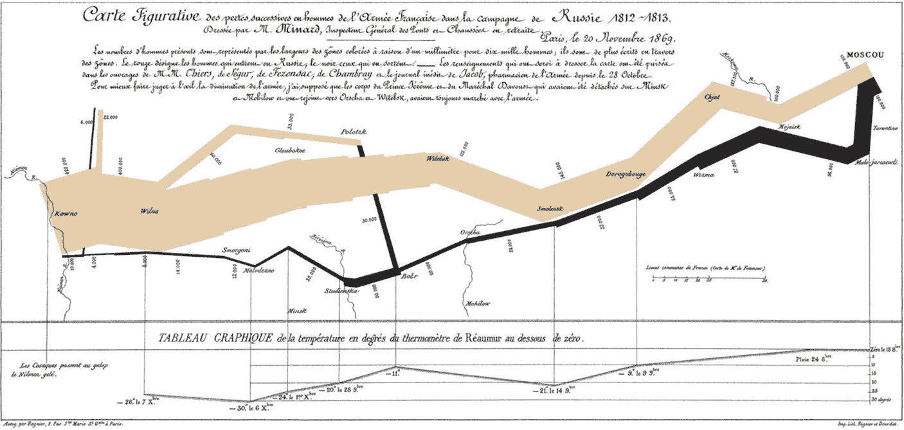

查尔斯·米纳尔绘制的拿破仑 1812-1813 年俄国战役流程图。该图展示了拿破仑军队在进军和撤离莫斯科时兵力规模的变化，条带宽度代表部队人数。米色条带表示进军，黑色条带表示撤退。图中标注了科夫诺、斯摩棱斯克和莫斯科等关键地点。下方温度图反映了撤退期间面临的严酷条件。该图表结合了地理与统计数据，以传达惊人的部队损失。

`图 18-1`

查尔斯·米纳尔对拿破仑灾难性莫斯科远征的再现。来源：摘自"File:Minard.png"，可在[`https://en.wikipedia.org/wiki/File:Minard.png`](https://en.wikipedia.org/wiki/File:Minard.png)获取，属于公共领域

军队于 1812 年初夏进入俄属立陶宛。俄国当时采取焦土撤退政策，因此军队觅食极为困难，甚至在进军早期就有士兵因疾病死亡。疾病从未消失，但他们仍继续向莫斯科挺进。8 月发生了一场战斗，拿破仑获胜，但约 9000 名士兵阵亡。9 月，他们在接近莫斯科时再次交战，35000 名法军阵亡，俄方伤亡更重（这被认为是现代战争史上最惨烈的单场战役之一）。拿破仑与约 10 万士兵占领了几乎完全空无一人的莫斯科。当地人在第二天焚烧了城市，约四分之三的区域被毁。拿破仑逗留数周，但食物获取困难，饥饿依然是大问题，疾病也持续困扰着他们。最终军队于 10 月底开始返乡。现代数据与图表上的数字在此存在差异，但众所周知，在返乡途中，深冬严寒降临在这支衣衫单薄的疲惫之师上，造成了巨大伤亡。饥饿、疾病和极端天气意味着只有极小部分士兵得以返回家园。

这幅可视化作品或许没有在实质上改变任何政策，但它极其清晰地揭示了那场战役的惨状，令人一目了然，远胜于查看表格和更简单的图表。通常，当你想展示某件事时，总存在一个完美的可视化方式，尽管找到它并不总是那么容易。

### 示例 2：统计上相同的数据，不同的面貌

描述性统计功能强大，人们长期以来一直用它来理解和描述数据。但是，正如统计学家弗朗西斯·安斯库姆（Francis Anscombe）在 20 世纪 70 年代绘制的四个简单却发人深省的图表所展示的那样，仅依赖单一视角是有风险的。他创建了四个不同的数据集，每个数据集都包含两个变量，且所有这些数据集都具有相同的基本统计特征（两个变量的均值与样本方差、两者之间的相关性、线性回归线以及回归的决定系数）。然后，他为每个数据集绘制了散点图，如`图 18-2`所示。

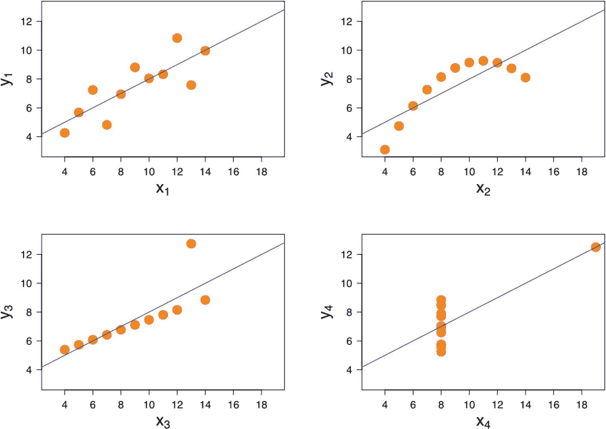

四面板 X-Y 图表，展示了具有相似线性回归线的不同数据集。每个面板显示一个散点图，包含橙色数据点和代表线性拟合的蓝色线条。左上角的图表绘制了`y_1`对`x_1`的散点图，显示出适度的正相关性。右上角的图表绘制了`y_2`对`x_2`的散点图，数据点呈曲线分布。左下角的图表绘制了`y_3`对`x_3`的散点图，除一个离群点外，大部分点沿直线聚集。右下角的图表绘制了`y_4`对`x_4`的散点图，数据点呈垂直聚集。每个坐标轴都标有相应的变量名称。

`图 18-2`

安斯库姆四重奏：四个图表展示了具有相同统计特性的不同数据集。来源：改编自“Anscombe’s quartet 3.svg”，可在[`https://en.wikipedia.org/wiki/File:Anscombe%27s_quartet_3.svg`](https://en.wikipedia.org/wiki/File:Anscombe%2527s_quartet_3.svg)获取，采用知识共享署名-相同方式共享 3.0 未本地化版本许可协议（[`https://en.wikipedia.org/wiki/en:Creative_Commons`](https://en.wikipedia.org/wiki/en:Creative_Commons)）。

这些图表让人立刻看出，这些数据集实际上并不相似，每个数据集都有其独特的特征。左上角的图表是我们所习惯看到的——数据散布开来，呈现出一种我们似乎能感知到的总体线性趋势。也许线性回归确实能告诉我们一些有用的信息，但我们确实需要更多数据才能确定。右上角的图表则清晰地显示了非线性数据，图上绘制的线性回归线看起来非常荒谬。显然，线性回归并非处理这些数据的正确方法。左下角的图表也很有趣，因为数据看起来极具线性，但一个离群点就完全扰乱了全局。很可能，线性回归是一种适用于这些数据的好技术，但在运行回归之前需要剔除那个离群点。但是，我们不应忘记它——需要记住这个数据集存在极端离群点。右下角的图表同样有趣，一个极端离群点也扰乱了图表，使得运行线性回归成为可能。实际上，变量`X`在任何模型中很可能都没什么用，因为它几乎总是同一个值——8。将其转化为一个“是否为 8”与“是否非 8”的二值特征可能更有用。

这些图表提醒我们，可视化既可以揭示问题、至关重要，同时也提醒我们，绝不应该对数据采取短视的看法，在没有先了解数据本质的情况下就随意运行相关性分析、线性回归或其他分析。

## 用数据讲故事

在正式展示你的发现之前，通常需要先制作一些可视化图表。但在制作幻灯片来展示你的发现之前，真正需要做的是决定你要向利益相关者讲述什么故事。你绝不应该只是把一堆图表和表格丢进幻灯片里就完事了。叙事在哪里？

有时人们会有点过度，试图将“用数据讲故事”与虚构故事中的叙事类比起来，我认为这没有必要。但是，拥有一个叙事脉络，意味着从一个想法过渡到另一个想法，并沿途触及关键点。通常，你需要依次回答以下这些问题：

1.  我们提出的问题或需要解决的问题是什么？
2.  我们拥有哪些信息可以帮助我们回答问题/解决问题？
3.  我们可以进行哪种模型或分析来回答问题/解决问题？
4.  答案/解决方案是什么？
5.  我们对该答案/解决方案有多大的信心？
6.  下一步的行动是什么？
7.  该解决方案的商业影响是什么？

这些也是你在汇报项目成果时需要回答的问题。从#1 开始，设定初始状态。我们试图解决的问题是什么？永远、永远、永远要回归到商业案例上。有时需要提醒人们他们为什么要听这个演示，特别是当你并非定期与这些人合作时。

在很多情况下，最好解释一下你用来解决问题的材料，如#2 所述。此处细节的详略程度取决于你的听众，但大多数利益相关者会想知道你使用了哪种类型的数据。他们可能想知道这是一个他们已经熟悉的数据源，还是一个他们自己也能使用的数据源。有时，他们还希望根据自己对数据源的了解来判断你的结果的可靠性或可信度。

通常也需要解释你是如何解决问题的，即#3。这时你会谈论技术细节，但要根据你的听众来定位合适的技术深度。你可能只是提到你对数据做了一些清理和修改，然后将其输入到一个机器学习模型中；或者你可以更具体地告诉他们使用了哪些模型，甚至展示模型结果（如线性回归公式或训练好的决策树）。请记住，我们所做的工作中有很大一部分是“隐性”的，因此这里的要点之一就是传达出我们做了大量工作，即使你并未提供太多细节。这一切都取决于如何迎合你的听众。

接下来，你将实际展示解决方案本身，即#4。解释你发现了什么，为什么它很重要，做出了哪些假设，信心水平如何，以及是否存在需要注意的任何弱点或局限性（这是#5 涉及的内容）。如果你要提出建议，也应在此处给出。这通常是演示文稿的主体部分，因为这正是项目的全部目的。此处的具体内容也取决于你正在进行的分析类型。描述性分析主要是图表和摘要，诊断性分析包括你发现的解释，预测性分析包括你的预测，处方性分析包括你的建议。

最后，通常会明确下一步行动，如#6 所述。如果项目仍在进行中，这些将是你下一步计划要做的工作（或供讨论的选项）。如果项目已经结束，这可能只涉及维护，或者可能真的没有更多工作可做。列出一些未来项目中可能做的事情仍然是常规做法。

如果项目完成至今已有足够的时间，那么#7 就是你谈论实际影响的地方。在商业领域，通常最好能以某种方式量化这种影响。

以故事形式讲述的要点之一不仅是条理清晰、逻辑严谨，故事还能在情感上打动人心，而单纯陈述事实通常无法做到这一点。当你向合适的利益相关者讲述你的解决方案时，甚至可以谈谈摸索过程中的挣扎以及最终如何取得胜利。这在向高层领导做简短汇报时可能并不合适，但那些定期与你开会的利益相关者或许会欣赏这种讲述方式。

请注意，可视化内容可能出现在这一过程的任何步骤中，尽管第 4 步应该包含最多。但切记不要用接二连三的可视化内容让听众应接不暇。利益相关者寻求的是帮助，以做出更好的决策。作为数据科学家，我们的职责是找到能够帮助他们的信息。显然，这可以有多种形式。在一个更侧重于理解过去和现在所发生事情的项目中（这将涉及数据分析类工作，可能还需要一些出色的可视化图表），沉浸于`EDA`的数据科学家很容易偏离最终目标。探索性工作固然重要，但我们真正想做的是创建解释性可视化图表，这些图表不仅能告诉我们“是什么”，还能揭示带有原因——即可被理解的解释——的联系。我们需要通过`EDA`来理解数据，找出最佳方式，发现那些能够向利益相关者解释有价值信息的有趣内容。

接下来，我将讨论你在叙事过程中可以制作的各种可视化图表，以及如何使它们发挥最大效用。

## 可视化图表的类型及其优秀之处

在第 2 章介绍描述性统计时，我已经讨论了几种基础但可靠的可视化图表。我将重温其中一些图表，并探讨它们在此处为何有效。我们还会研究图表的许多变体以及一些不常见的类型。但首先，我将讨论一些更普遍意义上的、能让图表变好的因素，以及一些需要避免的事项。

### 什么样的可视化是好的？

你需要知道你的可视化图表是为谁而作，以及你的利益相关者为何需要它。这意味着要了解你的受众，并尽可能做到具体。如果你想向你的数据科学家同事和高层领导展示同样的基本信息，很可能应该准备两种不同且独立的可视化图表。他们需要这个可视化图表的原因，显然与你试图向他们展示的内容相关。通常，当你制作可视化图表时，是为了帮助人们更好地理解某事，或帮助他们做出决策。

制作可视化图表时，另一个追求的目标是简洁——任何可视化图表都应在传达所需信息的前提下，尽可能做到简单。举一个大的禁忌为例，人们常常忍不住通过制作 3D 效果来“锦上添花”。往好了说，这是不必要的干扰；往坏了说，它会扭曲你所绘制的实际数值。要看出这一点，请看一下`图 18-3`，该图显示了同一个饼图的 2D 和 3D 版本，它们被平均分成三份（每个扇区包含相同数量的项目）。在左侧的 2D 版本图表中，比例一目了然，很明显它们各占饼图的三分之一。但在右侧的 3D 版本图表中，离我们最近的扇区看起来比另外两个更大。我发现，即使知道它们大小相同（而且我自认为数学头脑不错，空间感知能力良好），它*感觉上*还是更大。想象一下，如果这些扇区大小不一——那么大多数人的大脑基本上不可能在不付出巨大努力的情况下做出正确调整来准确解读。如果理解一个图表需要费很大力气，那它就不是一个好的图表。

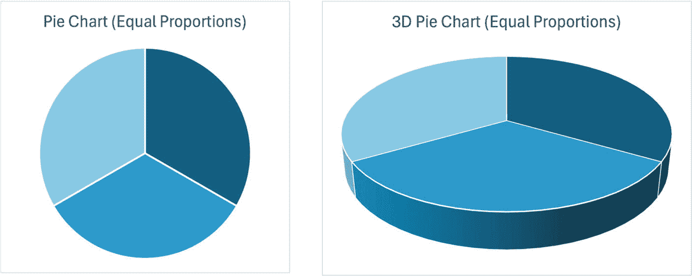  
`图 18-3`  
一个由三个等尺寸扇区组成的饼图：2D 版本和 3D 版本

### 散点图

`图 18-4` 展示了一个最基础图表——散点图的示例，我们在第 2 章中已经见过。它只是简单地将两个变量相互对应绘制，一个在 X 轴上，另一个在 Y 轴上。这是一种快速查看两个特征如何相互关联的方式——一个变量增大时另一个也增大，还是相反？或者根本不存在关联？散点图在商业中实际应用不多，但在科学领域更为常见，数据科学家在进行探索性数据分析（`EDA`）时也经常使用。

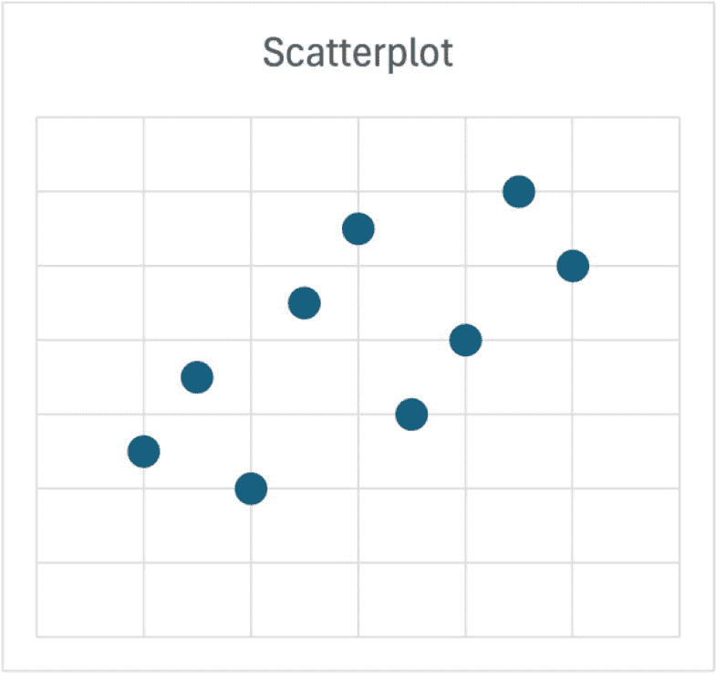

散点图，展示分布在网格上的一系列数据点。数据点呈现出正相关趋势，顶部标题为“散点图”。该图用于可视化两个变量之间的关系。

`图 18-4`：一个散点图

在`图 18-4`中，似乎呈现出正相关关系，两个变量同步增长。散点图也能很好地展示当变量之间没有明确关联的情况。创建散点图时，注意比例尺很重要——虽然设置任何图表的坐标轴都可能需要一些技巧，但通常最好尽量让两个坐标轴的刻度比例与数据的整体范围相匹配。此外，只展示部分数据可能会产生误导。请查看`图 18-5`中散点图的示例，当排除部分数据时，其呈现的形态可能会完全不同。

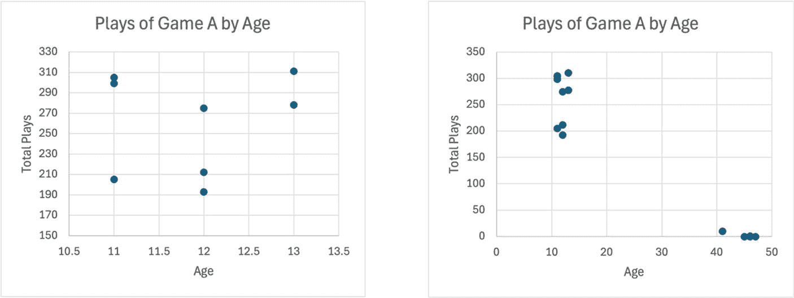

散点图，包含两个子图，标题为“游戏 A 的游玩次数按年龄分布”。左侧子图显示年龄在 10.5 至 13.5 岁之间的数据点，总游玩次数在 150 至 330 之间。右侧子图显示年龄在 0 至 50 岁之间的数据，总游玩次数在 0 至 350 之间。两张图都展示了年龄与总游玩次数之间的关系，但数据点分布不同。

`图 18-5`：两个不同坐标轴的散点图

在左侧图表中，年龄看起来分布相当分散，总游玩次数也高低不一。但是，当我们仅仅加入五个关于年长玩家的数据点后，首先，很明显第一个图表中的玩家年龄相对于人类的年龄范围来说较低。同样地，我们也能看到较年轻玩家的游玩次数远高于年长玩家。

我在第 2 章中讨论过散点图的两种变体，可以结合使用，使得在同一个图表上最多能绘制四个特征。这是通过为数据点添加颜色和/或大小来实现的。对于不同大小的数据点，我们通常称之为气泡图。

颜色既可以用于分类变量，也可以用于数值变量。对于分类变量，该变量的每个取值都对应一个图例中列出的离散颜色。对于连续变量，则使用单色渐变（也可以使用多种颜色渐变，但单色从浅到深更常见）。`图 18-6`显示了一个气泡图，表示了四个变量：年龄（X 轴）、总游玩次数（Y 轴）、性别（颜色）和评分（气泡大小）。为了清晰起见，气泡采用了半透明效果。

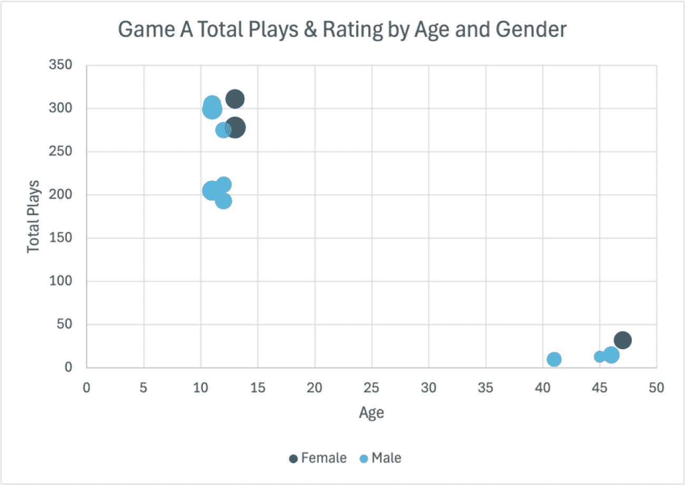

气泡图，标题为“游戏 A 的总游玩次数与评分按年龄和性别分布”。X 轴代表年龄，范围从 0 到 50；Y 轴代表总游玩次数，范围从 0 到 350。气泡按性别着色：深蓝色代表女性，浅蓝色代表男性。大多数气泡集中在 10 至 15 岁年龄段，总游玩次数在 200 到 300 之间；少数气泡分散在 45 岁左右，总游玩次数较低。

`图 18-6`：使用颜色和大小的四特征气泡图

散点图具有一定的灵活性，但请记住，许多商务人士对此并不熟悉，因此请务必留意你的利益相关者是否接受这类图表，以此判断它们是否适合你的受众。

举个例子，我们可以回顾一下第 2 章中的图表，图 2-8，此处作为`图 18-7`再次引用。它展示了儿童身高和性别的散点图。这是一个非常简单的图表，仅显示了年龄、身高和性别三个特征。通过观察，我们可以看到身高随着年龄的增长而呈现上升趋势。从现有数据来看，女孩和男孩的身高在 14 岁左右之前差异不大，而 14 岁之后女孩的身高趋于平稳，但男孩的身高则继续增长，超过女孩。

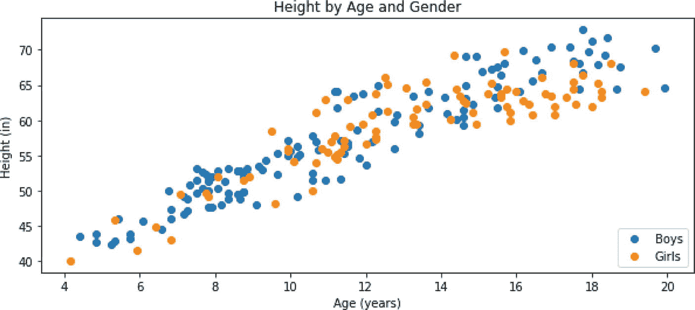

散点图，标题为“身高按年龄和性别分布”，展示了男孩和女孩年龄与身高的关系。X 轴代表年龄（以年为单位），范围从 4 到 20；Y 轴代表身高（以英寸为单位），范围从 40 到 75。蓝点代表男孩，橙点代表女孩。数据点呈现整体上升趋势，表明无论性别，身高都随年龄增长而增加。右下角的图例标识了男孩和女孩对应的颜色。

`图 18-7`：儿童身高与性别

虽然这可能是潜在有用的信息，但它并没有解释太多——我们早就知道男孩进入青少年时期后身高会超过女孩。此外，我们还可以发现，这个数据集中 11 岁以下的女孩似乎比男孩少。如果我们有更多女孩的数据，是否可能会注意到更年幼孩子之间的身高差异？这很难说。尽管这张图本身没有错误，但也没有什么特别吸引人的地方。除非利益相关者有特别要求，否则这张图可能不应该出现在发给他们的报告中。

### 柱状图与条形图

另一类主要展示单个变量（在最基础形式下）的重要图表是条形图。条形图是最直观的图表之一，既可以是水平方向，也可以是垂直方向（通常称为柱状图）。你可以在`图 18-8`中看到这两种不同的版本，它们显示了相同的数据。

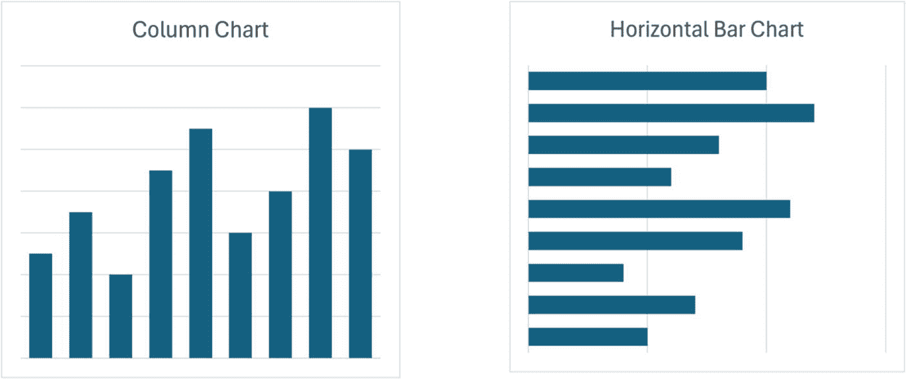

两个条形图并排显示。左侧图表是高度变化的垂直柱状图，标注为“柱状图”。右侧图表是长度不同的水平条形图，标注为“水平条形图”。两个图表都使用蓝色条形来代表数据值。

`图 18-8`  
垂直与水平条形图

你所绘制的数据通常能帮助你决定是采用垂直还是水平方向。通常这无关紧要，但在一种情况下你可能会选择水平方向，那就是当你的标签特别长时。对比图 18-9 中的两个图表。通过旋转图表以容纳左侧过长的 X 轴标签，便得到了右侧更易读的图表。

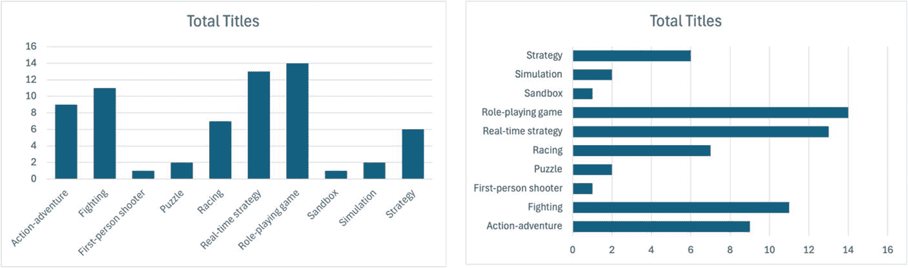

两个标题为“游戏总数”的条形图展示了不同游戏类型的数量。左侧图表是垂直的，显示的类型包括动作冒险、格斗和角色扮演游戏，其中角色扮演游戏数量最高。右侧图表是水平的，列出的类型包括策略、模拟和赛车，其中角色扮演游戏和即时战略游戏数量最高。两个图表都突出了不同类型中游戏数量的分布情况。

**图 18-9**  
按类型划分的视频游戏总数两种视图

调整这些基础条形图有多种方法，但需要注意一些最佳实践。通常认为，条形图的 Y 轴最好始终从 0 开始，否则可能会产生误导，让人难以快速理解条形之间的差异。此外，你可能见过一些图表中条形带有断点（通常是一条锯齿线），表示刻度发生了跳跃——这通常不被推荐，因为它破坏了视觉理解。这通常发生在某个条形远大于其他条形（即异常值）时，但通常更好的做法是保留较长的条形，并为其他条形添加标签，以便看清数值。你也可以另做一个图表，只显示非异常值的条形，这样更容易区分它们。

如果不在条形图中显示 Y 轴标签，而是将数值放在条形顶部，也是可行的。如果条形不多，这种方法尤其有效。例如，参见图 18-10，这是相同数据的两种视图。两者差异不大，但只有三个柱状图时，右侧的图表读起来更快。

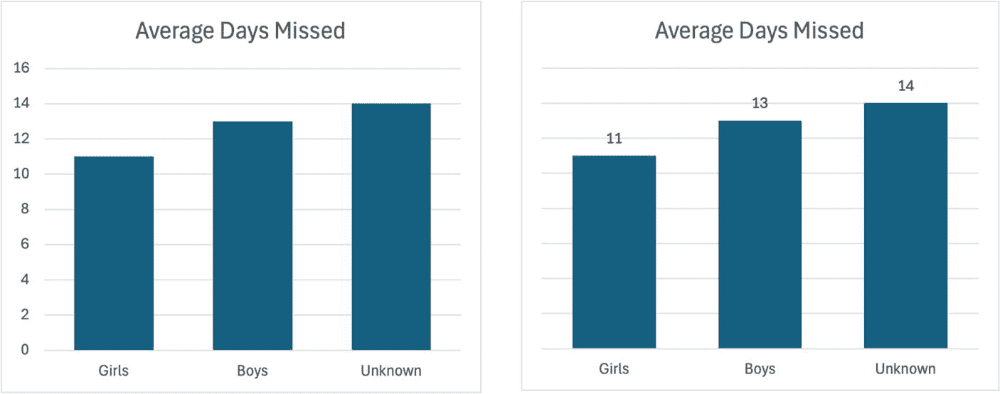

两个标题为“平均缺勤天数”的条形图比较了三组（女生、男生和未知）的平均缺勤天数。左侧图表显示女生约 12 天，男生约 13 天，未知约 14 天。右侧图表明确指出女生 11 天，男生 13 天，未知 14 天。

**图 18-10**  
一个小型柱状图的两种视图，展示了某个项目的学生缺勤情况

我们在第 2 章中讨论过其他类型的条形图。我们可以简单地分别显示多个分组，也可以将它们堆叠起来。选择哪种视图更合适取决于所展示的内容。我们将从观察不同分组的多个条形开始。假设我们使用在图 18-10 中看到的相同基础数据，即按性别分列的学生缺勤情况。如果我们增加一个按年份的细分，就有几种不同的方式来查看这些数据。请参见图 18-11 了解其中两种最基本的方式。

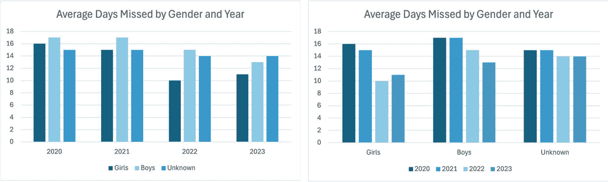

比较按性别和年份分列的平均缺勤天数的条形图。左侧图表显示了 2020 年至 2023 年女生、男生和未知类别的数据。右侧图表显示了相同年份的数据，但按性别类别分组：女生、男生和未知。两个图表都突出了不同年份和性别之间缺勤天数的变化。

**图 18-11**  
按性别和年份查看多年缺勤数据的两种方式

请注意，我们将分组数据聚类在一起。我们的数据同时按性别和年份进行了细分。在左侧图表中，我们将三种性别并排放置，并分别查看每年的情况。右侧图表的做法相反，将年份并排放置，每种性别分开显示。两个图表都相当容易看出缺勤率总体随时间下降的趋势，但通过右侧图表来理解每种性别自身的变化趋势要容易得多。

另一种常见的视图是堆积条形图，它将多个组包含在同一个条形中，这样我们既能看清各组的数量，又能立即看到总量。参见图 18-12 了解基本堆积柱状图的示例。两个不同的组被加在一起，我们可以看出每个组代表的数量以及总体总数。

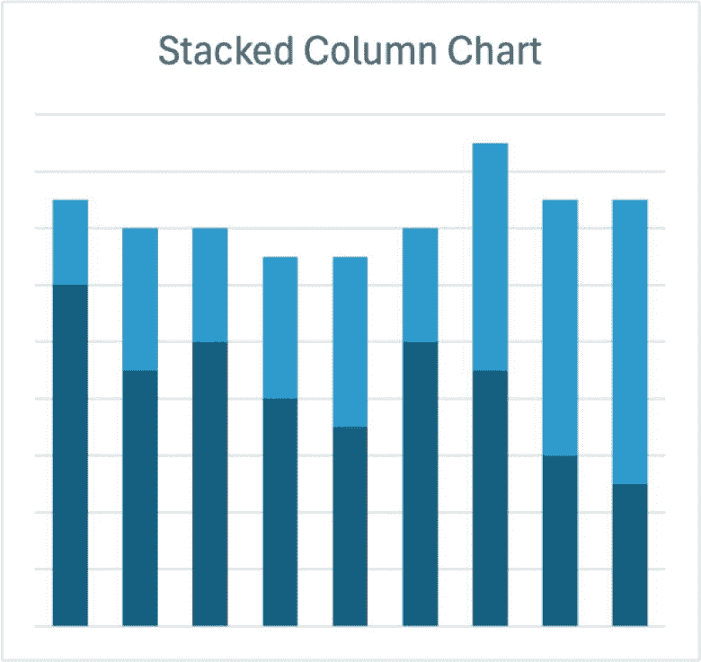

堆积柱状图显示多个垂直条形，每个条形被分成两个深浅不同的蓝色段。图表标题为“堆积柱状图”。这些条形代表跨类别的比较数据，其中较浅的蓝色段堆叠在较深的蓝色段之上。

**图 18-12**  
堆积柱状图

在我们的例子中，我们可以查看图 18-11 中两个图表的堆积版本。请参见图 18-13 了解图 18-11 中右侧图表的堆积版本。这清楚地表明男生的缺勤总数最多，但很难对每个单独的年份得出更多结论。折线图通常更自然地适合展示随时间的变化。

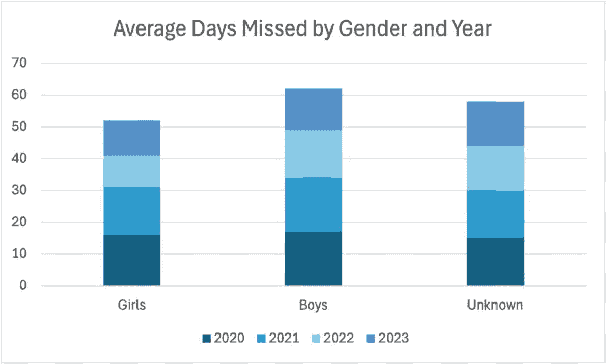

标题为“按性别和年份分列的平均缺勤天数”的堆积条形图。它展示了 2020 年至 2023 年女生、男生和未知类别的数据。每个条形被分成代表年份的四段，使用深浅不同的蓝色。Y 轴范围从 0 到 70 天。图例指示了每个年份的颜色：2020 年（最深的蓝色）、2021 年、2022 年和 2023 年（最浅的蓝色）。

**图 18-13**  
一个按年份和性别分列的平均缺勤天数堆积条形图

有一种更好的方式来利用这个想法，使得观察内部各组的变化更容易。图 18-14 展示了一种视图，其中每个内部组都有自己的条形，从而更容易观察每个组内的变化。这被称为“小多组图”。

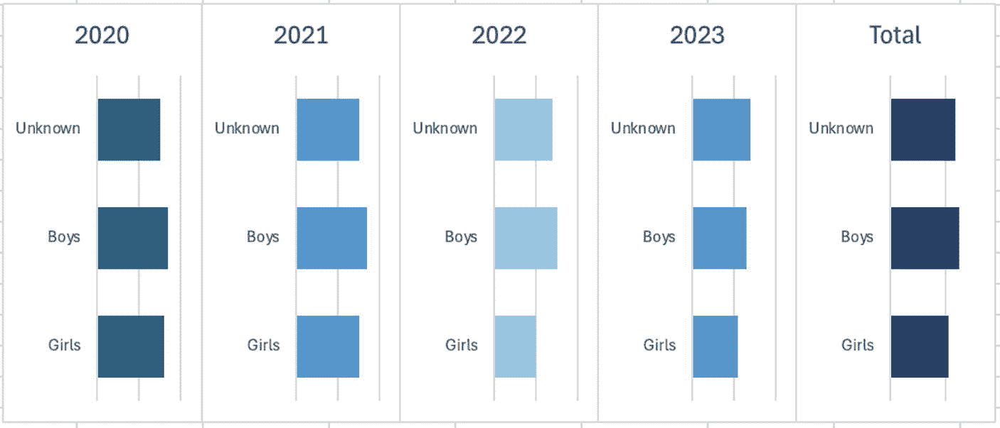

条形图显示了 2020 年至 2023 年的数据以及一个总计列。每年都有三个类别：未知、男生和女生，由深浅不同的蓝色水平条形表示。该图表展示了这些类别在历年中的分布情况，其中总计列汇总了数据。

**图 18-14**  
一组小型多线图，展示了堆叠柱状图的替代方案，便于观察各组间的趋势

当你计划使用堆叠柱状图时，需要谨慎确保数据适合这种视图——要确认将数值相加是有意义的。图 18-15 展示了一个不应堆叠的数据示例。图 18-15 左侧的图表显示了我们在图 18-11 右侧图表中看到的数据，但将其修改为展示缺勤天数百分比而非总数。图 18-15 右侧的图表是一个无效的堆叠柱状图——以这种方式添加百分比是没有意义的。

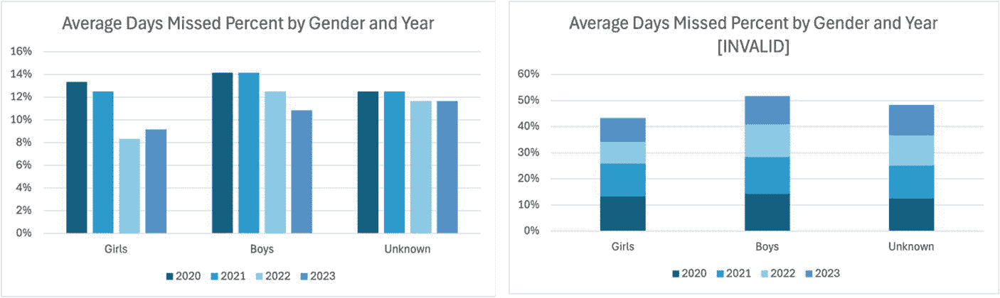

柱状图展示了“按性别和年份划分的平均缺勤天数百分比”。左侧图表显示了 2020 年至 2023 年女生、男生和未知类别的数据，百分比范围从 0%到 16%。右侧图表标记为“[无效]”，展示了相同类别和年份的堆叠柱状图，百分比高达 60%。每年用不同深浅的蓝色表示。

**图 18-15**  
一个多组柱状图和一个无效的堆叠柱状图

另一种值得一提的柱状图是 100%堆叠柱状图。它与堆叠柱状图相同，但每个数值不是以原始数字表示，而是以该点总和的百分比表示。图 18-16 展示了几张与图 18-13 相似的图表，我们可以从中看到缺勤的原始计数而非平均值。

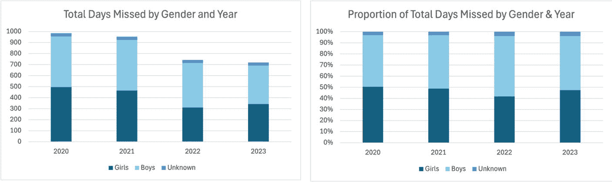

柱状图展示了 2020 年至 2023 年按性别和年份划分的总缺勤天数。左侧图表显示绝对数值，右侧图表显示比例。类别包括女生、男生和未知，用不同深浅的蓝色表示。两张图表均显示了逐年趋势，x 轴标记年份，y 轴标记天数或百分比。

**图 18-16**  
两张图表分别展示了按性别和年份划分的缺勤天数原始总数和比例天数

左侧图表仅是按年份和性别分解的原始数值。该组中有 31 名女生、27 名男生和 2 名未知性别者。有趣的是，尽管女生人数更多，但男生的缺勤天数却更多。通过观察平均值可以更清楚地看到这一点。但有时我们只想查看总数。右侧图表显示了相同的数据，但原始值被转换为百分比，因此每列展示的是女生、男生和未知性别学生缺勤天数占所有缺勤天数的比例。

柱状图和条形图还有很多变体，因为它们非常灵活。如果这些都不适用，你可以在线深入探索。你也可以在 `Excel` 或 `Google Sheets` 等快速程序中使用一些数据来尝试所有不同的变体。此外，还可以组合不同的图表，例如在条形图上添加一条代表平均值或目标等重要数值的折线。

# 折线图及相关图表

标准折线图广为人知，但有一些修改方法以及一些相关的图表可能非常有用。本节我将讨论折线图、面积图和斜率图。

## 折线图

折线图是展示随时间变化的非常有效的方式。只要你不试图在一张图表上放置太多线条或进行过于复杂的操作，它们就直观且易于理解。X 轴通常是时间，且需要间距一致（你不能在同一张图表中先按年显示，然后突然切换到按月显示）。线条不必都从同一时间点开始或结束。一个经验法则是，在一张图表上放置超过四到五条需要清晰识别的线条可能会变得难以处理。图 18-17 展示了几张典型的折线图，左侧有一条线，右侧有两条线。

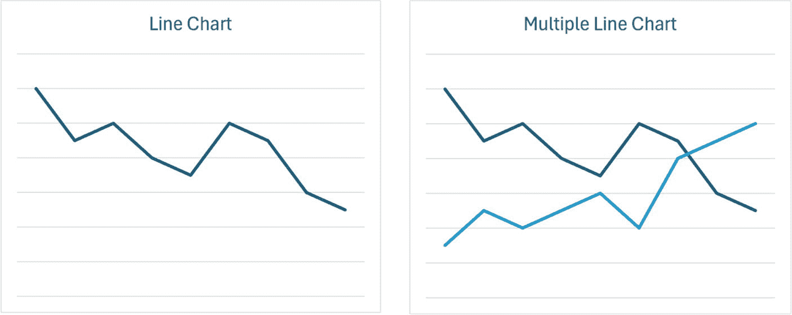

两张并排的图表：左侧图表标记为“折线图”，显示了一条呈下降趋势的单一折线。右侧图表标记为“多折线图”，包含两条重叠的折线，一条深蓝色，一条浅蓝色，显示出不同的趋势。两张图表都有水平网格线作为参考。

**图 18-17**  
单一折线图与多折线图

有时，即使柱状图和折线图都可行，折线图也可能比柱状图更直观。回顾图 18-11 中的左侧图表。我在图 18-18 中将其重新制作为折线图。

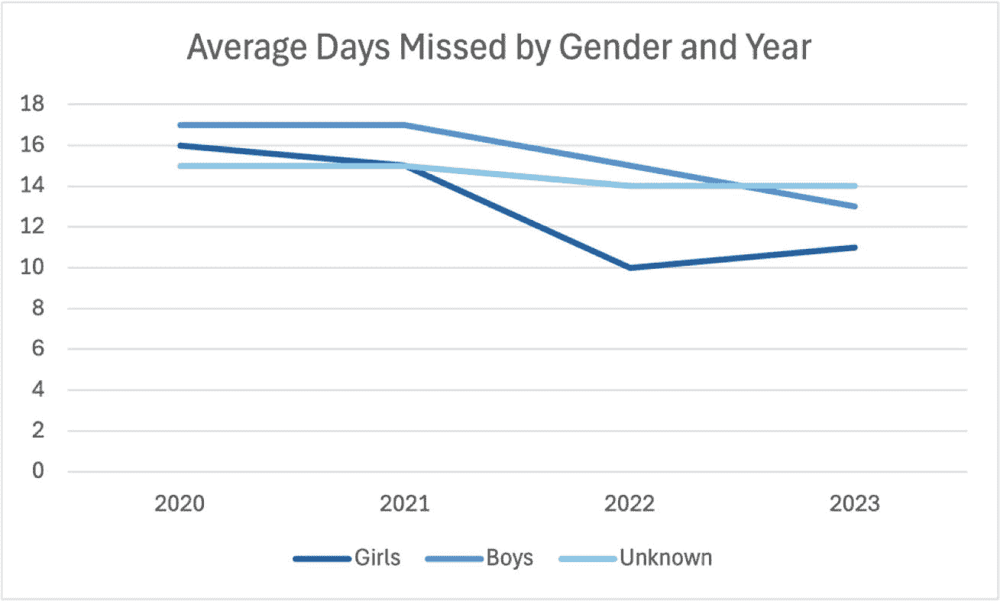

折线图标题为“按性别和年份划分的平均缺勤天数”，展示了 2020 年至 2023 年的数据。三条折线代表不同组别：女生、男生和未知。图表显示，所有组别的平均缺勤天数整体呈下降趋势。2020 年，女生和男生均从约 16 天开始，男生下降幅度更大，到 2022 年降至约 10 天，之后略有增加。未知组保持相对稳定，随时间略有下降。

**图 18-18**  
按性别和年份查看多年缺勤情况的另一种方式

你常会听说，折线图上的线条不应超过几条。这是因为当线条过多时，尤其是线条相互重叠时，很难追踪每条线。但具体效果取决于你绘制的内容，并且有一些方法可以将多张图表提取出来以达到相同的效果。例如，如果你绘制的线条中有一两条在某种程度上比其他线条更重要，你可以绘制所有线条，但让更重要的线条更加突出。例如，见图 18-19，该图显示了夏令营中每个孩子每天获胜的游戏总数，以及他们被分成的两个队伍的平均值。

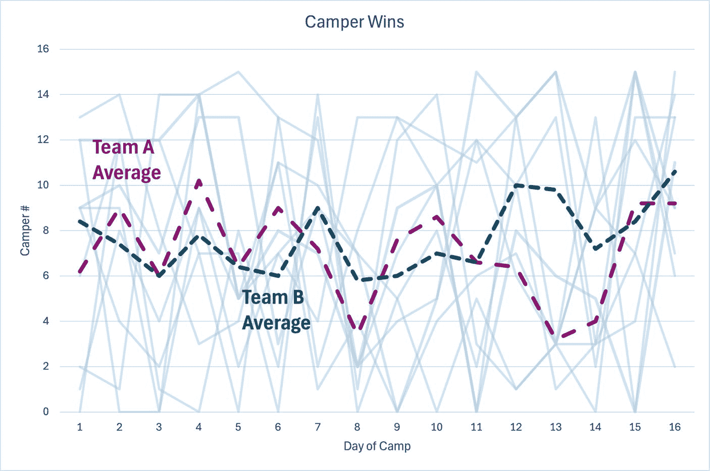

**图 18-19**

一张包含十二条线条的图表，其中两条更为突出

营员线条颜色较浅且相当细，因此不显眼，但我们仍然可以看到孩子们的不同线条。两条平均值线条更粗、更醒目，并使用深色虚线，因此很容易被看作图表中最重要的线条。

如果我们想查看每个营员的线条，也可以将每条线单独提取出来。有关示例，见图 18-20。

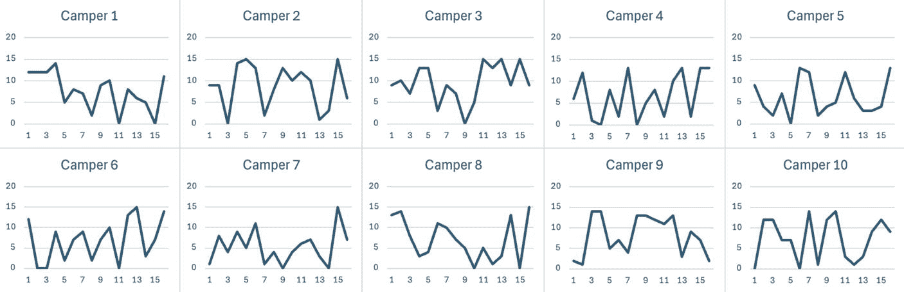

**图 18-20**

每位露营者单独一张折线图，而非全部合并在同一张图上

像这样分解图表时，必须确保所有 y 轴和 x 轴完全相同。这通常需要手动调整您所使用的工具。如果愿意，我们也可以在此处包含平均值，但假设我们关注的是每位露营者个体。

折线图的一个变体是添加置信区间。如果我们使用当前这批露营者来估算所有年份所有露营者的平均获胜次数，我们将生成一个置信区间。其在图表上的呈现方式可参见图 18-21。

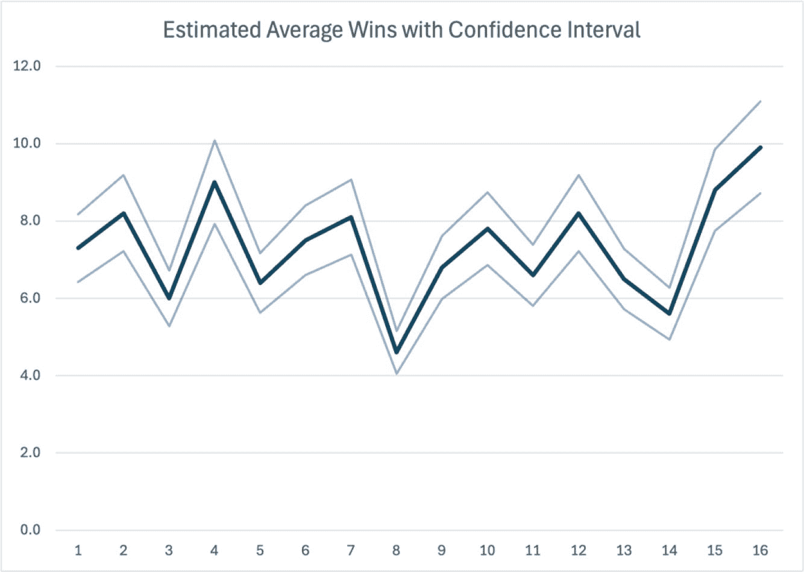

**图 18-21**

显示平均获胜次数置信区间的折线图

这是一个相当直观且易于解释的图表。有时，线条与其上下置信区间之间的区域会被着色，但这并非必需。通常，您需要确保主线条与置信区间线条区分开来。通常，主线条会更粗更醒目，如图 18-21 所示。

在第 2 章中，我谈到了具有双 y 轴的折线图。这意味着图表中至少有一条线遵循左侧的 y 轴，而至少另一条线则遵循右侧一个独立且不同的 y 轴。通常不建议在向利益相关者展示的图表中使用这种设计，尽管它在探索性数据分析（EDA）中可能有用。原因是这种图表可能令人困惑且难以阅读。它们需要观看者停下来思考，而我们真正希望观看者能够快速理解。泰勒·维根（Tyler Vigen）那个关于荒谬相关性的搞笑网站^((47))，我之前提到过，它展示了多少明显不相关的事物可以显得“相关”，几乎总是依赖于不同的 y 轴。这远不如单 y 轴那样直观。

## 面积图

另一种与折线图相似的图表是面积图。面积图就是一条折线图，其线条下方的区域一直着色到 x 轴。主要类型的示例，即简单面积图和堆叠面积图，请参见图 18-22。

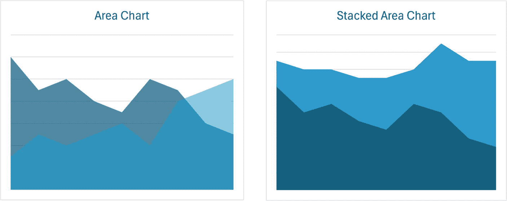

**图 18-22**

*面积图：左侧允许重叠，右侧为堆叠*

左侧图表显示了重叠区域，这是通过对每个系列使用透明度来实现的。重叠区域是一种不同的颜色，因此您仍然可以识别出两个不同的系列。如果图表上有两个以上的系列，这种类型的图表将难以阅读，因此面积图最常见的变体是堆叠面积图，我们可以在图 18-22 的右侧看到。这与堆叠柱状图类似，每个点的数值是该点所有系列的总和。

请注意，尽管右侧图表读起来稍容易一些，但我们添加的线条越多，就越难真正理解数值。最容易理解的是最底部的系列，因为它位于 x 轴上。正因如此，通常将折线图的值总和设为 100%，这样每个值就稍微更容易理解一些。比较图 18-23 中的两张图，左侧是简单的堆叠图，右侧是每天总和为 100%的图表。

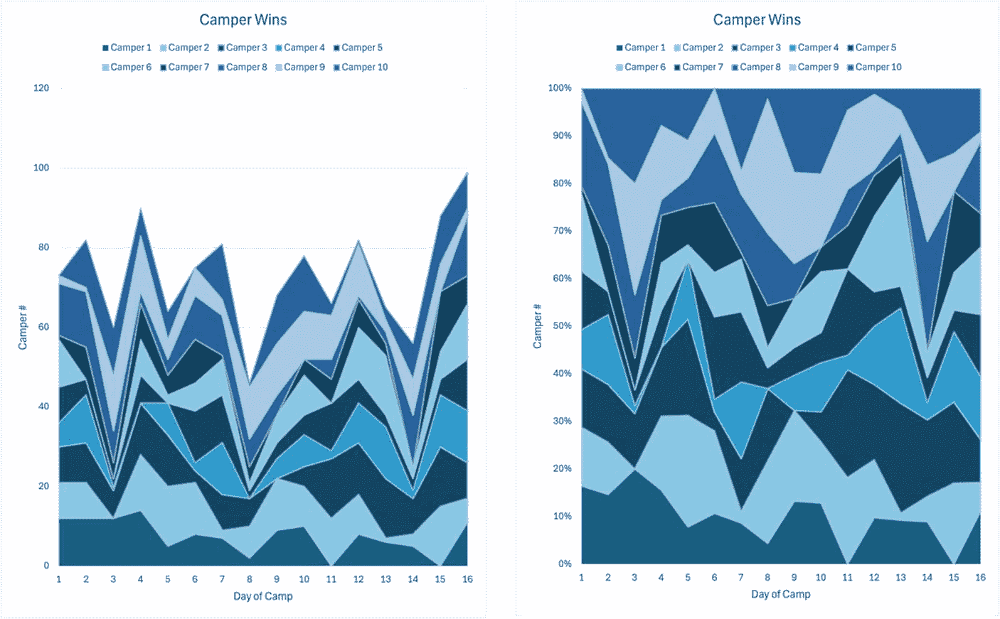

**图 18-23**

两张堆叠面积图显示每天每位露营者的获胜次数：左侧为堆叠图，右侧为总和 100%的堆叠图

尽管这些图表不是特别容易阅读，但在图 18-23 的左侧图表中，很容易看出有些天的总获胜次数异常高，但在右侧版本中，更容易看出哪些露营者导致了这些情况。

面积图与折线图非常相似，但有时它们可能更具戏剧性或影响力。何时选择一种或另一种，是您将随着时间的推移而培养的技能。

## 斜率图

我将提到的最后一种折线图是斜率图。它用于显示两点的变化，基本上是前后对比。通常，斜率图有多条线，但请参见图 18-24 中的示例，该图显示了两支队伍在夏令营第一天和最后一天的平均获胜次数。

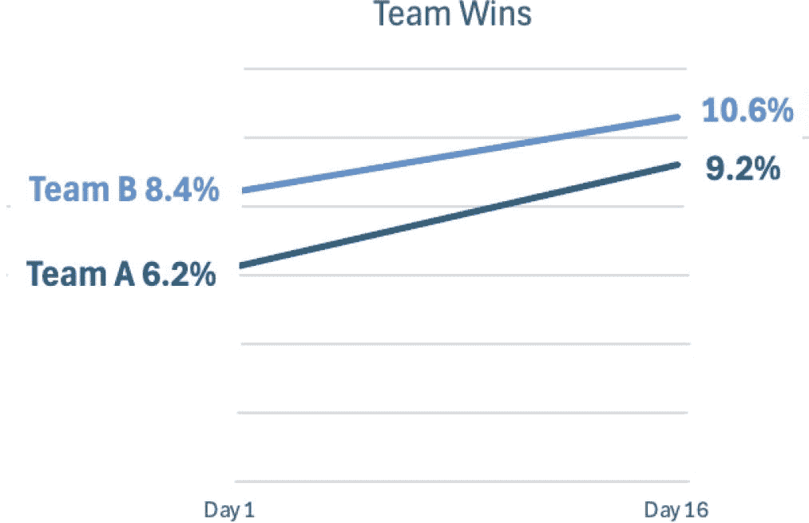

**图 18-24**

显示夏令营开始和结束时团队平均获胜次数的斜率图

可以立即看出，两支队伍的平均获胜次数从第一天到最后一天都有所增加，但 A 队按比例增加得略多一些。

折线图及其相关图表的多种变体为您提供了众多随时间变化的数据图表选项。当数据非基于时间时，通常不适合使用折线图，因为数据点之间的连接表示连续性，而离散事物之间没有自然的顺序或中间状态。例如，将 x 轴设为“女孩”、“男孩”和“未知”来制作折线图是没有意义的。

### 饼图

许多数据可视化专家都看不起饼图，这可以理解，因为它们功能非常有限，并且通常无法像其他更好的方式那样揭示数据的许多信息。此外，众所周知，人们不擅长比较不同的扇区，因此饼图不一定能达成目标。但有时利益相关者想要使用饼图，如果你无法说服他们改用其他图表，那就只能让步制作一个。你应当首先尝试说服利益相关者接受条形图，但这场争论你可能会输。掌握一些知识后，你就能针对特定场景制作出尽可能好的（或者说最不糟糕的？）饼图。请参见图 18-25 中的饼图示例。

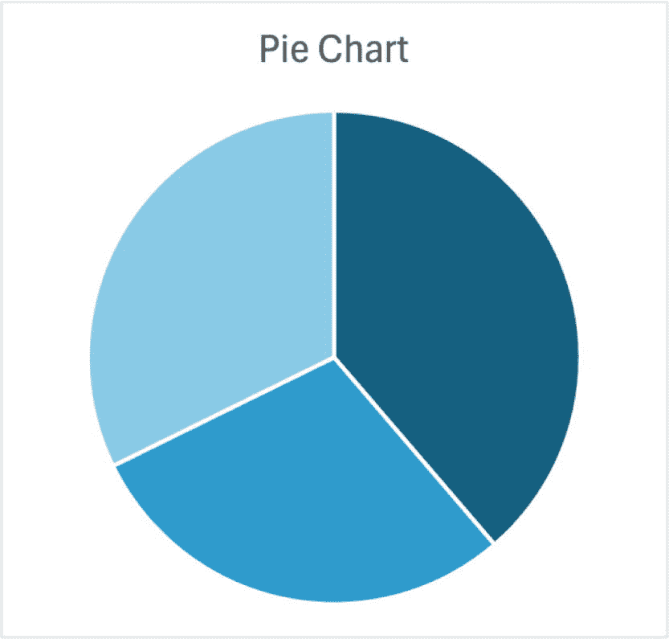

**图 18-25**

饼图

如上所述，第一条规则是永远不要制作饼图的 3D 版本，因为它会完全扭曲各部分的占比，而占比正是饼图的全部意义所在。

使用饼图最困难的事情之一是比较不同饼图，尽管这是饼图的常见用途。想象一下，阿肯色州的一个夏令营试图查看其在两次不同营销活动前后营员的来源地，这两次活动分别于 2019 年和 2022 年针对邻近州开展。他们决定查看每次活动后的次年数据，并与 2015 年进行比较。图 18-26 展示了这一系列图表。

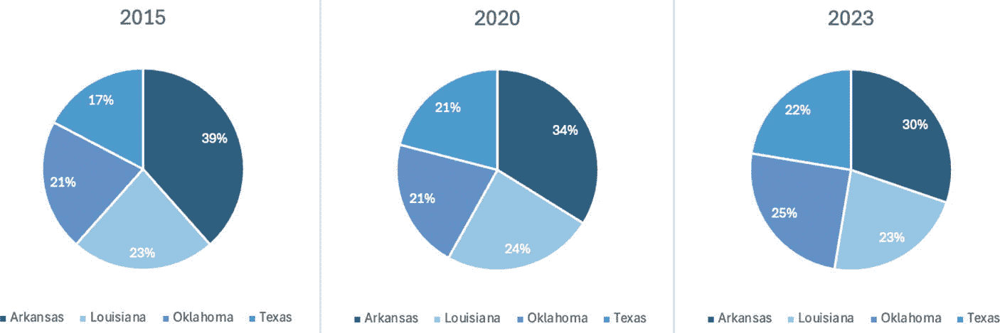

**图 18-26**

三个饼图展示了三年间营员来源州的比例变化

这一系列饼图确实能让人相当容易地看出变化。我们肯定能看到阿肯色州的比例随时间推移而缩小，而路易斯安那州和俄克拉荷马州的扇区在扩大。得克萨斯州在三年间变化不大。尽管这是基于时间序列的数据，但饼图比显示相同数据的折线图更简单、更易读。在每个扇区内部添加百分比（甚至原始数值）作为文字标注，会使信息更加清晰。

总之，要谨慎使用饼图，并认真考虑它们是否是最佳选择。另请参阅下文，了解一种名为**矩形树图**的饼图替代方案，它可能效果更好。

### 直方图及其变体

### 直方图

图 18-27 展示了一个直方图的示例。每一列称为一个“箱”，它代表落在该箱定义范围内的值的数量。对于定义箱的数量或箱的大小，并没有严格的规则，尽管有一些基于统计特性的经验法则。通常，你用来生成直方图的工具可以自动确定这些参数，但如果效果不佳，你可以自行搜索解决方案。

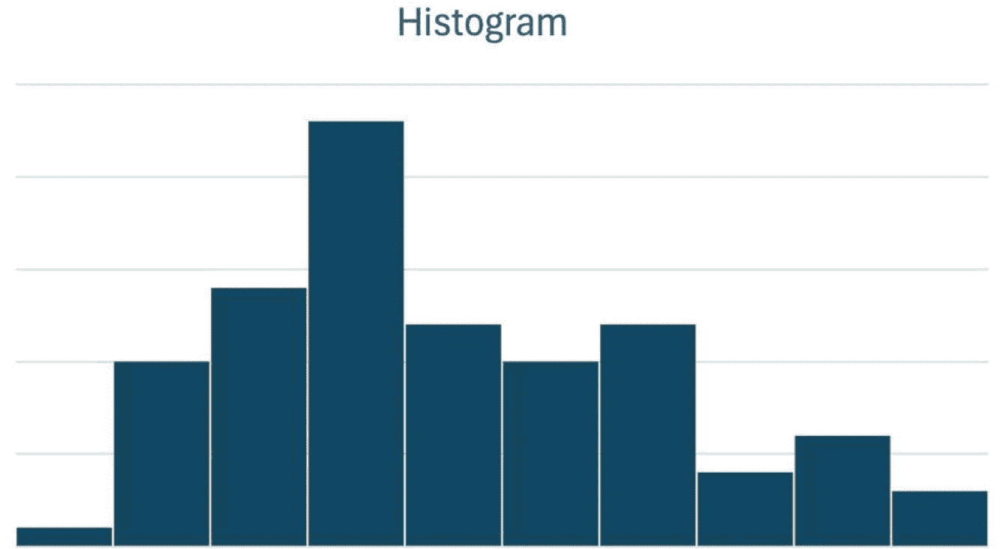

标题为“直方图”的条形图，展示了不同类别间的频率分布。该图有多个高度不同的垂直条柱，表示每个类别中数据点的频率。最高的条柱位于中心位置，表明该类别频率较高。图表背景有网格线作为参考。

**图 18-27**
直方图

直方图有几个值得理解的属性，其中**偏斜**最为重要。图 18-27 中的直方图略微向右偏斜，因为数据更多地集中在左侧。很多事物会因可能值的限制而向一侧或另一侧偏斜。成绩往往向左偏斜，因为更多成绩集中在 0-100 分的高分段。房价向右偏斜，因为房价不可能低于 0，但房价可以非常高，尽管价格越高，图表上的“邻居”就越少。在大多数地方，有很多价值 10 万美元的房子，但很少有价值 400 万美元的房子。这在与利益相关者沟通时会很有用。

### 帕累托图

标准直方图有一种变体，称为帕累托图。图 18-28 展示了一个帕累托图，使用了与上面相同的直方图数据，但这次添加了标签。该数据展示了某大学 100 名一、二年级学生完成的学分总数。帕累托图在第二 Y 轴（这是少数情况下使用第二轴的好主意）上增加了**累积百分比**。

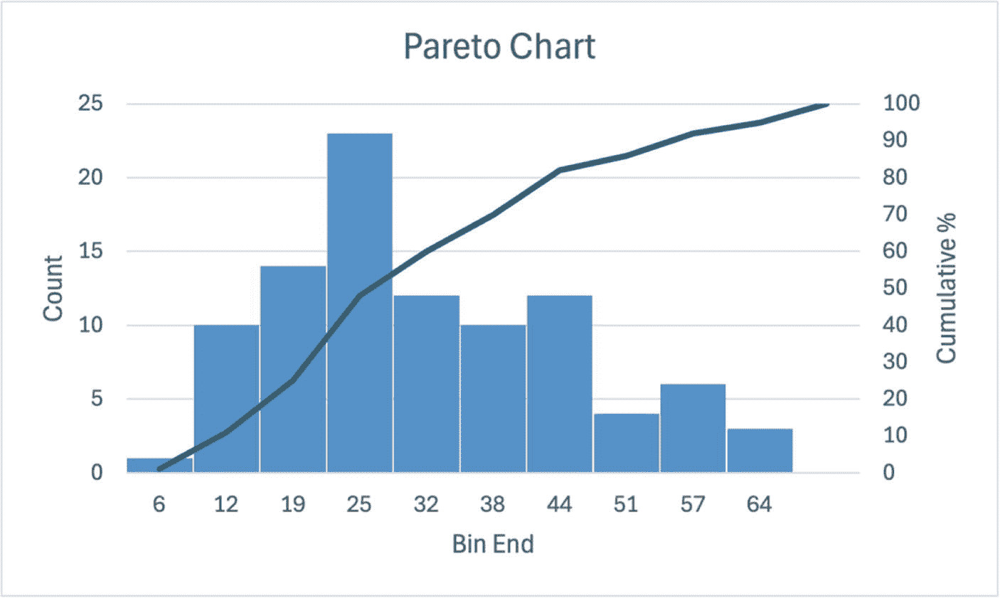

一个帕累托图，显示了一系列蓝色垂直条柱，代表 x 轴上标记为“箱终点”的数值（范围从 6 到 64）对应的计数。左侧 y 轴标记为“计数”，数值从 0 到 25。一条暗蓝色的累积百分比线叠加在条柱之上，对应于右侧标记为“累积 %”的 y 轴，数值从 0 到 100。该图突显了数据在不同箱之间的分布及累积影响。

**图 18-28**
包含累积百分比的帕累托图

累积曲线并没有从根本上改变图表的外观，但很容易看出它强调了增长在接近末尾时放缓的事实，因为图表左侧有更多的数值。

### 箱线图

我们在第 2 章中看到的另一种图表是箱线图，它能显示多个组中每个组的分布情况。箱线图依赖于分布中的某些特定点来展示数据的分散程度。它们比其他一些基于统计的图表更直观，并且可以很快地向之前没见过的人解释清楚。它们还能很好地展示异常值。示例见图 18-29。

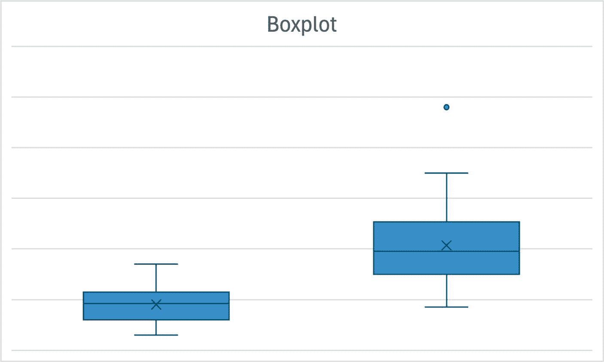

箱线图显示了两组数据。左侧的箱子较小，中位数较低且四分位距较窄，而右侧的箱子较大，中位数较高且四分位距较宽。右侧箱子上方存在一个异常值。该图突出了数据分布和变异性。

图 18-29：箱线图

图 18-29 展示了一个两组箱线图，其中第二组的值比第一组更高且更分散。在这张图中，彩色区域代表四分位距（`IQR`；介于`Q1`和`Q3`之间），中间的线代表中位数。在此版本中，“`x`”代表平均值，第二组的平均值明显高于中位数，这意味着分布是偏斜的。每组顶部和底部的水平线（“须”）代表最小值和最大值，但异常值除外。最小值和最大值都使用了`1.5`倍的`IQR`，最小值是`Q1`减去该计算值，最大值是`Q3`加上该值。此处的异常值定义为任何大于计算出的最大值或小于计算出的最小值的点。还可以包含极端异常值，它们是指任何小于`Q1`减去`3`倍`IQR`或大于`Q3`加上`3`倍`IQR`的值。

我们可以查看一些学生的学分数据，这次显示的是大一、大二和大三学生。见图 18-30。

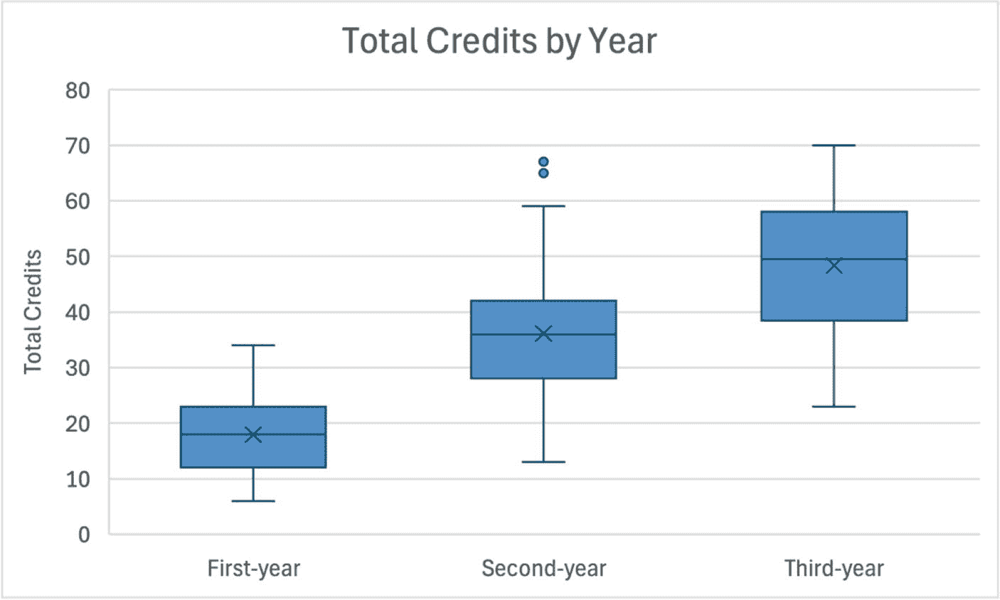

箱线图标题为“按年级划分的总学分”，显示了大一、大二和大三学生的总学分。`y`轴代表总学分，范围从`0`到`80`。每个箱线图都显示了中位数、四分位数和异常值。与二、三年级相比，一年级的中位学分较低，其中三年级的中位学分和范围最高。

图 18-30：展示按学年划分的学生已完成总学分的箱线图

该图整体上符合我们的预期，每年级的中位数、最小值和最大值都在增加，而且每个年级的数据也有相当程度的分散。有些学生是兼职，而另一些学生则课程负担过重或通过其他方式获得大学学分，所以并非所有学生的情况都一样。有几位大二的“学霸”学生，但他们是仅有的异常值。大一和大二学生的平均值和中位数很接近，表明偏斜很小，但大三组的平均值低于中位数。

这种图表在探索性数据分析（`EDA`）中出现频率很高，而在给利益相关者的图表中则不那么常见，但如果有合适的数据和利益相关者，它仍然很有价值。

### 热力图

*热力图*是对表格的一种增强，其中值的范围由不同的颜色和渐变来表示，通常浅色到深色对应小数字到大数字。由于视觉方面的特性，它对于快速传达信息非常有帮助，但同时仍保留了表格的细节。图 18-31 是一个示例，展示了一个热力图，显示了中学生在一系列普通科目中的平均成绩。

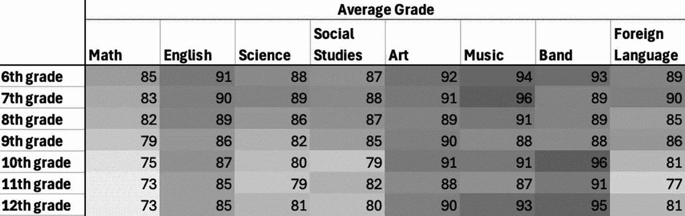

热力图显示了`6`至`12`年级不同学科的平均成绩。学科包括数学、英语、科学、社会研究、艺术、音乐、乐队和外语。颜色强度代表成绩值，较深的阴影表示较高的成绩。例如，`6`年级在音乐和乐队方面成绩较高，而`12`年级在外语方面成绩较低。

图 18-31：`6`至`12`年级学生成绩的热力图

这张热力图清楚地表明，随着年级的升高，某些学科的平均成绩会下降，但其他学科则没有相同的趋势。核心科目往往遵循这种趋势，而选修课则不然。如果没有灰度着色，我们根本无法如此快速地看到这一点。

热力图的众多优点之一是，你可以在保持其比其他一些可视化图表更具可读性的同时，展示大量数据。这就是为什么在进行`EDA`时，制作相关矩阵热力图很常见的原因之一，特别是因为你可以使用两种不同的颜色，并以不同的颜色和不同的强度来表示正值和负值。

每当你处理表格数据时，检查热力图是否合适总是值得的。利益相关者通常也喜欢它们。

### 树图

我之前提到过树图，因为它们可以作为饼图的替代方案，当类别过多以至于无法制作清晰的饼图时，树图就很合适，而且它们还允许分组。图 18-32 是一个树图示例，显示了按地区分组的美国各州人口。矩形的大小代表了该州的人口。

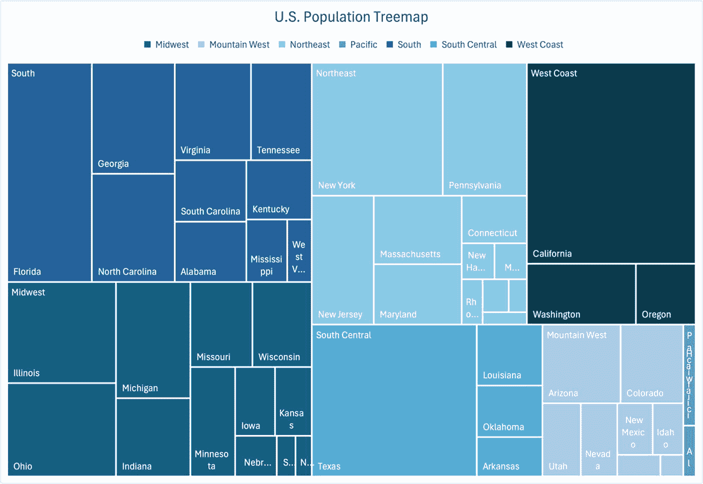

树图标题为“美国人口树图”，展示了美国各地区和各州的人口分布。区域以不同颜色编码：中西部、山地西部、东北部、太平洋沿岸、南部、南中部和西海岸。每个州由一个矩形表示，其大小与该州的人口成比例。值得注意的州包括加利福尼亚州、德克萨斯州、佛罗里达州和纽约州。该图提供了各州人口在其所在区域内的视觉比较。

图 18-32：按地区分组的美国各州人口树图

分组是一个不错的加分项，但尽管有`51`个数据点，我们仍然可以读取其中的大部分。右下角是夏威夷和阿拉斯加，被归为“太平洋”组。将其与图 18-33 中的饼图相比，后者如果没有放大镜和极大的耐心是无法理解的。

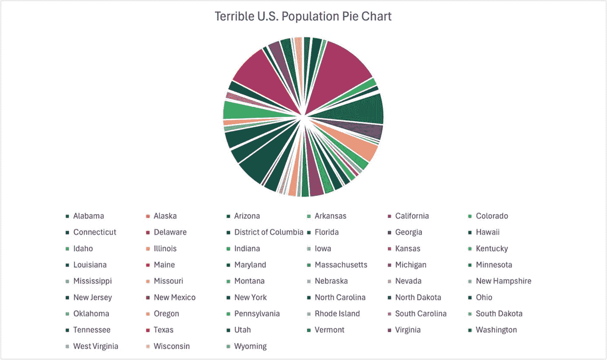

饼图标题为“糟糕的美国人口饼图”，显示了各个美国州及其对应的彩色扇区。每个州用一种不同的颜色表示，下面有一个图例列出了各州，如阿拉巴马州、阿拉斯加州、亚利桑那州等。该图表以视觉方式展示了人口分布，但缺乏清晰的数据区分，因此难以解读具体的数值。

图 18-33：显示美国各州人口的糟糕饼图

这个饼图显然很荒谬，但树图实际上可读性很强且直观，并且还有一个额外的好处，即能够有意义地对各州进行分组。当你拥有包含一个或两个分类级别的数值数据时，可以考虑使用树图。利益相关者不常见到树图，但你向他们解释起来不会有任何困难。

### 分区统计图

每个人都见过分区统计图，但几乎没人知道这个名称。它是一种根据不同数值对区域进行着色的地理地图。新闻媒体在选举期间制作的美国地图，各州用蓝色或红色标注，都属于分区统计图。图 18-34 展示了 2008 年美国总统大选的地图，其中显示了县级和州级的投票结果。

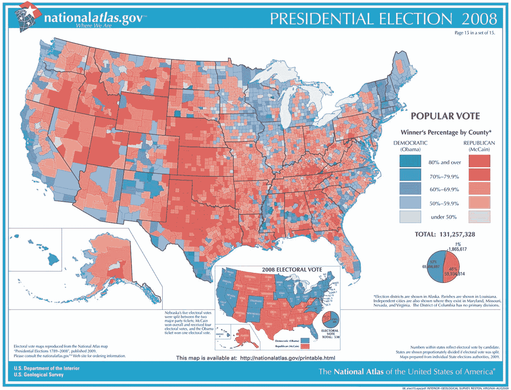

2008 年美国总统大选按县统计的结果地图，显示了民主党（奥巴马）和共和党（麦凯恩）的得票比例。各县以不同深浅的蓝色和红色着色，表示获胜党派的得票率。图例解释了颜色编码的含义：颜色越深代表得票率越高。插图中还包括一张较小的选举人票分布图和显示普选票总数的饼图。该地图来自 `nationalatlas.gov`，并附有关于内布拉斯加州选举人票分配的注释。

**图 18-34**

一幅显示 2008 年美国总统大选结果的分区统计图。来源：[`https://www.usgs.gov/media/images/printable-map-2008-presidential-election-results`](https://www.usgs.gov/media/images/printable-map-2008-presidential-election-results)

# 在这幅地图中

蓝色表示该州的选举人票投给了民主党候选人，红色表示投给了共和党候选人。根据数值的渐变对地点进行着色也非常常见，就像这里县级地图的做法一样。这可以基于真正的渐变，即最低数值对应最浅的颜色，最高数值对应最深的颜色，所有颜色按比例过渡。另一种做法是，将数值分箱，使用有限数量的颜色或色度。两种方法各有优缺点。图 18-35 展示了一幅美国各州人口的渐变着色地图（未分箱）。

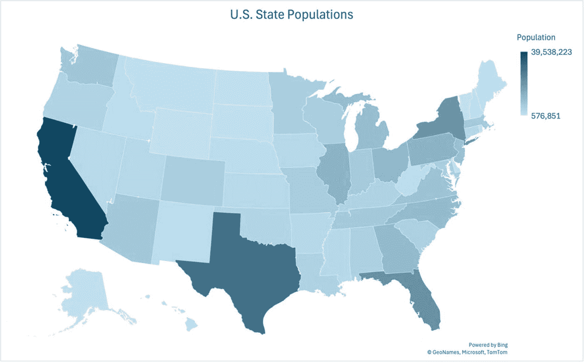

**图 18-35**

一幅显示美国各州人口的分区统计图

这幅地图虽然可读，但有太多不同的色度需要辨别。这就是分箱方法有用的原因。我们可以使用等距分箱（只需将整个范围等分为若干份）、利用数据分布特征（如四分位数），或者干脆创建任意分箱。鉴于这幅地图中人口最少和最多的州之间差距巨大，自行创建分箱或许是合理的。分箱的一个缺点是，即使两个数值非常接近，也可能落入不同的分箱，从而造成误导。例如，如果我们把最低分箱的上限设为 300 万，那么内华达州（总人口 3,105,000）仅超出 105,000 人，而堪萨斯州（总人口 2,938,000）则低于这个上限 62,000 人。尽管两州实际人口非常接近，但它们会被分到不同箱中。堪萨斯州看起来会与几个人口不足 50 万的州有更多相似之处，而不是与人口只多出不到 17.5 万的内华达州。正确选择取决于你具体想要达到什么目的。

绘制地图时另一个需要考虑的问题是使用哪种投影，尤其是在绘制全球地图时。我们大多数人最熟悉的是墨卡托投影，它将地球变成一个矩形，使得北部和南部的陆地被显著拉伸。罗宾逊投影则保留了地球的球形感，拉伸程度较小。许多工具内置了墨卡托投影，并且大家都很熟悉，因此对许多用途来说，这是最简单的选择。

# 演示汇报

在大多数公司，你将通过创建和分享报告（例如使用 `Microsoft Word` 或 `Google Docs`）或者创建并演示幻灯片（例如使用 `Microsoft PowerPoint` 或 `Google Slides`）来展示你的发现。有时也可能被要求分享幻灯片。我将讨论应根据不同受众以及媒介（文档或幻灯片）来决定在演示中应包含哪些信息。

## 受众

通常，我们有理由创建多个版本的演示文稿，每个版本根据受众不同而包含不同的信息。为了方便起见，我将在此处为每种通用受众类型命名，以便下文引用。通常，你最先向其演示的将是你的项目所服务的利益相关方（“你的业务利益相关方”）。你可能会被要求向他们的更上级领导（“业务领导层”）或你自己的上级领导（“技术领导层”）进行演示。如果项目进展得特别顺利，可能还有其他团队，比如你最初的利益相关方，他们也会对你做类似的工作感兴趣（“其他业务团队”）。最后，非常常见的情况是，你被要求向你自己的团队或其他数据科学家（“你的同行”）演示你的工作。在所有情况下，你都将遵循本章前面提到的讲故事步骤 #1–#7。

这些受众中的每一个都需要了解正在解决的问题是什么，以及你的解决方案如何帮助利益相关方完成他们的工作（步骤 #1 和 #4，根据需要略加步骤 #5）。对于业务和技术领导层，这两点都要简明扼要，但在解决方案如何提供帮助方面，请尽量用节省的时间（减少利益相关方完成原始任务所花费的时间）、销售额的可能增长或成本削减来量化。数字是领导层的语言。这两类群体都希望从步骤 #2 和 #3 中获得最少量的信息。除非另有说明，否则请将步骤 #2 和 #3 保持在最低限度。但是，不要完全省略它们，因为如果你进行现场演示，其中有些人可能会提出问题。对于文档和幻灯片，将一些更详细的信息放在附录中可能会更好。分享下一步计划也是有益的。

你的业务利益相关方已经了解问题，因此你无需为他们深入赘述问题细节；而根据其他业务团队的不同，你可能需要详细说明，也可能需要快速总结（如果这是他们已有的问题，则不需要太多信息，但如果他们在不同领域工作，则可能需要更多信息）。对于这两类群体，“看情况”是处理步骤 #2 和 #3 的规则。如上所述，其中一些群体本身也在处理数据，因此他们可能希望更多地了解你是如何使用数据的，以防对他们有所帮助。然而，花一些时间在这上面对你来说可能是有益的，因为这是你最可能已经与你的利益相关方合作过、或者将来需要与未来的利益相关方合作的领域（例如，弄清楚数据的含义）。因此，让他们看到数据准备是一个重要且耗时的步骤对他们是有帮助的。他们都对解决方案、步骤 #4 和 #5 最感兴趣。应该向这些受众详细解释这一点（对于任何不熟悉你当前利益相关方工作的其他业务团队更是如此）。就像对领导层一样，要确保清楚地表明这在时间和质量上给他们带来了多大的好处。这两类群体也会对听到下一步计划感兴趣，对于一些群体，如果这些计划已被提上日程即将开展，你甚至可能希望深入探讨它们。

最后一种常见的受众是你的同行。对他们来说，你需要把问题讲清楚，但他们通常对细节不太感兴趣。解决方案和下一步计划也是如此。不要忽略提及它们，但他们可能对步骤 #2 和 #3 更感兴趣。他们会想了解你使用的数据源，以便看看他们是否能将这些数据源用于他们自己的工作。同样，他们会对你的解决方案的技术信息更感兴趣，尤其是如果你向他们自己可能使用的团队代码仓库中添加了任何代码，或者你解决了一个他们也一直面临的技术问题，等等。

## 媒介

如上所述，你的文档和幻灯片的长度将根据你的受众而变化。但讨论这些报告的结构仍然是有帮助的。

在文档式报告中，你基本上总结了你的受众想了解的所有内容。你还应该包括日期、作者以及参与项目的人员。你需要一个目录，并通常应将文档划分为与上述讲述数据故事的步骤大致对应的章节。你需要以适合受众的详细程度，阐述你想表达的所有要点。这确实意味着你可能需要为不同的受众创建多份报告。许多地方都想要的高级版本称为执行摘要，它可能具有内部定义的结构。其他报告则是“一页纸”，这是信息共享的常见方式，显然被总结到一页纸上。文档式报告的一个优点是，你可以链接到包含更多信息或细节的其他文档，这样读者可以自行决定深入阅读的程度。

幻灯片也将传达你想要受众了解的所有内容。你通常以标题页、日期和项目参与人员列表开始制作幻灯片。在此信息之后立即包含一个作为目录的议程幻灯片。如果你正在创建用于会议演示的幻灯片，一份真正优秀的幻灯片会省略很多细节，而这些细节将由你口头说出。这是优秀演示的标志，因为当你展示一张幻灯片时，人们要么阅读幻灯片，要么听你说话，但通常不会同时进行。因此，最好有一些要点——谈话要点——你将在这些要点上展开，这样他们就不会只顾着阅读幻灯片。

然而，问题之一是，会议上的人（非常）经常要求你分享幻灯片，以便他们之后可以查看。如果你像我上面提到的那样创建了幻灯片，那它实际内容会非常少，他们不会真正记得你说了什么。有几种方法可以处理这个问题。一种方法是将你的主要观点（你在演示中口头说出的关键点）包含在每张幻灯片的备注字段中，这在演示模式下浏览幻灯片时是看不到的。另一种选择是，准备一份包含所有解释和细节的独立幻灯片，然后分享那份来代替。

如果你创建了一个工具，比如一个仪表盘，供人们使用，那么通常也会在会议中对该工具进行现场演示。你也可以在文档或幻灯片中包含指向它的链接。确保要么让参加会议的人能够访问该仪表盘，要么明确说明他们如何请求访问权限。

# 可视化工具

市面上有许多可视化工具。数据科学家经常使用 `Excel` 和代码，比如 `Python` 中的 `matplotlib` 或 `seaborn`，或者 `R` 语言中的 `ggplot`。我在本章中几乎所有的图表都使用了 `Excel`，因为它快速、简单且外观统一。在处理真实数据的探索性数据分析（EDA）时，更常见的是用代码来实现这些功能（因为你通常已经在代码中完成了大量数据操作）。但在向利益相关者展示时，你可以将数据准备为 CSV 文件，然后在 `Excel` 中使用，或者将其存放在数据库或电子表格中，以便在其他专业可视化工具（包括 `Tableau` 和 `Power BI`）中使用。

`Tableau` 和 `Power BI` 是目前最流行的两种专业可视化工具。`Power BI` 由微软公司所有，通常被那些全面采用微软产品和 `Azure` 云平台的组织使用。`Tableau` 则是一款独立工具，但它与许多其他工具集成了。如果你打算进入数据科学或数据分析领域，熟悉这两款工具都会很有帮助。

`Tableau` 和 `Power BI` 都允许你从多个来源拉取数据，并在内部进行合并（这被称为**数据建模**）。你基本上可以在工具内部创建一个或多个类似电子表格的结构，并以此为基础构建图表和仪表板。它们的优点在于，允许你将数据保持在相当原始的状态，从而可以在工具内部进行聚合操作。这样一来，你无需为了生成多个图表而创建一堆具有不同聚合方式和结构的数据表格或数据库表。

这两款工具都内置支持我上面提到的所有可视化类型，并且在添加筛选器方面具有非常灵活的选项——例如选择年份以仅查看一年的数据、选择单个产品等——这些筛选器可以影响同一仪表板上的多个不同图表和表格。这使得最终用户使用起来极为便捷。不过，这两款工具都有一定的学习曲线，但只要你花点时间使用它们，并掌握它们的基本工作方式，学习它们每个工具的新功能就会变得越来越容易。

你可以通过其官网⁴⁸了解有关 `Tableau` 及其免费公共版的更多信息。这个网站实际上是一个绝佳的机会，既能学习一些 `Tableau` 技能，又能为你的作品集创建作品。看看一些真正有技能的人构建了什么也很有趣。`Power BI` 也有一个可以下载的免费版本（仅限 Windows）⁴⁹。我强烈建议你尝试其中一个工具，这样在求职时，你就可以在简历中列出其中一款工具的基本技能。你无需学习两者，因为一款工具所需的技能可以相当容易地迁移到另一款工具上。

# 关键要点与下一步

在本章中，我们探索了广阔的可视化世界。首先通过几个有趣的例子展示了可视化令人惊讶且具有冲击力的效果，其中包括一幅著名的拿破仑入侵俄国地图，以及另一幅展示数据集可能拥有相同统计属性，但绘制出来却截然不同的图表。接着，我探讨了可视化与工作成果展示实际上是如何讲述故事的——数据以及你对其所做的工作讲述了怎样的故事？我介绍了多种不同的图表类型和其他可视化形式，包括散点图、柱状图和条形图、折线图、面积图、饼图、直方图、箱线图、热力图、树状图和等值区域图。随后讨论了向利益相关者及其他人员展示成果的方法，最后介绍了当今两种主要的专业可视化工具：`Tableau` 和 `Power BI`。

在下一章中，我将介绍机器学习和数据科学在多个领域的现代应用，从保险、医疗保健到教育等等。数据科学得到了广泛应用，且丝毫没有放缓的迹象。

# 从业者简介：梅根·伯杰

**姓名：** 梅根·伯杰

**现任职务：** 零售分析顾问与数据翻译员

**现任行业：** 一家数据与分析公司的咨询部门

**从业年限：** 10 年

**教育背景：**

- 证书：`认证 ScrumMaster (CSM)` 和 `Tableau Desktop 专家`
- `商业分析硕士`
- `商业管理学士`

*此处表达的观点仅代表梅根本人，与其现任或前任雇主无关。*

## 背景

梅根大学毕业后的前十年从事高端零售管理工作。在那里她学到了一些分析知识，并一直热衷于制作图表和计算数据，因为她喜欢这样做，并且这对工作有帮助，尽管她当时对分析并没有系统的了解。她会查看销售和库存数据，试图弄明白为什么某些商品销售不佳，或者是否有机会与其他门店调货。她还制作员工报告。这些都是必须完成的工作，但她乐在其中，因此投入的精力和时间超过了基本要求。她曾尝试结识公司里的一些分析人员并向他们学习，但当时学的内容都很基础，她觉得自己并没有得到满意的答案。最终，她意识到这是自己真正想做的事情，于是重返校园攻读分析学硕士学位。在读期间，她学到了很多知识，包括 `Python`、`R` 等，但尤其爱上了数据可视化。

# 工作

硕士毕业后，梅根在一家规模较小的数据与分析咨询公司找到了一份工作。她与几位不同的客户合作，开展了多种类型的分析和可视化工作。她发现，自己非常喜欢能够以当年做零售时渴望的方式帮助客户，而那时她还不具备这样的技能或工具。她在零售/消费品领域的可视化和分析中找到了自己的专长。

早期，她专注于使用 `Power BI` 和 `Qlik Sense` 等工具进行可视化开发。但随着职业生涯的发展，她承担了更多职责，包括在多个项目中领导数据可视化团队、产品管理（监督大规模分析项目的规划与执行），以及与整个组织中的业务用户建立关系，既指导他们进行自助式可视化，也为制定有效的分析解决方案提供业务洞察和策略。

## 妙语摘录

**工作中最喜欢的部分：** 每天的工作内容都不相同，所以从不枯燥。有不同的客户和不同的问题需要解决。她目前的处境也很好，因为公司规模很小，所以晋升机会很多。

**工作中最不喜欢的部分：** 有时作为顾问（取决于客户），利益相关者主要将她的团队视为技术分析师，而非业务伙伴。这限制了分享知识和就长期解决方案提供建议的机会。在建立现实的项目开发时间表与满足利益相关者期望之间保持平衡很有挑战性，尤其是在遇到预料之外的技术难题时。

**最喜欢的项目：** 她曾参与一个与零售缺货相关、时间较为紧迫的项目。她为此制作了一个非常有趣的可视化图表，因为它将两个独立的数据源结合到一个图表中，并且图表含义一目了然。在另一个涉及库存的项目中，她做了类似的工作，首次将三个数据源整合在一起，并添加了一些计算，帮助判断哪些产品可能延迟，从而为追踪订单和制定应对方案争取了更多时间。

**最常用的技能：** 她早期的工作偏技术性，主要是进行开发。但因为她现在的重点是可视化和指导，所以软技能更为重要。这些技能包括沟通、管理、领导力，以及规划并引导团队达成目标。

**当前主要使用的工具：** `SQL`、`Snowflake`、`DBT`、`BigQuery`、`Power BI`、`Qlik Sense`、`DOMO`、`Sigma`

**数据科学的未来：** 一个必然的趋势是，人工智能正在通过无代码或低代码选项让普通人更容易自行进行分析。这本身并非坏事，但对所处理的数据（以及如何将其与其他数据关联）的理解仍然至关重要。梅根认为，分析专业人士的角色可能会从开发和解决方案构建，转向对项目的更具战略性的监督。自助服务工具不会消失。这意味着数据文档将变得越来越重要。

**优秀的数据可视化专业人士的特质：** 真正理解最终的业务用途和目标。能够容忍大量的试错，以找到利益相关者能理解的正确的可视化方式，这一点同样重要。

**她对有志于从事数据和可视化工作的人的建议：** 学习永无止境。你必须不断学习该领域的新知识——新工具、新方法。你可能需要根据市场趋势在不同工具之间进行切换。同时，尝试在业务方面寻求合作伙伴，以深入了解你所在的工作领域也很重要。知识交流是建立关系的绝佳方式。

*梅根是一位经验丰富的分析与可视化专业人士，拥有深厚的零售背景。*

脚注：
1. 
2. 
3.

