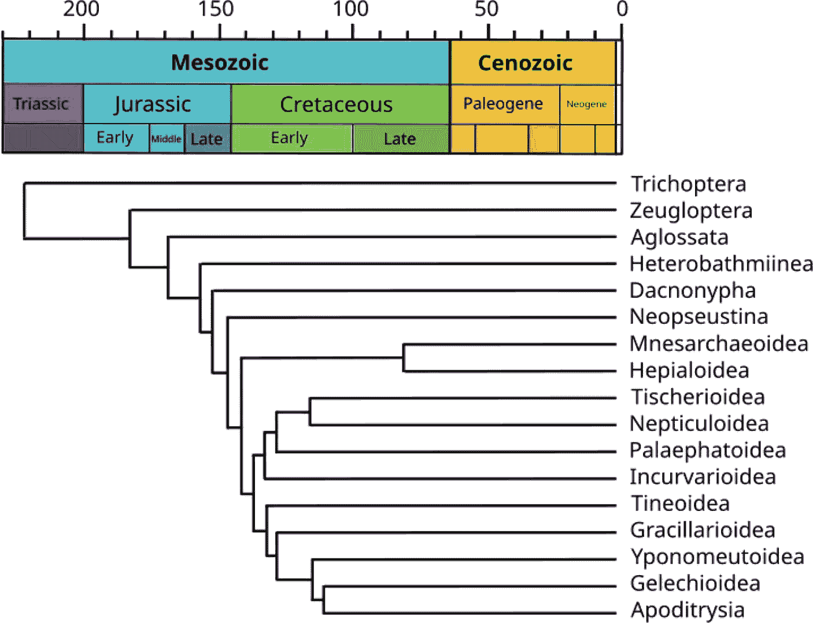

# 19. 这可不是我们的第一次：机器学习应用

## 引言

数据科学和机器学习总体上已存在数十年之久，并且其受欢迎程度正在稳步提升。随着像 `ChatGPT` 这样大量公开可用的基于机器学习的工具涌现，许多公司能轻松生成营销文案，程序员也能加速编码。随着分析和机器学习领域的日益普及，我们看到它们在众多领域的应用层出不穷。一些公司使用第三方工具，基于自身数据生成模型，就像我们在第 16 章中看到的 `Salesforce` 的机器学习工具那样，但也有许多公司正着手从零开始构建自己的数据科学解决方案和机器学习工具。

数据科学通过诸如 A/B 测试这类如今已司空见惯的方法，极大地帮助公司改善了营销工作。它使公司更容易利用聚类技术来迎合特定的客户群体，从而实现超个性化服务。通过精准的产品和服务推荐，它可以提升销售额。许多公司能够自动化执行各种任务，从而节省时间和人力。

`NLP` 和语音处理技术使得客户支持的部分自动化变得更加容易，通过易于构建的聊天机器人减少了所需的客服人员数量。

让公司更容易采用机器学习的一个趋势是，企业正将数据存储和工具迁移到云端，而不再将所有内容托管在本地。云服务提供商在吸引公司的核心服务之上提供了多种服务，公司可以轻松加入一些机器学习选项，从而以最小的投入进行尝试。如果他们喜欢结果，就已经踏上了正轨。我们将在下一章讨论云服务。

这里需要提及很重要的一点是，你已经知道机器学习的许多应用——以及广义上的技术——都伴随着道德困境。我将提及的许多应用都存在不容忽视的问题，即使我们选择忽略并继续推进。通常，人们不了解事情是如何运作的，因此不知道其中存在道德问题。这既包括使用机器学习的公司，也包括使用其产品的客户。

尽管机器学习能让我们做许多令人兴奋的事情，但我们不能忘记更宏观的图景。即使其他人不思考，我们始终有责任去思考其中涉及的伦理问题。

下面，我们将探讨几个行业目前是如何使用数据科学和机器学习的。我们将从保险、银行和金融领域开始，然后研究零售业。接着，我们将进入医疗保健和生物信息学领域，之后跳转到游戏行业。最后，我们将审视刑事司法和教育领域。

## 保险业

统计方法几乎从保险业现代诞生的初期就成为其一部分，这可以追溯到 17 世纪富有的英国人承保货物运输和殖民者运往美洲殖民地的业务（*underwriting* 承保，指的是为获取费用而承担财务风险，并有可能需要支付巨额赔款）。在帕斯卡和费马解决了“点数问题”之后，承保人采纳了他们计算风险的技术，保险业很快就成了一个完整的行业。

因此，诸如线性回归和广义线性模型之类的统计和统计建模方法长久以来一直是保险业使用的传统技术。这些方法帮助他们在承保过程中（例如确定保费价格）平衡风险与利润，但该行业尚未在其核心业务中真正拥抱现代机器学习。然而，有许多潜在的应用，尤其是在增强现有方法方面。一种可能性是使用机器学习进行特征工程，为该领域的传统模型创建特征。例如，他们可以准备非线性特征，更有效地对现有特征进行分箱，或使用聚类来识别全新的特征。此外，一些机器学习方法（如决策树和正则化）在处理稀疏数据方面优于传统模型，因此一些人开始关注这些方法。以这种方式使用机器学习会带来伦理风险，尤其是在许多西方国家，基于受保护类别的严格法规禁止将这些类别纳入建模中。例如，在决定提供何种服务时不能纳入种族因素，因此数据科学家必须小心，确保没有任何新特征充当“种族”的代理变量，即使种族本身未被包含在内。

# 保险业

保险业的其他领域已经更多地接受了机器学习。例如，机器学习可以通过分析索赔的特征，并根据欺诈风险或其他需要特定专业知识的情况，更有效地将索赔案件分配给分析员，从而加快索赔处理速度。这缩短了处理时间。机器学习还可以用于预测索赔频率和严重程度。借助机器学习，欺诈检测和预防变得更加复杂，依靠异常检测方法，能捕捉到更多真正的欺诈性索赔，同时最大限度地减少被送去进一步分析的非欺诈性索赔数量。在合规监控方面，通过监控交易、索赔或通信来满足监管要求也存在可能性。甚至可以通过图像处理技术部分自动化索赔中的财产损失评估。在很大程度上，这些做法在伦理方面的风险不大，但一如既往，需要谨慎对待客户，尤其是在涉及受保护类别时，要公平对待他们。

通过更好的监控和产品推荐，客户管理和销售也能得到改善。机器学习可以为与现有客户的互动提供信息，并通过将客户分组以便采取不同行动来识别获取新客户的方法。他们开始应用机器学习的另一个领域是客户流失预测（预测离开的客户），并且效果显著。聊天机器人和其他工具可以辅助客户服务。这些在伦理方面风险也相对较低，但聊天机器人可能存在隐私风险，因此需要确保其安全性。

# 银行与金融

银行与金融领域中的`ML`（机器学习）与保险业有许多共同之处，两者都是得益于统计学和数学的古老领域。与保险业类似，机器学习最具影响力且应用最广泛的领域之一是欺诈检测。同样，它们也开始在核保阶段和信用评分中更多地使用`ML`，尤其是在评估信用风险和确定贷款利率方面。`ML`使得在这些决策中纳入更多信息变得更加容易，从而促成更多低风险的贷款。如同保险业一样，它们也必须谨慎对待关于受保护类别的法规，以确保这些信息不被纳入模型中。

由于可用的数据比以往任何时候都多，人们也在投入精力预测市场趋势，例如利率和股市行为。`NLP`（自然语言处理）使公司更容易利用来自新闻和其他非结构化来源的更多数据进行股市预测，以及其他任何可能用到这些数据的领域。另一个越来越受欢迎的领域是全自动股票交易，即算法交易。这里的道德风险并不显著，尤其当所使用的数据是公开可用的时。然而，如何利用这些预测结果，可能会引发在向客户呈现方式方面的道德问题。

洗钱一直是银行和金融业必须防范的问题，而`ML`通过异常检测使合规监管变得更容易。法规通常格外棘手，因为它们会定期变化，但存在一些方法可以在面对变化时实现合规自动化。

在银行和金融领域，`ML`还被应用于许多与客户相关的领域。它们使用`NLP`和聊天机器人来自动化或半自动化客户服务，尤其是在处理较简单的任务时。客户流失预测在此领域也得以应用，因为当客户打算离开时，尝试说服他们留下非常有用。个性化对于提升客户在网站使用中的体验至关重要，而产品推荐既能提升客户满意度，也能增加销售额。其中一些功能伴随着需要妥善处理的隐私风险。

# 零售

与其他行业一样，零售业通过客户细分、精准营销和个性化产品推荐来运用数据科学提升客户体验和销售额。这在零售业中至关重要，因为重复销售是其核心目标。忠诚客户在零售业中是无价之宝。

零售公司还在许多其他领域使用`ML`。它们通过监控竞争对手价格并频繁调整价格的定价策略来实现利润最大化，尤其是在线店铺。自动定价比人工管理高效得多。为此，定价系统需要能够将公司产品目录中的商品与竞争对手网站上的产品进行匹配，分析价格差异，并设定新价格。访问其他公司的网站和价格可能会引发道德问题。

零售业采用`ML`的另一个重要领域是供应链管理。如今，大多数公司的供应链都极其复杂，涉及多个供应商、不同的生产或仓储地点，以及不同的运输机制。使用计算机系统管理整个供应链很常见，例如通过企业资源规划（`ERP`）系统。这些系统通常内建了`ML`工具，由于系统本身已掌握大部分重要数据，使用起来非常便捷。无论是否在`ERP`系统中使用，`ML`都能通过预测使用量来帮助需求规划，从而确定何时重新订购产品、组件和供应品（补货），以维持库存。其他预测通常对于辅助业务决策也极有价值。总体而言，预测有助于业务的诸多方面，包括人员配置、产品摆放和产品发布。这些工具在道德问题上也相对安全。

与其他行业一样，数据科学在营销中也得到广泛应用。这包括管理促销价格或通用折扣。客户细分在营销中至关重要，而零售业长期以来一直在践行这一点。它有助于针对不同群体提供不同的促销活动。客户终身价值这一概念使公司能够预测特定客户的长期价值，从而帮助确定对不同客户的营销策略或优惠方案。与其他行业一样，客户流失预测在营销中也很有帮助。凡是涉及客户数据的情况，都会面临同样的道德问题。

借助`ML`工具，管理网站（尤其是描述和图片）可以变得更加容易，例如使用`GenAI`（生成式人工智能）来生成产品描述。`AI`也可用于图像润色。网站监控可以帮助公司了解客户行为，例如他们点击的位置和访问最频繁的页面，而`A/B`测试则允许公司尝试不同的方案，观察客户的反应。这些功能在道德问题上风险较低。

对于拥有实体零售店面的商店，甚至有工具可以在店内监控客户行为，例如统计进店人数、他们在店内的行走路线、停留观看的陈列以及拿起的商品。这对于确定店铺布局和货架优化具有极大的帮助。它甚至可以通过使用面部识别来识别已知的扒手以及通过监控行为来协助防盗。显然，一旦开始监控人员，隐私和道德风险的可能性就会随之而来。面部识别，尤其是针对已知罪犯的面部识别，存在一系列道德问题。有些风险可能不值得去冒。

那些生产销售产品（无论用于转售还是直接销售给客户）的公司，也会利用数据科学来确定要开发的新产品，甚至调整食品中的配料成分。配料和零部件可以从多种因素上进行优化，包括成本、口味、健康因素、可持续发展效益等等。根据评估标准的不同，可能会引发道德问题。

# 医疗保健与制药

数据科学已取得显著进展的另一个领域是医疗保健，其潜力巨大，有望带来更多益处。个性化医疗的承诺尚未完全实现，但我们已经取得了一些进展，并在诊断、风险评估、治疗建议、药物开发/发现、评估药物及其他治疗试验，以及自动化处理大量行政任务方面取得了重大改进。医疗保健是一个充斥着歧视的领域，因此，在问题出现时加以解决至关重要。

最大的改进领域之一是医学影像分析，如核磁共振成像、CT 扫描和 X 光片，这些过去完全由经过专门培训的人员完成。我们在第 15 章中讨论过一种有助于诊断难以发现的乳腺癌的工具——基于机器学习的图像评估系统尤其擅长检测人类通常会漏掉的非常微小的异常。此外，依赖机器学习进行这项分析可以节省医生的时间——他们仍然需要查看图像，特别是那些机器学习未检测到任何异常的图像，但当它检测到问题时，时间就节省下来了。这里主要的伦理风险是过度依赖机器学习。这些工具确实会犯错，人类仍然需要尽职尽责。使用这些工具的一个优点是，它们最大限度地降低了歧视风险。当只观察我们身体内部时，像种族和社会经济地位这样的因素是无形的。

机器学习还有望改进其他诊断方法以及治疗方案。能够建议患者是否应该接受某种特定药物或特定治疗的工具已在一些医院投入使用。这些工具能够发现医生因因素数量庞大而忽略的问题，因此它们可以非常强大。其中一些工具可以更进一步，根据不同的治疗组合实际预测患者的预后，帮助医生选择策略。我们发现的一个问题是，这些工具可能存在偏见，因为人类的偏见被内嵌其中。例如，已知某个系统不太可能为黑人患者推荐止痛药，因为存在着不准确的观念，认为他们对疼痛的耐受力更高、成瘾风险也更高，而这些偏见已被系统所使用的模型捕获。但事实是，如果能够创建公平的机器学习工具，这里也存在着克服医生自身偏见的巨大潜力。

通过患者的医疗记录和监测技术，也能为患者带来益处。我们在本书中讨论过对患者的病历口述进行自动转录，这种方法以及其他自然语言处理方法对于理解和利用患者记录来帮助他们是非常宝贵的。可以挖掘这些记录以发现漏诊，并在慢性病管理中发挥作用。许多患者可以受益于佩戴监测其健康指标的医疗设备，这甚至能让患者更好地管理自身状况。其中一些领域可能触及我们在医疗保健中看到的歧视问题，但还有额外的担忧与医疗设备的安全性需求相关（设备可能被黑客攻击），以及追踪设备产生的数据所有权问题——迄今为止，数据所有权通常归属于制造该产品的公司，而非患者。

还存在更高层面的潜在益处，例如改善医院管理和公共卫生效益。医院可以像零售业一样使用供应链管理工具来规划耗材使用、合理备货并及时订货。需求预测既可以用于物资和流程排程，也可以通过机器学习更轻松地规划人员配备。医疗保健领域还有各种任务可以实现自动化，包括沟通、计费和预约安排。这确实给患者带来了压力，要求他们能够以数字化方式与医疗系统互动，这对于那些无法使用或无法安全使用计算机的人来说可能是一个挑战。

机器学习可以在公共卫生领域有很多应用，包括预测疾病趋势并为此进行规划。我们甚至可以追溯到患者记录，以识别和了解疾病爆发的源头，尽管在处理敏感数据时需要谨慎。

药物发现和开发是另外两个开始运用机器学习且前景广阔的领域。长期以来，药物发现一直是一个昂贵且耗时的过程。研发项目可能需要十多年时间，花费数十亿美元，但绝大部分时候仍以失败告终。^(⁵⁰) 决定某种特定化合物是否具有潜在用途的因素众多，人类无法全部考虑周全，因此机器学习是解决这一问题的理想选择。然而，这并不容易，因为它需要处理高维数据，这非常消耗资源，但随着大量化学和生物数据集（公共和私有）的出现，获取有用数据变得越来越可行。机器学习可以在药物发现和开发过程的各个阶段提供帮助，包括识别可能有用的潜在化合物成分（预后生物标志物）、分析临床试验的各个方面以及优化化学性质。

目前，机器学习在药物发现和开发中面临的一个挑战是解释机器学习的结果，以及机器学习结果缺乏可重复性（当使用非确定性方法时）。药物研究人员正在努力的一个方向是更好地理解机器学习的技术层面，从而更擅长选择合适的方法和评估结果。在我看来，机器学习在药物发现和开发中最大的风险之一在于更高层面——企业试图为哪些疾病寻找治疗方法，以及哪些人群受这些特定疾病的影响最大？但它也将加速这一过程并降低失败率。这既为制药公司节省了资金，也帮助了患者，尽管定价常常将许多患者排除在外——但如果公司能秉持道德行事，它们可以压低新药的成本，因为它们的开发成本降低了。

我提到过，机器学习可在药物发现过程中用于评估临床试验，但它也可用于评估其他应用，包括治疗策略。此外，它还可用于帮助设计新的研究并选择要评估的因素。

# 生物信息学

生物信息学是一个通过生物学、计算机科学（及机器学习）、化学和物理学等多门传统学科来理解生物系统的领域。当数据集规模变得庞大时（生物数据通常如此），它的价值尤为突出。如上文所述，生物信息学在机器学习的应用方面，与医疗健康领域有很多共同点，尤其是在药物发现方面。

在引入机器学习之前，处理庞大的生物数据集十分困难，并且几乎不可能识别出所有重要的特征。自机器学习问世以来，特征工程便成为其在生物信息学中表现出色的领域之一。主成分分析（PCA）这一降维技术，在处理这些数据集通常拥有的极高维度特征时，具有无可估量的价值。

蛋白质组学是对蛋白质的研究，机器学习正在多个领域给予帮助。蛋白质结构预测与药物发现非常相似，类似的方法已被用于识别可能具有研究价值且值得进一步研究的结构。它还被用来预测不同蛋白质的功能以及它们之间潜在的相互作用。此外，还可以使用自然语言处理技术来注释与蛋白质相关的研究材料。

基因组学是机器学习应用日益广泛的另一个重要领域。人类基因组于 2003 年完成测序，这花费了十多年的时间——机器学习使这一过程得以加速，如今可在一天之内完成。此外，还有许多不同动物的基因组可供使用，因此基因组学工作涉及生物学的所有领域。基因组学与蛋白质组学在机器学习辅助的任务类型上也有共通之处，例如预测 RNA 的结构和基因的功能。机器学习还有助于寻找基因并识别其编码区域。在基因组学中，人们利用机器学习来识别`motifs`（基序），即重复出现的、具有特定结构的 DNA 子序列。基序被认为具有某种功能，而机器学习可以帮助阐明这一点，以及基序的其他各种特征。基因组学中还有许多与序列相关的工作，包括序列组装，机器学习对此亦有助益。

进化研究与其他生物信息学领域具有跨学科性，但机器学习特别帮助的一个领域是构建`phylogenetic trees`（系统发生树），即代表物种间进化关系的结构。关于鳞翅目（包括蝴蝶和蛾子）的系统发生树示例，请参见图 19-1。

图 19-1：鳞翅目系统发生树。来源：来自“File:Phylogenetic chart of Lepidoptera chronogram.svg”，获取地址为 [`https://en.wikipedia.org/wiki/File:Phylogenetic_chart_of_Lepidoptera_chronogram.svg`](https://en.wikipedia.org/wiki/File:Phylogenetic_chart_of_Lepidoptera_chronogram.svg)，采用知识共享署名-相同方式共享 3.0 未本地化版本许可协议（[`https://en.wikipedia.org/wiki/en:Creative_Commons`](https://en.wikipedia.org/wiki/en:Creative_Commons)）

大多数生物信息学工作并不涉及个人数据，因此伦理风险不大，但任何处理个体人类基因组的基因组学工作都需要具备数据隐私意识。个人基因组可能伴随着重大风险。例如，基因组测序公司 23andMe 曾向客户承诺绝不会共享他们的基因组，但在 2025 年破产后，其数据被出售给了另一家公司。出售的条件之一是，新公司必须遵守这一承诺，但实际上并没有真正的方法来确保这些数据在将来不会被另作他用。

# 游戏

机器学习与游戏在公众认知中的紧密关联，很大程度上源于 1996 年和 1997 年 IBM 人工智能代理`深蓝`与当时国际象棋世界冠军加里·卡斯帕罗夫之间的著名对局。他们进行了多场比赛，`深蓝`在 1996 年的对局中赢了几局，但卡斯帕罗夫赢得了整个比赛。然而第二年，他们再次交手，`深蓝`获胜。此后，计算机下棋技术不断进步，但最近的重磅新闻是，人工智能代理`阿尔法围棋`在 2016 年击败了当时的围棋世界冠军。围棋被认为比国际象棋更具挑战性，因此这算得上是一件大事。然而自那以后，结果喜忧参半，这些工具未能持续击败围棋冠军。这似乎取决于棋风，人工智能并非总能击败某些策略。

但古老的棋盘游戏并非机器学习应用的唯一领域。现代电子游戏行业以多种方式使用它。其一是改进非玩家角色与玩家的互动和行为。非玩家角色是玩家在游戏世界中移动时遇到的、不受其他人类玩家控制的角色。这些角色在任务或挑战中通常很重要，因此玩家需要与他们互动以获取信息。过去，这些互动是按照预设的脚本编写的，所以非玩家角色只能说或做有限的具体事情。作为玩家，你最终常常会碰到非玩家角色重复说过的内容，这时你就知道信息已经问完了。但借助机器学习，可以产生更自然的行为，并对玩家的特定动作做出反应。这让游戏世界显得更加逼真。

自然语言处理通过让对话更自然，从而改善了非玩家角色，但它也允许对游戏玩法进行其他改进，尤其是与语音处理相结合时。玩家可以通过语音向游戏下达指令，并从聊天机器人那里接收指示。

另一个领域是个性化，类似于零售业对顾客的做法。游戏可以监控玩家的行为，并根据他们采取的具体行动提供不同的游戏反馈。这对于在游戏内销售物品的公司尤其有价值，因为它可以通过在恰当时机提供玩家“恰好需要的东西”来鼓励购买。但这也同样有助于提供更好的游戏体验，提供更多玩家喜欢的部分，并减少他们不喜欢的部分。例如，许多游戏都有支线任务，这些任务对游戏整体故事影响不大，但可能很有趣；有些玩家可能喜欢涉及谜题的任务，而不喜欢与较弱的怪物战斗，而另一些玩家的偏好可能正好相反。游戏可以提供他们喜欢的内容。监控玩家行为也是一种了解玩家普遍好恶的方式，这可以影响游戏的改进或增强，甚至可以用来识别漏洞。这种程度的监控还能让游戏开发者最大限度地减少作弊行为。

以往，游戏中的所有内容都是由人类完全编写脚本的，就像非玩家角色的行为一样。但机器学习可以允许一些内容自动生成，这一过程被称为`程序化内容生成`。在开发过程中，这可以涵盖从整个游戏关卡、场景、特定的游戏内任务到许多其他内容。在游戏过程中动态生成内容也是可能的，尽管这并不常见。

对游戏开发的另一个好处是测试和质量保证。与其他方面一样，这过去完全依赖人类，由他们从头到尾玩通游戏，希望能找到任何存在漏洞的特定路径。自动化测试和质量保证通常通过查找游戏数据中的特定模式或异常，来更快速地识别漏洞和性能问题。自动化使得在各种不同硬件配置上进行测试变得更加容易。

我们已经看到人工智能的一些创新涉及图像处理和计算机视觉，因此这也能促进游戏改进就不足为奇了。现代图形和动画质量非常高，尤其是对于我们这些玩着像最初雅达利系统这样 8 位游戏长大的人来说。机器学习允许他们不必绘制游戏的每一个部分，而是创建一个角色模板，机器学习工具可以通过不同的动作来操控这个模板。

最后，游戏公司也在销售产品，因此他们像传统零售公司一样拥有客户。他们可以用同样的方式使用机器学习来管理客户互动并加快客户服务的各个环节。他们还可以利用它来辅助商业功能，例如规划新游戏、管理促销活动以及做出其他商业决策。预测与零售业同等重要。

# 刑事司法

我们在第 9 章中看到，一些法院系统正在使用基于机器学习的工具来辅助对被定罪的罪犯判刑。支持者普遍认为这有助于消除偏见，尽管大多数研究这些工具的发现恰恰相反，认为它加剧了偏见。与任何机器学习一样，它存在减少偏见的潜力，但这需要以不学习现实世界中已存在偏见的方式来训练模型。我将概述它目前的使用方式，但请记住，大多数现有用途都存在极其严重的伦理问题，因为没有人真正找到从训练数据中消除偏见的方法。

警察机构以多种方式使用机器学习。其一是分析视频和图像，包括识别人员和物体等相对简单的任务，以及检测闯红灯、车辆事故和犯罪现场（甚至可以通过安装在公共空间的摄像头实时进行）。还可以分析犯罪现场图像来寻找证据。众所周知，他们使用面部识别技术，这是很多人不喜欢的。同样，他们可以通过安装在公共空间的传感器检测枪声，这样在有人报警之前，警方就能得到枪击通知，并能确定枪手的位置。有许多著名的案例，机器学习被用于犯罪预防工具，通过确定增派警力的位置和实施某些政策来发挥作用。最后，法医部门现在使用机器学习进行 DNA 分析。法医检查员也在某些情况下使用图像处理技术，通过查看放射影像来帮助确定死亡原因和方式。

机器学习也应用于法院系统。正如我们在第 9 章中看到的，被定罪被告再次犯罪的可能性由机器学习工具预测，该数字用于影响量刑决定。这属于风险评估范畴，其他相关决定包括审判前的保释决定、定罪后的量刑决定、监禁期间的释放决定，以及释放后的缓刑和假释决定。

还有一些工具可用于帮助自动化部分行政任务，包括法院系统中的排期、文件管理工作流协调等。这显然可以节省时间并减少人为错误，但同时，它也可能引入其他类型的错误，给人们带来不好的体验。这意味着人类对此进行监控非常重要。

# 教育

机器学习也被应用于教育领域，这也许并不令人意外。学校使用许多工具来管理所有资源和学生，这些工具中经常包含以某种方式运用机器学习的组件。例如，有些工具会扫描学生的电脑，查看他们的写作、电子邮件和即时消息，以识别出有自杀风险的学生。

分轨制是一种传统的根据对学生能力的感知进行分组，并让他们接受不同课程（“轨道”）的方法，现在可以部分自动化。这决定了他们未来的选择机会。几十年来，高中一直在实行分轨制，但现在通常借助能够筛选大量数据的机器学习工具来辅助实施。分轨制对学生来说一直存在风险，他们可能因为他人做出的决定而几乎被大学录取机会拒之门外，而现在至少部分是由机器学习来处理。

分轨制并非利用海量学生数据能实现的唯一用途。它还能让学校识别出需要额外帮助的学生，如果学校资源充足，就可以提供这种帮助。大学也可以采用这些方法，一些大学发现，找出学习困难的学生并为他们提供支持，已经取得了非常积极的效果。

分轨制和挑选学生给予额外帮助这两者最大的问题在于，这些系统会再次加剧偏见，因为它们是基于已经带有偏见的系统所产生的数据训练出来的。此外，这两种做法都存在隐私风险。

个性化学习是机器学习应用的一个令人兴奋的教育领域。越来越多的教育软件被开发出来，尤其是针对低龄学生，这些软件通常包含机器学习功能，能够根据学生完成一课后的情况来决定接下来该学习什么。还有一些机器学习工具用于识别学习系统中的欺诈行为，这在直接用于评估学生时尤为重要。人工智能导师和聊天机器人也正变得流行起来。所有这些无疑都能带来积极影响，但我们需要注意让学生不要迷失在技术之中。这意味着我们需要将人类纳入这个系统，以确保学生得到公平的对待。

## 关键要点与下一步

在本章中，我们探讨了机器学习应用的八个不同领域。几乎所有这些领域都以某种形式涉及客户，而大多数公司都在利用分析技术来管理客户和营销。同样，许多公司也将其应用于供应链管理。保险、银行和金融领域面临许多相似的问题和应用场景，包括评估风险承担程度、处理欺诈与合规问题。零售业以多种方式运用机器学习，例如定价策略、网站管理以及产品开发或采购决策。机器学习在医疗保健领域影响深远，相关努力致力于改进诊断、治疗方案和药物发现。生物信息学与医疗保健有许多共通之处，包括类似药物发现中的流程，但机器学习在基因组学和蛋白质组学中也有应用。电子游戏行业以多种方式运用机器学习，主要是为了提升现代电子游戏的玩法和画面。刑事司法系统在执法（监控人员、侦查犯罪）和法庭系统（量刑、保释与释放决策）中都大量使用机器学习。机器学习也被应用于从小学到高等教育的各个阶段。

在下一章中，我们将探讨云与可扩展性。这意味着要比较传统方式（本地数据中心）与新型方式（去中心化云计算，即按需付费使用其他公司托管的资源）。云选项带来了许多优势，包括可扩展性、弹性、资源池化和按需付费模式，我将在下一章详细讨论。我们还将涉及并行计算和分布式计算，它们有助于加速处理大量数据。我们将了解最主流的云平台以及数据科学家最可能使用的部分工具。

## 从业者简介：凯特琳·泰特斯

**姓名：** 凯特琳·泰特斯

**现任职位：** 洞察与分析高级分析师（数据翻译员）

**所属行业：** 快速消费品

**从业经验：** 3 年数据分析师

**教育背景：**

-   商业分析硕士
-   工商管理硕士
-   声乐教学法硕士
-   表演艺术学士
-   声乐表演学士

*此处观点仅代表凯特琳本人，与其现任及历任雇主无关。*

### 背景

与书中的许多从业者一样，凯特琳从小就热爱数字和数学。她一直觉得这能给她带来能量。高中时，她最初期望走上科学、技术、工程和数学（STEM）的道路，但在爱上音乐剧后，她选择了另一条路，进入大学学习声乐表演和表演。她热爱其中的一点是讲故事，并在表演课上深入研究了人类行为。当她意识到自己并不想成为表演者时，她攻读了音乐教学硕士学位。作为学位的一部分，她进行了涉及大量定量分析的初级研究，并发现自己乐在其中。毕业后，她确实成为了一名小学音乐教师，同时经营和管理自己的音乐工作室。但她仍然觉得自己没有完全找到理想的状态，于是又回归定量分析工作，并计划进入商界。她攻读了工商管理硕士（MBA），以获得更广泛的商业视野，对商业分析部分尤其感兴趣，也是从那时起，她开始看到这一切如何融合在一起。她看到了将数据整合成故事在商业环境中所能产生的强大力量与影响。作为双硕士项目的一部分，她又攻读了商业分析理学硕士，从而全身心投入这条道路。

### 工作内容

凯特琳在研究生阶段就开始为初创企业做咨询，这让她得以在商业领域崭露头角。这项工作涉及多种活动，让她学到了各种实用技能。她学会了如何有效设置`Google Analytics`并分析网站流量，也做了一些分析工作。她热爱的事情之一是识别业务问题或需求，进行深入探究以理解问题所在，并找到最佳的推荐解决方案。

毕业后，凯特琳开始了现在的工作，在一个洞察团队工作。该团队负责分析工作，并开展大量直接的定性和定量研究，然后分析其结果。他们还在不同的分析中使用第三方数据，这是她当前角色的主要工作重点。目前，她与营销战略和营销创新团队合作，量化新兴品类和子品类，通过整体品类分析战略性地识别增长领域和机会，并利用多种数据源编织成连贯的故事，从而提供可执行的建议。与此同时，凯特琳仍在摸索自己的确切角色，因为她的公司本身也还在探索分析将在业务中扮演什么角色。因此，凯特琳正处于一个既令人兴奋又有些令人望而生畏的位置：她要弄清楚如何最大限度地发挥自己的作用，某种程度上也是在定义自己的角色。

### 语录精华

**工作中最喜欢的部分：** 凯特琳喜欢用数字和数据讲故事，尤其是当这涉及到解决问题，并且需要运用她的逻辑推理能力，利用现有资源创造性地找到解决方案时。她也喜欢与拥有不同背景和优先事项的人合作。

**工作中最不喜欢的部分：** 数据质量，特别是数据的整洁度和可用性，始终是一个挑战。分析前的准备工作耗时且常常令人沮丧。当需要使用不同的数据源来获取所有正确的信息时，这种情况尤其困难。

**最喜欢的项目：** 凯特琳最喜欢的项目之一是在一家初创企业孵化器工作时参与的。她量化了该孵化器运营的经济影响，以展示资金投入的成效，并生成了预测报告。通过展示对本地和区域经济的直接与间接影响，这项分析被直接用于向地方和州政府展示投资回报率（ROI），从而成功争取到了资金。这项工作的具体内容包括量化他们所资助的初创企业活动所创造的就业岗位和工资，并利用预设模型确定总体的间接经济影响。它为“将税收资金投入该组织能产生多少投资回报率？”这个问题赋予了具体的价值。

**最常用的技能：** 她最常使用的两项技能是逻辑推理和灵活叙事，这两项都依赖于沟通能力。推理还需要深刻理解，这来自于积极倾听利益相关者和其他知情人士的意见。积极倾听对于探究表面问题背后的本质、确定分析结果将如何被使用以及了解谁会受到影响至关重要。令她惊讶的一件事是，她每天使用的很多技能都来自于她在完全不同的领域（如表演和教学）的经历。另一个来自商业经验的重要技能，就是领域知识与商业敏锐度的结合，即从全局高度理解所在领域和业务。

**当前主要使用的工具：** 凯特琳大量使用`Excel`和`Google Sheets`，因为她所做的大部分工作相对基础。但她也在用`Python`将一些重复性的分析任务进行自动化处理。她还使用`Domo`和`Looker Studio`这两个非常简单的可视化工具。

**数据科学的未来：** `GenAI`（生成式人工智能）显然正在彻底改变游戏规则，并将在未来继续发挥重要作用。人类在很长一段时间内（如果可能的话）不会被排除在流程之外，但`GenAI`将继续产生影响。`GenAI`分析在处理非结构化数据（如业务报告和其他文本文档）时尤其有效，因为它们可以被自动摘要，这会改变分析师的工作流程。此外，计算能力和硬件的发展将确保`GenAI`处理能力不断增强。

**优秀数据分析师和科学家应具备的素质：** 倾听并善于提问的能力，包括明确目标、决策驱动因素以及利益相关者是谁。培养商业敏锐度和领域知识，并理解它们如何与你的具体工作相关联，这一点很重要。最后，解决问题的创造力非常有价值。这可以通过广泛思考分析的不同角度来找到最具影响力的方案。

**给未来数据科学家的建议：** 在你感兴趣的领域建立行业知识。这能让你的任何分析都更具洞察力，并使你更容易进入该行业。

*凯特琳是一位数据专业人士，她拥有帮助多个行业公司更好地理解其数据与影响力的经验。*

脚注 1

