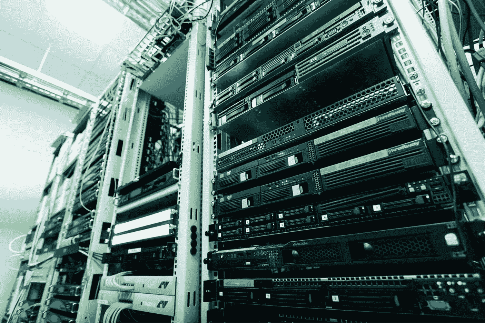

# 20. 规模的重要性：可扩展性与云

## 引言

“云”无疑是当下的热门词汇，但它是如何兴起的呢？从历史上看，企业依靠*本地部署*计算机（on-premise computers 的简称）运营——他们在服务器机房（塞满服务器机架的巨大会客）或更大的数据中心内，将许多称为服务器的、薄而宽的计算机塞进机架插槽中。*服务器*在很多方面与普通计算机相似，但体积更大、内存和磁盘容量也更大，不过它通常不连接显示器或键盘，而是通过公司网络进行访问。图 20-1 展示了几台服务器的外观。

一个装有多组机架的服务器机房，机架上摆满了黑色服务器单元和不同颜色的线缆。服务器带有指示灯和标签，线缆整齐地连接至各单元。房间光线充足，突出了设备的细节和结构。

**图 20-1** 多组服务器机架的外观。来源：“机柜中的网络服务器”，摄影：Sergei Starostin，可访问 `https://www.pexels.com/photo/network-servers-on-an-enclosure-6466141/`

本地数据中心对于企业的多数运营至关重要。公司的网站和内网都运行在服务器上。所有数据库、电子邮件以及公司为员工搭建的共享工具（用于那些无法直接安装在个人电脑上的功能）也都存放在数据中心的服务器中。数据中心还托管着公司的网络设备。

服务器曾是人们处理大量数据的唯一途径，因此对数据工作者来说也至关重要。当程序员或其他人员的个人电脑无法处理数据时，他们会登录到服务器上（通常运行着某种 Linux 操作系统），通过一些命令行操作来运行代码。有些公司偏爱 Windows 服务器，这类服务器可能更易用，因为它们拥有与个人电脑几乎完全相同的图形用户界面。

几十年来，企业一直以这种方式运营，但运行数据中心的成本高昂，原因有很多——硬件（服务器等）价格不菲，设备产生大量热量导致冷却房间既重要又昂贵，需要大量员工进行管理，物理安全也费时费力且可能花费不菲。因此，云计算提供了一种革命性的替代方案。公司虽然无法完全舍弃硬件，但可以大幅缩减其规模。

如今，*云计算*仅指使用可通过互联网访问的计算机，因此这些计算机可以位于几乎任何地方。我们将重点讨论云计算、并行与分布式计算，以及可扩展性在当今的重要性。

## 真实世界中可扩展性与云的例子

云技术开启了许多仅依靠数据中心无法实现或非常难以实现的可能性。这既源于位置因素（你所做的事情需要处于同一个有线网络中），也源于可扩展性——有时在短时间内需要的计算和存储能力超过了长期拥有这些资源的价值，有时又难以跟上需求。这里我们将看两个例子，两者都体现了可扩展性的重要性，其中一个例子还涉及了位置因素。

### 示例 1：数字网球锦标赛

2021 年澳大利亚网球公开赛正值疫情期间，但主办方仍希望举办一场有球迷和赞助商参与的大型活动。他们使用名为 Meridian（由 Infosys 创建）的云平台创建了一个名为“虚拟中心”的虚拟空间，为球迷和赞助商提供了沉浸式体验。[⁵¹] 事实上，他们在 2019 年澳网就已经开启了数字化转型，但在 2021 年将各方面都大幅扩展了。如果没有云技术，这几乎是无法实现的——它让人们能够观看比赛、与他人互动，并在比赛期间和场外获取大量额外信息和体验。他们开设了一家销售服装和其他装备的商店，虚拟模特可以从不同角度展示商品。对于比赛，他们提供了基于 3D 驱动的动画，并在每次击球时叠加数据图层，包括速度、旋转和发球落点等实时分析数据。他们利用机器学习技术提取比赛精彩片段，其中包含客观特征（如击球速度等物理方面）和略为主观的特征（如观众反应和球员情绪）。他们还提供了虚拟体验，如幕后参观、音乐会、网球训练营和其他现场活动。他们对结果非常满意，因此在疫情后的未来几届澳网中继续保留了大部分此类功能，并提供了关于击球类型、球员回合分析和比赛节奏的详尽统计数据和可视化图表。

### 示例 2：面向大众的音乐

音乐平台 Spotify 在几年前就转向了云，但其收益是立竿见影且持久的。[⁵²] 这家公司于 2008 年才成立，当时云服务尚未问世，因此他们的一切都内部完成，运营着自己的本地数据中心。他们在 2011 年突破了 100 万用户大关，并持续快速增长。到 2015 年，他们的四个数据中心已不堪重负，并考虑建造更多的数据中心来满足日益增长的用户群和工程师的需求。于是，他们开始考虑云解决方案。

即使在那个时候，谷歌、微软和亚马逊都已提供云平台，但功能还相对初级。经过一番考虑，他们选择了谷歌云平台（GCP）。实际上，他们的迁移过程非常顺利，仅由六人管理，但所有工程团队都参与其中，对其大部分基础设施进行了所谓的“直接迁移”，这意味着他们基本上按原样移动了数据和流程，而没有重写任何东西（尽管有一些必要的重写）。这涉及迁移来自 100 个不同团队的 1,200 个在线流程，每天执行这些流程超过 20,000 次，因此并非易事。

其影响是深远的，他们得以关闭数据中心——第一个于 2017 年关闭，另外三个于 2018 年关闭。最大的两个好处是：当数据存储需求增长时，扩展变得非常容易；以及 GCP 能完全确保客户数据的隐私。他们的客户每天播放音乐达数十亿次。Spotify 的工程师可以专注于他们的核心业务——利用 GCP 提供的自动化和其他省时工具来服务这些客户。他们还可以轻松使用 GCP 提供的许多其他服务，包括极具价值的数据分析和机器学习服务。

## 本地部署、虚拟机与云端

上文我谈到人们如何登录服务器处理更大规模的数据工作，但严格来说，他们通常并非直接登录服务器。相反，服务器上会创建多个*虚拟机*（`VM`），顾名思义，它们就像是虚拟的“计算机”——你可以登录进去，它看起来、用起来都像一台计算机，但实际上完全存在于某台特定的服务器上，并被分配了该服务器的一部分内存和磁盘空间。它可以配置任意操作系统。用户获得了该`VM`的访问权限后登录进去，感觉就像登录了一台普通计算机。用户可以安装软件、打开程序、正常运行，必要时还可以重启（只不过没有物理电源按钮）。实际上，`VM`中能进行的操作通常有限制（多出于安全原因），而且它们经常运行缓慢、延迟较高，但从概念上讲，它们的功能与普通计算机无异。

由于虚拟机是由软件创建的，因此可以配置成你需要的任何大小（取决于 IT 部门是否愿意给你分配一台足够大的）。尽管并非完美，但这些方案确实提供了一定的*可扩展性*，即代码处理更大规模且通常日益增长的数据量的能力。但这同时也意味着，*代码优化*（让程序运行更高效，从而减少时间和资源消耗的工作）对于大多数从事数据工作的人来说至关重要。另外两种计算方式——并行计算（将代码拆分成可同时运行的部分）和分布式计算（将代码片段发送到不同服务器，以利用更多的内存和磁盘空间）——也常常协同作用。

这几乎是唯一的方式，所以十五年前没人称之为“本地部署”。随着互联网的出现，选择范围得以扩展。如今，虽然本地部署依然存在，但云计算正日益普及。有一点很重要：也可以采用混合模式——一些公司既有数据中心，又使用云服务。有时这是因为监管要求，比如银行面临的那些问题。例如，最敏感的数据或任何与合规性相关的数据可能保留在公司自己的数据中心内，而其他所有数据则放在云端。不过，这并非绝对必要，因为云服务提供商也提供相关的监管服务，可以帮助管理此类事务。

## “大数据”与规模问题

我之前提到过“大数据”这个词，它被以多种方式使用，因为它还不是一个精确的术语，但基本上指代需要大量算力才能处理的海量数据，通常超出了单台计算机的处理能力。不过，它正变得日益规范化，现在大数据有几个“V”，具体取决于你参考的“专家”网站：体量（volume）、速度（velocity）、多样性（variability）和真实性（veracity）。

*大数据体量*指的是日常生活产生的海量数据，并且由于如今存储成本大幅降低，这些数据通常从许多不同来源汇集到更集中的地方。这也与*大数据多样性*相关，因为数据来源众多。*大数据速度*关乎数据生成的速度，来自购物交易、金融交易和社交媒体活动等实时数据采集。*大数据真实性*涉及数据的准确性和可靠性，因为这些特性至关重要。还有另一个 V 通常不被视为核心支柱，但却是隐含的前提——价值（value）。如果数据本身没有价值，其他 V 都毫无意义。

大数据的出现引发了规模问题。实际上，这个问题由来已久——代码或仪表板通常使用数据的子集编写（这实际上是标准做法，因为速度更快），但连接到真实数据时，性能表现会很差。这就是程序未能良好扩展的实例。通过代码优化来提高代码效率几十年来一直是软件工程的一部分。在过去，这需要深入了解程序将运行的特定硬件（处理器和磁盘），并在编程语言中直接管理和改进内存管理。大多数现代编程语言会自动处理内存管理，因此如今程序员通常无需过多处理这个问题。

当你试图处理大量数据时，无论这些数据是否被视为“大数据”，这个问题都会暴露出来。一些真正的大数据工具能让这变得容易，但了解一些提升代码效率的知识仍然很重要。这通常涉及理解`ML`算法的工作原理，以及其他技术，如交叉验证、网格搜索和其他常见的`ML`技术。同时，了解一些经典的计算机科学数据结构和算法也会有所帮助。

# 分布式与并行计算

传统上，当你运行一个程序时，它会在计算机的内存和磁盘驱动器中按步骤依次执行。一步接一步地运行称为*顺序计算*，而在本地机器上运行通常被称为本地运行。如今，这种基本方法在云环境中也很常见——你仍然在云中的单台机器上运行顺序程序，而非在个人电脑上。

有一种替代顺序计算的方法称为*并行计算*，它将程序拆分为不同步骤并同时（并行）运行。无论是你的个人电脑还是云计算系统，在多核处理器中，每个核心都能处理一个进程。因此，一个四核处理器可以同时运行四个并行进程。其主要优势显而易见：由于无需等待每个步骤完成后再开始下一步，总耗时将大大缩短。

从概念上看，并行计算非常理想，但这要求代码能够拆分为可独立运行的步骤。因此，你不能简单地将已有的顺序代码直接放入支持并行计算的系统中。代码必须告诉计算机如何进行拆分。虽然有工具可以在某种程度上自动实现这一点，但通常并没有那么简单。

假设你有一个机器学习流水线：清洗和准备游戏数据、训练模型、对数千款游戏运行预测、并将结果上传至数据表——你无法对整个流水线进行并行化。根据具体情况，其中几个步骤或许可以并行处理。数据清洗和准备工作可以部分并行，例如清洗和依赖于外部信息或仅基于行数据的特征生成。此时，我们可以将大型数据集拆分为若干较小的子集并分别执行这些步骤。然而，如果存在需要整列数值的聚合操作，则无法在拆分后的数据集上完成。部分并行训练可能可行也可能不可行（取决于算法），但最终所有结果都必须汇集在一起以完成最后步骤。预测很可能可以并行进行——只要有足够多的处理器，每款游戏都可以与其他游戏同时运行。

并行计算通常与*分布式计算*相伴相生，后者是指将不同的代码步骤分发到不同的计算机上执行。在并行计算的语境中，这意味着将程序拆分为多个部分，分别在不同计算机上运行，然后将结果传回原始计算机，由原始程序将结果拼接完整。但任何在不同计算机上运行并相互通信的系统都可算作分布式计算，例如万维网、分布式数据库、大型多人在线游戏，甚至蜂窝网络。

有时人们会这样区分并行计算和分布式计算：在并行计算中，代码所发送到的所有处理器共享同一块内存（比如利用个人电脑四核处理器但依然使用系统单一内存的程序）；而在分布式计算中，每个处理器都有各自独立的内存（比如一种病毒被发送到网络中的每台个人计算机上运行并传回信息）。

对于大多数数据科学家的日常工作而言，这些区别并不至关重要，但当处理大规模数据需要应用这些技术时，理解并行与分布式的基础知识会非常有用。

# 虚拟机与容器

上文我们讨论了虚拟机的概念，但它们的一个关键用途在于：每台虚拟机都是一个已知实体且被视为隔离环境——操作系统、编程语言、库等版本的更新都必须经过慎重考虑，因为这会影响到该机器上的所有内容。一个重要的问题是：由于我们希望各应用程序在各自的虚拟机中保持隔离，为每个应用程序运行一整个虚拟机的成本很高，因为它会占用大量分配的内存和处理器资源。

针对在单台虚拟机上运行多个应用程序的问题，一种流行的解决方案是容器。*容器*在概念上与虚拟机类似——它们也配置了特定的语言、库等——但不同容器可以共享底层的操作系统，从而显著降低成本，因为它们更高效地利用宿主系统的资源。这也使容器易于扩展。通常，你不会在一个容器中放入多个应用程序。请注意，你可以在任何计算机（包括虚拟机）上运行容器，关键在于每个容器都是隔离的。

如今，虚拟机与容器通常部署在云环境中，我们将在下文讨论这一点。

## DevOps 与 MLOps

“DevOps”是你在技术领域经常会听到的另一个流行词。`DevOps` 并没有一个严格的定义，但它基本上既是一种源于敏捷思维的哲学，也是一种方法论，它鼓励从开发人员到测试人员，再到代码仓库管理者以及实际部署人员等所有参与软件部署的人员进行协作。它强调自动化、精益原则、衡量、协作和共享文化。数据科学家并不总是需要为此操心，但理解其运作方式会有所帮助，有时你也需要处理相关问题。

自动化在 DevOps 中扮演着重要角色。软件测试，以及构建和发布（即软件在准备部署的状态下最终定型并实际部署的过程）通常都是自动化的。其他与开发相关的方面，例如为开发创建环境以及其他任何容易出错且可以自动化的工作，也会被自动化。它通常与另一个缩写词 `CI/CD`（持续集成/持续部署）联系在一起，这两者都需要上述提到的自动化。`CI` 指的是定期的代码集成和测试，而 `CD` 指的是代码可靠地、通过正确的环境进行部署。

所有这些都意味着更快的开发和产品发布速度，以及更迅速的用户反馈。许多大公司都非常看重这种速度，据说亚马逊会让每一位新入职的软件工程师在入职第一天就对代码库做一次真实的修改并将其部署。但这不仅仅是更快，通常也会更好——更可靠、更安全。开发方与运维方之间的沟通与协作对这种方法论至关重要。

`MLOps` 相当于机器学习领域的 DevOps。与 DevOps 一样，`MLOps` 关注的是机器学习解决方案的开发、部署以及两者之间的所有环节。这指的是将代码、特征存储（见下文）和模型部署到生产环境中（并非每次都必须全部部署）。在成熟度不高的组织中，数据科学家可能永远不需要完整的 MLOps，因为他们并不需要将代码部署到任何生产系统，但会遵循其中一部分，比如版本控制和某些自动化。许多建模前的工作，即使不投入生产，也能从 MLOps 实践中受益。

与 DevOps 一样，MLOps 也由自动化驱动。我们首先来谈谈机器学习工具的一般流程，通常称为*管道*。我们从数据准备开始，可能还会创建一个*特征存储*（一组经过定义和微调的特征，可以从使用的通用数据中派生出来），以及后续需要的训练和测试数据集。下一步是训练和调优，基本上就是准备模型。我们进行实验来选择算法和参数，然后训练最终模型。最后一步是部署（隐含的第四步是监控，以便检测模型漂移和其他需要重新训练的情况）。在部署中，模型和特征存储，以及任何处理传入数据的代码都会被部署到位。这就是从开发到部署的端到端流程，现在系统已准备好供最终用户使用。

## 云服务与云计算

从根本上说，云计算就是在互联网上进行计算。任何你使用的、通过网站而不是下载软件（无论是否联网都能工作）来操作的服务，都是云计算。那些要求你联网才能使用的软件，即使程序本身安装在你的电脑上，也属于云计算。Gmail 和大多数电子邮件服务都是云服务，即使你使用的是电脑上安装的 Outlook。你的电子邮件实际上是一个运行在云端的应用程序，因为它位于某个服务器上，而网站（或 Outlook）只是让你能够查看它。Slack、Steam 和 Zoom 是基于云的应用的另外一些例子，你虽然安装了软件，但必须联网才能完全使用它。像在线购物、网上银行和社交媒体这类网页应用则完全只在浏览器中运行。那些在线管理许可证，但不需要你使用时一直联网的产品，比如 Adobe 产品和 Microsoft Office 360，尽管可以离线工作，但同样使用了云服务。

然而，当我们在数据科学领域谈论云计算时，我们关心的并非便利的基于互联网的应用。相反，我们指的是通过互联网交付和使用计算资源，如磁盘存储、处理能力（通常简称为“算力”）和软件。这使得用户无需使用公司内部的数据中心，甚至无需使用用户电脑上的实际资源（除了网页浏览器和运行它所需的东西）就能访问所有这些资源。这很有价值，因为它意味着我们可以获得可扩展性（使用大量资源）、弹性（根据当前需求自动调整所使用的资源）、资源池化（多种计算资源可供多位用户使用）以及按需付费（只为使用的内容付费）等好处。

云计算产品使用起来很方便。但用户通常对数据、自行编写的软件和管道的控制权较少，这些内容可能以专有方式存储，这带来了被供应商锁定的风险。*供应商锁定*指的是你无法轻易从一个程序或平台切换到另一个。例如，如果你在微软的云平台 Azure 上创建了一个数据管道，可能没有明确的方法将其导出到其他地方运行。当你根本无法将数据移出时，也会发生锁定。在你使用任何平台（例如我们接下来要讨论的主要云平台之一）时，这都是一个需要考虑的问题，在选择开发软件和管道的工具时应该加以考虑。

### 主要云平台

我们在上面看到，云平台基本上取代了数据中心，而数据中心基本上提供计算和内存。但云产品和服务仅仅是任何在互联网上运行的软件，它们数量众多，有些只提供一种或少数几种特定服务，但也有三个大型的、功能全面的平台（在 Spotify 的例子中提到过）：Microsoft Azure（微软 Azure）、Amazon Web Services（AWS，亚马逊云服务）和 Google Cloud Platform（GCP，谷歌云平台）。如今，这三个平台都提供了海量且多样化的产品和服务，从数据存储、定时数据加载等基础服务，到聊天机器人、推荐引擎等高级 AI 服务，不一而足。由于可用的服务如此之多，很容易找到你需要的那一个并开始使用。

需要注意的是，本节中我讨论的服务更多是面向企业的。云平台可能非常昂贵，这通常是希望开始使用它们的公司（或者希望给员工足够权限以进行实际工作的公司）面临的一大障碍。

云平台对个人而言也可能很昂贵，并且很难弄清楚如何避免产生意外的费用。我下面提到的所有平台都提供免费选项，所以如果你真的想熟悉它们，值得去探索一下。

# Microsoft Azure

Azure 始于 2008 年，经过多年的发展，现已包含超过 200 种产品和服务。他们在线提供了一个涵盖所有当前可用产品的详尽列表，并按类型进行了分类。这些产品包括存储、数据库、媒体、分析、AI + 机器学习等等。其中一些工具的功能可能存在重叠，这通常是因为它们针对略微不同的用途进行了优化。

我将在此处介绍一些最常用的产品。有很多数据存储选项以及迁移工具，可以轻松地将公司的数据迁移到 Azure。最流行的对象存储产品之一是 Azure Blob Storage，它具有高度的可扩展性和安全性，常用于机器学习应用。Azure Data Lake Storage 支持高性能分析。Azure Files 适用于文件存储，并且安全且可扩展。

# 云服务、数据科学与项目管理

## Azure 云服务

一些最受欢迎的服务是 Azure 上的 `SQL Server`（也可以存在于虚拟机中）、`Cosmos DB` 以及 Azure 自家的 `SQL Database`。`SQL Server` 是微软的数据库产品，早在云出现之前就已存在。Azure 还支持另外两种流行的 SQL 数据库：`MySQL` 和 `PostgreSQL`。`Cosmos DB` 旨在用于高性能应用程序中的数据，并提供良好的可扩展性。Azure 还有一个简单的名为 `Table Storage` 的 NoSQL 键值数据库。`Azure Backup` 是一项流行的服务，可用于备份您在 Azure 中的所有数据。

还有许多用于移动和处理数据（提取、转换和加载，简称 ETL）的工具，但其中最受欢迎的是 `Azure Data Factory (ADF)`。它是一个工作流风格的工具，这意味着您可以将不同的节点拖到工作区上，并以数据可以从左到右流经它们的方式连接起来。每个节点执行一个特定的任务，比如从数据库提取数据，对其执行操作（通常是转换），以及写入数据库。它在很大程度上无需编码，这使得更多人能够使用它。它提供了许多转换和任务，包括许多分析任务。该工具可以从超过 90 个不同的来源提取数据，包括来自其他云提供商的数据。

`ADF` 是一个很好的低代码 ETL 工具。还有其他流行的工具，尤其是一个更高级的工具叫做 `Databricks`，它可以轻松地使用 `Spark`（一个分布式处理系统）进行大规模数据处理和分析，并且还允许轻松管理机器学习模型。`Databricks` 可用于执行许多其他操作，包括 ETL。前面提到的 `Power BI` 是一款流行的可视化工具，它在 Azure 中可用，使得与客户共享仪表板变得容易。`Microsoft Fabric` 是一个相对较新的综合性平台，内置了 AI，专为数据科学家和其他数据专业人士设计。

Azure 提供的另一类产品属于“计算”标签。这些基本上是允许您使用计算机（处理器和内存）来运行代码的产品。Azure 虚拟机 (VM) 允许您创建和配置一台“计算机”，可以用于特定产品——例如，安装特定的操作系统、安装特定版本的编程语言发行版、安装所有必需的库、代码库驻留并运行在其中，并设置好所有配置文件。您还可以在虚拟机内设置数据库。虚拟机可以是 Windows 或 Linux 系统。

如上所述，虚拟机可能很昂贵，因此在应用基础架构世界中出现了容器和其他无服务器工具。`Azure Kubernetes Service` 允许您轻松设置包含代码等内容的容器来运行应用程序。另一个流行的服务是 `Azure Functions`，它允许您在已设置的任何专用服务器（计算机）之外运行代码，这可以在其他现有的 Azure 对象上完成。`Azure Functions` 的一大优点是，您可以将它们绑定到这些对象并分配触发器，当另一个 Azure 对象上发生特定定义的事件时，它就会运行。

组织中另一个流行的产品是 `Azure DevOps`，它主要用于改善协作、规划和管理开发过程。它通过代码仓库、测试工具以及对持续集成和持续交付（CI/CD；一种管理代码部署到生产环境的方法）的支持来支撑软件开发。它还提供了看板和其他敏捷工具（我们将在下一章讨论的软件开发概念）。

这只是对 Azure 部分产品和服务的介绍——基本上只是冰山一角。此外，如上所述，这些产品之间存在大量的重叠和互连——例如，您可能正在 `Databricks` 代码中从 `Azure SQL Server` 读取数据，或者在虚拟机内设置任意数量的服务。

# Amazon Web Services

Amazon 在 2006 年推出了他们的云存储解决方案 `Amazon Simple Storage Service (S3)`，不久后又推出了其计算产品 `Amazon Elastic Compute Cloud (EC2)`。这些是 `AWS` 平台中的前两个产品，但现在已有更多产品。他们还提供了一个在线列表，其中包含所有产品的可搜索区域。

与 Azure 一样，他们拥有许多服务，超过 200 种。每个产品类别都有自己的“决策指南”，可以帮助您根据自身情况选择合适的产品。例如，存储类别的指南讨论了不同类型的存储（块存储、文件存储和对象存储）以及针对每种类型的各种产品。`Amazon S3` 是一个对象存储，可以通过 `AWS Storage Gateway` 与一些本地系统集成，这使得存储文件和迁移数据变得容易。`AWS Backup` 是另一个有用的产品，可用于备份系统中的不同类型文件。

`AWS` 也有几个数据库可供选择，用于常规数据库负载，包括两个关系型服务：`RDS`（支持 `PostgreSQL`、`MySQL` 和 `SQL Server` 等引擎）和 `Aurora`（为 `PostgreSQL` 和 `MySQL` 工作负载提供高性能和可扩展性），以及几个 NoSQL 数据库。它还提供 `Redshift`，用于快速处理非常大量的数据。

有几个分析工具可以让人们（即使是非技术人员）相对快速地处理数据并从中提取信息。`Amazon Athena` 允许用户快速进行实时数据探索、分析和可视化。`AWS Glue DataBrew` 可以快速进行数据准备，`Amazon QuickSight` 让您可以快速进行可视化。还有更高级的工具供数据科学家使用，其中一些需要编码，例如全面的机器学习服务 `Amazon SageMaker`，它支持从数据准备到模型训练和部署的所有环节。它还集成了流行的 `PyTorch` 和 `TensorFlow` 框架，用于神经网络工作。其他工具不需要太多编码，例如用于自然语言处理的 `Amazon Comprehend`、用于构建聊天机器人的 `Amazon Lex` 以及用于基于视频任务的 `Amazon Rekognition`。

在计算领域，`Amazon EC2` 是经典选择，允许您运行虚拟服务器。`Amazon Linux` 允许您快速启动基于 Linux 的环境。`Amazon Lambda` 提供由事件触发的无服务器计算。`AWS Batch` 允许您运行大型批处理作业，而无需管理大量基础设施。

`AWS` 还拥有许多开发人员工具，包括用于内部应用程序的 `AWS App Studio`、用于编写和测试代码的 `AWS CodeBuild`，以及几个与特定语言相关的工具。

# Google Cloud

Google 于 2008 年推出了 `Google App Engine` 的预览版，允许人们创建易于扩展的 Web 应用。该服务于 2011 年结束预览，并成为主要的云平台提供商之一，如今提供超过 150 种产品和服务，详情可见其产品列表。^(⁵⁶)

`BigQuery` 是一个可用于多种用途（包括分析）的数据仓库。`Cloud Storage` 支持针对非结构化数据（如图片和视频）的对象存储，而 `Filestore` 为用于企业应用的网络文件系统提供全托管文件存储。`Cloud SQL` 支持三种关系型数据库，并提供其他适用于 `SQL Server` 和 `PostgreSQL` 的选项。此外，还有 NoSQL 选项 `Datastore`、`Cloud Spanner` 以及 `Cloud Bigtable`。`Dataform` 允许您在 `BigQuery` 中运行 SQL 工作流。

Google Cloud 中有多个可用于 ETL 流程的产品，包括 `Cloud Data Fusion` 和 `Datastream`。`Cloud Data Fusion` 是一个全托管工具，允许用户通过可视化界面构建、管理和调度 ETL 任务。`Datastream` 是一种变更数据捕获和复制服务，支持在数据库和存储服务之间移动数据。

另一个重要工具是 `Dataplex`，它有助于管理即使分散在不同孤岛中的数据。`Spanner` 允许将多种数据库（包括关系型数据库和 NoSQL）整合在一起。

在分析领域，`BigLake` 统一了数据湖和数据仓库中的数据进行分析，`Dataflow` 是一个无服务器流式及批处理工具，专注于 ETL 和实时分析。`Document AI` 支持一些 NLP 工作，而 `Recommendations AI` 是一个推荐引擎。`Vertex AI` 是一个通用型的分析和 AI 平台，提供多项具体功能，包括智能体构建器。

在计算领域，有多个实用工具。`Dataproc` 控制 `Spark` 和 `Hadoop` 集群，可用于处理大数据。`Compute Engine` 允许运行可定制的虚拟机。还有一些针对特定需求的计算工具，包括 `Cloud GPUs`（用于高负载处理和机器学习训练）和 `Cloud TPUs`（用于加速神经网络计算）。`Cloud Workstations` 是另一个适用于开发环境的选项。`Cloud Run` 允许对容器化应用进行无服务器部署，`App Engine` 则提供了一个用于托管 Web 应用的无服务器平台。他们还通过 `Knative` 提供了基于 Kubernetes 的无服务器功能。

## 关键要点与下一步

在本章中，我们讨论了云、可扩展性以及与此相关的一切。这包括理解过去本地数据中心与现代云计算之间的差异，以及可扩展性、弹性、资源池化，以及按需付费的理念。我们谈到了大数据和可扩展性的重要性。我们还讨论了分布式计算和并行计算，这两者对于提升大规模作业的计算速度都至关重要。最后，我们了解了三大主流云平台及其部分功能。

在下一章中，我们将深入探讨数据科学项目管理，首先了解传统项目管理与现代软件开发管理。我们将概述如何使用看板方法管理数据科学项目，还会讨论项目完成后的相关步骤。

# 从业者档案：布米卡·沙阿

**姓名：** 布米卡·布里延·沙阿

**现任职位：** 容器技术工程经理

**现任行业：** 零售业

**工作经验：** 科技领域 17 年，其中包含 3 年数据分析师、7 年云 DevOps、4 年平台解决方案经验

**教育背景：**

*   持有 Kubernetes、Azure 和谷歌云平台认证
*   计算机科学硕士
*   计算机科学学士

*以下观点仅代表布米卡个人，与她的任何现任或历任雇主无关。*

### 背景

青少年时期，布米卡就热爱计算机，并在学校里正式学习了计算机科学。顺理成章地，她攻读了计算机科学学士学位。大学期间，她实习并接触了软件工程、测试及其他重要环节，开始真正培养起软件开发者思维。此后，她继续攻读了计算机科学硕士，并持续参加课程以不断成长。

### 工作经历

她的第一份工作是 ETL 开发工程师（提取、转换、加载——基本就是数据搬运），这是她首次在商业领域真正接触“数据”。她非常看重转换步骤的价值——将难以使用的数据变得有用。随后她转型为数据分析师，并持续提升数据技能。她享受数据可视化，因为它能展现数据中难以察觉的规律。沿着这条路径，她逐步迈向数据科学领域，学习了数据脱敏，随后对数据安全产生兴趣，这促使她的职业生涯再次小步转型。她调入云 DevOps 岗位，负责自动化基础设施和解决方案的开发，并热爱编写脚本。在该领域深耕后，她转入容器平台工程领域，如今带领着一个团队。

## 语录精选

**最喜欢的工作部分：** 布米卡热爱所有工作中解决问题的环节，以及持续学习的过程。她还喜欢跨团队协作，让解决方案落地。她尤其享受打造可扩展的解决方案。

**最不喜欢的工作部分：** 平衡相互冲突的优先级有时令人沮丧。作为经理，她需确保团队工作与公司目标愿景一致，同时让利益相关者满意，这有时颇具挑战。更令人沮丧的是，别人对你的工作所需事项擅自决策。

**最喜欢的项目：** 她曾参与一个项目，旨在构建安全且可扩展的 Kubernetes 环境以缩短部署时间。她成功将部署时间缩短了 40%，帮助开发者避免了宕机。这对数据科学家尤其有用，因为他们也开始使用 Kubernetes。该平台提供了数据工具，包括数据脱敏功能。项目中值得关注的方面包括自动扩缩容、优化、降低运营成本，以及将单体工具迁移至微服务架构。

**最常用技能：** 按重要性排序：解决问题、批判性思维、沟通能力、领导力、技术专长

**当前主要使用工具：** `Kubernetes`、`Terraform`、`Jenkins CI/CD` 流水线、云服务（`GCP` 和 `Azure`）、`Golang`、`SQL`

**云的未来：** 所有行业都在向云计算和自动化迈进。这简化了应用部署，意味着 AI 工具既作为云和自动化工具的一部分，也作为被部署应用的一部分被广泛使用。

**优秀技术人才的必备素质：** 好奇心、创造力与扎实的技术能力相结合。坚实的统计学基础。在恰当的时机进行沟通（不早不晚）。还需懂得如何从 AI 工具中获益——明确目标而非盲目使用。

**给未来技术从业者的建议：** 参加开放日，结识同行，了解公司及各类岗位角色。然后专注打造你目标领域坚实的技术基础。

*布米卡是一位容器平台工程经理，拥有跨数据及其他技术领域的多元背景。*

脚注 1 2 3 4 5 6

