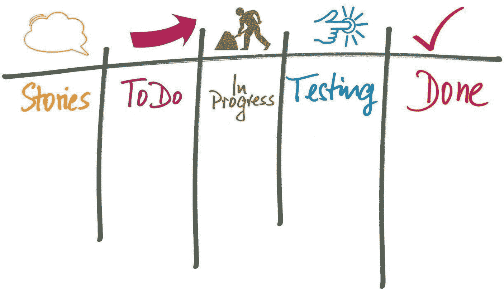
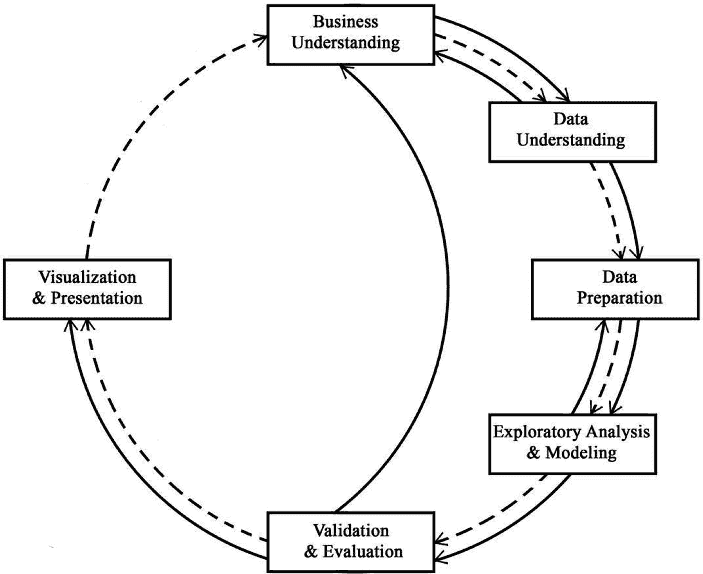
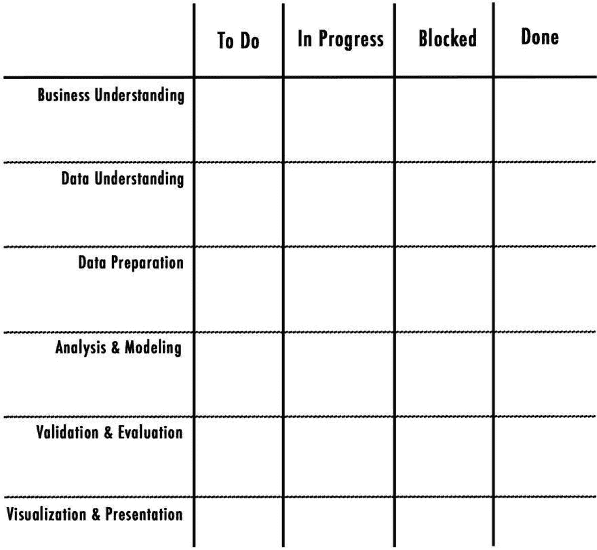
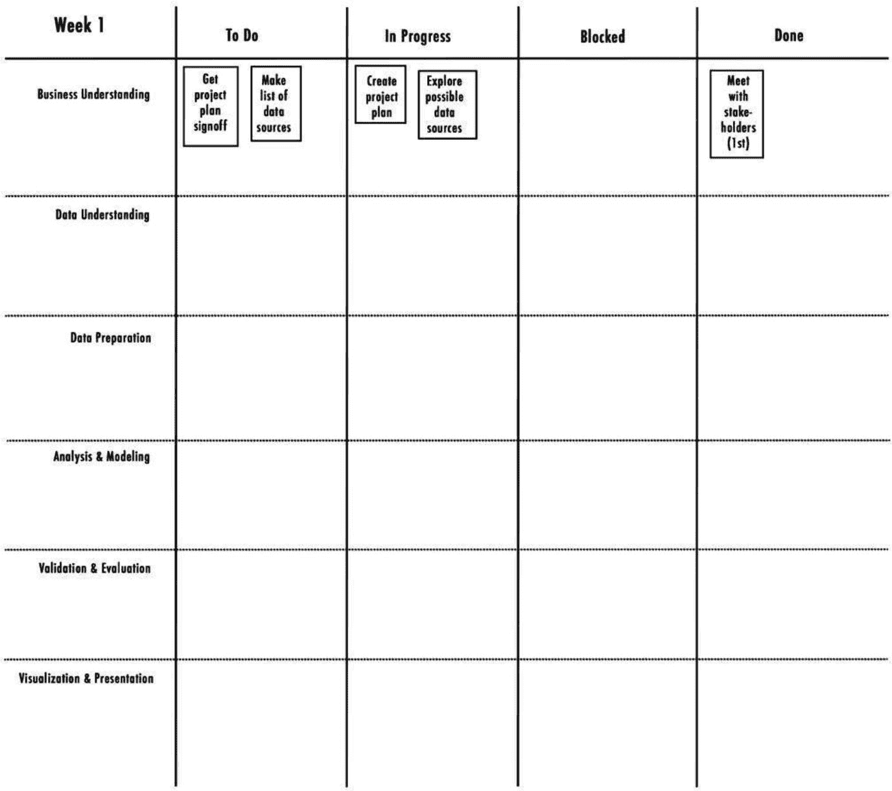
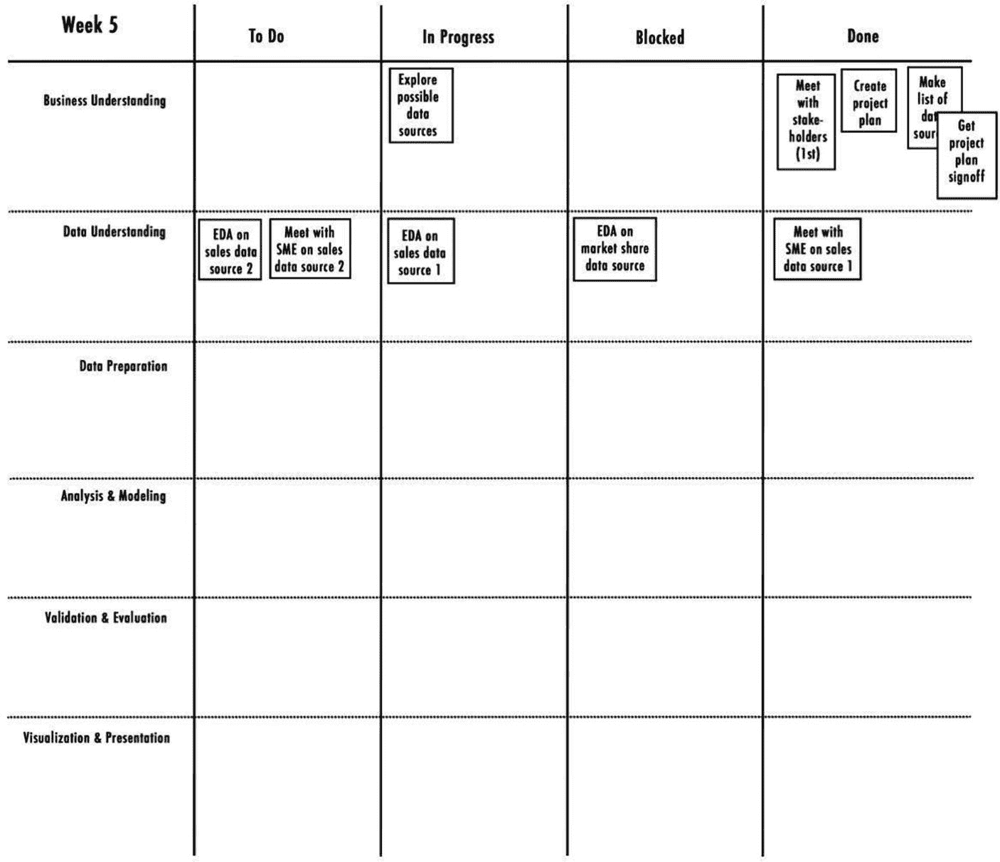
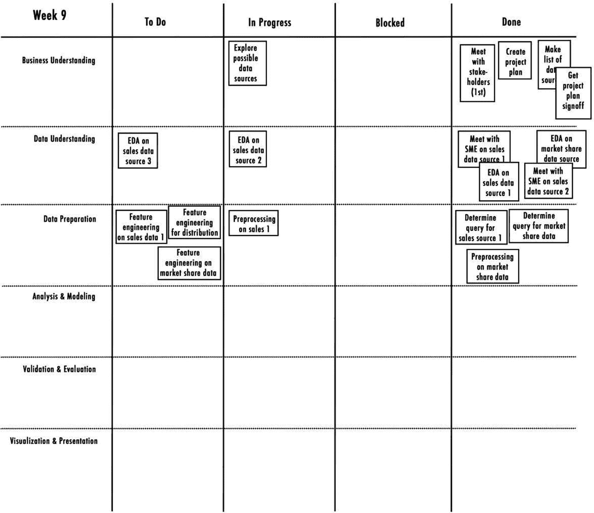
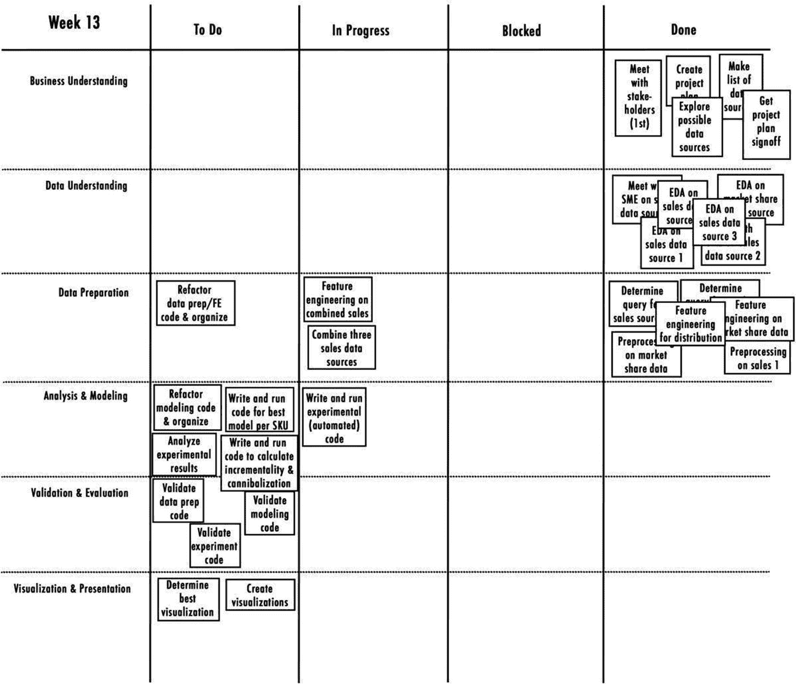
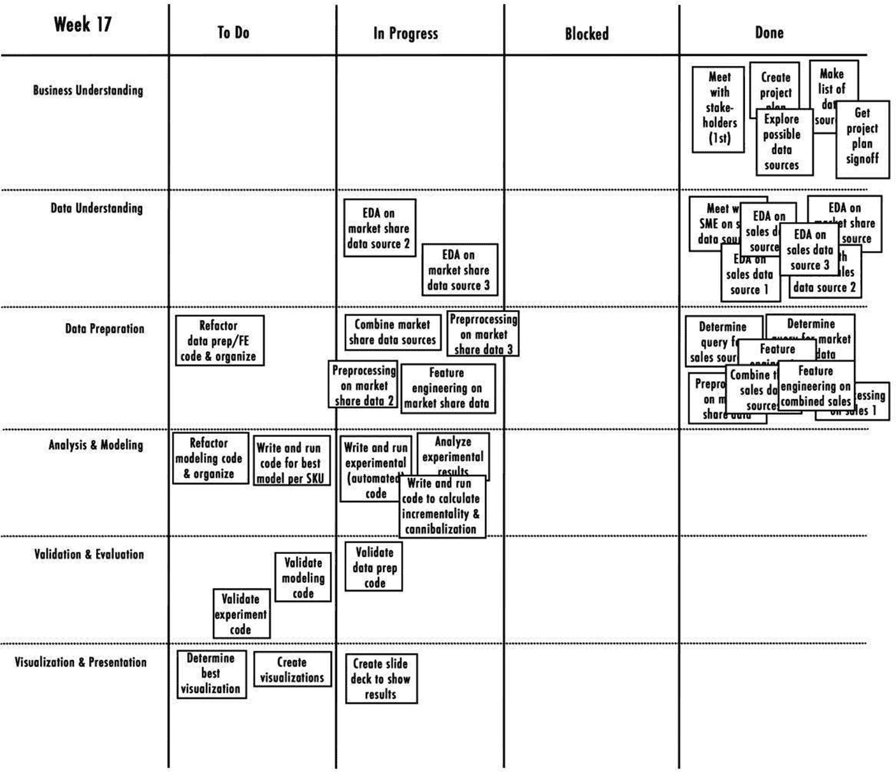
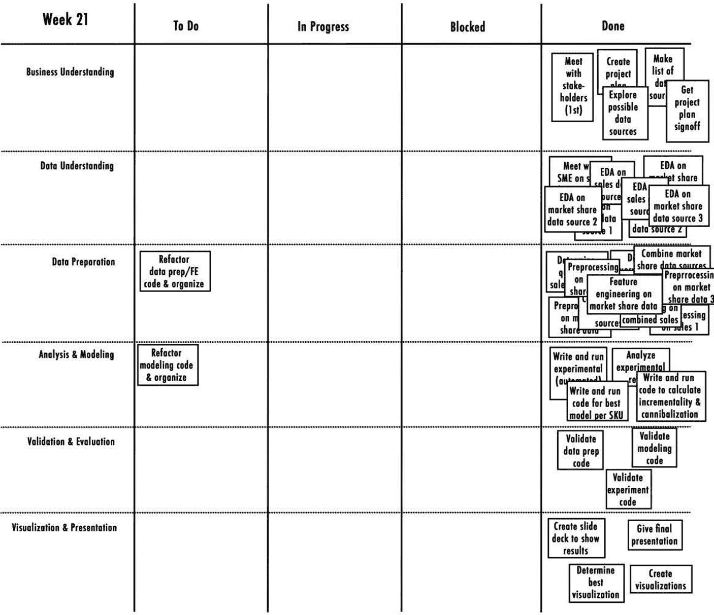

# 21. 融会贯通：数据科学解决方案管理

## 引言

上份工作求职面试时，我必问的问题之一是：“你们使用什么开发方法论？”我问这个是因为前公司强迫我们在同一看板上使用 `Scrum`，与软件开发者、数据开发者和 BI 开发者共事，结果行不通。

但现实是，目前还没有公认的、成熟的数据科学项目管理方法。人们只是用 `Scrum` 等方式凑合。我将探讨管理数据科学项目时至关重要的各个方面，然后分享一种可能适合某些数据科学团队的管理方法。

## 项目管理

项目管理是一门历史悠久的完整学科，在软件开发和工程领域已有许多相当标准的方法。所有这些方法都旨在明确需要完成的工作、制定时间表，并在项目过程中监控进度，确保一切落实。传统上只有一种管理方法——我们现在称之为瀑布模型。在瀑布范式下，一切都需要预先精心规划。当变更成本高昂或耗时费力时，这种方法尤为合理，因此大型建筑工程和工程项目确实需要它。

大学时代“错误已铸成”的轶事至今仍让我忍俊不禁。有传言说，我就读的工程学院那栋相对较新的建筑，顶层有一个永远空着的喷泉。据说在注水之前，他们核查了设计图，工程师显然忘记了计算水在楼板上的重量，装满水的喷泉会超过承重极限。这不像大多数软件 bug——你不能随手多扔几根工字钢来修补。这就是规划和管理如此重要的原因。

### 通用项目管理方法论

`项目管理知识体系`（`PMBOK`）是一套许多项目经理遵循的知识、术语和指南集合。其权威来源是`项目管理协会`出版的一本书，截至撰写本文时最新版本为 2021 年发布的第七版。该协会提供两种认证，为进入项目管理领域的人们提供了常见途径。`PMBOK` 相对传统且严谨，但在 2017 年的倒数第二个版本中增加了更灵活的做法。另一种项目管理方法是 `受控环境下的项目`（`PRINCE2`）。该方法侧重于组织与控制，但也强调持续改进，使其比传统的 `PMBOK` 更具灵活性。然而，它在结构上仍然严谨，并最终需要大量的文档工作。

这两种方法都将项目划分为若干阶段。它们都定义了五个阶段，以下是 `PMBOK` 的五个阶段：

1.  **项目启动**：定义商业案例和项目目标，并识别利益相关者。
2.  **项目规划**：定义范围，识别任务和子任务，制定时间表，确定资源（完成工作的人员和工具），制定预算，识别第三方供应商或工具需求，识别风险及缓解计划，定义质量和成功衡量标准，并确定与利益相关者的沟通方式。
3.  **项目执行**：开展实际工作。
4.  **项目监控**（与执行并行）：确保基于既定因素和成功衡量标准，目标得以实现，工作按需正常推进。
5.  **项目收尾**：总结经验教训，并报告整个项目情况。

这两种方法都源自瀑布式项目管理方法论，该方法属于前期工作繁重型，需要在工作开始前进行大量规划。在 `PMBOK` 中，据说任何项目约 50%的时间都花在第二个阶段，即项目规划上。其余大部分时间则花在项目执行上。我们将在下文进一步讨论这些内容。

在传统项目管理中，*项目经理*（`PM`）是监督整个流程的人，对项目的成功至关重要，包括为项目成功获取外部资源，无论是人员、工具还是数据。`PM` 是代表项目向公司其他部门展示项目的人，而项目规划步骤正是他们提出申请以获取资金和资源的地方。

## 项目规划

在传统项目规划中，“做什么”和“怎么做”至关重要，“做什么”决定了项目的整体目标，“怎么做”则明确了实现方式。以下是十个基本步骤，将在下文讨论：

1.  定义项目目标和范围。
2.  描述项目。
3.  制定详细工作计划。
4.  定义里程碑和可交付成果。
5.  确定所需人员。
6.  定义时间表。
7.  制定预算。
8.  定义变更控制流程。
9.  识别风险。
10. 定义政策和指导方针。

流程中的第一个实际步骤是定义清晰的项目目标，并界定该目标的边界（即范围）。这包括获取利益相关者的需求。接下来，应对项目进行描述。这需要提出几个问题，包括（但不限于）将要做什么以及何时做？将交付什么？谁负责验收项目完成？开发者和用户的责任是什么？如何衡量进度？至此，我们已定义了客户的需求以及项目范围。接下来，必须制定包含细节的实际工作计划，包括里程碑和可交付成果。

流程中的后续步骤涉及定义项目的不同方面，包括人员需求、时间表、预算、变更控制流程、风险以及政策和指导方针。这通常由项目经理向公司获取信息来完成，许多公司拥有可自动处理部分工作的工具。一旦分配了人员，结合详细的工作计划，就可以帮助制定时间表。进而可以制定出预算。政策和指导方针对于明确项目中人员的角色和职责是必需的。最后，定义变更控制流程。这涉及任何类型的变更，包括人员、角色以及项目产品本身的修改。

在传统方法中，任何正在创建的系统或对象的设计都会在规划阶段完成，因为这是制定时间表、预算、识别资源等工作的前提。

## 项目执行

当所有事项都已规划好，资源也已到位时，项目执行就开始了。这就是实际的工作，无论是设计、编码还是其他活动。人们将致力于达成里程碑、准备可交付成果。此时，`PM` 的职责是确保一切按计划进行，如果需要额外支持（例如，更多的人手或工具），他们将为此争取。`PM` 还需让利益相关者了解最新情况。在此阶段可能会提出变更请求，`PM` 会将其带回团队讨论。

当所有工作都达到既定的完成点（通常由规划阶段确定的一个人员或团队来决定）时，项目执行便终止。

## 软件项目管理

尽管上述两种通用项目管理方法相对严谨，但它们已适应了 `敏捷` 方法（这是一种全新的、比瀑布式方法适应性更强的管理方式，下文将讨论），因此在软件开发中相当常见。尽管我强烈认为适用于软件开发的项目管理方法不能未经修改就直接用于数据科学，但数据科学团队被迫遵循这些方法的现象却非常普遍。该领域尚未确立管理数据科学项目的良好方法论，这正是它们退而求其次采用其他方法的原因。尽管如此，`敏捷` 软件开发方法论仍然为数据科学项目管理提供了良好的参考点。

几十年来，瀑布式方法一直是管理软件项目的方式。但一种名为`敏捷`的、完全不同的方法论范式已基本取代了它。`敏捷`的关键方面是由客户需求驱动的迭代式开发，并伴有来自客户的持续反馈。专注于尽早提供可工作的软件，并通过添加功能来改进它，是该方法的基本组成部分。最小可行产品（或`MVP`）是一个功能性的软件片段，它包含部分所需功能，随着产品开发会添加更多功能。这些方面使得流程异常灵活。它与前期工作极其繁重的瀑布式方法截然相反。只要确定好了基础框架和初始概念，你甚至可以在获取项目所有需求之前就开始`敏捷`项目的开发。两种最常见的特定`敏捷`方法是`Scrum`和`看板`。

## 项目规划

尽管你可以更快地启动一个敏捷项目，但仍有项目前期工作要做。确定项目目标和范围（这涉及获取关键需求）仍然至关重要。项目需要被描述清楚，包括最终的需求收集，并且需要制定一份工作计划。在敏捷项目中，工作计划将是具体工作项的列表，保存在最常见的敏捷管理类型`Scrum`（我们将在下文讨论）中所谓的“产品待办列表”中。由于项目刻意采用了敏捷性质，这个产品待办列表不一定是所有待办事项的完整记录。执行过程中可能会出现更多需求，这些需求可以添加到产品待办列表中。重要的里程碑和可交付成果会被确定，但这些在执行过程中也可能发生变化。其余文档不会像传统管理项目那样具体，但它们应该以某种形式存在。风险和相关人员需要被识别，并创建进度表和预算。最后，要定义变更控制流程，以及相关的政策和指南。

## 项目执行

在软件项目中，进一步的系统设计可能发生在执行阶段，同样，所有的编码、基础测试、性能测试、质量保证和实施也都在此阶段进行。

对于项目执行，`Scrum`的特点是称为`冲刺`（两到四周）的短开发周期、产品待办列表、`冲刺`各个阶段的一些特定会议，以及一个物理或虚拟的看板，所有进行中的`用户故事`都在上面跟踪。开发人员在每个`冲刺`开始时从产品待办列表中挑选`用户故事`，这些就是他们在该`冲刺`期间要完成的工作。各种会议被称为“`仪式`”，包括`每日站会`（非常简短的工作进展检查会议）、`冲刺回顾`（检视上一个`冲刺`的情况）、`产品待办列表梳理`（随着了解更多信息，向产品待办列表添加`用户故事`并改进其中的信息）、`冲刺评审`（演示开发进度）和`冲刺计划`。`Scrum`的理念是赋能开发人员和自我组织。

`看板`则稍微宽松一些，但也有一个用于跟踪工作的可视化看板，`任务卡片`（虚拟或物理）在开发阶段从左向右移动。它也是迭代式的，旨在鼓励专注于较少量的任务（通常会对同时处理的任务数量进行限制）。它也很灵活，能够赋能开发人员，鼓励协作，并更容易快速发现障碍。

`看板`和`Scrum`看板都应定期更新，理想情况下是每天更新。许多团队都会有每日会议，他们会在会上通过移动物理或虚拟看板上的`任务卡片`来共同更新看板，或者只是回顾自上次会议以来所做的更改。

图 21-1 展示了一个典型的`看板`。状态分区几乎可以是任何内容，具体取决于它所用于的工作类型。这里展示的是用于软件开发的状态分区。在这个`看板`中，一个`任务卡片`/任务会从“`用户故事`”分区（产品待办列表）移动到“`待办`”，当它即将被开始处理时；然后一旦开始处理，就移动到“`进行中`”；接着当测试工作开始后，移动到“`测试中`”；最后当完成时，移动到“`已完成`”。`Scrum`看板看起来非常相似。`Scrum`中唯一必需的状态是“`待办`”、“`进行中`”和“`已完成`”，但其他常见的状态还有“`搁置`”、“`测试中`”和“`受阻`”。

一个说明项目管理流程的流程图，包含五个列，分别标记为：`用户故事`、`待办`、`进行中`、`测试中`和`已完成`。每列上方都有一个图标：`用户故事`列上方是云朵图标，`待办`列上方是箭头图标，`进行中`列上方是一个人正在工作的图标，`测试中`列上方是一只手按按钮的图标，`已完成`列上方是一个勾选标记图标。该流程图直观地展示了从初始想法到任务完成的各工作流程阶段。

**图 21-1** 一个`看板`示例。来源：来自 [`https://pixabay.com/illustrations/work-work-process-to-organize-4057334/`](https://pixabay.com/illustrations/work-work-process-to-organize-4057334/) 的“工作，工作流程，组织免版税库存插图”

为了理解上述软件开发`看板`的工作方式，我们来看一个从零开始开发的餐厅销售点系统。销售点系统是餐厅用来接单和收款的系统。首先要做的是收集需求，这涉及到开发人员和/或项目经理与系统所服务的利益相关者进行沟通。这将包括确定诸如能够从菜单中选择食品项目这样的需求，这需要预先输入价格；以及能够创建包含多个项目的订单、计算小计、添加适当的税费、允许自定义小费、获取总金额、为总金额接受现金和/或刷信用卡、处理退货以及打印和/或通过电子邮件发送收据等能力。

一旦开发人员获得了利益相关者的需求，他们就会深入挖掘并提出一个解决方案，详细说明技术需求。由此，他们可以为系统需要完成的特定事项创建一个产品待办列表。这些通常被称为`用户故事`，并且它们应该尽可能小且边界明确，目标是尽可能少地依赖其他人或其他`用户故事`。以下是一些可能出现在产品待办列表中的示例：

- `数据库`：创建一个数据库来存储订单等。
- `数据库`：创建一个表来存储项目。
- `数据库`：创建一个表来存储项目价格。
- ……
- `前端`：创建项目显示界面。
- `前端`：使显示的项目可点击以弹出更多信息。
- `前端`：为每个显示的项目添加可点击按钮和数量选择，以将其添加到数据库中的订单。
- `前端`：添加一个可点击的结账按钮，该按钮会打开一个订单摘要界面。
- ……

请注意，产品待办列表通常不包含在`看板`上，因为产品待办列表中的`用户故事`通常比`看板`上的空间多得多。上面的列表与需要完成的工作相比显然微不足道，并且也很清楚，某些`用户故事`依赖于其他`用户故事`完成后才能开始。这在大多数项目中是不可避免的。总会有许多`用户故事`彼此不依赖，可以由不同的开发人员同时处理，这就是为什么它在软件开发中运作得如此之好。

一旦有了产品待办列表中的`用户故事`，开发人员就会选择即将开始处理的`用户故事`，这些故事会进入上面图表中的“`待办`”列。这个分区能清晰地展示即将到来的工作。一旦开发人员开始处理某个`用户故事`，它就会被移到“`进行中`”列。准备就绪后，它会被移到“`测试中`”列，当测试完成（以及所有必要的更新）后，进入“`已完成`”列。当发现错误时，`用户故事`经常会被从“`测试中`”移回“`进行中`”，这个过程可能会重复，直到所有测试都通过。然后它就可以被移到“`已完成`”列。

值得指出的是，目标始终是让产品待办列表是“完整的”——列出所有需要完成的事项——但即使在软件开发中，这也很难做到，而且流程足够灵活，允许随时向产品待办列表添加`用户故事`。

由于`Scrum`和`看板`都非常适合软件开发，人们自然而然地尝试将这些方法应用于数据科学项目，但结果并不总是很好。在下一节中，我们将进一步讨论在数据科学项目中开展工作的方法。

# 数据科学解决方案开发方法论

数据科学在许多方面看起来类似于软件开发，但大部分工作实际上截然不同。有时数据科学家会创建可部署的软件，这种情况下确实与软件开发相似。然而，大量数据工作、探索性分析、特征工程、不同模型的开发与测试、可视化方案的选择与准备，以及最终成果的整理，这些都无法完全套用软件开发方法。

在工作中，即使并不理想，你可能会被迫遵循`Scrum`或软件开发的`看板`方法，因此了解这些方法的运作方式会有所帮助。但若是你的团队尚未选定方法论呢？如果你足够幸运，能帮助团队确定运行数据科学项目的最佳方式，请继续往下阅读。

残酷的现实是，没有任何一种方法论能够统治数据科学的所有场景。但这并不意味着没有好的实践方法。

## 项目规划

即使你能更快地启动一个敏捷式项目，仍然需要完成项目的前期准备工作。虽然项目规划在软件项目中已很成熟，但在数据科学项目中却并非如此。不过，许多步骤是相同或相似的。让我们再次参考`CRISP-DM`框架，其前两个步骤就与项目的规划阶段相关。

流程图展示了数据分析过程：从“`业务理解`”开始，接着是“`数据理解`”、“`数据准备`”、“`探索性分析与建模`”、“`验证与评估`”，最后到“`可视化与呈现`”。箭头指示各阶段之间的流向，并从“`可视化与呈现`”返回“`业务理解`”，形成一个迭代循环。

**图 21-2** `CRISP-DM` 数据科学生命周期

`业务理解`是规划的一部分。`数据理解`也部分包含在规划中，但它同样可以是执行阶段的内容。规划步骤列举如下：

1.  定义项目目标、范围和高层需求（`业务理解`）。
2.  确定候选数据源、获取访问权限的方法以及数据所有者（`数据理解`）。
3.  进行预探索性数据分析，以确定数据中的候选字段以及它们是否能提供必要信息（`数据理解`）（根据需要返回步骤 2）。
4.  创建当前已知任务的待办列表，主要是探索性数据分析任务。
5.  定义里程碑和可交付成果。
6.  确定所需人员。
7.  制定时间表。
8.  确定预算。
9.  定义变更控制流程。
10. 识别风险。
11. 定义政策和指南。

第一步是定义项目目标、范围和高层需求。如果工作涉及仪表盘，此时还需创建其原型。在数据科学项目中，数据至关重要，因此在规划时必须考虑这一点。需要识别并充分探索可能的数据源，以确保它们能够满足利益相关者的需求。其余任务也应完成，但与软件项目一样，它们不像传统项目规划那样严格或完备。接下来创建待办列表，但由于此时只了解所有任务的一小部分，因此大部分任务会后续添加。可以定义关键的里程碑和可交付成果。此时可以确定人员、制定时间表、确定预算并识别风险，但所有这些都可能需要根据项目执行过程中的实际情况进行修订。变更管理流程以及任何必要的政策和指南也可以在此处创建。

## 项目执行

对于项目执行而言，无论是软件开发中使用的`看板`还是`Scrum`，都不完全适合数据科学，但经过调整的`看板`方法可行性更高。幸运的是，`看板`方法本身很灵活。使用`看板`时，核心思路是存在一个“工作项”，可以将其从左到右在不同状态间移动，直到最终进入“`已完成`”列。在软件开发中，这个工作项是一个独立的软件组件或任务，可以与其他组件或任务并行处理，但数据科学任务并非如此。数据科学中的大部分工作都依赖于前期探索的发现，无法像软件开发那样预先详细规划。很多时候，我们原本认为某个方向可行，但深入研究后发现并非良策，于是便不再继续。或者我们发现实际工作量远超预期，从而衍生出更多工作。

例如，考虑一个“准备用于模型的数据源”这样的任务。它并不像其他任务那样直接明了。假设这是关于 B 商店所有产品的销售数据，与之相关的基本任务如下（有些任务与其他事项相关，且并非所有任务都必须执行）：

1.  查找所有相关数据源。
2.  获取 B 商店销售数据的访问权限（数据库访问）。
3.  对 B 商店销售数据进行探索性数据分析。
4.  探索识别出的任何异常数据。
5.  判断 B 商店销售数据是否足以用于建模，或者是否需要补充其他数据。
6.  清理 B 商店销售数据。
7.  再次对 B 商店销售数据进行探索性数据分析。
8.  对 B 商店销售数据进行数据预处理。
9.  将 B 商店销售数据与其他数据合并。
10. 对数据进行特征工程。

至此，该数据源才可用于建模。现在，考虑创建一个用于预测的模型的任务。这部分工作甚至要等到特征工程数据准备就绪后才能开始，因此它远在项目启动之后。数据准备工作通常占据项目 80%-90% 的时间。此外，即便我们准备好开始构建模型，它本身也并非单一任务。通常会有实验环节——我们会尝试几种不同的算法、不同的数据拆分方式和不同的参数。为每种算法创建一个独立的`用户故事`可能更合理。每个故事的工作内容包括：为特定算法准备必要的数据变更、编写运行交叉验证和超参数调优的代码、执行代码并收集性能指标。至此，该故事可能就算完成了。后续可能还有一个故事，负责评估所有针对不同算法的故事结果。

另一方面，一个成熟的团队或许可以通过自动化将“构建模型”视为一个单一任务。可以编写代码，让系统自动尝试所有指定的算法，并运行指定的交叉验证和超参数值。实际运行时间可能相对较短——对于较小的数据集甚至只需几分钟。但编写运行这些实验的代码则需要更长的时间。与软件开发一样，这段代码也需要经过测试。而在之前那种为每种算法创建单独故事的方法中，每个故事也都需要编写相应的代码。

显然，建模任务与数据源准备任务截然不同。很难看出它们有哪些共同的具体状态。但它们确实拥有基本状态：`待办`、`进行中`和`已完成`。考虑到这一点，并再次参考`CRISP-DM`生命周期，我们便能找到前进的方向。见图 21-2 以再次查看`CRISP-DM`模型。

### 分步式数据科学看板

我们可以做的是将生命周期中的每个阶段设置为一个*泳道*，即简单`看板`上的横向分组。你知道，在这个过程中存在大量交互，需要返回前一个阶段重新审视某些内容或处理新事务。大部分交互发生在`数据理解`、`数据准备`、`探索性分析`和`建模`步骤中。`业务理解`通常会在项目开始时完成，而`可视化`、`演示`、`验证`和`评估`可能要到接近尾声时才会进行。即便如此，这也并非定论，而这里提议的`看板`结构可以适应任何情况。我们将沿用基本的状态，但增加一个`受阻`列，以便在出现挑战时提高可见性。提议的`看板`样式见图 21-3。

`看板`表格，列标题为`待办`、`进行中`、`受阻`和`完成`。行包括`业务理解`、`数据理解`、`数据准备`、`分析与建模`、`验证与评估`以及`可视化与演示`。该表用于跟踪项目任务和进度。

**图 21-3**  
分步式数据科学`看板`

### 看板上的示例项目

为了说明分步式数据科学`看板`如何运作，以及我们如何运行一个数据科学项目，我将以近期参与的一个真实项目为例进行讲解。在该项目中，我们希望通过一些计算来确定*增量*，即新产品发布所带来的真正新销售额。每当我们发布新产品时，它在潜在客户方面通常与其他一个或多个产品相似。我们知道有些客户会转换——他们会购买新产品，但停止购买旧产品。这种情况被称为旧产品的*蚕食*，即我们因自己的另一款产品而失去销售额。如果只有这些人在购买新产品，那将毫无益处。我们希望看到的是，新旧产品的总销售额高于如果从未发布新产品时的销售额。因此，我们根据旧产品的历史销售数据，预测了新产品发布后的销售额。蚕食和增量是基于预测和实际销售值的快速计算。这个项目的数据科学部分在于对原产品的预测。

我将逐步讲解我们在几个月内所完成的项目工作，并每月展示一次`看板`的快照。实际上，`看板`的变动频率会高得多，但通过这种方式，你可以看到事情随着时间的推移是如何进展的。内容非常详细，你可能会发现，仅仅浏览这些月度`看板`就能让你对项目的流程有一个充分的了解。另一方面，如果你从未在公司做过数据科学工作，这可以帮助你理解实际项目的工作方式。

我们首先与利益相关者召开了启动会议来收集基本需求，因此这部分内容在项目第一周结束时，已位于图 21-4 的`完成`列中。他们的需求相当直接，但数据情况要复杂得多。我总是会先建立一个项目文档，概述总体计划和粗略的时间估算，该文档不仅记录了利益相关者的需求，还作为一个工作文档，我们可以随着项目推进进行修改，保存数据来源等信息。同时，我们还根据他们已知的信息探索了可能的数据来源，并联系了其他人员（这感觉有点像大海捞针，偶尔才能成功）。这两项都处于`进行中`状态。我们有两项已知且即将开展的工作列在`待办`列中：获得项目文档完成草稿的批准，以及确定我们将使用的数据来源的最终列表（我们不会再添加新的）。请注意，所有内容仍位于`业务理解`泳道中，因为我们才刚刚起步。

第 1 周项目管理的`看板`。列：`待办`、`进行中`、`受阻`和`完成`。行：`业务理解`、`数据理解`、`数据准备`、`分析与建模`、`验证与评估`和`可视化与演示`。任务包括`获取项目计划批准`、`列出数据来源`、`创建项目计划`、`探索可能的数据来源`和`与利益相关者会面（第一次）`。

**图 21-4**  
增量项目第一周结束时的分步式数据科学`看板`

四周后，我们取得了不错的进展，你可以在图 21-5 中看到。这次，我们在“`业务理解`”和“`数据理解`”泳道中都有故事。不过，大部分“`业务理解`”的故事已经完成了——这个项目的数据并不确定，我们不断听到其他可能性。严格来说，我曾说过不会加入任何新的数据源，但利益相关者希望我们尽可能多地使用数据，所以我们一直在密切关注。我们主要在“`数据理解`”泳道中工作，在与某位了解第一份销售数据源的人开会以更好地理解某些列之后，我们仍在对该数据源进行`EDA`。我们开始对市场份额数据进行`EDA`，但发现缺少`SKU`，因此无法将其与我们现有的`SKU`列表进行关联。我们想出了如何利用另一张表从`UPC`获取`SKU`，却发现在那个数据源中的`UPC`是错误的，末尾数字被截断了。一位数据工程师正在修复这个问题，因此我们不得不暂停该项工作等待他们。我们粗略地看了一眼第二个销售数据源，意识到我们需要更多知识，因此我们正试图与该数据源的一位`SME`安排一次会议。

第 5 周`看板`，包含列：`待办`、`进行中`、`受阻`、`已完成`。行包括：`业务理解`、`数据理解`、`数据准备`、`分析与建模`、`验证与评估`、`可视化与展示`。任务包括：探索数据源、对销售数据进行`EDA`、与`SME`会议、创建项目计划。任务按列分布以显示其状态。

**图 21-5** 增量性项目第 5 周末的`看板`

到第 9 周结束时，我们取得了很大进展，现在正在“`数据准备`”泳道中工作。见图 21-6。我们仍在假设等待更多数据源的信息，尽管这项工作即将结束，因为项目进行到这一步，我们无法再接受任何新内容。但过去一个月发生的一件事是，我们必须添加一个新的数据源，因此对其进行`EDA`的任务被添加到了“`数据理解`”的“`待办`”列中。我们已经完成了三个“`数据准备`”故事，完成了市场份额数据和第一份销售数据源的查询，并完成了对市场份额数据的预处理，因为它相当简单和干净。我们正在积极处理第一份销售数据源的预处理，并且在“`数据准备`”的“`待办`”列中有三个待处理的故事。

第 9 周项目任务流程图，按列组织：“`待办`”、“`进行中`”、“`受阻`”、“`已完成`”。行代表阶段：`业务理解`、`数据理解`、`数据准备`、`分析与建模`、`验证与评估`、`可视化与展示`。任务包括：探索数据源、对销售数据进行`EDA`、特征工程、与利益相关者会议。“`已完成`”列包括创建项目计划和预处理数据等任务。

**图 21-6** 增量性项目第 9 周末的分步数据科学看板

到第 13 周结束时，如图 21-7 所示，取得了相当大的进展。我曾说过到那时我们绝对不会再接受新的数据源，因此最后一个“业务理解”故事以及所有“数据理解”故事都移到了“已完成”。我们在“数据准备”泳道开始了特征工程，并为市场份额和分销（我们从第一个销售数据源获得的额外特征）完成了这项工作。我们还完成了第一个销售数据源的预处理，并且我们意识到想要将三个数据源合并在一起，并在这个合并数据集上进行特征工程，因此我们添加了一个故事，并修改了针对第一个销售数据源的特征工程故事。我们在“待办”列中又添加了一个关于重构（重新设计）数据准备代码的故事，以便于在更多产品上使用。（这将在之后完成。）

我们在“分析与建模”泳道开始编写用于运行所有实验（不同算法、交叉验证和超参数调优）的代码。我们还对剩余工作和需要做的额外工作进行了规划。一旦所有特征工程完成，我们就必须修改实验代码，然后才能运行它，因此该故事被添加到了“分析与建模”的“待办”列中。另外两个新故事是为每个`SKU`编写并运行最佳性能模型的代码，以及编写并运行计算增量性和蚕食效应的代码。该泳道中的最后一个新故事是重构进行建模的代码，也将在之后完成。

然后，我们将已知必须完成的事情的故事添加到了“验证与评估”和“可视化与展示”泳道的“待办”列中。

流程图描绘了第 13 周的项目管理过程，分为列：“待办”、“进行中”、“受阻”、“已完成”。行代表阶段：业务理解、数据理解、数据准备、分析与建模、验证与评估、可视化与展示。任务包括：“重构数据准备/特征工程代码”、“对合并销售数据进行特征工程”、“为每个 `SKU` 编写并运行最佳模型代码”、“创建可视化”。该图表按状态和阶段组织任务，提供了项目活动的结构化概览。

**图 21-7** 增量性项目第 13 周末的分步数据科学看板

在第 13 周之后，一个重大难题出现了，因为我们在第 11 周被要求纳入两个新的市场份额数据源。有时很难拒绝，因此我们必须满足这一要求。请参见图 21-8 中的第 17 周看板。我们正在对这两个数据源进行`EDA`，回到了“数据理解”泳道，同时开始对两者进行预处理和特征工程（我们将之前针对市场份额数据的特征工程故事从“已完成”移回“进行中”）在“数据准备”泳道。这通常不是你想要的情况，但我们需要能够尽快包含这些特征，因此我们在已知可能需要根据`EDA`的结果进行一些微调的情况下编写代码。“分析与建模”泳道中的实验代码除了添加市场份额特征外已经完成，因此它卡在“进行中”状态。我们仍然能够开始一些代码的编写工作，并微调我们评估实验结果的流程，因此这些被移到了“进行中”。我们还能够在“验证与评估”泳道开始验证数据准备代码（除与新的数据源相关的部分外）。我们在“可视化与展示”泳道添加了另一个故事，用于创建最终的幻灯片，并开始制作最初仅解释项目和其他预备事项的幻灯片。

流程图展示第 17 周的项目管理时间线，分为"待办"、"进行中"、"受阻"和"已完成"四列。行代表各阶段：业务理解、数据理解、数据准备、分析与建模、验证与评估、可视化与呈现。任务包括利益相关者会议、数据探索、市场份额数据探索性数据分析、数据预处理、特征工程、模型代码编写以及可视化创作。该图表追踪了不同项目阶段中任务的进度与状态。

**图 21-8** 第 17 周末增量项目分步数据科学看板

新的数据源接入后，我们争分夺秒地完成了所有任务，通过连续数日加班，终于在迫在眉睫的截止日期前全部搞定。看板状态如图 21-9 所示。我们完成了数据理解泳道中两个新数据源的探索性数据分析。随后在数据准备泳道中，我们对两个数据源完成了预处理，将其合并，并最终确定了特征工程代码。该泳道仅剩重构任务，暂缓执行。在分析与建模泳道，我们完成了所有"进行中"的任务，仅剩重构任务留待后续。在验证与评估泳道，我们对代码进行了充分验证，确认其准确性，尽管我们没时间像往常一样进行严格代码审查。最后，我们完成了可视化与呈现泳道的全部任务，并向利益相关者展示了演示文稿。

流程图展示第 21 周的项目管理看板，分为"待办"、"进行中"、"受阻"和"已完成"四列。行代表各阶段：业务理解、数据理解、数据准备、分析与建模、验证与评估、可视化与呈现。任务包括会见利益相关者、探索数据源、重构代码、预处理数据、分析实验以及创建可视化。"已完成"列填满了完成的任务，而"待办"列列出了诸如重构代码等任务。"进行中"和"受阻"列均为空。

**图 21-9** 第 21 周末增量项目分步数据科学看板

希望这能让你了解看板如何应用于数据科学项目。请注意，在实体看板上，通常会将所有便利贴留在"已完成"列，但显然这样会变得拥挤，因此有时也会将其移除。而在虚拟看板上，如果设置为可见状态，它们会一直保留在那里。

## 项目后期工作

各类项目通常都有始有终，数据科学项目也不例外。我们讨论过数据科学项目的生命周期，但并未涉及项目完成后的工作。在软件领域，存在公认的项目后阶段——维护。对软件而言，维护仅意味着确保其持续运行。但在数据科学领域，情况则更为复杂。

就项目后期工作而言，有些数据分析与数据科学项目并无直接基于项目工作的后续任务。例如，当你被要求执行某项分析并提交报告后，可能会被要求重复或更新该分析，但这只需重新运行程序（但愿你的代码能使之如此简便），而非真正调整实际项目中的工作。在其他两种典型情况下，则存在项目后期责任。接下来我们将讨论这些情况。

### 代码维护

一种需要项目后期工作的场景是：项目中创建了需要定期刷新的仪表板，因此无论仪表板是在商业智能工具内还是外部，都需要编写代码来准备数据。第二种场景是：创建了将持续使用的模型（无论通过 API 查询，还是在你自己编写的定期刷新代码中使用，或其他场景）。

在这两种情况下，任何计划任务或商业智能工具中的代码转换都需按预期运行。代码的优势在于，除非发生某些变化或出现短暂的随机计算机故障，否则它将始终如一地运行。随机计算机故障可能包括：在依赖云端数据的代码运行时网络连接中断，或计算机宕机导致任务无法触发。关键在于，故障并非源于代码本身，而是其依赖的运行机制。通常的解决办法是，在其他系统恢复运行后手动启动该流程一次，之后它应能在下次计划时间恢复正常运行。

"发生变化"的场景则更为棘手。这涵盖众多可能性，包括：数据库结构变更（例如某个表中列被删除或新增）、用于连接数据库的账户权限变更、你所用表的刷新时间推迟到允许范围之外等。基本上，导致代码出错的潜在原因数不胜数。这确实令人头疼，因为你现在必须排查问题；若不巧只收到一条毫无帮助的错误信息（不幸的是，这很常见），那就可能意味着任何问题——因此故障排查非常耗时。有时你可能需要询问他人，若对方正忙，你便只能等待回复。若必须让系统恢复运行，你就得持续排查直至找到原因。

### 模型漂移与维护

当模型已部署（无论是训练后静态使用还是定期重新训练），另一个重要概念是模型漂移。*模型漂移*指模型性能随时间发生变化，通常是性能下降。因此，我们需要监控模型随时间的性能变化。例如，假设你有一个已投产的模型，每晚运行并预测所有门店未来七天的销售额。该模型本身不重新训练，因此运行时间越长，数据就越"过时"。大部分时间性能指标可能表现良好（例如平均绝对百分比误差低于 10%）。但运行一年后，更多平均绝对百分比误差分数可能升至 10%以上。解决方案是重新训练模型，但这需要评估结果并测试不同算法和参数，因此并非快速修复。

对于销售预测而言，通常更好的选择是定期重新训练模型，若可行甚至可每晚训练。这将降低模型漂移的可能性，但无法完全消除。以我们的例子来说，假设引入了你最初编写代码生成模型时未考虑到的常规促销活动。这些信息很可能极大改善模型，因为促销通常会改变购买模式；但在你修改代码添加该特征之前，这些信息会丢失，模型性能将不佳。

另一种需要调整的情况是：新增了模型此前未考虑但当前必须包含的内容。例如，若你需要按不同方式预测特定产品的销售量，新产品不会立即被纳入模型。你需要进行相应工作将其包含进来。

### 项目后时间管理

这里需要记住的重点是，如果项目正式结束后出现了需要干预的情况，你未必有“空闲”时间来处理。那时你可能正在处理其他事务。你很可能无法自行决定优先处理有问题的代码或仪表盘而搁置当前工作，但这很可能会占用你当前工作的时间，这对你以及对该项目感兴趣的其他所有人来说都令人沮丧。

## 关键要点与下一步

在本章中，我讨论了管理数据科学项目所面临的挑战。目前没有既定的方法，人们通常只是拼凑出各种项目管理方式。我介绍了传统的项目管理，特别是与项目规划和执行相关的内容，接着讨论了在此基础上衍生的软件项目管理变体。我提出了一种使用渐进式数据科学看板来管理数据科学项目的方法，该方法在典型的看板基础上增加了泳道来定义项目阶段。随后，我谈到了项目结束后必须完成的一些后续工作。

在下一章中，我将讨论可能影响数据科学家和数据科学项目的各种已知偏见与谬误。了解它们将有助于你避免或至少减轻其影响。

### 从业者简介：哈德莉·康布林克

**姓名：** 哈德莉·康布林克

**现任职位：** 技术项目经理

**当前行业：** 零售业，曾涉足医疗保健和 IT 咨询

**从业年限：** 6 年数据科学管理经验

**教育背景：**

* 认证 Scrum Master
* 公共管理硕士
* 英语与社会学学士学位

*此处观点仅代表哈德莉本人，不代表其过去或现在的任何雇主。*

## 背景

完成本科学业后，哈德莉继续攻读硕士学位，并在之后几年里在该项目中任教。在此期间，她也接触到了分析学并乐在其中。她总体上被 IT 领域吸引，曾在一家医院与数据库管理员共事，这让她学到了更多。很快，她转到另一个 IT 团队担任新的职务，负责基础设施项目管理，并成为了一名技术项目经理。在这个职位上，她管理着仍可能影响业务的技术推广项目，例如 `SharePoint` 和 `Internet Explorer`。她逐渐感觉自己对各方面都略知一二。在另一份工作中，她担任了类似的职位，之后在医院找到了新的角色，成为一名业务解决方案分析师。

## 工作

在担任业务解决方案分析师期间，哈德莉职责多样，身兼产品负责人、`Scrum Master`、业务分析师等数职，并管理着多种类型的项目。这份工作也涉及大量与客户的互动，她还在此阶段尝试了一些编码工作。但最有趣的是，团队中有多个职位，包括数据科学家，这也是她开始更深入了解该领域的起点。她很快发现自己专注于管理数据科学项目，并一直从事至今。

## 精彩语录

**管理数据科学项目最喜爱的部分：** 日常工作的多样性，以及与拥有不同背景和专业特长的各类人士共事。她也喜欢在不担任人员管理者的前提下，帮助设定优先级并引导业务价值。

**管理数据科学项目最不喜欢的部分：** 官僚作风，以及当她看不到如何能产生影响时，比如遇到自己无法控制的事情。

**最喜爱的项目：** 她曾在医院参与过一个移动设备管理项目，该项目非常考验人际交往能力。他们需要说服医生使用手机进行工作，但必须让他们相信医院不会窃取他们的照片或侵入手机的其他区域。在那个项目中，她不得不充分运用自己的沟通技巧，最终项目取得了成功。

**管理数据科学项目时最常用的技能：** “牧猫”式的协调能力以及各种组织技巧，比如管理电子邮件、待办事项清单，以及用于管理和组织项目工作的系统（如敏捷管理工具）。

**当前主要使用的工具：** 哈德莉仍然喜欢笔和纸，尤其是在处理待办事项清单时。在项目管理方面，她使用过 `Jira`、`ServiceNow` 以及其他敏捷工具。此外，还有 `Google Suite` 和 `Canva`。

**数据科学的未来：** 它仍然是未来方向，同时为所有工作打下坚实的数据基础至关重要。总体而言，数据方面仍有工作要做。但优秀的沟通者仍将非常重要。

**优秀数据科学家和数据科学项目经理的特质：** 数据科学家应该具备强烈的好奇心，愿意与业务方和利益相关者合作，拥有技术技能，并始终考虑不同的方案。数据科学项目经理需要具备灵活性，因为它不同于其他技术项目的管理。

**给潜在数据科学家的建议：** 多问问题，不要自负。建立人脉关系，特别是如果可能的话，找一位导师，因为数据科学圈子很小。

*哈德莉是一位经验丰富的项目经理，在管理数据科学及其他 IT 项目方面拥有丰富经验。*

