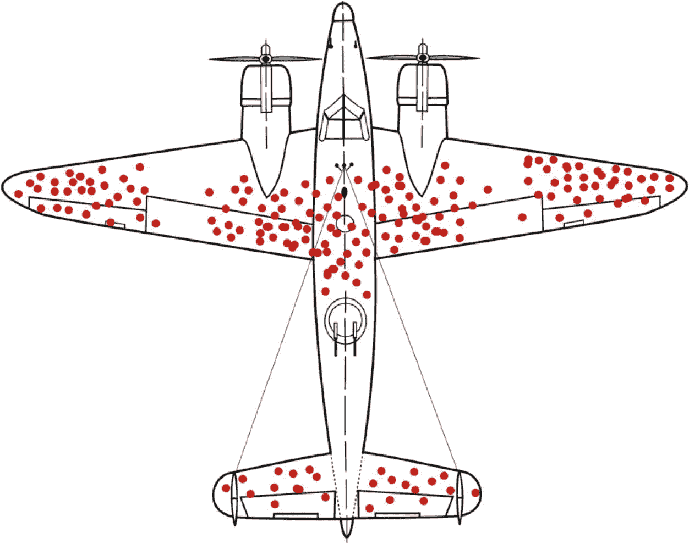

# 22. 判断失误：偏见、谬误与悖论

## 引言

我们都知道人们存在认知偏见，记忆和信念也容易出错——或者至少我们知道*别人*会这样。但很难记住我们自己也有这些问题。这实际上有一个专门的名称——*偏见盲点*，即我们假设自己比其他人更少偏见。没有真正的方法能完全消除这种原始大脑的非理性，但我们可以意识到这些不准确的信念，并有意识地纠正或补偿它们。

当然，在一本关于数据科学的书中，我们更关心那些影响我们开展高质量、公平数据科学工作的因素，但其中很多因素会以令人惊讶的方式影响我们的数据科学工作。

在本章中，我将涵盖各种偏见、谬误和悖论，它们如何在数据科学工作中体现，以及我们能做什么。首先，我们将看几个偏见或谬误导致问题的例子。

## 现实世界中的偏见与谬误实例

我们将分析的两个例子包括亚马逊带有性别偏见的简历筛选系统，我们最初在第 9 章中看到过。这个例子展示了本章将要讨论的几种不同的偏见。第二个例子是医疗保健中使用的一个工具，它无意中对黑人群体产生了偏见，因为它使用了一种经济指标，错误地使黑人显得比实际病情更轻。这也揭示了几个问题，尤其是我们下面还将讨论的一个悖论。

### 示例 1：亚马逊的性别歧视简历自动筛选系统

2014 年，亚马逊开始研发一款工具，旨在通过自动审阅简历来识别优质应聘者。这款工具本应能自动抓取网络上的优秀候选人，并尝试将他们纳入招聘流程。到 2015 年，亚马逊发现其筛选系统存在严重性别歧视，明显偏向男性应聘者。这并非初衷，公司随后叫停了这个项目（不过表面上他们又尝试了新的方法）。那么，这个系统是如何变得带有性别歧视的呢？

这个筛选系统原本是一个分类器，用来识别值得进入评估流程的候选人。团队使用了十年的应聘者简历作为训练集，并为每个职位和地点分别建立模型，总共约 500 个。接着，他们利用自然语言处理技术解析简历，识别出数万个潜在特征，基本就是词语和词组组合。模型首先发现大多数特征毫无用处，因此忽略了同一职位下所有简历中普遍存在的某些特征（例如软件开发工程师的编程技能）。到目前为止，一切顺利。

但此时，情况开始急转直下。模型开始识别并偏好“强动词”——比如“执行”和“捕获”这类在男性简历中比女性简历中更常出现的词汇，因为被录用的人中男性数量远超女性。同时，系统还会惩罚那些明显与女性简历相关的词汇，例如“女性”（如“女子橄榄球”）以及某些女子学院的名称。

根本问题在于，团队陷入了技术沙文主义——他们相信只要实现了自动化，就一定会比人工操作更好。他们想从网络上海量挖掘“遗珠”。但他们忘记了一点：他们所做的一切，不过是让系统精确复现了他们一直以来的做法——带着性别偏见进行招聘。

这其中还涉及其他几种偏见，我们将在下文进一步讨论。其一是`选择性偏见`——他们的训练集仅包含向亚马逊投递简历的人。亚马逊以门槛高著称，因此任何缺乏自信的人都不太可能应聘，而女性的“冒名顶替综合征”远比男性普遍。众所周知，男性即使不完全符合所有技能要求也倾向于申请职位，而女性通常不会。另一种是`幸存者偏差`，即只考虑那些已经通过某个筛选阶段的人。在这个案例中，十年的训练期内被录用的女性数量极少，以至于关于她们（及其能力）的信息完全不被考虑。系统可以判断算法是否主要放行了那些可能成功的候选人，但他们无法得知是否有其他更优秀的候选人被拒之门外。他们完全不了解那些被筛除者的素质。

当前，各行各业都在全速推进利用人工智能进行招聘，尽管这类案例已表明其难度有多大。此外，这一切似乎都基于一个假设：简历能提供关于候选人的有价值信息。任何参与过招聘的人都知道，候选人的简历与其真实经验和技能之间，可能存在巨大出入。

### 示例 2：带有种族偏见的医疗风险预测

另一个充满歧视的领域是医疗保健，尤其体现在教科书、医疗实践和从业人员对黑人群体的系统性偏见。在疼痛管理方面，黑人的医疗待遇非常糟糕，因为存在错误观念，认为他们的疼痛阈值高于白人，且更倾向于寻求药物，但总的来说，他们的诉求常常被忽视。就连网球巨星塞雷娜·威廉姆斯在产后也险些丧命，因为她对严重病症的报告被忽视（在美国医疗体系中，既是黑人又是女性，处境尤为危险）。

一项在 2010 年代中期广泛使用的工具被发现会导致对黑人的歧视性医疗，因为它依赖于有偏见的数据和特征。该工具旨在帮助医院和保险公司识别哪些慢性病患者应纳入“高风险护理管理”项目。进入这些项目的患者通常会获得更好的治疗，因为他们能得到额外护理和专科护士的照料。其理念是，对病情更重的患者在此进行干预，可以预防更严重的并发症，从而降低医疗成本，让患者更健康、更满意。

这听起来是个好主意，但该工具使用了一个旨在反映患者医疗需求的特征：既往医疗支出。换言之，就是该患者过去在医疗上的花费。显然，这是医疗领域机器学习中一个常用指标，而如果你对美国医疗体系有所了解，就应该立刻警铃大作。这个指标在全民医保的国家可能更公平，但众所周知，美国医疗费用高昂，对许多人来说负担过重。人们因无力承担费用而避免定期就医，导致一些本可相对轻易治愈的小问题久拖不治，最终恶化到需要急诊、住院甚至死亡。一切只因金钱问题。因此，比较不同患者的既往医疗支出，更多反映的是他们的经济阶层，而非实际健康状况。此外，由于遭受歧视的经历，黑人群体普遍对医疗系统信任度更低，这也是他们不常就医的另一个原因。因此，这个特征本身带有偏见，不应被使用。

研究人员在分析这一特定工具时发现，该工具分配给黑人患者的风险等级低于应有水平。平均而言，黑人的收入低于白人，因此他们在医疗上的支出自然更少，因为他们更难负担得起。当研究人员比较支出水平相同的白人和黑人患者时，发现黑人患者的健康状况更差。在风险评分极高的患者群体中，黑人患者的慢性病数量比白人患者高出 26.3%。这一切都意味着，本可从额外护理中受益的黑人患者，被该工具推荐的机会却少于需求水平相同的白人患者，因为他们的医疗支出更少。如此一来，歧视性医疗的恶性循环便持续下去。

显然，这里涉及多个问题，包括数据缺失，但其中一个是`伯克森悖论`，我将在下文详述。当系统或人们因为未考虑某些条件信息而得出错误结论时，就会出现该悖论。在这个案例中，被忽略的信息正是黑人患者的实际需求，而这一需求被“既往医疗支出”这一误导性指标掩盖了。

## 保持好奇

作为数据科学家或数据分析师，最重要的一点是必须倾听数据的声音——可以说是成为数据的“低语者”。我们需要渴望知道数据将告诉我们什么。这意味着，虽然你可以带着知识、挖掘意义的技巧以及对相似事物的理解进入工作，但一定要避免先入为主的观念和仓促下结论。

有许多认知偏见会削弱这种好奇心。`锚定偏见`是指我们执着于某事物的一个想法或特征，而忽视其他方面，通常是我们最先了解到的事物特征。经典例子是：逛街时看到一件 300 美元的衬衫，又看到一件 150 美元的衬衫，你会倾向于认为第二件很划算，因为你最先看到的是 300 美元。如果顺序颠倒，你很可能不会觉得 150 美元划算，反而会觉得 300 美元是敲竹杠。在数据科学中，这可能导致过早结束探索性数据分析（EDA），因为你以为自己发现了有趣的东西。想象你有一个来自十所本地高中青少年阅读习惯的数据集。开始 EDA 后，你很快发现大部分阅读书籍的作者是男性，惊悚和科幻是最流行的两种类型。如果你已经读到这里，就知道不该就此止步并下结论。但如果你真的认为“大多数作者是男性”这个事实意味着现在的孩子仍然主要阅读男性作者的作品——这就会玷污你对其他所有内容的看法。

锚定偏见与`保守偏见`相关，即即使在获得相矛盾的新信息时，我们也不愿改变原有信念。假设你将读者分为女生和男生两组，发现实际上女生更倾向于阅读女性作者的作品。但如果你仍坚持“青少年总体上阅读男性作者更多”的观点，这就是保守偏见。如果你最终发现数据集中包含三所男校，其余为混合学校，这应该破除你的执念，因为数据本身就明显存在偏差，但保守偏见仍可能阻止你改变看法。

如果你查看更多关于青少年读者的数据，并对新数据集（已确认全部来自混合高中）进行探索性工作，却无法摆脱先入为主的念头，你可能会把对男性读者的轻微偏好看得比实际更显著。这就是`确认偏见`，即我们倾向于关注、解读眼前呈现的信息（并记住它们），使其符合我们已有的信念。确认偏见的另一个方面是，人们会主动寻找更多支持自己信念的信息，这可能影响驱动工作的假设。

还有一种可能陷入的偏见叫`信念偏见`，即当结论感觉“可信”时，人们更容易认为其论证逻辑合理。类似的是`虚幻真相效应`，即我们更倾向于相信更容易理解或更熟悉的事物。如果我们已经认为“人们总体上阅读男性作者多于女性”，这个初步发现可能感觉可信、合理且熟悉——从而轻易接受。

所有这些偏见都会损害我们做好数据科学的能力。如果所见的正是我们期望看到的，我们就更容易陷入其中。要应对锚定偏见和保守偏见，强迫自己问：你确定吗？是否还有其他可能？我该如何证明这是真的？应对确认偏见、信念偏见和虚幻真相效应的方法类似。你需要识别其他真正可能的解释，并将其排除。但你必须诚实地去做——不要编造虚假的“替代解释”来测试并排除。始终努力退一步思考，尽可能压制个人情感。

基本要点是：保持好奇心，不要急于下结论或接受简单的答案。

## 数据科学实践

在开展数据科学工作、解读和报告结果时，有许多重要的偏见和谬误需要考虑和处理。我将首先讨论在规划和执行数据科学工作时应重视的偏见，然后转向解读结果时重要的偏见，最后是在向利益相关者及其他人员传达结果时需要留意的偏见。

### 规划与执行

根据你所从事的数据科学工作，你可能需要设计实验或研究，或者仅仅是处理现有数据。某些偏见和谬误是规划实验时所特有的，而另一些则与我们在规划和执行分析与建模时的其他情境相关。

我们之前曾在实验和研究设计的背景下讨论过`选择性偏差`，这种偏差是指在看似随机的统计抽样中，实际并未做到真正的随机，可能受到实验者认知偏差的影响，或者仅仅是由于抽样过程中的系统性或技术性问题。如果我们遵循标准的选择方法（例如第 3 章中概述的方法），这些问题都是可以解决的。

在设计实验和研究时，还有其他一些因素需要考虑。`预期偏差`是一种确认偏差，即实验者只根据其先入为主的观念寻找他们想看到的结果；而`观察者期望效应`则是指实验者为了看到自己期望的结果，通常会通过影响参与者行为的方式，操纵（通常是无意识地）实验或其数据解读。带有诱导性问题的问卷调查就是观察者期望效应的典型例子。在你的设计中寻找这些偏差至关重要。你需要以这样一种方式开展工作，让你的研究宿敌无法在你的实验中找到纰漏。

`观察者悖论`是一种在社会科学（基本上是在人类研究中）中出现的现象，即研究者观察某个行为的举动本身就会改变该行为。它最早出现在社会语言学中，当语言学家试图研究人们的说话方式时，他们作为观察者的存在改变了人们说话的方式。每当涉及人类研究时，都应考虑到这一点。

正如我们在上一节中看到的，保持开放的心态很重要。有一些现象可能会与此相悖。`群体思维`是一种现象，当一群人因认为群体和谐至关重要，而导致群体决策不合逻辑或功能失调时，就会发生这种情况。这对数据科学团队的运作方式可能很重要。如果你知道某事有问题，请努力成为那个勇敢发声的人。

保持开放并不意味着忽略重要信息。一种被称为`领域忽视`的框架偏差会导致我们在跨学科背景下工作时，忽略某个领域的重要知识。你有责任确保自己收集了关于某件事的所有相关信息，尤其是当可能存在你因为来自其他领域或业务部门而不了解的观点时。彻底的研究或与来自其他学科和团队的同事交谈可以解决这个问题。

确保自己走在正确的道路上也很重要。首先，始终要确保你的项目值得去做，并且不会带来意想不到的负面后果。`自动化偏差`是技术沙文主义的另一种说法，指的是我们过于信任自动化系统，而牺牲了人类的决策。仅仅因为项目很酷，并不意味着我们就该去做。项目一旦开始，定期审视进展情况也很重要。`沉没成本谬误`是指人们即使计划看起来有问题，也坚持原计划，而这一切仅仅是因为他们已经投入了成本。如果在项目进行到一半时你意识到它行不通，那么重新开始可能比试图将已经完成的工作改造成可行的东西更好。在工作领域，当你面临截止日期时，这尤其困难。没有人想从头再来。但有时候，这却是最好的方法。

在规划和执行任何数据科学项目时——无论是涉及设计实验或研究、分析数据，还是利用现有数据创建预测模型——始终思考你正在做什么，这一点至关重要。

### 解读

在解释和分析数据时，有许多需要考虑的重要偏见和谬误。

前面提到的`领域忽视`，即倾向于不在本专业领域之外寻找思路，在这一阶段同样重要。你可能会在结果中看到一个自己无法解释的效应，但心理学或财务团队的同事或许能解释。虽然在规划阶段就处理好这个问题（并与同事建立关系）会更好，但你可能需要重新联系最初的联络人或进行更多搜索。

一个重要的悖论是`伯克森悖论`，它直接影响数据科学工作，发生在人们因忽略关键的条件信息而得出错误结论时。当样本存在偏差时，就会出现典型情况。例如，想象一位家长得出结论，认为青少年小说比成人小说长得多，因为他们的样本是家里的书，而家里的藏书包括他们自己的温馨悬疑小说和浪漫小说，以及他们孩子的青少年奇幻小说。在青少年类别中，奇幻小说通常比当代或浪漫小说长得多；而在成人类别中，温馨悬疑小说和许多浪漫小说往往篇幅较短。这并非“青少年书籍”和“成人书籍”的代表性样本。

有几种偏见属于`扩展忽视`，即实验者在判断结果时没有考虑样本量。其中最重要的是`基础概率谬误`，当人们只关注与特定案例相关的信息而忽略更重要的总体信息时就会出现。术语“基础概率”基本上指的是总体情况，有时人们会为了更有趣的信息而忽略它。一个与数据科学家特别相关的例子是：我们有一个分类器，用于测试某种相对罕见的事物，且精度较低（假阳性相对于真阳性很多）；我们必须避免陷入相信所有阳性结果的陷阱。这被称为`假阳性悖论`，是基础概率谬误的一种特定类型。

`阿波菲尼亚`（Apophenia）是指我们倾向于在不相关的事物之间看到联系和关系。这就是为什么“相关性不等于因果性”的警告如此重要——识别我们世界中的联系是人类的本能。这意味着我们必须小心。如果你认为看到了某种联系，就需要确认它是否真实。不要仅仅因为感觉有趣就草率下结论。这也是使用统计检验的原因之一。仅仅因为一个数字比另一个高，并不意味着它真实反映了现实，而可能只是随机性的结果。

有一个著名的（但真实性存疑的）故事说明了另一种偏见：`幸存者偏差`。当我们审视某个结果时，只考虑那些通过了某种过滤而幸存下来的东西，而忽略了那些没有幸存下来的。这个例子是关于二战期间从轰炸任务返回的美国轰炸机的损伤情况。军方想要给飞机增加装甲，但不能覆盖所有地方，因此需要保护最重要的区域。军方将飞机的损伤汇总在一张图上，如图 22-1 中飞机上的红点所示。

*一张飞机的俯视草图，机翼、机身和机尾上散布着红点。这些点代表损伤点，标示了被敌方火力击中的区域。该草图强调了幸存者偏差的概念，表明未受损区域对于生存至关重要。关键词：飞机，草图，损伤，幸存者偏差，红点。*

**图 22-1** 二战期间飞机损伤汇总图，说明了幸存者偏差。来源：来自维基百科文件“File:Survivorship-bias.svg”，网址：[`https://en.wikipedia.org/wiki/File:Survivorship-bias.svg`](https://en.wikipedia.org/wiki/File:Survivorship-bias.svg)，基于知识共享署名-相同方式共享 4.0 国际许可协议使用（[`https://creativecommons.org/licenses/by-sa/4.0/deed.en`](https://creativecommons.org/licenses/by-sa/4.0/deed.en)）

# 认知偏差、谬误与数据科学

## 对机器学习的影响
许多人乍看之下会认为，那些聚集了大量红点的区域应该用装甲加固。但实际上，恰恰相反——这些是成功返回（幸存）的飞机。那些在发动机、机头、机翼中央部位或从炮手位置到尾翼前方的机身区域受损的飞机，都没有返回。这是因为飞机在这些部位被击中后会坠毁。这个真实度存疑的故事说，当所有人都落入这个偏见陷阱时，一位名叫亚伯拉罕·沃尔德的统计学家指出了这一点。同样的情况也出现在亚马逊招聘工具的例子中，他们只关注被录用的人，却没有考虑那些未被录用的人中是否有人才。思考问题时，永远要考虑那些你尚未看到的数据。

另一个非常有趣的问题是`辛普森悖论`，当数据的不同子集中显现的趋势在子集合并后变得不同，甚至相反时，就会出现此悖论。这听起来不可能，但在真实数据中经常出现。这也是以不同方式对数据进行切片和切块分析很重要的原因之一。图 22-2 展示了它在视觉上可能呈现的样子。

*包含两个面板的散点图。左图显示多个彩色数据簇，呈现正相关关系，由红色趋势线表示。相关性值分别为 0.74，0.82，0.75，0.72 和 0.69。右图显示一组黑色的单个数据点，呈现 -0.74 的负相关，也由一条红色趋势线标出。两个面板都有 X 轴和 Y 轴标签。*

**图 22-2** `辛普森悖论`的一个例子，显示了各个分组内的正相关（左图）以及整个数据集上的负相关（右图）。来源：来自维基百科文件“File:Simpsons_paradox—animation.gif”，网址：[`https://en.wikipedia.org/wiki/File:Simpsons_paradox_-_animation.gif`](https://en.wikipedia.org/wiki/File:Simpsons_paradox_-_animation.gif)，基于知识共享署名-相同方式共享 4.0 国际许可协议使用（[`https://creativecommons.org/licenses/by-sa/4.0/deed.en`](https://creativecommons.org/licenses/by-sa/4.0/deed.en)）

你可以从图中看到，每个组内的效应看起来有多强，但同样重要的是不能忽视整体趋势。这并不意味着组内趋势不重要，但整体图景是重要的。

最后值得一提的谬误是`麦克纳马拉谬误`，即人们只通过定量指标来衡量成功，而忽略其他重要因素（定性因素）。当数据科学工作通过公共政策、医疗决策等影响人们时，这一点尤其重要。想象一家热门视频游戏公司只看新游戏的销量，却忽略了所有人都讨厌它、评论糟糕、人们说它漏洞百出。如果他们只看销量，就错过了极其重要的信息——这些信息表明销量很快就会下滑。最初的销售数字是靠公司的声誉支撑的，而不是游戏本身的受欢迎程度。应对这一问题的唯一方法是强迫自己超越数字本身去思考。

在分析数据科学的结果时，很容易陷入各种陷阱，但只要你留心并了解这些陷阱是什么，就能避开它们。

## 沟通
上述许多偏见和谬误在沟通中都很重要，部分原因在于你的利益相关者可能也持有同样的偏见，你可能需要指出这些问题，以解释它们何以不准确。不过，还有一些偏见则与沟通本身密切相关。

当专家忘记如何从普通（非专家）人的视角看问题时，就会产生*知识的诅咒*。这是我反复强调的一点——你必须善于以非技术受众能理解的方式，向他们解释技术性内容。忘记考虑他们的背景和知识水平绝不是好事。在与利益相关者沟通前，请尽力了解他们的技术层次以及他们所理解和相信的内容。

还有一种有趣的自我评估现象，称为*邓宁-克鲁格效应*，它表现为专家低估自己的技能水平，而新手或完全无技能的人却认为自己的能力远超实际水平。对你来说似乎不难的事情，你可能会忘记自己的知识有多专业，对他人而言又是多么难以企及。沟通中的另一个挑战可能源自该效应的另一半：当你的非技术利益相关者认为自己比实际懂得更多时，情况就会变得棘手。因为他们可能会说出完全错误的话，而在会议上纠正别人，尤其是当对方比你资历更深时，这很难处理。明智的做法取决于诸多因素。最好的办法是观察其他经验更丰富的同事如何应对。老实说，有时你只能忽略它，继续前进。

最后一种对沟通至关重要的偏见是*创新偏见*，它与技术沙文主义相关，指人们认为创新或新颖的事物对社会的好处可能被夸大，这很大程度上是由于忽视了其负面方面。不要让自己陷入这个陷阱，也不要让你的利益相关者陷入其中。这意味着要思考更广泛的后果，而不是忽略负面因素或风险。

## 职业
作为一名数据科学家，通常意味着要在这个领域或相关领域拥有长期的职业生涯。我们有很多方式会自我破坏，或者至少错失提升和成长的机会。有两个关键领域的偏见会影响我们的职业生涯。大多数与自我认知及其偏差有关。还有几个与规划相关，这会影响你在职业道路上能取得多大的成功。发展你的事业是你自己的责任，了解自己、自己的优势和局限，是知道如何提升的最佳途径。

### 自我认知
最著名的偏见之一是*冒充者综合征*，你会觉得自己是个骗子——你实际上并不称职，而你周围的每个人*都*很称职，并且很快他们就会意识到你一无是处。显然，这种情况理论上是可能发生的，但现实中很少见。大多数人表现得比他们实际感受的更自信，内心充满自我怀疑，所以你并不孤单。应对这个问题的最佳方法是真正反思你的技能，看看你是如何努力培养它们的，从而确信它们的真实性。找出你拥有而同事不具备的技能，即使你的本能是认为它们不重要而忽略它们。如果你擅长人际交往，这是很多人不具备的技能。如果你会说多种语言，并且比一些同事更擅长 `NLP`，那也是一种优势。

在任何职业（乃至生活中），自我意识都是宝贵的财富。对自己的优势和劣势有现实的认识，能让你更容易选择正确的道路并实现自我成长。但有一些偏见会影响你准确认识自己的能力，它们都与冒充者综合征相反，属于*自我中心偏见*的范畴，即我们高估自己的观点，认为我们通常比他人眼中的自己更好。我上面提到了盲点偏见，即我们假设自己比他人偏见更少。还有*虚假独特性偏见*，即我们认为自己异常独特、比实际更特别，比如可能因为身边的同事在编写优化代码方面不那么擅长，就认为自己在这方面特别出色。*虚假共识效应*让我们认为他人比实际更同意我们的观点，这可能导致我们认为所有人都同意我们的解决方案，即使有些人心里存疑。人们当时不发言可能有很多原因，并不仅仅是因为他们同意你。最后，*有效性错觉*指人们认为自己的观点和判断比实际更准确。*解释深度错觉*则让我们认为自己对某个事物的理解远超实际水平。这两者都可能让我们对自己的解决方案过于自信。

所有这些都是自然的。我们生活在自己的头脑世界里，当然会觉得自己的视角是最好的。但更好地了解这一点，可以帮助我们避免让这种自我中心阻碍自身的进步。要应对这些问题，你首先必须意识到每个人（包括你）都以各种方式抱有偏见。认识到这一点就是一种力量，如果你倾听他人并观察他们的偏见，这也能像一面镜子反映出你自己的偏见。你不必到处宣扬自己的偏见是什么，但如果你知道自己有这些偏见，就可以在心里进行调整，并选择不同的行动。如果你的某个偏见被公开指出，不要产生防卫心理。相反，要倾听，承认错误，并做得更好。

独特性偏见和虚假共识偏见实际上有些相反，所以我们同时拥有两者，这有点讽刺。这两者以及有效性错觉，在你与他人合作时都特别重要。独特性偏见让我们认为自己总体比他人优秀，有效性错觉则让我们认为自己的想法更出色。当你在一个团队中工作时，这些并非普遍成立。即使你确实拥有独特的经验或知识，你仍然并非全知全能。此外，记住其他人有时拥有你不知道的经验或知识，这点也很重要。当你在团队中试图做决策时，切忌陷入虚假共识效应。通过重申你们刚刚达成的共识来确保意见统一，并邀请大家提出批评意见。

我前面提到了邓宁-克鲁格效应，即专家低估自己的技能，而非专家则假定自己比实际懂行。不要让自己低估你的技能。你付出了努力才培养出这些技能。这显然与冒充者综合征有关，但它的重点不总是让你自我感觉良好，而是你根本没意识到自己的某些技能有多重要。如果有人把你当作导师，你可能觉得自己没什么可教；但他们来找你这一事实本身就说明你是有价值的。

最后一个值得提及的自我认知偏见是*冷热移情鸿沟*，当我们不承认情绪对我们的信念和行为影响有多大时，就会出现这种情况。我们都是人类，没有人能百分之百冷静和理性，无论我们自认为有多理性。作为人类是可以的，但这只意味着你应该尝试识别任何影响你决策的情绪，并评估它们与你正在做出的决策是否相关。

### 规划
职场中每个人都需要培养的技能之一就是规划能力，包括估算工作量和时间。这众所周知地困难，主要归咎于两个谬误。其一是*难易效应*，即人们会高估自己完成困难任务的能力，却低估自己完成简单任务的能力。这进一步引发了*规划谬误*，即人们相信事情实际耗费的时间会比需要的更少。这两者相辅相成，在技术领域屡见不鲜。提供估算本质上就很困难，而精通此道的唯一方法就是关注自己的估算，并从其偏差中学习。

### 其他偏见与谬误
还有许多其他偏见与谬误影响着我们，即便它们并非总是直接作用于数据科学工作。然而，任何形式的人性弱点都可能影响工作，因此这里再列举一些值得思考的内容。

我们在准确思考未来方面表现极差，尤其是在涉及不确定性时。*赌徒谬误*导致人们认为未来事件的可能性会受到过去事件的影响，即使两者毫无关联。这个名称源于赌博者会根据已发生的情况来预测未来。例如，玩老虎机的人可能会想：“我已经连输 20 局了——很快该赢了。”这种思维过程也与*乐观偏差*相关，即人们高估积极结果的可能性，低估消极结果的可能性。*概率忽略*也很常见，即我们在面对不确定情况时干脆无视概率。老虎机玩家忘记了每次拉下杠杆获胜的概率都是相同的。在数据科学中，这些会影响我们规划项目的能力。

我们常常难以理解复杂情况，尤其是（但不仅限于）涉及不确定性时。*零和偏差*指人们认为某种情况是零和博弈而实际上并非如此（*零和博弈*指一人获利必然意味着另一人受损）。认为给别人东西就必须从他人那里拿走什么，这显然不对。我们还常常将模棱两可的情况视作固有威胁或负面，这被称为*解释偏差*。如果更仔细地观察，或许会得出不同的理解。然而，我们常常渴望获得关于情况的更多信息，即使这些信息对理解毫无帮助，这种偏差称为*信息偏差*。

其他与理解情况相关的偏差包括*范围忽略*，即人们在思考解决方案时忽视问题的规模或影响程度；以及*零风险偏差*，即人们倾向于完全消除微小风险，而不是在更大范围内降低风险。范围忽略意味着人们可能不会立刻意识到，向非洲贫困学校运送一万张课桌的成本远高于运送一千张。对于零风险偏差，人们往往不满足于仅仅降低风险（这意味着在广泛条件下仍存在一定风险），而更倾向于在特定条件下完全消除风险。这方面的例子来自针对假设性危险场地清理的问卷调查。^( ⁵⁹ ) 假设有两个危险废物场址 A 和 B。A 每年平均导致八例癌症，B 导致四例。有三种清理方案。前两种方案使总病例数降至六例，但两个场址都仍有病例。第三种方案完全消除了 B 的病例，但 A 仅减少一例，因此总病例数更高，为七例。近半数受访者倾向于第三种方案而非前两种之一，尽管总体减少的病例更少。

我们在回顾过去方面通常表现不佳。认知偏差*近因偏差*导致人们更偏爱最近的记忆。*近因错觉*使人认为刚学到的事物本身是新颖的。我们也强烈希望世界合乎逻辑，*后见之明偏差*导致人们认为过去的事件是可预测的。当回顾往事时，人们容易说：“哦，那当然会发生——从他后来的行为来看显而易见。”但当时我们毫无头绪，也不可能知道，因为这实际上并不可预测。

我们也不擅长等待好事。*现时偏差*指人们高估近期回报而低估远期回报。这就是为何那么多人难以进行投资——他们宁愿现在就拥有那辆悬浮滑板车，也不愿未来能买五辆同等的产品。

另一个困扰我们的领域是容易被事物间的细微差别分散注意力。有几种偏差属于*框架效应*，即想法的呈现方式会影响我们的感知。其中之一是*默认效应*，即当人们面临多个选项时，会倾向选择被设为默认的那一个。*区分偏差*是指同时比较事物时，会比分开看待时觉得它们差异更大。*诱饵效应*是一种营销中利用的现象：当某人正在比较两个事物并偏向其中一个时，引入具有特定特征的第三个选项（诱饵），可能导致此人转而偏好第二个选项。诱饵明显比原有两个选项中的一个更差，但与另一个相比则好坏参半（某些方面更好，某些方面更差）。

均值回归是本书前面讨论过的统计学概念，但值得牢记。它指出，当我们看到一个极端值时，下一个值很可能不那么极端。这与*热手谬误*截然相反，后者认为有成功经历的人会继续成功。这个名称源于体育迷认为某人“手感火热”——比如在比赛中因状态正佳而连续投进异常多的篮球。不过，值得一提的是，由于心理因素，有人相信热手谬误未必总是谬误——处于连胜状态的篮球运动员可能认为自己不会失误而更加自信，这反而促使他们实际表现更好。但这不适用于老虎机上的连胜者，因为获胜完全由概率决定，与个人自信无关。

这些偏见和谬误都会影响我们日常运作和决策的能力，进而可能影响我们在工作和职业生涯中的表现与抉择。

## 要点总结与下章预告
在本章中，我们讨论了一系列认知偏差、谬误和悖论。我首先举了几个例子说明偏差如何对机器学习系统产生负面影响。接着，我讨论了若干阻碍我们保持开放心态的偏差和谬误，而这种开放心态正是做好数据科学、成为优秀数据科学家所必需的。随后，我谈到了一些直接关系到数据科学工作的规划、执行、解读与沟通的偏差与谬误。再之后，我探讨了可能影响你职业生涯的偏差和谬误，最后介绍了一些更普遍但可能在工作和生活中引发麻烦的其他问题。

在下一章中，我将讨论如何“亲自动手”进行真正的数据科学实践。获得实践经验对于技能成长和建立个人作品集都至关重要。我还会介绍可以用来获取这些经验的各种工具和平台，以及如何寻找可用的数据源。

# 从业者简介：丹尼尔·塔拉松·巴贝拉

**姓名：**丹尼尔·塔拉松·巴贝拉

**现任职位：**高级数据科学家

**现任行业：**通过咨询涉足多个行业，包括零售、银行和天然气

**从业年限：**6 年，另有 2 年数据工程师经验

**教育背景：**

*   物理学学士学位

*此处表达的观点仅代表丹尼尔本人，而非其历任或现任雇主。*

### 背景
丹尼尔热爱物理，因此在大学主修了该专业。但随着学位接近尾声，他不确定毕业后想做什么。他对核物理或医学工作感兴趣，但这些工作机会难得。医学领域的相关岗位每年只有寥寥几个，而参加考试争夺这大约 12 个职位的人却成千上万。随着毕业临近，他感到不确定且越来越焦虑，因为他知道那条路希望渺茫。一位家人偶然发现了一门关于大数据的课程并告诉了他，于是他开始研究这个领域。他对此一无所知，也从未听说过数据科学，但当他在研究过程中偶然发现它时，他知道这就是正确的道路。即使在攻读物理学学位期间，他也一直热爱编程和处理数据。他开始了数据科学的硕士学习，并完成了课程作业，只差毕业论文尚未完成——因为他成功找到了一份数据相关的工作。

### 工作经历
在转入数据科学岗位之前，丹尼尔做了两年数据工程师。数据工程工作本身不太有趣，但他确实在工作中学到了很多关于数据处理的知识。他非常喜欢做数据科学家，因为他热爱编程。这个岗位很适合他，因为他注重细节，信奉严谨和把事情做对，包括检查统计显著性。他的数据科学工作一直在一家咨询公司进行，因此他能在不同公司和不同行业从事多种类型的工作，这让他觉得很有趣。

### 妙语精选
**工作中最喜欢的部分：** 他在数据科学中最喜欢的是使用优化技术（如 `SIMPLEX` 和遗传算法）的模型。他喜欢数据科学的另一点是，它能够对社会诸多方面产生积极影响。

**工作中最不喜欢的部分：** 尤其是在做咨询顾问时，你并不总能掌控为哪些公司工作或从事何种工作，丹尼尔有时会对数据科学领域正在进行的某些工作感到道德冲突。他也不喜欢探索性数据分析及数据科学其他方面存在如此多的不确定性。他经常在事后质疑自己的工作，心想如果换一种方式或者多花些时间探索，结果会不会更好。

**最喜欢的项目：** 丹尼尔有几个自己特别引以为傲的项目。一个是为其所在地区的公共图书馆创建图书推荐系统。他们仅对借阅量最高的前 5000 本书（而非图书馆系统中的数百万本）使用协同过滤进行了试点，但效果确实非常好。由于资金不足，项目未能超越试点阶段，但很明显，如果资金充足，它会是一个优秀的系统。第二个项目是为一家燃气零售商在时间非常紧迫的情况下完成的。他们想要优化燃气配送，这涉及两个方面：一是决定哪个客户由哪个工厂供应，二是优化从工厂到客户的路线。他们在一个月内完成了所有工作，公司采纳了研究结果，因此取得了巨大的成功。

**最常用的技能：** 务实精神，以及对透明度和可解释性的重视。想想奥卡姆剃刀原理——其在数据科学中的要义是，如果两个解决方案都能用，较简单的那个可能最好。更简单的解决方案通常在透明度、对利益相关者的可解释性以及数据科学家本身的易理解性（比如了解模型使用了哪些特征）方面更胜一筹。丹尼尔总记得一句西班牙谚语，翻译过来是“杀鸡焉用牛刀”。例如，你可能不需要用生成式 AI 来对文本进行分类，因为十年来我们早就知道怎么做了。

**目前主要使用的工具：** `Python` 或 `R`（取决于客户）、`SQL` 和 `Excel`（有时用 `Excel` 快速制作图表比打开 `matplotlib` 或 `ggplot` 更容易）

**数据科学的未来：** 不幸的是，未来属于生成式 AI，尽管他觉得这很大程度上是在解决一个“没人有”的问题。他不信任它，因为它会胡编乱造，同时还“听起来头头是道”。他认为接下来会有几年糟糕的时期，每个人都想用生成式 AI，但他们会发现它实际上没那么有价值，然后我们就会回归传统的数据科学工作方式。

**优秀数据科学家的特质：** 理解统计学很重要，因为很多人（甚至包括数据科学家）都不懂。坚持自己的原则很重要，否则，如果基于错误或误导性的结果，企业可能会做出糟糕的决策。这种情况经常发生，因为业务人员通常不理解统计显著性这类概念，所以认为它们无关紧要。在质量和严谨性方面设定标准，并在别人希望你妥协时坚持正确的东西（有趣的是，这恰恰是为了他们好）至关重要。另一点是，你不应该寻找特定的结果，因为你总是可以操纵数据，让它“说出”你想听的话——相反，你需要保持开放的心态，让自己去发现数据中真正蕴含的信息。

**他对未来数据科学家的建议：** 好好学统计。大多数人（甚至包括许多数据科学家）对统计学的理解都流于表面。另外，不要过分担心编程等技术技能是否完美。你可以在工作中磨练自己的技术能力。

*丹尼是一位拥有多个行业经验的数据科学家。他还做过一些数据工程工作，目前正在接受培训，希望成为一名教师。*

脚注 1 2 3

