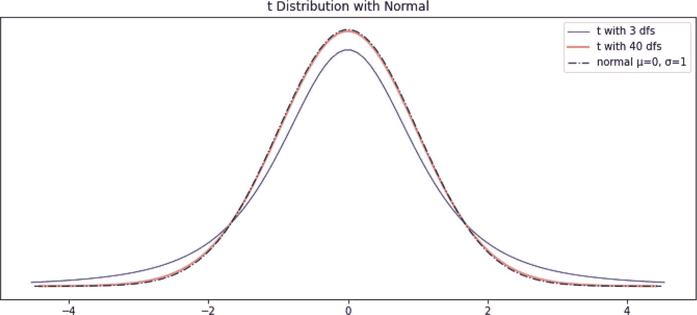
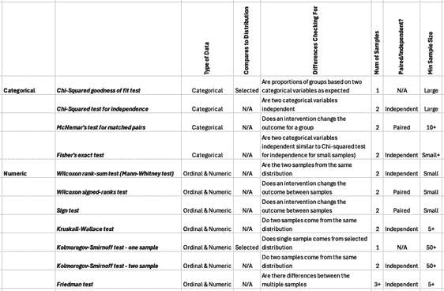
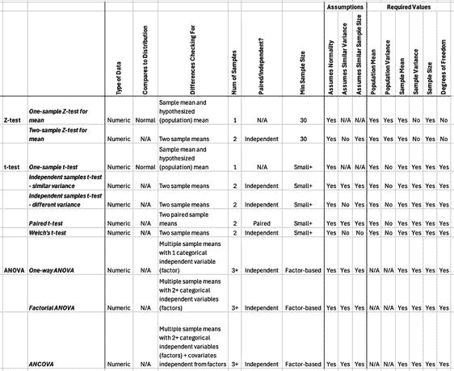
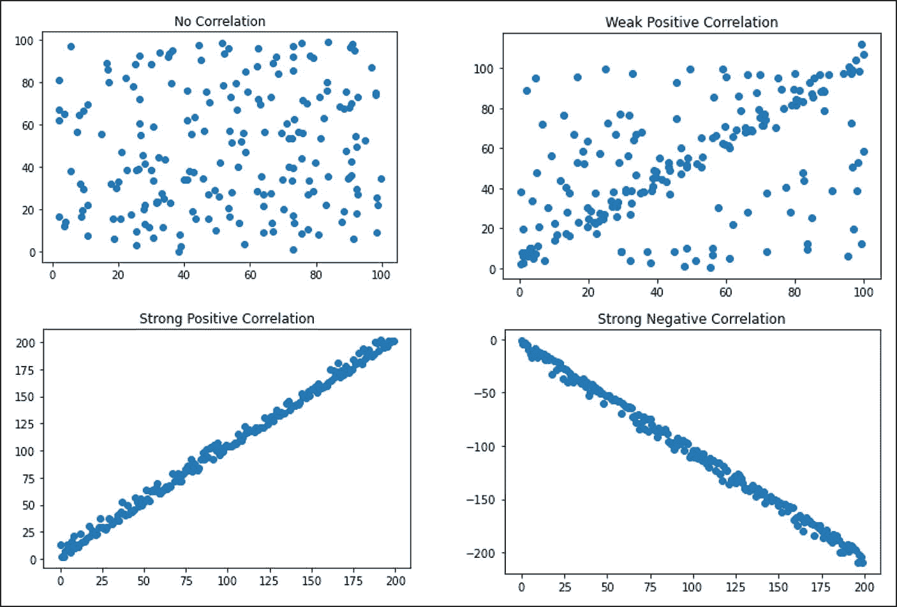
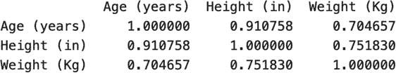
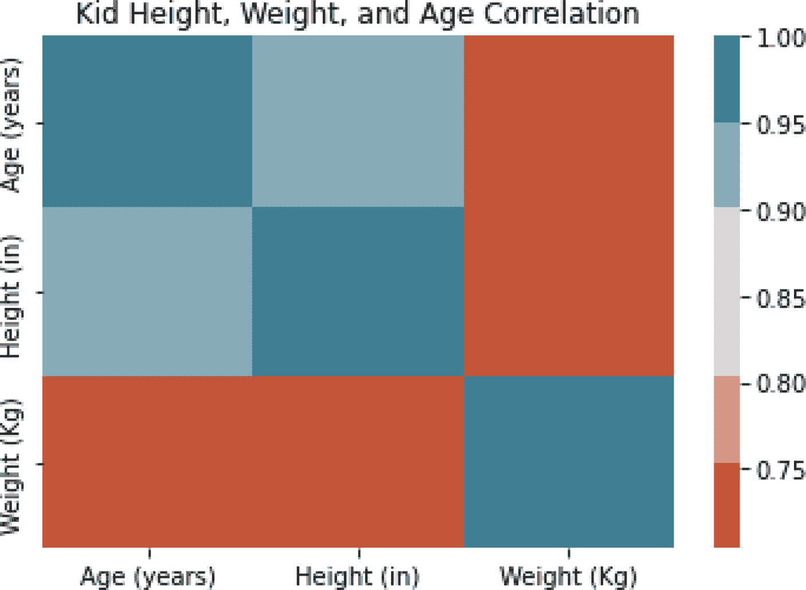
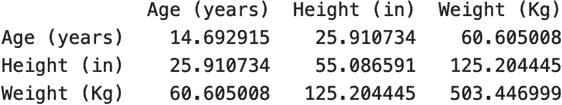
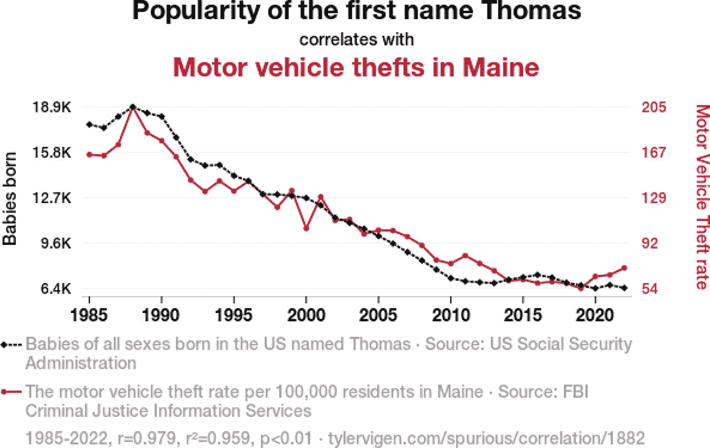

# 统计检验

统计检验是用于确定统计显著性的定义明确的工具——即观察到的数据是否支持某个特定假设。许多统计检验依赖于具有已知特征的分布，并涉及生成一个检验统计量——根据特定公式计算出的单一数值——该数值可以放置在分布上的某个位置，以便得出推论。虽然我们是在分布的背景下讨论这个问题，但如果我们是手动计算，一旦得到检验统计量，我们要做的就是查看显示特定值显著性的表格。有时这个值基于自由度，这是一个稍显棘手的概念，但它与当前计算之前计算了多少个中间值，或者数据中包含多少个独立信息片段有关，目的是确定参考分布的形状。对于单个样本，它通常比观测值数量少一个；对于两个样本，则少两个。在表格的右侧列中，查看检验统计量并在必要时查找自由度，我们只需要判断该检验统计量在我们选择的 p 值水平（通常为 0.05）下是否显著即可。请注意，所有基于分布的检验都可以是单尾或双尾的。此外，大多数这类检验都需要数值型数据。

基本的检验流程是：选择合适的统计检验，获取检验所需的所有数据，计算检验统计量，然后在表格中找到该检验的显著性水平。完成所有这些工作的一个更好方法是使用 Python 或 R，它们具有能使我们获取大量检验所需的所有相关数值的函数，我们无需手动翻查统计表格。我们仍然需要充分理解这些检验，以便知道在代码中提供什么以及指定哪些参数，但这仍然减少了工作量。后面的章节中有几个表格，总结了我们已经讨论过的检验及其要求、用途等（表 4-4 和 4-5）。

### 参数检验

正态分布彻底改变了统计学领域。一些最强大的统计检验都与它相关联，有时也与其他著名分布有关。本节将讨论几种基于正态分布的检验。如上所述，所有这些检验都涉及计算检验统计量，我们将使用它来确定显著性水平，并决定是否拒绝零假设。

#### Z 检验

均值的 `Z 检验` 可用于检验样本在统计显著性水平上是否与总体存在差异。它依赖于 `Z 分布`，也就是标准正态分布，因此其均值为 0，标准差为 1。`Z 检验` 与下一节讨论的 `t 检验` 类似，但 `Z 检验` 用于较大的样本量（30 或以上），并且需要知道总体标准差。

执行 `Z 检验` 的过程涉及计算 `Z 统计量`，由于我们处理的是标准正态分布，`Z 统计量` 与 `Z 分数`（回顾第 3 章，它表示某个值与均值相差多少个标准差）相同。

#### t 分布与 t 检验

`t 检验` 是一类基于 `t 分布` 的经典统计检验。它在多种场景下都很有用，数据集规模通常较小，但这并非必要条件。该分布和检验由吉尼斯公司的一位统计学家开发，并以“Student”的笔名发表，因为公司当时不想让人们知道他们在使用统计方法（考虑到如今公司多么热衷于滥用人工智能和机器学习这些术语，这显得颇为有趣），因此该分布有时也被称为学生氏 t 分布。

`Z 检验` 和 `t 检验` 通常相辅相成，在某些情况下需要选择其中一种。主要问题在于你是否知道总体方差。如果不知道，就不能使用 `Z 检验`。如果知道，并且至少有 30 个观测值，那么 `Z 检验` 是最佳选择。否则，就使用 `t 检验`。

##### t 分布

`t 分布` 与正态分布相似，都是对称且具有细尾的，但 `t 分布` 的尾部比正态分布更重，且当自由度较低时，其峰顶更低。当自由度接近 30 时，它开始看起来更像正态分布。这有点元意味，因为它对样本统计量的分布进行建模，并帮助我们计算相关统计量的置信区间，本质上帮助我们理解抽样误差。例如，如果我们有一组身高测量值并计算了均值，我们可以确定均值的 90%置信区间，这意味着如果从同一总体中反复抽取不同的样本，那么有 90%的情况下样本均值会落在这个区间内。在计算机时代之前，它被广泛用于理解样本，但现在使用较少，因为我们可以通过其他技术利用计算机来理解误差。

分布的形状由自由度决定，自由度是根据所涉检验的样本量确定的一个数字。自由度越高，`t 分布` 就越接近正态分布。

当我们想要知道样本的均值有多大可能等于实际的总体均值时，该分布非常有用。当我们有一个可以假设为正态分布的总体，但不知道总体的均值或标准差时，就可以使用它。我们可以利用样本均值、标准差以及 `t 分布` 来估计样本均值的分布，这有助于我们理解总体均值。

图 4-3 展示了几条 `t 分布` 曲线，并叠加了一条标准正态曲线，以便我们看到增加自由度如何使其更接近正态分布。在低自由度下，曲线（蓝色）与正态曲线（黑色）不同，但在 40 个自由度（红色）下，它与正态曲线几乎无法区分。

标题为“t 分布与正态分布对比”的图表，比较了 t 分布和正态分布。蓝色线条代表自由度为 3 的 t 分布，红色线条代表自由度为 40 的 t 分布，黑色虚线代表均值为 0、标准差为 1 的正态分布。x 轴范围从-4 到 4，展示了分布曲线的形状和重叠部分。

图 4-3

一些示例 t 分布与黑色叠加的标准正态分布的对比

##### t 检验

`t 检验` 是一类经典的统计检验，尤其擅长处理小样本量（通常少于 30 个）。下面将描述几种不同的检验。所有这些检验都有一些基本要求，包括假设数据是正态分布的。这里我没有列出所有要求，如果你打算使用这些检验，你需要确保你的数据适合。

###### 单样本 t 检验

最基本的 t 检验是 `单样本 t 检验`，通常用于通过比较均值来检验一个样本总体是否与另一个总体不同。我们可能知道某所学校的第一代大一新生的平均 GPA 是 3.03。如果我们想测试一个将这些学生与第三代大三学生配对指导的项目是否有助于提高他们的 GPA，就可以使用 `单样本 t 检验` 来查看指导组的均值是否与总体均值（所有第一代大三学生的总体）不同。我们可能首先考虑只检验它是否总体上提高了平均 GPA（单尾检验），但做双尾检验可能是个好主意，以便考虑到它可能产生相反效果的可能性（也许是因为派对邀请变多了）。

###### 独立样本 t 检验

`独立样本 t 检验`，也称为 `非配对 t 检验`，用于比较两个独立且无关联的样本的均值，看它们是否存在差异。这里的“独立”意味着两个样本之间没有联系，比如对同一个人重复测量或样本之间存在任何其他关系。样本量应大致相近。这类研究的一个例子可能是比较一所大学中第一代学生与世袭学生的 GPA。

###### 配对 t 检验

`配对 t 检验`，也有其他几个名称，如 `重复测量 t 检验`，涉及两个自然相关的样本，例如在一项干预措施前后进行的一组测量。例如，如果我们发现一些职业足球运动员的体能似乎进入了平台期，教练可以尝试一个新的训练计划，并在计划前以及计划实施两个月后测量他们的体能。样本 1 中的每个测量值在样本 2 中都有一个配对值。

###### 韦尔奇 t 检验

`韦尔奇 t 检验`，也称为 `异方差 t 检验`，也允许我们比较两个总体，看它们是否有相等的均值。它类似于 `独立样本 t 检验`，但如果样本大小不同或它们之间的方差不同，该检验比 `独立样本 t 检验` 效果更好。尽管如此，我们仍然必须假设两个总体都服从正态分布。

### ANOVA

不同的 t 检验仅允许比较两个样本的均值。方差分析（简称 ANOVA）也允许我们比较均值，但其优势在于可以同时比较两个以上的均值。该方法名称中“方差”一词的误导性用法，指的是它基于不同因素对方差进行划分，而非因为我们在分析方差。ANOVA 依赖于 F 分布，其曲线由两个不同的自由度定义。

要使 ANOVA 可靠运行，必须满足若干假设。数据必须是连续的（定距或定比）且相互独立，这意味着变量之间不能相互影响其值。每个组内的数据还应当近似服从正态分布，且各组间的方差也应相似。ANOVA 具有一定的稳健性，其中部分假设可以稍微放宽，尤其是正态性和方差齐性要求可以相对宽松，但数据独立性和连续性的要求确实不容妥协。

在 ANOVA 中，我们通常将所测试的变量称为`因子`，将每个变量可能取的值称为`水平`。我们还讨论`组`，即对应于每个特定变量和水平组合的数据子集。例如，如果我们有一项研究包含两个因子，每个因子有两个水平，那么就会有四个可能的组，如表[4-2]所示。

表 4-2  
ANOVA 两个不同因子下的测试组

| **组** | **因子 1 水平** | **因子 2 水平** |
| --- | --- | --- |
| 1 | 1 | 1 |
| 2 | 1 | 2 |
| 3 | 2 | 1 |
| 4 | 2 | 2 |

#### 单因素方差分析

与其他检验一样，ANOVA 也有几种不同的形式。单因素方差分析涉及测试单个自变量（因子）。如果该变量只有两个水平，则它等同于 t 检验。在此检验中，我们关注的是组间变异和组内变异。

作为适合此类 ANOVA 的研究示例，我们可以考察屏幕时间对十岁儿童专注力的影响。专注力通过他们能够专注于特定任务的分钟数来衡量。每日屏幕时间可以有三个水平：无、一小时和两小时。这里每个水平对应一个组，每组有十名儿童，我们想知道这三组儿童的平均专注时间之间是否存在差异。

#### 多因素方差分析

在现实世界中，研究单一因子的情况相对少见。组织一项研究需要付出相当多的努力，因此通常认为同时引入多个因素更具价值。谨慎对待这种做法是有原因的，一方面因素之间可能相互作用，从而影响研究质量；另一方面，测试过多因素可能导致虚假结果（请参见“检验极限与显著性”一节）。尽管如此，与仅涉及一个因子的 ANOVA 相比，更常见的情况是需要运行包含多个因子的 ANOVA。在设计研究时（或考虑是否可以对现有数据运行 ANOVA），获取足够大的样本来补偿所有不同的因子组合是非常重要的。多因素方差分析就是涉及两个或更多因子的 ANOVA 检验。

双因素方差分析仅仅是多因素方差分析的一个特例，它涉及两个不同因子，每个因子有多个水平。表[4-2]显示了两个因子之间有多少种不同的交互作用（四种）。如果我们对儿童专注力的研究添加营养补充剂（两个水平分别是提供补充剂和不提供补充剂），那么我们就能进行双因素方差分析。

包含三个因子的多因素方差分析具有更多的交互作用，因为三个因子中每两个都需要检验交互效应，此外还有全部三个因子的交互效应。每个组需要的样本量会更大。如果专注力研究中的部分儿童患有多动症，我们可以将其作为第三个因子加入，从而进行三因素方差分析。

显然，这个过程可以一直扩展到更多因子，但你研究的因子越多，就越有可能看到虚假结果。

#### 协方差分析

另一个相关的检验是协方差分析（ANCOVA），这是一种统计方法，它通过使用`协变量`（即已知对结果变量有影响，但不是主要研究因子的定距预测变量）来扩展多因素方差分析。它被认为是 ANOVA 和回归分析的结合，我们将在第 15 章中介绍回归分析。举例说明何时可以使用它：在儿童专注力研究中，如果我们加入了不同年龄的儿童，那么可以假设儿童的年龄会影响他们的专注能力——年龄较大的儿童比年龄较小的儿童更容易集中注意力。在这种情况下，年龄因子被称为协变量。

### 非参数检验

统计学长期以来一直依赖分布来理解和检验显著性。正态分布尤其重要，因为许多检验都需要正态性假设。很多进行统计分析的人对其假设态度轻率，在从未检验这些条件的情况下，就假定数据满足正态性或其他要求来运行检验。这样做很容易，但这是不负责任的，并可能导致结果潜在的无效。

针对这些假设问题——无论是我们不知道数据是否满足要求，还是我们知道数据不满足要求——的解决方案之一是`非参数检验`，这些检验不需要许多基于分布的检验所要求的全部假设。非参数检验有很多种，其中一些允许我们检验诸如正态性等条件，另一些则允许我们对非连续的结果变量进行检验。我们不会深入介绍每一种检验，但了解有哪些可用的方法很重要。

本节将首先介绍分类检验，主要是卡方检验，以及其他适用于数值数据的检验。我们再次计算一个检验统计量，并据此确定显著性，从而指导我们决定是否拒绝原假设。

#### 分类检验

有几种非参数检验可用于更好地理解分类变量，特别是判断其行为是否与预期不同。最著名的分类检验是卡方检验。卡方检验有几种不同的类型，但本节我们将讨论皮尔逊卡方检验，另外还有用于配对设计的麦克尼马尔检验和费希尔精确检验。即使是皮尔逊卡方检验，也有几种不同的形式：独立性卡方检验，用于检验研究中的两个变量是否相互独立；比例相等性卡方检验，用于检验从多个不同总体中抽取的样本中，某个选定变量的分布是否相同；以及拟合优度卡方检验，用于检验某个特定的分类变量是否遵循已知的分布。这通常是指均匀分布，这意味着所有组合的比例相等，但也可以是任何分布。为了确保检验统计量真正服从卡方分布（这对结果的准确性至关重要），这些检验有一些要求。

### 拟合优度的卡方检验

我们常常想知道一个变量是否遵循某个已知分布（或一个不那么严格的模式），而这项检验就能让我们验证这一点。通过拟合优度的卡方检验，我们观察频数，看观测到的频数是否与我们根据假定分布所预期的频数相同。例如，我们可以考察大学生每月的阅读习惯，看看这是否符合我们在另一项研究中发现的预期分布。这仍然是分类数据，因此我们可能有 100 名学生，他们每月完成规定数量书籍的比例分为三个等级：55 人完成一本，25 人完成两本，15 人完成三本，5 人完成三本以上。我们使用一个列出每组学生总数的表格，来确定实际计数是否符合预期的比例。

### 独立性的卡方检验

通过独立性的卡方检验，我们想知道两个分类变量是否独立。原假设是它们彼此独立，因此拒绝原假设就意味着它们可能相互依赖。想象一项研究，它考察是否有工作会影响高中生毕业的能力。我们会统计四种可能组合（无工作/毕业、无工作/未毕业、有工作/毕业、有工作/未毕业）中各有多少学生。为了分析这一点，我们首先根据每列和每行的总数计算出每个单元格的期望值。这次我们使用的列联表将一个变量的值列在表头，第二个变量的值列在侧边。在我们的例子中，它看起来像表 4-3。我们将添加计数以及行列的总数来计算统计量。

**表 4-3** 独立性卡方检验中列联表的设置

| | **已毕业** | **未毕业** |
| --- | --- | --- |
| 有工作 | | |
| 无工作 | | |

### 麦克尼马尔卡方检验

另一种卡方类型的检验是麦克尼马尔配对检验，它放宽了标准卡方检验中对独立性的要求。该检验考察配对样本数据，以查看某个变量的特定值在两次配对测量之间是否发生变化。当观测值并非独立时，此检验特别有用，因为它关注的是配对内部的差异。例如，如果一所大学要求所有大二学生参加一个关于社会正义问题的研讨班，他们可能想衡量学生在参加研讨班后对某些问题的看法是否发生变化。他们会在课程开始时测量一次，然后在学生升入大三时再测量一次，以了解这是否长期改变了他们的观点。为了获得每个问题的统计量，他们会创建一个类似于独立性卡方检验的列联表，但统计量的计算方式不同。

### 费希尔精确检验

费希尔精确检验类似于卡方检验，但不需要满足相同的假设条件。它实际上确实与一个分布有关，即超几何分布，但除此之外，它比卡方检验的要求更宽松。费希尔精确检验衡量的是研究结果与观测结果一样极端或更极端的概率。例如，在一项研究是否有工作影响高中毕业率的问题中，该检验通过判断“未毕业的学生数量等于或高于某个给定数值”的可能性，来确定有工作的人未毕业的风险是否更高。

## 数值检验

针对数值数据的不同情况，有许多检验方法。这些方法也适用于有序数据。它们中有几种使用了数据的秩次。

### 威尔科克森秩次检验

威尔科克森独立数据秩次检验有助于理解两个通常是（但未必是）相同大小的有序数据样本，或者不能视为比率或区间数据的数值数据样本。实际上有两种相关的检验。第一种是威尔科克森秩和检验，也称为曼-惠特尼检验，它涉及对每个样本进行排序，并以一种能处理并列情况的方式对其进行排名。然后可以对这些秩次求和，这使我们能够计算 `U` 统计量并检验其显著性。

威尔科克森符号秩检验考察配对观测值之间差异的大小和方向，以判断两个配对样本是否不同。该检验统计量的计算方法是：首先计算每对数据之间的差异，然后对符号（根据该值低于或高于均值，取 `-1` 或 `+1`）与秩次的乘积进行求和。然后可以计算显著性，并决定是否拒绝原假设。

符号检验是威尔科克森符号秩检验的一种变体，它不需要配对观测值之间差异的大小信息（特别是当差异大小不太可靠时）。它可以用于具有二元结果变量的数据，并检验样本是否具有假设的中位数。它使用二项分布来计算在原假设（即总体中位数是指定的那个值）为真的情况下，给定结果出现的概率。

### 克鲁斯卡尔-沃利斯检验

克鲁斯卡尔-沃利斯检验类似于单因素方差分析，用于检验多个样本的中位数是否相同。它很方便，因为它不要求样本大小相同，并且适用于小样本。它还对异常值不太敏感。此外，它与威尔科克森检验相似，因为它也处理秩次。该统计量可以使用一个包含每个样本大小、该样本的秩和以及合并样本大小的公式来计算。

### 柯尔莫哥洛夫-斯米尔诺夫检验

柯尔莫哥洛夫-斯米尔诺夫检验是第 3 章“正态性检验”一节中提到的用于检验正态性的重要检验。它可用于检验一个样本是否来自特定分布，或两个样本是否来自同一分布。这种单样本选项涉及对观测值进行排序，并计算样本中低于每个观测值的观测值比例（这被称为经验分布）。然后可以将其绘制成图，并与我们正在核对的分布进行比较。对于双样本版本，我们比较两个经验分布，而不是将一个经验分布与一个理论分布进行比较。

### 弗里德曼检验

当有两个以上的匹配样本时，可以使用弗里德曼检验来检测重复测量之间的差异。它也使用秩次，并且检验统计量可以通过样本大小、每个受试者的测量次数以及每轮测量的秩和来计算。

### 选择合适的统计检验

统计检验方法种类繁多，我们仅涉猎了其中最常见的部分。根据你的具体工作，可能会需要用到完全不同的检验方法。但我们已经涵盖的这些内容，将为你提供一个良好的起点。表 4-4 总结了所涵盖的、基于正态性假设的参数检验，表 4-5 则总结了非参数检验。那么，你该如何决定使用哪种检验方法呢？

**表 4-5** 非参数检验总结

|  表格列出了针对分类数据和数值数据的统计检验。列包括：“数据类型”、“与分布比较”、“检验的差异”、“样本数量”、“配对/独立”和“最小样本量”。分类数据的检验包括卡方拟合优度检验、独立性卡方检验、麦克尼马尔检验和费希尔精确检验。数值数据的检验包括威尔科克森秩和检验、威尔科克森符号秩检验、符号检验、克鲁斯卡尔-沃利斯检验、科尔莫戈罗夫-斯米尔诺夫检验（单样本和双样本）和弗里德曼检验。每项检验都指定了其数据类型、与分布的比较、目的、样本数量、配对情况以及最小样本量。 |

**表 4-4** 参数检验总结

|  表格比较了统计检验：Z 检验、t 检验、方差分析和协方差分析。列包括数据类型、分布比较、检验的差异、样本数量、配对/独立状态、最小样本量、假设和所需值。Z 检验和 t 检验侧重于样本均值，并针对配对样本和独立样本有不同变体。方差分析和协方差分析则使用分类变量来分析多个样本均值。假设包括正态性和方差齐性，并有具体的样本量要求。 |

选择正确的检验方法需要遵循以下几个步骤：

1.  定义研究问题以及零假设和备择假设。
2.  确定你所拥有数据的类型（名义、有序或数值），如果是数值型数据，则判断其是否呈正态分布。
3.  确定是单样本还是两个及以上样本，如果是两个及以上样本，则判断这些样本是配对样本还是独立样本。
4.  根据第 2 步和第 3 步的结果，考虑可能适用的检验方法，并查看每种方法的假设条件，以确认你的样本是否满足这些条件。
5.  根据你的数据满足哪些假设条件来选择检验方法。

请注意，你可能需要进行一些检验来判断你的数据是否确实满足所需的假设条件。

在统计学中决定使用哪种检验方法，起初可能会有些困难，但会随着实践而变得熟练。每当你考虑使用一种检验方法时，很可能需要花些时间去研究它，以便了解更多。但有朝一日，你的直觉会让你更容易做出判断。

### 检验的边界与显著性

关于统计检验，我们需要记住一个最终的重要考量：每当我们进行一次寻找显著性发现的检验时，都面临着犯第一类错误的风险。一次性检验多个变量很诱人，尤其是在我们并不确切知道哪些变量可能重要的时候。例如，请记住`p 值`0.05 的真正含义——基本上就是，在 20 次检验中（或在 100 次检验中有 5 次），我们可能会看到一个表面显著但实际上并不显著的结果，它只是偶然出现的。

如果我们有十个没有真正影响的预测变量，并对它们全部进行检验，那么其中至少有一个变量可能出现显著结果，尽管它实际上并不显著。我们甚至可以计算出一个变量在十个无用变量中显示为阳性结果的概率。基本上，在显著性水平为 0.05 的情况下，意味着一个无关紧要的变量有 0.95 的概率被正确判断为不显著，但有 0.05 的概率被错误地标记为显著。对这十个无关变量进行的所有检验都能准确地判定为不显著的概率是`0.95¹⁰`，即仅为 0.60。即使只检验十个变量——这个数量看起来并不算多——也至少有 40%（`1 – 0.60`）的概率会出现一个错误显著的结果。如果我们将变量数量增加到二十个，那么至少有一个变量被错误标记为显著的概率反而会超过 50%（`0.95²⁰` 为 0.36，因此有 64%的概率）。

这就是为什么有些人主张使用更严格的`p 值`，例如 0.01，或者关注`p 值`之外的其他指标。但即使在 0.01 的水平下，对十个无关变量进行检验，至少有一个会显示为显著的概率是 10%；如果检验二十个变量，这个概率则是 18%。所以这并不能完全解决问题，但确实降低了问题出现的可能性。还有一种称为`邦费罗尼校正`的技术，通过根据执行的检验次数调整`p 值`阈值，来降低第一类错误（假阳性）的发生概率。

这也是重复研究对于理解事物如此重要的另一个原因。如果我们在一次研究中仅以 0.05 的显著性水平检验一个变量，那么即使该变量实际上没有影响，该检验仍有 5%的概率得出显著结果。但如果另一个人在另一项研究中检验同一个变量，他同样有 5%的概率发现该变量显著，但这两件事同时发生的概率仅为 0.25%（`0.05 * 0.05`），显然低得多。

## 相关性与协方差

大多数人都听说过“相关性不等于因果性”这一警告，即使他们并不确切知道这意味着什么。作为一个概念，*相关性*仅仅是衡量两个变量之间关系强度和方向的指标。在*正相关*中，当一个变量增加时，另一个变量也随之增加。在*负相关*中，变量之间呈反向关系——当一个变量增加时，另一个变量减少。儿童的身高和体重呈正相关，并且两者都与年龄相关，而儿童所需的睡眠时间则与年龄呈负相关。

*协方差*是一个与相关性类似的概念，也用于描述两个变量之间的关系，但两者之间的区别主要在于它们可能取值范围以及计算方式的不同，我们将在下面看到。

数据分析师和科学家的工作是基于数据来解释事物发生的原因，因此了解变量之间的关系非常重要，这或许并不令人惊讶。他们会出于不同的原因频繁计算相关性和协方差，我们将在后续章节中深入探讨。

### 相关性

散点图也常被用于直观地观察相关性，因为通过观察图表很容易看出：当数据点围绕一条从原点向右上方延伸的对角线分布时，变量呈正相关。类似地，负相关则表现为一条从左上方向右下方延伸的对角线。但在图表中看到相关性仅有一定价值——如果我们想了解这种相关性是否具有统计显著性，就需要对其进行量化。有关不同类型相关性的示例，请参见图 4-4。

四个散点图展示了不同类型的相关性。左上图：“无相关性”，显示随机分布的点。右上图：“弱正相关”，呈现轻微上升趋势。左下图：“强正相关”，显示明显的线性上升趋势。右下图：“强负相关”，描绘了明显的线性下降趋势。每个图都有带不同刻度的坐标轴标签。

**图 4-4** 相关性的四种视图

左上方是完全随机的数据，不存在相关性。右上方存在一些相关性，但由于存在大量随机值，相关性较弱。左下方是强正相关（一个变量增加，另一个也随之增加），右下方是强负相关（一个变量增加，另一个以相似速率减少）。

量化相关性首先需要计算**相关系数**，这是一个表示两个特定变量之间关系的单一数值。它被称为标准化计算，因为它是两个被比较变量的协方差除以它们标准差的乘积，这使得它无量纲，且数值始终介于 –1 和 1 之间。正值表示正相关（方向相同），负值表示负相关（方向相反）。由于该值是标准化且无量纲的，因此可以轻松比较完全不同数据集的相关性。通常会将来自单个数据集的多个相关系数显示在**相关矩阵**中，该矩阵以易于阅读的网格格式呈现。

计算相关系数有几种不同的方法，每种方法在特定情况下各有优缺点。**皮尔逊相关系数**是最常用的，它要求数据呈正态分布。其他几种我们不在此讨论但无需正态性假设的相关度量方法是斯皮尔曼秩相关系数和肯德尔秩相关系数。计算皮尔逊相关系数需要将每个 `X` 和 `Y` 数据点与其均值的差值相乘，再除以 `X` 和 `Y` 标准差的乘积。

无论你决定如何计算相关性，通常都会在**相关矩阵**中显示多个相关系数。我们对第 2 章中查看过的患病儿童的身高、体重和年龄数据运行了皮尔逊相关系数计算，表 4-6 以典型视图展示了结果。

**表 4-6** 患病儿童年龄、身高和体重的相关矩阵

| -相关矩阵表，显示了年龄、身高和体重之间的关系。对角线上的值为 1，表示与自身的完全相关。年龄与身高的相关系数为 0.910758，年龄与体重为 0.704657，身高与体重为 0.751830。 |

每个单元格显示的是列变量与行变量的相关性，因此它们沿对角线对称。你还可以看到对角线上的相关性为 1，因为一个变量总是与自身完全相关。通常也仅显示对角线及左下角的相关性（将右上角留空），因为右上角是左下角的镜像。相关性是单方向的，因此身高与年龄的相关性完全等同于年龄与身高的相关性。

另一种查看相关矩阵的常见方式是使用热力图，这能使数值更清晰。图 4-5 展示了同一数据的热力图。

热力图标题为“儿童身高、体重与年龄相关性”，显示了年龄（岁）、身高（英寸）和体重（公斤）之间的相关性。颜色渐变范围从青色到红色，红色表示更高的相关性。热力图右侧有一个颜色条，标注范围从 0.75 到 1.00，代表相关值。

**图 4-5** 患病儿童年龄、身高和体重数据的相关性热力图

这些变量之间的相关性都非常显著，因此从低到高的颜色范围都显示为正相关值，范围从 0.7 到 1.0。热力图通常也会用一种颜色表示负相关，另一种颜色表示正相关。这些图对于少数几个（最多十个左右）变量效果很好，但和许多其他可视化方式一样，变量过多时会变得难以处理。

### 协方差

**协方差**在概念上与相关性相似，但相关性总是在 –1 到 1 之间，而协方差取决于所比较的两个变量的尺度。计算协方差需要将两个变量的均值差相乘，对每个数据点求和，然后除以自由度。

通常也会像显示相关矩阵一样显示协方差矩阵，但其中的数字会不同，有时差异还很大。表 4-7 展示了在同一组患病儿童数据上计算协方差的结果。

**表 4-7** 患病儿童年龄、身高和体重的协方差矩阵

| -一个显示年龄、身高和体重之间相关性的表格。对角线显示自身相关性：年龄与年龄 (14.692915)，身高与身高 (55.086591)，体重与体重 (503.446999)。非对角线值表示交叉相关性：年龄与身高 (25.910734)，年龄与体重 (60.605008)，身高与体重 (125.204445)。 |

我们可以看到，这些数值并不像相关性那样限制在 –1 到 1 之间，并且更难真正理解其含义。协方差通常不直接用于观察，而更多用于其他计算中，比如我们之前提到的协方差分析（ANCOVA）。相关性则更直观。

### 相关性 vs. 因果性

让我们重温一下那句格言：“相关性不等于因果性。”它要强调的是，你不能想当然地认为一个变量的变化*导致*了另一个变量的变化。有时，事情看似相关，但实际上仅仅是巧合。有一个名为“虚假相关性”的博客，专门搜集数据之间的有趣关联。例如，1985 年至 2020 年间，“托马斯”这个名字的流行度与缅因州的汽车盗窃案数量几乎完美相关，如图 4-6 所示。

折线图标题为：“名字‘托马斯’的流行度与缅因州机动车辆盗窃案相关”。该图展示了 1985 年至 2020 年的两组数据序列。黑色线条代表美国取名为托马斯的婴儿数量，从 1.89 万下降到 0.64 万。粉色线条代表缅因州每 10 万居民的机动车辆盗窃率，从 205 起下降到 54 起。来源：美国社会保障局和联邦调查局刑事司法信息服务部。相关详情：1985-2022 年，`r=0.979`，`r²=0.959`，`p<0.01`。网站：`tylervigen.com/spurious/correlation/1882`。

**图 4-6**

两个不相关变量之间的虚假相关性。版权：Tyler Vigen。经许可使用。来源：[`https://tylervigen.com/spurious/correlation/1882_popularity-of-the-first-name-thomas_correlates_with_motor-vehicle-thefts-in-maine`](https://tylervigen.com/spurious/correlation/1882_popularity-of-the-first-name-thomas_correlates_with_motor-vehicle-thefts-in-maine)

人们很容易认为这两者之间存在关联，因为它们甚至在图表顶部和底部都略微持平，但常识告诉我们，它们不可能有关联。然而，如果我们自己做了研究，并且正关注研究中两个我们*非常希望*存在因果关系 的变量，我们很可能会试图假设它们确实存在真实的关联。在审视相关性时，保持谨慎和怀疑态度至关重要。做好统计分析意味着绝不能草率下结论，尤其不能仅仅因为*期望*某个结果就相信它。数据分析师和数据科学家必须始终秉持“先确认再断言是否存在趋势或影响”的思维方式。

## 关键要点与下一步

统计学几乎在每个领域都有一定程度的应用，但其风格和视角在不同领域之间差异很大。心理学家与计算生物学家所做的事情截然不同。数据科学的实施方式也并非只有一种，因为数据科学技术可以应用于如此多的领域。大多数数据科学家处理的是由计算机或各种交易（从零售购买、广告响应、银行欺诈检测到计算机系统监控）生成的大量数据。像心理学家那样直接与人类大量打交道的情况，对数据科学家来说并不常见。但既然数据科学实际上几乎可以应用于任何事物，而且统计学的不同方面可能在不同领域被使用，那么本章与前两章便稍稍后退一步，将统计学作为一个整体来审视，而不仅仅是数据科学家最常用的那些部分。

本章聚焦于统计学的推断方面——其核心是从样本推广到整个总体。这是通过依赖于概率分布的统计检验来完成的，我们在前一章中已经介绍了许多这样的分布。有一些统计上的显著性度量以及其他方面，需要在统计检验的背景下加以理解。我们讨论了适用于连续数据和分类数据的检验，其中许多检验假设总体呈正态分布，也有一些不假设正态性的非参数检验。随后介绍了相关性和协方差。

下一章将最终深入探讨本书至此所讨论思想的应用。第 5 章将讨论数据分析。即使数据科学家没有数据分析师的职位头衔，他们也很可能在日常工作中进行数据分析。该章将描述数据分析的起源，介绍两个现实世界中的数据分析实例，讨论数据分析所需的实用技能，并最终阐述数据分析项目通常遵循的流程。事实上，数据分析中使用的大部分技术知识和技巧已经介绍过了，但本章会将它们整合在一起。

