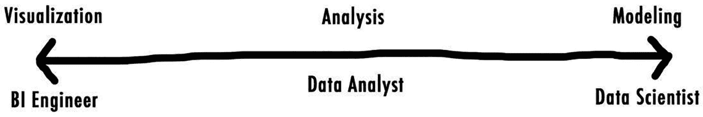

# 25. 这是你的未来吗？—— 投身数据科学领域的职业之路

## 引言

如果你正在阅读本书，你很可能对成为一名数据科学家感兴趣。但事实上，数据科学领域包含诸多角色，一旦你有所了解，可能会发现自己对其他角色同样感兴趣，甚至更感兴趣。本章我将讨论三类不同的工作。第一类以数据为核心，包括数据科学家、数据分析师和商业智能工程师。第二类属于工程领域，该范畴下包含不少职位，例如机器学习工程师、软件工程师和数据工程师。最后一类是销售、商务及管理岗位，包括销售工程师、商业分析师和项目经理等。我还会探讨如何选择适合申请的具体职位，以及如何真正获得这份工作。

## 数据科学及相关职位

目前市场上有很多职位名称，而不同公司对这些名称的使用方式也各不相同。如果你开始浏览招聘信息，比对职位名称和职位描述，你会发现情况相当混乱。在本节中，我将尝试逐一介绍每个职位名称及其"金发姑娘"式的标准描述——即大多数人使用该术语时的普遍理解。但请记住，这些定义也在不断变化。职场世界是一个需要持续研究才能跟得上变化的领域。

### 补充说明：继续深造

有一点我想提一下：如果你即将完成数据科学的本科学习，并非一定要直接进入职场。你始终可以选择继续攻读研究生，比如硕士学位，甚至博士学位或其他博士学位。你甚至可能发现仅凭本科学历求职困难，而硕士学位会让你更具竞争力。数据科学是一个应用性较强的领域，因此大多数学习该专业的人会进入职场，但你所学的技能同样让你有资格学习其他学科。我建议，如果攻读硕士，最好深入某个具体学科，而不是再读一个数据科学学位。例如，如果你热爱统计学部分，可以攻读统计学硕士或博士。应用统计学是另一个硕士选择，它通常更贴近行业需求，大多数人将其作为终极学位攻读。你可能想专注于机器学习或深度学习，可以寻找相关学科的专业。也可能想往技术方向发展，攻读计算机科学学位，或提升编程技能后攻读软件工程学位。或许你想稍作转型，进入更广泛的人工智能领域，或者更深入地研究自然语言处理。或者你可以专注于特定行业，寻找医疗分析或金融方向的学位。选择很多，尤其是如果你计划自费深造的话。

如果你想攻读有资助的博士学位，需要提前做好更多准备。你需要积累一些研究经验，最好能与某位教授建立指导关系，帮助你获得录取和资助，还需要其他教授为你提供热情的推荐信。如果你认为这可能是一条你想走的道路，请尽早开始获取研究经验。

如果你觉得自己倾向于在中学或高等教育阶段从事教学工作，可以攻读教学硕士（针对中学）或其他硕士（针对高等教育）。中学教育对 STEM 学科教师的需求正在增长。仅凭本科学历通常无法获得终身教职，但拥有硕士学位可以担任兼职教师或社区大学教师。许多技术领域的人士会通过参与继续教育项目、担任兼职教师或在社区大学任教来补充收入。

### 以数据为核心的职位

我将数据核心类职位分为三种：数据科学家、数据分析师和商业智能工程师。我认为它们处于一个连续统上，因为有很多重叠的技能和职责，而不同公司对此的定义也各不相同。在一些公司，数据科学家永远不会为利益相关者制作仪表盘，但在其他公司他们可能会这样做。图 25-1 展示了目前存在的连续统。

流程图描绘了从"商业智能工程师"到"数据科学家"的线性递进。该图包含三个主要阶段：左侧的"可视化"、中间的"分析"和右侧的"建模"。"数据分析师"角色位于"分析"下方。箭头指示从"商业智能工程师"到"数据科学家"的方向。

图 25-1 商业智能工程—数据分析—数据科学连续统

由于这些职位名称具有流动性，请参见本节末尾的表格 25-1，了解这三个角色可能对应的其他职位名称。

表 25-1 以数据为核心职位常见的其他名称（非详尽列表，其中一些更常见的含义可能不同，如商业分析师）

| 商业智能工程师 | 数据分析师 | 数据科学家 |
| --- | --- | --- |
| 商业智能分析师 商业智能架构师 商业智能开发者 商业分析师 数据分析师 | 分析经理 商业智能开发者 商业智能工程师 商业分析师 数据经理 数据科学家 研究分析师 研究科学家 | 分析经理 商业分析师 数据分析师 数据工程师 数据建模师 数据讲述者 机器学习工程师 统计学家 |

我先从中间位置开始，谈谈*数据分析师*。我之前谈到过数据分析与数据科学之间存在大量重叠，但它们是不同的概念。一位标准的数据分析师会使用各种数据源，进行探索性数据分析（`EDA`）和其他类型的分析，以识别数据中的趋势并得出结论。他们通常侧重于描述性和诊断性分析。他们也可能对数据进行统计分析，甚至帮助设计和运行符合统计规范的实验。虽然他们经常使用 `SQL` 查询数据，但通常不会编写大量代码，也不会使用超出统计检验范围的非常先进的技术，尽管有些人可能会进行线性回归。当他们从事这两类工作时，就偏向数据科学工作了。在另一个极端，大多数数据分析师会在分析过程中使用基础工具制作可视化图表，有些人可能会在企业级工具中创建仪表盘，这些仪表盘会定期刷新，供利益相关者常规使用。当他们使用公司可视化工具制作仪表盘时，就偏向商业智能这一端了。数据分析师有时会像商业智能工程师和数据科学家一样进行同行评审，但这种评审往往不如许多角色那样结构化。他们还会花大量时间验证工作，特别是关注数据和分析质量以及统计假设。

# 数据科学与工程职位

基于此，`商业智能工程师`主要为客户制作可视化图表。通常，他们无需进行大量数据准备工作，因为所使用的大多是其他团队为多个领域准备就绪的数据源。因此，`BI` 工程师通常不进行广泛的探索性数据分析 (`EDA`) 或其他分析，但可能会做一些探索和验证工作，以确保所掌握的数据符合预期。他们会使用企业的（专业的、官方的，通常也是全公司范围的）可视化工具，通常是 `Tableau` 或 `Power BI`，但也存在一些公司试图采用的其他廉价工具，或是公司已承诺使用的其他工具中内嵌的特定工具。大部分 `BI` 工作涉及创建相当复杂的仪表板，其中包含多个独立的图表、表格和其他组件。如果他们的工作内容超出仪表板构建范畴，那么职位就偏向于这个连续谱系的中间地带。`BI` 工程师会测试自己的系统，与团队成员进行同行（代码）审查，并接受他人对其工作的审查。他们通常专注于仪表板的准确性和数据的实时性。

在这个连续谱系的另一端是`数据科学家`。本书已聚焦于这一角色的职责，因此您对其工作内容已相当了解。他们像数据分析师一样处理数据以发现趋势并得出结论，但倾向于使用更复杂的工具（如机器学习），并通过预测性和规范性分析将工作推进得更深入。数据科学家主要使用代码完成工作，通常是 `SQL` 和 `Python` 或 `R`，但有时也会使用其他语言。当他们在进行更基础的工作甚至创建可视化图表向利益相关者分享时，其职位无疑偏向于该连续谱系的中间地带。在许多不太成熟的公司，数据科学家实际上确实涵盖了整个连续谱系。最后值得提及的一点是，数据科学家可能负责将他们的模型部署到生产环境（将其放置到其他人员或其他软件可以使用的环境中）。这理想情况下应由 `ML` 工程师（见下一节）完成，但数据科学家最终往往承担此责。根据公司可用的平台和基础设施，这项工作可能简单也可能困难。数据科学家还必须验证自己的工作，测试并审查自己和他人的代码。他们将确保其模型经过严格测试、性能优良且可复现。

这里的教训是，你必须努力弄清楚某个特定职位招聘信息代表的是哪种工作类型，并且在寻找特定类型的工作时要广泛浏览。

## 工程职位

有许多工程角色为数据科学工作提供支持。与数据相关的职位类似，这些工程角色可能涉及以各种其他标签归属的工作，有些职位则需要身兼多职。但我将讨论四种与数据科学感兴趣者可能也相关的不同工程职位。请注意，所有这些职位都涉及大量的同行（代码）审查、对所开发代码和系统的测试，以及在涉及数据时的验证工作。关于你可能找到的每种职位的其他头衔，请见表 25-2。

`数据工程师`基本上是负责准备数据以供其他人使用的人员。这是一个技术性很强的职位，需要精通多种工具，通常也需要编写代码。其主要任务是数据建模和 ETL（抽取-转换-加载）或 ELT（抽取-加载-转换），具体取决于平台选项。数据建模是指设计用于存储数据的表或其他位置，然后进行准备工作，例如创建一个包含所有正确数据类型的数据表。ETL 基本上就是从一处抽取数据，进行适当的转换，然后加载到他们在数据建模步骤中设计并准备好的新位置。ETL 中的转换可以是微不足道的小操作，也可能是大规模、复杂且耗时的操作。目前正从 ETL 向 ELT 转变，许多云平台都支持 ELT，它允许先将数据加载到中央位置，然后再进行转换。用于完成这些工作的工具各公司不尽相同。许多公司使用为此设计的工具，这些工具无需编写大量代码就能处理大部分工作，而另一些公司仍需要编写代码。大多数公司都会需要 `SQL`，即使其他方面是低代码的。

`分析工程师`实际上是专业化的数据工程师，对分析以及数据分析师、数据科学家甚至 BI 工程师的特定需求有更深入的了解。他们的任务实质上差别不大，区别在于他们了解更多专业转换知识，并可能采用不同的数据存储方法。他们有时会使用特定工具来准备数据，以供自助式分析使用。

`机器学习工程师`与数据科学家紧密合作，以部署他们的模型。这项工作可能简单到将模型放置到其他系统可以访问的生产位置，或者将数据科学家编写的代码放入生产系统，也可能复杂得多，例如重写甚至完全重写代码。在重写代码时，ML 工程师可能会使用相同的语言，但优化代码使其运行更快、规模效率更高；他们也可能使用另一种更高效的语言（出于相同目的）重写代码，或者在另一个工具中实现它。ML 工程师非常擅长编写高效代码，并且对分析需求也了如指掌。他们中的许多人拥有超越许多数据科学家的深度学习（神经网络）技能。通常，ML 工程师精通整个数据科学流水线，从数据摄取（通常是数据工程师的领域）到数据准备和其他数据科学步骤，再到部署。他们通常遵循 MLOps，并经常使用容器化、编排等专用工具。在某些地方，数据科学家也可以掌控整个流水线，但区别在于，ML 工程师在编码和基础设施方面更具技术性，而数据科学家则更擅长数据准备和建模步骤。决定 ML 工程师具体任务的是他们所在的团队。

`软件工程师`是一个经典角色，其本身与数据科学或机器学习并无直接关联。不过，有时这些角色可能存在于数据科学团队中，而其他时候，该角色的职责范围可能超出软件工程，甚至会涵盖数据科学。在数据科学团队中，他们的职责可能既包括数据工程，也包括机器学习工程。他们可能以多种方式为数据科学家提供支持，包括构建将机器学习模型暴露在互联网上的 API、为数据管道设计基础设施，以及确保所有团队代码遵循 `CI/CD` 工作流。软件工程师从根本上说就是编写软件，通常是通过在自己的电脑上或特定平台内编写代码来实现。但有些人可能会使用其他工具来开发将在另一个系统内运行的软件，例如通过拖拽界面（尽管使用这些界面通常仍需编写一些代码）。特定软件工程师的日常工作实际情况因公司而异。软件工程师使用像 `Git` 这样的版本控制系统，并且经常使用集成的测试和部署基础设施。这涉及到为他们编写的软件编写测试并进行各种程度的测试。软件工程角色的一个关键特征是，他们确实将大部分时间花在编写代码上，而所有其他工程师（和数据科学家）角色的任务组合则更为多样，不会花费那么多时间在编码上。

就像关注数据的工作一样，你需要进行一些深入探索才能找出你可能感兴趣的角色。

**表 25-2**

你将会看到的工程职位下的其他一些职位名称（并非详尽列表）

| 数据工程师与分析工程师 | 机器学习工程师 | 软件工程师 |
| --- | --- | --- |
| 大数据工程师 数据架构师 数据科学家 数据仓库工程师 ETL 开发人员 | 人工智能工程师 分析工程师 数据科学家 深度学习工程师 机器学习分析师 MLOps 工程师 机器学习科学家 | 应用程序工程师 后端开发人员 开发人员 前端开发人员 全栈开发人员 程序员 软件开发者 软件开发工程师 |

## 业务分析师职位

有些职位适合那些理解并喜爱数据科学领域，但对日常技术工作可能不那么感兴趣的人。这些职位需要技术专长，但不需要达到数据科学家或工程师那样的水平。有一个特定的职位头衔，在一百家公司可能意味着一百种不同的含义，但我在这里使用`业务分析师`指的是那些了解业务（公司内的特定领域）并分析数据和流程以找出更好的做事方法的人。他们也能理解并与数据和数据分析人员协作。这个角色可能类似于数据分析师，但大多数拥有这个头衔的人技术性没有那么强。他们肯定会广泛使用 `Excel`，甚至可能使用 `SQL` 来获取他们所需的数据。业务分析师会提出改进其所负责事项的解决方案。他们通常参与其负责领域的项目规划。这份工作涉及与公司内部不同的人进行大量沟通，有时需要传达技术信息。这个角色出现在许多不同的职位头衔下。与数据相关的头衔包括数据分析师和分析翻译师。

## 销售职位

如果你喜欢说服别人去做事情，那么技术销售可能适合你。销售领域有几种不同的角色，涉及到不同程度的技术知识。请注意，这些职位通常部分是佣金制，这确实意味着如果你能力出色，可以赚很多钱，但如果你在销售方面的能力不如自己预期的那样好，收入就会少得多。所有这些工作都需要出色的人际交往能力，而且你会经常向高级别人员做演示或与他们交谈，尤其是在客户是初次接触时。这些角色需要很强的自信和魄力，或许还需要一点点愿意夸大事实的精神。根据公司的不同，可能还需要出差，因此有时你还要负责与潜在或现有客户周旋和应酬。最重要的是，在这些角色中你实际上不会做太多数据科学方面的工作，但你对这个领域的知识会很有用。

有几种角色需要很少的技术知识，如果你想利用你在数据科学方面新获得的专业知识，你可能应该避开这些角色。销售（或业务）拓展代表负责接触潜在客户，但随后会将线索移交给客户经理。客户经理基本上负责完成销售，然后客户关系会移交给客户成功经理，后者在其他更具技术性的人员协助下管理客户关系。

`销售工程师`职位与其他销售人员合作，为潜在客户制定解决方案，所有这一切都是为了促成交易。这个角色需要对公司产品有良好的技术理解，以及对类似产品的行业和宏观格局有广泛的了解。它还需要出色的人际交往能力和有说服力的个性。

`客户成功经理`的角色是与客户经理及其客户紧密合作，帮助他们在销售完成后采用并使用公司的产品。这其中尤其（通过追加产品或服务）涉及销售，但这主要是客户经理的职责。这个角色需要中等水平的技术专长，因为他们需要充分了解公司的产品，以便能够指导客户使用。因此，他们需要的知识不仅仅是泛泛的，还需要在工作中学习公司的产品。拥有良好的技术基础是快速入门的好方法。这仍然需要大量的人际交往能力，因为他们与客户的关系应该是密切且长期的。他们还应该代表客户发声，这意味着他们可以将客户需求反馈给公司，并随后指导产品的开发。

在一些公司，`解决方案架构师`的角色与客户成功经理几乎相同，但在其他公司，它的技术性要强得多。顾名思义，这个角色涉及为（或与）客户真正构建解决方案。目标当然是为了销售——留住客户并向他们销售更多东西——但这更多是依靠技术专长，而不是觥筹交错。它仍然需要与客户沟通并理解他们真正需要什么（即使客户自己也不知道）的良好技能，然后知道如何利用这些信息。

我要提到的最后一个销售角色是`合作伙伴销售经理`，这个角色有一定的技术性。但这个角色不直接与客户打交道，而是与中介机构合作，即那些使用公司产品来服务自己客户的其他公司。这与客户成功经理的角色类似，区别在于关系对象是这些中介机构，而不是直接使用产品的公司。但他们仍可能参与将客户需求反馈给公司。本节末尾的表格 25-3 总结了一些现有的职位。

**表 25-3**

销售职位名称和技术知识水平（并非详尽列表）

| 较低技术知识 | 中等技术知识 | 较高技术知识 |
| --- | --- | --- |
| 销售拓展代表 业务拓展代表 入站销售代表 客户经理 客户成功经理 | 客户成功经理 合作伙伴销售经理 | 销售工程师 解决方案架构师 |

## 管理工作

与数据科学相关的最后一类工作涉及产品、项目或人员管理。和上一类工作类似，如果你喜欢数据科学但不想整天埋头于技术工作，这些职位或许值得关注。过去，技术专长对于这类岗位通常只是加分项，但如今其价值日益凸显。这些角色的职位名称变化不多，入门级机会也较少，但有经验的人很容易转入其中。

`项目经理`负责启动项目、把控进度并确保项目最终完成。具体职责可能有所不同，但通常他们会接手一个新建或现有项目，并与分配到项目中各角色的人员协作。他们一般负责制定计划；创建和管理预算与时间表；安排适当的常规及专题会议；监督工作进展以确保按时推进；协助扫清出现的障碍；与高层领导、利益相关者和项目成员沟通；并确保所有工作完成后，完成收尾流程。他们会使用合适的企业工具来辅助项目管理。如上所述，在许多公司，项目经理是通才，并不具备真正的技术专长（甚至除了项目管理之外也没有特定领域的专长），因此可以被指派到任何项目。但在其他地方，拥有技术专长可能会让你有资格负责特定项目，或只是让工作轻松很多。这绝对是一个需要领导力、沟通能力和通用人际技能的角色，尤其是激励他人的能力。有时，这个角色还需要有点强势，无论是推动项目内部成员，还是在面对外部人员需要清理障碍时。有时团队会配备自己的项目经理，所以如果你对管理数据科学项目特别感兴趣，可以寻找此类职位。此外，如果你对此感兴趣，可以考取项目管理认证来提升竞争力。

一个相关的职位是`项目集经理`，它基本上是进阶版的项目经理——项目集经理通常管理一个更大计划（项目集）下的多个项目，并负责其战略一致性。许多公司没有这个职位，因为它只存在于较大型的企业中。这个角色的基本职责与项目经理相同，但责任更重，并且比普通项目经理更频繁地与高级领导沟通。这通常是为有经验的项目经理准备的资深职位。

另一个与项目经理相似的职位是`产品经理`，两者有很多重叠之处。但产品经理更专注于某个特定产品，管理其生命周期，而非一个个独立的项目。与项目集管理类似，可能同时有多个围绕特定产品开展的项目。许多实际任务与项目管理非常相似，但范围更广。然而，产品经理对自己负责的特定产品具备专业知识和深入理解，甚至会参与产品本身的构思。他们常常负责最初组建产品团队，或为团队寻找新成员，并规划短期和长期工作。他们处理与利益相关者的大部分沟通，还负责关注竞品、管理策略和规划产品发布。他们也会考察产品的表现和用户反馈，收集并分析意见。与项目经理一样，领导力和软技能至关重要。

一个与项目经理职责部分重叠的角色是`敏捷教练`，但两者在关键方面其实大不相同。首先，敏捷教练是敏捷方法论中的特定角色，而正如我之前所说，敏捷方法并不适合数据科学。因此，如果你想留在数据科学领域，这可能不是一个值得追求的角色；但如果你对更广泛的技术领域感兴趣，则值得考虑。敏捷的关键特征之一是团队应主要实现自我组织和运作，这使得该角色与传统项目经理截然不同。敏捷教练主要负责确保每个人都正确遵循敏捷方法论，并主持和安排每日站会以及所有仪式性会议（回顾会、冲刺规划会和冲刺演示会）。他们帮助保护团队免受干扰性工作的影响，确保团队成员定期更新工作追踪工具，并向领导层汇报进度。他们还会根据需要帮助清除障碍并管理团队内部冲突。这里所需的技能与之前角色相似——领导力、沟通能力和同理心。尽管不总是强制要求，但敏捷教练通常需要了解所管理工作的相关技术技能，因为需要有精细的理解才能有效管理工作。如果你想进入这个角色，也可以考虑考取相关证书。

我要谈的最后一个角色是`人员经理`，通常简称为经理（但如今很多职位名称中包含"经理"一词，实际并非真正的管理岗位）。经理通常领导一个团队，团队成员通常被称为个人贡献者，以区别于领导职位。经理负责团队的日常运作，包括与每位团队成员就绩效、目标、职业发展及纪律问题等方面进行沟通。他们为整个团队提供指导，并通常帮助定义团队愿景。他们分配任务、规定截止日期，并酌情安排培训。他们还需要在必要时处理人际关系和其他冲突。人际交往技能是优秀经理最重要的素质。经理会花大量时间参加关于战略、目标与时间表、项目选择与规划等高层话题的会议。核心技能包括领导力、沟通能力、果断力以及（理想情况下）技术专长。在许多公司，并不要求人员经理具备技术知识，但许多地方也明白，了解业务工作的经理才是更好的经理。这很可能不是一个刚拿到数据科学本科学位就能直接担任的角色，但如果你对此感兴趣，可以将其作为努力的方向。

### 职位等级

几乎所有工作都有不同的级别。你会在招聘信息中看到这些级别，但它们往往让人一头雾水，因为大多数级别并没有什么规律或道理可言。你必须查看招聘信息以及它们所要求的经验年限才能弄明白。有些公司使用三个级别，最低的是`初级`，最高的是`高级`，中间角色则没有标签。这些标签本身也没有任何意义——`高级`在一家公司可能意味着五年经验，而在另一家公司则可能意味着十五年。`首席`是另一个常见的标签，通常指在其领域拥有广泛专业知识的人。这通常是职位层级中的顶端。有些公司使用`主管`来指代类似于高级或介于高级与首席之间的职位。你还会看到在职位名称前加上`助理`这个词，表示初级职位。其他公司则使用数字来表示级别（通常用罗马数字，让事情更显混乱），但每个公司可以定义任意数量的级别。还有一些公司使用`骨干`一词来表示经验更丰富的人。其他公司则使用`科学家`一词。在寻找初级职位时，令人沮丧的一点是，几乎没有人会这样标注他们的招聘信息。你必须点进去才能知道他们是否要求工作经验。更令人沮丧的是，他们有时确实标注了“初级职位”，但你点进去后发现他们要求一年的工作经验。在你找工作的过程中，你会开始了解不同公司如何使用这些级别，因此如果你发现自己符合某家公司二级数据科学家的资格，你就可以开始在同一家公司的其他职位中根据这个标签进行筛选。

## 选择合适的工作

找到一份你热爱的工作并非易事。如果你从未在企业界工作过，这一点尤其困难，因为你很难想象日常工作究竟是什么样子。我会讨论一些最重要的考量因素，但我建议你深入浏览招聘网站，开始看看有哪些职位（LinkedIn 和 Indeed 是不错的起点）。

请注意，招聘信息通常遵循一个基本结构。它们会先介绍一些公司和职位的信息，试图说服你这为什么是一个很棒的工作场所以及这个机会有多好。然后，它们会以段落形式列出该职位的基本职责，接着是一个列有必备技能和经验的要点列表。可能还会有更多信息，然后有时它们会以段落或另一个要点列表的形式列出优先考虑的技能。通常，接下来会包含一些福利信息。最后，招聘信息底部会附上法律用语（平等机会雇主等等）。

### 角色类型

尝试确定你真正想每周五天、每天做八小时以上的事情，坦白说很难。如果你读了上一节中关于许多可能职位的描述，有没有什么比其他的更吸引你？想想当你深入进行项目编码、或者在进行探索性数据分析（`EDA`）、试图确定最佳算法、创建可视化图表或撰写结果报告时，你的感受如何？你最喜欢哪部分？你在小组项目中工作时喜欢与他人合作吗？（然而，值得一提的是，大学里的小组项目与在工作中与他人合作并不太相似，尽管通常仍然会有那么一个不怎么干活的人。）你是否有机会展示你的工作？如果有的话，你喜欢策划演示、制作幻灯片以及进行演示吗？你喜欢解释复杂的事情吗？你喜欢总体上的策划工作吗？你喜欢在小组项目中协调他人吗？

这些都是你在考虑角色类型时需要思考的事情。请记住，你不仅要确定自己想要的特定职位，还要考虑这个职位名称下的具体角色类型。如果你真的认为自己永远学不会与利益相关者沟通，那你会极大地限制自己，但这也意味着你需要仔细查看职位描述，并看是否能揣摩出你将与利益相关者共事的程度。有些职位在这方面肯定比其他职位多。

同样值得一提的是，仅凭职位描述很难判断一份工作会是什么样子，因为很多职位描述都是荒谬的、不切实际的技能愿望清单。在一家公司，领导们对人工智能兴奋不已（太神奇了！它无所不能！），以至于当我们只需要招聘一位处理零售数据的普通数据科学家时，他们却把机器人技术、语音技术和图像处理列为了希望具备的技能。而且，不，他们并没有什么秘密项目在进行；他们只是不知道自己在做什么。这种情况在招聘人员中很常见，甚至（不幸的是）有时也发生在招聘经理身上。

招聘人员不知所以的问题也体现在上述职位名称使用不一致上，比如数据分析师职位要求深度学习技能。职位以不准确的名称列出可能有多种原因。有时是公司为了给一个地位较低的职位名称支付更少的薪水，有时是因为发布职位的人不知道自己在做什么，还有时是因为公司内部有一些奇怪的遗留职位名称。

你在选择角色时一定要考虑的一个因素是职业发展。招聘信息本身可能会提及这一点，这是个好迹象。但你也可以通过查看同一家公司其他类似职位（尤其是不同级别的职位）来了解。如果有明确命名的级别，那是个好迹象，表明你能够逐步晋升。如果你看中的职位是在一家小型非营利组织担任唯一的数据科学家，那里的明确发展潜力就不那么大。这并不意味着这对你不是一份好工作，但这可能是你在面试中可以谈论的话题，或者至少在你想要快速晋升时需要考虑的一点。但也请注意，在当今的工作环境中，接受这样一个孤立职位、积累一些经验、然后跳槽到一家新公司是完全正常的。

#### 咨询职位还是直接聘用

上面我讨论的所有职位都好像它们是某家公司的直接聘用职位。但实际上几乎所有职位都可以通过咨询公司来完成。你绝对应该考虑是否想要尝试咨询工作。有时很难判断招聘信息中的职位是否来自咨询公司。

为咨询公司工作可能是获得广泛经验的好方法，如果你正在纠结该往哪个方向发展，那么探索这个选项或许值得一试，因为你可以接触到不同类型的工作。作为顾问工作有其积极和消极的方面。

# 数据科学职业指南

咨询工作因你所工作的咨询公司而异。你的项目任务可能相对较短，也可能你最终会在同一家公司待上一段时间，甚至数年。你在项目任务中的经历也可能大相径庭。在一些公司，顾问会受到轻视，被当作二等员工对待，尤其当公司长期聘用顾问是因为他们不想支付足够的费用来为顾问提供福利（如果他们将顾问转为正式员工就必须提供这些福利）时。其他一些咨询公司规模庞大，并且总体来说在行业内以及领导层中享有相对较高的声誉。

## 行业现状

正如我们在前面章节中所见，几乎没有任何领域未曾涉足数据科学。你可能对某些行业情有独钟，也可能觉得另一些索然无味。如果你对公司的核心工作至少有一点点兴趣，这会有助于你在工作中保持愉悦。但同时，这并非必需条件。

对于想要进入数据科学领域的人来说，不同行业在该领域的成熟度各不相同。保险和金融业使用统计学家已有数十年，因此人人都信任这份工作，你无需不断证明自己的工作有价值、有用且值得信赖。而这一点，你在许多其他刚刚开始踏上机器学习这趟列车的行业中都将会遇到。

如果你对数据科学较新的行业感兴趣，可以特别关注这些行业中公司的市场营销岗位，因为其中许多公司从事更高级分析的时间比公司其他部门要长。

## 思考你的价值观

但选择在哪个行业工作，也可能关系到你的价值观和信念带来的影响与选择。并非每个人都适合所有行业，因此在求职前你应该思考这些问题。

我以自己的职业生涯举几个例子。我个人对整个保险行业，尤其是健康保险行业心存疑虑，因此我绝不会申请这类工作。我曾申请一家宗教医院的工作，面试时被告知，他们所有会议开始时都要祈祷，每个人都必须念一段祷词。我虽感意外，但这信息很有用，因为我不希望个人生活与工作如此混淆，所以我没再申请那家医院的任何职位。

在其他例子中，也许你不想为大麻公司、枪支公司、含糖饮料公司或国防承包商工作。许多大型科技公司利用其巨额财富左右政治领导人，以制定有利于自身和股东的法律。这些公司也常常在客户数据上随心所欲、不负责任。有些公司明知故犯地伤害本就处于劣势的群体。如果这些问题中有任何是你所不喜欢的，那么在求职时应避开这些公司。在申请前做足功课，这取决于你自己。

此外，有时公司整体还行，但公司内的某些岗位可能会让你犹豫。例如，成为人力资源团队的数据科学家可能涉及“优化岗位”，换句话说是为裁员做准备。总会有人做那份工作，但如果你不想是自己，就可以避开。或者，有些团队在别人看来可能糟糕的情境下努力做好事。例如，在马斯克入主之前的推特时代，尽管许多人对网站上的某些内容感到困扰，但有团队负责监控并试图消除仇恨、错误信息和其他有害内容。你可能会乐于在这样的团队工作，但不愿在公司其他部门任职。

同样值得指出的是，并非每个人都对这些事情有强烈看法，这也没问题。如果这些事情不会让你耿耿于怀，那就无需担心。但如果你确实在意，就不要让自己陷入做一份不喜欢或不认同的工作、或为一家让你不舒服或羞耻的公司效力的境地。

## 组织类型

现实中有许多不同类型的组织，并非每个人都能在其中享受工作或茁壮成长。你可以在 Glassdoor^(¹⁰⁸) 网站上了解不同公司的情况，那里的人们评价雇主、工作，并分享他们的薪资。

许多理工科学生梦想为美国西海岸的大型科技公司工作（通常称为 FAANG 公司，即 Facebook、Amazon、Apple、Netflix 和 Google）。这些公司本身没什么问题。它们很难进入，但提供高薪、声望，并且当别人问你在哪里工作时，能得到品牌认可。你通常会从事有趣且富有挑战的工作，这对职业发展和专业能力提升很有帮助。但它们内部竞争激烈，有些甚至残酷无情，对员工要求很高。它们频繁重组，所以即使你加入了一个很棒的团队，一年后也可能被调到其他岗位，面对糟糕的上司。你必须灵活应变，把工作放在首位。这些公司对女性尤其不易，特别是当她们经历孕期时。它们都说你的工作安全无虞，但大多数公司都会想办法惩罚那些将孩子置于职业之上的女性。这些公司还会定期裁员，没有人真正安全。好消息是，从这样的地方被解雇或辞退，并不会在你的简历上留下污点，因为这种事常有发生。

初创公司可能存在于许多行业，但数据科学岗位大多集中于科技初创公司。为初创公司工作可能令人兴奋——成为新事物的一部分非常酷，尤其是如果它成功了。工作内容多样化，但薪资有时处于中等水平，因为你通常会获得大量股权（股票），如果你真的非常幸运，公司大获成功，这些股权有可能让你发财。公司文化通常充满干劲，每个人都争先恐后地用比科技巨头更少的资源，快速完成尽可能多的工作。但有时你被期望长时间工作，因为其他人都在加班，而且没人能保证公司不会倒闭。

还有一些是人们耳熟能详、历史悠久的大型企业，比如希尔顿、高露洁、美国航空和哈雷戴维森。这些公司之间差异很大，但那些比个人电脑历史更悠久的公司，通常有独特甚至老派的文化，非常看重资历和等级制度。它们变革缓慢，对数据科学能实现什么（或者速度有多快）常常持有非常不切实际的看法。老牌公司还倾向于拥有噩梦般的遗留数据系统，它们可能一直试图清理这些系统，但由于极其复杂，尝试往往以失败告终。取决于你的个性，在这样的大型公司里很容易迷失。这在很大程度上取决于你加入了什么样的团队，而这在事先很难了解。这类公司的薪资通常不错，而且通常有可观的年度奖金。

规模较小的公司在企业文化上差异很大。它们通常比大公司更年轻，因此不那么老派，更容易结识领导者和不同层级的人，这对某些人（尤其是擅长社交的人）来说很有用。有时你能找到一家正从初创公司向企业转型的公司。如果它们即将上市，你可能有机会获得一些不错的股票期权，这些期权可能会带来长期回报。这类公司的薪资可能不错，但你获得年度奖金的可能性较小。

你也能在规模非常小的非科技公司找到机会，比如那些员工不到 50 人的公司。在这些公司里，大家基本上都互相认识，就像生活在一个小镇里。有时他们会刻意倡导一种“家庭”文化，但这种做法可能奏效，也可能行不通。这有助于你脱颖而出。如果他们刚涉足数据科学领域，那么你就有很大机会大展拳脚。但如果你难以做出真正有价值的成果，你也更容易被注意到——这很可能仅仅是因为他们没有足够多合适的数据供你使用。这类公司通常数据质量不佳，而且对数据科学的运作方式知之甚少。薪资通常偏低，一般也没有奖金。

大学和其他教育机构可能规模庞大且缺乏人情味，也可能小巧温馨。这些地方的工作通常相当稳定，而且竞争远不如企业界激烈。它们行事可能比较缓慢，但同时也可能极具创新性，具体取决于你所在的部门。薪资水平一般，而且没有奖金。

非营利组织也会雇佣数据科学家，但他们在这一领域通常非常不成熟。这些组织规模通常较小，所以如果你做得好，能产生显著的影响力，但也面临失败被放大的风险。薪资通常一般（这也在预料之中），但工作本身可能非常有成就感，尤其是如果你在一个你充满激情的领域工作。

工作机会多种多样，比我在上面列举的要多得多，但这对于你进行思考很有帮助。一定要对不同类型的公司做足调研，看看自己适合哪里。

## 这并非终身承诺

需要记住重要的一点：虽然你希望自己的第一份数据科学工作能称心如意，但如果结果证明它并不适合你，那也没关系——你并非一辈子困在那里，也不会永远被局限在那个行业或公司类型里。如果你跟婴儿潮一代的人聊聊，他们会告诉你公司忠诚度有多重要，但在当今世界，这已经完全不适用了。你欠雇主的，不过是他们付钱让你做的工作而已。他们对你也是同样的想法。在科技界，每两到三年换一次工作被视为健康的状态。通常这指的是在同一公司内部调岗，但你的简历显示你在七年内换了三家公司，这也没问题。大多数人不会在意。你确实需要为每一次离职提供一个理由，而答案应该始终是类似“在那里我没有好的成长机会”。请注意，在同一家公司甚至同一个岗位上待上好几年也是可以的，但很多潜在雇主会怀疑你是否对职业发展感兴趣（专业提示：他们希望你有上进心）。

## 薪资

虽然薪资很重要，我在上面也提到了，但它绝不应该成为你求职中最重要的事情。是的，你需要确保自己能拿到一份体面的薪水。大多数公司一旦决定给你录用通知，都会允许你协商薪资。为你心仪的工作确定一个合适的薪资是出了名的困难。如果你要搬到新的地方，这一点尤其如此。最好的做法是去类似 `salary.com` 和（前面提到的）`Glassdoor` 这样的网站，搜索职位名称、地点和经验水平。你会看到薪资范围，也可以尝试相关的职位名称，以便更准确地了解实际范围。你还应该通过查找公寓租金以及其他开销（比如汽车、停车费或公共交通费用）来了解生活成本。

你也可以询问年度奖金，因为很多公司都有这项福利，数额从很少到非常丰厚不等。但在审视录用通知上的薪资时，务必将这一点考虑进去。

其他福利——假期、病假、健康保险、退休储蓄匹配金——以及有时还有其他一些福利也很重要。很多职业建议听起来好像你可以就这些不同项目进行协商。虽然理论上有可能，但在大多数公司，你能得到的就是规定的那些。不同公司之间的差异可能很大，有时在入职若干年后，你还能获得额外福利（尤其是更长的假期或更高的退休储蓄匹配金）。请务必关注这些方面，并考虑哪些对你是重要的。有些公司允许你将未使用的假期或病假滚存到下一年的（把一年未用的保留到下一年）；有些则不行。有些公司甚至还有理论上的无限假期政策。

## 如何获得工作

正如我之前所暗示的，你甚至在开始投简历之前就应该做一些调研，这样整个过程才不会漫无目的。这意味着要调研你感兴趣的行业、公司和职位。也要开始研究招聘网站，这样你才能了解市场上有哪些机会。保存你感兴趣的工作。

确保你持续完善你的作品集，让它尽可能令人印象深刻。完善你的简历，使其在视觉上具有吸引力（但不要花哨），留有适当的空白，并确保没有拼写错误或格式不一致（让一个语文水平好的人帮你检查——如果你还在上学，可以去学校的写作中心或就业指导中心）。

### 申请

一旦你准备好开始申请，请确保你的简历和作品集都准备妥当。回顾一下你之前保存的工作。我建议的一点是，尽量避免通过招聘网站直接申请，而是直接找到发布该职位的公司，在其职业发展网站上找到该职位并申请。这样你就能避免中间人型招聘人员的干扰。在某些情况下，你无法确定公司是哪家，那就直接通过招聘网站申请。与独立招聘人员合作的一个缺点是，如果公司聘用了你，他们会得到一笔介绍费，所以他们只关心拿到这笔费用，而不在乎你是否适合这个职位。关于公司职业发展网站的一个提醒：它们通常有极其繁琐的申请流程，你需要把简历上的所有信息手动填充到那些笨拙的表格里，这要花费大量时间。但如果你第一次向这家公司申请，还是得这么做。

请注意，招聘网站通常会让你觉得求职信是可选的。但务必每次都附上一份。很多公司不会在意，但你可能会因此错过一个完美的工作机会，因为招聘人员会因为没看到求职信而感到不满。求职信基本上就是突出简历中与职位要求相关的最重要的特点。也尽量找人通读一遍，尤其是如果你的文笔不够干净利落的话。对于注意到的人来说，拼写错误非常损害印象。投递简历，然后投递更多，持续进行。

请注意，你投递几十份简历后，收到的最多的回应将是石沉大海。即使你完全满足了每一项要求，甚至包括了所有期望的技能，你也可能得不到任何回复。不要绝望——现实就是如此。公司的一个职位常常会收到数百份申请。需要了解的一个重要点是，简历筛选人员会在你的简历上寻找与工作相关的特定关键词。上网搜一下，弄清楚哪些关键词需要确保出现在你的简历中。

### 面试流程

恭喜！你获得了第一次面试机会。现在，你需要开始研究这家公司，并尽可能了解该职位的信息。

通常，第一步是与公司的招聘人员进行快速面试，这通常被称为筛选面试。这主要是为了确保没有明显的问题，并确认你对职位有更多了解，且明确表示仍有兴趣。这些面试通常完全不涉及技术问题（众所周知，招聘人员的技术知识非常有限），但这是一个很好的机会，让你可以询问关于工作和公司的问题。你应该随时准备展示自己对公司的了解，并主动提问。只是要避免显得贪婪，在面试早期就提及薪资被视为不妥（除非是他们主动提起）。

如果你通过了最初的筛选，你会发现不同公司的做法各不相同。你可能会面对的一些环节（按随机顺序排列）包括：与招聘经理的面试、与团队的小组面试、与若干团队成员的一对一面试、脑筋急转弯面试、带回家的作业（可能有时间限制，也可能没有；规模或大或小）、现场编程环节、非现场编程的技术面试、行为面试、与团队和/或招聘经理共进午餐、一整天在白板前的连续面试，等等。通常情况下，如果你通过了筛选，招聘人员会告知你后续流程——如果他们没说，一定要主动询问。你也可以在网上搜索，了解更多关于这些常见的招聘活动类型的信息。

我会给出一些小建议。每次面试你都要准备一些问题，并且要确保这些问题能显示出你做过功课（例如，不要问公司是什么时候成立的——任何人都能在网上找到这类信息）。你的问题应该既能给面试官留下印象，又能为你提供信息。尽量多了解工作和团队的情况。

永远不要说任何负面的话。即使你上一任老板是个刻薄、记仇的混蛋，并且特别喜欢无缘无故地折磨你，也不要对任何人提起。你离开一份工作的原因始终应该是“那里没有足够多的职业发展机会”，或者是“你在寻找更有挑战性和更有趣的事情”。

对于行为面试，一定要提前做好研究，准备好应对他们可能提出的问题。这类问题通常是“请讲一个你……的经历”，比如不得不处理与同事的冲突、发现有人做不道德的事、犯了一个没人注意到的错误等等。你的例子越具体越好。但回答要力求简洁。始终保持积极的态度。如果你必须承认自己有过失，一定要谈谈你如何从错误中吸取了教训。另外，不知道某些事也没关系——承认自己不知道，并在合适的时候询问答案，反而更好。我曾经被问到 SQL 命令 `UNION` 和 `UNION ALL` 的区别，当时我不知道。我如实说了，并请教了答案，他们告诉了我，最后我得到了那份工作，并且再也忘不了它们的区别。假装懂你不懂的东西风险很高，因为这会让你显得不可信，他们也会怀疑你是否能接受批评并成长，或者是否会永远不肯认错（这是一个很糟糕的特质）。

当被问及你觉得自己哪些方面需要提升时，你总可以用那个老套的说法：“有时候我有点完美主义，对自己要求太苛刻。”但这句话现在已经相当俗套了，所以看看你能不能想出一些至少基本真实，但听起来又像是在变相表扬自己的话。总的来说，在面试中撒谎不好，但把一切都往积极的方向去表达是常规做法。

### 录用通知

恭喜！他们想录用你了！这可能是非常激动人心的时刻，尤其是如果你已经找了一段时间的工作。如果你已经做好了研究，并确信这个团队和职位很适合你，那么这很可能是一件大好事。你不必马上接受录用。有时他们会想在给出薪资方案之前先与你谈谈，所以尽量别在此时流露出你有多兴奋（但也不要显得不感兴趣——要表现出热情和高兴）。这就像任何谈判一样。通过提问来准确了解他们提供的薪酬细节。有时他们可能会问你是否有其他待定的录用通知。你可以诚实回答，或者暗示你正在与另外一两家公司进行深入的流程，正在等待他们完成其他面试。等你和他们谈完后，你可以挂断电话或合上笔记本电脑，*然后*再蹦蹦跳跳几下。但你必须坐下来，决定你想怎么做。如果你确实还有其他正在推进的机会，那么现在正好可以联系其他招聘人员，了解最新进展。你可以解释说你已经收到了一个录用通知，希望能尽快做出决定。如果你确信自己更想要其他某家公司的职位，这一点就尤其重要。但你也别让最初那家公司的录用通知等太久。只要保持尊重和理性，你就能做出正确的决定。

祝你好运。

# 关键要点与下章预告

在本章中，我介绍了与数据科学相关的各类职位，从显而易见的数据科学家、数据分析师和 BI 工程师，到不同的工程角色、项目管理、业务分析师，甚至是销售岗位。随后，我探讨了超越职位头衔的角色类型、行业考量，以及在求职过程中坚守自身价值观的重要性。我还提醒你，一份工作并非终身承诺，薪资固然重要，但并非最重要的事情。最后，我简要讨论了求职、申请和面试流程，并以如何处理工作录用通知作为本章的结尾。

## 从业者简介：亚历克斯·鲍尔

**姓名：** 亚历克斯·鲍尔  
**现任职位：** 高级解决方案架构师（全栈数据科学家）  
**当前行业：** 科技行业，并曾短暂涉足其他几个行业，包括大麻、化工和电信  
**从业年限：** 8 年  
**教育背景：**

- 化学学士，辅修创业学

*此处表达的观点仅代表亚历克斯本人，与其任何现任或前任雇主无关。*

### 背景

亚历克斯一直热爱化学，因此在大学主修了化学，但他同时也怀有创业精神，所以辅修了创业学。他的第一份工作是化工销售，但他真正想做的是化学中更具科学性的部分。于是他开始学习其他领域的知识，并发现了数据科学。他在 Coursera 上完成了约翰霍普金斯大学的数据科学证书课程，随后疯狂地进行社交联络，最终在一家大麻公司获得了他的第一份数据科学家工作。

### 工作经历

亚历克斯的新工作并不完全是纯粹的数据科学角色，他做了很多市场营销、销售和网站分析的工作，但确实也开始用 `R` 进行一些建模。他最早的项目之一是创建一个网络节点图，展示所有大麻品系的传承谱系。他仍为主要收入渠道做了大量广告推广，但也开始着手对访问他们网站的用户进行分类。他离开那家公司成立了一家咨询公司，为各种客户（包括大麻和金融行业的客户，以及一位“英国公爵”）提供分析和营销服务；此外，他还创立了第二家咨询公司，致力于帮助大麻药房更好地管理库存。

在与商业伙伴发生矛盾后，亚历克斯最终在一家零售公司找到了一份数据科学家的工作。起初他做了很多预测和分类工作，随后参与了一个解决供应链问题（货物轮船滞港）的项目。他创建了一个非常成功的算法，能够有效地对库存进行分类。接着，他被抽调参与一些项目，期间学习了通用的云服务以及 `Databricks` 平台，最终获得了一份需要身兼数职的工作。他帮助创建可长期部署的自动化 MLOps 工具包，以便团队能够快速上手。

### 观点摘录

**工作中最喜欢的部分：** 做好数据科学，实际上是真正的技术洞察与真人沟通相结合的结果。他擅长这两方面，并享受其中一系列不同的挑战。成功地将技术工作翻译给非技术人员听，有时感觉像变魔术一样。

**工作中最不喜欢的部分：** 数据清洗。另外，数据科学真正作为业务的一部分被应用存在滞后性。人们在概念上认可数据科学的想法，但他们不明白这是一个过程，需要耐心等待它结出果实。他们也很难理解我们永远无法给出 100% 确定的答案，但这仍然可以提供帮助。

**最喜欢的项目：** 为一个庞大的全球零售组织优化海运集装箱的供应链问题，既困难又迷人。他的工作确保了诸如圣诞树和高价值玩具等物品能在圣诞节前而非一月份抵达。这为该公司节省了价值 33.5 亿美元的库存浪费。

**最常用的技能：** 系统的架构与设计，以及可视化。他对现有的、新兴的以及涌现中的机器学习技术有广泛的了解，并懂得如何将其与云基础设施结合；同时，他也理解成功应用机器学习和人工智能的细微差别。能够与任何层级的人就技术和非技术话题进行沟通。

**当前主要使用的工具：** `Databricks`、`Python`、`PySpark`、`SQL`、`Azure`、`AWS`、`GCP` 和 `Fabric`

# 数据科学的未来

永不变的是对高质量、及时且相关数据的需求。未来不会那么强调数据科学家必须理解特定机器学习算法的细微差别。我们似乎正处在一个更加复合的人工智能时代，我们更关心输出如何帮助业务，而非其内部机制。

# 优秀数据科学家的特质

实用技能，如强大的 `Python` 编码能力（`C++` 和 `C#` 在某些角色中也很有帮助）、扎实的 `SQL` 技能以及可靠的统计学知识（以便你确保数据确实在说你所认为的东西）。软技能，如与各种不同类型的人（包括技术人员和非技术人员）合作与沟通。一个值得努力的目标是：面对一个问题，能够立即看到机器学习或人工智能可以如何实现利益相关者的目标并驱动业务价值。

# 他对未来数据科学家的建议

擅长清洗数据。大学应该开设一整年的课程来教如何清洗数据。但通常不会，而这将是工作中很大的一部分，所以靠自己去精通它。

*亚历克斯是一位数据科学家和 MLOps 领导者，在多个行业拥有丰富经验。*

# 脚注

1 2

# 索引

## A
- 精算科学
- 聚合/交互
- 亚马逊简单存储服务 (S3)
- 亚马逊网络服务 (AWS)
- Anaconda
- 分析项目
  - 高级技术
  - 聚合/粒度方法和工具
  - 篮球队
  - 商业智能
  - 商业报告
  - 霍乱疫情等级
  - 描述性分析
  - 诊断性分析
  - 成熟度
  - 预测性/规范性
- 应用程序编程接口 (API)
- 人工智能 (AI)
  - 分析项目
  - 大数据与深度学习
  - 热情/乐观
  - 启发式方法
  - 人类智能术语
  - 寒冬
- 人工神经网络 *参见* 神经网络
- 关联规则学习（挖掘）
- 自回归积分滑动平均模型 (ARIMA)
- Azure
- Azure 数据工厂 (ADF)

## B
- 词袋模型
- 银行与金融
- 贝叶斯概率
- 贝叶斯定理
- 伯努利分布
- 偏见/谬误
  - 亚马逊的性别歧视简历筛选器
  - 锚定偏见
  - 自动化偏见
  - 沟通
  - 确认/信念偏见
  - 保守主义偏见
  - 好奇心
  - 区分偏见
  - 领域忽视
  - 期望
  - 虚假独特性偏见
  - 框架效应
  - 赌博偏见
  - 难易效应
  - 医疗保健系统
  - 热手谬误
  - 冒名顶替综合症
  - 解释/信息偏见
  - 解释/分析数据
    - 基率谬误
    - 舒适推理/浪漫叙事
    - 假阳性悖论
    - 麦克纳马拉谬误
    - 悖论
    - 辛普森悖论
    - 幸存者偏差
  - 长期职业发展
  - 观察者期望效应
  - 乐观偏见
  - 规划
  - 规划谬误
  - 支持创新偏见
  - 选择
  - 自我认知偏见
  - 统计概念
  - 零和博弈
- 二项分布
- 生物信息学
- 博客与在线文章
- 布鲁萨德，梅雷迪斯
- 数据分桶
- 商业智能 (BI)
  - 开发者
  - 成熟度模型
  - 报表创建
  - 自助式报表

## C
- 加州消费者保护法案 (CCPA)
- 加州隐私权法案 (CPRA)
- 中心极限定理
- 云计算
  - AWS 平台
  - Azure
  - 代码优化
  - 分布式计算
  - Google Cloud
  - 供应商锁定
  - 在线服务
  - 本地部署
  - 并行计算
  - 平台
  - 可扩展性 *参见* 可扩展性/云计算
  - 虚拟机
- 云提供商
- 聚类方法
  - 凝聚式
  - 定义
  - 分裂聚类
  - 层次方法
  - *k*-均值
  - 杂色鸢尾
- 整群抽样
- 收集与存储
  - 自动化数据
  - 数据预处理
  - 定义
  - 基础设施方法
  - 波多黎各地址
  - 定性/定量数据
  - 质量
    - 录入/存储
    - 指法错误/拼写错误
    - 不一致数据
    - 局限性
    - 缺失数据
    - 问卷
  - 科学家
  - 半自动化
  - 追踪
  - Shutterfly
  - 存储 *参见* 存储数据
  - urbanización
- 逗号分隔值 (CSV) 文件
- 持续集成与部署 (CI/CD)
- 便利抽样
- 卷积神经网络 (CNN)
- 相关/协方差
  - 因果关系概念
  - 协方差矩阵
  - 矩阵
  - 皮尔逊
  - 正值
  - 散点图
  - 强正相关
- 犯罪/法院系统
- 跨行业数据挖掘标准流程 (CRISP-DM)
  - 业务利益相关者
  - 业务理解
  - 数据分析过程
  - 数据准备
  - 差异
  - 探索性分析/建模
  - 生命周期
  - 线性回归
  - 演示
  - 验证/评估
  - 可视化
- 交叉验证
- 客户关系管理 (CRM)

## D
- 数据分析 *参见* 分析项目
- 数据库管理员 (DBA)
- 数据库管理系统 (DBMS)
  - NoSQL
  - RDBMS *参见* 关系数据库管理系统 (RDBMS)
  - 模式层级
  - 存储管理
- 数据定义语言 (DDL)
- 数据信息
  - 抽象表示
  - 分类/定性
    - 二元（布尔）类型
    - 名义数据
    - 有序数据
  - 普查信息
  - 收集/存储
  - 数据收集器
  - 数据集
  - 数据项
  - 定义
  - 家庭聚会
  - 弄清楚
  - 治理/质量
  - 区间数据
  - 智商数据
  - 局限性
  - 数值天气数据
  - 元数据
  - 尼罗河水尺
  - 数值/定量
  - 组织业务问题
  - 数据爆炸
  - DIKW 金字塔
  - 非关系型数据库系统
  - 关系型数据库系统
  - 制表机
  - 质量
  - 比率数据
  - 原始/衍生数据
  - 现实世界表示
  - 结构化/非结构化/半结构化数据
  - 转换类型
- 数据操作语言 (DML)
- 数据运维（数据管理）
- 数据保护官 (DPO)
- 数据查询语言 (DQL)
- 数据科学
  - AI 炼金术
  - 定义模糊
  - 分析 *参见* 分析项目
  - 偏见/谬误
  - CRISP-DM 生命周期
  - CRISP-DM 流程
  - 水晶球
  - 数据驱动公司
  - 领域知识
  - 伦理 *参见* 伦理考量
  - 可解释性
    - 黑盒 *vs.* 白盒解决方案
    - 决策树方法
    - 线性回归
    - 透明度
  - 探索性分析/建模
  - 复杂数学
  - 欺诈检测
  - 密集型技术
  - 交叉领域
  - 工作 *参见* 招聘版面/职位名称
  - 字面编程
  - 组织自动化规划
  - 流程理解
  - `Python` 包
  - 素质/角色
  - 声誉
  - `R` 包
  - 解决方案 *参见* 软件开发
  - 验证/评估值
    - 确定性/非确定性过程
    - 可解释性
    - 可复现性
    - 简洁性
    - 可信度
    - 可理解性/可共享性
  - 维恩图
  - 虚拟环境
  - *vs.* 系统
  - 可视化/演示
- 数据集来源
- 深度学习
- 拒绝服务 (DoS)
- 描述性统计 *参见* 统计学
  - 精算科学特征
  - 直方图
  - 推断性统计
  - 位置度量
    - 均值（平均值）
    - 中位数/众数
    - 修正均值
    - 异常值
    - 截尾均值
  - 离散度量指标
    - 四分位距
    - 峰度
    - 最小值/最大值
    - 百分位数
    - 四分位数
    - 偏度
    - 标准差
    - 方差
  - 电子游戏评分
  - 可视化
    - 条形图
    - 分箱
    - 箱线图
    - 直方图
    - 折线图
    - 饼图
    - 散点图
- DevOps
- 分布式计算
- 领域知识
  - 鸡
  - 服装/配饰组件
  - 客户视角
  - DeepMind 系统
  - 定义
  - 经验/学习
  - 专家
  - 预测系统
  - 医疗保健/客户服务/市场营销
  - 法律法规
  - 会员编号
  - 个性化
  - 预处理
  - 安全/隐私问题
  - 主题专家 (SME)
  - 技术领域理解
  - 利益相关者
  - 维恩图
- 药物发现与开发
- 邓宁-克鲁格效应

## E
- 教育
- 自我中心偏见
- 弹性计算云 (EC2)
- 集成机器学习
  - 装袋
  - 提升
  - 误差/偏差/方差
  - 异质/同质
  - 元学习
  - 堆叠
- 企业资源规划 (ERP)
- 实体关系 (ER)
- 伦理考量
  - 偏见
  - 黑盒系统
  - 便利文化
  - 定义
  - 歧视性评估系统 (IMPACT)
  - 公平性
  - 寻找模式
  - 框架/指南
  - 希波克拉底誓言
  - 招聘决策
  - 正当性阶段很重要
  - Northpointe 系统
  - 从业者
  - 代理变量
  - 问卷筛选程序
  - 技术沙文主义
  - 实用性
- 探索性数据分析 (EDA)
- 提取、转换、加载 (ETL)

## F
- 特征工程技巧
  - 平衡方法
  - 共线性
  - 数据准备
  - 因变量
  - 领域专家
  - 虚拟变量
  - 嵌入方法
  - 编码分类特征
    - 聚合
    - 频率
    - 最小-最大缩放
    - 缩放/归一化/二值化
    - 目标编码
  - 转换
    - 特征爆炸
    - 过滤方法
    - 插补
    - 异常值
  - 交互
  - 过拟合
  - 数据透视
  - 多项式特征
  - 投影/降维
  - 辐射检测
  - 正则化/特征选择
  - 数据重塑
  - 数据拆分与合并
  - 转换
  - 欠拟合
  - 包装器选择
- 费曼，理查德
- FORTRAN 语言
- 函数式编程

## G
- 游戏行业
- 收集数据
  - 哮喘患者数据 *参见* 预处理技术
  - 特征工程
  - 主办竞赛
  - 集成
  - 肺炎患者
  - 准备
- 通用数据保护条例 (GDPR)
- 广义线性模型
- 生成对抗网络 (GAN)
- 生成式预训练变换器 (GPT)
- 基因组学
- Google Cloud
- Google 云平台 (GCP)
- 格兰特，约翰

## H
- 医疗保健/制药
- 希波克拉底誓言
  - 特许数据科学家
  - 合规性
  - 反直觉
  - 定义劣势
  - 本科生视角
- 超文本标记语言 (HTML)
- 假设检验

## I
- 推断性统计
  - 偏见/代表性
  - 中心极限定理
  - 实验
    - A/B 测试
    - 病例对照设计
    - 随意网络调查
    - 观察性研究
    - 准实验
    - 回复率
    - 响应变量
    - 严肃调查
  - 调查基础
    - 符号/术语
    - 结果变量
    - 预测变量
  - 概率 *参见* 概率论
  - 抽样
    - 便利抽样
    - 定义
    - 市场调研
    - 非随机反问题
    - 随机
    - 替换
    - 样本量
    - 简单随机抽样
    - 自愿/滚雪球抽样
  - 统计检验 *参见* 统计检验
- 信息安全 (InfoSec)
- 保险行业
- 集成开发环境 (IDE)
- 交互
- 物联网 (IoT)

## J
- JavaScript 对象表示法 (JSON)
- 招聘版面/职位名称
  - 分析工程师
  - 申请
  - 业务分析师
  - 咨询公司
  - 客户成功经理角色
  - 数据相关工作
  - 直接职位
  - 教育
  - 工程角色
  - 保险/金融
  - 面试流程
  - 级别
  - 终身承诺
  - 机器学习工程师
  - 管理提供选项
  - 组织
  - 合作伙伴销售经理
  - 人员管理角色
  - 薪资
  - 销售筛选面试
  - Scrum 方法论
  - 软件工程师
  - 解决方案架构师角色
  - 大学/教育机构
  - 价值观/信念
- Jupyter 安装

## K
- 看板方法
- 关键绩效指标 (KPI)
- `k-Means` 聚类
  - 肘部法则
  - 轮廓系数法
  - 两步法
  - 维诺图
- `k-近邻 (k-NN)`
- 知识/技能集
  - 书籍/论文
  - 云平台
  - 课程/培训
  - 文档
  - 活动
  - 语言/库
  - 学习/社交
  - 专业组织
  - 研究/Google/ChatGPT
  - 故事讲述
  - 技术论文/白皮书
  - 志愿服务

## L
- 语言数据来源
  - 语言学
  - 文本数据
  - 书写系统
- 大型语言模型 (LLM)
- 线性判别分析 (LDA)
- 线性回归
  - 决策树
  - 外推
  - 截距
  - 线性/强相关
  - 多元线性回归
  - 数值权重
  - 残差
  - 直接/直观/最简单技术
  - 误差平方和 (SSE)
  - 变量
- 局部可解释模型无关解释 (LIME)
- 逻辑回归
- 长短期记忆网络 (LSTM)

## M
- 机器学习 (ML)
  - AI *参见* 人工智能 (AI)
  - 分析项目
  - 应用
  - 编码/实现
  - 维度灾难
  - 数据泄露
  - 数据稀疏性
  - 领域知识
  - 降采样
  - 工程 *参见* 特征工程技巧
  - 工程师
  - 集成
  - 评估
  - 超参数调优
  - 不平衡数据
  - `k-fold` 交叉验证
  - 指标
  - 模型解释器
  - Netflix 奖金
  - 神经网络
  - NLP *参见* 自然语言处理 (NLP)
  - 过拟合与欠拟合
    - 偏差-方差权衡
    - 分类数据模型
    - 特征选择
  - 性能 *参见* 性能评估
  - 流水线/特征存储
  - 概率/统计
  - X 光摄影
  - 强化学习
  - 半监督学习
  - 监督学习 *参见* 监督学习 (SL)
  - 术语
  - 传统编程
    - 分类/回归
    - 确定性流程图
    - 输出/确定性
    - 随机数种子设置
  - 无监督学习
    - 关联挖掘
    - 聚类
- 最大似然估计 (MLE)
- 平均绝对误差 (MAE)
- 平均绝对百分比误差 (MAPE)
- 均方误差 (MSE)
- 医疗记录/监测技术
- 元数据
  - 定义
  - 不同类型
  - 语义分析
  - 非结构化数据
- 指标
  - 分类
    - 曲线下面积 (AUC)
    - 二元
    - 二分类准确率
    - 混淆矩阵
    - F 值
    - 精确率/召回率指标
    - 分类问题
  - 聚类
    - 调整兰德指数 (ARI)
    - Calinski-Harabasz 指数
    - Davies-Bouldin 指数
    - 外部度量
    - 内部度量
    - 互信息 (MI)
    - 兰德指数 (RI)
    - 轮廓分数
  - 宏/加权/微版本
  - 多类分类
  - 接收者操作特征曲线 (ROC)
  - 回归指标
  - ROC 图
  - `R` 方分数
- Miniconda

## N
- 自然语言处理 (NLP)
  - 聊天机器人
  - 分类/建模
  - 共指消解
  - 实体识别
  - 医院患者记录
  - 人类语言
  - 语言数据 *参见* 语言数据来源
  - LLM
  - 语言特征
  - 机器翻译
  - N-gram
  - 语言解析
  - 正则表达式
  - 表示/任务
  - 苏格兰公司
  - 情感分析
  - 摘要
  - 术语
  - 词嵌入方法
- 神经网络
  - 反向传播
  - 收敛
  - 卷积神经网络
  - 定义
  - 判别器/生成器
  - 生成对抗网络
  - 神经网络结构
  - 循环神经网络
  - 语义
  - 单层感知机
  - 变换器
- 非线性回归
- 非参数检验
  - 卡方检验
  - 费希尔精确检验
  - 拟合优度
  - 独立性
  - 麦克尼马尔检验
  - 数值数据
    - 弗里德曼检验
    - 柯尔莫哥洛夫-斯米尔诺夫检验
    - 克鲁斯卡尔-沃利斯检验
    - 威尔科克森秩检验
  - 正确检验选择要求
- 非玩家角色 (NPC)
- 正态分布
  - 钟形/高斯曲线
  - 特征
  - 高尔顿的著名
  - 柯尔莫哥洛夫-斯米尔诺夫检验
  - 非正态数据
  - Q-Q 图
  - 随机正态数据
  - 标准正态分布
  - 磨损模式
  - Z 值
- NoSQL 数据库（不仅仅是 SQL）
  - 类别
    - 文档存储
    - 图数据库
    - 键值对
    - 键值存储
  - 存储数据
  - 宽列存储

## O
- 面向对象编程
- 本地计算机

## P
- 并行计算
- 语言解析
  - 定义
  - 例外
  - 词形还原
  - 非词令牌
  - 词性标注
  - 分句
  - 词干提取
  - 停用词移除
  - 分词
  - 词风格分词
- 词性 (POS)
- 词性标注 (POS tagging)
- 性能评估
  - 指标 *参见* 指标
  - 分类
  - 指标驱动开发
  - 模型测试
  - 质量保证
  - 自助预测
- 个人身份信息 (PII)
- 系统发育树
- 泊松分布
  - 指数/威布尔分布
  - 不规则事件/发生
  - λ (lambda)
- 警察组织
- 项目后工作
  - 代码维护
  - 数据转换
  - 模型漂移/维护
  - 责任
  - 时间管理
- 预处理技术
  - 重复行
  - 特征选择/投影
  - 格式化/标准化
  - 插补
  - 异常值
- 演示
  - 观众
  - 文档式报告
  - 媒介
  - 幻灯片
- 主成分分析 (PCA)
- 隐私
  - 人权
  - 个人数据
  - PII 数据
  - 限定
  - 敏感类型
  - 违规
  - 漏洞
- 概率论
  - 生日问题
  - 组合
  - 计数分布
    - 二项分布
    - 正态分布
    - 泊松分布
  - 独立性
  - 蒙提霍尔问题
  - 排列理论
- 程序化内容生成
- 过程式编程
- 编程语言
  - 控制流/迭代
  - 约定/标准/实践
  - 数据框
  - 数据类型
  - 历史
  - 人类语言
  - 语言选择
  - ML/NLP 包
  - 操作
  - Python/R *参见* Python/R 编程
  - 结构
  - 语法/语义
  - 网页开发
- 项目管理
  - 执行
  - 方法论
  - 规划过程
  - 软件开发敏捷项目方法
    - 待办事项列表
    - 仪式
    - 执行阶段
    - 看板和 Scrum 板
    - 规划过程
    - 冲刺
  - 软件工程
- 项目管理知识体系 (PMBOK)
- 蛋白质组学
- Python/R 编程
  - 注释
  - 比较运算符
  - 数据类型
  - 错误处理
  - 金融科技 (FinTech)
  - 函数
  - 处理错误
  - 对冲基金公司
  - If-else 结构
  - 安装 Anaconda
  - 编码 (VS Code)
  - `python.org` 下载页面
  - 关键字
  - 语言选择
  - 库/包
  - `for` 循环代码
  - 循环
  - 数学运算符
  - ML/NLP 包
  - 变量命名
  - 运算符
  - 运算顺序
  - 组织/格式化
  - 包
  - Pandas 包
  - ProperCase
  - 伪代码/代码步骤
  - 安全性
  - 技能发展
  - 源代码
  - 统计工具
  - 技术栈
  - 变量
  - `while` 循环代码

## Q
- 质量保证 (QA)

## R
- 随机抽样
- 原始/衍生数据
- 循环神经网络 (RNN)
- 强化学习
  - 定义
  - 探索/利用
- 关系数据库管理系统 (RDBMS)
  - 优点
  - DML/DQL 操作
  - 平面表
  - 外键
  - 专业/导师/学校表
  - 规范化
  - NoSQL 操作
  - 主键
  - 关系数据模型
- 负责任的数据科学 (RDS)
  - 问责制
  - 审计
  - 汇编
  - 文化
  - 公平性
  - 框架
  - 正当性
  - 无害
  - 准备
  - 原则
  - 阶段
  - 透明度
- 零售公司
- 均方根误差 (RMSE)
- R 编程
  - 扩展
  - 标签图标
  - 安装包
  - RStudio 桌面版
  - VS Code
- R/Python 编程
  - 数据类型
  - `lopsided_square` 函数
  - 包/库
  - Python 变量

## S
- 可扩展性/云计算
  - 大数据
  - 容器
  - DevOps/MLOps
  - 硬连线网络
  - Meridian/虚拟中心
  - Spotify 工程师
  - 3D 驱动动画
  - 虚拟机
  - 体量/速度/多样性/真实性
- 科学 *参见* 数据科学
- 安全/隐私
  - 应用程序安全
  - 风险评估
  - 攻击
  - 可用性
  - 备份
  - 黑帽/白帽
  - CIA 安全三元组
  - 云安全
  - 计算机病毒概念
  - 机密性
  - 便利性 *vs.* 风险
  - 网络攻击定义
  - 领域知识
  - 领域
  - DoS 攻击
  - 要素
  - 加密
  - Equifax 系统
  - 黑客
  - InfoSec
  - 基础设施安全
  - 完整性
  - 键盘记录器
  - 法律
  - 恶意软件
  - 掩码方法/技术
  - 监控
  - 网络安全
  - 密码猜测
  - 人际互动
  - 钓鱼邮件
  - 物理盗窃
  - 规划与策略
  - 隐私 *参见* 隐私
  - 生产环境
  - 保护要求
  - 勒索软件
  - 勒索软件运作
  - 替换掩码
  - 诈骗者
  - 诈骗
  - 打乱
  - 混淆/替换
  - 社会工程
  - 鱼叉式钓鱼
  - 间谍软件
  - 特洛伊木马
  - 用户授权
  - 语音钓鱼
  - 捕鲸
  - 擦除恶意软件
  - 蠕虫
- 半结构化数据 *参见* 结构化 *vs.* 非结构化 *vs.* 半结构化数据
- 半监督学习
  - 基础模型/伪标签
  - 定义
  - 自训练模型
- 顺序计算
- 服务器
- SHapley 加法解释 (SHAP)
- 技能发展
  - 编码选项
  - 云选项
  - 免费选项
  - Kaggle
  - 个人电脑数据思维
  - 作品集展示/共享/可视化
    - 云平台
    - 个人电脑平台
    - 代码仓库网站
  - 问题解决者/创造力
  - 真实世界数据工具/平台
- 滚雪球抽样
- 社交媒体
- 软件开发方法
  - 侵蚀
  - CRISP-DM 生命周期
  - 交叉验证/超参数调优
  - 数据准备
  - 数据理解泳道
  - 执行实验
  - 增量项目
  - 看板
  - 方法论
  - 规划阶段
  - 项目后工作
- 语音处理
  - 发音的
  - 拼接
  - 深度学习
  - 共振峰合成
  - NLP
  - 韵律
  - 识别系统
  - 口语合成
  - 语音识别
- 统计建模
- 统计检验
  - 邦费罗尼校正
  - 概念
  - 置信水平
  - 相关/协方差
  - 自由度
  - 疾病建模
  - 效应量
  - 预测
  - 德国坦克历史
  - 假设
  - 误差幅度
  - 方法
  - 非参数检验
  - 单尾/双尾检验
  - 参数检验 *参见* Z 统计检验
  - p 值/效应量检验
  - 限制/显著性
  - 检验统计量
  - 处理
  - 第一类和第二类错误
- 统计学
  - 天文学家
  - 人口统计学
  - 易出错过程
  - 历史
  - 工业革命
  - 推断性统计 *参见* 推断性统计
  - 测量/经验主义
  - 点问题
  - 职业赌徒
  - 技术/工业灾难
- 存储数据
  - 分析
  - 工程师
  - 清洗/准备
  - CSV
  - 数据库系统
  - 定义
  - 分布式计算
  - 文件格式
  - 硬盘/固态硬盘
  - 信息组织
  - 数据湖的优缺点
  - 质量/治理
  - 安全性
  - 数据孤岛
  - 电子表格
    - Excel 表格
    - 额外行
    - 样本数据
    - 表格结构
  - 文本编辑器
  - 数据仓库
- 分层随机抽样
- 结构化查询语言 (SQL)
- 结构化 *vs.* 非结构化 *vs.* 半结构化数据
  - 矩阵
  - 元数据
  - 患者详细信息
  - 记录/实例/实体/案例
  - 半结构化数据
  - 表格结构
  - 非结构化数据
- 主题专家 (SME)
- 监督学习 (SL)
  - 决策树
    - 决策表示
    - 电子邮件数据集
    - 直观展示
    - 指标
    - 节点/叶子
    - 回归树
  - 定义
  - 广义线性模型
  - 推断
  - `k-NN` *参见* `k-近邻 (k-NN)`
  - 线性超平面
  - 朴素贝叶斯
  - 神经网络
  - 预测
    - 交叉验证
    - 特征流程图
    - 高级流程
    - 超参数调优迭代
    - 训练测试分割
    - 两步法
  - 支持向量机 (SVM)
  - 时间序列分析
  - 树算法
    - 分类特征
    - 决策树
    - 随机森林
- 合成少数类过采样技术 (SMOTE)

## T
- t-分布随机邻域嵌入 (t-SNE)
- 词频-逆文档频率 (TF-IDF)
- 文本数据来源
  - 音频
  - 自动转录过程
  - 字符编码问题
- 时间序列分析

## U
- 非结构化数据 *参见* 结构化 *vs.* 非结构化 *vs.* 半结构化数据
- 无监督学习
  - 关联挖掘
  - 聚类
  - 特征流程图

## V
- 虚拟机 (VM)
- 虚拟专用网络 (VPN)
- 可视化
  - 安斯库姆四重奏
  - 等值区域图
  - 柱状/条形图
    - 数据建模
    - 类型信息
    - 多图表
    - 堆叠条形图
    - 类型
    - 垂直/水平图表
  - 定义
  - 描述性统计
  - 解释性
  - 热力图
  - 直方图/变体
    - 箱线图
    - 直方图
    - 帕累托图
    - 属性
  - 折线图
    - 面积图
    - 露营者线
    - 置信区间
    - 左侧图表
    - 重叠区域
    - 单条/多条
    - 斜率图
    - 拿破仑·波拿巴
  - 饼图
  - 演示 *参见* 演示
  - 散点图
    - 气泡图
    - 分类/数值变量图表
    - 不同轴高度/性别
    - 简洁性
    - 故事讲述
  - Tableau/Power BI
  - 树状图
- Visual Studio Code (VS Code)
- 自愿抽样

## W
- 威布尔分布
- 词嵌入
- 词义消歧 (WSD)
- Word2Vec（词嵌入方法）
- 包装器特征选择

## X, Y
- XML（可扩展标记语言）

## Z
- Z 统计检验
  - 方差分析 (ANOVA)
    - 协方差分析
    - 协变量
    - 因子
    - 单因素方差分析
  - 独立样本 t 检验
  - 含义
  - 单样本 t 检验
  - 配对 t 检验
  - t 分布
  - t 检验
  - 韦尔奇 t 检验

# 脚注

1 2 3 4 5