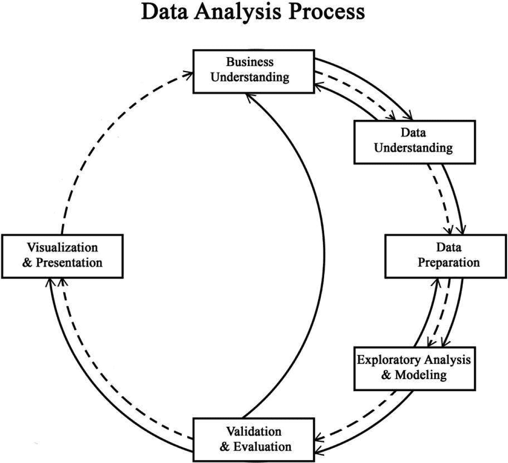

# CRISP-DM：数据分析流程

尽管数据分析项目都略有不同，但管理此类项目有一个通用的流程。我们通常称之为数据分析生命周期。不同的数据分析师可能使用略有不同的流程，但许多团队都使用名为`CRISP-DM`（跨行业数据挖掘标准流程）的流程来进行数据分析和数据科学，两者之间只有细微差别。它包含以下六个步骤：

1. 业务理解
2. 数据理解
3. 数据准备
4. 探索性分析与建模
5. 验证与评估
6. 可视化与呈现

虽然这些步骤看似线性，但流程中存在大量迭代。我们不会完成一个步骤就进入下一个步骤，然后再也不回头。图 5-3 展示了该流程可能具有的迭代性。

  
流程图标题为“数据分析流程”，展示了循环的步骤序列。流程始于“业务理解”，接着是“数据理解”、“数据准备”、“探索性分析与建模”、“验证与评估”，最后是“可视化与呈现”。箭头指示了每个步骤之间的流向，强调了流程的迭代特性。  
图 5-3 — CRISP-DM 数据分析流程

我们将在此处概述每个步骤的基础知识，但有关该流程的更多详细信息，请参阅第 21 章。

## 业务理解

我们总是必须从业务理解开始，这意味着理解你的客户试图了解什么，并定义你的研究问题。换句话说，他们试图解决什么业务问题，你将如何调查这个问题？例如，一支橄榄球队可能想知道应该交易掉他们的哪名防守球员。这意味着你需要查看所有球员的一些表现指标。你必须与业务方合作来识别和定义这些指标，并且还需要确定你是否拥有这些指标的数据。这个步骤通常与下一步骤（数据理解）同时进行，你可能会发现在一开始你会在这两者之间反复摸索。与客户交谈以试图提出研究问题被称为需求收集，这在许多不同的学科中都会进行。但这不仅仅是快速询问他们想要什么那么简单。在此过程中，如果你尚未具备相关的领域知识，则必须开始培养它。

### 数据理解

在充分理解客户需求后，下一步是理解可用的数据。这通常也隐含着首先要找到数据。大多数数据分析工作由能够访问既定数据源的团队完成，因此你很可能已经能获取这些常见的数据源。在确定要使用哪些具体数据源之前，你需要从宏观层面了解：为了回答上一步提出的研究问题，你需要哪些数据。假设在我们的示例中，你和业务方已确定要追踪防守球员的四项数据：擒抱、擒杀、抄截和掉球。

一旦明确了所需数据，你就要寻找包含这类信息的数据源，并开始调查具体的数据源。若运气好，可能有数据工程团队能直接提供你需要的内容，或者存在类似数据字典的文档来辅助理解数据源。但更多时候你并没有这么幸运。此外，哪些字段至关重要并不总是显而易见的，因此这可能是一个迭代的过程。值得注意的是，即使获取了所需数据，你可能会发现这些数据并不足以回答你提出的研究问题。这时你或许会调整问题，但很可能需要与业务方确认，确保新问题仍能满足他们的需求。

在橄榄球的示例中，假设我们找到了包含每位球员的擒抱、抄截和掉球数据的数据源，但唯独没有专门记录擒杀的数据（擒杀特指针对四分卫的一种擒抱）。然而，你发现另一个数据表记录了带时间戳的擒抱信息，以及被擒抱球员的位置，却没有记录执行擒抱的球员。你重新查看原始的擒抱数据，发现其中包含部分时间记录。你推断或许可能将这两个数据源对应起来，但不确定能否实现以及需要多少时间。这时就需要与业务相关方讨论：擒杀数据的重要性如何？是否值得投入时间进行提取？在进入下两个阶段前你未必能给出答案，但先与相关方沟通是合适的做法。他们或许会告诉你，对于当前问题，擒杀数据并不那么重要。

请注意，正如示例所示，在此阶段你会对数据进行一些处理，但真正的深入分析要等到数据准备阶段才会开始。

### 数据准备

当你对业务需求有了充分理解，并确信手头有正确数据后，下一步就是数据准备。这一步在整个流程中可能占据极大比例。后续会有专门章节讨论这一主题，但数据准备涉及诸多方面：清理包含尾部空格的混乱文本字段、确保数值字段的数据均在预期范围内、识别并处理缺失值或空值等等，不一而足。我们将在第 13 章和第 14 章中深入探讨。

如果你的公司有数据工程师，他们已提前为你准备了干净整洁的数据，那你可真是幸运。这种情况下，你或许能跳过部分准备工作，但很可能仍需在此处完成一些工作。

如果项目涉及建模，你还需要进行特征工程——基于现有数据源创建新特征，以改进建模或分析效果。知道要创建什么特征通常依赖于下一步的发现，因此这两个步骤之间也存在反复交互。在数据科学中，特征工程几乎总是必要的——即使数据工程团队提供了干净数据也是如此，但在数据分析中则不一定常用。确定需要哪些特征本身就是一个流程，它既取决于数据的具体形态，也取决于后续将使用的技术。

值得一提的是，这一步与下一步（探索性分析与建模）之间可能存在大量反复，因为你在下一步中可能会发现需要补充数据准备或调整已完成的工作。

在我们的橄榄球示例中，部分数据准备工作可能是：创建一个包含球员姓名及所有基本统计数据的新数据表，并根据业务相关方确认的合理业务逻辑，将空值替换为 0。同时需确保所有数值字段以数值数据类型保存。你可能仍在思考能否从两个数据源中推导出擒杀数据——但此时知识储备尚不足以完成这件事，需要依靠下一步的发现来判断是否可行且必要。

### 探索性分析与建模

在准备好数据之后，就该开始做你一直想做的事情了：深入研究数据。探索性分析与建模通常是另一个重要步骤。其重要性程度取决于你钻研的深度。但如前所述，在发现之前粗略调查时遗漏的数据问题或小陷阱后，你很可能会多次回到数据准备步骤。在其他情况下，你甚至可能不得不一路回溯到数据理解阶段。你可能会发现需要寻找全新的数据。这完全正常，并不意味着你做错了什么。

*探索性数据分析*（EDA）始终是“查看数据”的首要步骤。这不是在 Excel 中随意打开数据文件并随便看看的过程。探索性数据分析提供了一个以开放心态调查数据的框架。它不是一套必须严格遵循的僵化步骤，但它有助于指导你完成初步分析。统计学家约翰·图基在 20 世纪 70 年代提出了这一过程，自此数据分析师们一直遵循他的指导原则。EDA 也可以被视为一种心态或态度。我们应以充满好奇、摒弃假设和预期的心态来审视数据，因为我们永远不知道会发现什么。

所以，我们知道了 EDA 很重要且相对简单，但它具体涉及哪些内容呢？基本上，EDA 就是第 2 章介绍的描述性统计。我们生成汇总统计数据和基本图表。汇总统计数据告诉我们关于“位置”和“分布”的信息，涉及均值、中位数、众数以及标准差/方差等指标。典型的图表包括散点图、条形图、直方图、箱线图和饼图。

我们进行的初步 EDA 通常侧重于单个字段。汇总统计是针对单个字段进行的，但使用多个字段来制作图表的情况也并不少见，尤其是线图和散点图。在进行 EDA 时，各种相当简单的图表都很有用。这通常仅仅是以可视化方式查看位置和分布度量的方法，便于解释。很多时候，在纯数字数据中难以发现的东西，在可视化后可能会变得一目了然。我们可以制作一个字段值按另一个字段值细分的折线图（用不同的线条表示细分字段），或者通过直方图查看字段值的分布情况。异常值可能会一下子跳到你的眼前。

值得注意的一点是，当你在 EDA 过程中创建图表时，可能不会非常讲究地添加坐标轴标签和图标题。如果这些图表仅供你自己查看，那没问题；但任何时候你要与他人分享图表，即使只是另一位同事，也最好至少标出坐标轴，并且添加图标题总是一个好主意。如果包含超过一种数据类型，则应添加图例。你在创建图表时可能觉得坐标轴和图表组件代表什么显而易见，但其他人——甚至几个月后的你——未必能一眼看出。

EDA 至关重要，并且取决于我们正在从事的项目类型，可能需要进行更深入的分析（例如数据分析项目），或者我们可能直接着手进行建模（例如数据科学项目）。或者，更有可能的是，在开始更多的 EDA 之前，我们可能需要先回到数据准备步骤。了解你的数据通常是一个迭代过程。

对于橄榄球数据，你会查看我们拥有的指标（擒抱、拦截和掉球）的分布情况，寻找在数据准备期间未发现的异常值或其他异常情况。但我们仍然存在从两个来源推导出擒杀次数的问题。你需要仔细研究这个问题，看看是否能找出如何对齐两个文件中不同时间戳的方法。你可能需要做相当多的工作才能弄清楚这个问题，这就是为什么你需要向利益相关者确认这样做是否值得。但如果弄清楚如何操作，你就会回到数据准备步骤，并将这个衍生特征添加到你的表格中。

完成 EDA 后，你可能会有更大的问题需要回答，而此时你应当已经对数据中可用哪些变量有了清晰的认识。你大概会了解哪些特征可靠且准确，以及它们的局限性。因此，你会清楚你的数据在回答问题时能发挥多大作用，尤其是当问题变得更复杂时。回顾你的问题并尝试提出更多问题，是 EDA 完成后一个好的第一步。

完成 EDA 后你将要遵循的探索性分析步骤，完全取决于项目的目标。你可能有一些尚未得到解答的研究问题，或者你可能有来自客户的新需求，这两者都会指导你的方向。接下来的步骤通常涉及更复杂的数据切分和聚合方式，以便更侧重于研究不同字段如何相互影响，并深入挖掘以理解与特定研究问题相关的数据。此阶段的部分工作可能是在为可视化和展示步骤做准备，但通常还不会创建最终交付物。

虽然以上讨论的所有步骤在大多数数据分析项目中都很常见，但一些数据分析师会使用一些重要的高级技术。其中一些技术与人们通常认为的数据科学的主要技术有显著重叠，这也是为什么它们在此被视为高级技术。我们不会在此介绍它们，因为它们将在后续章节中逐一讲解。

数据分析师最常用的高级技术包括相关性检验、基本假设检验、显著性检验，以及其他诸如 t 检验和卡方检验等，所有这些都是统计学的一部分。要理解这些，需要具备概率以及分布的基本知识，从大多数人听说过的正态分布（也称为钟形曲线）开始。你在第 3 章和第 4 章中已看到所有这些内容。

另一种常用技术是线性回归，同样基于统计学。从视觉上看，这很像在散点图的点之间绘制最佳拟合线，但实际创建起来要复杂得多。它通常涉及两个以上的变量，这使得它难以可视化，但理解起来仍然比许多其他技术容易。尽管它相对简单，但被认为非常有价值，因为它易于解释，并且对大多数人来说相当直观。

如果你的利益相关者提供了更多信息，你或许可以进行线性回归（或其变体逻辑回归）。假设他们对一些球员进行了 1 到 10 分的评分。你可以创建一个基于你所处理的指标进行训练的线性回归模型，来计算其余球员的评分。他们或许可以用它来选择一个阈值，任何评分低于该阈值的球员将被交易。

任何数据分析项目（以及大多数数据科学项目）都会包含探索性分析步骤和某些更深入的分析，但只有少数项目包含建模。建模在数据科学项目中最为常见，但一些更高级的数据分析项目也可能涉及建模，特别是像线性回归这样的方法。有时甚至可能涉及使用机器学习的建模。数据分析与数据科学之间的这种重叠正是该领域的本质——不同工作、不同项目之间的期望和工作内容差异巨大。

### 验证与评估

完成分析后，你需要验证自己的工作，如果创建了模型，还需对其进行评估。这一步就是“检查你的工作”，这是绝不能敷衍了事的环节。你必须确保没有出现任何计算错误，也没有以任何可能导致对现实世界产生误解的方式使用数据。这并非易事，通常需要花费大量时间。

验证侧重于确保所尝试的工作准确无误地完成，而评估则要求我们思考所做的工作是否恰当，以及是否回答了利益相关者的问题。评估有不同的方法，同行评审员也会在评审过程中评估你的方法。在*同行评审*中，同事们会互查彼此的工作，以便在问题固化之前发现它们。同行评审员会审视你进行分析所采取的步骤以及编写的任何代码，帮助你识别任何可疑的假设、错误的逻辑或编码错误。

尽管有时验证和评估会在工作“完成”之后才进行（在确认正确之前，工作并未真正完成），但沿途检查也是常见做法，许多团队会在工作仍在进行时就互相评审。征求同事的意见往往是确保自己方向正确的明智之举。即使是最优秀的数据分析师和数据科学家，也会在过程中犯错——错误通常很小，但并非总是如此。同行评审是避免陷入死胡同的好方法。数据科学尤其是一个需要高度协作的领域。

你需要验证在数据准备步骤中对足球数据所做的所有转换，以及你在上一步中创建的任何图表或运行的任何测试。

### 可视化与呈现

最后，我们来到了最后一步。这一步在图表左侧独自占据一席之地，因为它与大多数其他步骤截然不同。这是你汇总所有结果并向客户展示的环节。可视化通常是数据分析师工作中很重要的一部分。在探索性分析和建模步骤中准备大量图表是标准做法，但这一步的重点是向利益相关者进行展示。可视化很重要，但通常数量不宜过多，因为你不想用过量信息淹没利益相关者。

可视化是呈现的重要组成部分，但通常不止于此。不同公司、不同展示对象以及项目的正式程度，都会导致操作方式大相径庭。如果这是一个一次性项目，你或许可以直接展示探索阶段创建的一些可视化图表。有些公司希望所有内容都以幻灯片形式呈现，因此你可能会创建一个突出显示发现成果（包括你创建的图表）的演示文稿。其他公司可能更喜欢 Word 文档。很多人对 Excel 情有独钟，喜欢查看原始数据，因此你可能会创建一个包含所有数据和图表的 Excel 表格。（`Excel` 是许多数据专业人士的眼中钉。）更具技术性的公司可能会使用 Python 笔记本或创建 Web 应用程序。本书后面有一章专门讨论可视化和呈现，届时会更深入地探讨这些主题。

如果这项工作是为持续向利益相关者提供信息奠定基础，那么可能涉及创建一个仪表板，该仪表板会按一定周期自动刷新最新数据。有些数据分析师确实会使用 `Tableau` 或 `Power BI` 等工具创建仪表盘并设置自动数据刷新，但在许多公司，会有另一个团队根据你提供的要求来完成这项工作。

对于你的足球比赛结果，一个合乎逻辑的展示方式是为玩家评分及其其他指标创建一个表格，从高到低排列。在探索过程中，很容易发现其他有趣的趋势或视角。