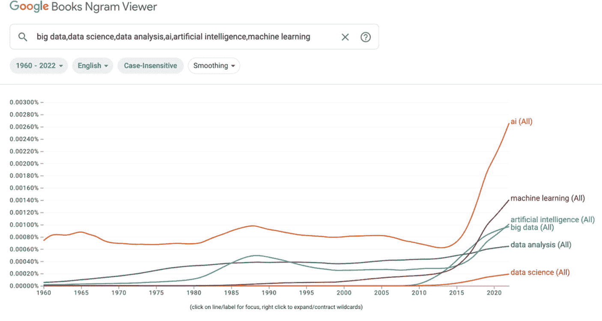
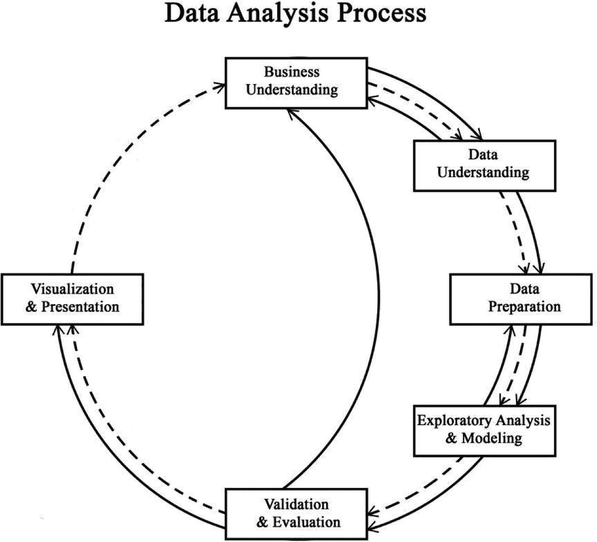
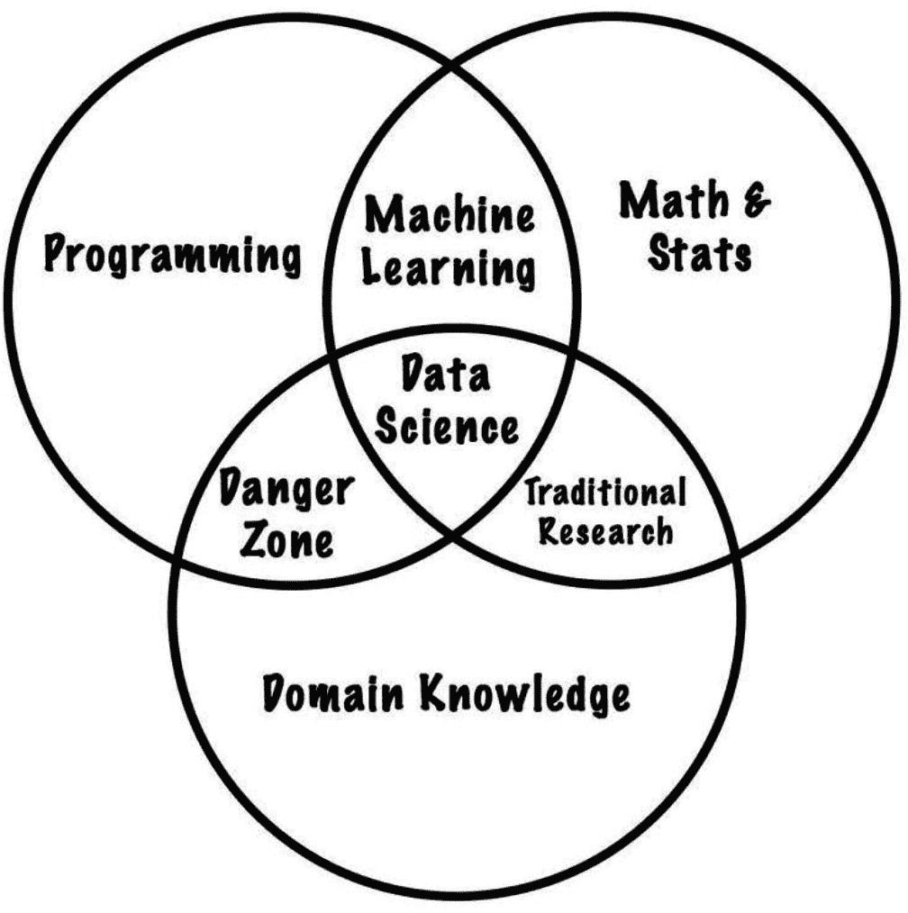
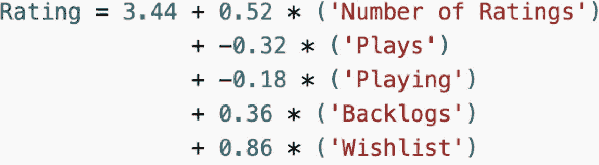

# 数据科学作为一门学科的出现

数据科学源于多种学科的漫长历史，但其真正的基础是数据分析，并融入了属于人工智能（AI）这个总括术语下的点点滴滴。对相关领域的一些定义和历史的了解，将有助于我们理解数据科学究竟是什么，以及它从何而来。

## 人工智能与机器学习

*人工智能*（AI）是一个庞大的总括术语，涵盖了众多学科和概念。从历史上看，AI 一直围绕着拥有人类智能的*人造生物*——以及后来的机器——这一概念。相关的想法已经存在了数千年，近代的例子包括小说《弗兰肯斯坦》和《R.U.R.（罗素姆万能机器人）》。

现代 AI 的基础始于 20 世纪 40 年代，由哲学家、一些高级数学家和像艾伦·图灵这样的早期计算机科学家奠定，但直到计算机变得更便宜，它才真正起步。对 AI 的热情和乐观情绪在 20 世纪 60 年代到 70 年代蓬勃发展，当时包括从业者在内的所有人都相信，到世纪末我们将拥有匹敌或超越人类智能的机器。早期工作主要集中在创建代表人类大脑工作方式的正式规则上，因此很多都是基于规则的系统，而非现代机器学习。这些规则通常被称为*启发式规则*，因为它们通常是通过实验和试错来确定的。研究人员也在早期神经网络、语言处理、自动机等领域开展工作。

美国和英国政府曾向 AI 研究投入大量资金，但在 20 世纪 70 年代中期，由于研究未能产生实质成果，怀疑情绪蔓延，资金枯竭。这段时期被称为**第一次 AI 寒冬**，但在 20 世纪 80 年代，随着**专家系统**的出现和神经网络的进一步发展，出现了一次小小的复苏。然而，由于成果仍然不够引人注目，另一个 AI 寒冬在本十年的最后几年开始了。

20 世纪 90 年代，我们认为是现代 AI 的东西真正出现在工业界。人们找到了运用其中一些想法的方法，但他们已经降低了期望值，不再真的试图将机械的弗兰肯斯坦怪物带入现实。1997 年，IBM 的**深蓝**国际象棋系统击败了国际象棋世界冠军，这在该领域的从业者和公众中引发了更多兴奋。

当我们现在回顾过去时，从 20 世纪 90 年代到 21 世纪初，成功案例不断涌现，但这是一段有趣的时期，因为当时很多成果并不被称为“AI”。相反，这些胜利归属于特定的已命名领域，比如**决策支持系统**，而这些领域*现在*被认为是 AI 的一部分，但在当时，他们避免称其为 AI，因为 AI 因其过度炒作而声名狼藉。概率和统计开始发挥更大的作用，现在所谓的**机器学习**开始腾飞。*机器学习*基本上指的是任何不遵循一套人为创建的规则来处理信息的计算机系统。它根据输入进行调整。我们将在后面的章节中详细讨论，但它和其他方法被用于多个领域，包括机器人技术、语音识别、自然语言处理、互联网搜索等等。这些通常被视为其他学科（如计算机科学、电气工程和信息学）下的分支。

**大数据**和**深度学习**的出现导致了 AI 这个术语的复兴，现在我们视许多学科属于这个总括术语之下。大数据使得更先进的技术变得必要，因为需要处理的数据量巨大，而深度学习只是一个用于更先进（和更大）神经网络的术语。当然，如今我们也有了数据科学，它可能已经失去了作为最性感领域的地位，让位给了**大语言模型**和**生成式 AI**——现代 AI 的先锋。值得注意的是，在很多方面，AI 仍然是大梦想家的术语，大多数公众认为它基本上是魔法，几乎可以做任何事情。实际上，它涵盖了一系列用于处理数据的学科和技术，可用于解决各种各样的问题，并且严重依赖于数据的质量和从业者的技能。

## 数据科学：更老练的分析学小弟

从很多方面来看，数据科学是一个拼凑起来的领域，并没有一个真正普适的定义。正如我所说，在我看来，*数据科学*基本上就是那些自称数据科学家的人为了寻求能为决策者提供信息的、有价值的解决方案所做的工作。数据科学家通常处理人们与商业相关联的数据。这包括诸如零售商的销售记录、组织成员或奖励计划的信息、计算机系统的性能数据、医疗领域的患者信息、银行记录等等。数据科学家会研究这些数据，以得出关于未来销售预期的结论、会员行为的信息、计算机系统问题的识别、医疗患者疾病模式的信息、潜在的欺诈性银行交易等等。

许多属于 AI 的学科通常不被视为数据科学的一部分，比如机器人技术、语音识别和生成式 AI，但这并不意味着数据科学家永远不会接触这些领域。另一个数据科学家较少涉及的领域是自然语言处理，但随着企业感兴趣（尤其是来自社交媒体）的文本数据增加，这种情况正在改变。此外，数据科学家——以及所有其他人——在工作中*使用*如 ChatGPT 这样的 AI 工具正变得越来越普遍。但这并不构成*从事*生成式 AI。

数据科学家用来进行数据科学工作，并且通常也被认为属于 AI 标签的最常见的方面包括机器学习和一些统计技术。过去，*数据挖掘*这个词也常被用作一种涉及处理数据库中数据的 AI 类型，但你现在很少听到它了（它通常不如当前的技术先进）。

AI 并非数据科学借鉴的唯一领域——正如我之前所说，我认为数据科学是变得更加复杂老练的数据分析。数据分析和数据科学的目标通常非常相似——通过查看某个业务或领域的数据来更好地了解该业务或领域的各个方面，以帮助决策者做出更好的决策和识别风险。与数据分析一样，它也属于**数据分析学**的总范畴，如第`5`章所述，并将在下一章进一步讨论，但数据科学通常主要属于**预测性**和**规范性**分析类型，而数据分析更侧重于前两种类型：**描述性**和**诊断性**分析。

### 更多术语解析

在商业世界中，人们对“AI”、“机器学习”和“数据科学”这些频繁出现的术语兴奋不已。研究这些术语在实际世界中的真实用法很有意思。谷歌有一个名为 Ngram Viewer 的工具，它可以显示其 Google Books 语料库（收录了截至 2022 年出版的图书）中任意搜索词的出现频率百分比。让我们来看看这些术语的流行程度，尽管缺少最近几年的数据并不理想。我们可以使用谷歌的 Ngram Viewer 来查看从 1960 年开始，截至 2022 年这些术语在已出版书籍中的流行度，如图 6-1 所示。

来自 Google Books Ngram Viewer 的折线图，显示了 1960 年至 2022 年各术语的频率。这些术语包括“big data”、“data science”、“data analysis”、“AI”、“artificial intelligence”和“machine learning”。图表显示，自 2010 年以来，“AI”和“machine learning”的使用显著增加，其中“AI”的增长最为陡峭。像“artificial intelligence”和“big data”等其他术语也呈现上升趋势，而“data analysis”和“data science”的增长则较为平缓。Y 轴表示术语使用百分比，X 轴代表年份。

**图 6-1**

谷歌 Ngram Viewer 显示 1960 年至 2022 年间“ai”、“big data”、“machine learning”、“artificial intelligence”、“data analysis”和“data science”这些词的使用情况。来源：2025 年 1 月 17 日访问，网址为 [`https://books.google.com/ngrams/graph?content=big+data%2Cdata+science%2Cdata+analysis%2Cai%2Cartificial+intelligence%2Cmachine+learning&year_start=1960&year_end=2022&case_insensitive=true&corpus=en&smoothing=3`](https://books.google.com/ngrams/graph?content=big+data%252Cdata+science%252Cdata+analysis%252Cai%252Cartificial+intelligence%252Cmachine+learning&year_start=1960&year_end=2022&case_insensitive=true&corpus=en&smoothing=3)

请注意，术语“AI”的使用频率远超其他任何术语，甚至超过了全称“artificial intelligence”。这是因为它大约有 90% 的成分是流行词汇——人们在并不真正了解其含义的情况下使用它，命令数据处理人员想办法运用它，而不是将其视为解决实际问题的方案。大多数公司需要的是数据科学，而不是其他类型的 AI。术语“big data”开始流行的时间比“machine learning”稍早，但其热度已放缓，而“machine learning”则继续增长。这是因为它们也都是非常流行的词汇，许多稍微更有见识、呼吁 AI 的领导者知道正是机器学习驱动了现代 AI，并且每个人都在为大数据作为多数 AI 的基础而感到兴奋。这张图表清晰地显示了数据科学是多么新的事物，而数据分析自 20 世纪 70 年代以来一直稳定存在。

## 现实世界中的数据科学应用案例

数据科学这个术语可能相对较新，但许多聪明的公司和行业几十年来一直遵循数据驱动的方法。在某些行业，这甚至关系到生存问题，不过，只要运用得当，任何公司都可以通过数据改善自身状况。在这里，我将讨论作为数据驱动型公司的可口可乐以及保险欺诈检测。

### 项目 1：可口可乐是一家数据驱动型公司

可口可乐一直是一家技术创新的公司，拥有独特的产品设计以及积极且富有创意的品牌和广告宣传。但更有趣的是，他们与数据和统计打交道已超过一百年——他们的统计部门成立于 1923 年。早期，他们收集并分析交通模式以挑选最佳广告牌，识别出利润最高的零售商并指示销售代表加倍频率拜访这些商家，并且利用收集到的药店购物习惯数据来训练冷饮机操作员销售更多可乐（并说服顾客购买其他商品——为参与的操作员增加收益）。他们还尝试预测销售和利润，而这一切都是在计算机出现之前完成的。更有趣的是，该公司的统计学家曾警告 1928 年即将发生金融危机，不幸的是，这一预测在次年华尔街崩盘后不久就被证实是正确的。

由于该公司长期拥有经验丰富的统计学家，他们全力投入大数据和现代数据科学也就不足为奇了。如今，数据工作几乎驱动着所有战略决策。作为一家在 200 多个国家运营的庞大公司，他们收集所有可收集的数据，无论何地。

其中一项创新成果提供了大量关于客户口味偏好的有用信息，其规模是任何目标群体研究都无法比拟的。可口可乐的 Freestyle 饮料机于 2009 年推出，允许顾客通过一台时尚的机器和触摸屏，向他们的可乐、雪碧及其他可口可乐产品中添加多种口味，如香草、柠檬、樱桃等。这些机器每天分发出超过 1000 万杯饮料，这使得公司能够创造出新口味，例如樱桃味雪碧。

虽然 Freestyle 饮料机很有趣，但处理这些数据并不需要很高的专业水平。不过，该公司还在做其他更直接地运用 AI 的事情。一个更高级的举措是研究定价和促销弹性，即使用统计或机器学习技术来识别定价（“常规”价格）变动以及添加促销活动（包括促销类型）所产生的影响。公司的全球覆盖意味着他们不仅可以查看定价和促销的历史数据，还可以实际进行实验来观察变动带来的影响。

可口可乐在其广告中使用先进技术，同时充分利用社交媒体和手机等新平台，这也不会让任何人感到惊讶。A/B 测试和数字广告的便捷性意味着他们已经将广告重点从电视转向社交媒体和其他在线平台。这为他们提供了源源不断的数据，他们的数据科学家随后可以以多种方式进行分析。尽管很难找到关于他们具体方法的信息——文章往往聚焦于流行词汇——但很明显，可口可乐确实已经拥抱了数据和数据科学，以推动其持续的商业成功。

### 项目 2：欺诈检测

银行、信用卡公司和保险公司进行欺诈检测早在 20 世纪 90 年代初就已十分重要，尤其是随着越来越多的交易通过虚拟方式进行。但当时的检测方法非常简单，仅仅依赖交易记录，缺乏其他信息。随着时间推移，企业开始获取更多数据，并采用更复杂的检测方法。

大多数公司从不透露其检测秘诀，但一位研究人员在 20 世纪 90 年代中期曾与一家保险公司合作，我们可以借此了解他们当时是如何运用一种前沿技术的。^(¹) 该公司处理的家居保险欺诈通常并非来自职业罪犯，而是普通人为各种原因提交虚假索赔。

该公司希望自动标记出可疑的索赔申请，以便进行进一步调查。他们还需要解释标记的原因。他们使用了一个**模糊逻辑**系统来实现这一目标。该系统会为每项索赔打分，分值介于 0（非欺诈）到 1（可能欺诈）之间。公司设定了一个阈值，得分低于该阈值的索赔会自动理赔，而其他索赔则会提交给理赔审计员。提供给理赔审计员的信息包括该索赔获高分的原因，为他们进行人工调查提供依据。

这个系统并不复杂，只有七个输入变量，包括一年内的历史索赔次数、客户成为会员的时长、客户的收入以及平均每月银行余额。不同的变量流入三个子系统，分别涵盖客户与保险公司的历史记录、银行历史记录以及个人情况的变化。这三个子系统的结果再汇入两个独立的组件：一个是评分组件，应用模糊逻辑生成一个分数；另一个是原因组件，为理赔审计员提供调查起点。该方法的一个关键优势在于，单一因素无法触发标记——只有多个因素的组合才能产生高分。例如，某人一年内索赔次数很多，但如果其他因素并不可疑，可能不会被标记——也许他们只是倒霉的一年。

该系统的一个重要方面是公司如何设定触发审计的阈值。具体做法是，让理赔审计员手动评估并打分超过一千份索赔申请，同时让系统对这些申请打分。然后，他们可以适当调整阈值，使系统标记的索赔与人工标记的索赔尽可能一致。有趣的是，该系统实际上识别出了几个人类审计员未能发现的真实欺诈案例。随后，他们测试了不同的阈值。显然，这里需要找到一种平衡——如果阈值太低，就会有太多索赔需要人工调查（耗费大量人力工时），但如果阈值太高，就会遗漏真正的欺诈性索赔（导致赔付成本增加）。这种平衡在当今所有此类系统中仍然至关重要，尽管如今的欺诈检测系统要复杂得多。

## 那么，什么是数据科学？

数据科学是新的炼金术。只要在水晶球上挥挥手，商业洞察和价值就会源源不断地涌现，变成沉甸甸的金条。唯一的区别是，炼金术无法产生任何真实的东西，而数据科学可以。只不过，它需要的远不止是快速挥挥手。

企业会抛出许多其他流行词汇，比如“数字化转型”和“数据驱动”，但除非所有这些花哨说辞背后有真正的承诺去做出实际改变，建立真实、可用的数据基础设施，否则一切都不会改变。公司经常聘请数据科学家，但后者入职后却发现，除了几份散落的电子表格外，根本没有可用的数据。

如果它不是魔法，那它是什么？*数据科学*本质上是利用计算密集型技术从数据中寻找意义。关键在于，它几乎总是涉及那些人工手动操作耗时过长的技术，这要么是因为数据量太大，要么是因为计算的数量和复杂度太高。我还说过，数据科学通常涉及数据分析，但这些都是数据分析师通常不做的部分。

数据科学与数据分析的另一个区别在于术语中的“科学”二字。这可能更多是因为听起来更高大上，而且数据科学通常被认为比数据分析更受追捧。“科学”听起来比“分析”更重要。事实上，数据科学的某些方面可能带有科学色彩，大多数技术领域也是如此。但说实话，其中很大一部分是艺术。

就像数据分析一样，数据科学的大部分工作也是发现、理解和准备数据。这正是领域知识——关于你所处理数据的业务知识——变得至关重要的地方。本书后面有一章专门讨论领域知识。只有在与数据进行了大量工作（数据理解、数据准备和探索性数据分析）之后，才能进行建模并得出有价值的见解。领导者往往缺乏耐心，难以理解这一点，因此数据科学家经常需要反复解释。因此，数据科学的另一个重要部分是与领导层和其他人打交道，解释事情并规划细节。

然而，一旦数据准备就绪，探索性分析和其他数据分析完成，数据科学家终于可以进入为他们赢得声誉的环节：建模。这通常涉及机器学习和其他属于人工智能标签下的技术。后面有几章专门介绍机器学习和自然语言处理，将对这些领域进行全面的概述，但现在只需知道，这个阶段常被戏称为“花哨的数学”。完成这项工作的方法有很多，可能包括编写代码，使用允许拖放式工作流程构建的图形用户界面，或是介于两者之间的方式。后面有一章将介绍最常用的工具。一旦数据科学家完成了这些步骤，并相信他们发现了值得分享的有趣事物，或者创建了一个能够生成预测的模型，就该考虑如何向利益相关者呈现结果了。另一章将讨论可视化和演示。

如果这个过程听起来很熟悉，那是因为它基本上与我们在上一章中看到的数据分析过程相同。建模是在 CRISP-DM 流程的探索性分析和建模步骤中完成的，我们在第 5 章中看到过，但这里在图 6-2 中再次展示。

### 流程图标题为“数据分析过程”，展示了一个包含六个阶段的循环流程：业务理解、数据理解、数据准备、探索性分析与建模、验证与评估，以及可视化与呈现。箭头指示了各阶段之间的流转方向，强调了迭代方法。

**图 6-2**

CRISP-DM 生命周期

数据分析与数据科学在流程上的一个区别在于探索性分析与建模步骤，因为数据科学家通常在此花费更多时间，因为他们从事的工作更复杂。此外，验证与评估步骤中所做的工作也可能与数据分析项目不同，会更多地强调和投入时间进行代码审查，但并不限于此。同样，可视化与呈现步骤可能涉及不同类型的输出，具体取决于项目。但牢记这一流程将有助于你理解和规划所从事的任何数据科学项目。

最后，为了更深入地了解数据科学究竟是什么，请参见图 6-3，这是一个基于数据科学家德鲁·康威绘制的维恩图，展示了数据科学三个主要领域如何交汇融合，从而形成真正的数据科学。

一个由三个重叠圆圈组成的维恩图，分别标记为“编程”、“数学与统计”和“领域知识”。其交叠区域标记如下：“机器学习”（编程与数学与统计之间）、“传统研究”（数学与统计与领域知识之间）、“危险区”（编程与领域知识之间），以及三者重叠的中心区域“数据科学”。

**图 6-3**

德鲁·康威的数据科学维恩图

这个图表虽然带点调侃意味，但它确实捕捉到了数据科学的各个组成部分。“编程”涵盖了任何可用于处理数据以及应用基于数学和统计技术的工具。这包括像 Excel 这类非代码工具，因此并不总是涉及字面意义上的编程。“数学与统计”不言自明，但它意味着需要掌握特定类型的数学和统计知识，而非全部。我之前谈到过领域知识的重要性，这基本上意味着对某个业务或其他领域的理解（并不一定需要具备技术知识）。

如果你观察这些圆圈的交叉区域，会发现一些有趣的现象。首先，数学与统计和领域知识的交集（不含编程技能）是心理学家、社会科学家和其他科学家进行的经典学术研究，通常涉及实验设置和传统的统计检验。这是一个合法的职业，但如果这些研究人员能够开发并运用真正的编程技能，其工作就可能向数据科学领域延伸。具备良好数学与统计知识的程序员可以进行机器学习，但除非他们能在深层次上理解自己的数据，否则这算不上数据科学。常见的情况是，一些人在学习了编程和机器学习方法后，便开始尝试寻找有趣的问题，但由于对所代表的数据缺乏深入了解，其工作的价值十分有限。最后，某个领域的专家在学习编程后，可能认为自己知道如何发现规律，但若缺乏数学和统计学的严谨性，其结果将会杂乱无章、毫无头绪，这也是我们将其标注为“危险区”的原因。

尽管仍有不少人认为数据科学神奇又简单，但更了解内情的人知道其秘诀：数据科学很难，主要有两个原因——第一，数据是杂乱的；第二，精确定义需要解决的问题十分困难。数据既是数据科学家的“面包和黄油”，也是他们职业生涯中的“眼中钉”。

## 数据科学价值观

数据科学并非一成不变，每个项目都与其他项目略有不同，但仍然存在许多共性，这些共性要求采用特定的工作方式才能达到最高效率。我们看到优秀的数据科学具备六大核心价值：简洁性、可解释性、可复现性、可信赖性、可理解性和可共享性。

*简洁性*体现在寻找解决方案时——你会从可能奏效的最简单方案入手，只有当更简单的方案行不通时，才选择更复杂的方案。简洁性有时会背负骂名，但实际上它在几乎所有科学和工程领域都备受推崇。如果你记住它是复杂性的对立面，你或许就能看到其优势。复杂机器和系统成本更高且更难维护。任何软件也是如此。同样，任何数据科学解决方案也是如此。目标通常是创建一个尽可能简单而又不牺牲质量的解决方案。

*可解释性*——你向利益相关者解释解决方案的难易程度——在许多情况下至关重要。在某些情况下，能够向利益相关者解释清楚事情至关重要，特别是当他们刚接触数据科学时。这对于建立信任至关重要。如果利益相关者无法理解你所做的事情，他们可能就不会信任你的结果。简洁性在此也发挥作用，因为通常简单的解决方案比复杂的更容易解释。你经常会听到人们讨论“黑盒”与“白盒”解决方案。*黑盒*解决方案是指其选择在根本上无法解释的方案。其复杂性过高或计算过程被掩盖了。神经网络是黑盒的一个经典例子。我们将在第 15 章更详细地讨论神经网络，但缺乏可解释性正是它在商业世界中没有得到更广泛应用的原因之一。相反，*白盒*解决方案则很容易解释。线性回归和决策树是白盒解决方案的两个经典例子。我们将在这里看看它们为何具有可解释性，但我们将在第 15 章进行更深入的讨论。可解释性并非总是最重要的，因此如果黑盒方法能获得更高的准确性（通常如此），那么不可解释的黑盒方法可能是正确的选择。

普通最小二乘法*线性回归*（我们讨论时通常省略前半部分）是统计学家使用了数十年的经典方法，其基本原理是通过最小化每个数据点与直线之间的误差（差异）之和，在数据中画出一条直线。在线性回归中，模型实际上就是一个公式，你将每个变量乘以一个由线性回归技术优化后的系数，然后将所有项相加。你可以与利益相关者分享这个公式，从而清晰地看出哪些变量影响最大。图 6-4 展示了一个公式示例，该公式代表一个线性回归模型，该模型根据表格中的其他数值特征来预测视频游戏数据中的评分。

表示评分计算的数学公式。公式如下：

\[
\text{评分} = 3.44 + 0.52 \times (\text{'评分数量'}) - 0.32 \times (\text{'游玩数'}) - 0.18 \times (\text{'正在游玩'}) + 0.36 \times (\text{'待玩清单'}) + 0.86 \times (\text{'心愿单'})
\]

该公式包含了系数和变量，例如 `'评分数量'`，`'游玩数'`，`'正在游玩'`，`'待玩清单'`，以及 `'心愿单'`。

**图 6-4**

一个基于多个特征预测评分的线性回归公式

