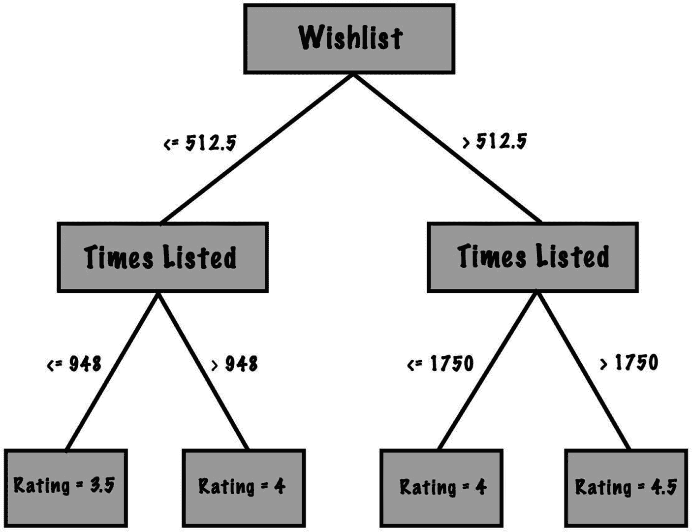

# 文档排版

这个公式很有意思——`愿望清单`最为重要，其权重甚至超过`评分数量`。`游玩数`和`正在游玩数`都会降低评分，这看似有悖直觉，但`欲望清单`比两者都重要，可能会抵消它们的影响。模型有时会出现令人意外的数值。当然，也有可能这个模型本身就不够精确。

另一个易于解释的模型是决策树，其中每个决策点都可以直观地表示出来，从而可以追踪一条路径。在最高层级，决策树方法通过识别最有效的分割点（即其中一侧比其它分割方式更能匹配某个标签或结果），将数据分成两部分，然后对每个结果重复此过程，直到达到全部或大部分是同一个标签的结果（或者达到最大深度）。举例来说：如果`游玩数`大于 100，则走右分支；否则走左分支。如果大于 100 的数据大部分评分在 4 分及以上，而小于 100 的数据大部分评分低于 4 分，这将是一个良好的分割。图 6-5 展示了在相同电子游戏数据上的一个非常简单的树，同样用于预测评分。

流程图展示了一个基于`愿望清单`和`被列入清单次数`的评分决策树。顶层节点是`愿望清单`，分支出两条路径：一条用于小于等于 512.5 的值，通向`被列入清单次数`，并进一步分支为小于等于 948（评分结果为 3.5）和大于 948（评分结果为 4）；另一条路径用于大于 512.5 的值，也通向`被列入清单次数`，并分支为小于等于 1750（评分结果为 4）和大于 1750（评分结果为 4.5）。

**图 6-5**  
一个根据多个特征预测评分的简单决策树

这是一个极其简单的模型，仅使用`愿望清单`和`被列入清单次数`来决定评分，只预测 3.5、4.0 或 4.5 三种评分。但根据给定数据点的特征值，从顶层节点向下追踪路径非常容易。该模型仅关注两个特征：`Wishlist`（将其加入愿望清单的用户数）和`Times Listed`（用户列出该书的次数），两者都是简单的计数。决策树包含节点（特征上的决策点）、叶节点（底部的最终决策）和分支（连接节点，或连接节点与叶节点，代表特定决策范围的线条）。如果你想根据当前的数值预测一款游戏的评分，假设`愿望清单`为 750，`被列入清单次数`为 975，你会从顶部开始，检查`愿望清单`的临界值。我们的值 750 大于 512.5，因此走右分支。然后查看`被列入清单次数`，发现 975 小于 1750，因此走左分支，这会到达一个预测评分为 4 的叶节点。

尽管线性回归模型和决策树模型都有点技术性，一些利益相关者可能难以理解，但它们是完全透明的，大多数人都能学会如何解读。此外，你可以用更少技术性的方式展示这棵树，甚至用手在白板上画一个，以降低其令人望而生畏的程度。透明度是可解释性的基石。

数据科学的另一个科学方面是对可重复性的需求，这意味着你或其他人应该能够轻松地再次运行你的流程并获得相同的基本结果。因此，以某种方式记录你的流程，并确保任何尝试重复你流程的人都能持续获得相关数据，这一点很重要。这里值得提及的一个概念是确定性——一个确定性流程意味着每次运行都会得到完全相同的结果，而一个非确定性流程可能产生不同的结果（有时差别很小，有时差别很大）。有些技术是确定性的，有些则不是——我将在第 15 章中详细讨论。通常，影响可重复性的一个重要因素是计算机语言中可用的随机值生成器，它们并非真正的随机。我们称之为伪随机。确保结果可重复的一种方法是在运行任何非确定性算法之前，在代码中手动设置随机种子，因为这能保证起始点相同。

与可重复性相关的一个概念更侧重于直接的代码复用，可能包括编写其他人可以在其代码中调用的函数，或者直接复制粘贴。这样做的好处是，团队中的每个人都以相同的方式做事，并且当你一年后回看之前的工作时，可能只需稍作调整就能重新运行代码。

可信度是封装了伦理、合法性、隐私和安全性（这些方面常常相互影响）的数据科学价值。从根本上说，这是关于确保你所做的工作保持在道德和法律界限内，并且不损害个人或公司的隐私与安全。所有这些都将在本书后面进行更深入的探讨，但需要记住的重要一点是，数据科学家需要有责任心，了解与他们所使用的数据和流程相关的法律以及公司关于隐私和安全的规则，并拥有自己的道德指南针，时刻将伦理记在心中。

可理解性和可共享性是另外两个相关的数据科学价值，分别指你的结果易于理解和易于分享的程度。这两者既适用于你的利益相关者，也适用于你的同行。与利益相关者的可共享性，基本上指的是我们首次在第 5 章中看到的 CRISP-DM 生命周期中的最后一步（参见下方图 6-3 的另一个示意图）。那最后一步，即可视化与展示，完全关乎如何将你的成果分享给利益相关者。分享方式取决于你的公司和利益相关者，可能是幻灯片演示或内网上的一个网页。但是，仅仅让你的结果易于获取还不够——它们还需要易于理解（尤其是我们上面讨论过的可解释性）。我们已经讨论过理解利益相关者出发点和背景的重要性，这样你才能为他们提供不令人生畏且能够理解的信息。

可共享性也可以追溯到复用和可重复性，因为数据科学家之间经常分享结果、流程和代码，可理解性在此也起着作用。大多数数据科学家喜欢了解同行在做什么，但他们也会关注与利益相关者不同的事情。因此，你可能需要分享不同的信息，包括代码。你的同事可能想要复用你写过的某些内容，或者遵循你创建的流程。这样一来，可理解性也意味着让你的代码和流程对同事更加友好——包括清晰的步骤说明、注释完善的代码以及其他能让他人轻松理解（并重复或复用）你工作的内容。

## 组织如何运用数据科学

正如我上面提到的，许多组织谈论数据科学是为了吸引眼球，但实际上由于缺乏数据基础设施和工具，它们并不具备实施数据科学的能力。但有些组织确实成功地运用了数据科学，有时效果显著，有时则不然。组织运用数据科学主要有三种基本方式：理解、规划和自动化。

### 理解

数据科学最常见的用途之一是更深入地了解组织所服务的人群或对象，以及组织的运营状况。这通常涉及对历史数据的分析。数据科学往往在已有数据分析工作的基础上更进一步，但通常并不会完全取代现有的数据分析流程。

例如，一家披萨餐厅可能想更深入地了解顾客，于是他们可以开展一项顾客画像调查。他们可以利用一种名为聚类（clustering）的机器学习技术，根据顾客的属性（如果足够幸运能拥有顾客数据的话）将不同顾客分群。他们可能会发现存在四种主要顾客类型：工作日的午餐匆忙客、工作日的晚餐食客、深夜的醉酒访客，以及周末的悠闲逛客。这种分类对于针对不同类型的顾客推出不同的特价活动和营销方案非常有帮助。

同一家餐厅可能还想评估一次针对这些顾客类型开展的营销活动。他们可以分析活动前后数周的销售数据，看看是否存在差异。这有助于评估该活动的效果，以及它对四类顾客行为产生的影响。他们可能会发现，深夜的啤酒特价吸引了更多深夜访客，并因啤酒的利润远高于披萨而显著提升了整体利润。

### 规划

数据科学也大量应用于规划目的。这既可以通过分析不同努力的成果来决定继续推进哪些项目，也涉及实际的预测工作——因此它既可以聚焦于历史数据，也可以着眼于预测未来，或两者兼顾。任何预测都依赖于历史数据才能生成。

如果这家披萨餐厅对上次营销活动的成功非常满意，他们可以深入研究，找出活动中最成功的具体环节。这些信息对于规划未来继续推出哪些类型的特价活动、以及如何调整不太成功的方案都极具价值。

他们甚至可以更进一步，创建一个基于四类顾客类型预测未来销售额的模型。这将有助于他们精确掌握需要订购多少食材和烹饪用品。

### 自动化

组织运用数据科学的最后一种方式是实现自动化，这可以通过多种途径达成。通常（但并非总是）这意味着包含预测未来的元素，尽管与任何预测一样，历史数据仍然至关重要。自动化还可能包括：在客户关系管理（CRM）系统中自动将新客户分配给销售代表，在大学咨询系统中自动估算完成学位的可能性，或在约会应用中自动进行用户匹配。许多公司已经在做这些事情，但他们可以通过引入机器学习技术做得更好（或更快）。

对于这家披萨餐厅而言，自动化可能包括：自动为新顾客打上标签，为披萨配送司机规划最优路线，或者每周日晚上自动更新一张包含未来两周预测数据的表格，以便与订购系统对接，自动订购食材和供应品。

## 数据科学家的品质与角色

数据科学家并非只有一种类型。不同的角色有不同的侧重点。有些数据科学家可能接近于数据分析师，因为他们的大部分工作并不涉及其他人可能从事的更严谨的机器学习工作。有些人可能大部分时间埋头于`Python`机器学习代码中，难得抬头。还有一些人则可能发现自己更多地是与利益相关者打交道、进行高层规划，而非使用数据工具。后续章节将更详细地讨论不同类型的数据科学角色，以及如何找到最适合自己的那一类，其中也会包含一些职业建议。

前一章中概述的职能、技术和软技能同样适用于数据科学家，尽管不同类型的角色会对某些技能有所侧重。但对数据科学家来说，最重要的技能包括好奇心、耐心、有条理以及成长型思维。好奇心驱使你发现值得提出的有趣问题，从而带来最有价值的发现。耐心必不可少，原因很多，但最主要的是即使你想立即开始建模，也必须等到数据准备就绪。有条理且注重细节能帮助你避免错误，并建立逻辑清晰、易于重复的流程。最后，在这个以及许多其他技术领域，成长型思维是必需的——总有新的工具和技术不断涌现，你永远不知道哪一项可能正是你的项目所需要的。