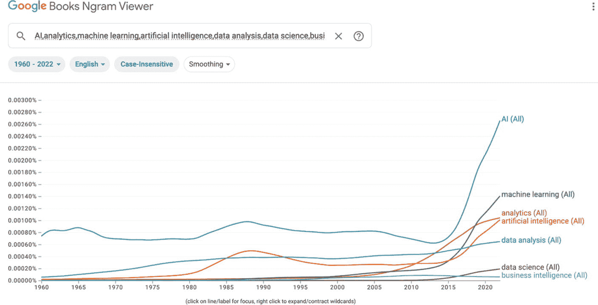
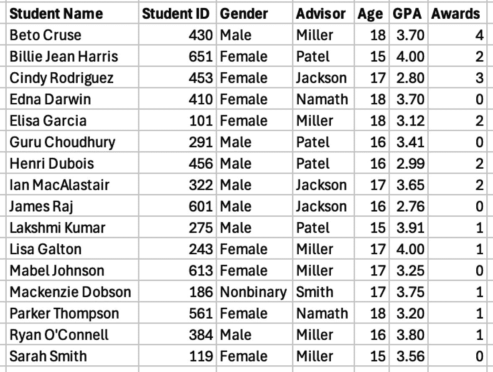
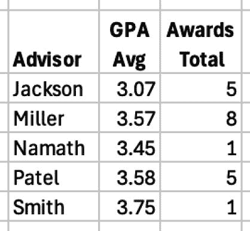
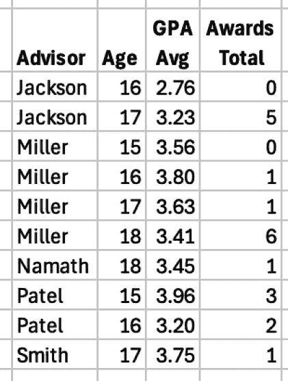

# 7. 全新视角：新一代数据分析

## 引言

我们之前已经了解到，数据科学与许多其他术语相关——数据分析、人工智能、机器学习等等。这里再介绍一个：分析。

`数据分析`作为一个概念已经存在了一段时间，但这个术语开始被更多地用作一个统称，用来描述精明的公司正在采用的一种全面的数据驱动方法。一个成功的分析计划涉及许多学科，但最重要的是商业智能、数据分析、数据科学、数据库管理、数据工具管理以及数据工程（其中日益出现一个称为分析工程的专门分支）。所有这些都为一个有助于公司实现其目标的分析计划做出贡献。分析计划中经常包含的其他领域包括机器学习工程和生产化支持。

我之前在前几章已经讨论过数据分析和数据科学，我将在后面的章节中更多地讨论商业智能和机器学习。现在，我将快速解释我们尚未讨论过的术语。`商业智能`基本上是商业报告——图表和仪表板——帮助人们做出明智的决策。`数据库管理`特指对数据库和其他一些数据存储的管理。`数据工具管理`是管理数据科学家和其他数据工作者使用的各种工具。`数据工程`涉及为`数据工作者`（使用数据的人，包括 `BI`、数据分析师和数据科学家）捕获和准备数据，而`分析工程`是数据工程的一个子集，其中的工程师拥有更多的分析专业知识，可以更好地准备数据，以便数据工作者更容易使用。`机器学习工程`涉及实施数据科学家创建的机器学习模型，以使它们更高效并准备好投入生产。`生产`指的是在“现实世界”中运行的软件——该软件依赖于真实数据，由实际客户使用，自动运行以为仪表板等创建新数据。将诸如预测模型之类的东西投入生产通常是开发它的全部意义所在，但数据科学家也会编写大量代码，这些代码仅用于生成要直接与利益相关者分享的结果。数据科学家有时确实需要自己进行生产部署，因此其他`生产或部署支持或工具`会协助完成这些任务。一些数据科学家可能会发现自己要执行许多——甚至全部——这些任务，但在更大、更成熟的组织中，这些任务是被分开的。

为了说明所有这些角色在一个拥有不同人员担任这些角色的成熟组织中可能如何互动，考虑一家公司，它托管客户图像文件并自动为其添加标签和分类，允许用户相互关注和分享图像，并为新用户提供关注建议。会有数据库存储图像文件、标签、标签、相关元数据和其他数据，这些由数据库管理员管理。数据工程师将负责收集额外的数据，可能涉及客户使用和行为、额外的图像元数据以及系统行为。他们和分析工程师还将负责为 `BI` 工程师和数据科学家等数据工作者准备这些数据以供使用。`BI` 工程师将创建仪表板，供领导层和其他人员用于了解他们感兴趣的网站方面的持续趋势和行为，例如用户数量、存储的图像数量以及分享数量。数据科学家将查看数据并进行调查，以回答业务利益相关者的问题，但他们还要负责确定推荐引擎是否需要修改。他们还可能准备一些用于内部报告的数据。机器学习工程师将负责实施数据科学家中将投入生产的任何流程，例如对推荐引擎的更改或自动化数据科学家用于报告的数据，他们将与数据工程师或分析工程师合作，使这些数据可供 `BI` 工程师使用。

这种成熟度概念——即不同组织处于不同的分析成熟度水平——也将在本章中讨论，同时还有四类分析，它们通常需要不同的成熟度水平才能实现。

### 分析术语杂烩

我们在上一章中已经通过谷歌 Ngram Viewer 查看了数据科学相关许多术语的使用情况，但看看“分析”这个词排在什么位置很有趣。在图 7-1 中，你可以看到它排在“AI”和“机器学习”之后，但早于其他所有术语。请记住，这只是在统计截至 2022 年的所有著作中这些单独术语出现的次数。

**图 7-1**

谷歌 Ngram Viewer 显示的“AI”、“分析”、“机器学习”、“人工智能”、“数据分析”、“数据科学”和“商业智能”从 1960 年到 2022 年的使用频率。来源：访问日期 2025 年 1 月 17 日，网址：`https://books.google.com/ngrams/graph?content=AI%2Canalytics%2Cmachine+learning%2Cartificial+intelligence%2Cdata+analysis%2Cdata+science%2Cbusiness+intelligence&year_start=1960&year_end=2022&case_insensitive=true&corpus=en&smoothing=3`

事实上，分析这个术语在 21 世纪 10 年代末被如此广泛使用是一个积极的信号，因为如果组织采取高层次的、全局的分析视角，而不是关注模糊的 `AI` 或其他特定的学科，它们会做得最好。不幸的是，“机器学习”正在流行起来。然而，我再次尝试搜索，加入了“数据基础”、“数据工程”和“分析工程”，结果前两个出现的频率低于其他所有术语，而“分析工程”几乎没有任何记录。尽管更新近的数据可能会改善这些数字，但这仍然是个问题，因为它们都对任何分析计划至关重要。没有由数据工程师和分析工程师构建的坚实基础，你根本无法进行任何分析工作。许多关于分析的讨论都停留在表面，并不了解其真正涉及的内容。

数据科学和 `AI` 仍带有新鲜感的光环，人们听说了它们能提供的深刻见解，承诺着通往财务成功宝库的钥匙。但它们并非许多人认为的灵丹妙药。毫无疑问，这些领域强大且真实，但炒作被夸大了，除非一个组织致力于一个真正的分析计划，而非拼凑起来的零散部分。

## 数据分析在现实世界中的应用实例

在前几章中我们已经看到了一些分析案例，但换个角度，从分析项目的宏观层面而非具体项目入手来观察会更有帮助。首先，我们将关注一家批发商如何努力降低成本并改善与客户和供应商的关系，然后再看一支职业篮球队如何利用分析技术来提升球迷参与度。

### 案例一：降低成本、改善客户与供应商关系的数据分析项目

一家总部位于英国的批发供应公司使用了一套内置报表功能的 `CRM`（客户关系管理）软件套件，但发现其功能过于局限。他们希望更深入地了解客户需求、提高客户留存率、优化库存流程，并缩短客户的付款周期。他们与一家咨询公司合作，实施了一套新系统，目标是在上线后八个月内将收入提升 20%。从根本上说，他们希望转向以数据驱动的战略和决策方式。

该公司当时仅运营一个仓库，且只向企业客户发货，但他们拥有 3000 种办公相关产品，客户超过 1000 家。他们面临的挑战包括：保持合理的库存水平（这需要预测客户需求），以及高效管理客户付款以确保按时到账。同时，他们也在寻找合适的交叉销售和向上销售机会，以推广利润更高的产品。公司明白自身的数据能够为这些挑战提供有价值的信息，因此聘请了咨询公司来帮助他们实现这一目标。

显而易见，他们首先需要的是一个商业智能系统，能够为管理者提供良好的报表和仪表盘。咨询公司帮助他们从 `CRM` 系统及其他来源中识别出可用的数据，将这些数据迁移到另一个可由自定义报表访问的系统中，并构建了商业智能基础设施。这使得他们的运营效率得以提升，因为随手可得的额外信息能帮助他们做出更明智的决策。

数据在加载到 `SQL` 数据仓库之前，经历了多个准备步骤，包括基础处理和更高级的数据转换。随后，为了方便使用，创建了包含多种维度的数据立方体和数据集市。数据准备工作确保了各类用户——从自助服务用户到 `BI` 报表构建者——都能使用这些数据。良好的数据安全保障也是数据处理和存储管理的一部分。

数据准备就绪后，创建了多项关键绩效指标（`KPI`）和报表。其中包括：多维度客户细分分析；应收账款分析（包括客户分类及优劣客户识别）；供应商分析（涉及定价、交货时间、信用期限和利润率）；以及有助于降低库存成本的库存补货分析。

该项目被认为取得了巨大成功，因为它使高利润产品的收入增长了 15%，付款周期缩短了 18%，库存费用降低了 17%。同时，公司也得以与部分供应商进行更好的谈判并获取更有利的条款。公司认为，如果没有齐心协力地实施一个专注于数据、高级报表和 `KPI` 的综合分析项目，这些成果是无法实现的。

### 案例二：一支篮球队通过数据与球迷互动

一支职业篮球队受困于遗留的 `IT` 系统，这些系统既无法支持他们想要的分析功能，也妨碍了以有效方式与球迷沟通。一项新的数据分析项目使他们得以增加收入、提高营销转化率、提升球迷参与度并增加球迷现场观赛人数。

该球队原有的 `CRM` 系统过于陈旧，虽然能够与球迷沟通，但缺乏良好的定制选项，导致球迷可能会收到与其兴趣和购买历史无关的信息。与球迷的大部分互动都是通过他们的移动球迷 `APP` 完成的，他们深知这款 `APP` 在功能扩展方面潜力巨大。

该球队有两个关键但并非直接相关的目标。首先，他们希望用现代化的 `CRM` 系统替换原有系统，以提升球迷参与度。其次，他们还想增加更先进的数字化工具，以激励销售代表达到更高绩效水平。与上一家公司类似，他们认为内部缺乏相关专业技能，因此聘请了一家咨询公司来帮助他们实现这些目标。

他们创建了新的 `CRM` 系统并增强了移动球迷 `APP` 的功能，使两者完全集成，为球队提供了大量关于球迷的信息，同时为球迷带来了更好的体验。具体来说，球队能够追踪球迷的观赛行为模式（如到场情况）和购买模式（如食品、饮料和商品）。球队可以分析这些数据并做出相应的调整，例如通过调整票价来填补空座。该 `APP` 还为球迷提供了有价值的信息，包括停车详情以及如何找到距离最近的餐饮和洗手间排队位置。

球队还为销售团队创建了多个仪表盘，例如按周、月和季度目标设置的排行榜，这激发了良性竞争，并显著提升了门票销售。`APP` 的一些增强功能简化了商品和季票的购买流程。这些改变使 `APP` 内的商品和季票销售量均提升了 50%。尽管这是一项浩大的工程，但球队对取得的成果非常满意。

## 分析学总览

要成功创建一个分析项目涉及很多方面，企业需要有组织、有明确意图才能取得成功。本节将讨论从旧式分析方法的转型，以及分析项目内部的不同专业领域。

### 从“传统”分析到“新型”分析

许多公司已经从事分析工作多年甚至数十年，但“新型分析”指的是将其视为一个全面的项目，而非这里做一点 `BI`、那里做一点分析。一个全面的项目通常会将工作集中到一定程度，并为工作制定更多标准和最佳实践，使其更像传统的软件开发，从而增加严谨性。

不同的数据工作者角色通常从事软件开发（尤其是制作报告的 `BI` 开发人员和创建实时运行模型的数据科学家），因此可以应用软件和其他系统开发流程。该流程通常会将工作环境至少分成两种：开发环境和生产环境。`开发环境`用于进行所有开发工作——包括编写新代码和修改现有代码。这些环境彼此严格隔离，但开发环境通常会尽可能模拟生产环境。在开发和生产环境之间，可能还存在另一个环境，通常称为 `test`，这是通向生产环境的一个步骤，可以在此对代码进行更严格的测试。

影响数据分析师和科学家的问题之一是，有时开发环境无法访问真实的生产数据。这在软件领域乃至 `BI` 开发中都是合理的。报告和仪表盘可以在虚假或不完整的数据上进行开发，然后部署时再切换显示生产数据。最终仍需进行测试以确保没有发生异常，但这工作量相对较小。

相比之下，数据分析师和数据科学家从一开始就必须访问真实数据，这在那些不了解数据分析和数据科学是什么或如何进行的公司中，可能成为一个争论焦点。包括探索性数据分析在内的流程早期阶段，需要访问真实数据。诸如创建特征和选择最佳特征等工作也需要真实数据。基于不完整或虚假数据构建模型是毫无意义的。这就好比给你医生完全捏造的症状而隐瞒真实症状，却期望他们能给出准确的诊断。

在那些拥有真正数据分析计划的企业中，这些问题都得到了理解并妥善处理。事实上，一些组织非常有条理，甚至遵循一种相对较新的范式，称为 `DataOps`（有关 `DataOps` 的更多信息，请参见侧栏）。

#### DataOps

在 `DataOps` 中，从数据准备到报告和展示的数据产品整个生命周期，都通过自动化以及借鉴自技术界其他三种范式（`敏捷`、`DevOps` 和精益制造）的原则，使其尽可能严谨。`敏捷`是一种软件开发方法论，我们将在后面章节详细介绍。它本身并不完全适用于数据科学项目管理，但其部分原则是有用的。我们稍后也会更详细地讨论 `DevOps`，它同样用于软件开发中，以实现测试和部署的自动化（从而形成所谓的持续集成和持续部署（`CI/CD`））。其原则构成了 `DataOps` 的一部分。最后，精益制造是制造业中的另一种范式，强调统计过程控制，这在 `DevOps` 中体现为对现有数据进行持续监控，一旦出现任何异常迹象，就会发送通知。

### 数据工具与基础设施

数据工程师需要工具来构建数据基础，而 `BI` 开发人员、数据分析师和数据科学家需要工具来完成工作。可选的工具几乎数不胜数。这些工具可能包括任何云环境及其各种数据相关工具、可能存储在公司基础设施内部的“本地”解决方案、需要安装在个人电脑上的工具，等等。所有这些工具都需要一种机制来访问公司存储在任何位置的数据。理想情况下，应由数据工作者以外的人员来管理这些工具和基础设施，但实际情况并非总是如此。如果 `BI` 开发人员、数据分析师和数据科学家将时间花在管理基础设施上，他们就无法高效地完成富有成效的工作。

### 数据基础

如引言所述，`BI`、数据分析与数据科学都依赖于一个坚实的*数据基础*——经过清洗、准备并可随时使用的数据——作为起点。存储数据的方式有很多，我们将在后面的章节中更详细地讨论各种类型的数据存储。但现在，可能用来描述数据组织和存储方式的一些术语包括：`数据库`（`SQL` 或 `NoSQL`）、`数据仓库`、`数据湖`以及`数据集市`。与这些数据源交互的方式也会有所不同。

数据基础最重要的方面通常不是数据的存储方式，而是数据的质量和实用性。数据应能以人们期望的粒度提供（请参阅侧边栏中关于粒度的解释），这通常意味着要以最低的粒度存储数据，以便人们能够根据需要合并和汇总数据。还需要有有效的数据组合方式——例如，人们想知道客户正在购买什么商品，因此，除非有办法将购买信息表和客户信息表关联起来，否则这两张表格单独存在是没有用的。

虽然理想情况下，数据使用者不应自己开发这个基础，但在成熟度较低的组织中，他们可能不得不这样做。但如果他们没有时间进行全面投入，只能以项目为基础准备数据，那这就不是真正的数据基础。

**聚合与粒度**

在处理数据时，通常需要进行聚合，通常是跨列求和或求平均值，从而获得更少的行，因为聚合后的数据粒度与原始数据不同。例如，考虑下面图 7-2 中的内容，该图展示了一些包含 `GPA` 和奖项的学生数据。

表格展示了学生信息，列包括学生姓名、学生 ID、性别、导师、年龄、`GPA` 和奖项。表格包含 15 名学生的数据，年龄范围从 15 到 18 岁，`GPA` 范围从 2.76 到 4.00，奖项数量从 0 到 4。所列导师包括 `Miller`、`Patel`、`Jackson`、`Namath` 和 `Smith`。

图 7-2 一些示例学生数据

如果我们想汇总这些数据以了解不同导师所带学生的整体情况，我们可以按`导师`粒度对 `GPA` 和`奖项`进行聚合，这样每位导师只会得到一行数据，包含该导师名下所有学生 `GPA` 的平均值和`奖项`的总和。结果将如图 7-3 所示。

表格展示了导师绩效指标。列包括“导师”、“`GPA` 平均值”和“奖项总数”。行列出了导师：`Jackson`（`GPA` 3.07，5 个奖项）、`Miller`（`GPA` 3.57，8 个奖项）、`Namath`（`GPA` 3.45，1 个奖项）、`Patel`（`GPA` 3.58，5 个奖项）和 `Smith`（`GPA` 3.75，1 个奖项）。

图 7-3 仅在导师粒度上聚合后的相同数据

在这个表中，除了仅指导一名学生的 `Smith` 外，原始的 `GPA` 和`奖项`数值完全看不到。`Jackson` 指导了三名学生，因此表中的 `GPA` 是这三名学生 `GPA` 的平均值，而`奖项`是这三名学生获奖的总数。这很有趣，但也许我们还想考虑学生的年龄。我们可以改为按`导师-年龄`粒度进行汇总，如图 7-4 所示。

表格展示了学生数据，列包括导师、年龄、`GPA` 平均值和奖项总数。表格包含导师 `Jackson`、`Miller`、`Namath`、`Patel` 和 `Smith` 的记录，年龄范围从 15 到 18 岁，`GPA` 平均值从 2.76 到 3.96，奖项总数从 0 到 6。

图 7-4 按年龄-导师粒度聚合的示例学生数据，包含平均 `GPA` 和总奖项数

这个表的行数更多，因为大多数导师都有不同年龄段的学生，只有 `Namath` 和 `Smith` 例外。任何时候当你聚合或查看聚合数据时，都必须考虑粒度。

日期是一种在不同粒度下经常调整的常见数据，因为我们通常希望以周或月粒度查看销售额等数值，而不是查看每日数值。

数据基础理想情况下应由数据工程师（或在某些地方，由分析工程师）创建，但现实情况是，有时其他人最终不得不构建它。这些人在某种程度上可能包括数据链末端的任何人，比如数据分析师、数据科学家或商业智能工程师。

### 商业智能

商业智能 (`BI`) 实际上就是报表——创建各种类型的报告，范围从 Excel 表格到摘要文档，再到包含图表、表格和其他数字的仪表板。`BI` 报告通常是持续性的，会定期刷新和查看，而不是一次性报告。领导者和员工利用这些报告来了解业务各个方面的状况，这有助于他们做出决策。许多公司长期以来一直在做这项工作，即使它们在分析方面的其他能力可能还不够成熟。通常，商业智能团队也负责准备他们将在报告中使用的数据，无论是在像`Tableau`或`Power BI`这样的工具内，还是在数据库中（可以独立完成，也可以与数据工程师和/或数据库管理员合作）。

`BI`开发人员——即报告创建者——通常不从事任何可被称为“数据分析”的工作。他们所做的“分析”仅仅是为了理解和准备数据，以便制作报告，与决策者分享。尽管如此，他们为了理解数据而进行的许多分析，与数据科学家和数据分析师为了解数据所做的分析是相似的，但他们在理解了数据内容之后就会停下来。而数据科学家和数据分析师则利用这些信息进行更深入的工作。

`BI`的重点几乎总是放在过去和当前的业务上，而不是未来。如果显示了任何未来的数据，那也只是他人创建的表格中的数字，或者是一个与人共享的简单公式的结果，绝不是 `BI` 团队自身通过任何算法生成的内容。

#### 自助式报表

公司可能难以满足所有的`BI`需求，因此许多公司会创建自助式分析程序，允许非技术背景的业务人员自行创建报告。人们通常喜欢这种方式，因为他们不必等待别人来构建报告，而且他们还可以通过反复试验自己找出需要什么，而不是等待开发人员提供进行中的仪表板进行检查。这种程序的成功完全取决于用户可获得的数据质量。全自动报告——即设计为按需运行，但其字段和值由`BI`或数据分析师预先编程的公式确定——是安全的，但很多自助式服务涉及非技术人员自行设计报告、选择字段和聚合方式。数据必须既干净又易于使用，才能实现这一点。具体来说，当所有数据尚未合并到一张表中时，用户很难知道如何组合数据——正确地连接多个数据源通常需要技术知识。如果数据没有准备好，他们可能会生成包含不准确信息的图表，这会影响决策，并可能造成对分析团队的信任问题。数据分析师进行分析后，发现结果与由非技术人员生成的自助式报告相矛盾的情况并不少见。他们需要额外的工作来证明数据分析了没有错误，错误出在自助式报告中。总之，成功的自助式程序需要精心设计的数据、防护栏和良好的培训（用户需要理解他们能做什么和不能做什么）。