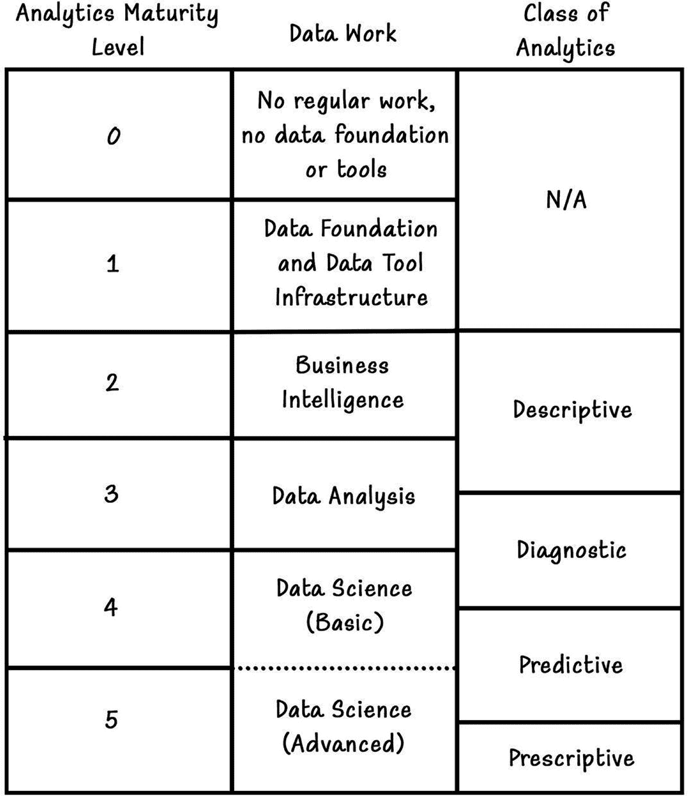

# 分析成熟度模型

成熟度等级范围为 0 到 5，对应他们在分析项目中达到的级别，并且每个后续级别都建立在之前级别的基础上。`表 7-1`总结了这些级别，并附带了关于移动的类比。

`表 7-1` 成熟度模型等级及分析项目的已实施部分

| 成熟度等级 | 已实施的分析阶段 | 移动方式 |
| --- | --- | --- |
| 0 | 无数据基础 | 原地踏步 |
| 1 | 数据基础 + 工具 | |
| 2 | 数据基础与商业智能 + 所有工具 | 爬行 |
| 3 | 数据基础、商业智能和数据分析 + 所有工具 | 行走 |
| 4 | 数据基础、商业智能、数据分析以及基础数据科学 + 所有工具 | 奔跑 |
| 5 | 数据基础、商业智能、数据分析、基础与高级数据科学 + 所有工具 | 飞翔 |

不同公司的成熟度水平差异很大，尽管可以大致概括不同类型公司可能达到的水平（但显然，这些概括存在许多例外）。大多数初创公司和科技公司至少达到第 3 级，许多甚至达到第 4 级，因为它们从早期就开始利用这些信息来驱动决策。它们从一开始就理解数据的空间和价值。成立时间较长的非科技大型公司通常处于第 2 级或第 3 级，因为它们投入了时间和精力试图了解自己的业务，这意味着通过商业智能甚至数据分析来查看数据。因此，它们的数据基础通常已经到位，尽管可能还不完全适合数据科学工作。较小的组织通常成熟度要低得多，因为它们没有投入时间和精力来构建坚实的数据基础，即使它们试图从现有的杂乱数据源（如孤立存在的电子表格）中提取信息。

请注意，这并非完全非黑即白的尺度——例如，如果某些数据基础仍在建设中，那么拥有它总比没有好。但是，一个制作了大量仪表板却没有时间做其他事情的数据分析师，不应该被认为真正达到了数据分析级别，因为他们所做的仅仅是商业智能工作，即使他们拥有不同的职位头衔。

## 四类分析

这四类分析呈层级结构，因为每种类型的挑战性都在递增。第一类是描述性分析，其次是诊断性分析、预测性分析和规范性分析。成熟度为 1 级或 2 级的组织能够完成第一类（描述性分析），但可能无法完成第二类。其他类型的分析仅仅需要更高的成熟度才能实现。第二类（诊断性分析）需要数据分析师，而预测性分析和规范性分析通常需要数据科学家。

### 描述性分析

`描述性分析` 是关注过去发生了什么以及现在（或至少是刚刚过去）正在发生什么的数据工作。这是商业智能和数据分析的主要领域。它可以表现为商业智能报告的形式，也可以是数据分析中的探索性和描述性统计。例如，商业智能创建的一份报告，显示一家视频游戏公司截至昨天每款游戏的每日销量，并附有月度汇总，这就是描述性分析的一个例子。数据分析师的工作可能会更深入一些，但仍然是在描述过去，例如分析该公司最新游戏发布的新在线营销活动 A/B 测试的点击结果。

### 诊断性分析

`诊断性分析` 的工作不仅仅是描述发生的事情，还旨在*解释*这些事情发生的原因。理解发生了什么很重要，因此描述性分析是其中的一部分，但这不是最终目标。这通常是数据分析师，有时也是数据科学家的领域。例如，显示每日游戏销量的仪表板可能允许用户将鼠标悬停在某一天的销量数字上，以查看关于该天的更多信息，包括营销、广告、促销、节假日以及亚马逊 Prime Day 和选举日等重大国家事件的信息。再次点击，这些信息就会叠加在图表上，从而可以看到整个销量图表的趋势。例如，某款游戏每日销量的多线图可以包含销量数据、投放的广告数量、游戏价格（反映常规价格变动或折扣），以及节假日或重大事件所在日期的竖线。

### 预测性分析

`预测性分析` 顾名思义——重点是预测未来趋势。这主要是数据科学家的领域，因为预测通常需要机器学习方法。最常见的预测性分析任务之一是预测未来短期内的销量。这可能会出现在“诊断性分析”部分描述的同一种图表上——用户可以看到历史数据、叠加的解释性项目，以及未来 14 天的预测。这种图表非常强大，因为一个地方就汇集了大量信息。

### 规范性分析

最后一类是`规范性分析`，旨在帮助告诉决策者他们可以——甚至应该——做什么。这是相当高级的，属于数据科学家的领域，尽管很多数据科学家可能从未从事过这类工作，因为与其说是为决策者提供信息，不如说是直接告诉他们该做什么。然而，这并不像听起来那么强硬。我们可以有一个系统来研究价格变动和促销对销量的影响，并建议何时进行促销或调整价格。这些信息通常还会包含解释，例如是哪些特征导致了该建议。决策者不必强制执行，但这是一种基于以往信息的建议，这些信息在复杂的分析中被用于考虑比人脑所能处理的更多的因素。

## 分析成熟度与类别结合

一个组织的分析成熟度取决于许多因素，但这些因素决定了它通过分析改进业务所能取得的成功程度。`图 7-5`显示了每次前进一个级别时，成熟度、所进行的分析工作类型以及四类分析之间的关系。

`图 7-5` 分析成熟度级别及对应的数据工作和分析类别，展示了一个有组织的分析项目的传统发展轨迹

说明分析成熟度级别的表格。该表格有三列：“分析成熟度等级”、“数据工作”和“分析类别”。等级范围从 0 到 5。0 级表示“无常规工作，无数据基础或工具”，分析类别为`N/A`。1 级涉及“数据基础与数据工具基础设施”。2 级是“商业智能”，分析类别为“描述性”。3 级是“数据分析”，分析类别为“诊断性”。4 级是“数据科学（基础）”，分析类别为“预测性”。5 级是“数据科学（高级）”，分析类别为“规范性”。

如你所见，第 1 级仅仅是分析开始前的设置和准备，但直到第 2 级，才真正开始进行分析。在第 2 级，商业智能产出描述性分析。诊断性分析在第 3 级成为可能。第 4 级将预测性分析纳入了组织的技能库中。最后，在第 5 级，规范性分析成为可能。