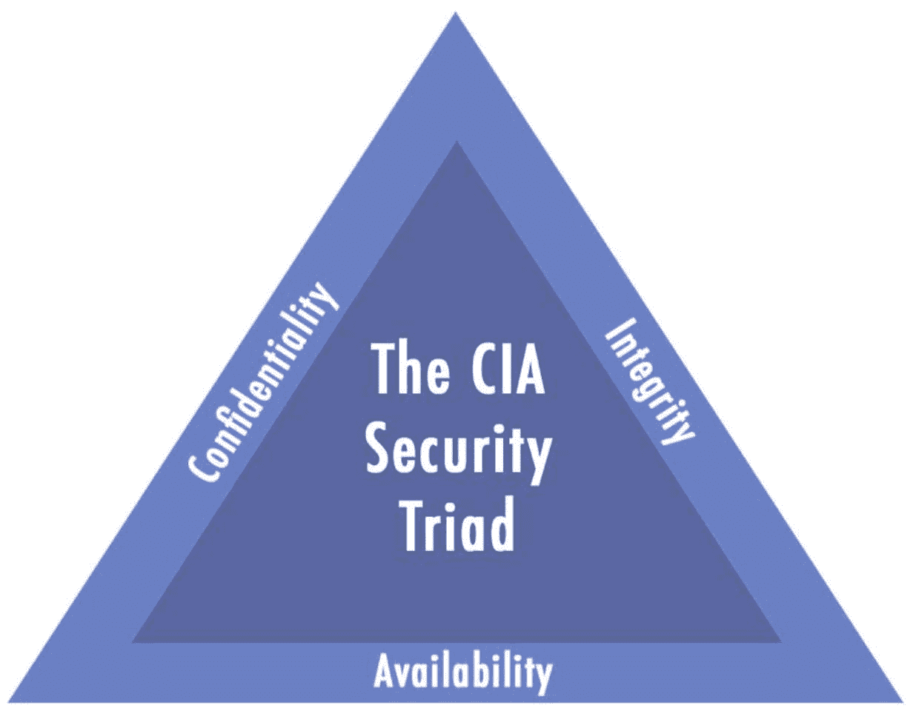

# 示例 2：勒索软件攻击导致运营中断数周

勒索软件对我来说一直有点离奇，直到我有个朋友在疫情期间她的公司遭受了攻击，她描述了在业务中挣扎求存的噩梦，更不用说像往常一样运营了。

我的朋友在一家大型欧洲跨国集团下属公司的会计部门管理一个团队。她在美国太平洋西北地区工作，负责为制造业切割原材料。同一业务在美国和加拿大还有大约十个地点，从西海岸延伸到东海岸。

一月初的那个早晨，大家在寒假后纷纷回到家庭办公室，朋友发现她无法登录工作笔记本电脑的远程桌面。她无法访问电子邮件或团队使用的任何其他软件。很快，她整个团队的短信乱飞——没人能登录，当他们向团队外求助时，得知并非只有他们有问题。显然出了状况，但几个小时后他们才知道发生了什么。

大约中午时分，他们终于收到了IT部门的通知：公司遭受了勒索软件攻击，所有人原地待命。IT部门从当天早上就开始忙乱。虽然一些细节后来才公布，但起因是一名员工点击了一个恶意链接，无意中让黑客进入了公司的许多系统。当IT部门开始收到无法登录的报告时，他们进行了调查，并很快意识到问题严重，于是关闭了所有其他系统。由于无法立即访问员工记录，公司电子邮件也无法使用，就连向员工发出中午那条通知都很困难。但唯一的好消息是，由于集团的结构，一些系统未受攻击影响，包括人力资源和薪资系统，这让许多员工松了一口气。

但在基层，会计部门当天本应是月末流程的开始，所有财务记录都要最终确定以结算12月份。他们显然无法做到这一点，也做不了任何其他事情，因为他们无法访问发票系统。他们也无法向供应商付款，并且由于无法访问系统甚至电子邮件，也无法联系他们。第二天，部门让每个人都创建了包含自己姓名和公司名称的`outlook.com`电子邮件地址，这样他们至少可以互相沟通，但显然无法用`jane_acmepress@outlook.com`这样的邮箱给供应商发邮件。

IT部门正在努力逐一恢复系统访问权限。但优先处理的实际上是那些应该进行金属切割的分支机构，因为他们完全被阻断了。虽然切割系统本身未被入侵，但他们无法访问任何订单，因此没有切割规格说明。他们积压的时间越长，核心业务受到的影响就越大。

第三天，我朋友的团队重新获得了对`SAP`的访问权限，这是主要的企业软件，由于托管在另一个国家而未被攻破。他们仍然无法访问网络驱动器上的任何内容，但逐渐找到了一些可以做的事情。他们使用的几个系统是第三方或基于Web的，因此是安全的。他们能够监控公司的银行账户，从而看到资金流入，但无法将之与内部的任何账户或文档关联起来。几天后，我朋友被要求起草一封措辞非常谨慎的实体信件，发送给他们的供应商（至少是那些他们能凑齐邮寄地址的供应商），解释他们遇到了一些“技术问题”，并将尽快支付发票。

然而，金属切割工作仍处于停滞状态，没有人能做任何事。他们也无法就备份事宜联系客户。直到第二周，这些订单才最终被释放，切割工作才重新启动。同一周，我朋友的团队能够登录他们的远程桌面并访问电子邮件，但除此之外别无他法——而且他们所有的归档电子邮件都无法访问。他们直到四月份才能访问电子邮件档案。到第三周时，会计部门的情况基本恢复正常。他们为十二月的结账创建了一个变通方案，并且幸运地基本能够像往常一样处理一月底的结账，而由于十二月结账异常产生的差异则被上报给总部。

员工们并未被告知最终损失了多少钱，但损失肯定高达数百万美元。公司避免了支付赎金，这一点很重要，因为尽管他们必须承担损失，但黑客并未从中获利。公司开始强制要求进行更多、更好的安全培训，并制定流程，以避免人们落入像“CEO发来的要求立即付款的紧急邮件”这类情感操控骗局。

## 数据安全

数据安全非常重要，几乎所有公司都有一个通常称为“信息安全”的团队来管理它。该团队对公司的数据安全以及所有确保数据安全的政策和技术解决方案负有最终责任。他们职责的另一个重要部分是教导与数据打交道的个人，让他们认识到保护公司数据是每个人的个人责任。

信息安全部门之所以必须教导人们他们在保护公司数据中的作用，原因之一是大多数人对于外界的危险只有模糊的认识。这属于“眼不见，心不烦”的问题。人们经常听说暗网，但不一定知道它是什么。暗网是万维网的一部分，只能通过能保证用户匿名性和隐私的特殊工具访问，并且与非法活动以及获取被盗数据的场所高度关联。

通常将那些试图窃取数据或以不良方式利用数据来伤害公司或个人的人称为不良行为者。这些人包括黑客、诈骗者，甚至垃圾邮件发送者。黑客是指未经授权访问系统的人，无论是黑帽（意图造成伤害）还是白帽（受雇于公司以识别弱点并加以修复的人）。诈骗者是指在现实世界和计算机世界中通过欺诈或其他方式骗取他人钱财或信息的人。垃圾邮件发送者是指向人们发送大量电子邮件或其他未经请求消息的人，通常怀有恶意，但总是试图从人们那里获取某些东西。令许多人感到震惊的是，这些不良行为者并非孤独地待在母亲地下室的年轻男子——他们背后有一个完整的犯罪网络，这些人经常在某些国家普通的办公楼里运营，甚至举办公司圣诞派对。

信息安全部门负责将所有这些通常通过机器人和其他软件运作的人挡在公司的系统之外。他们通过一系列政策和工具，遵循该行业一些最重要的原则来做到这一点。

数据安全通常被认为包含三个要素：机密性、完整性和可用性。这些要素构成了所谓的`CIA`三元组，如图8-1所示。机密性意味着只有正确的人才能访问数据，这包括阻止外部黑客入侵，同时也管理内部访问权限。例如，并非每个人都需要访问人力资源数据或产品成分。完整性意味着数据处于其应有的状态——没有被任何人无意或恶意修改。这涉及到明智地管理访问权限，这也是数据科学家和其他数据用户通常只被授予数据源读取权限的原因之一——数据科学家没有理由更改源表中的数据，而没有写入权限可以防止他们意外修改。最后，可用性意味着在正确的人需要时，数据是可用的。

CIA安全三元组示意图，以三角形表示。三角形的三条边分别标注为“机密性”、“完整性”和“可用性”。三角形中心包含文字“CIA安全三元组”。该图说明了信息安全的核心理念。

**图 8-1**
CIA安全三元组