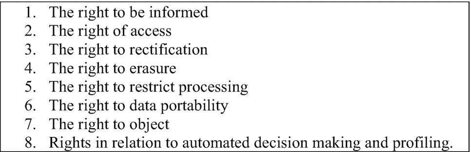
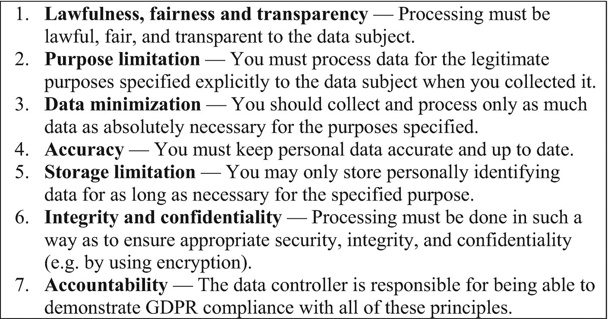

# 数据安全与隐私法律

我们看到的与数据安全和隐私相关的问题都相对较新，因为计算机和互联网使得那些在现实世界中本是小问题的事情——比如有人捡到一张信用卡——放大并大规模发生。在互联网出现之前，持有偷来的信用卡的人必须亲自去不同的商店——或者至少打电话给不同的商店——才能使用这张卡。而现在，他们可以迅速出售卡号，成千上万的人可以同时使用它，直到信用卡公司检测到欺诈行为并冻结卡片。但在早期，欺诈检测并非那么顶尖。多年来，这一技术一直在进步。

就像信用卡公司不断改进欺诈检测一样，法律也需要跟上这个新世界。我们已经朝着正确的方向迈出了一些重要步伐，尤其是在隐私领域。但政府也越来越普遍地要求企业承担责任——主要是通过罚款——当它们的疏忽导致数据泄露并影响公民时。同样，恶意行为者实施的攻击是违法的，如果能被识别出来，他们将面临罚款甚至监禁。

各国和各州近年来制定的法律主要涉及隐私而非通用数据安全，但有些法律试图两者兼顾。欧盟在这方面走在前列，其全面的隐私与安全法律《通用数据保护条例》（`GDPR`）^(⁸)于 2018 年全面生效。它规定了欧盟公民数据的收集和管理方式，这意味着在全球任何地方运营的公司，如果以任何方式处理欧盟公民的数据，都必须遵守该条例。公司可能面临巨额罚款，最高可达 2000 万欧元，对于大型企业，则可达其全球营收的 4%。

用户同意和公民访问自身数据的权利是`GDPR`的核心部分。组织必须在“自由给予、明确、知情且毫不含糊”的情况下获得同意，并且要用“清晰直白的语言”进行解释。图 8-2 展示了`GDPR`中定义的欧盟公民隐私权。

列出了数据保护权利清单，包括：1. 知情权；2. 访问权；3. 更正权；4. 删除权（被遗忘权）；5. 限制处理权；6. 数据可携带权；7. 反对权；8. 与自动化决策和分析相关的权利。

**图 8-2**

`GDPR`中定义的欧盟公民隐私权。来源：[`https://gdpr.eu/what-is-gdpr/`](https://gdpr.eu/what-is-gdpr/)

即使处理了上述所有事项，数据保护仍有诸多要求，如图 8-3 所示。

表格列出了`GDPR`下数据处理的七项原则：1. 合法、公平与透明；2. 目的限制；3. 数据最小化；4. 准确性；5. 存储限制；6. 完整性与保密性；7. 问责制。每项原则均附有要求的简要说明。

**图 8-3**

`GDPR`中定义的组织数据保护要求。来源：[`https://gdpr.eu/what-is-gdpr/`](https://gdpr.eu/what-is-gdpr/)

组织必须能够证明自己遵守了这些数据保护规则，以及在数据安全方面采取了额外的“适当的技术和组织措施”。大型组织需要指定一名数据保护官（`DPO`），但大多数小型企业如果仍努力理解和实施`GDPR`的要求，则可以免于设立。此外，组织必须在三天内向政府当局和数据泄露涉及的人员报告数据泄露事件。

所有公司均需在 2018 年完全遵守`GDPR`，此后美国出台的许多法律也纷纷以此为参考。但美国的情况有所不同，联邦层面没有一部全面的法律，而是由针对特定情境和特定州的法律拼凑而成。

美国第一部现代法律是 2019 年的《加州消费者隐私法案》（`CCPA`），它规定了任何处理加州公民数据的公司需遵守的法规。2023 年，该法案被新法律《加州隐私权法案》（`CPRA`）修正并取代。加州法律最著名的部分涉及用户同意、公民选择退出数据收集以及访问自身数据的权利。与`GDPR`类似，公司必须纠正不准确的信息，并且对数据泄露承担严格责任，同时面临罚款。

美国多个州也纷纷效仿并通过了自己的法律，包括弗吉尼亚州、科罗拉多州以及近 20 个其他州。不幸的是，公民权利在美国是一个政治问题；因此南部大部分地区和其他一些地区没有任何隐私法律。

## 与信息安全部门的冲突

值得一提的是，信息安全（`InfoSec`）部门通常是公司里最不受欢迎的部门之一。尽管每个人都知道他们工作的重要性，但他们通常过于热心地维护安全和隐私，有时甚至阻碍了其他部门的工作。获取数据可能需要完成一系列繁琐的流程，通常涉及大量文档审批和多重授权，尤其是高层领导的批准。有时这个过程可能需要数周时间，这对于正等待开始一个项目的人来说非常令人沮丧，而且一位完全不了解你工作方式的高级副总裁需要签字批准你的访问权限，这毫无道理。他们的规定对于那些只想好好完成本职工作的人来说，常常显得严苛。由于`InfoSec`部门不了解其他部门的工作方式，他们往往会把事情变得困难甚至不可能。有一个场景一直让我抓狂：强制性的电脑更新。他们通常会在夜间安排个人电脑的更新，以为那时没人使用。但数据科学家经常运行需要数小时才能完成的模型或数据转换，因此夜间运行是最理想的——你可以在下班前启动它，第二天早上回来时它就已经准备好了。除非你的公司强制在夜间进行系统更新，导致你丢失了所有进度，不得不等待一整天才能重新开始……话虽如此，他们的出发点是好的，而且最好还是尽量和`InfoSec`部门做朋友，因为如果他们没有把你视为敌人，他们就更有可能听取你的意见。

## 关键要点与下一步

数据安全与隐私至关重要，关注并遵守相关良好实践是每个人的责任。安全领域主要涵盖四个范畴：基础设施、网络、应用和云。企业（以及部分个人）会采取若干标准措施来保护其数据和系统。数据隐私同样重要，并日益被视为一项人权。个人身份信息（`PII`）是指任何可用于识别个人的数据，而敏感数据则指可能被用来伤害个人或其他实体的个人数据或其他数据。人们需要警惕多种安全和隐私威胁，包括社会工程学攻击、网络钓鱼、密码猜测、物理盗窃、病毒、蠕虫、间谍软件、勒索软件、拒绝服务攻击以及各类诈骗。最后，我们还探讨了一些即将出台的与安全和隐私相关的法律法规。

第 9 章将深入探讨职业道德，它与安全和隐私有一定关联，但运作方式有所不同。我将定义职业道德以及它如何与为组织工作、处理他人及组织数据的人员相关联。我将阐述我们信赖计算机系统、认为其比人类偏见更少的种种方式。我将介绍数据科学职业道德守则的理念，然后探讨进行合乎道德的数据科学的框架和指南。最后，我将讨论个人如何成为道德文化的一部分。

**从业者档案：达柳斯·戴维斯**

**姓名：** 达柳斯·J·戴维斯

**职位：** 高级安全工程师，蓝队，兼 Southside CHI Solutions 创始人/首席技术官

**行业：** 计算机安全

**经验年限：** 在技术领域从业 15 年，从系统管理员到安全工程师

**教育背景：**

* 自学成才

*此处表达的观点仅代表达柳斯本人，与其任何现任或前任雇主无关。*

**背景**

达柳斯小时候对一切事物的运作方式充满好奇。坐在车后座看着父母开车时，他开始思考事物是如何运作的——引擎盖下的汽车是如何工作的？*一切*是如何运作的？这份好奇心一直伴随着他。在想要弄清楚电子游戏是如何运作之后，他第一次开始学习编码和技术。十几岁时，他通过一个名为`Scriptlance`的网站学习代码和网页设计，并找到了大量编写`HTML`、构建表单以及从事其他网络工作的自由职业。通过这些工作建立的作品集，使他得以进入企业技术领域。

**工作**

达柳斯的第一份企业技术工作让他感到有些畏惧，因为他觉得自己作为来自芝加哥的年轻黑人男性有些格格不入，尤其是他没有学位就进入了这个行业，但他的社交能力帮助他学习并逐渐适应。他的早期职位是 IT 支持，但他不断提升自己的编程和数据库技能，很快在一家小公司担任了软件开发和数据管理的职务。几位优秀的经理帮助他更加熟练地适应企业环境，他作为软件工程师不断成长，最终领导了一个平台集成团队。从那里，他转向安全领域，并在这一领域工作了相当长一段时间。他的软件和管理背景让他对技术有了广阔的视野，而该职位也让他能够深入了解网络安全和更高层次的安全问题，如数据保护策略和保护敏感信息。

**精粹语录**

**工作中最喜欢的部分：** 达柳斯热爱修复和解决问题，尤其是在运用通过经验获得的知识时。作为领导者，带领团队解决问题同样令人满足，即使他并非具体找出答案的那个人。他也喜欢在一个不断变化和发展的行业中工作（并适应它）。

**工作中最不喜欢的部分：** 有时很难让人们听从你的意见，你必须真正努力才能让他们理解事情背后的原因。此外，同事的表现并不总是一致——上次合作时他们可能做得很好，但下一次可能就完全不同了。最后一点与治理、风险和合规有关，它定义了人们应该如何开展工作以最小化安全风险的某些方面，而人们通常不喜欢这样。与此相关的是，人们常常将安全视为障碍或只是一个“成本中心”，因为如果安全措施有效，其成果往往是看不见的。人们应该记住，很少听到或看到安全部门的消息通常是件好事。

**最喜欢的项目：** 达柳斯最喜欢的项目之一是在他的第一份编程工作中构建一个数据摄取和报告服务。该公司与数控机床打交道，这些机床在铝板上钻孔，然后作为“真空工作台”出售。这些板材必须达到极高的精度标准，因为它们用于处理需要完美平坦表面的精密材料。达柳斯开发了一个系统，直接从机器的串行端口获取数据，进行分析，并生成一份全面的“平整度”报告。这有助于向客户保证他们购买的板材的精度和质量。他喜欢这个项目，因为它既具有技术挑战性，又对企业产生了巨大影响。他既要解决技术难题，又要考虑客户方面的问题，这让他看到了支持业务目标和解决问题的重要性。

**最常使用的技能：** 依次为：解决问题的能力、沟通能力和技术技能。沟通很重要，因为技术领域的许多人可能会非常孤立，从而失去更宏观的视角。总体而言，社交技能是关键，往往是成功人士与其他人之间的区别。学会专业且得体地沟通对达柳斯的职业生涯至关重要。

**当前主要使用的工具：** `Python`用于自动化任务；多种安全工具，如`CrowdStrike`、`Prowler`、`Kali Linux`；以及来自 Discord 和暗网资源的情报

**数据科学的未来：** 从科学角度来看，人工智能的未来是美好的，但对人类来说却不一定。既然我们已经将人工智能交到普通人手中，就必须警惕其后果。我们有了人工智能，而人们已经受到启发，用它去做坏事。我们需要关注此事，并开始着力培训人们，尤其是年轻人，要负责任地使用它。此外，它还会开始自我衍生，比如人工智能基于 AI 生成的内容进行训练。公司和开发者在向公众发布内容时应保持谨慎。

**优秀技术工作者的特质：** 解决问题的能力和沟通能力。显然技术技能很重要，但这些因角色而异，而解决问题的能力和沟通能力则是跨领域的核心要求。

**给有志于技术工作者的建议：** 每个人都需要一个作品集。这不一定是充满代码的`GitHub`——当然可以是，这也很好，但并非必需。在你的作品集里，确保重点突出你学到了什么、如何学到的，以及你将如何将这些知识应用到你想为之工作的组织中。尽管学习与你所在领域相关的技术很重要，但你不应该*过于*关注技术本身——而应更侧重于如何使用它来解决业务问题。但是，当你选择要学习的技术时，请尽力确保该技术或类似工具确实在你想要进入的领域中被使用，否则可能就是白费力气。

*达柳斯是一名具有软件工程背景、拥有广泛技术经验的安全工程师，同时也是总部位于芝加哥的安全咨询公司 Southside CHI Solutions 的联合创始人。*

脚注

