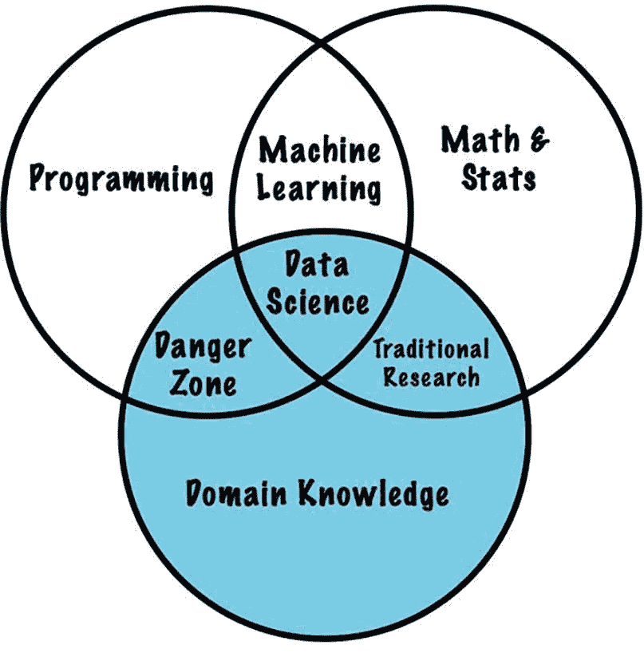
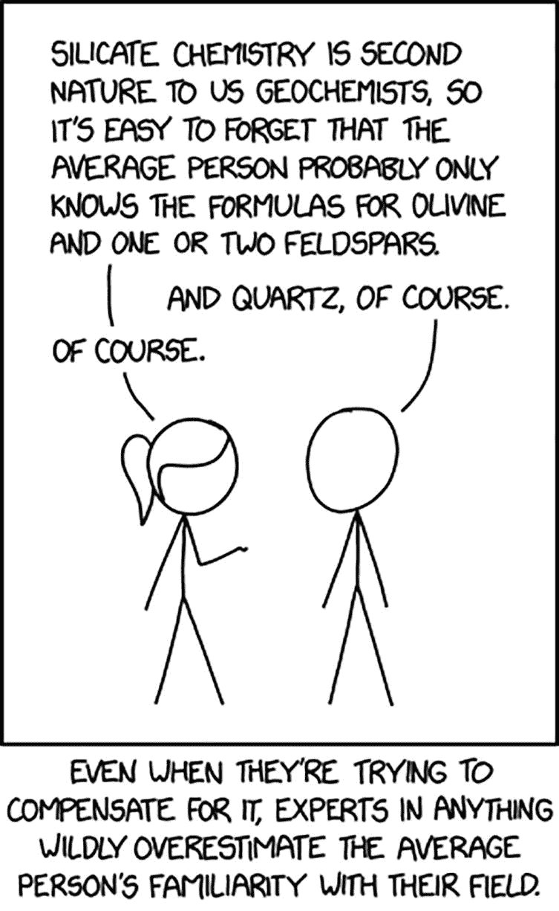

# 为什么领域知识至关重要

你在第 6 章首次看到了数据科学维恩图，但如果你再看一次（图 10-1），并关注下方高亮的圆圈，就能发现领域知识对数据科学的关键作用。这三个领域都很重要，但领域知识是优秀数据科学的核心组成部分。那么它究竟有何价值呢？

维恩图展示了三个领域的交集：编程、机器学习、数学与统计学。中央重叠区域标注为"数据科学"。其他重叠区域包括编程与领域知识之间的"危险区"，以及数学与统计学和领域知识之间的"传统研究"。领域知识部分的背景以蓝色高亮显示。

**图 10-1** 高亮领域知识的数据科学维恩图

到了这一步，你可能已经认同领域知识在数据科学中至关重要。我在前几章谈到过，理解数据在现实世界中代表什么非常重要，而领域知识能确保你拥有这种理解。我们来探讨几个最需要领域知识的特定领域。

## 理解利益相关者

作为领域专家，数据科学家能更好地理解利益相关者所处的世界，从而更容易理解他们面临的问题并提出更优解决方案，这主要得益于更顺畅的协作——而协作的顺畅来自相互理解带来的**更好沟通**。即使只掌握部分领域知识也能带来巨大帮助。当你与从未和数据科学家合作过的利益相关者打交道时，任何领域知识都尤为宝贵，因为他们往往不清楚该期待什么或需要分享哪些重要信息，而你的领域知识能帮你提出正确的问题。请记住，利益相关者常常不知道自己掌握了哪些知识，但你的知识可以避免由此产生的问题。图 10-2 以有趣的方式提醒我们，无论是在科学界还是商界，人们常常意识不到自己掌握的知识。

一幅两个火柴人的漫画。左侧扎马尾辫的人物说："硅酸盐化学对我们地球化学家来说是本能，所以很容易忘记普通人大概只知道橄榄石和一两种长石的化学式。"右侧人物回应："当然还有石英。"下方文字写道："即使在努力弥补这种认知偏差时，任何领域的专家都会严重高估普通人对他们领域的了解程度。"这幅漫画幽默地揭示了专家知识与公众认知之间的鸿沟。

**图 10-2** 《平均熟悉度》，xkcd 漫画。来源：Average Familiarity, xkcd.com，采用[知识共享署名-非商业性使用 2.5 许可证](https://creativecommons.org/licenses/by-nc/2.5/)。

领域知识发挥作用的另一个领域是**可信度**。这实际上在所有技术领域都存在——利益相关者通常不信任为他们构建系统的技术人员。原因在于他们经常遭遇技术团队交付方案偏离目标的糟糕体验。我的一位朋友在餐饮业从事销售点系统安装工作（即服务员输入顾客订单的收银系统），作为工作的一部分，她需要培训员工使用系统。她很快就学会了在培训开始时提及自己多年担任服务员和餐厅经理的经历，因为这能让受训者信任她。在安装和配置系统时，她的经验也能派上用场，因为她完全理解这些系统的实际使用方式。而她的多数同事只有技术经验，往往理解得不够透彻。

类似地，在我曾经任职的一家零售数据科学公司，公司文化认为除非从门店基层做起（最好是推过购物车），否则没人能真正理解业务。奇怪的是，他们不认可在其他公司的类似经验。遇到这种情况，我们往往无能为力。当团队遇到持这种心态的利益相关者时，我们的应对方法是让一位**确实**从门店基层起步的同事参与进来（这位同事同时也是优秀的数据工作者，所以对我们来说并非牺牲）。

## 数据准备与理解

领域知识在数据处理本身也至关重要。理解数据的真实含义具有不可估量的价值，而这有时离不开领域知识。诚然，没有专门知识似乎也能理解数据，但你会发现，如果缺乏相关经验，就可能会做出无效假设或误解某个字段。

例如，我曾在一家零售公司工作，几乎所有购买都由持有公司会员卡的顾客完成，因此每笔交易都存储了会员编号。但偶尔会有非会员交易，这些交易都被分配了一个虚拟会员编号（始终相同）。由于全球有大量门店，如果按会员编号拆分购买数据，这个虚拟会员编号的总订单量甚至比最豪爽的真实会员还要高出几个数量级。如果不了解这个特殊会员编号的含义，就可能错误地将这些交易纳入分析。当你在会员层面（如计算平均消费额）进行分析时，这会造成极大误导。

在同一家公司，我参与过一个项目：预测某熟食产品的销量，以帮助熟食经理决定全天各时段的产品制作量。项目初期，我们发现某些早晨会出现大量订单，但并非每天如此。我们一时无法理解，后来从领域专家那里得知，这些是提前下单、在营业前取走的订单，因此将其排除在建模之外是合理的。熟食经理会提前知晓这些订单。如果没有这个认知，我们可能会将这些订单纳入模型，从而降低预测的准确性和价值。

领域知识在数据预处理和特征工程中也至关重要。我们将在后续章节讨论数据准备，但其中一个核心问题是**处理缺失数据**。如果没有领域专业知识，几乎不可能知道处理缺失数据的正确方法。领域知识同时指导特征创建和特征选择，这两者我们后续都会深入探讨。它还能帮助识别多个特征实际代表同一事物、不应全部纳入模型的情况。举个例子：如果你正在为某大学开发一套系统，用于每学期优化教师的课程分配，那么会有一些基本假设，弄错这些假设可能引发问题。例如，如果忽略教师可以教授多门课程甚至同一课程的多个班级这一事实，就会导致结果出错。你需要考虑众多参数，包括他们的专业领域、教师可承担的总课时量，以及是否应安排连堂课等。

