# `Python`与`R`在现实数据科学中的应用实例

第一个案例很好地说明：你无需在`R`和`Python`之间做选择，而是可以根据各自优势搭配使用。随后我们将探讨`Python`在金融科技领域的应用。

## 示例 1：兼用两者进行对冲

对冲基金公司 Amadeus Investment Partners 通过采用包含`Python`、`R`、`SQL`及其他工具的技术栈（团队完成工作的技术工具组合）取得了成功。其跨学科团队设有多个角色，每个角色使用特定工具。技术专家使用`R`、`Excel`等工具探索数据；数据工程师则使用`R`、`SQL`和`C++`（注重性能的传统编程语言）；数据科学家用`R`进行探索性数据分析（EDA），用`Python`专门处理机器学习和深度学习；用户界面开发人员也同时使用`R`、`Python`及其他工具。

在大多数数据分析任务（包括数据探索和可视化）中，Amadeus 偏好使用`R`，该语言拥有出色的相关包。但`Python`在机器学习等计算密集型任务中表现更优——尤其当处理公司使用的大规模数据集时。值得注意的是，他们明确规定了各岗位应使用的工具。许多企业允许数据科学家自由选择工具（这种做法虽受欢迎），但会导致代码库分散、难以维护和复用。而通过要求数据科学家用`R`进行 EDA，后续工作便能更轻松地基于前期成果展开。

该公司的另一独特之处在于：他们不走寻常路，直接招聘商学院顶尖毕业生并培训成数据科学家，而非招录有技术背景的人员。他们发现这些毕业生能较快掌握`Python`和`R`，同时兼具学位赋予的通用软技能和商业知识。这正说明了这两种语言相对易于学习。

## 示例 2：快速灵活的金融科技

金融科技咨询与定制软件开发公司 djangostars 在所有工作中都偏好使用`Python`。他们认为`Python`是金融科技领域的最佳语言（尤其对新兴公司），原因众多：其一，数学家和经济学家已习惯使用该语言，因此从他们那里获得的系统需求在“正式编码”前就已完成了大半准备。虽然金融科技涉及大量数据科学工作，但其内涵远不止于此——`Python`作为多用途语言的优势得以凸显。他们指出，`Python`结合`Django`（成熟的`Python`网络框架）是快速将产品推向市场的绝佳组合。此外，这套工具组合灵活性极强且易于修改——这对金融科技而言至关重要（与传统银行业不同）。他们还发现，由于`Python`相对易学，开发人员和数据科学家能更顺畅地向客户解释技术、促进协作和知识转移。`Python`已非常成熟，几乎任何可想象的功能都有对应的免费包提供支持。

好的，作为一名高级文档工程师和翻译员，我将严格遵循您的注意事项和示例格式，将给定的英文文本翻译成中文。


## 计算机编程基础

编程语言实际上和人类语言很相似，只是简单得多得多。我有一位教授，他在 20 世纪 80 年代获得了计算机科学学位，并说服他的大学将 Pascal（另一种传统编程语言）算作他的外语必修课。这在今天不会发生，但就像人类语言一样，编程语言有语法（特定的单词、运算符以及它们的书写顺序）和语义（遵循语法规则所写的特定文本的含义）。它们还有随着时间的推移而形成的惯用语，即程序员之间约定俗成的完成特定任务的方式，即使这并不是唯一可以编写的方式。少数语言还有相当严格的格式规则来规定风格——Python 就是其中之一，Python 爱好者们坚信这是编写美观代码的唯一方式。

计算机代码基本上就是用特定编程语言的语法编写的“菜谱”。几乎所有编程语言都使用英语单词，并且有几个单词和运算符在大多数语言中通用。一些最常见的运算符包括表 11-1 中列出的那些。这些大多是我们从基础数学中熟悉的元素。它们在代码中的使用方式也大致相同。下面我也会对这些运算符进行更多阐述。

**表 11-1** 多种语言（包括 R 和 Python）中的常见运算符

| 赋值与控制 | 比较运算符 | 数学运算符 |
| --- | --- | --- |
| `=``:` | `>``<``>=``<=``==``!=` | `+``-``/``*``^``%` |

一些常见的关键字如图 11-1 所示。*关键字*是指在语言中始终具有特定含义的单词，除了按定义好的方式使用外，不能（或不应该）在代码中的任何其他地方使用。图 11-1 中的所有关键字都用于控制程序流程，我们将在下面讨论。


**图 11-1** 多种语言（包括 R 和/或 Python）中的常见关键字

一旦你掌握了语法的基础知识，你就走上了学习如何用代码完成几乎所有事情的道路。编程非常系统性，但一旦你深入其中，你就会发现在寻找解决问题的好方法时，创造力有多么重要。

有几种不同的高水平编程方法，称为范式。我们在此重点关注的是过程式和函数式，但你还会听到另一种常见的范式叫*面向对象编程*，它侧重于某种模块化设计，并且可以在 Python 和 R 中实现（在 Python 中很容易，但在 R 中稍复杂一些），尽管许多数据科学家可能永远不会使用它。*过程式编程*涉及一个一个按顺序执行的步骤序列。*函数式编程*涉及函数的使用（我们将在下面进一步定义），但基本上包含更小的代码单元，这些代码单元可以被定义，并使用不同或不使用值来重复调用，以实现有效的复用。

请注意，本章讲的是代码，但你不必期望在本章中就学会编写代码。各节中有一些 Python 和 R 代码的示例，但它们仅仅是为了说明概念并展示这两种语言之间的差异。然而，如果你是一个动手型学习者，那么进入 Python 或 R 解释器并尝试一下也无妨。这是一个很好的学习方式。附录 A 详细说明了如何安装它们并开始使用。

## 传统编程

一个计算机程序就是一系列代码行，利用语法和其他文本来告诉编译和/或运行代码的东西该做什么。有些语言使用编译器进行编译，这意味着它们被处理并转换成可运行的文件，或者由解释器实时运行。R 和 Python 都使用解释器。

代码的格式化通过使用换行、空白（包括缩进/制表符）以及控制结构（如花括号 `{` 和 `}`）来实现，使其既能被人阅读，也能被编译器或解释器读取。除此之外，编写代码还有许多要素，我们将在下面的小节中介绍。

我在图 11-2 中包含了一些示例 Python 代码，以防你从未见过代码。这段代码没有做任何特别有趣的事情，但它展示了我们将在下面讨论的一些基础知识。当我们下面讨论到它时，我也会指出这段代码中的相关部分。左侧是行号。请注意，代码是带有颜色编码的——这在大多数代码编辑器中是标准做法。


**图 11-2** 一些示例 Python 代码

### 注释

所有编程语言都允许你在代码中包含注释。编写注释的具体语法因语言而异，但 Python 和 R 都使用井号 `#`。每当你在某行代码上看到这个字符时，`#` 之后的所有内容都是注释，不会被解释器运行；而 `#` 之前的所有内容都是将要被运行的常规代码。

关于如何以及应该在代码中添加多少注释，有很多不同的看法，但大多数人都认为应该有一些注释。有些人几乎叙述正在发生的每一件事，而另一些人则只包含 TODO 或标记他们认为非常令人困惑的内容。在实践中，你会发现当你稍后回过头来看代码时，你会忘记代码中那些棘手部分的作用，所以强烈建议添加注释。

### 变量

变量是在代码中存储数据和值的方式。你可以将一个值赋给一个*变量*，变量就是一个用于保存该值的名称。变量用于存储数字、文本或其他更复杂的数据类型等值。在包括 R 和 Python 在内的一些语言中，几乎任何东西都可以存储在变量中，甚至函数也可以。变量是一种占位符，代表其他东西。当你将要重复做某件事，又不想每次都重新输入一个值时，通常会使用变量，尤其是当这个值以后可能改变的时候。

#### Python

和几乎所有语言一样，Python 使用等号来赋值变量。例如，代码 `my_number = 7` 将值 7 存储在变量 `my_number` 中，因此每当你在代码中看到 `my_number` 时，都可以在心里用值 7 来代替。如果你看到 `my_number + 5`，结果将是 12。

在 Python 中命名变量时有几条规则。变量名中只能使用字母（大写或小写）、数字和下划线（`_`），并且名称不能以数字开头。你可以用字母或下划线开头来命名变量，但在 Python 中，以下划线开头的变量用于指示特定场景，因此对于常规变量，你应该以字母开头。

图 11-2 中示例 Python 代码的第 2-8 行是变量赋值，行尾的注释表明了 Python 当前会分配给该变量的数据类型。


## R

R 允许在变量名中使用与 Python 略有不同的字符。它允许所有与 Python 相同的字符，但也允许使用句点（句点在 Python 中是运算符，因此不能使用）。实际上，在 R 变量名中使用句点相当常见。名称必须以字母开头。

R 在赋值运算符的使用上与其他语言不同，它使用`<-`而不是等号。等号也可以工作，但大多数 R 程序员更喜欢`<-`。它的写法如下：`my.number <- 7`。这就像 Python 一样，每当在代码中看到该名称，它就代表 7。

### 数据类型

*数据类型*就是给定语言中允许的数据类型，即你可以存储并且语言知道如何处理的内容。最常见的基础类型（通常称为*原始数据类型*）包括：*整数*（整数）、*小数*（小数）、*布尔值*（false/true 或 0/1）、*复数*（包含复数的值，即–1 的平方根）和*字符串*（包含在标记内，通常是引号内的文本）。不同的语言会对每种类型有不同的尺寸版本。

还有更高级的类型可以原生支持、自定义定义或通过语言的其他包（插件）使用。这些包括*数组*或*列表*（值的序列）、*映射*（一种键指向值的键值对序列）以及*集合*（像没有重复值的数组或列表）。

还有更多存储数据的方法，这些方法更加高级，几乎从不内置于语言中（因此你必须使用外部包）。这些通常被称为*数据结构*，这是一个更抽象的术语，表示基于数据存储方式的部分行为和关系。这些包括*栈*（后进先出，就像餐厅里的一摞盘子）、*队列*（先进先出，就像小吃摊前排的队）和*树*（就像家谱）。有一些处理这些更复杂数据结构的方法，使它们在某些情况下非常方便，尽管这些在数据科学编程中很少出现。

最后，不同语言在处理数据类型和变量方面存在一些重大差异。在静态类型语言（如 Java 和 C++）中，变量的类型必须在创建时定义，并且永远只能保存该类型的数据。Python 和 R 都是动态类型语言，这意味着你不需要在创建变量时声明类型，而且一个变量可以在不同时间保存不同类型的数据（它可能先保存字符串，然后保存数字）。动态类型导致更简洁的代码，但意味着你必须小心更改变量。

在强类型语言（大多数流行语言都是）中，不同数据类型之间的混合方式有限制。Python 和 R 都是强类型语言，因为当代码运行时，解释器会跟踪所有数据类型并禁止某些操作。例如，一种流行的弱类型语言允许你“添加”一个字符串值（或变量）和一个数字值（或变量）。在 JavaScript 中，`"X" + 9`会得到`"X9"`（一个字符串），但 Python 和 R 都会抛出错误。

注意，Python 和 R 都根据赋值给变量的值来记录其数据类型。因此，如果你将一个变量赋值为 7，Python 和 R 会将其视为`int`，直到它被重新赋值给其他内容。

#### Python

Python 拥有所有基础数据类型，外加两种类似的列表类型（分别称为`list`和`tuple`），以及映射类型（称为`dict`，字典的缩写）。列表和元组从 0 开始索引，因此第一个元素在位置 0，第二个在位置 1，依此类推。在当前流行版本中，Python 只有一个整数数据类型`int`（早期版本有一个更大的整数类型`long`）。它也只有一种小数数据类型`float`（以前有一个更大的小数类型`double`）。当前的`int`和`float`与之前的`long`和`double`一样大，这就是为什么现代代码中不再需要它们。布尔类型称为`bool`，复数类型称为`complex`。字符串存储在`str`数据类型中。你可以通过调用`type()`函数并将变量名放在括号内来查找数据类型。

## R

R 也拥有所有基础数据类型。它有两种类似的列表类型：`vector`和`list`。与 Python 不同，两者都从 1 开始索引。整数数据类型称为`integer`，小数类型称为`numeric`。复数类型简称为`complex`。字符串使用`character`数据类型构建。最后，布尔类型称为`logical`。你可以通过调用`class()`函数并将变量名放在括号内来检查任何值的数据类型。


### 运算

运算就是编程语言中对所执行动作的指令。例如，若想在代码中进行数学运算，可以使用如表 11-2 所示的运算符。这些运算符在 Python 和 R 中的工作原理完全相同，虽然取模运算符在两者间略有差异。图 11-2 中示例 Python 代码的第 11 至第 16 行展示了这六种数学运算符的用法。

**表 11-2** Python 和 R 中的数学运算符

| 用途 | 数学符号 | Python | R | Python 示例及结果 |
| --- | --- | --- | --- | --- |
| 两数相加。 | n + m | `+` | `+` | `6 + 2` 得到 8。 |
| 两数相减。 | n – m | `-` | `-` | `6 - 2` 得到 4。 |
| 两数相乘。 | n × m | `*` | `*` | `6 * 2` 得到 12。 |
| 两数相除。 | n ÷ m | `/` | `/` | `6 / 2` 得到 3。 |
| 求幂运算。 | n^m | `^` `**` | `^` `**` | `6 ^ 2` 得到 36。`6 ** 2` 得到 36。 |
| 计算模（余数）。 | n % m | `%` | `%%` | `6 % 2` 得到 0。`7 % 2` 得到 1。 |

数学运算中一个重要的概念是*运算顺序*，它决定了数字和运算符的组合会先执行哪一个。这与常规数学中的规则相同，可以使用括号强制优先计算某些部分。手写数学表达式时，通常会加上括号以确保清晰明了；但在代码中，只有当运算顺序确实需要时，才会使用括号。例如，表 11-3 展示了一些代码、中间概念步骤以及最终结果。如果你对数学中的这一概念不太熟悉，刚开始可能会觉得有些复杂，但经过一段时间的实践，它就会变得自然而然。

**表 11-3** 运算顺序示例

| 运算 | 步骤 1 | 步骤 2 | 步骤 3 | 结果 |
| --- | --- | --- | --- | --- |
| `6 + 2 * 3 – 1` | 6+2 × 3–1 | 6+6–1 |   | 11 |
| `(6 + 2) * 3` | (6+2)×3 | 8×3 |   | 24 |
| `2 ^ 3 * 5 – 3` | 2³×5–3 | 8×5–3 | 40–3 | 37 |
| `2 ^ (3 * 5 – 1)` | 2^((3 × 5) – 1) | 2^(15 – 1) | 2¹⁴ | 16384 |
| `2 ^ (3 * 5) – 1` | 2^((3 × 5))–1 | 2¹⁵–1 | 32768–1 | 32767 |

另一种比数学运算更常用的运算是比较运算。我们想要知道某事物是否与另一事物相同、不同、更大或更小。这些可以在表 11-4 中看到。这些运算的结果总是返回一个布尔值。它们在 Python 和 R 中的工作原理完全相同。

**表 11-4** Python 和 R 中的比较运算符

| 用途 | 数学符号 | Python | R | Python 示例及结果 |
| --- | --- | --- | --- | --- |
| 小于 | n < m | `<` | `<` | `6 < 2` 得到 False。 |
| 小于或等于 | n ≤ m | `<=` | `<=` | `6 <= 2` 得到 False。 |
| 大于 | n > m | `>` | `>` | `6 > 2` 得到 True。 |
| 大于或等于 | n ≥ m | `>=` | `>=` | `6 >= 2` 得到 True。 |
| 等于 | n == m | `==` | `==` | `6 == 2` 得到 False。 |
| 不等于 | n ≠ m | `!=` | `!=` | `6 != 2` 得到 True。 |

还有一些与条件判断密切相关的重要运算符：`not`、`and`和`or`。`not`对其前置的值取反：如果值为 True，取反后为 False，反之亦然。`and`和`or`用于将多个条件连接起来，产生一个单一的布尔值：对于`and`，仅当所有部分都为 True 时，结果才为 True；对于`or`，只要至少有一个部分为 True，结果即为 True。例如，`6 > 2 and 2 > 6` 结果为 False，而 `6 > 2 or 2 > 6` 结果为 True。

这些是 Python 和 R 中最常用的运算符。还有其他一些不常用的运算符，包括位运算符，但你在数据科学中可能不需要用到它们。

### 程序控制流与迭代

编程的一个重要方面是让代码按正确的顺序执行你的意图，并且经常需要重复执行某些操作。从微观层面看，运算顺序正体现了这一点，但更重要的是控制流功能。有两种常见的控制机制可以让你随心所欲地控制程序流程：if–else 条件和循环。

#### If–Else 块

If–else 结构允许你表达：如果条件成立，则执行一件事；否则，执行另一件事。你还可以嵌套这些结构，例如：如果条件一成立，做一件事；如果条件二成立，做另一件事；如果条件三成立，再做另一件不同的事；否则，做其他事。如果我们将这种逻辑详细描述出来，结果如表 11-5 所示。这种书写方式被称为*伪代码*（不过通常你会有像右侧那样的实际值），它是一种类似于代码的写法，不特定于任何编程语言，但能清晰地表达正在发生的事情。

**表 11-5** 包含三个条件的 if–else 块框架

| 流程概念 | 伪代码 |
| --- | --- |
| 如果条件 1 <br>那么执行操作 A <br>否则如果条件 2 <br>那么执行操作 B <br>否则如果条件 3 <br>那么执行操作 C <br>否则执行操作 D | `if var1 > 0` <br>`then print("positive")` <br>`else if var1 == 0` <br>`then print("zero")` <br>`else if var1 < 0` <br>`then print("negative")` <br>`else print("something's wonky")` |

表 11-5 左侧的代码检查条件 1，如果条件 1 为真，则执行操作 A。否则，继续检查条件 2 是否为真，以此类推。请注意，这些块的工作方式是，一旦满足第一个条件就会“跳出”。如果条件 1 满足，该块将执行操作 A，然后跳转到整个块之后的下一段代码，而不会再去检查条件 2。只有当条件 1、2、3 都不为真时，才会执行操作 D。右侧代码展示了当我们想要打印一个名为`var1`的数值变量的方向（正或负）时的流程。

Python 使用三个与 if–else 语句相关的关键字：`if`、`elif` 和 `else`。它使用冒号来引出每个条件。R 只使用 `if` 和 `else`，在必要时使用 `else if` 组合，并且需要使用花括号来划分不同的代码块。参见表 11-6，其中展示了表 11-5 中的代码在 Python 和 R 中的表现形式。你也可以在图 11-2 的第 19 至 24 行看到 if–else 块的示例。

**表 11-6** Python 和 R 中的 if–else 代码示例

| Python | R |
| --- | --- |
| ```python
if var1 > 0:
    print("positive")
elif var1 == 0:
    print("zero")
elif var1 < 0:
    print("negative")
else:
    print("something's wonky")
``` | ```r
if (var1 > 0) {
    print("positive")
} else if (var1 == 0) {
    print("zero")
} else if (var1 < 0) {
    print("negative")
} else {
    print("something's wonky")
}
``` |


# 循环

在代码中，我们经常需要重复执行某个操作，每次仅使用略有不同的值。这类操作通常不止是基础操作，但概念上相当简单，我们可以通过一个示例来观察：为几个不同的值打印一些数学计算结果。首先，让我们看看如图 11-3 所示的伪代码。

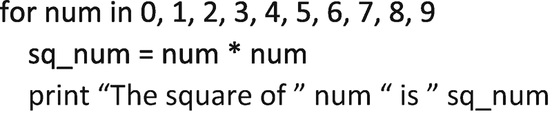

用于计算并打印 0 到 9 数字平方的 Python 代码片段。该代码遍历每个数字，计算其平方，并以“The square of [number] is [square]”的格式打印结果。

**图 11-3** 一个简单 for 循环的伪代码，用于打印前十个数字的平方

这里展示的循环类型是 *for 循环*，其基本结构是“对于值列表中的某个值”，循环运行的次数与列表中元素的数量相同，每次运行时，该值都取列表中的一个值。我们始终知道这种循环会运行多少次。

另一种循环类型是 *while 循环*，它会反复运行，直到预先定义的条件不再满足为止。其伪代码大致如图 11-4 所示。在这个例子中，我们从名为 `num` 的变量开始，每次循环运行时增加其值，直到数字达到 10 才停止。只要 `while` 后面的条件为真，循环就会继续。此外，你也可以使用关键字 `break` 在代码中的该点退出 while 循环。

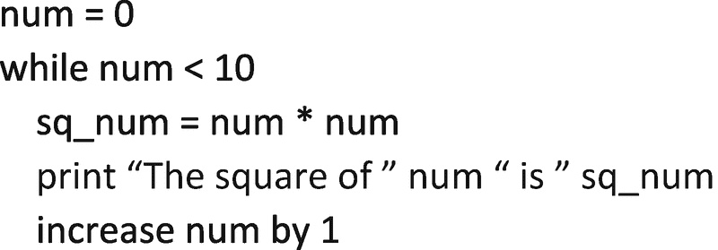

一段演示循环的伪代码片段。它将变量 `num` 初始化为 0。在 `num` 小于 10 的条件下循环继续。循环内部，通过将 `num` 乘以自身来计算 `num` 的平方，赋值给 `sq_num`，并打印语句 “The square of `num` is `sq_num`”。然后变量 `num` 递增 1。

**图 11-4** 一个 while 循环的伪代码，用于打印前十个数字的平方

请注意，大多数程序员更倾向于使用 for 循环而非 while 循环，因为 while 循环很容易出现导致其永远运行的 bug（例如，如果在图 11-4 的例子中忘记将 `num` 增加 1，它将永远不会退出）。这显然很容易修复，但第一次运行带有这个 bug 的代码时仍然会很麻烦。

## 伪代码与代码逐步执行

伪代码本质上是算法的步骤，是使用人类语言编写的代码。在你刚开始学习编程时，先用这种方式写出来通常非常有益，这样你就能理解其中的逻辑和流程。

同时，记录伪代码每一步使用实际值时发生了什么也非常有用。例如，对图 11-4 中的代码进行逐步执行，起始过程如下：

| **num 的值** | **结果** |
| --- | --- |
| 0123456789 | 0 的平方是 0。1 的平方是 1。2 的平方是 4。3 的平方是 9。4 的平方是 16。5 的平方是 25。6 的平方是 36。7 的平方是 49。8 的平方是 64。9 的平方是 81。 |

这可以帮助你理解发生了什么，并发现问题，尤其是在处理更复杂的代码时。

Python 有 `for` 循环和 `while` 循环。`for` 循环使用关键字 `for` 和 `in` 来设置，而 `while` 循环使用 `while`。R 语言有相同的关键字，但还有另一种类似于 `while` 循环的循环，它使用关键字 `repeat`。这种循环就像一个 `while` 循环，但它没有条件，只有在循环内部使用关键字 `break` 时才会停止运行。因此，它总是运行到 `break` 关键字首次出现的位置。而 `while` 循环如果初始条件不满足，可能永远不会运行。参见表 11-7，其中展示了用于实现图 11-3 中功能的 for 循环在 R 和 Python 中的代码示例。在 Python 中，获取从 0 到 9 每个数字列表的方法是 `range(10)`（不是 1 到 10），所以你会在代码中看到它。在 R 语言中，你可以使用代码 `0:9` 获得相同的结果。

**表 11-7** Python 和 R 中的 for 循环代码示例

| **Python** | `for num in range(10):`    `sq_num = num * num`    `print("The square of " + num + " is " + sq_num)` |
| **R** | `for (num in 0:9) {`    `sq_num <- num * num`    `print(paste("on the ", paste0(counter,`        `("The square of ", num, " is ", sq_num, sep=""))` `}` |

表 11-8 展示了使用 while 循环完成相同功能的代码。注意，在 Python 中，有一种给数字加 1 的简写方式：`num += 1`。

**表 11-8** Python 和 R 中的 while 循环代码示例

| **Python** | `num = 0``while num < 10:`    `sq_num = num * num`    `print("The square of " + num + " is " + sq_num)`    `num += 1` |
| **R** | `num <- 1``while (num < 10) {`    `sq_num <- num * num`    `print(paste("on the ", paste0(counter,`        `("The square of ", num, " is ", sq_num, sep=""))`    `num <- num + 1``}` |

你可以在图 11-2 的第 27–29 行和第 32–35 行的 Python 示例代码中看到另一个 `for` 循环和 `while` 循环。

## 函数

到目前为止我们讨论的所有内容都适用于过程式编程，但引入函数将带我们进入函数式编程领域，并且如果我们反复执行相同或相似的任务，函数可以极大地改进代码。*函数*是一段完成特定任务的代码块，它可以接收变量并使用，也可以返回一个值。在不同的语言和上下文中，函数可能有不同的名称，包括方法、过程和子例程（这些术语并非完全同义，但在此节中足够相似）。函数被认为是可调用的，这意味着你定义它一次，然后通过在代码中包含其名称来稍后运行它。

一个函数有两个高级组成部分：函数定义和函数体。这些在不同语言中可能看起来不同，但第一行总是函数定义，并包含函数名称以及输入变量（如果需要的话）。输入变量被称为实参或形参。函数体从下一行缩进开始，或者包含在花括号（或其他符号）内。

函数可以很小——甚至只有一行——也可以长达数百行。通常，更短的函数更受欢迎，因为最佳实践是让一个函数主要做一件事（即使完成这一件事需要许多、许多步骤），而不是做几件不同的事情。当你调用 Python 或 R 语言原生函数或已安装的某个包中的函数时，你会广泛地使用函数。但你也会经常创建自己的函数，这是非常强大的能力。


好的，作为一名高级文档工程师和翻译员，我将严格遵循您的注意事项和示例格式，将给定的英文文本翻译成中文。


#### Python

In Python, a function is called a `function`, unless it’s used in a specific context of object-oriented programming, but we don’t have to worry about that just yet. They are defined using the keyword `def`, followed by the function name and opening and closing parentheses, with the variables in the parentheses if they are to be included when the function runs. The function in lines 38–40 of the code in Figure 11-2 is a simple one that returns a modified square of a number. Line 38 is the definition, containing the keyword `def`, the function name, an opening parenthesis, one parameter, a closing parenthesis, and a colon that signals the definition is closed and indicates the function body is next. The function body begins on the next line in Python. The first line calculates the new value, and the last line returns the value with the keyword `return`. We can call the function later with the function name followed by parentheses, with the same variable order/sequence as in the function definition. The parentheses are required regardless of whether a variable is passed. The call is shown in line 42 of the example code in Figure 11-2, with the function name and a parameter in parentheses. The parameter can be hard-coded values or variable names.

Python also has a less common type of function. You can use the keyword `lambda` to define an anonymous function. This creates a block of code that works like a function but is called only once where it is defined because it has no name. One of the more common uses is to sort data in some nonstandard way. Suppose you have a list of lists with two numbers (row number and height), such as `[[4, 60], [8, 69], [3, 62], [1, 67], [2, 65], [9, 72]]`. If you called Python’s `sort()` function on the whole list, it would be sorted as you might expect – by the first number in each sublist for all two-element lists. But if we wanted it to be sorted by the second number, we could create a simple `lambda` function in the call to sort to instruct it to sort by the second number.

## R

Functions in R are similar to Python in the way they are defined and used, but they look a little different. The `lopsided_square` function from the Python version in Figure 11-2 above is written in R and shown in Figure 11-5. In the definition, the name is placed first, followed by the assignment operator, the keyword `function`, parentheses with the parameter name, and finally a left curly brace that indicates the start of the function definition. The function definition follows for two lines, and it is closed with a right curly brace. R also uses the same keyword `return` as Python to return values.

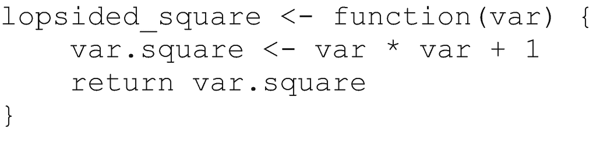

> Code snippet for defining a function in R programming language. The function is named `lopsided_square` and accepts a single variable `var` as input. It calculates `var.square` by multiplying `var` by itself and adding 1. The function returns `var.square`. Keywords: R, function, variable, multiplication, return.

**Figure 11-5**  
> An example function defined in R.

If we include `lopsided_square(3)` in the code, we will get a return of 10.

### Libraries and Packages

An important part of organizing code in nearly all programming languages is through libraries and packages that group code by purpose. In Python, the word *library* is sometimes used, but *package* is usually preferred. The base installation of the language contains many default packages, but you can install more. For example, while basic math is already included in Python, there is a special package with more advanced math functions. There are also many third-party packages available in data science code. To use these types of packages in Python and R, they must first be imported.

#### Python

In Python, there are a couple of different ways to import packages. It is typical to import at the top of the code. Packages contain classes or functions that you want to use, and the method of import defines how you refer to those things later. Table 11-9 shows different ways you could import a package called `Pandas` and how to reference a function from it with that import.

**Table 11-9**  
> Common ways to import packages in Python

| 包导入语句 | 从包中调用函数 |
| --- | --- |
| `import pandas` | `pandas.to_csv()` |
| `from pandas import to_csv` | `to_csv()` |
| `import pandas as pd` | `pd.to_csv()` |

How you refer to an imported package relates to a concept called a namespace, which defines the hierarchy in which variables and other names are applied. The first way is the most basic, and the third way is the same except you create an alias, `pd`, for the `pandas` package. When you want to call functions or reference classes from a package imported in one of these two ways, you must preface the function or item with the package name (or alias) and a dot. As shown in the second column of the table. So, the second method is sometimes convenient because you don’t have to specify the package every time you call a function from it, but it has drawbacks. If you use the second method and wrote your own function called `to_csv()`, you couldn’t use both functions – whichever is defined last is the one that would actually be called. This can be confusing. `Pandas` is a critical package in data science, and the regular way to import it is the third method, with the alias `pd`.

## R

In R, there are a few key ways to import packages. The first is to use the `library()` function, and the second is to use the `import` package. There can be namespace challenges in R as well. By default, all functions in a package are available directly by their function name, but you can also reference a function from a particular package by using the package name followed by two colons. See Table 11-10 for sample imports.

**Table 11-10**  
> Common ways to import packages in R

| 包导入语句 | 从包中调用函数 |
| --- | --- |
| `library(dplyr)` | `filter()` 或 `dplyr::filter()` |
| `import::from(dplyr, select, filter)` | `filter()` |
| `import::from(dplyr, select, dplyr_filter = filter)` | `dplyr_filter()` |

The first method is the most common, and you can either refer to a function directly by its name, or you can specify the package name as shown. The second method is similar, but it imports only the specified functions (in this example, `select` and `filter` from the `dplyr` package). The third method allows you to rename specific functions, which can be important when different packages have the same function names. In the third case, `select` is imported normally, but the package function `filter` is given the alias `dplyr_filter`. There are more ways to specify which functions are imported; you can look up the online R documentation for more details.


### 组织与格式

代码的组织方式和风格多种多样，观点也层出不穷。有些观点涉及注释。我曾与一位同事共事，他坚持认为，在写得很好的 Python 代码中不需要注释，因为代码本身已经非常易读。我不同意这种观点，但确实不必为所做的每一件事都加上注释。对于许多程序员（尤其是 Pythonistas）来说，代码的外观很重要。目标是让代码尽可能易读，这通常意味着适当的空白和偶尔的注释。在 R 语言中，花括号用于定义不同的代码块，通常左花括号位于代码块的第一行，右花括号则单独位于代码块的末尾一行。Python 不使用像花括号这样的代码块封闭符，而是用冒号标记一个块，并依靠缩进来定义代码所属的块。下面我将介绍一些已发布的 Python 和 R 语言风格指南。

### 错误处理

通用编程的一个重要部分是恰当地处理代码中的错误，尤其是在代码投入生产或需要被其他人运行时。当你编写的代码将在团队内或其他程序员之间共享时，后一点尤其重要。如果你只是编写 Notebooks 来运行自己的数据科学分析，则无需特别处理代码中的错误，因为你自己会看到错误并立即进行适当的修正。

但设想一下，你创建了一个函数，它位于一个核心代码位置，供人们对某个值进行特定的转换。他们会导入你的函数并运行它，而无需了解其内部代码——但如果你做得对，用户凭借你优秀的文档就会确切知道如何使用该函数。假设该函数需要几个参数，并应返回一个转换后的数字。然而，如果函数内部出现问题并产生错误，用户将无法对函数内部进行故障排查——他们甚至可能看不到函数内部。因此，你需要预见可能出现的错误类型，捕获它们，并向用户返回有意义的错误消息。常见的会引发错误的场景包括除以`0`或提供错误的数据类型。在 R 和 Python 中都有很好的错误处理方式，如果你开始编写需要此功能的代码，就可以学习这些方法。

### 安全性

程序员并不总是会考虑到安全性。虽然与编写代码直接相关的隐私或伦理问题不多，但编写的代码可能存在安全性不足的问题。对于只处理内部系统的数据科学家来说，这通常不是什么大问题，但如果你通过将系统投入生产或创建 API（应用程序编程接口，一种在你的网络上运行并允许其他代码查询它的软件，你的代码会生成响应并发送回去）将代码暴露到互联网上，这就很重要了。

程序员应该关注的一些安全领域包括：身份验证、加密、错误处理、输入验证、输出验证以及第三方包的选择。我们已经在第 8 章讨论过身份验证和加密，但这里的关键是确保在必要时进行身份验证，并在代码中正确设置，以及在必要时包含加密。输入验证和输出验证对于确保不会引发任何不良行为至关重要。一种常见的网络攻击称为 SQL 注入，即有人在填写表单时，在文本框中放入 SQL 代码（比如请求用户名的字段，或者任何其他字段）。如果攻击者编写了能删除数据库中所有表的代码，并且文本框没有进行任何输入验证，那么这段 SQL 代码就可能在该系统的数据库中执行。输入验证可以阻止这种情况。输出验证则确保没有代码或其他问题结果会导致网页浏览器渲染错误或显示冒犯性图像等。我之前提到过错误处理，它可以与输入和输出验证结合使用，以处理检测到的问题。我还提到了包的选择，因为像 R 和 Python 这样的开源语言的一个美好之处在于，任何人都可以创建并分享一个包。但这并非总是阳光与彩虹，因为可能会发布有不良意图（无论是有意还是无意）的包，不过它们最终会暴露出来。因此，建议坚持使用成熟的包，而不是贸然使用全新的包。


# 数据科学编程

在大多数数据科学和统计编程中，最具标志性的事物就是数据框，它是分别在 `R` 语言中和 `Python` 语言下使用 `Pandas` 来存储表格数据的基本结构。数据框在 `R` 中实际上是一种内置数据类型，但在 `Python` 中，我们必须使用一个名为 `Pandas` 的包，它为我们提供了类似 `R` 语言的功能。

数据框以便捷且有意义的方式存储表格数据。表 11-11 展示了一个典型的数据框。

**表 11-11 示例数据框**

| 宠物编号 | 物种 | 名称 | 性别 | 出生日期 | 品种 | 颜色 _1 | 颜色 _2 | 死亡日期 |
| --- | --- | --- | --- | --- | --- | --- | --- | --- |
| 1 | 猫 | Chica | 已绝育雌性 | 2023-05-10 | 家养长毛猫 | 黑色 |  |  |
| 2 | 猫 | Zephyr | 已绝育雄性 | 2020-01-15 | 家养短毛猫 | 橙色虎斑 |  |  |
| 3 | 猫 | Darwin | 已绝育雄性 | 2014-06-11 | 暹罗猫 | 海豹色重点色 |  |  |
| 4 | 猫 | Misha | 已绝育雄性 | 2012-05-06 | 家养中毛猫 | 棕色虎斑 | 白色 |  |
| 5 | 猫 | Tank | 已绝育雄性 | 2012-08-25 | 家养短毛猫 | 橙色虎斑 |  | 2023-12-25 |
| 6 | 猫 | Callie | 已绝育雌性 | 2011-04-30 | 家养短毛猫 | 玳瑁虎斑 |  | 2023-07-19 |
| 7 | 猫 | Virginia | 已绝育雌性 | 2000-05-27 | 家养短毛猫 | 虎斑 |  | 2014-03-15 |
| 8 | 猫 | Maggie | 已绝育雌性 | 2006-09-18 | 家养短毛猫 | 三花猫 |  | 2016-11-05 |
| 9 | 猫 | Ash | 已绝育雄性 | 2010-3-27 | 家养中毛猫 | 黑色 |  | 2011-03-20 |
| 10 | 猫 | Newton | 已绝育雄性 | 2006-06-01 | 家养短毛猫 | 棕色虎斑 |  | 2018-08-10 |
| 11 | 猫 | Vixen | 已绝育雌性 | 2007-04-17 | 家养短毛猫 | 棕色虎斑 | 白色 | 2023-09-12 |
| 12 | 猫 | Isolde | 已绝育雌性 | 1996-03-19 | 家养长毛猫 | 灰色 | 白色 | 2010-07-23 |
| 13 | 猫 | Winston | 已绝育雄性 | 1995-05-13 | 家养长毛猫 | 黑色 |  | 2009-06-30 |
| 14 | 狗 | Buddy | 已绝育雄性 | 1984-06-11 | 混种犬 | 黑色 |  | 1996-09-04 |
| 15 | 狗 | Barbie | 已绝育雌性 | 1983-10-04 | 可卡犬 | 棕褐色 |  | 1994-01-13 |
| 16 | 豚鼠 | Rufus | 雄性 | 1982-11-01 |  | 黑色 | 白色 | 1984-12-08 |
| 17 | 仓鼠 | Hammie | 雄性 | 1981-07-18 |  | 棕褐色 |  | 1982-10-02 |

数据框之所以方便，是因为它们允许我们通过单个命令对行、列甚至整个数据框执行操作。添加新列和新行也很容易。分组数据和聚合操作可以在一步内完成。例如，仅用一行代码，即可在 `Python` 和 `R` 中，根据其他列中的出生和死亡日期添加一个 `Age` 列。在 `Python` 中，它看起来像这样：

```
pets_df["Age"] = pets_df["Date_died"] - pets_df["Birth_date"]
```

根据数据类型以及你希望 `Age` 列所在的单位，可能还需要一些额外操作，但从概念上讲，你只需要这样做。它知道要去获取整个列，将行对齐后的另一列相减，然后将结果作为新列添加到数据框的末尾。这比过去处理表格数据的方式（通常是在循环中逐行处理，每次循环都进行计算，这比使用数据框操作花费的时间多得多）要容易得多。

数据科学家喜欢用数据框处理大量表格数据，但他们如此偏爱 `Python` 和 `R` 的另一个原因是两种语言都提供了统计学、可视化和机器学习相关的包。表 11-12 展示了数据科学家在 `Python` 和 `R` 中使用的众多包中的一部分。有些是内置的，但大多数需要安装（幸运的是，这很容易做到）。详细讨论如何使用这些包超出了本书的范围，但我们将在后续章节中讨论机器学习。

**表 11-12 数据科学家使用的数据科学包。ML 代表机器学习，NLP 代表自然语言处理**

| Python |  | R |
| --- | --- | --- |
| 包 | 用途 |  | 包 | 用途 |
| --- | --- | --- | --- | --- |
| `pandas` | 数据框 |  | `data.table` | 更多的数据框操作 |
| `numpy` | 数值数据操作 |  | `dplyr` | 数据操作 |
| `scipy` | 基于 numpy 构建 |  | `lubridate` | 日期操作 |
| `datetime` | 日期操作 |  | `ggplot2` | 可视化 |
| `plotly` | 可视化 |  | `stats` | 统计学 |
| `matplotlib` | 可视化 |  | `e1071` | 机器学习建模 |
| `seaborn` | 可视化 |  | `xgboost` | 机器学习建模 |
| `statsmodels` | 统计学 |  | `randomForest` | 机器学习建模 |
| `scikit-learn` | 机器学习建模与性能评估 |  | `tensorflow` | 机器学习建模 |
| `tensorflow` | 机器学习建模 |  | `naivebayes` | 机器学习建模 |
| `torch` | 机器学习建模 |  | `metrics` | 机器学习性能评估 |
| `nltk` | 自然语言处理建模 |  | `tidymodels` | 机器学习支持 |
| `spacy` | 自然语言处理建模 |  | `shiny` | 演示与展示 |

如果你在云平台上编码，可能会用到其他能显著提升性能的包。例如，如果你能访问 `Spark`，你会使用 `Spark` 数据框而不是 `Pandas`，这将需要使用不同的机器学习库。有时也会有一些特定于平台的包可用。这些包可能非常有用，但在从一个平台切换到另一个平台时，有时也会带来困难。

数据科学编程另一个比较独特的特点是使用笔记本，或者说那些允许你运行单行代码而不是整个文件的系统。在过去，你所有的代码都在一个文件中，要运行它，你需要运行整个文件。每次都必须运行所有步骤，因为在两次运行之间，上次运行创建的所有内容都会丢失。笔记本的工作方式不同，它允许你一次运行一个单元格，并保留你已经创建的变量和其他对象。这是一项伟大的创新，尤其在数据科学领域，因为当你处理大量数据时，你不想重复那些耗时的步骤，比如读取和转换一个给定的数据集。这种笔记本风格选项的其他几个优点是，你可以将笔记本格式化为易于演示的形式，并且与同事分享也非常棒。


## 约定与习惯

编程领域，特别是软件工程中，存在许多约定、标准和最佳实践。但很多数据科学家并未学习这些，因为他们通常使用较短的代码段来解决特定问题。这会导致整体代码混乱，尤其难以复用，而当多个团队成员都编写混乱代码时，问题会更加严重。强烈建议你尝试遵循良好的实践，因为一旦掌握，它们就会成为本能，你无需刻意思考就能写出优质代码。

我在上文已经简单提到了注释。这绝对是一个值得培养良好习惯的领域。你未来的同事会因此而感激你，甚至可能从你这里习得这一习惯。但更重要的是，未来的你也会感激现在的自己。写代码后却不记得其工作原理或当初为何这样写，这种情况极其常见。一些注释便能起到很大作用。

大多数语言都发布了相关的标准和最佳实践，Python 和 R 也不例外。Python 的主要风格指南被称为 `PEP 8`，次要指南是 `PEP 257`，这两者都已沿用超过 20 年。此外，还可以通过包或编程平台来自动格式化代码。R 语言没有如此高级的风格指南，但谷歌发布了一份被广泛使用的指南，内容相对简短。许多新手程序员认为风格并不重要，的确，不遵循它也能学习编程，但尽早养成好习惯非常有益。风格指南的存在是为了让代码更易于维护（即可读性和可理解性）。有意识地遵循一段时间，你便能很快将其内化，从而使编写清晰、高可读性的代码成为你的第二天性。

编程中你会遇到的一个问题是：如何命名变量和表列。风格指南确实涉及了这一点，但通常来说，变量名不能包含空格或以数字开头；虽然列名在技术上可能允许这两者，但应遵循惯例而避免使用。关于多词变量名中如何大写和分隔单词，存在一些争论。历史上，常用`camelCase`（除第一个单词外，其余单词首字母大写），这常与`ProperCase`（所有单词首字母大写）混淆；但 Python 中一个较新的趋势是使用`under_case`（全小写或全大写，单词间用下划线分隔）。在 Python 中，函数和变量通常使用`under_case`，而类则使用`ProperCase`。在 R 语言中，即使允许使用下划线，也通常用句点代替下划线。

还有许多其他可以遵循的约定，具体取决于语言和团队的偏好。在某些语言中，常见做法是用单个字母 `v` 或 `var` 开头来命名所有变量，有时甚至会在变量名中包含数据类型。你可以对此有自己的看法，但通常你会遵循所在团队的风格。

一开始遵循所有这些规则可能会显得有些繁琐，但老实说，这对于生成更易读的代码是值得的——无论是他人编写的，还是几个月前你自己写的。许多数据科学团队都有自己的标准，你需要适应并遵循这些标准；但如果你加入的团队没有这些标准，拥有自己的标准仍然对你更有利。

## 选择语言

如果你正在决定学习哪种语言，有许多因素会影响你的选择。如果你在读学位课程，该课程可能有一种贯穿始终使用的语言。显然，学习那门语言至关重要。如果你已经对某门语言有一定经验，那么继续使用它也是合理的。如果你是自学，可以两种都尝试一下，看看更喜欢哪种。如果你预计主要从事统计方面的工作，并且可能不需要部署机器学习模型，那么 R 可能是合适的选择。它在纯统计领域比 Python 稍强一些。基于同样原因，如果你真想深入学习统计学，它也或许是一个不错的选择。如果你想在涉及其他语言开发的工作中具备竞争力，那么一定要选择 Python。与 R 相比，Python 与其他流行语言（如 Java 和 C#）有更多共同点。总的来说，Python 在工业界更受欢迎，而 R 则在学术界更常见。最后，如果你完全不知道该选哪个，也没有任何因素指向某一特定语言，我建议选择 Python。它在受欢迎程度上正开始超越 R，而且从 Python 转向其他编程语言比从 R 转向更容易。你还可以调查一下数据科学职位，看看有多少要求 R vs. Python。

你可能会想两门语言都学，但我建议至少将一门学到中高级水平后，再开始学习另一门。它们之间有很多相似之处，但也存在一些可能导致混淆的差异。此外，如果你在学习 Python，我强烈建议也学习数据科学家不常使用的那些部分。如果你在网上查找 Python 教程，那些不提及数据科学的教程很可能不会教你`Pandas`和`scikit-learn`，但它们对于学习其他领域很有帮助。而如果你查找 R 教程，你将直接进入数据框和统计学习。

当你在寻找数据科学工作时，即使团队偏好某一种语言，他们通常也不关心你已掌握的是哪一种，因为如果你在一种语言上已经很出色，学习另一种语言会被视为相对简单的事。这就像人类语言一样，一旦你学会了一门外语，学习第二门外语就会更容易。


# 核心要点与下章预告

本章首先回顾了统计学与数据科学领域的编程历史。两种最流行的数据科学语言——R 和 Python——均自 21 世纪初问世，至今仍被广泛使用。随后我们深入探讨了与传统编程相关的多个主题，发现 R 和 Python 之间存在许多相似之处，但也存在一些重要差异。代码中的注释非常重要。变量让我们能够用名称表示值，便于复用。R 和 Python 提供了多种不同的数据类型，包括整数、浮点数（小数）、字符串、布尔值、列表和数据框。我们可以通过代码轻松完成多种操作，包括数学运算和比较操作。编程最有价值的几种能力包括条件行为和代码重复执行，例如对多个样本重复运行某段代码。这类操作通过我们所谓的编程控制流来处理，例如 `if`–`else` 结构（允许你在满足特定条件时执行一种操作，不满足时执行另一种操作）和循环（对一系列值重复运行同一段代码）。另一种提升代码效率和复用性的重要方法是函数，即可以通过特定参数调用的代码块。代码的格式化和组织同样重要，遵循最佳实践和标准具有不可估量的价值。在 Python 和 R 中，编程存在一些数据科学特有的方面，最显著的是名为数据框的数据结构，它是一种高效存储和处理表格化数据的方式。最后，在决定学习哪种语言时，需要考虑多个因素，包括你的职业目标。

在第 12 章中，我们将探讨数据收集与存储。首先，我们将了解除了第 1 章讨论过的数据类型之外的其他数据类型。数据收集有两种方式：手动收集和自动收集，但这两种方式内部存在多种可能场景。我们将讨论数据收集过程中面临的各种风险及其缓解方法（或至少了解这些风险）。我们还会探讨数据的所有权归属，以及无论数据存储在哪里，由谁负责管理。我们将深入讨论数据库和其他数据存储方式，包括电子表格和文本文件。最后，我们将了解数据科学家通常如何参与数据收集与存储工作——这在行业中差异极大。

## 从业者访谈：玛吉·沃尔夫

**姓名：** 玛吉·沃尔夫  
**职位：** 数据科学家，产品分析  
**行业：** 旅行科技  
**从业经验：** 4 年数据科学家，8 年分析领域  
**教育背景：**

*   数据科学硕士
*   传播学学士

*此处观点仅代表玛吉本人，不代表其过去或现任的雇主。*

### 背景

玛吉从小就热爱数学，甚至在高中时参加过数学竞赛。她也在高中时开始学习编程，具体是 HTML 和 Pascal。她在互联网泡沫时期毕业，大学主修计算机科学，立志成为一名网页开发者。但第一堂课就让她望而生畏，她觉得这条路不适合自己。于是她转专业到传播学，希望这能带来更令人兴奋的职业生涯。

玛吉大学毕业后第一份工作是在会计会议的市场营销部门。她很快转职到一家医院的“草根市场营销部门”，在那里她兼顾网站管理，最重要的是学会了网络分析。她不喜欢市场营销的一点是它往往过于主观，但处理数据则感觉完全不同。她热爱与数据打交道——团队里没有其他人对此感兴趣，但她不断使用 Excel 和其他基本工具深入挖掘。她曾想过自己或许能成为一名分析师，但当时觉得这遥不可及，于是这个念头便搁置了。

## 工作

几年后，一位副总裁看到了她对数据和分析的兴趣，将她调到一个数据分析岗位，她非常喜欢这份工作。她学习了 R 和 Power BI，并对正确工具带来的可能性感到兴奋，于是开始攻读数据科学硕士学位。之后，她对市场营销感到厌倦，便转岗到产品分析部门，并一直工作至今。

### 金句

**工作中最喜欢的部分：** 需要逻辑思维和分析能力。这与市场营销截然不同，现在她可以更客观地专注于数据本身。这是一个更加非黑即白的世界。她特别喜欢与产品经理合作，因为他们比许多利益相关者更懂数据。她还热爱总有新东西可学，没有人无所不知，但我们总能从彼此身上学到东西。

**工作中最不喜欢的部分：** 除了分析和数据科学之外的所有额外工作，比如安装程序、编写文档。处理极其混乱的数据也是一件苦差事。此外，“持续学习”的状态也有其弊端——有时你需要拼命跟上步伐，这会让人应接不暇（而且你偶尔要做别人没做过的事，需要花时间去摸索）。

**最喜欢的项目：** 在某个工作中，玛吉创建了一个名为“用户努力指数”的新指标，用于衡量用户在网站上预订行程时遇到的阻力。提出这个需求是因为利益相关者想通过 A/B 测试来评估用户的努力程度，但当时缺乏一个能代表努力程度的良好指标。于是她开始在网上搜索，但相关资源很少。她自行识别了多个表明用户遇到阻力的信号。她坚持推进，并使用机器学习来预测何种程度的阻力会导致用户放弃预订。这项成果很有价值，并已在公司内部推广使用。

**最常用的技能：** 量化思维，以及天生对数字敏感的心态。好奇心至关重要，因为你需要渴望发现数据中的真实情况，而不是寻找你预想的东西。时间框定很重要，尤其是在进行探索性数据分析时（很容易钻牛角尖）。良好的沟通能力至关重要，因为你处理的是复杂的概念，而你的听众可能不理解，你需要为他们进行转化以获得支持。

**当前主要使用的工具：** SQL、Snowflake、Python notebooks、Adobe Analytics、Tableau、一些 Power BI

**数据科学的未来：** 事情似乎充满不确定性，但玛吉认为人工智能会让我们更高效，但很可能不会取代我们。她希望人们继续追求多学科发展，并理解行业和背景——这是人类比人工智能做得好的地方。

**优秀数据科学家的特质：** 量化直觉、乐于学习、扎实的沟通能力。另一个重要技能是理解没有人无所不知，不完美也没关系。人们往往因为害怕失败而不敢开始，但正如许多圈子里常说的，“快速失败”，从而更快地变好。

**她对有志于成为数据科学家的人的建议：** 尝试找一位导师，帮助你了解不同类型的行业和工作。有时一旦开始工作，转换赛道会变得很困难。

*玛吉是一名数据科学家，在市场营销和产品开发与管理方面拥有丰富经验。*

脚注 1   2   3   4   5   6

# 12. 尽量不要搞砸：数据收集与存储


## 引言

数据的两个重要方面——数据收集和数据存储——尽管常常未得到充分重视，却至关重要。数据由谁获取？他们如何获取？随后又将数据存放在何处以便访问？古埃及人和苏美尔人派遣官员前往其领土，将数据记录并存储在泥板上。中世纪的税吏也采用类似方法，只不过他们使用的是 parchment 纸或普通纸张上的墨水。

如果你正在阅读本文，你显然知道如今的数据收集量比某人骑马挨家挨户记录数字时要多得多，且速度更快。同时，你也清楚数据必须存放在某台计算机上，供任何想要进行数据科学工作的人使用。但仅仅说数据“存储在电脑里”并不够具体——数字化存储数据的方式有很多种。我们将探讨数据存储的几种方式，以及数据是如何被收集的。

# 现实世界中的数据收集与存储案例

经过深思熟虑的数据收集与存储所带来的强大效益，其案例比比皆是，且往往与更大的基础设施（例如迁移至云端或网络硬件）相契合。但以下两个案例展示了在应对复杂且本质上混乱的信息时，改进数据收集与存储方法的价值，以及跳出传统数据库系统之外寻找方案的重要性。正如许多事情一样，打破常规的思维能够改变游戏规则。

## 案例一：波多黎各地址危机

2017 年，波多黎各接连遭遇飓风袭击，导致电力中断数周，大部分基础设施被毁，许多人受困。这是一场巨大的灾难，美国通过多个机构做出响应。民众申请援助，机构需要审批申请，然后将援助物资送达民众手中^(³⁰)。为此，他们使用了联邦机构（包括美国人口普查局）拥有的地址。这些特定地址是由人口普查员收集的。但他们很快发现，申请人在申请表格上填写的地址很难与机构档案中的官方地址匹配上。他们需要将援助对象与已知记录对应起来，因为他们无法将物资寄给身份不明的人。人口普查员和居民对地址应该如何书写往往有着不同的想法。如果你只在美国郊区生活过，可能很难想象这种情况。但很多地方都有非标准化的地址，尤其是包括美国在内的许多国家的农村地区。也许现在还有些地方，你只需在给雷诺兹奶奶的信封上写上她的名字、城镇和州名，信就能寄到。然而，波多黎各的这种不一致性给当地救援物资的分发带来了极大的困难。

数据质量低下的主要原因有两个：一是收集方法可能不足以获取居民自己书写地址的格式；二是数据本身很可能存在一些真实的不一致性。人们有时会在不同时间以不同方式书写自己的地址，可能会根据特定情况下分享地址的特定目的而改变。无论数据收集过程中设置了怎样的保护措施，这都会带来问题。

显然，当时对于数据质量已无能为力，各机构只能尽力设法应对并送达援助物资。他们利用当地人作为向导，并借助航拍照片，但这仍然极其困难。第二年，多个联邦机构联合起来，寻求更好的办法来存储波多黎各的地址，最终成立了一个工作组来解决这个问题。其中的挑战之一在于，岛上的地址包含一个名为 *urbanización*（城市化社区）的组成部分，有时这可能是区分两个地址的唯一要素，因为存在大量重复的道路名称。这个要素在美国其他地址中并不存在，因此各机构通常不需要处理它。图 12-1 显示了几个（虚构但符合现实的）地址，其中第一行就是 *urbanización*。这些地址的唯一区别在于第一行“Urb”之后的内容。这些地址地理位置上并不邻近——它们只是具有相同的街道名称。


两块相邻的标牌，显示着地址。第一块标牌上写着“Urb Smith, 567 Calle A, San Juan, PR 00926”。第二块标牌上写着“Urb Mar, 567 Calle A, San Juan, PR 00926”。两块标牌具有相似的布局和字体样式。

**图 12-1** 两个不同但相似的波多黎各地址

该工作组最终通过对数据收集和存储方式进行微调，改善了局面，一些机构还开展了实地工作以核实地址。另一些机构则开始使用第三方、开源或定制工具或数据来验证、标准化和清理其数据。所有这些举措对于克服数据收集的局限性都是必要的，这些局限性既包括人工收集数据所面临的挑战，也包括地址本身固有的非标准化问题。


### 示例 2：Shutterfly 对 SQL 说“不”

Shutterfly 拥有海量数据——由数百万用户上传的数十亿张照片，这些用户会存储、分享并购买印有这些图像的 products。他们的数据存储基础设施至关重要。与大多数公司一样，他们最初也使用关系型数据库。我在第 1 章中提到了这些数据库，但我们将在本章后面讨论关系型数据库和其他数据库。只需知道，传统和经典的数据库系统是关系型的，并且在各组织中仍被广泛使用。这些系统使用的语言（`SQL`）是数据科学家的一项关键技能。最近，新型数据库系统被创建出来，其中大多数被统称为 `NoSQL`，因为它们不是关系型的。

Shutterfly 发现，在使用关系型数据库时，当人们访问其网站时会出现瓶颈。^(³¹) 众所周知，扩展这些数据库的成本很高，通常需要增加存储空间等方式。他们决定脱离关系型数据库领域，最终选择了文档数据库方法 `MongoDB`。我们稍后也会讨论这种类型数据库的工作原理，但关键点在于，他们在数据库基础设施以及人们处理数据的方式上做出了重大转变。好处之一是，开发人员不再需要设计和遵循严格的关系型规则，而是可以“按照头脑中的样子”存储数据，这是一个巨大的变化。`MongoDB` 的最大优势在于其极高的灵活性，这与关系型数据库截然相反。如果他们在某些 `MongoDB` 中存储数据的方式被证明不是最佳方案，他们可以轻松更改。例如，可以通过这种方式来提升查询或写入数据库的性能。与扩展关系型数据库相比，这使得扩展至越来越大的系统变得微不足道。

结果确实是积极的，而且过渡并不困难。Shutterfly 拥有数 TB 的数据，他们使用一些迁移工具，在几分钟内就将数据从关系型数据库迁移到了 `Amazon Web Services (AWS)` 上的 `MongoDB`，并且（重要的是）没有中断其网站和服务。扩展（或缩减）的能力尤为重要，因为 Shutterfly 在节假日和其他关键日期会看到使用量的高峰和低谷。缩减规模的能力本身在一定程度上是独特的，因为通常公司需要确保在最繁忙时有足够的存储空间，以便在达到峰值时拥有足够的存储空间。但采用这种方法，他们在其他所有时间都会拥有超出需求的存储空间。转向 `MongoDB` 意味着 Shutterfly 立即开始节省成本，其成本比其关系型基础设施低约 20%。图 12-2 展示了 Shutterfly 的主页，在他们从关系型数据库迁移到 `MongoDB` 的过程中，该页面完全未受影响。


Shutterfly 网站主页截图，展示了一个促销活动，内容为“10 张免费卡片，包括节日贺卡”，使用代码“10CARDS”。该优惠有效期至 10 月 6 日，使用代码“SHIP79”可享受订单满 79 美元免运费。页面包含各类产品类别的导航链接，如相册、节日、卡片与文具等。页面显示节日贺卡的视觉展示，部分卡片上印有“节日快乐”和“亲爱的圣诞老人”字样。顶部可见搜索栏和购物车图标。

图 12-2

Shutterfly 使用 `MongoDB` 支持其基础设施。来源：[`https://www.shutterfly.com/`](https://www.shutterfly.com/)

## 数据收集

在糟糕的旧时代，数据收集总是手动的。有人出去与人交谈，或观察工厂活动等事物，或走进大自然并记录所见之物。但如今，收集到的绝大部分数据都是通过数字化方式获得的。这可能意味着自动进行（比如跟踪你点击的网站或收集天气数据的物联网（IoT）设备），或通过在线表单等方式手动进行。有时手动是唯一的方法，而且这些数据通常更有价值，因为它可以获取到其他方式难以获得的信息，例如研究人员采访有特定经历的个人，比如住院经历或参加某个特定活动。我们将在接下来的两个小节中讨论不同类型的数据收集。

数据收集通常是研究设计的一部分，第 3 章讨论了这一点以及抽样，因此如果你要作为研究或实验的一部分收集数据，请务必回顾那一章。但数据也经常独立于任何类型的研究进行收集，因此研究设计并不总是相关的，本章侧重于那些事后以及在存储背景下必须考虑的收集方面。

### 手动收集

手动收集数据有许多方法。所有方法都涉及一个人——数据收集者——做一些事情来获取数据并以某种方式记录。许多方法涉及与现实世界中的人打交道（或至少通过电话或虚拟电脑）。这些方法包括访谈和焦点小组、面对面调查/问卷。这些通常用于市场营销和政治评估。

还有其他方法，数据收集者仍以某种方式在现实世界中，但并非直接与人打交道。他们仍然可以记录关于人的数据，例如观察法。例如，一位社会学家可能会观察看护者在公园里看护孩子玩耍时如何互动，或者在寒冷冬日里数一数学校里穿短裤的青少年男生人数。此外，他们可能观察与人类无关的事物，比如记录大猩猩的行为或评估树木上真菌生长的程度。

手动数据收集可以收集定性或定量数据。对人的观察通常涉及对行为的定性评估，但通常即使在那里，目标也是获取一些可供处理分析的 numbers。焦点小组和访谈也可以同时收集两种类型的数据，但通常会有更多定性数据，供分析师稍后解析以量化其中一部分。调查和问卷通常产生更多定量数据，但它们通常包含一些部分，人们可以在其中留下自由文本回复，这些回复也可能随后被分析以进行量化。图 12-3 显示了一个典型的手动填写的问卷。


一个带有“焦虑和抑郁检查表（K10）”表单的剪贴板放在一张玻璃桌上。表格中包含一系列与焦虑和抑郁感相关的问题，并带有频率回复选项。一支黑色钢笔放在表格上，表明它已准备好填写。环境看起来像是诊所或办公室。

图 12-3

一份用于手动数据收集的问卷。来源：Alex Green 照片的裁剪版，可在 [`https://www.pexels.com/photo/crop-woman-in-office-with-clipboard-5699437/`](https://www.pexels.com/photo/crop-woman-in-office-with-clipboard-5699437/) 获取，并根据 Pexels 许可使用 ([`https://www.pexels.com/license/`](https://www.pexels.com/license/))


### 自动化与半自动化采集

如今，自动化数据采集是主流趋势。你几乎做任何事都可能留下被追踪的痕迹。今天我正坐在星巴克工作，从离开家门起就被一路追踪——我的汽车保险通过手机应用监控我的驾驶习惯，谷歌记录了我去过的每一个地方，我先前在墨西哥餐厅用餐的消费记录由于使用信用卡支付并短信接收了小票而被保存，而我在星巴克购买印度奶茶的记录既存在于他们的交易系统中，也出现在我的支付应用里。如果你不想被这样追踪，就得费些周折才能避免。

因此，这一类别既包括全自动化采集，也包括半自动化追踪。全自动化采集就像大型农场周围布设的天气与环境传感器持续监测环境数据，以及谷歌通过手机追踪每个人的位置。关键在于，数据采集的双方都无需为数据记录做任何额外操作，只需完成初始设置（将传感器接入网络，或有人手机中安装了相应应用）。这还包括网站上的点击行为追踪（用户只是像平常一样使用网站）。参见图 12-4 中自动采集环境读数的气象传感器示例。


蓝天白云下，草地上的气象监测设备。装置包括一根高高的白色杆子，上面装有传感器和一个标有"SII"的控制箱。背景中有建筑物和机场跑道。设备通过电缆连接，安装在碎石地面上。

*图 12-4* —— 采集环境读数的气象站示例。来源：来自 Famartin 的“File:2017-06-06 10 45 14 Present weather sensor on the Automated Surface Observing System (ASOS) at Ronald Reagan Washington National Airport in Arlington County, Virginia.jpg”，可在[`https://commons.wikimedia.org/w/index.php?curid=63842646`](https://commons.wikimedia.org/w/index.php?curid=63842646)获取，采用知识共享署名-相同方式共享 4.0 国际许可协议（[`https://creativecommons.org/licenses/by-sa/4.0/deed.en`](https://creativecommons.org/licenses/by-sa/4.0/deed.en)）授权使用。

有许多工具可以实现或简化自动化与半自动化采集，包括条形码扫描仪（扫描商店中的 UPC 码）、RFID 读取器（从带有 RFID 标签的设备获取信息）、光学字符识别软件（扫描贷款申请以提取字段）、智能手机（手机 GPS）以及物体识别（车牌扫描仪）。这仅仅是冰山一角，新的数据采集方式层出不穷。

半自动化数据采集主要是指自动化程度较高，但需要有人执行少量特殊操作的过程，例如使用条形码扫描仪或在特定的销售点系统中输入数值。例如，零售交易追踪就是半自动化的，因为收银员需要逐一扫描顾客的每件商品（手动过程），但所有产品详情都能从现有数据库中检索，此后交易数据会自动存入数据库。表单是另一个半自动化的例子：需要有人创建表单，有人填写表单，但其他所有环节都是自动化的。图 12-5 展示了一个典型的、用于调查或研究的网络多选题表单。

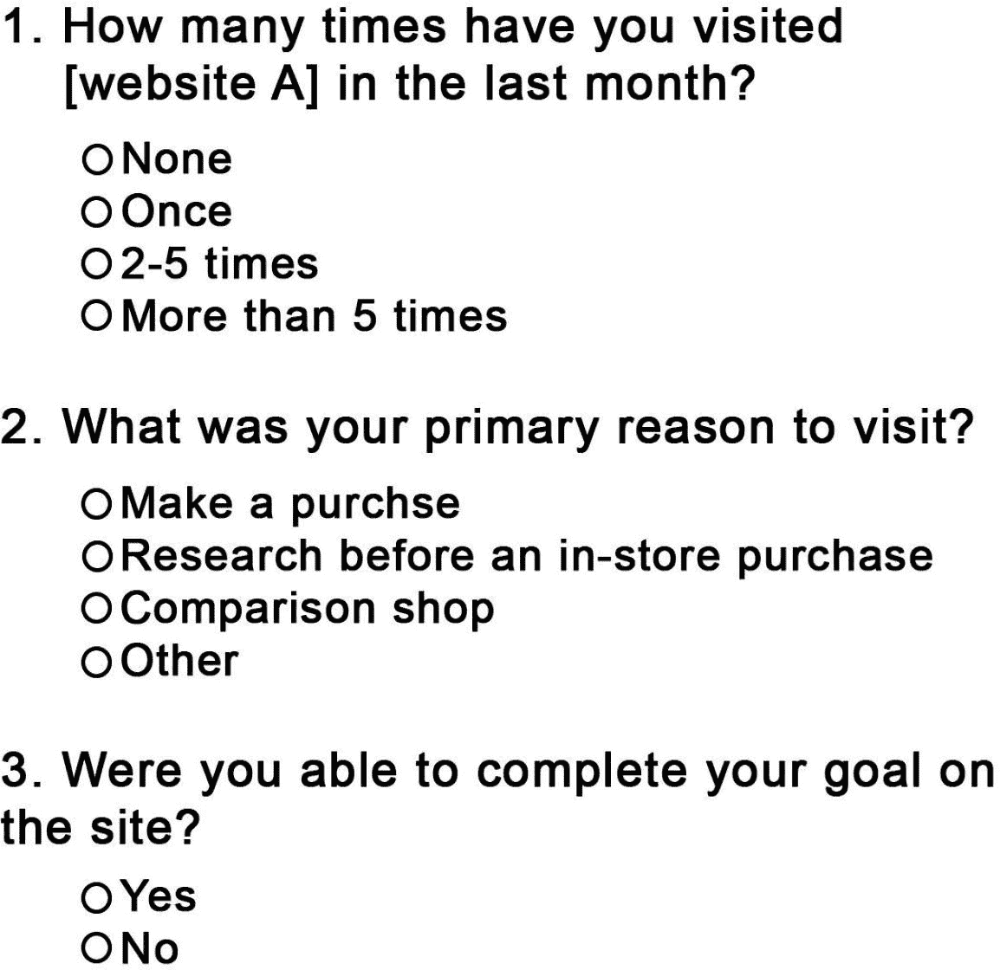
包含三个问题的调查图片。  
1. "上个月您访问[网站 A]多少次？" 选项：无、一次、2-5 次、超过 5 次。  
2. "您访问的主要目的是？" 选项：购买商品、到店购买前调研、比价、其他。  
3. "您是否在网站上完成了目标？" 选项：是、否。  
注意："购买"（Purchase）拼写错误为"purchse"。

*图 12-5* —— 半自动化数据采集表单示例

## 数据采集中的质量

我们讨论过数据如何是对现实的抽象，以及我们的目标是如何让数据有意义地反映现实。这意味着数据需要准确，而这又意味着实际的数据采集过程——无论是人工采访并记录答案，还是在某个区域架设气象传感器网络——都必须执行到位。

### 手误、笔误与拼写错误

这些错误仅发生在手动数据采集过程中。与任何涉及输入的操作一样，数据中可能出现笔误和其他小错误。*手误*是人们用于指代诸如打字错误等无意识错误的术语。还可能存在转录错误，例如有人根据手写表单录入时无法辨认字迹，从而在输入电脑时引入错误；或者记录错误，即最初记录信息的人拼写错误或以其他方式写下错误信息（可能填错了表单的字段）。

应对方法之一是让数据采集者从现有选项中选择，而不是总是使用自由文本字段。此外，根据上下文，可以进行拼写检查。另外，让第二个人复核他人录入的数据也并不罕见。

### 数据不一致

另一种主要发生在手动操作中的问题，是不同记录中对同一字段的使用方式不统一。例如，两个收集宠物信息的人可能在"姓名"字段中填入不同的信息——一个填入主人名字，另一个填入宠物名字。当有不同人员采集数据时，这种情况尤其容易出现，因此对工作人员进行每个字段含义的培训是预防此问题的最佳方法。同样，如果由受试者直接为自己填写表单，为每个字段提供清晰的说明可以大大减少此类情况的发生。

### 数据缺失

*数据缺失* 指的就是空白字段，本质上是不完整的记录。这在手动和自动数据采集中都可能发生，但在手动采集中更为常见。原因可能是数据从未被采集过（受访者未回答采访者的问题，或在表单中留空），也可能是在将纸质记录转录到电脑时无意遗漏，或类似的手动填写过程出错。自动采集中也可能缺失数据，例如用户匿名浏览网站时，我们无法获取用户名；或者某个特定的天气传感器发生故障，我们将丢失来自该传感器的数据。数据缺失后续总会带来麻烦，因此我们应尽可能确保数据的完整性。

对于手动采集场景，培训数据采集人员理解完整数据的重要性，将有助于他们尽力填写所有字段。

### 采集、录入与存储之间的不匹配

这通常是手动采集中存在的问题。有时数据存储方式的限制会导致采集到的数据难以保存。例如，如果团队只能使用关系型数据库，但采集的数据并非很好的表格形式，则可能难以录入电脑。如果系统预期某个字段只包含一个值，但实际获得了两个值，那么如何同时添加两者，或者如何选择其中一个？如果能提前了解这些限制，数据采集过程就可以根据数据存储和数据录入的约束条件来进行设计。


### 数据存储

如今，数据通常以某种方式进行数字化存储，但仍有一些内容保存在纸张甚至缩微胶片上，这是互联网时代前图书馆的主要载体（缩微胶片是一卷透明胶片，上面印有文本等的微型版本）。数字存储的选择更多，包括一些不用于日常用途但用于存档的旧式存储方式。一些较旧的类型包括磁带（盒式磁带和录像带）、闪存盘和光盘（CD、DVD 和蓝光光盘）。所有旨在常规使用的现代数据最终都存储在硬盘驱动器或固态驱动器上，但这些驱动器可能位于组织内部的本地服务器中，也可能位于云端的某处，与你工作地点相距甚远，存放在由亚马逊、谷歌、微软甚至组织本身运营的数据中心的服务器上。当使用磁带或其他类型时，通常用于存档（用于备份目的的数据和系统快照，通常是每日进行）。我曾在一家公司工作，我们每晚都会制作备份磁带，然后每周一次将物理磁带运送到另一个地点。

在数字领域，有多种不同的数据存储方式，但对于数据科学家使用的数据而言，通常存储在数据库、文本文件或电子表格中（主要是数据库）。这些都有许多类型或格式。我将先讨论电子表格，然后是文本文件，接着将进行更深入的数据库系统讨论。

### 电子表格

电子表格是一种常见的数据存储方式，财务部门和其他许多部门几十年来一直用它来存储和处理数据。它们功能相当强大，因为表格结构是存储许多数据集的自然方式。当电子表格首次出现时，它们凭借图表和数据透视表、VLOOKUP 等数字运算工具，革新了数据分析的某些方面。尽管技术已经进步，但许多电子表格用户却没有跟上。因此，数据科学家经常会发现他们从电子表格中提取数据，尽管使用起来可能很笨拙。大多数数据专业人士认为像 Excel 这样的电子表格是其职业存在的祸根，因为它有许多限制且使用不当。此外，电子表格在处理大数据时毫无用处——最流行的电子表格软件 Excel 无法处理超过一百万行的数据。

Excel 是最常见的电子表格程序，但也有一些其他的程序。`Python` 和 `R` 中都有用于读取 Excel 工作表的包。如果一个工作表不仅仅是顶部有标题行、其余行向下排列数据的简单结构（比如有人在顶部添加了标题并合并了单元格），它仍然可以通过编程方式读取，但这会更困难。通常，如果你遇到了一个不规则的电子表格，将相关部分复制粘贴到一个新文件中并单独保存可能会更容易。在这种情况下，你甚至最好将其保存为逗号分隔值（`CSV`）文件，我们将在下面讨论这一点。图 12‑6 展示了一个包含图书数据且难以处理的电子表格。乍一看它像是一个常规表格，但仔细看你会发现，对于有多位作者的图书，在该图书下方多出了一行，其中只有 `Contributor` 列有数据，其他列均为空。对于许多电子表格用户来说，这似乎是一种自然的数据存储方式，但它存在很多问题。

```
images/628533_1_En_12_Chapter/628533_1_En_12_Fig6_HTML.jpg
```

表格列出了图书及其列：ID、标题、副标题、贡献者、贡献者角色、系列名称、系列编号、出版日期、ISBN、出版商和印记。条目包括 Bryan VanDyke 于 2024 年由 Little A 出版的《In Our Likeness》，以及 Gourge Stalk, Jr. 和 Thomas H. Mout 于 1990 年由 The Free Press 出版的《Competing Against Time》。其他贡献者包括 Neil Jordan、Colin Walsh 和 Barbara Kingsolver。该表格提供了各种书籍、作者和出版细节的结构化概览。

**图 12‑6**  
一个难以处理的示例电子表格，因为第 15-17 行的“额外行”实际上属于第 14 行

这使得这个工作表难以处理。通常，每个“事物”（无论代表什么，此处指单本图书）应该只有一行。如果必须将所有信息放在一个电子表格中，更好的组织方式如图 12‑7 所示。在这种情况下，有多个 `Contributor` 列，因此每位作者都可以添加到一个单独的列中（部分贡献者超出了图像范围）。这种方法在这里可行，但如果有 20 位作者，就会显得笨拙。这些也是我们在设计数据库和表时需要考虑的因素，我们稍后会讨论。

```
images/628533_1_En_12_Chapter/628533_1_En_12_Fig7_HTML.jpg
```

一个表格，列出了各种书籍及其列：标题、副标题、系列名称、系列编号、出版日期、ISBN、出版商、印记、贡献者 1、贡献者 1 角色、贡献者 2、贡献者 2 角色。该表格包含了诸如《In Our Likeness》、《Competing Against Time》和《The Well of Saint Nobody》等图书详情，以及它们各自的作者、出版年份和出版商。该表格提供了图书信息的结构化概览，包括多个贡献者及其角色。

**图 12‑7**  
来自图 12‑6 的相同数据，但针对单个电子表格进行了更好的组织

还有一点关于电子表格值得提及。有时，利益相关者过于习惯和依赖电子表格，以至于他们期望结果也以电子表格的形式呈现，即使图表或其他可视化方式会好得多。这常常让数据科学家抓狂，他们通常会尝试温和地向利益相关者介绍图表，有时是有效的。但……有时则不然。


### 文本文件

纯文本是指可以在微软记事本或苹果文本编辑等文本编辑器中打开且仍可阅读的文件。这是一种常见的数据存储方式，其中逗号分隔值（`CSV`）格式在数据世界中一直都被广泛使用。

一个`CSV`文件其实就是一个纯文本文件，其格式以逗号表示列分隔符。如果保存的文本中包含逗号，则该字段文本会用双引号括起来。如果文本中包含双引号，则会在其前面再添加一个双引号。如果文本中包含双双引号……嗯，你懂的。总有一种方法可以处理任何情况。好处在于，你通常无需担心这些细节，因为有程序可以正确地读写`CSV`文件。如果某个不怀好意或粗心大意的人给你一个没有正确处理所有这些特殊字符的`CSV`文件，可能会很难处理，但终究还是可以搞定的。

`Excel`可以轻松打开`CSV`文件，你通常可以安全地在那里编辑并保存它们（假设行数不超过一百万行）。然而，`CSV`只是文本，因此它不会保存你在`Excel`中添加的任何格式，比如加粗的列标题。如果你用`Excel`打开图 12-7 中书籍数据的`CSV`版本，它看起来是一样的，只是没有加粗的标题或不同大小的列。如果你想真正看清`CSV`的真实面貌，可以在文本编辑器中打开它。该书籍数据的`CSV`文件看起来会像图 12-8 那样。空白值会被完全省略，所以你会看到一连串的逗号连在一起，就像图 12-8 中大多数记录末尾那样，因为大多数书籍没有多位作者。

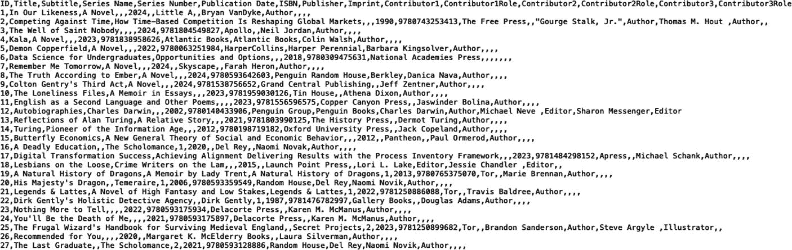

一个表格列出了各种书籍，列包括 ID、书名、副标题、系列名称、系列编号、出版日期、ISBN、出版社、印记和贡献者。每一行都提供了特定书籍的详细信息，包括书名、作者和出版信息。该表格包含小说、散文和科学著作，出版社包括 Little A、The Free Press 和 HarperCollins。著名作者包括尼尔·乔丹、芭芭拉·金索沃和娜奥米·诺维克。

图 12-8

在文本编辑器中查看书籍 CSV 文件

### 序列化文件及其他文件格式

还有其他存储数据的方式，但在 Python 中使用 Pandas 以及在 R 中使用它们通常很简单，因为你只需使用相应的库来读取这些文件，然后一两行代码就能搞定。有时数据或其他对象会被序列化并以 Python 中称为*pickle*的格式存储。任何内容都可以通过这种方式保存，并且保存机器学习模型时常用此方法。

另一种在云平台中越来越流行的格式是*parquet*，这是一种存储大量数据的好方法，因为它可以拆分到多个文件中。Parquet 文件还能很好地与那些可将耗时操作拆分开以便并行执行的工具配合使用（这称为*分布式计算*，在处理云平台上的大量数据时很常见）。

用于存储数据的文件类型层出不穷，因此保持与时俱进是件好事。

### 数据库

对于几乎所有数据科学家来说，数据库系统是日常工作的一部分。出于多种原因，数据库通常比电子表格和文本文件更好，包括存储管理方面的优势以及易于操作。数据库管理系统是一种软件，负责处理数据库中所有信息的存储。用户通过几种不同的方式与之交互，通常是通过数据库托管的界面，该界面允许编写和运行 SQL。数据科学家也使用这个界面，但很多时候，他们通过在其他环境中编写的 Python 或 R 代码来与系统交互。

在技术领域，术语*database*本身基本上意味着可以通过数据库管理系统访问的相关数据集合。你经常会看到这些系统本身被简称为*DBMS*（数据库管理系统），它可以是任何类型的数据库。大多数 DBMS 在高层级上将事物组织成它们所谓的数据库，这是一个可以包含其他对象（如表或其他层级对象）的对象。一个典型的例子是，Oracle DBMS 拥有数据库，每个数据库可以有多个模式，模式内部包含表和其他对象。这里的模式只是一个组织对象（例如，可以在模式级别授予权限，这些权限将应用于其中的所有对象）。在 Oracle 的设定中，引用一个特定的表需要数据库名、模式名以及表名本身。

#### 模式（SCHEMA）

术语“模式”在数据库世界中还有另一种用法，指的是数据库的整体逻辑结构，通常意味着其可视化表示。在大多数情况下，它会包括表名、表列以及表之间的关系。对于非关系型数据库，它会显示不同的对象。开发人员和数据科学家经常查看这些模式，以了解如何在特定数据库中处理数据。图 12-9 展示了我们将在下文“关系型数据库系统”部分中看到的一些表的模式。

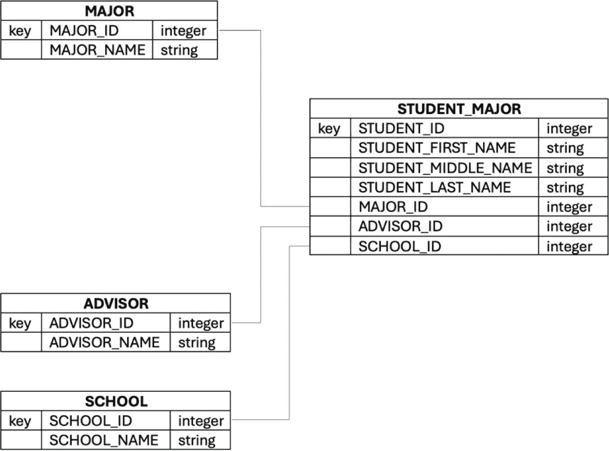

图示展示了一个包含四个表的数据库模式：`MAJOR`、`STUDENT_MAJOR`、`ADVISOR`和`SCHOOL`。每个表列出了其字段和数据类型。`MAJOR`包含`MAJOR_ID`（整数）和`MAJOR_NAME`（字符串）。`STUDENT_MAJOR`包含`STUDENT_ID`、`STUDENT_FIRST_NAME`、`STUDENT_MIDDLE_NAME`、`STUDENT_LAST_NAME`（均为字符串），以及`MAJOR_ID`、`ADVISOR_ID`、`SCHOOL_ID`（均为整数）。`ADVISOR`包含`ADVISOR_ID`（整数）和`ADVISOR_NAME`（字符串）。`SCHOOL`包含`SCHOOL_ID`（整数）和`SCHOOL_NAME`（字符串）。线条连接了不同表中相关的字段，表明它们之间的关系。

图 12-9

一个小型数据库的简化模式示例

该图显示了四个表。`STUDENT_MAJOR`表存储学生姓名以及他们的专业、顾问和学校。其他三个表只保存了专业、顾问和学校的 ID 和名称值。线条显示了表之间的关系。`STUDENT_MAJOR`存储一个链接到`MAJOR`表的专业 ID，对于顾问和学校也是如此。

这个示意图过于简化，通常会传达更多信息，尤其是关于字段之间关系的信息。另外请注意，这种示意图在关系型数据库世界中也被称为*实体-关系（ER）图*。

从历史角度来看，大多数数据库系统采用关系型组织范式，并使用一种称为 SQL 的语言与之交互。近年来，采用 NoSQL 范式的非关系型数据库系统已经变得更加普及，因为它们非常适合某些特定类型的数据。正如我们所见，Shutterfly 在上面的例子中就使用了 NoSQL 数据库系统。然而，尽管 NoSQL 已可用，但大多数数据仍然存在于关系型数据库系统中。我将在下文讨论这两种类型。

处理数据库中数据的数据科学家主要通过编写代码来*查询*数据库，以从表中获取特定数据，但他们也会创建、修改和管理表。每个 DBMS 都有某种机制来以某种方式与数据库交互。


好的，作为高级文档工程师和翻译员，我将遵循您的注意事项和示例，将给定的英文文本翻译为中文。


# 关系型数据库系统

关系型数据库管理系统（通常缩写为 RDBMS）非常适合处理结构化数据，并依赖于关系数据模型（详情请见侧边栏）。这些以及其他数据库系统在几乎所有组织中都无处不在，SQL 也是如此，SQL 是一种让人们与数据交互的语言。

## 关系数据模型

关系数据模型是一种处理表格数据相当直观的方法。它定义列并存储单独的行，每一行都有一个与每列对应的值。通常，每个表代表一个特定的事物（学生、销售交易、产品等），并且它们通过链接在一起来建立数据之间的关系。它描述了多个表如何被虚拟地连接在一起，并通过一种名为 SQL 的语言来定义，这种语言使人们能够轻松地对表进行操作，例如检索特定数据、向表中添加行或合并多个表。它还在 1970 年代早期彻底改变了数据存储方式，并且在其他方法出现之前的几十年里，一直是数据存储的方式。

## SQL

SQL——Structured Query Language（结构化查询语言）的缩写——是一种允许你与 RDBMS 交互的简单语言。一些最常见的 RDBMS 包括 MySQL、PostgreSQL、Microsoft SQL Server 和 Oracle。每个系统使用的 SQL 都略有不同，但大多数语法在系统之间是一致的。

学习 SQL 的最佳方法是边处理数据边学习，这样你就可以尝试不同的操作。它与其他大多数语言非常不同，因此学习 Python 或 R 并不能直接帮助你，尽管 R 和 Python 库 Pandas 的某些方面使用了类似 SQL 的概念来处理数据。

SQL 技能对于几乎所有数据科学家来说都至关重要，但你还需要对另外一件事表明立场：该语言的发音。大多数人把它读作 “sequel”，但有些人读作 “es-cue-el”。两种发音都是正确的，但人们对自己偏爱的发音有些自以为是，所以你最好想清楚自己的立场，以便在被要求选边站队时有所准备。

RDBMS 支持多种类型的操作，但数据科学家最常用的是数据定义语言（DDL）、数据操纵语言（DML）和数据查询语言（DQL）。数据科学家使用 DQL 和 DML 比使用 DDL 更多。DDL 包含允许用户通过创建、修改和删除数据表来定义和描述数据结构及关系的命令。创建和修改表涉及定义列，包括数据类型和唯一标识符。DDL 还允许用户定义表之间的关系，通常通过称为“键”的标识符来完成。`主键` 是表中的唯一标识符，在该键列（或列组合）中，任意两行的值都不能相同。最佳实践是每个表都有一个主键，通常只是一个整数值，每个新行递增 1，例如记录 ID。外键定义表之间的关系。`外键` 是一个表中的列，该列连接到另一个表中的键（通常是主键），从而将这些表联系在一起。

对于数据科学家来说，DML 和 DQL 操作更为常见。DML 包含数据修改命令，这基本上意味着使用 `INSERT` 命令向表中添加行，使用 `UPDATE` 修改行，或使用 `DELETE` 删除现有行。还有一些其他命令，但这些是核心命令。DQL 只有一个命令，即 `SELECT`，用于查询数据库或从数据库中提取数据。这是迄今为止数据科学家最常用的命令。

关系数据模型中与数据库设计相关的一个重要概念是`规范化`，这是一种将数据分解到多个相关表中，而不是全部存储在一个大表中的实践。将所有内容存储在一个大表中通常会导致大量数据冗余或重复数据，这会极大地增加存储在计算机磁盘上的数据的物理大小。规范化的主要目标是减少存储的数据的大小。它确实增加了处理数据的复杂性，但这种权衡被认为是值得的。当你查询数据库时，理解这一点也很有帮助。

为了理解数据库规范化，想象一所大学存储其学生信息。他们可能以表 12-1 所示这种简单方式存储，这通常被称为平面表，因为所有内容都在一个地方。

**表 12-1**
一个包含一些基本学生专业数据的小型“平面表”

| 学生 ID | 名字 | 中间名 | 姓氏 | 专业 | 导师 | 学院 |
| --- | --- | --- | --- | --- | --- | --- |
| 123 | 莎拉 | Dawn | 摩根 | 历史学 | 玛丽亚·内特尔斯 | 文理学院 |
| 456 | 维贾伊 |   | 雷迪 | 历史学 | 玛丽亚·内特尔斯 | 文理学院 |
| 789 | 勒罗伊 | N. | 史密斯 | 计算机科学 | 杰克·麦克尔罗伊 | 工程学院 |
| 850 | 维娜 | Swati | 斯里尼瓦桑 | 计算机科学 | 杰克·麦克尔罗伊 | 工程学院 |
| 1000 | 马文 |   | 加西亚 | 工业工程 | 琳达·马洛 | 工程学院 |
| 1111 | 泰德 |   | 罗 | 英语 | 玛丽亚·内特尔斯 | 文理学院 |

但请注意冗余数据：“历史学”、“计算机科学”、“玛丽亚·内特尔斯”、“杰克·麦克尔罗伊”、“文理学院”和“工程学院”这些值都出现了不止一次。这一点并不总是很明显，但在计算机存储领域，文本总是比数字占用空间更大。在这样一个小表里，这无关紧要，但如果有成千上万名学生，所需的额外空间就会开始累积。规范化要求将此表拆分为多个表。

考虑到哪些值重复了，规范化的第一步是将专业、导师和学院提取到单独的表中，为每个值分配一个数字，然后将该数字存储在此表中。这三个主要的表将类似于表 12-2 到 12-4。

**表 12-4**
规范化后的学院表

| 学院 ID | 学院名称 |
| --- | --- |
| 1 | 文理学院 |
| 2 | 工程学院 |

**表 12-3**
规范化后的导师表

| 导师 ID | 导师姓名 |
| --- | --- |
| 1 | 玛丽亚·内特尔斯 |
| 2 | 杰克·麦克尔罗伊 |
| 3 | 琳达·马洛 |

**表 12-2**
规范化后的专业表

| 专业 ID | 专业名称 |
| --- | --- |
| 1 | 历史学 |
| 2 | 计算机科学 |
| 3 | 工业工程 |
| 4 | 英语 |

新的部分规范化后的表如表 12-5 所示。所有的专业、导师和学院都被替换为指向新表中值的 ID。ID 仍然是重复的，但在数据库中，数字比文本小，因此它们占用的空间更少。

**表 12-5**
学生专业表规范化的第一次尝试

| 学生 ID | 名字 | 中间名 | 姓氏 | 专业 | 导师 | 学院 |
| --- | --- | --- | --- | --- | --- | --- |
| 123 | 莎拉 | Dawn | 摩根 | 1 | 1 | 1 |
| 456 | 维贾伊 |   | 雷迪 | 1 | 1 | 1 |
| 789 | 勒罗伊 | N. | 史密斯 | 2 | 2 | 2 |
| 850 | 维娜 | Swati | 斯里尼瓦桑 | 2 | 2 | 2 |
| 1000 | 马文 |   | 加西亚 | 3 | 3 | 2 |
| 1111 | 泰德 |   | 罗 | 4 | 1 | 1 |

如果这个表存储了数千名学生，它将比之前的版本小得多。但正如上面提到的，它也需要外键，表中“专业”、“导师”和“学院”列下的那些数字就是外键。这些数字在每列中出现不止一次并不太令人担忧，因为它仍然占用更少的空间，并且仍然减少了基于冗余的存储空间。


那些目光敏锐的读者可能已经注意到，`student_major`表仅部分实现了规范化，因为仍然存在一些冗余。每一行中，只要`Major ID`为`1`，`School ID`也必定为`1`，因为历史专业始终隶属于文理学院。（实际上，你需要确认这一点，但通常情况确实如此。）此外，如果我们假设每个专业只有一位特定的顾问，我们可以将这些信息提取到另一个表中，然后在`student`表中仅保留`Major`列。我们可以修改`Major`表来存储所有这些信息，并使用外键引用`Advisor`表和`School`表。修改后的表如表 12-6 所示。进一步规范化后的`student_major`表则如表 12-7 所示。

**表 12-7**  
进一步规范化后的`student_major`表

| Student ID | First Name | Middle Name | Last Name | Major |
| --- | --- | --- | --- | --- |
| 123 | Sarah | Dawn | Morgan | 1 |
| 456 | Vijay |   | Reddy | 1 |
| 789 | Leroy | N. | Smith | 2 |
| 850 | Veena | Swati | Srinivasan | 2 |
| 1000 | Marvin |   | Garcia | 3 |
| 1111 | Ted |   | Rowe | 4 |

**表 12-6**  
进一步规范化后的`Major`表

| Major ID | Major Name | Advisor ID | School ID |
| --- | --- | --- | --- |
| 1 | History | 1 | 1 |
| 2 | Computer Science | 2 | 2 |
| 3 | Industrial Engineering | 3 | 2 |
| 4 | English | 1 | 1 |

规范化结构还有其他优点。假设历史专业的顾问换成了另一个人，那么只需在`Major`表中更新（指向`Advisor`表中另一位顾问）。或者，如果顾问的姓名发生了变化，也只需在`Advisor`表中更新。在这两种情况下，更改都会在所有地方得到反映。要查找某位学生对应的顾问，我们可以通过`student`表中的`Major ID`查找，然后查看`Major`表中的`Advisor ID`，最后在`Advisor`表中找到具有该 ID 的行。

请注意，我们在本表中所采用的结构并非完美无缺。在`student`表中存储专业信息可能并非最佳选择。如果学生是双专业怎么办？任何标准的数据库系统都不允许在同一列中存储两个不同的 ID。因此，逻辑上的下一步是将专业信息从`student`表中移除——仅将`student`表用于学生的个人信息（或许包含出生日期、住址、永久地址等）。然后，我们将创建一个全新的表，仅存储`Student ID`和`Major ID`——如果学生有多个专业，则只需用该学生的 ID 对应不同的`Major ID`，创建两行记录即可。这种方法的另一个优点是能够跟踪学生专业的变更时间戳——例如，他们曾是化学工程专业，一年后才转到历史专业。我们可以跟踪每个专业的开始和结束日期，而如果所有信息都放在一个表中，这是不可能做到的。这些都是数据模型设计时可以考虑的选项。

还有一点值得一提：注意，顾问信息存储为全名。你几乎不应该以这种方式存储姓名。最佳实践通常是像我们对学生姓名所做的那样，将姓氏、中间名和名字分别存储在不同的列中。事后进行这种拆分并不总是那么容易，因为并非总能明确如何拆分全名——有些人有两个姓氏，且其中第一个被视为主要姓氏，此外还存在其他文化特定的命名习惯。在我们的示例中，理想的做法是创建一个包含名字、中间名和姓氏的表。然后，该表存储顾问 ID，如表 12-8 所示。

**表 12-8**  
一个更好的`Advisor`表

| Advisor ID | First Name | Middle Name | Last Name |
| --- | --- | --- | --- |
| 1 | Maria |   | Nettles |
| 2 | Jack |   | McElroy |
| 3 | Linda |   | Marlowe |

仅凭这张表，我们无法得知某个学生关联的顾问或学院，但通过运行查询将这些表连接起来非常容易。同样，我们可以通过正确连接所有表，运行查询来生成原始平面表中的所有信息。这正是数据科学家们一直在做的事情——运行查询，将不同数据源拼接在一起，以获取完成工作所需的数据。

这是一种极其常见的数据处理方式，因此理解关系模型非常重要——但这绝对是一件熟能生巧的事情。


### NoSQL 数据

近年来，其他数据存储方式的普及度日益增长。`NoSQL` 这个统称常用于强调它们不使用关系型数据模型。这些系统是为应对关系型数据库模型在可扩展性、性能及灵活性方面的局限而开发的。这是一个处于积极发展中的数据存储领域。`NoSQL` 常见于云端而非“本地”（存储在公司自有计算机系统内）部署，但也可在任何地方搭建。

`NoSQL` 数据库的一个有趣之处在于，许多 `NoSQL 数据库管理系统` 尽管数据并非以关系模型存储，却在系统之上构建了类似 SQL 的语言。因此，使用 `NoSQL` 数据库的体验往往与使用关系型数据库系统无异，所有差异都隐藏在底层。这得益于 SQL 的广泛普及以及 `NoSQL` 系统作为新生事物这一事实（大多数专业人士熟悉 SQL，但学习一门新的查询语言需要时间）。

`NoSQL` 数据库主要有几大类：文档存储、键-值存储、宽列存储和图数据库。*文档存储* 保存半结构化的“文档”，通常采用 JSON 或 XML 格式。它们非常灵活，且文档之间不必相互匹配，但不适用于复杂事务。示例中提到的 `MongoDB` 数据库就是一种文档存储。我们之前在书中看到的一些 JSON 数据可以存储在文档存储中，如图 12-10 所示，该图展示了文档存储中的三条动物记录。

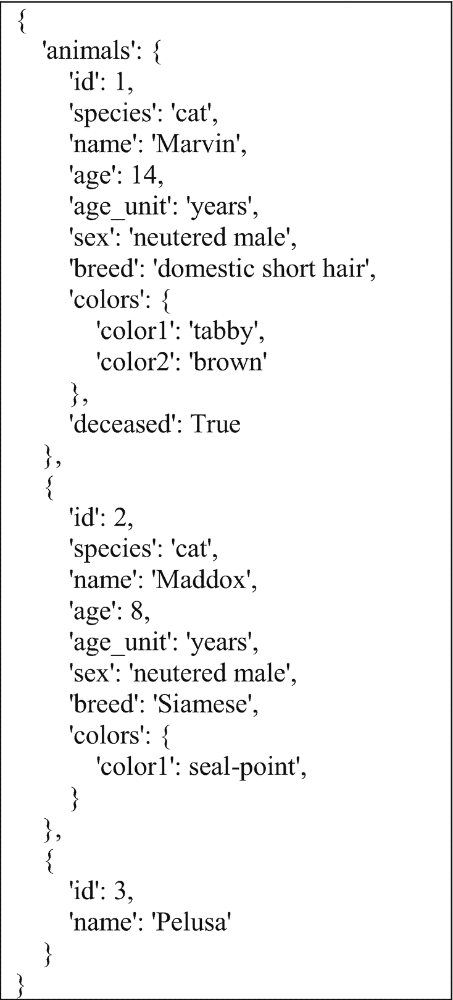

一个列出动物信息的 JSON 数据结构。它包含了三只猫的详细信息：Marvin、Maddox 和 Pelusa。Marvin 是一只 14 岁、已绝育的雄性家养短毛猫，毛色为虎斑棕，已故。Maddox 是一只 8 岁、已绝育的雄性暹罗猫，海豹重点色。Pelusa 的条目仅包含名字。

**图 12-10** 文档存储中三条记录的示例

*键-值存储* 包含的每个键在数据库中仅出现一次，每个键指向一个值。其巧妙之处在于，值本身可以包含键-值对。它们灵活且适用于非结构化数据。在顶层，存储一个键，它指向一个值，该值可以包含许多内容。图 12-11 展示了键-值存储中三条动物记录的示例，与文档存储相似。

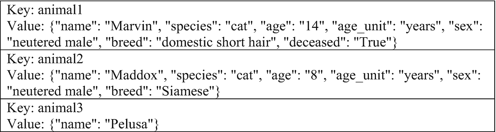

展示动物数据的表格。每个条目包含一个键和一个值。

- 键：`animal1`，值：名称：`Marvin`，物种：`Cat`，年龄：`14` 岁，性别：`Neutered male`，品种：`Domestic short hair`，已故：`True`。
- 键：`animal2`，值：名称：`Maddox`，物种：`Cat`，年龄：`8` 岁，性别：`Neutered male`，品种：`Siamese`。
- 键：`animal3`，值：名称：`Pelusa`。

**图 12-11** 键-值存储中的数据示例

*宽列存储* 表面上与关系模型相似，因为它们也将数据存储在表和行中；然而，列并非在表级别严格定义，不同的行可以拥有不同的列。这既提供了关系型结构的优势，又避免了其僵化性。如表 12-9 所示，其表示形式基本类似于一个稀疏的关系表，但在底层，那些看似“空”的值实际上根本不属于该行。

**表 12-9** 宽列存储中一张表的三条记录示例

| ID | 名称   | 物种 | 年龄 | 年龄单位 | 性别           | 品种              | 是否已故 |
|----|--------|---------|-----|----------|---------------|--------------------|----------|
| 1  | Marvin | Cat     | 14  | Years    | Neutered male | Domestic short hair | True     |
| 2  | Maddox | Cat     | 8   | Years    | Neutered male | Siamese            |          |
| 3  | Pelusa |         |     |          |               |                    |          |

最后一种 `NoSQL` 数据库是*图数据库*，它通过节点和边（连接节点的线）来存储数据。节点通常存储名词，如人物、地点或事物，并且可以拥有额外的属性。它们在视觉上通常用椭圆形表示。边定义了节点之间的关系（常使用动词）。图 12-12 展示了三个动物和一个房屋，均为节点，以及三条关系（边），定义为节点之间的连线。

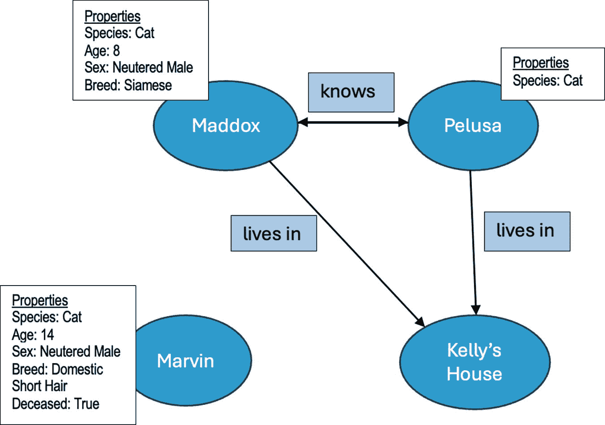

描述实体之间关系的流程图。Maddox，一只 8 岁的已绝育雄性暹罗猫，认识 Pelusa，另一只猫。Maddox 和 Pelusa 都住在 Kelly's House。图中还显示了 Marvin，一只 14 岁已故的已绝育雄性家养短毛猫。箭头表示关系：Maddox 和 Pelusa 之间的“认识”，以及 Maddox 和 Pelusa 指向 Kelly's House 的“居住于”。

**图 12-12** 图数据库中的数据示例

NoSQL 数据库可能与关系型数据库管理系统 (RDBMS) 有很大不同，并且通常有特定的用例。你可能永远不会在关系型数据库管理系统之外处理数据，但了解其他选项有朝一日可能会派上用场。

### 数据维护与保养

我已经提到过数据清洗和准备工作，但无论怎么强调它们的重要性都不为过。下一章将深入探讨面向数据科学家的数据准备工作，但同时，在数据存储层面也有数据清洗和准备的工作。当由不同团队管理数据时，这一点更为明显，例如由分析工程师或数据工程师负责将数据导入数据科学家使用的标准位置。他们通常会进行一些基本的转换并应用简单的业务规则，以便数据可供使用。

这些数据团队应确保数据的基本质量，例如确保唯一键在数据中真正唯一、不存在重复项，以及在不允许为空的地方没有空字段。数据科学家通常不必关心这些，但现实情况是，在许多公司，数据工程师可能不存在或未能尽职尽责。因此，除非数据科学家对数据工程师的工作极为信任，否则做好准备检查所使用数据的质量至关重要。这种信任通常只有在数据被广泛使用且所有问题都得到解决之后，或者数据工程团队非常成熟时才会建立。


# 数据与信息组织

尽管数据库管理系统确保数据以特定方式组织，但在跨多个系统时还有其他组织数据的方式。在这一领域有许多术语，包括数据湖、数据仓库、数据孤岛和数据市集。

*数据孤岛*是指被锁定、仅限预期用户访问，其他领域和系统无法触及的数据集合。这通常并非有意为之——数据孤岛往往是某个特定领域的需求逐渐积累而成的。例如，随着时间的推移，人力资源部门积累了大量不对外共享的数据。对于大部分数据而言，这可能是合适的，但其中某些数据在不损害隐私和合规的情况下，可能对其他部门有益。此外，不同领域独立发展的数据孤岛会存储基本相同的数据，但往往形式各异。这些数据可能完全相同，导致效率低下且占用不必要的存储空间；也可能略有差异，从而在不同领域间产生不同的结果。总的来说，企业希望避免数据孤岛，因为它们会增加存储成本，并且“重复但不同”的数据可能导致使用不同孤岛版本的分析产生巨大差异。请注意，这与访问权限无关——没有人希望整个公司都能访问人力资源数据，但其部分数据应酌情提供给其他领域和系统，而数据孤岛阻碍了这种可能性。

*数据仓库*是一个集中化且高度结构化的系统，它将来自多个领域的数据汇集到一起，以支持报告和分析。其目标用户是商业智能。数据仓库的组织组件是事实表和维度表。维度通常是“事物”，事实是“行为”。例如，在一个视频游戏商店的数据仓库中，会有一个关于商店产品的维度表，包含名称、主机、价格、类型等信息。可能还有一个客户维度表，包含每位客户的信息，如姓名、会员编号和地址。然后会有一个表示商店所有交易的事实表——即不同客户购买不同产品的记录。

请参阅表 12-10、12-11 和 12-12，了解这样一个小型数据仓库。所有产品都存储在一个名为 `Products` 的维度表中（表 12-10），其中包含每个产品的基本信息。然后有一个名为 `Orders` 的事实表（表 12-11），存储通常所说的订单头信息——即使一笔订单可能包含多个购买项，每笔订单也只占一行。该表包含多个列，用于记录该高级别的各种信息。`Orders` 表完全没有提及游戏，因为游戏是在订单行项目级别销售的，这些信息存储在 `Ordered Items` 事实表中（表 12-12）。该表与 `Orders` 表中的订单相关联，显示订单中每个项目的信息。它包含两个外键：`Order ID`（指向 `Orders` 表）和 `Game ID`（指向 `Products` 表）。

**表 12-12**

小型数据仓库事实表 (`Ordered Items`)

| 订单项 ID | 订单 ID | 游戏 ID | 小计 | 地方税 | 州税 | 折扣 | 交易时间戳 |
| --- | --- | --- | --- | --- | --- | --- | --- |
| 1 | 1 | 3 | 29.99 | 1.05 | 1.95 | 10.00 | 2024-01-15 15:03:45 |
| 2 | 2 | 4 | 49.99 | 1.60 | 3.37 | 0.00 | 2024-01-18 02:14:42 |
| 3 | 2 | 5 | 49.99 | 1.60 | 3.37 | 0.00 | 2024-01-18 02:14:42 |
| 4 | 3 | 1 | 39.99 | 1.20 | 2.29 | 0.00 | 2024-01-18 17:58:41 |
| 5 | 3 | 3 | 19.99 | 0.60 | 1.15 | 20.00 | 2024-01-18 17:58:41 |
| 6 | 3 | 2 | 49.99 | 1.49 | 2.86 | 0.00 | 2024-01-18 17:58:41 |
| 7 | 4 | 4 | 49.99 | 1.87 | 3.25 | 0.00 | 2024-01-18 21:47:48 |
| 8 | 4 | 4 | 49.99 | 1.87 | 3.25 | 0.00 | 2024-01-18 21:47:48 |
| 9 | 5 | 2 | 49.99 | 1.17 | 3.50 | 0.00 | 2024-01-19 01:39:51 |
| 10 | 6 | 1 | 39.99 | 1.24 | 2.20 | 0.00 | 2024-01-19 09:01:00 |

**表 12-11**

小型数据仓库事实表 (`Orders`)

| 订单 ID | 收款机编号 | 小计 | 地方税 | 州税 | 订单总额 | 总折扣 | 运费 | 实收金额 | 发货日期 | 交易开始时间戳 | 交易结束时间戳 |
| --- | --- | --- | --- | --- | --- | --- | --- | --- | --- | --- | --- |
| 1 | 1 | 29.99 | 1.05 | 1.95 | 32.99 | 10.00 | 5.99 | 28.98 | 2024-01-17 | 2024-01-15 15:03:17 | 2024-01-15 15:03:45 |
| 2 | 4 | 99.98 | 3.20 | 6.75 | 109.93 | 0.00 | 7.99 | 117.92 | 2024-01-19 | 2024-01-18 02:14:31 | 2024-01-18 02:14:42 |
| 3 | 1 | 109.97 | 3.29 | 6.30 | 119.56 | 20.00 | 7.99 | 107.55 | 2024-01-19 | 2024-01-18 17:58:19 | 2024-01-18 17:58:41 |
| 4 | 2 | 99.98 | 3.74 | 6.50 | 110.22 | 0.00 | 7.99 | 118.21 | 2024-01-19 | 2024-01-18 21:47:30 | 2024-01-18 21:47:48 |
| 5 | 1 | 49.99 | 1.17 | 3.50 | 54.66 | 0.00 | 5.99 | 60.65 | 2024-01-20 | 2024-01-19 01:39:42 | 2024-01-19 01:39:51 |
| 6 | 3 | 39.99 | 1.24 | 2.20 | 43.43 | 0.00 | 5.99 | 49.42 | 2024-01-20 | 2024-01-19 09:00:34 | 2024-01-19 09:01:00 |

**表 12-10**

小型数据仓库维度表 (`Products`)

| 产品 ID | 标题 | 主机 | 标价 | 类型 | 发布日期 | 平均评分 |
| --- | --- | --- | --- | --- | --- | --- |
| 1 | 星酿物语 | Wii | 39.99 | 冒险;解谜 | 2018-05-16 | 3.45 |
| 2 | 竞速狂飙 | Wii | 49.99 | 竞速;体育 | 2019-02-01 | 4.01 |
| 3 | 终审法庭：首案 | Xbox | 39.99 | 角色扮演;回合制策略 | 2020-07-14 | 2.98 |
| 4 | 松景庄园 | PlayStation | 49.99 | 冒险;角色扮演 | 2021-10-31 | 3.90 |
| 5 | 松景庄园：后台区 | PlayStation | 49.99 | 冒险;角色扮演 | 2022-01-08 | 3.99 |

数据仓库设计有不同方法，但数据科学家通常不参与创建过程。数据仓库的表通常是“扁平化”的（规范化程度较低），这就是它们方便商业智能的原因（用户无需为了创建报表而连接多个表）。在数据仓库中，也常见聚合表。它们的目的相对聚焦，但仍可能变得非常庞大。另一方面，*数据市集*则是一个更小、更聚焦的数据仓库，通常局限于特定领域。

*数据湖*是一个集中化且高度可访问的不同类型数据存储库，基本上与数据孤岛截然相反。其内容可以来自其他数据库、数据仓库以及任何其他类型的数据。数据湖旨在让数据易于处理，因此对数据科学家有很多好处。一个需要注意的问题是，数据湖在集中数据时几乎不进行（或很少进行）转换。其理念是数据已被提供，用户可以根据自身特定需求来决定如何进行转换。数据湖需要精细管理（尤其是在数据完整性和安全性方面），否则可能沦为“数据沼泽”。


## 存储选择的后果

所有不同的存储选择都各有利弊，通常取决于数据的预期用途。例如，高度规范化的数据库从存储角度来看效率很高，但查询它们的成本可能很高，因为需要连接许多表才能获取所有信息。这也是数据仓库被用于商业智能的原因之一——获取一条信息需要连接的表更少。每当有人打开报表时，商业智能报表都会查询数据库，如果用户等待报表完全加载的时间超过几秒钟，这通常被认为是不好的体验。

安全性也因存储选择而变得更容易或更难管理。如果整个公司的数据都进入一个数据库，安全团队将不得不管理那个庞大数据库中的所有对象。这也是为什么更常见的是存在许多数据库，每个数据库都有特定用途的原因之一。可以为团队授予对不同数据库的访问权限，这使得访问管理稍微简单一些。

## 数据所有权与管理

我相当抽象地谈论了管理数据的“其他人”，而非数据科学家本人。不同公司的情况各不相同，但与数据收集和存储相关的常见角色包括数据工程师、分析工程师和数据库管理员。`数据工程师`通常负责在数据存入数据库或其他预定位置之前，进行数据移动、转换、清理等工作。`分析工程师`是专业化的数据工程师，他们对分析需求有更深入的了解，旨在做出良好的转换选择，从而为数据科学家和其他分析用户简化工作。最后，`数据库管理员`负责管理数据库基础设施本身，包括（但不限于）数据库软件、有时是安装该软件的机器、性能与优化，以及安全性与访问权限。

我还提到了数据质量和数据治理的重要性。这是一个重要但常常未被实施或实施不当的领域。虽然数据库管理员管理数据的物理存储位置，数据工程师负责数据的移动，但数据到底归谁所有，谁又为其质量负责？这始终是一个难以回答的问题。数据治理旨在回答这个问题，并控制数据管理的其他方面。

数据治理是一项数据管理职能，旨在确保数据具有高质量、可用性、安全性和高完整性。其中一些是高层面的，涉及数据法规等问题，但我们更关心它与数据科学家工作的关联。通常，数据治理人员会与安全团队和数据库管理员合作，但不与数据科学家合作。他们所做的工作之一是试图确定数据所有者。数据所有者有时可能被期望非常懂技术，但也存在寻求业务数据所有者的案例——即对数据有业务专长的人，也就是领域专家。例如，人力资源部门的人应该拥有人力资源数据。这不应该是数据科学家、数据工程师或数据库管理员。但让业务人员拥有数据很困难，因为人们并不真正想要这个责任，因为这看起来任务繁重。数据所有者的概念也相对较新，人们还不习惯这个想法。业务数据所有者可能不知道所有字段名等等，因此还需要其他更懂技术的人员来弥合业务与数据科学家、商业智能等人员（那些需要实际查询表的人）之间的差距。实际上，有时数据科学家自己必须填补这个角色。

## 数据科学家在数据收集与存储中的角色

在数据的收集和存储方面，数据科学家扮演着不同的角色。大多数人不会经常处理数据收集工作。市场营销和其他领域的数据科学家可能会运行 A/B 测试或其他实验，这些实验可能涉及数据收集的规划。数据科学家通常也不需要就核心数据做出存储决策。然而，他们会发现自己需要创建自己的数据源，以便与其他数据科学家共享或在项目内重复使用。了解所有选项对此可能很重要。通常，这很简单，只需将表存储在团队数据库中即可，但有时会更复杂。只要记住存储选择总是存在取舍，你就已经领先一步了。


## 主要收获与下一步

在本章中，我们探讨了数据收集与数据存储。我提到了手动收集与自动收集：手动收集指像填写表单这样需要人工将数据录入计算机的操作；自动收集则指无需人员直接参与即可将数据存入数据库。如今大多数情况介于两者之间，比如填写数字表单——你手动填写，但点击提交后，数据就会自动进入数据库。数据产生错误的途径有很多，包括拼写错误、记录间数据不一致以及数据缺失。

我介绍了当前数据存储的三种主要方式：电子表格、文本文件和各类数据库。我们深入研究了关系型数据库系统，并讨论了规范化这一数据库设计风格。几十年来，关系型数据库一直是数据存储的中流砥柱，但我也谈到了几种不同类型的 NoSQL 数据库，即关系型数据库的替代方案。

在下一章中，我们将通过探讨数据预处理来开启数据准备的讨论。数据预处理主要侧重于清理数据，确保数据能准确反映其应代表的内容。它涉及处理缺失值、重复行、格式不一致的数据以及异常值等问题。

## 从业者简介：肖里亚·梅塔

**姓名：** 肖里亚·梅塔

**现任职位：** BI 工程师

**当前行业：** 零售

**从业年限：** 在数据分析、数据科学和 BI 领域拥有 5 年经验

**教育背景：**

*   分析学专业研究硕士
*   信息技术学士

*此处表达的观点仅代表肖里亚本人，与他的任何现任或前任雇主无关。*

### **背景**

肖里亚对计算机感兴趣，因此他进入大学攻读信息技术专业。他最初从事软件测试工作，测试软件的功能和性能，其中很多是手动测试，所以他学会了如何处理数据。他尤其喜欢处理大量数据的软件，在进一步研究有哪些类型的工作岗位后，他意识到自己想要从事数据领域的工作。他开始自学，但最终决定攻读该领域的学位。他来到美国攻读硕士学位。

### **工作**

在读研期间，肖里亚在一家大型零售商那里获得了一份数据科学实习机会，他非常喜欢这份工作。他学到了很多东西，毕业后留在了同一家公司。他的技能在多个领域得到了发展。疫情期间，他所在的公司出现了供应链问题，他对供应链管理产生了浓厚兴趣，于是在该领域找到了一份新工作。过了一段时间，他又转入了另一个有趣的领域，对该零售商网站的数据进行数据分析和 BI 工作。他喜欢这份工作，因为观察数据随时间的变化很有趣，并且能帮助网站团队进行改进。

### **语录集锦**

**工作中最喜欢的部分：** 肖里亚觉得挖掘数据很有趣，因为他总能发现有趣的东西，但这同时也意味着要了解数据，这样他以后就能用数据做更多事情。所有这些都提升了他解决利益相关者问题的能力，当他帮助公司节省资金或提高运营效率时，也很有成就感。

**工作中最不喜欢的部分：** 依赖其他团队有时会令人沮丧，因为他们常常没有时间帮助你或完成你需要的事情，他们有自己的优先事项，这可能导致你的工作受阻，进而导致项目延期。

**最喜欢的项目：** 肖里亚有几个他非常喜欢的项目。在一个项目中，交货经常延迟，公司想了解原因。他致力于理解产品从发货到送达的整个生命周期，包括在仓库的时间以及实际发货时间。然后，他通过查看承运商和配送服务本身（如 UPS、USPS 等）的数据，深入分析了运输步骤。他最终成功找出了延迟的原因，公司据此进行了改进。在另一个项目中，他研究了仓库中的物品处理流程以及参与处理的人数。通过查看数据，他发现当处理的物品数量较多时，实际工作人员反而较少，反之亦然，这让所有人都感到惊讶。这一发现带来了流程变革和巨大的财务节省。

**最常用的技能：** 对数据有敏锐的洞察力，并且有好奇心去了解更多。这可能很耗时，但你需要仔细审阅数据，了解其中包含什么，以及它如何与现实世界关联。另一个重要技能是在处理数据和与人打交道时要有耐心。在数据中发现故事也非常重要。如果你找不到故事，就需要提出不同的问题。

**目前主要使用的工具：** SQL、Databricks、用于 Azure 的 SSMS、Excel/Google Sheets、Power BI

**数据科学的未来：** 人工智能领域还会有更多发展。但我们仍然需要人类，因为只有人类才能真正拥有业务知识。理想的情况是，人们利用 AI 来加速工作。这不是二选一的问题。

**优秀数据科学家的特质：** 最重要的事情是对数据有洞察力。仅仅知道算法是远远不够的——这大概只占你需要理解内容的 10%。你需要独立自主，愿意主动出击并抓住机会。拥有扎实的计算机科学背景也是一个巨大的优势，因为它能帮助你编写更高效的代码。此外，理解你所在公司的业务——当然还有数据——也非常重要，因为只有这样，你才能为你的机器学习模型提出有意义的特征。

**给未来数据科学家的建议：** 在你找工作之前，就要选定一个细分领域并培养你的技能。花时间研究那个领域，尽可能多地学习。但也要有耐心——有时候事情需要时间。始终保持成长型思维，提升编码和分析两方面的技能。

*肖里亚是一位经验丰富的零售数据专业人士，在数据分析、数据科学和商业智能领域拥有丰富经验。*

脚注 1 2

# 13. 给准备者：数据收集与预处理


## 引言

至此，你可能已经明白为什么我们需要获取正确的数据并进行恰当的预处理——预测或分析的质量完全取决于输入的数据。在数据科学领域，“垃圾进，垃圾出”这一格言真切成立，而原始数据未经处理就能在机器学习模型中表现良好的可能性微乎其微。这并不意味着数据不包含大量有用信息，只是它天生尚未准备好应用于实际场景。西蒙·拜尔斯并非一夜之间就成为举世闻名的体操运动员——她经过了多年的准备、发现并磨练特定优势、并有针对性地弥补不足。

数据收集看似不言自明，但为机器学习或分析选择正确的数据却并非总是易事。正如我们在关于领域知识的第 10 章中看到的，你需要非常了解你所处理的问题、所需的数据类型以及可用的数据。如果你是自己收集数据，则应关注上一章以及第 3 章关于实验设计的讨论。更可能的情况是，你将使用已经存在的数据。这意味着你必须找到它，然后对其进行预处理以投入使用。

在现实世界中，“数据预处理”到底意味着什么？它并非一组特定的步骤。你需要进行的预处理取决于你试图实现的目标、你计划进行的分析或机器学习类型，以及你所拥有的数据类型。有时，当数据科学家谈论数据预处理时，他们指的是准备将任何数据输入机器学习模型的所有方面，包括数据预处理和特征工程。在本章中，我将重点讨论第一阶段，即预处理，而将特征工程留到下一章。数据预处理任务与特征工程任务之间并没有严格的规则来区分，但我会专注于基础内容，包括清洗、格式化、合并数据以及处理“坏”值。

# 现实世界中的数据预处理实例

拥有状态正确的正确数据至关重要，足以决定项目的成败。如前所述，特征工程对大多数机器学习来说确实至关重要，但如果数据本身没有准备好，就无法进行良好的特征工程。这正是数据收集和预处理发挥作用的地方。在下面的第一个示例中，一家医院原本有一个旨在预测肺炎患者再入院率的系统，以便更好地决定治疗方案，但他们直到项目深入后才意识到，他们收集的数据遗漏了决策所需信息的一个关键方面，导致预测结果出现偏差。他们没有收集到正确的数据。在下一个示例中，我们将看到，在初涉数据科学的人最常尝试的机器学习问题之一——预测泰坦尼克号上哪些乘客能够幸存——上获得良好结果是如何依赖于良好的数据预处理的。

## 示例 1：缺失的生死攸关信息

这是一个旨在帮助决定肺炎患者是否再入院的项目，以辅助护理决策（并降低成本）。我们知道，不同的肺炎病例严重程度不同，适当的治疗取决于评估的严重程度，特别是患者是需要住院还是可以在家康复。在这家特定的医院，患有哮喘的肺炎患者无论其肺炎严重程度如何，都会被送入医院重症监护室。^(³²) 由于对哮喘患者采取了这种保险措施，他们在研究中的最终存活率反而高于普通人群。这实际上导致了数据偏差，因为它使得哮喘看起来根本不是风险因素，从而导致模型在建模时忽略了患者是否患有哮喘这一因素。

之所以出现这种情况，是因为哮喘患者的数据从整体数据集中缺失了，因为他们没有基于病情严重程度进行评估。数据科学家试图自动化的流程从未将这些人完全考虑在内。确保拥有正确的数据用于模型开发始终至关重要。

尽管这是一个无心之失，但如果项目相关人员没有意识到这个问题，并将此系统发布到现实中，试想一下，对于那些无法自动收治哮喘患者、而必须使用此工具作为指南来决定是否收治的医院，它会给哮喘患者带来多大的伤害。这将严重违反医疗伦理。

## 示例 2：人人钟爱的机器学习问题

`Kaggle.com` 是一个热门网站，它托管供数据科学家使用的比赛和数据。这是一个在真实数据科学领域初试锋芒的好地方，你甚至可以使用他们的平台运行代码，而无需在自己的电脑上安装所有东西。人们会创建包含解决方案和分析的笔记本并在网站上分享，这样你可以向他人学习并积累声誉。许多比赛确实有现金奖励，但该网站最受欢迎之处在于它作为一个社区，能培养成长中的数据科学家。那么，这与数据预处理相关的例子是什么呢？该网站上参与人数最多的滚动比赛是预测“`泰坦尼克号`”灾难幸存者的比赛。^(³³) 截至撰写本文时，已有近 15,000 名参与者提交了超过一百万份参赛作品。

随着这个问题被反复解决，一个共识浮现出来：良好解决方案中最重要的部分就是恰当的数据准备。当我查看排行榜时，排名前 335 的参赛作品在其测试集上获得了满分（100% 完美预测幸存者与非幸存者），而这个测试集是 `Kaggle` 提供的但并未公开。坦白说，这实际上表明了一种过拟合（模型训练中的一个问题，即模型泛化能力差，过于贴合其训练所用的特定数据）现象，我们稍后会讨论。我们知道，对于每个幸存者来说，运气都起了一定作用，因此结果不应该是完全可预测的，但我们也确实知道，有一些特征是预测的非常重要的因素，包括性别和船票等级。

如果你浏览一些贡献者分享的高分笔记本，你会看到他们都进行了扎实的`EDA`，检查每个字段的模式和缺失值。^(³⁴) 他们研究了相关性以识别共线特征（那些看起来提供相同信息的特征，因此我们不应同时包含两者）。他们利用在`EDA`中的发现来选择要关注的特征、清洗数据，特别是填充缺失值。有这么多人解决了这个问题，我们可以毫不怀疑地断定，数据预处理（以及特征工程）至关重要。


## 数据收集

数据收集与准备的绝对第一步是理解业务问题。你希望通过使用数据达成什么目标？这会影响你将寻找和使用的数据集。

实际收集数据的过程有时可能很艰巨。除非你已有权访问这些数据，否则你需要向不同的人打听才能找到数据，然后可能还要申请访问权限。一旦拿到数据，你必须在上面进行 `EDA`（探索性数据分析），才能了解你是否真的能使用它、可能用到哪些字段，以及需要做哪些准备。

作为数据收集的一部分，你还希望尽可能了解数据的收集方式，特别是是否存在任何已知的错误可能性（或确定性）。在处理问题时，这种知识可能非常宝贵。

准备的下一步是数据预处理，旨在使数据尽可能可用，并为任何重要的特征工程做好准备。同样非常常见的是，在数据预处理阶段（以及特征工程阶段）你可能会发现没有所需的所有数据，这意味着你需要回到起点，尝试确定你能获取的重要数据来源。这种迭代是完全正常的，可能涉及与利益相关者反复沟通。

## 合并数据源

数据科学家常常需要合并来自不同来源的数据，这也被称为*集成*。大多数情况下，当考虑关系型表格时，这意味着添加列而不是添加行。例如，想象一家披萨外卖店，它在销售数据中有一个表格，每次销售如果使用了优惠券，就会包含一个优惠券 ID。他们想知道每种优惠券的受欢迎程度，并计算折扣“损失”了多少销售额。他们还有另一个表格，包含优惠券 ID 和其他信息，包括折扣金额。如果他们将这两个表格合并在一起——用关系型数据的术语来说就是*连接*——他们就能在一个表格中更轻松地看到这些模式。设想他们还希望了解不同类型的客户使用哪种优惠券，以便在人们家门口留下更有针对性的优惠券传单。幸运的是，他们还有一个包含基本客户信息的表格。他们还可以将客户数据连接到已经创建的合并表格，因为每笔订单都由一个客户完成，且该客户 ID 就在销售表格中。一旦所有数据到位，他们可以进行各种操作——聚合和筛选——来了解能发现什么。例如，他们可能会按周聚合销售额，看看发布新优惠券的周是否比其他周更繁忙。

## 数据预处理技术

数据预处理的某些方面可能由数据和分析工程师完成，但数据科学家几乎总是还需要自己做一些准备工作。在讨论数据准备时，我们通常使用相当不精确的语言。你会听到各种术语——清洗、净化、整理、调校——所有这些都可能指向相同的基本概念。数据几乎从不会真正准备好用于分析，因为它总是有*噪声*——从小到大各种错误、不一致性以及其他意外情况，这些都可能对分析和数据科学工作造成严重破坏。`EDA` 的一个目标是识别这些值，而预处理的目标是确定如何处理它们并做出适当的更改。

请注意，预处理可以帮助我们处理数据的许多方面，即使从技术上讲数据并非“错误”。例如，我们可能决定更改日期字段的格式，使其按特定顺序存储。

### 重复行

如果你忘记检查，重复行往往就藏在眼皮底下。但它们可能会严重偏倚模型，尤其是如果存在某种特定的重复模式。有时，重复行可能是另一行的字面副本，每一列的值都相同。这些是最容易检测到的。其他时候，可能只有某些行需要重复，记录才被视为重复。如果你有一个人员表格，两行具有相同的社会安全号码、姓名和出生日期，但出生地不同，那肯定有问题，你知道其中一行是错的。如何处理重复行取决于上下文和业务知识。你总是需要考虑记录是如何变成重复的，这会指导你如何修复它。即使两行之间每个值都重复，也可能存在它们并非真正重复条目的情况——两者都可能有效。例如，假设一个表格存储人们的姓名、出生日期和出生州，但没有其他信息。虽然不太可能，但也不排除两个同名同姓的人在同一天甚至同一州出生的可能性。

### 格式化和标准化

当数据被妥善存储时，通常不需要进行大量格式化工作。但我们并非总是这么幸运。我们希望特定列中的所有数据保持一致并以相同格式排列，因此有时需要进行清理才能实现这一点。你可能会遇到一个字段有时以磅（pounds）存储重量，有时以千克（kilograms）存储，由另一个字段指示（这在跨国经营的公司中很常见，本地单位如度量衡和货币会按当地方式存储）。创建一个新版本的表格，其中包含两个新列分别显式存储以磅和千克为单位的重量，这可能是个好主意。这需要根据指示单位的第二个字段来转换原始字段。

在处理文本值（如电子邮件地址、物理地址和电话号码）时，格式化尤其重要，通常需要标准化。通常，这类数据会被拆分成不同列和/或以原始形式存储，以避免在数据库中进行格式化，但如果你处理的数据不是这样构建的，你可能需要进行一些格式化。例如，你更希望电话号码只存储数字而不带标点，就像 `9435551234` 这样。但如果某些记录只使用短横线，而其他记录使用括号表示区号，那么如果你打算以任何方式使用该号码，就需要处理这个问题。

一种特别常见、因格式化而可能成为噩梦的数据类型是日期。主要的数据库管理系统（DBMS）都拥有可以正确存储日期和时间的日期、时间和日期时间数据类型，但即使在数据库中，它们也经常被存储为文本。如果你处理的是文本文件甚至是原生电子表格，你也会遇到文本格式的日期。虽然人类习惯于使用像 `1/4/24` 这样的简写形式，但在没有额外信息的情况下，这并非 100% 可解读。是月份在前，采用美式风格，还是月份在后？是 2024 年还是更早的世纪？很多与计算机打交道的人更喜欢 `2024-01-04` 这种风格，它总是四位数的年份，然后是月份和日期，月份和日期都用前导零补齐。这种格式对于代码处理来说很轻松，即使以文本形式存储也能正确排序。但如果在你之前的人不那么贴心，将文本日期以另一种格式存储——或者更糟的是，以多种不同格式存储——那么标准化工作就将落在你头上。二十世纪末临近时，全球曾对“Y2K”（千年虫）问题产生过轻微恐慌，原因就是年份只被存储为最后两位数字。最终它并没有造成太大问题，因为关键系统在时钟跳转到 2000 年之前就被修复了，但当时确实存在很多不确定性。


### 处理“不良”数值

数据中可能存在大量在某种程度上被视为不良的数值，但最明显的两类是异常值和缺失值。许多数据科学新手会本能地想要直接剔除异常值，并用该列其他数值的平均值来替换缺失值。这两种选择几乎总是错误的——但并非在所有情况下都是如此。

#### 异常值

首先，异常值不一定是糟糕的数据，因为它们实际上可能是正确的。有时候事情确实异于寻常。另一些时候，异常值纯粹是错误的。我一位朋友的母亲有一张驾照，上面错误地将其体重标注为 934 磅——对于一位驾驶汽车的人来说，这显然超出了可能的范围。如果你的数据集中包含这个值，你就需要弄清楚该如何处理它。

异常值也可能表明有其他情况在发生。我曾在一家需要会员资格的零售商工作，当时所有订单都关联着一个会员编号。但偶尔会有一些订单，由于某些特殊原因无法获知真实会员编号，而使用一个虚拟值 99 来记录。如果我们按会员对销售额进行汇总，那么会员 99 的销售额将远超其他所有个人会员。它实际上并不代表一位真实的会员，所以如果我们研究的是与会员相关的事项，就应该剔除这些记录。但如果我们不关心会员资格，只关心各门店的总销售额，那就不该剔除这些记录。背景和业务知识至关重要。这再次提醒我们要思考数据中数值的实际含义。

在识别“异常值”方面，有一些相当标准的标准，例如低于或高于四分位距 1.5 倍的值。但如何定义它们取决于你的项目和具体背景。

### 插补

缺失值带来了另一个需要决策的难题，同样要基于背景以及你对数据所代表含义的了解。有时，用另一个值填充缺失值是合理的，这个过程称为*插补*。一些常见的插补方法包括用 0、整个数值列的平均值或中位数、或者分类列的众数（最常见值）来填充空值。但如果这些空值所代表的意义与你刚刚填入的值完全不同呢？想象一个存储信用卡余额的数值列，系统中存在一个无法处理负值（表示应退还给持卡人的款项）的 bug，导致在这些情况下该值被留空。如果你用所有信用卡余额的平均值来填充这些空值，结果将会极其不准确。在这种情况下，用 0 进行插补可能是一个不错的解决方案——但如果你不知道数值缺失的原因，你又如何知道对那一列中的每一个缺失值来说，这个方法都是正确的选择呢？

你始终需要考虑数据和背景。想象一列名为 `death_date` 的数据。如果该值为空，可能表示此人尚未去世，也可能表示该日期不详。如果你的数据是关于生活在 19 世纪的人，你知道是后一种情况；但如果数据是关于 20 世纪出生的人，则两种可能性都存在。根据你试图用这些数据做什么，你可能不希望用某个任意值来填充它，因为你添加的任何值都只是错误的。或者，你可以填入一个明显不切实际的日期，比如 `12-31-9999`，你知道这是虚构的，但这样可以对这一字段进行某些计算。

请注意，这个过程可能更适合保留到特征工程步骤中，并结合其他特征来考量。例如，如果你知道某些信用卡余额为空是由于上述问题，你可以稍微探索一下数据，看看过去几个月里该持卡人是否没有被收取利息，那么你可能就愿意推断这些特定持卡人确实有应收款项，并可以安全地为其分配一个 0 余额。

处理插补值的一个常用技巧是添加一个新的布尔列，用于指示另一列是否经过了插补。这个新列可以输入到模型中，从而改善模型性能。如果值未经插补，模型可以有效利用该值；如果经过插补，则可以忽略它。


## 关键要点与下一步

本章探讨了数据准备中的数据预处理部分。我们通过几个示例说明了拥有正确数据的重要性，以及数据准备对后续机器学习模型性能的关键作用。我们讨论了数据收集和整合不同数据源的过程。随后，介绍了一些常见的预处理步骤，包括处理重复行、格式化以及处理“不良”值。所有这些步骤都可以归类为不同的术语，最常见的是数据清洗。

在下一章中，我们将介绍特征工程，从而完成数据准备部分。这将涉及处理单个特征，对现有特征进行转换、组合或拆分，并在此基础上创建新特征。还有一些技术将所有特征视为一个整体集合，并致力于对其进行优化，包括特征选择和特征投影（或降维）。通常来说，特征数量较少是件好事，但这仅仅是因为特征过多可能会带来问题。最重要的不是只拥有少量特征，而是拥有*正确*的特征。

# 从业者简介：赛斯·多布森

**姓名：** 赛斯·多布森

**当前职位：** 分析工程师

**当前行业：** 消费品

**从业经验：** 10 年

**教育背景：**

*   人类学博士
*   人类学硕士
*   人类学/动物学学士

*此处表达的观点仅代表赛斯本人，与其现任或前任雇主无关。*

### 背景

赛斯从大学直至博士期间的研究背景是人类学和动物学，他最终专攻于非人灵长类动物的面部表情研究。他曾作为教授在学术界工作了七年。研究工作非常迷人，而且他比大多数同行都更热衷于数据和统计分析部分，因此在这两方面积累了更深的专业知识。几年后，他决定不再留在学术界。他开始寻找如何利用自己的数据分析和统计技能进入工业界。他了解到数据分析和数据科学领域后，便开始寻找相关工作。起初这很困难，因为他的背景相当非传统，但最终，一位正在寻找具有行为科学和统计学背景人才的招聘人员联系了他。他由此获得了在工业界的第一份工作。

## 工作

赛斯发现自己进入了金融行业工作，起初这对一位人类学家来说似乎有些奇怪，但大部分工作内容仍然与人类行为以及从中可以获得的洞见相关。他的具体工作并非深入的数据科学，但其职位设在高级分析卓越中心内部，因此他接触到了各种各样的数据科学和分析方法。他从学术工作中就已经掌握了`R`语言，但在那里他进一步学习了`SQL`和`SAS`技能。他还发现了数据科学领域的 Twitter，并开始学习更多相关知识，对此也变得越来越兴奋。在他的各个职位中，他学习了更多关于数据（和分析）工程的知识，后来他担任一个新的数据科学职位时，发现该职位缺乏足够的数据来做真正的数据科学，于是他便转向了一个新角色，主导建立这样一个数据基础的工作。事实证明，这对公司的数据科学家、商业智能开发人员以及其他数据处理人员来说都是无价之宝。

## 快问快答

**工作中最喜欢的部分：** 赛斯喜欢现在工作的远程特性，这让他更容易实现良好的工作/生活平衡。他也喜欢社交方面带来的联系与社交活动。结识聪明有趣的人也让他很感兴趣。

**工作中最不喜欢的部分：** 他不喜欢商业和公司体制，更愿意在一个能以更明确方式造福社会的地方工作。但在这里，他依然以一种在学术界从未感受到的方式蓬勃发展。

**最喜欢的项目：** 他在金融公司的第一个大项目是关于员工辅导，他找到了一种非常有效的方法来改进它。他合作的那些员工从事的工作离职率很高，因为工作难度很大，而且由于过度关注指标，职业倦怠现象严重。公司启动了一个辅导计划，试图帮助员工培养技能，让工作不那么困难，但效果并不理想。一对一辅导涉及一名员工帮助或指导另一名员工以提高技能，通常两名员工在公司层级中的级别不同。赛斯回归了他研究灵长类动物和肢体语言的根源，让公司（用视频）记录下辅导过程，之后他再进行分析。他追踪了微笑和其他手势等行为，并能够定量地证明，微笑——即使是强装出来的——也能产生巨大的影响。这是一种建立信任的经典亲社会行为，对于他们正在进行的这种辅导（主要是帮助被辅导者识别自身的障碍）非常重要。他创建了一些可视化图表，清晰地说明了为什么一些表现异常的教练（那些总是面带微笑的教练）能够拥有表现超群的团队。这项工作得到了非常好的反馈，并被纳入了入职和培训流程中。他还因此项工作获奖，这让他确信自己在工业界也能做得很好。

**最常使用的技能：** 人际交往能力是最重要的。任何人都能学会编程，但不是每个人都能有效沟通并建立关系。如果你拥有最先进的机器学习模型，但没人喜欢你，他们就不会用它。

**当前使用的主要工具：** `DBT Cloud`、`BigQuery`、`GitHub`、`SQL` 和 `R`。现在所有工作都在云端，以至于他几乎不使用任何安装在电脑上的软件（除了网页浏览器）。

**数据科学的未来：** 一切事物的未来都是人工智能。从增强的角度来看，AI 有潜力提升数据科学家的工作效率，使其更轻松。这甚至不一定涉及大型语言模型，但它们肯定可以提高工作产出和工作/生活平衡。

**优秀数据科学家的特质：** 求知欲和坦然面对大量不确定性的能力，因为这两者是相辅相成的。善于讲述故事也非常重要，因为归根结底，这就是你所做的事情（数据本身不会说话）。

**给准数据科学家们的建议：** 尝试在数据领域之外获得广泛的经验。拥有全面的知识素养可能是无价之宝。

*赛斯是一位经验丰富的研究员和数据专家，专长于人类行为、数据分析、数据科学和数据工程。*

脚注 1 2 3

# 14. 准备好迎接重头戏：特征工程、选择与降维


## 引言

特征处理是运行机器学习模型前整体必要数据准备流程的一部分，对于获得良好结果可能至关重要。在数据分析中，我们通常不会进行太多特征工程。特征工程通常与机器学习相关，因为你所使用的特征可能成就或毁掉一个机器学习模型。

那么特征究竟是什么？我们在本书中一直将这个术语与“变量”交替使用，有时也与“列”混用，这并不算错。*特征*只是数据中代表其表征特性的一个值，它是机器学习中的首选术语，尽管训练中使用的特征也可以称为*自变量*。结果（即我们试图预测的内容）通常被称为*目标变量*，但也可能被称为*因变量*。在本章中，我将主要使用“特征”和“目标变量”这两个术语。

根据上下文和领域的不同，特征可能易于理解且直观，也可能几乎完全晦涩难懂。在关于电子游戏玩家的数据中，特征可能是直观的，比如年龄、性别、拥有的游戏主机、拥有的游戏、游戏评分和评论。而对于不太直观的情况，你可能拥有一组图像数据，每张图像都有一百个特征，其名称类似`SHAPEFEATURE_1`、`SHAPEFEATURE_2`等等。

在本章中，我将讨论*特征工程*，其重点是处理单个特征并根据现有数据的各个方面创建新特征；还将讨论*特征集改进*，这涉及将所有特征视为一个整体，选择正确的特征或将它们组合起来，使整体特征集达到最有效。特征集改进既包括*特征选择*（从现有特征中挑选特定特征），也包括*特征投影*或*降维*（利用数学技术将现有特征组合成新特征，供机器学习模型使用）。当特征数量较多（数百甚至数千）时，特征投影最为常见。

# 现实世界中的特征工程实例

人们普遍认为，特征工程是机器学习前必要的数据准备的一部分，但也有一些研究人员通过比较使用和不使用良好特征工程的机器学习效果，在几个不同领域证明了这一点。两种情况下都明显表明，良好的特征工程改进了模型。

## 实例 1：专家特征工程

一个研究小组在两个医学结果预测应用中，研究了在特征工程过程中引入数据科学家以及领域专家所带来的影响。^(³⁵) 第一个应用预测患者的跌倒和骨折情况。第二个应用预测抗癫痫药物引起的骨缺损副作用。他们建立了预测模型，并比较了仅由领域专家（标准做法）选择的特征集与数据科学家与领域专家合作引入更复杂特征的特征集的性能。他们执行了所有合适的标准机器学习任务，包括数据准备、特征工程、特征选择和数据集平衡。该研究以两种不同的方式（有数据科学家和无数据科学家）进行了特征工程和选择。他们明确发现，虽然仅由领域专家处理时性能尚可，但引入数据科学专家后性能显著提升。我们将在后续章节讨论性能测量，但在第一个项目中，加入数据科学家将准确率从 61%提高到了 82%，在第二个项目中，则从 80%提高到了 91%。

## 实例 2：更有效地检测辐射

其他一些研究人员进行了类似的研究，表明在众多可用于获得更准确机器学习结果的技术中，高质量的特征工程可以带来最大的改进。^(³⁶) 他们还发现，特征工程还可以提高模型本身的可解释性。他们研究了三种条件下的辐射检测：有遮挡物、有本底辐射、既无遮挡物也无本底辐射。他们的模型预测了辐射源所在方向的角度。他们使用了随机森林模型，并像前一个实例中的研究人员一样，进行了常规的数据准备和机器学习训练。他们最终发现，特征工程在所有三种条件下都大幅改善了结果。

# 特征工程技术

在完成上一章讨论的数据预处理工作后，现在你已经准备好进行更重要的特征微调和改进了。此时你可以应用许多技术，但首要关注领域是处理单个特征，无论是转换现有特征，还是创建交互特征或其他特征。

你通常会发现自己有很多特征本身就很完善，无需太多修改（除了清理和其他预处理之外）。直接使用现有特征没有任何问题，你不必因为觉得自己应该做而过分追求花哨的特征工程。但有时，它确实能带来巨大差异。

在预处理工作中，你已经熟悉了自己的数据。如果特征数量较少（比如 50 个或更少），你可能已经对许多甚至所有特征有了一定了解。你也许已经能感觉到哪些特征强大、哪些需要进一步调查、哪些似乎不必要或冗余、以及哪些可能不应包含。在这种情况下，很容易知道从哪里开始特征工程。但如果你有很多特征，或者这些特征不太直观，你可能就无法很好地了解各个特征的质量。

无论哪种情况，你都可以做更多工作来了解下一步该采取什么行动。下面“特征选择”部分讨论的一些技术有助于开始特征处理。但除了了解你的特定数据集之外，特征工程总是深受领域知识的影响。当你了解领域时，知道应该进行何种转换或如何组合特征就会容易得多。

只需记住，进行特征工程的整个原因是为了找到最有意义的方式来呈现你正在建模或调查的任何内容，无论是披萨店的销售数据还是患者诊断结果，因为这些信息在机器学习模型中价值最大。

请注意，通常当你基于一个（或多个）特征以某种方式创建新特征时，原始特征通常会在后续步骤中被排除（或者你可能只是就地进行了转换）。


### 转换特征

你可以通过多种不同方式转换现有特征来创建新特征。这些操作通常仅针对单个数值进行，但有些也可能涉及使用整列的信息。许多方法会用到数学运算或统计技术。

一种常见方式是*多项式特征*，即通过将一个特征提升到二次或更高次幂来创建，以便捕捉与目标变量的非线性关系。另一种统计方法可能涉及计算分位数，这需要在为每一行赋值之前查看整个列。

但还有其他许多可能性。在零售业中，按单位跟踪数据很常见。想象一家披萨店想要了解其披萨的整体销量。由于披萨有不同的尺寸，没有明确的方法能在不丢失信息的情况下合并不同尺寸的单位。但他们可以创建一个新变量，表示售出披萨的平方英寸数，这样所有这些数值就可以相加了。具体示例如表 14-1 所示。

**表 14-1** 为披萨店创建的新转换特征 `Sq. Inches Sold`

| 订单编号 | 尺寸 | 售出数量 | 销售额 | 售出平方英寸数 |
| --- | --- | --- | --- | --- |
| 1 | 个人装 | 1 | 12.50 | 45 |
| 2 | 大装 | 1 | 21.00 | 154 |
| 3 | 中装 | 2 | 34.00 | 226 |
| 4 | 大装 | 1 | 25.00 | 154 |
| 5 | 个人装 | 3 | 37.50 | 135 |
| 6 | 大装 | 2 | 47.50 | 308 |

通常，在创建转换特征后，你不会在同一个模型中使用其他特征。这是因为有时会导致信息被重复包含，从而影响结果。（这基本上就是我稍后会提到的共线性问题。）由于新的披萨特征（`Sq. Inches Sold`）是通过（一个特定的乘数）结合了 `Quantity Sold` 和 `Size`，我们不应在同一个模型中同时使用这三个特征。我们可以考虑要么包含 `Quantity Sold` 和 `Size`，要么包含 `Sq. Inches Sold`。

### 交互特征

*交互特征*是基于至少两个其他特征，通过某种数学运算（通常是乘法或加法，但也可以是其他运算）创建的新特征。这些操作通常只在一行内进行。你不会无缘无故地把几个特征相乘——交互特征旨在捕捉不同特征之间的关系，以及这种关系具体如何影响目标变量。如果你有多个相关的特征，取它们之间的 `min`、`max` 或 `average` 作为交互计算的起点，可能比包含所有特征更有意义。

披萨店可能会根据我们上面添加的新特征（售出平方英寸数）使用的一个交互特征示例，是每平方英寸的总销售额。该计算见表 14-2。

**表 14-2** 为披萨店创建的交互特征 `Sales per Sq. In.`

| 订单编号 | 尺寸 | 售出数量 | 销售额 | 售出平方英寸数 | 每平方英寸销售额 |
| --- | --- | --- | --- | --- | --- |
| 1 | 个人装 | 1 | 12.50 | 79 | 0.158 |
| 2 | 大装 | 1 | 21.00 | 154 | 0.136 |
| 3 | 中装 | 2 | 34.00 | 226 | 0.150 |
| 4 | 大装 | 1 | 25.00 | 154 | 0.162 |
| 5 | 个人装 | 3 | 37.50 | 236 | 0.159 |
| 6 | 大装 | 2 | 47.50 | 308 | 0.154 |

通常，在创建交互特征后，你不会在后续工作中再使用它所涉及的原始特征，这与转换特征类似。新的披萨特征涉及用 `Sales` 除以 `Sq. Inches Sold`，而且我们知道 `Sales` 与 `Size` 和 `Quantity Sold` 都相关，所以情况开始变得复杂。但有时你并不知道原始特征还是新的交互特征在模型中的表现会更好，因此有时你会对所有特征进行测试。这就是特征选择重要的原因。我们将在下面进一步讨论。

### 虚拟变量

我们讨论过的大多数技术都只适用于数值数据。另一种特别适用于分类数据的常用技术是创建虚拟变量。*虚拟变量*是从一个包含多个值的原始特征派生出来的。每个值都被转换成一个单独的列，该列代表该值，并包含一个二进制值指示原始列中是否是该值。对于给定的某一行，除了与原始列值匹配的那一个虚拟变量外，其他虚拟变量均为 `0`。

表 14-3 是一个涉及所订购披萨类型的示例。这里，每一行代表一份特定披萨的订单，因此我们仅在一个对应类型的单列中用二进制值记录披萨的类型。

**表 14-3** 从 `Type` 字段创建的四个虚拟变量

| 订单编号 | 类型 | 至尊 | 素食 | 肉食爱好者 | 双料 | 三料 | 多料 |
| --- | --- | --- | --- | --- | --- | --- | --- |
| 1 | 至尊 | 1 | 0 | 0 | 0 | 0 | 0 |
| 2 | 双料 | 0 | 0 | 0 | 1 | 0 | 0 |
| 3 | 三料 | 0 | 0 | 0 | 0 | 1 | 0 |
| 4 | 多料 | 0 | 0 | 0 | 0 | 0 | 1 |
| 5 | 素食 | 0 | 1 | 0 | 0 | 0 | 0 |
| 6 | 肉食爱好者 | 0 | 0 | 1 | 0 | 0 | 0 |

与其他类型的特征一样，通常在创建虚拟变量后，原始特征会从后续工作中排除。因此，我们将在模型中使用这些虚拟特征，而不再使用 `Type` 特征。值得一提的是，如果我们有 *n* 种不同的类型，我们实际上只需要 *n* – 1 个虚拟变量。在上面的例子中，最后一个虚拟变量（`Multi-Topping`）取值为 `1` 时，恰好与其余五个变量均为 `0` 的情况相同。有时出于这个原因，最后一个虚拟变量会被剔除。

### 特征合并与拆分

你可能还想对特征进行字面意义上的合并。想象一下，有数据将年龄存储在两个不同的字段中：`years` 和 `days`。一旦你确认了 `days` 列存储的是超出 `years` 列的天数，你就可以简单地将它们合并。你可以将 `years` 字段转换为总天数，然后加上 `days` 列的值，从而创建一个总天数字段；或者将 `days` 列转换为代表一年已完成比例的小数，然后加到 `years` 列上，从而创建一个新字段。无论哪种方式，你都得到了一个合并了其他两列的新列。

将一列拆分为多列也很常见。这与创建虚拟值不同，因为它会获取单列中的数据，并将其拆分为多列，这些列包含原始列中的特定值，且都位于同一行。在宠物数据中，常见做法是将性别和绝育状态存储在一个单独的列中，但你可能希望将它们放在两个单独的列中，一个只存储性别，另一个只存储动物是否已绝育。作为二进制特征，它们可能比一个具有四个值的单一特征更有价值。

表 14-4 展示了一个在宠物数据中进行拆分和合并的示例。如果我们想要一个同时包含主人姓名和宠物名字的字段，我们可以轻松地将姓氏和宠物名字合并为一个。类似地，我们也可以将合并的性别和绝育状态拆分为新的独立字段。

**表 14-4** 通过合并与拆分创建的新特征，左侧为原始数据，右侧为新数据

| 宠物名 | 主人姓氏 | 宠物性别/绝育状态 |   | 编码后的宠物名 | 宠物性别 | 是否已绝育 |
| --- | --- | --- | --- | --- | --- | --- |
| Michael | Smith | 公/未绝育 |   | Smith, Michael | 公 | 否 |
| Marlowe | Jessup | 公/已绝育 |   | Jessup, Marlowe | 公 | 是 |
| Luna | Vintner | 母/已绝育 |   | Vintner, Luna | 母 | 是 |
| Bella | Rodriguez | 母/已绝育 |   | Rodriguez, Bella | 母 | 是 |

与其他特征调整一样，在未来的建模中，我们通常不会将旧字段（用于拆分或合并的那些字段）与新字段一起使用。


# 编码、频率与聚合特征

本节目前为止讨论的大多数技术都涉及对单个样本或行进行操作。还有许多有价值的特征可以基于整个列的数据来创建。有多种方法可以推导出高质量的特征，但这里我们将讨论三种主要方法：编码、频率计数和聚合。所有这些方法都可以与本部分的其他技术结合使用，例如用于创建交互特征。

## 目标编码

一种常用技术是*目标编码*，即根据每个类别值在特定目标值中出现的比例对类别特征进行编码。它在异常检测任务（如欺诈检测——当你要寻找的目标非常罕见时）中特别常见，但也可用于其他场景。例如，假设我们拥有包含 II 型糖尿病诊断结果（患病与否）的患者数据。我们知道某些特征与患糖尿病相关，例如`BMI`、`年龄`和`活动水平`。如果我们将`BMI`和`年龄`进行分箱，并将`活动水平`作为类别特征，我们就可以看到每个分箱中有多少人患有糖尿病。例如，也许 60-70 岁年龄段中有 18%的人被诊断为糖尿病，因此我们可以在新的目标编码年龄特征中存储值`0.18`。所有处于 60-70 岁年龄段分箱中的样本都具有相同的目标编码年龄，但这些值在模型中与其他特征结合使用时可能非常有价值。我们可以对`BMI`和`活动水平`做同样的处理。

请参见表 14-5 了解可能的样子示例。在这些数据中，我们对`年龄`、`BMI`和`活动水平`进行了分箱，计算了每个分箱中目标值为正（确诊 II 型糖尿病）的比例，并将该值添加到原始数据中，但表中不保留分箱信息。

**表 14-5** 包含新目标编码特征的医疗数据

| ID | 年龄 | BMI | 活动水平 | 目标编码-年龄 | 目标编码-BMI | 目标编码-活动 |
| --- | --- | --- | --- | --- | --- | --- |
| 1 | 56 | 29 | 低 | 0.09 | 0.19 | 0.26 |
| 2 | 63 | 26 | 中 | 0.18 | 0.19 | 0.15 |
| 3 | 21 | 20.5 | 高 | 0.01 | 0.04 | 0.02 |
| 4 | 37 | 26.5 | 低 | 0.04 | 0.19 | 0.26 |

## 频率编码

另一种编码类型是*频率编码*，它与目标编码类似，不同之处在于你编码的是特定类别特征值的计数。在上述糖尿病数据示例中，我们可以添加一个新特征，用于存储整个数据集中特定年龄分箱的总计数。如果 60-70 岁年龄段的分箱中有 3,450 人，那么所有属于该年龄分箱的样本在新特征中的值都是 3,450。表 14-6 显示了表 14-5 中的数据经频率编码后的结果。

**表 14-6** 与表 14-5 相同的医疗数据，但包含频率编码特征

| ID | 年龄 | BMI | 活动水平 | 频率编码-年龄 | 频率编码-BMI | 频率编码-活动 |
| --- | --- | --- | --- | --- | --- | --- |
| 1 | 56 | 29 | 低 | 73 | 131 | 192 |
| 2 | 63 | 26 | 中 | 121 | 131 | 113 |
| 3 | 21 | 20.5 | 高 | 11 | 26 | 19 |
| 4 | 37 | 26.5 | 低 | 27 | 131 | 192 |

## 缩放、归一化与二值化

缩放、归一化和二值化都涉及查看所有行中的单个列，并根据每个行的值与该列整体值的关系来转换该行的值。缩放会设定一个具有最小值和最大值的范围，例如所谓的*最小-最大缩放*中的 0 和 1，这将导致每个行的值按比例转换以适应该范围。有时我们也希望将几个甚至所有特征缩放到相似的尺度上，这是通过一个称为*归一化*的过程来实现的，该过程将许多特征缩放至相同的定义范围。请注意，有些类型的机器学习算法要求进行归一化，因此理解这一点很重要。你也可以对数据进行*二值化*，根据阈值将所有值转换为 0 或 1。表 14-7 显示了一些学生数据在进行缩放、归一化和二值化之前的情况。

**表 14-7** 一些学生数据（转换前）

| 学生编号 | 年龄 | 奖学金金额 | 社团数量 | 英语成绩 | 数学成绩 |
| --- | --- | --- | --- | --- | --- |
| 1 | 18 | 0 | 2 | 81 | 89 |
| 2 | 20 | 1,500 | 0 | 57 | 60 |
| 3 | 21 | 25,000 | 3 | 80 | 92 |
| 4 | 21 | 17,000 | 0 | 93 | 94 |
| 5 | 18 | 9,000 | 4 | 90 | 78 |
| 6 | 22 | 0 | 1 | 49 | 81 |
| 7 | 19 | 12,000 | 2 | 96 | 91 |
| 8 | 21 | 750 | 1 | 75 | 81 |
| 9 | 20 | 21,500 | 3 | 86 | 79 |
| 10 | 18 | 15,000 | 0 | 62 | 58 |

如果我们对`年龄`、`奖学金金额`和`社团数量`使用最小-最大缩放（范围 0-1），那么我们也对它们进行了归一化，因为我们对这三者使用了相同的尺度。我们还可以根据及格线（60 分及以上为及格）对两门成绩进行二值化。表 14-8 展示了此操作后的结果。

**表 14-8** 一些学生数据经过缩放、归一化和二值化后

| 学生编号 | 年龄-缩放 | 奖学金-缩放 | 社团-缩放 | 英语成绩-二值化 | 数学成绩-二值化 |
| --- | --- | --- | --- | --- | --- |
| 1 | 0.00 | 0.00 | 0.50 | 1 | 1 |
| 2 | 0.50 | 0.06 | 0.00 | 0 | 1 |
| 3 | 0.75 | 1.00 | 0.75 | 1 | 1 |
| 4 | 0.75 | 0.68 | 0.00 | 1 | 1 |
| 5 | 0.00 | 0.36 | 1.00 | 1 | 1 |
| 6 | 1.00 | 0.00 | 0.25 | 0 | 1 |
| 7 | 0.25 | 0.48 | 0.50 | 1 | 1 |
| 8 | 0.50 | 0.03 | 0.25 | 1 | 1 |
| 9 | 0.25 | 0.86 | 0.75 | 1 | 1 |
| 10 | 0.00 | 0.60 | 0.00 | 1 | 0 |


### 聚合编码

我们还可以使用基于聚合的组统计量。例如，在信用卡欺诈检测中，不同类型的持卡人可能具有不同的“正常”且不易被视为欺诈的行为。我们可以利用组统计来获取强大的特征。假设我们有数千名持卡人个人交易的大表。如果将持卡人按典型月度消费区间分组，最低组为 0 到 1,000 美元，较高组为 20,000–30,000 美元，那么一笔 900 美元的交易对低消费群体可能异常，但对高消费群体却微不足道。我们可以通过几个步骤，基于此思路创建新特征。首先计算每组内所有交易的平均值，然后取持卡人所在组的平均值与单笔交易值之间的差值，由此得到的新数值可作为新特征存储。

举例来说，假设我们要标记可能需要进一步欺诈调查的交易。我们只需一个简单的筛选机制来标记部分交易，但不必担心误报，因为这些交易会进入后续的自动调查流程。表 14-9 展示了三位会员的部分交易。表 14-10 显示了每位会员至上月底的月均消费额，表 14-11 则列出了每位会员截至给定日期的过去 30 天累计消费额。

**表 14-11** 每位会员过去 29 天的累计消费

| 会员编号 | 截止日期 | 过去 29 天消费额 |
| --- | --- | --- |
| 1 | 2024-05-01 | 7,589.64 |
| 2 | 2024-05-01 | 2,587.45 |
| 3 | 2024-05-01 | 441.67 |
| 1 | 2024-05-02 | 8,039.87 |
| 2 | 2024-05-02 | 3,154.78 |
| 3 | 2024-05-02 | 441.67 |
| 1 | 2024-05-03 | 13,145.79 |
| 2 | 2024-05-03 | 567.33 |
| 3 | 2024-05-03 | 117.32 |
| 1 | 2024-05-04 | 12,545.61 |
| 2 | 2024-05-04 | 367.82 |
| 3 | 2024-05-04 | 1,473.77 |

**表 14-10** 每位会员至上月底的月均消费额

| 会员编号 | 会员月均消费额 |
| --- | --- |
| 1 | 9,500 |
| 2 | 700 |
| 3 | 1,100 |

**表 14-9** 转换前的部分信用卡交易

| 交易编号 | 交易日期时间 | 会员编号 | 交易金额 |
| --- | --- | --- | --- |
| 1 | 2024-05-02 13:04:53 | 1 | 450.23 |
| 2 | 2024-05-02 18:09:11 | 2 | 567.33 |
| 3 | 2024-05-03 00:34:30 | 3 | 75.65 |
| 4 | 2024-05-03 12:04:55 | 1 | 11,200.30 |
| 5 | 2024-05-03 14:21:39 | 1 | 101.92 |
| 6 | 2024-05-04 07:11:45 | 3 | 34.96 |
| 7 | 2024-05-04 10:34:22 | 2 | 120.55 |
| 8 | 2024-05-04 17:43:56 | 3 | 1,356.45 |
| 9 | 2024-05-04 23:54:23 | 1 | 1,204.67 |
| 10 | 2024-05-05 11:08:23 | 2 | 156.96 |

为了确定是否标记某笔交易，我们计算一个名为`剩余消费`的列：从表 14-10 中获取会员月均消费，减去表 14-11 中的前日 29 天消费额，再减去当日所有先前交易。如果该值为负，则将`检查标记`列设为 1。结果如表 14-12 所示。

**表 14-12** 标记消费超出正常范围的会员

| 交易编号 | 交易日期时间 | 会员编号 | 交易金额 | 剩余消费 | 检查标记 |
| --- | --- | --- | --- | --- | --- |
| 1 | 2024-05-02 13:04:53 | 1 | 450.23 | 1,460.13 | 0 |
| 2 | 2024-05-02 18:09:11 | 2 | 567.33 | –2,454.78 | 1 |
| 3 | 2024-05-03 00:34:30 | 3 | 75.65 | 582.59 | 0 |
| 4 | 2024-05-03 12:04:55 | 1 | 11,200.30 | –9,740.17 | 1 |
| 5 | 2024-05-03 14:21:39 | 1 | 101.92 | –9,842.09 | 1 |
| 6 | 2024-05-04 07:11:45 | 3 | 34.96 | 947.72 | 0 |
| 7 | 2024-05-04 10:34:22 | 2 | 120.55 | 12.12 | 0 |
| 8 | 2024-05-04 17:43:56 | 3 | 1,356.45 | –408.73 | 1 |
| 9 | 2024-05-04 23:54:23 | 1 | 1,204.67 | –4,850.46 | 1 |
| 10 | 2024-05-05 11:08:23 | 2 | 156.96 | 175.22 | 0 |

考虑到如此多交易被标记，这种检测过于敏感，可能需要调整。但在许多情况下，此类方法仍能发挥强大作用。

### 插补

在数据预处理中，您可能已经进行过一些插补——即替换特征中的缺失值。但创建新特征有时会引入新的缺失值。因此，您应检查新特征中是否存在此类情况，并根据需要进行插补。


### 重塑数据

你可能会进行的另一种转换类型涉及重塑数据，最常见的方式是通过透视。*透视*是一种转换，它接受许多行，并通过从某些原始列的值中创建新列来减少行数。它还涉及聚合，例如求和或求平均值。例如，以我们在表 14-1 中看到的一些数据为基础，并添加一些额外的记录，如表 14-13 所示。

**表 14-13** 按披萨尺寸分类的销售数据

| 订单号 | 日期 | 尺寸 | 销售数量 | 销售额 |
| --- | --- | --- | --- | --- |
| 1 | 2024-03-01 | 个人装 | 1 | 12.50 |
| 2 | 2024-03-01 | 大装 | 1 | 21.00 |
| 3 | 2024-03-01 | 中装 | 2 | 34.00 |
| 4 | 2024-03-01 | 大装 | 1 | 25.00 |
| 5 | 2024-03-01 | 个人装 | 3 | 37.50 |
| 6 | 2024-03-01 | 大装 | 2 | 47.50 |
| 6 | 2024-03-01 | 中装 | 1 | 18.00 |
| 7 | 2024-03-02 | 个人装 | 2 | 24.00 |
| 7 | 2024-03-02 | 中装 | 1 | 16.50 |
| 8 | 2024-03-02 | 大装 | 3 | 59.00 |
| 8 | 2024-03-02 | 个人装 | 2 | 20.00 |
| 9 | 2024-03-02 | 大装 | 1 | 21.00 |

如果我们希望查看每个订单的数据，而不让一个订单出现多行，我们可以这样做。我们也可以在日期级别进行聚合。我们希望看到每一行的销售数量和销售额的总和。表 14-14 显示了订单级别的数据，表 14-15 显示了日期级别的数据。

**表 14-15** 按日期透视的披萨销售数据

| 日期 | 数量-个人装 | 数量-中装 | 数量-大装 | 销售额-个人装 | 销售额-中装 | 销售额-大装 |
| --- | --- | --- | --- | --- | --- | --- |
| 2024-03-01 | 4 | 3 | 4 | 50.00 | 52.00 | 93.50 |
| 2024-03-02 | 4 | 1 | 4 | 44.00 | 16.50 | 80.00 |

**表 14-14** 按订单号透视的披萨销售数据

| 订单号 | 日期 | 数量-个人装 | 数量-中装 | 数量-大装 | 销售额-个人装 | 销售额-中装 | 销售额-大装 |
| --- | --- | --- | --- | --- | --- | --- | --- |
| 1 | 2024-03-01 | 1 | 0 | 0 | 12.50 | 0.00 | 0.00 |
| 2 | 2024-03-01 | 0 | 0 | 1 | 0.00 | 0.00 | 21.00 |
| 3 | 2024-03-01 | 0 | 2 | 0 | 0.00 | 34.00 | 0.00 |
| 4 | 2024-03-01 | 0 | 0 | 1 | 0.00 | 0.00 | 25.00 |
| 5 | 2024-03-01 | 3 | 0 | 0 | 37.50 | 0.00 | 0.00 |
| 6 | 2024-03-01 | 0 | 1 | 2 | 0.00 | 18.00 | 47.50 |
| 7 | 2024-03-02 | 2 | 1 | 0 | 24.00 | 16.50 | 0.00 |
| 8 | 2024-03-02 | 2 | 0 | 3 | 20.00 | 0.00 | 59.00 |
| 9 | 2024-03-02 | 0 | 0 | 1 | 0.00 | 0.00 | 21.00 |

还有其他重塑数据的方法，包括逆透视，这基本上就是逆转透视的过程。如果我们对表 14-15 进行快速逆透视，每天将得到六行数据，每一行都有一个包含值“`Qty-Personal`”、“`Qty-Medium`”等的列，以及另一个包含相应数量或销售额总计（`4`、`3`等）的列，如表 14-16 所示。

**表 14-16** 表 14-15 的逆透视版本

| 日期 | 类型 | 数量 |
| --- | --- | --- |
| 2024-03-01 | 数量-个人装 | 4 |
| 2024-03-01 | 数量-中装 | 3 |
| 2024-03-01 | 数量-大装 | 4 |
| 2024-03-01 | 销售额-个人装 | 50.00 |
| 2024-03-01 | 销售额-中装 | 52.00 |
| 2024-03-01 | 销售额-大装 | 93.50 |
| 2024-03-02 | 数量-个人装 | 4 |
| 2024-03-02 | 数量-中装 | 1 |
| 2024-03-02 | 数量-大装 | 4 |
| 2024-03-02 | 销售额-个人装 | 44.00 |
| 2024-03-02 | 销售额-中装 | 16.50 |
| 2024-03-02 | 销售额-大装 | 80.00 |

实际上，这相当丑陋，还需要做更多的工作才能让它变得更好，比如为数量和销售额设置单独的列。有时，数据转换需要多个步骤。

### 平衡的方法

正如我上面提到的，大多数时候你对你的数据和它所在的领域有所了解，因此你知道哪些转换和交互可能最有意义。做一些研究来找出哪些转换在你拥有的数据类型中很常见，这总是明智的，因为通常存在约定俗成的转换或交互。

有时，只需正确的特征，你就可以学到一些东西或创建一个强大的模型。因此，很容易诱使人尝试每一种可能的转换或交互，并依赖下一步——特征选择——来找到有价值的那些。然而，这是个坏主意。特征选择技术并不完美，而且扔给它的（或者说扔给机器学习算法的）垃圾越多（说真的，这些特征大部分都是垃圾），你就越有可能混淆它。这些方法有时能在干草堆里找到针，但同样经常的是，它们会发现一堆仅仅因为巧合而看起来效果不错的特征。你应该坚持使用有意义的转换和交互。这就是为什么数据科学是科学而不仅仅是变戏法。

#### 特征爆炸与维数灾难

创建过多特征这个问题的名称是*特征爆炸*，即当你拥有太多特征，以至于机器学习模型无法有效估计或优化时。特征选择是用于减少特征数量的最常见任务，但也使用了称为正则化和特征投影的技术。两者都将在下面讨论。

*维数灾难*是一系列在高维数据中发生的现象。它的产生是因为特征数量组合爆炸式增长。挑战在于你需要大量记录才能有意义地表示特征的许多组合。但是高维数据通常是稀疏的，并且样本之间通常相对“遥远”。这意味着特征的组合没有很好的代表性，因此没有足够的信息来训练一个精确的模型。

因此，基于你拥有的样本数量，你应该拥有多少个特征是有上限的。一个经验法则是，你的特征集中每个特征至少要有五个训练样本。虽然这作为一个经验法则有效，但在特征数量和训练样本之间总是存在一个平衡。其他因素也会影响所需样本的数量，包括模型的复杂性以及特征冗余的程度。

但现实是，有时你不得不尝试看看，因为有时你可以拥有相对较高的特征与训练样本的比率，但仍然得到好的结果。我曾参与一个预测商店销售的项目，我们使用五年的训练数据（按天聚合）为每个单独的商店创建了一个模型。所以每个商店只有大约 `5 * 365`，或者说略高于 `1,800` 个训练样本。我们有大约 `450` 个特征，起初我们认为这太多了。但早期的探索很有希望，所以我们继续部署了一个运行良好的模型。它最终运行了一年多，并且在大多数日子里（在合法的未见过的数据上）持续获得百分之九十出头的准确率。我们还在仪表板中构建了一个模型解释器，它能告诉我们每天预测中最重要的特征。我们看到了一些有意义的、且每天都不同的特征，这是健康模型的标志。数据科学中很少有硬性规则。


# 优化特征集

识别甚至创造优质特征在数据科学中至关重要，但你仍需判断哪些特征应实际纳入你的*特征集*。`正则化`和特征选择是常用的特征选取方法，下文将对此进行讨论。此外，还有一种名为特征投影（或称降维）的技术，通过合并特征来减少特征总数，同时保留最关键的信息。

数据准备的这一环节尤其有助于应对过拟合与欠拟合问题。*过拟合*指机器学习模型在训练数据上表现极佳，但因其过度特异化于该数据集，无法泛化至新数据。模型在训练中发现的某些模式仅存在于该数据集中。预测模型的核心价值在于对未知的未来数据进行预测，而过拟合的模型在这一环节表现糟糕。这通常被比作死记硬背——就像有人记住了大量事实却未能真正理解，因此无法运用这些“知识”。我们将在下一章深入探讨此问题（包括如何检测它）。

*欠拟合*则相反——模型过于简单，未能捕捉训练数据中的重要模式。这种情况通常因缺乏能刻画数据模式的关键特征而发生。

## 特征选择

尽管套索正则化能有效剔除特征，但还有其他重要的特征选择方法。它们通常分为三类：包装法、过滤法和嵌入法。

### 包装法

包装法特征选择的基本思路是：选取部分特征，基于预测模型（部分数据训练，其余数据测试）评估其表现（根据误差率），再对新的特征集重复此过程。这看似有些本末倒置，因为你本要寻找适合自己模型的特征，而它却自行推进尝试。此类方法通常需要大量计算资源，因为需遍历众多特征子集，但准确率也较高。当特征数量庞大时，高昂的计算成本可能使其不切实际（甚至无法实现）。此外，由此生成的特征集有时仅对与选择过程中所用预测模型相似的机器学习方法有效，但这并非绝对。

有一类流行的技术称为逐步回归，可分为前向、后向或双向选择。*前向选择*从零特征开始，每次添加一个特征，并在每次变更后运行模型评估表现。*后向消除*则相反，从全部特征开始，每次移除一个特征并进行测试。双向选择则同时进行前向与后向操作，直至无更多组合可尝试。这些方法无需穷举所有组合，而是利用统计技术决定每轮应移除哪些特征。

### 过滤法

过滤法对特征进行某种计算，然后选取满足特定计算标准（通常是阈值）的特征。*方差阈值*法适用于数值型特征，通过计算各特征的方差，舍弃低于特定阈值的特征。

皮尔逊相关系数用于另外两种过滤技术。首先，可计算特征间的相关性。当特征彼此相关时，称为*共线性*（有时也称*多重共线性*）。当存在两个或多个高度相关的变量时，不应同时保留多个，因为这会过度强调特定信息，并对结果产生不良影响。如前所述，当从其他特征派生出新特征时，观察所有特征往往会发现共线性。

另一种常见做法是检查特征与目标变量之间的相关性，但这并非绝对可靠，因为特征之间可能存在交互作用共同影响结果，而单独看未必与目标变量强相关。这正是机器学习价值的核心原因——数学能同时处理比人类多得多的大量信息，因此即便关系微妙或仅在特定情况下重要，也能发现这些关联。你可以剔除低于特定相关水平的特征。

虽然相关性和方差是常见的过滤指标，但还有其他过滤方法。例如，使用互信息这一计算指标来比较特征对，帮助排除部分特征（类似于相关性，但适用于非线性关系）。

与许多事物一样，过滤法需要精细处理。想象一个初中生数据集，其中同时包含以年为单位和以月为单位的年龄。这两个特征显然高度相关，尽管月份特征比年份特征包含更多信息。你不需要同时保留两者。对于成年人，选择哪个可能无关紧要；但由于这些是年龄较小的群体，若研究的是成熟度这类指标，月份就会产生差异——146 个月和 156 个月的孩子之间的差异，远大于 912 个月和 922 个月之间的差异。正如数据科学中的许多事情，特征选择可能是一门随着职业发展而逐渐领悟的艺术。

### 嵌入法

嵌入法结合了过滤法和包装法的优点。与包装法类似，这些方法通过预测模型（在训练集和测试集上运行）的表现来测试特征。区别在于，嵌入法并非仅通过多轮迭代评估指标，而是在训练过程中直接选择特征。

*正则化*是一组流行的嵌入技术，它通过降低某些特征在机器学习模型中的影响力来防止过拟合并提升模型泛化能力。有时这可能略微降低训练集的表现，但针对与训练数据不同的新数据，模型的稳健性会大幅提升（在测试集上表现更佳）。

主要存在两种正则化方法：岭回归和套索回归，以及结合两者的弹性网络。这些方法均涉及复杂的数学运算，但通过几行代码即可实现。岭回归和套索回归通过计算各特征的权重（惩罚项，即特征值的乘数）来惩罚复杂的特征集。套索允许权重计算为 0，这意味着它实际上将该特征从集合中剔除。弹性网络则线性结合了岭回归和套索回归，能更有效地确定惩罚项。

另一类主要的嵌入法是基于树的方法，包括随机森林和梯度提升。算法在训练过程中构建决策树的方式会揭示特征重要性。这些技术会输出特征重要性评分，你可以据此选择排名前 *n* 的特征。


### 特征投影与降维

到目前为止，我们讨论的技术都在选择前保持了特征的原始形态。特征可能会被移除，但它们本身是完整的。另一类技术则基于数学方法对特征进行组合，将我们从高维特征空间带入低维空间。使用这些技术时，目标是减少特征数量，但无需以任何方式保留原始特征。当您希望模型具有高精度，且不需要以任何形式解释预测结果时，这些方法就非常有用。正如我提到过的，在利益相关者需要理解预测如何得出时，透明度和模型可解释性在商业中可能非常重要。但如果您的处境并非如此，那么有许多好技术可以让您的特征空间变得更小。请注意，当我们谈论高维空间时，指的是特征数量非常多，因为每个特征都代表了数据的一个维度。

#### 主成分分析

`主成分分析`（PCA）是经典的降维技术，最早于二十世纪初提出，它通过线性映射并在低维空间中最大化方差。这涉及到一些线性代数和统计学知识，特别是协方差矩阵和特征向量，但幸运的是可以通过代码实现。其工作原理是：首先对特征进行标准化，使它们处于同一尺度。然后使用这些新值计算协方差矩阵并进行线性代数变换。这会生成多个单位向量（即“主成分”），随后可以测量每个成分解释特征空间中所有方差的比例。通常，我们执行此操作并选择排名靠前的成分（选择多少个通常取决于您的具体问题）。这些方法功能强大，但原始特征会被完全掩盖。请注意，该方法假设数据具有线性关系，可能不适用于非线性数据。

#### 线性判别分析

`线性判别分析`（LDA）是另一种常用方法，它推广了统计方法中的费舍尔线性判别，用于找到能够区分两个或多个类别的线性特征组合。它实际上类似于方差分析和线性回归，适用于连续数据。与 PCA 一样，它通过数学方式组合多个原始特征来创建新维度。但与 PCA 不同的是，LDA 使用类别标签，并旨在最大化不同类别之间的分离度。然而，与 PCA 类似，它最终也会得到一个低维空间，且原始特征会被掩盖。

#### 其他技术

PCA 和 LDA 都适用于线性数据。它们各自都有变体，使用特定方法来处理非线性数据。自编码器和 T 分布随机邻域嵌入（t-SNE）是几种用于处理非线性数据的技术。还有一种称为“最大信息维度”的技术，它在保留原始数据中尽可能多的“信息”（该概念在信息论中有特定含义）的同时，仍然能够减少特征空间。


## 关键要点与下一步

我们介绍了四种主要方法，用于在将数据输入机器学习模型之前（有时是在进行数据分析之前）提升数据质量。我们既考虑了单个特征，也考虑了整体特征集或特征空间。首先讨论了转换或组合单个特征以获得更高质量特征的技术。然后介绍了如何从整体上改进特征集（而非单个特征），具体方法有两种：一是通过选择最佳特征来构建更强的特征集，二是利用数学方法表示特征空间并对其进行转换，从而生成全新的特征——这些新特征代表了原有的特征，但与原特征并非一一对应关系。

接下来是深入探讨机器学习的章节。我们一直在为此做准备，将介绍最常见的两种机器学习类型——监督学习和无监督学习——然后简要介绍其他类型，包括半监督学习、强化学习和集成学习。我们还会讨论不同类型中最流行的算法，以及它们通常适用于哪些类型的问题的一些考量。

## 从业者简介：泰瑞·吉尔斯

**姓名：** 泰瑞·吉尔斯

**现任职务：** AI/ML 工程师

**当前行业：** 医疗健康

**从业经验：** 10 年

**教育背景：**

*   计算机科学硕士/博士（在读）
*   机械工程学士
*   绘画艺术学士
*   哲学学士

*此处观点仅代表泰瑞本人，与其现任或前任雇主无关。*

### 背景

泰瑞从小就喜欢理解世界，但他并非“数理型”孩子，甚至曾被劝退不要上大学。不过他仍然上了大学，主修哲学和艺术。但当 2014 年马来西亚航空 MH370 航班在印度洋失事时，他被这个谜团深深吸引——我们怎么可能弄丢一整架飞机？他想弄明白，这促使他转向工程学。他攻读机械工程学位，一直推迟修读一门以难度著称的计算机科学“筛选课”，但最终他选修了这门课并爱上了它，感觉就像在与一位老朋友交谈。他后来担任了该课程的助教，学到了更多东西，接着又完整学习了吴恩达的机器学习课程。毕业后，他想进入机器学习领域，但必须找到一份愿意雇佣拥有机械工程学位的他的工作。

### 工作经历

泰瑞在电信行业找到了一份完美的工作，负责构建一个预测卫星故障的概念验证模型。该模型准确率极高，但公司意识到他们缺少所需的关键数据，项目最终被取消。他了解到机器学习项目的失败率极高（估计达 90%），于是决定深入学习 DevOps 和 MLOps，因为端到端的机器学习项目流程往往是失败的关键环节。当他的公司迁移到云端时，他不得不学习一整套新工具，并意识到技术世界日新月异，仅凭数据科学和领域知识已远远不够，因此他开始攻读计算机科学硕士课程，并计划最终攻读博士学位。他目前在医疗健康行业工作，利用 NLP 技术分析医生笔记和其他文本源，以寻找问题的根本原因、识别疾病爆发等，这一切都是为了公共卫生服务。

### 快语箴言

**工作中最喜欢的部分：** 泰瑞喜欢他在紧密团队中的同事，也热爱他需要解决的问题。有些数据科学问题并不那么有趣（比如某个网站上的绿色比另一种绿色卖得更好这种问题谁在乎呢），而在现在的公司，他们的任务轮换相当频繁，所以永远不会感到厌倦。

**工作中最不喜欢的部分：** 有时，一些数据科学家同事缺乏良好的工程实践，例如遵守编码规范和最佳实践，或者测试代码（机器学习代码在一定程度上是可以测试的）。

**最喜欢的项目：** 泰瑞最喜欢的项目之一是他作为毕业设计完成的一个机械工程项目。建筑物存在热力学现象——吸热和散热。通常的测量方法是关闭建筑物，充满烟雾，然后用传感器确定烟雾泄漏的位置。但这非常不切实际，他根据在建筑行业的工作经验想到了一个更简单的方法。他使用热像仪从外部拍摄照片，同时在建筑物内外放置温度传感器。他利用语义分割对材料进行分类（如玻璃、砖块等），并将所有数据结合起来，计算出能量损失，其准确率达到了此前烟雾测试结果的 70% 以内。

**最常使用的技能：** 批判性思维、推理过程、善于应用知识（而不仅仅是拥有知识）、勇于担当和负责，以及善于沟通。

**当前主要使用的工具：** Python、PySpark、Databricks、Azure 或 AWS 上的 PyTorch

**数据科学的未来：** 关于生成式 AI 和大语言模型的讨论很多，但他认为这些不会从根本上改变数据科学领域，尽管他自己也会将它们与谷歌搜索结合使用。在他与同事的交流中，似乎教育背景很重要，并且需要掌握超越基础的知识。这不一定是正规教育，但如今要在数据科学领域表现出色，你需要更深入的技术知识，而过去领域知识曾是最重要的。随着神经网络日益流行，这一点尤其如此。

**优秀数据科学家的特质：** 扎实掌握数据科学基础。对新方法保持开放态度，不局限于已知的算法或以往的做法。愿意在技术上深入钻研，例如更深入地了解计算机的工作原理，从而可能学到其他领域已经解决、但对数据科学来说却很新奇的解决方案。

**给未来数据科学家的建议：** 尽可能多地学习计算机科学知识，甚至选修数据结构、算法、操作系统、面向对象编程等课程。这真的能带来改变。

*泰瑞是一位在电信和医疗健康领域拥有丰富经验和专业知识的数据科学家。*

脚注 1   2

# 15. 并非水晶球：机器学习


## 引言

尽管生成式人工智能 GenAI（它依赖于特定类型的机器学习算法，即下文将要讨论的神经网络）当下风靡一时，但机器学习作为我们世界的一部分已有多年，并广泛应用于各个领域。它被嵌入银行和信用卡公司的欺诈检测系统中。亚马逊几十年来一直用它来推荐产品。同样长久以来，它一直在帮助我们控制垃圾邮件的泛滥。它决定了我们在社交媒体网站上看到的内容，并且多年来一直应用于医疗保健领域。语音识别让我们远离人工客服代表的时间比我们希望的还要长。当然，企业早已用它来预测销售额以及几乎所有其他能想到的事物。市场营销人员，尤其是网络营销人员，很早就接受了它。地图应用用它来提醒你注意意外的交通拥堵。它在法庭上被用来为对被告的判决提供信息。你懂的。

其中一些应用对人类确实有益，而另一些则非常糟糕，还有很多介于两者之间。在本章中，我将介绍作为数据科学家实践的一门学科——机器学习的重要方面。我们将从几个例子开始，然后讨论机器学习的五种类型。关键的类型是监督学习和无监督学习，但还有其他一些有用的方法（半监督学习、集成学习和强化学习）。接着，我们将深入探讨几种监督学习技术，随后是无监督学习技术，之后再讨论模型解释器以及机器学习的编码和实现。本章最后，我们将探讨数据科学家在执行机器学习时面临的一些挑战，包括维数灾难、数据泄露、过拟合与欠拟合，以及偏差-方差权衡。

# 现实世界中的机器学习示例

我们知道机器学习在现实世界中已经存在了一段时间，但我们的第一个例子——Netflix Prize，比以往任何事物都更能将机器学习带入主流关注，这可能与那悬而未决的 100 万美元奖金有关。第二个例子是医学领域的一个应用，其成果已在显著改善患者的生活质量。

## 示例 1：Netflix Prize

2006 年，Netflix 设立了一个奖项，面向任何非 Netflix 关联人士（还有其他少数排除条件），只要能以一定幅度击败 Netflix 内部预测用户评分的系统（他们使用了性能指标均方根误差，我们将在下一章讨论）。这将有助于他们改进向用户提供的推荐。如果系统预测某位用户会对一部电影给出高分，那么如果该用户还未观看过此片，推荐给 ta 就是合理的。同时，他们也会避免推荐预测用户会给出低分的电影。

参赛者获得了超过 1 亿条包含四个字段的训练集记录，分别是`用户 ID`、`电影 ID`、`评分日期`和`评分`。这并非海量数据，但在比赛启动后的六天内，就有一个团队已经击败了 Netflix 的内部预测器。又过了一周，又有两个团队做到了。这件事在蓬勃发展的数据科学领域引起了轰动，几个领先团队每次提交新结果时，排行榜的排名都会发生变化。在接下来的几年里，向团队颁发了两次进度奖，许多团队进行了合并，最终奖项由三个早期表现优异且后来合并的原始团队共同获得。另有团队的成绩与获胜团队持平，但获胜者比对方早提交了 20 分钟，因此这七人小组带走了 100 万美元（这 20 分钟可真昂贵）。

获胜团队被要求公开其方法，实际上该方法通过三篇独立的论文发表。三个原始团队各自发表了一篇关于其解决方案的论文，而最终的解决方案是这三种模型的线性组合。这些论文是：

*   《2008 年 Netflix Prize 的 BigChaos 解决方案》^(³⁷)，作者：Andreas Töscher 和 Michael Jahrer
*   《2008 年 Netflix Prize 的 BellKor 解决方案》^(³⁸)，作者：Robert M. Bell、Yehuda Koren 和 Chris Volinsky
*   《Netflix Grand Prize 的 BigChaos 解决方案》^(³⁹)，作者：Andreas Töscher 和 Michael Jahrer

解决这个问题涉及复杂的建模。由于数据非常简单，且没有明显的方法将其与其他数据关联，因此实际上并不需要任何数据预处理。所以团队能够直接进行建模。但是，有超过 40,000 个团队参与竞争，显然需要相当高超的技术才能击败所有其他团队。在此过程中尝试了许多方法，但发现有必要结合多种不同模型的结果（机器学习中称为集成学习的技术），并且需要对集成解决方案进行大量调整才能达到最终版本。该奖项被认为推动了机器学习领域的发展，因为如此多的不同技术和方法直接在同一个问题上进行了比较，这是一种真正的苹果对苹果的比较。

关于整个事件，有一件有趣的事：Netflix 原本计划举办第二届比赛，但因为隐私问题被起诉而取消了。尽管诉讼后来被撤销，但这强烈提醒我们，几乎不可能真正匿名化任何与人相关的数据。尽管数据中只有四个字段，且仅包含人员和电影的 ID，但还是有人通过将 IMDB（互联网电影数据库网站）上的用户和评分进行匹配，从而识别出了数据集中的一些人。

## 示例 2：放射学中的机器学习

分析医学影像（患者身体的扫描图）对人类来说仍然是一项极其容易出错的任务，因为它除了需要专业知识外，还需要极其专注的细节注意力。各种涉及机器学习的解决方案通过帮助人类捕捉图像中指示问题的细微之处，极大地改善了这种情况。

乳腺癌是全球最常见的癌症。它可能影响任何人，但在 40 岁以上的女性中最为常见。医疗保健领域已普遍认为女性一旦达到该年龄就应该开始每年进行乳房 X 光检查，这意味着有很多机会甚至在早期阶段发现癌症。但这仍然依赖于放射科医生来检测。每个人的身体都不同，一些情况如致密乳腺组织使得识别癌症更加困难。

Lunit 公司有一款名为`INSIGHT MMG`^(⁴⁰)的工具，该工具基于深度学习（我们将在下文讨论的神经网络），专门用于解读乳房 X 光片。他们声称癌症检测准确率达到 96%，这显然很好，但他们提供的另一个好处是加速了从图像中检测癌症的过程。这个工具尤其擅长在致密乳腺组织中检测癌症。通过一些回顾性研究（回顾后来被诊断出癌症的早期乳房扫描图像），他们发现该系统正确检测出了那些早期扫描中 40%的案例——而这些案例曾被人类漏诊。

这正是机器学习应该被使用的完美领域，因为它只带来积极影响。它不会取代人类专业知识，但在没有癌症时能显著加快速度，同时也有助于标记出更复杂的病例，让医生可以花更多时间进行研究，从而提高患者的生存率。


# 机器学习类型

机器学习与传统编程有着根本性的不同，其区别在于已编写程序的输入和输出内容。在大多数传统编程中，我们编写代码时已知输出结果，因为这正是我们编写代码所要实现的目标。我们可以对过程中的每一步进行测试，因为同样清楚中间步骤及其应有的输出。图 15-1 展示了传统编程的流程。输入的规则集是我们在代码中编写的预期行为，由计算机执行。许多程序还会依赖输入的数据，这些数据可以是记录，也可以是一些简单的配置细节。可以将图中的“计算机”方框视为我们根据规则编写的软件程序。运行程序会生成输出，即“计算结果”。在有数据输入的情况下，我们仍然知道每个数据输入或数据输入组合所对应的输出应该是什么，而我们对“计算结果”所做的任何测试都将基于已知的输入和输出。这类软件也被称为*确定性*软件，这意味着每次使用特定输入集运行时，输出结果都将完全相同。

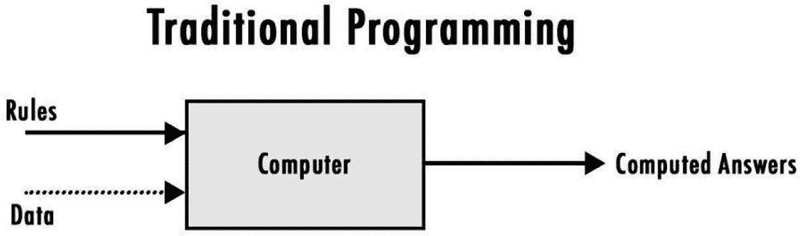

流程图展示了传统编程。该图显示了一个过程，其中“规则”和“数据”作为输入进入“计算机”方框，进而产生作为输出的“计算结果”。箭头指示了从输入到输出的流向。

**图 15-1** 传统编程流程。规则是必需的，但是否需要数据则取决于程序的需求。

此类软件的一个例子是计算比萨餐厅总销售额的代码。程序员编写计算数据的规则，输入所有交易数据以及任何其他需要包含的值，然后计算机生成汇总结果。如果每次都以完全相同的输入运行，那么生成的输出汇总结果也将完全相同。另一个例子是，在 1999 年夏天人们对千年虫问题感到恐慌时，我编写了一个 Java 小程序——千年倒计时时钟，它运行在公司的内部网上，倒计时显示距离 1999 年 12 月 31 日午夜还有多少天、小时、分钟和秒。该程序中使用的唯一数据就是当前的系统时间。

传统编程中已知输出和确定性有一个例外，那就是当我们使用随机性编写任何代码时。编程语言可以生成随机数，这些随机数可用于控制由代码中生成的数字决定的不同行为。想象一下，你想要根据不同的数值随机生成一个《龙与地下城》角色。一个角色由一组特定的基本身份（如种族和职业）以及代表各种事物（如技能和能力）的数字来定义。例如，如果有九个可能的角色种族，你希望程序随机选择一个，并且希望它随机为角色的敏捷属性选择一个介于最小值和最大值之间的数值。每次运行这个程序时，你想要的输出都是不同的且未知的。然而，你了解输出的参数——所有能力和技能分数都将在定义的最小值和最大值之间，并且你知道角色可能拥有哪些种族、职业和背景，因为它们来自一个特定的列表。随机性的另一个常见用途是在模拟中，科学家们可能希望定义一个起点，然后观察事物随时间如何演变，而这至少会部分地由随机事件驱动。混沌理论正是源自以这种方式运行的气象模拟。

请注意，在编程语言中，这种随机性被视为*伪随机*，因为对于一个特定的起点，随机数生成器会以相同的顺序生成相同的数字，因此在这种情况下它实际上是确定性的——每次结果相同——即使程序仍然在使用“随机”值运行。有时这正是期望的行为，例如，当你在运行一个实验并希望它具有可重复性时。这通过在代码中创建随机数生成器时设置一个称为*种子*（即起点）的数字来控制。如果你希望每次运行的结果相同，就将种子设置为相同的数字。相反，如果你想要非确定性的行为，则需要将种子设置在某个变化的量上，例如将当前日期和时间转换为一个数字，并将种子设置为该值。这样每次运行的输出都会不同。

请注意，即使是许多使用了随机性的程序，仍然被视为传统编程。这是因为输入是已知的，输出基于规则和已知的输入，仅此而已。在机器学习领域，情况则有所不同，因为你不会预先提供规则，也永远不知道输出会是什么。机器学习的两种主要类型是监督学习和无监督学习。下面我将用图 15-2 和图 15-3 展示这两种类型，并在图 15-4 中展示另一种类型——半监督学习。我们将在下文中一一讨论它们。

但首先，我们需要了解机器学习试图解决的两种问题类型：分类和回归。*分类*的目标是通过预测目标变量值来为数据打标签——例如，确定一款电子游戏的类型，判断某人是否患有疾病，或确定某个数据点属于哪种花。可能的标签数量各不相同——我曾参与过一个项目，其中包含二战期间个人经历的叙述，我们想根据主要话题为它们打标签，这是一个多类问题，因为有七个可能的话题。最终，我们将它们视为标签来处理，这样每段叙述可以包含多个话题，因此我们对每个标签进行独立分析，并为每个标签建立一个二元模型来判断它是否符合该话题。这种方法并不罕见，因为衡量多类模型的性能可能很困难。

*回归*是机器学习用于解决的另一种问题类型，我们称之为对数值数据进行预测。像销售预测——预测比萨餐厅未来七天的销售额——是一个非常常见的回归任务。其他例子可能包括预测电子游戏的下载量或急诊科每天的患者数量。

每种问题都有不同的算法，但有些技术存在变体，允许它们同时处理这两种问题。我将在下文中讨论它们。

## 监督学习

在*监督机器学习*中，我们向计算机提供数据，以便它能够找出数据中的模式和规则（这一步称为训练模型），然后计算机将这些计算出的规则输出到我们所谓的模型中。监督机器学习有一个最低要求——我们必须在输入数据中包含目标值，这使得数据成为*标记数据*。正是因为我们提供了目标变量，所以才称之为“监督”——即我们提供了指导。

监督学习通常用于两种类型的任务，这两种任务都需要已训练好的模型：预测和推断。我们将在下文中详细讨论每一种。监督学习在商业世界中非常重要，也是组织机构中最常见的机器学习类型，其中预测是最常见的任务。


#### 预测

一旦我们有了训练好的模型，就将它连同第一步中未包含的新数据输入计算机，然后计算机输出与新数据相关的预测结果。请注意，这些新数据必须具有与模型训练时相同的特征。这对新手数据科学家来说可能是一个容易出错的地方。在本节末尾，我将进一步详细讨论预测生成运行过程具体需要包含哪些内容。

在第一步中，我们并非完全没有向计算机提供任何“规则”，这有两个原因。第一个原因是，我们提供的是经过专门准备的数据，这些数据包含我们认为重要的特征。这就是数据准备和特征工程如此关键的原因。第二个原因是，我们提供了目标值。图 15-2 展示了预测性监督机器学习的两个步骤。

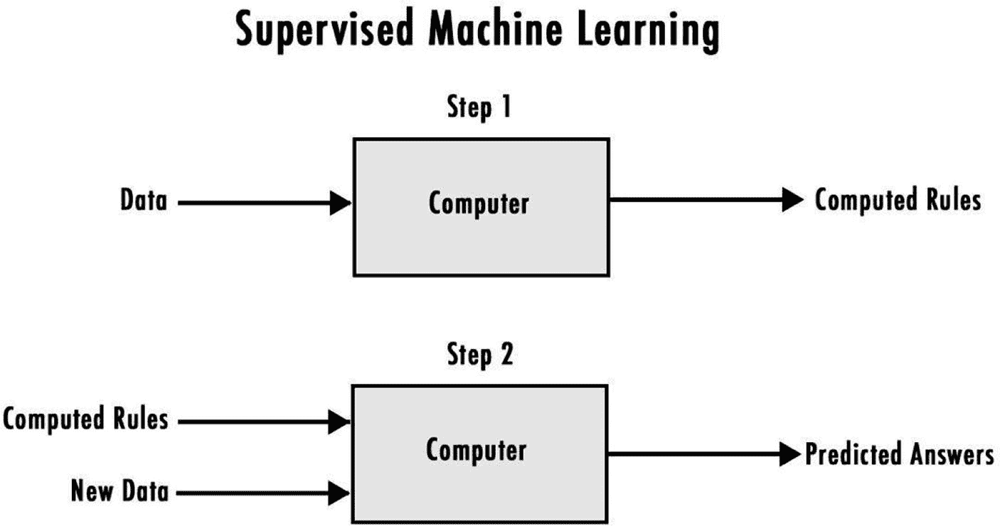

说明监督机器学习的流程图。该过程分为两个步骤。步骤 1：将数据输入计算机，计算机输出计算出的规则。步骤 2：将计算出的规则和新数据输入另一台计算机，该计算机输出预测的答案。箭头表示数据和结果的流向。

图 15-2

预测性监督机器学习流程。第一步训练模型，第二步输出预测结果

图中的步骤 1 包含几个具体部分。总体而言，这是训练模型的过程，但在监督机器学习中，“训练”在最终确定模型之前还包括测试。准备数据后的第一步是将数据拆分为训练集和测试集，有时还会拆分为一个额外的验证集，这被称为训练-测试拆分。有关训练-测试拆分的更多信息，请参见侧边栏。

**训练-测试拆分**

将数据拆分为训练集和测试集（如果需要的话还有验证集）本身是一门艺术。常见的拆分方式是按数据百分比进行，例如 80-20 的训练-测试拆分，或 70-20-10 的训练-验证-测试拆分。但如何选择那 80%的数据呢？当你不处理基于时间的数据时，有多种方法可以选择训练集和测试集。通常可以随机选择，使用与第 3 章讨论的抽样技术相同的方法。这种方法意味着你会有良好的覆盖率，并且你的测试集将测试模型在训练数据中学习到的尽可能多的模式。

如果你处理的是基于时间的数据，尤其是使用时间序列方法时，你通常会选择后 20%的数据作为测试集，并使用前 80%的数据作为训练集。这样做的一个缺点是，你的测试数据可能无法覆盖模型中检测到的所有模式。例如，如果你有两年的数据，你可能只能测试五个月的数据，这刚好超过 20%。如果一年中某些部分比其他部分更容易预测呢？如果这些日期恰好落在夏季和初秋，模型可能表现得非常好。但是，当时间推移，你在深秋和冬季运行模型时，它的表现可能就不那么好了，而你最初的测试并没有发现这个问题。反之亦然。

这些训练集、测试集和验证集中的每一个都应该完全独立于其他集合，没有任何数据点出现在多个集合中。此外，所有这些数据必须具有我们关心的特征以及目标值，无论这个目标值是一个标签（例如“患有糖尿病”或“未患糖尿病”）还是一个数字。步骤 1 将获取所有这些信息，并找出广义规则，以便从特征的组合得到特定的目标值。这就是模型，也就是图 15-2 中的“计算出的规则”。

高级流程基本上是：基于训练数据集训练模型（步骤 1），然后在测试数据集上对其进行测试，以查看其表现如何（步骤 2）。我们将使用各种指标来衡量性能，我将在下一章中介绍这些指标。我们会在训练集上训练许多不同的模型，并在测试集上进行测试，尝试不同的算法或每种算法中的不同设置。请注意，训练最佳模型的一部分工作不仅是尝试不同的算法，还要进行所谓的超参数调优。

在`R`或`Python`中，用于训练算法的多数函数都有超参数，这些参数需要在运行时设置，当你在代码中调用该函数时，它们作为参数传递。这些参数定义了所使用的机器学习算法的各个方面。当我们下面讨论算法时，会涉及其中一些参数，例如对于决策树，它会控制树的深度。这些超参数通常有默认值，但这并不意味着这些默认值对你的特定问题是最优的，因此这是一个必要的步骤。

*超参数调优*是寻找能产生最佳性能模型的最佳超参数组合的过程。有不同的方法可以实现这一点，但目前只需理解，这就是验证集的用途。调优通过选择超参数并在训练集上进行训练，然后用验证集进行测试，并重复此过程直到找到性能最佳的模型来实现。然后，使用这些超参数对训练集进行最后一次训练，并在测试集上进行测试，从而得出模型的最终性能。还有一种方法称为交叉验证，它涉及将训练集分成几个不同的训练集和验证集拆分，而不是使用专门的验证集。当试图避免过拟合（即模型构建得过于针对训练集，无法泛化）时，这种方法特别有价值。我将在下面进一步讨论超参数调优和交叉验证的方法。有一些便捷的工具允许你仅用几行代码就进行多次不同的运行。

在我们多次迭代步骤 1 和步骤 2，识别并测试了性能最佳的模型之后，该模型就可以用于新的、未见过的数据，以获取这些数据的预测结果。这意味着要用新数据重新运行步骤 2。监督机器学习的一个典型例子是预测销售量之类的东西。一家披萨店可能想知道在晚班开始前需要准备多少面团，因此他们可以根据历史销售数据以及其他数据（如天气、体育赛事、节假日和其他日期信息（已知数据））创建一个模型。然后，他们可以将未来日期（未见数据）的这些信息提供给模型，并获得预期销售披萨总数的预测。这将帮助他们知道需要准备多少面团。预测是监督机器学习的最终目标。


### 进行预测所需的条件

有时，新入行的数据科学家会困惑于需要向训练好的模型提供什么才能获得预测结果。正如前文所述，我们需要提供模型训练时所用的所有特征值。假设我们有一个用于预测商店每日销售额的模型。今天是 2 月 1 日，我们有一个基于截至 1 月 31 日过去三年数据训练好的模型，并且想要预测未来七天的每日销售额。我们使用了多种特征，包括星期几、月份中的第几周、节假日以及若干历史销售特征。我们必须拥有接下来七天所有这些特征的数据。想象一张包含七行数据的表格，每一列对应上述的一个特征。有些人会惊讶于我们需要“未来的数据”——但模型正是基于每一天的这些特征值运行的，因此它们是必需的。

这意味着我们需要能够获取这些未来的特征值。使用无法体现未来情况的特征是新手的常见错误。例如，如果你有一个特征“`昨天的销售额`”，用这个特征训练模型没有问题。但当你进行预测时，你无法提供这个特征值，因为你根本不知道第七天的“`昨天的销售额`”是多少——我们还没有第六天的销售额数据。一种处理方法是使用第六天的预测值作为第七天预测中的“`昨天的销售额`”，但由于存在不确定性，这并不总是正确的解决方案。

### 推断

监督学习的另一个不那么常见但仍然有价值的用途是推断，即通过生成模型并对其进行检查。其理念是查看模型指定的特征和数值，从而理解模型中哪些因素是重要的。这可能意味着将所有数据直接投入图 15-2 中的步骤 1，观察输出的特征和数值；也可能涉及在多个模型上同时运行步骤 1 和步骤 2，选出性能最佳的那个，然后仅检查该模型。为了使这种方法有效，我们需要使用透明的算法或模型解释器，以便理解哪些特征对输出有贡献。在这种情况下，我们可能甚至不需要将数据拆分为训练集和测试集。相反，我们直接训练模型，如果算法能够揭示其所用的特征和数值，我们就检查该模型。像线性回归和决策树这类透明方法非常适合此目的，因为它们能精确告诉我们哪些特征是重要的。但另一种树方法——随机森林——只能输出对整个模型最重要的特征，而不会提供任何数值信息。

另一种选择是使用模型解释器，这种工具能够揭示非透明算法的重要特征（我们将在下文详细讨论）。使用模型解释器时，我们实际上是通过模型运行训练数据来生成“`预测值`”——即模型基于所提供的特征生成的数值。然后，我们可以使用模型解释器获取每个特定预测的最重要特征并进行研究。在这种情况下，我们可能会重点关注那些准确率较高的预测，但那些不准确的预测也可能很有研究价值。

机器学习中一个相对较新且正在发展的领域是因果推断，它专门致力于寻找变量之间的因果关系。例如，如果你想了解改变价格对销售额的影响，你需要将其他变量归一化，然后仅关注这两个变量。

### 无监督学习

无监督学习在某些方面与监督学习相似，但关键区别在于我们不向它提供目标值，这也是其被称为“无监督”的原因。*无监督机器学习*在没有指导的情况下（数据准备阶段完成的特征工程除外）识别数据中的模式，而非像监督学习那样找出如何从特定特征得到特定值。我们并非主动“教”它。

在无监督学习中，不要求进行训练-测试拆分。它可以是一个或两个步骤的过程。第一步基本上是在准备好的数据上运行算法，从而生成两样东西：(1) 你向算法请求的“`答案`”，以及 (2) 一个训练好的模型，你可以将该模型应用于新数据，并应用算法在运行期间确定的规则。最常见的无监督机器学习是聚类，它简单地将数据分为不同的组，因此输出的是附有组别标签的原始数据。这让你能够看到哪些数据点被分到了一起，从而可以深入挖掘并发现这一组与其他组的不同特征。这可能就是你当前工作的终点，但你同时也获得了一个训练好的模型。通过可选的第二步，你还可以将新的、未见过的数据输入模型，从而为这些数据也生成分组标签。图 15-3 展示了这一流程。

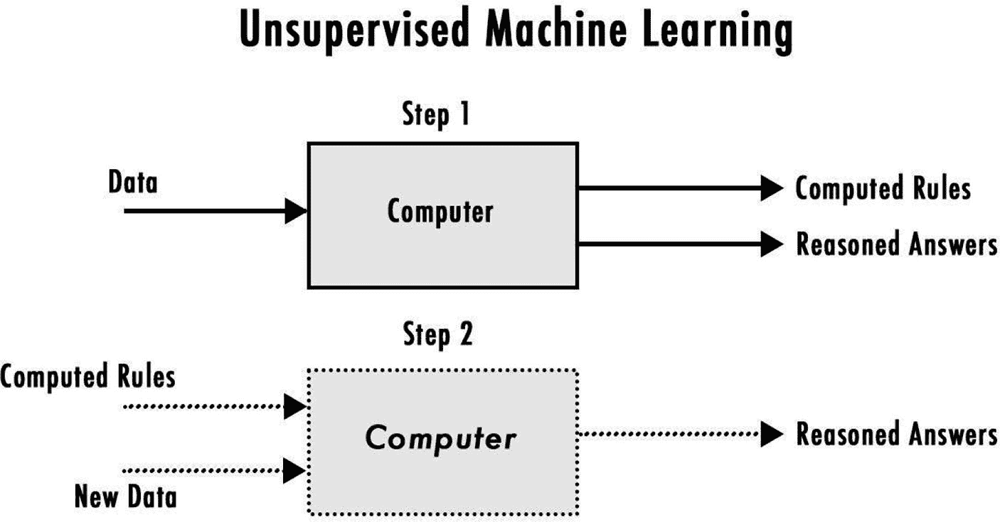

流程图展示了无监督机器学习的两个步骤。第一步：数据输入计算机，计算机输出计算得出的规则和推理得出的答案。第二步：将计算得出的规则与新数据输入计算机，产生推理得出的答案。箭头表示数据和结果的流向。

**图 15-3**  
无监督机器学习流程图。第一步训练模型并输出标签（如分组）。可选第二步允许模型为新数据标注标签。


### 半监督学习

`半监督机器学习`是监督学习和无监督学习的结合，因为我们同时提供了有标签和无标签数据。有时，有标签数据非常昂贵或难以获得，尤其是在机器学习通常需要大量数据的情况下。如果无监督学习不足以解决当前问题，那么有一种方法可以增强现有数据，以获得更多可用于监督学习模型的“有标签”数据。这种方法可能效果不错，但并不总是奏效。这绝对是一种“因人而异”的方法，取决于你的领域和数据。

使用这种方法存在一些普遍的限制。一个关键的方面是，无标签数据在内容上需要与有标签数据相似。如果我们试图识别歌曲的流派，并且我们有一个包含已标注的摇滚、流行和雷鬼歌曲的数据集，那么在加入除了这三类之外还包含乡村和说唱的无标签歌曲，就不会产生好的结果。这很直观，但有时很难判断无标签数据是否与有标签数据相似。一些探索性数据分析通常可以回答这个问题。

半监督学习有几种不同的技术，但我只打算讨论自训练方法，这是一个三步过程。自训练半监督学习首先从创建一个`基础模型`开始，该模型仅在小量有标签数据上进行训练。然后，我们将无标签数据输入模型以获得预测结果——即无标签数据的标签，通常称为`伪标签`。这第二步的一个要求是，每个预测都要生成一个置信度。然后，你可以取出所有具有高置信度（通常在 80%左右）的伪标签数据，将这些数据（也就是无标签数据中具有高置信度伪标签的子集）与原始有标签数据合并，并用这个规模大得多的数据集训练一个新的监督模型。图 15-4 展示了整个流程。

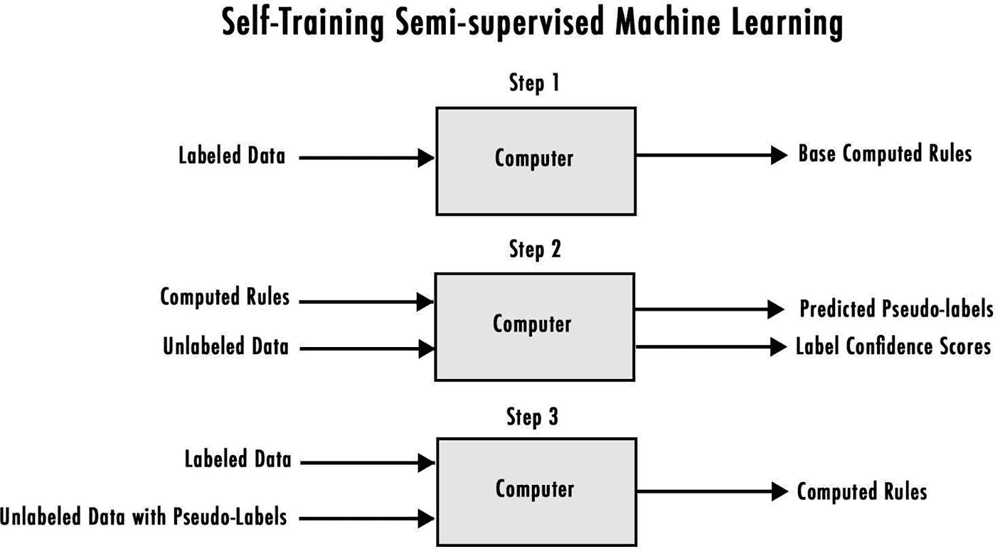

图 15-4：基本的自训练半监督机器学习流程

你可能已经猜到，这通常不是一种非常稳健的技术，并且在很大程度上取决于伪标签的质量。因为我们使用的伪标签数据远多于真实数据，如果生成过程中出现任何问题，整个模型都会出错。如果原始训练集中的某个特征被赋予了比其实际重要性更高的权重，那么该特征在伪标签数据集中就会被过度强调，从而可能导致这种情况发生。这并不意味着你不应该尝试它，但你需要小心谨慎，并用放大镜仔细检查你的结果。请注意，当这种方法效果良好时，通常是因为特征空间中彼此接近的点往往具有相同的标签，因此与其他点接近的伪标签很可能具有正确的值。

### 强化学习

强化学习被认为是继监督学习和无监督学习之后的第三种机器学习范式。它不提供训练数据，但会指定一些行为规则。强化学习通常被描述为一个“智能体”探索陌生环境并朝着目标努力的过程。想象一个机器人在房间里探索，试图找到一个需要关闭柜门的柜子（目标）。仅凭目标它无法成功——它还必须有一个策略来决定如何选择要做的事情，以及在执行期望的动作后获得奖励。这些目标、策略和奖励都是预先指定好的。

强化学习的基本挑战之一是找到探索（如机器人探索所在的房间）和利用（利用它学到的关于房间的知识）之间的平衡。强化学习方法的一个有趣之处在于，它们并不总是选择局部最优选项（即在特定时刻能带来最大奖励的选项），而是可以处理延迟满足，为了更大的回报而做出小的牺牲。强化学习最大的优势是优化——寻找最优路径，无论是物理路径还是虚拟路径。

它在数据科学中的使用不如在其他人工智能领域那么广泛，但在营销领域与推荐系统结合时可能很有用。它还被用于`AlphaGo`，该系统击败了最优秀的围棋选手，如第 10 章所述。

### 集成学习

其核心而言，`集成机器学习`与其说是一种机器学习的“类型”，不如说是一种将不同机器学习模型结合起来以获得比任何单个模型都更好性能的方法。有时人们称之为基于委员会的学习，因为它组合结果的方式。这个想法相当直观——例如，众所周知，当人们猜测一个大罐子里的弹珠数量时，许多猜测的平均值会比大多数个人的猜测更接近正确数字。高估和低估往往会相互抵消，互相弥补对方的不准确性。即使是最好的机器学习模型也有一些局限性，比如误差、偏差和方差（我们稍后会讨论这些），但是当我们组合多个模型时，这些问题会被其他模型中的值所弥补。

训练和组合不同模型主要有两种方法：顺序式或并行式。在并行方法中，多个模型在训练数据的不同部分上独立训练，要么所有模型使用相同的算法（同质），要么使用不同的算法（异质）进行训练。在顺序方法中，每个模型被训练，然后其训练结果被输入到下一个模型的训练中。最后，在分类问题中使用多数投票法（选择在多个模型中出现次数最多的预测）以及在回归问题中取所有模型输出的平均值来组合最终的模型输出。

还有另外三种技术可以使用：装袋、堆叠和提升。`装袋`这个词是“自举聚合”的合成词，它涉及通过对训练集进行重采样来创建新的数据集，并在每个新生成的数据集上使用相同的算法训练单独的模型。然后将这些模型的结果进行组合以获得最终预测。

`堆叠`使用异质并行方法，训练多个模型，然后在第一轮模型的输出上训练另一个模型。这种创建最终模型的方法被称为`元学习`，因为它是在其他模型的输出结果上进行训练，而不是在原始数据上。最终的模型生成最终预测。

`提升`是一种顺序集成方法，通过专注于在后续模型中对错误预测进行处理以改进差的预测。首先在一个训练数据集上训练一个模型，但它会将结果分为正确和错误两大类，然后创建一个包含错误预测记录的新数据集，但在此基础上做一些调整（例如在新数据集中为它们赋予权重）。这个过程在多个模型上重复进行，最后通过计算权重将它们组合起来。


# 监督技术

本节将介绍几种流行的监督技术。实际可用的技术比这里提到的要多，但很多时候，数据科学家的工作都集中在最常用的几种方法上。当你的常规工具箱不够用时，上网搜索一下也是完全正常的做法。

## 时间序列分析

时间序列分析是一种古老的统计方法，由于许多其他机器学习技术表现更优，它已有些失宠，因此我不打算过多介绍。但了解一下仍有好处，因为它在某些情况下确实有效。时间序列分析依赖于基于时间的数据，例如某款特定电子游戏在商店的周下载量。其局限性之一是，经典的时间序列分析无法像其他机器学习算法那样使用特征。我们只有时间单位以及被追踪的数值，比如销售额或下载量。图 15-5 展示了一个我们在时间序列分析中常见的典型图表。

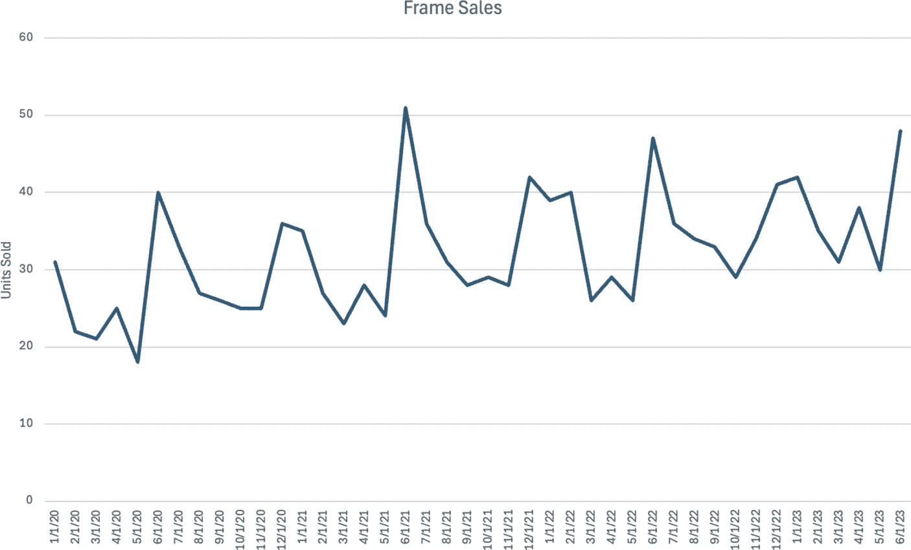

折线图标题为"画框销量"，展示了从 2020 年 1 月到 2023 年 5 月期间的销售量。X 轴以月为间隔表示日期，Y 轴表示销售量，范围从 0 到 60。数据显示出销量波动，有高峰和低谷，表明该期间画框销量存在变化。

图 15-5

一个适用于时间序列分析的示例图表，展示了一家虚构的小型画框店数年间每月的销售额

图 15-5 清晰地显示了数据的上升趋势。在时间序列分析中，这被称为*趋势*，即长期内持续一致的总体增长或下降。我们还可以看到*季节性*，这是一种有规律重复出现的增长或下降模式，例如图 15-5 中每年六月和十二月的销量激增。

这些模式肉眼很容易识别，但也有工具可以自动识别趋势和季节性（或周期性），以及其他一些模式。这些工具允许我们*分解*原始时间序列，以查看显示趋势和季节性等模式的各个子图。这之所以有用，一方面是因为有时图表中这些模式并不像我们希望的那样清晰，另一方面是因为我们可以利用这些特征进行预测。

我们还可以使用工具，根据时间序列中的历史数据生成预测。还有其他基于时间序列的算法能做更多事情。其中一种流行的算法是*自回归积分滑动平均模型*（ARIMA），它从三个不同角度审视时间序列。第一个是*自回归*（AR），关注一个数据点与其先前（或滞后）点之间的关系。第二个是*积分*（I），它使用差分方法有效地去除趋势和季节性。第三个是*滑动平均*（MA），它考虑数据点以及过去几个观测值的滑动平均值。所有这些都是在运行`ARIMA`时可以指定的参数。请注意，使用`ARIMA`需要满足一些假设，最重要的是数据必须是*平稳的*，这意味着均值和方差不会随时间发生剧烈变化。

尽管时间序列方法并不总能产生最佳结果，但尝试一下并观察其表现并不难。然而，由于我们通常只使用一个“特征”——即我们试图预测的同一个变量的历史值——数据的模式必须局限在该变量本身。换句话说，时间序列假设除了月份、星期几等时间特征之外，没有其他外部因素决定未来的数值。请注意，也存在一些允许包含外部值的选项，特别是名为`ARIMAX`的`ARIMA`变体。它允许引入一个额外变量，这个变量可以是单个特征，也可以是多个特征的组合（在技术中表现为一个变量）。

## 广义线性模型

线性回归是一种非常流行的技术，既可用于理解数据，也可用于进行预测。它也是统计学家和数据分析师最早使用的、超出纯统计检验范畴的技术之一。其优点是直观透明，并且易于向利益相关者解释。从概念上讲，*线性回归*特指取一组数据——想象一个散布着许多点的散点图——并在其中画一条线。画这条线有特定的技术，我们将在下面讨论。这条线代表了两个变量之间的关系，也就是该图中预期值的位置——如果我们观察图中已有数值以外的范围，就会看到预期值在该范围之外是怎样的。预测，即观察我们构建模型所用数据范围之外的数值，被称为*外推*。

线性回归是一种广为人知的特定技术，但它实际上归属于统计回归技术家族，属于*广义线性模型*。这个名称可能具有误导性，因为其中的一些技术会产生非线性模型，如多项式回归和泊松回归，但该名称仍然沿用。最常见的两种广义线性模型是线性回归和逻辑回归。线性回归用于回归——生成数值型输出，而逻辑回归通常用于二分类——生成非数值型标签。两者都将在下面进行讨论。


```markdown
#### 线性回归

线性回归是回归方法中最直接、最直观且最简单的技术。术语“线性回归”从技术上讲，涉及仅基于一个其他变量（即特征预测变量 `X`）对一个变量（目标变量，或称 `Y`）进行建模，但这在大多数情况下并不那么有用，因为单个变量能够很好地预测另一个变量的情况非常罕见。

仅用两个变量就能得到一个不算太差的模型，最常见的例子之一是体重与身高的关系，其中身高是 `X`，体重是 `Y`。图 15-5 显示了一个较大数据集中 75 个身高和体重测量值的样本。

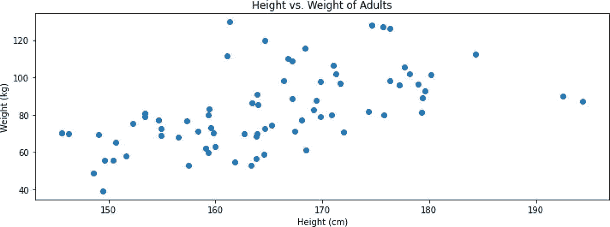

散点图标题为“成年人身高与体重”，显示身高（x 轴，单位厘米）与体重（y 轴，单位公斤）之间呈正相关。数据点分散分布，表明存在变异性，身高范围从 140 厘米到 200 厘米，体重范围从 40 公斤到 130 公斤。

图 15-6

成年人的身高与体重

要使线性回归有效，必须满足几个假设。其中最重要的三个是：线性关系、强相关性，以及如果存在多个 X 值时，`X` 变量的独立性。我们需要确保散点图中的数据点看起来接近一条清晰的直线，并且 `X` 和 `Y` 变量之间存在相当强的相关性（通常大于 0.5 或小于 –0.5）。人们常常懒得进行这些检查，但如果不满足这些条件，回归分析就无法提供可靠的结果。进行任何回归分析的另一个重要步骤是理解模型中固有的误差（没有任何模型能够做到完美精确）。

观察图 15-6，我们可以看到数据点有些分散，并没有一条所有测量值都聚集在其周围的直线，但存在明显的上升趋势。从视觉上看，这大致呈线性。我们还可以计算身高与体重之间的相关性。使用 Python 对这个样本进行计算，得出的皮尔逊相关系数为 0.565，超过了 0.5 的阈值。（需要说明的是：原始的完整数据集的相关性并不高于 0.5，但这个特定的随机样本确实如此，所以我用它来举例说明。）接下来是独立性问题：很明显身高和体重并非相互独立，因为一个身高 6 英尺 6 英寸的人不可能仅重 100 磅，除非极不正常。对于身材较矮的人体重较重的情况也是如此。但为了便于理解线性回归，我们可以暂且忽略这一点。老实说，几乎没有哪两个不相互依赖的变量组合能产生好的回归结果，所以我们只能先用这个例子。

线性回归的核心在于它用来确定直线应如何穿过图表上各点的方法。我们将讨论这一点，但图 15-7 展示了上面那个散点图加上回归直线后的效果。凭直觉，这感觉很对。如果你仅根据图 15-6 自己画一条线，很可能也会画成这样。但它究竟是如何计算出来的呢？

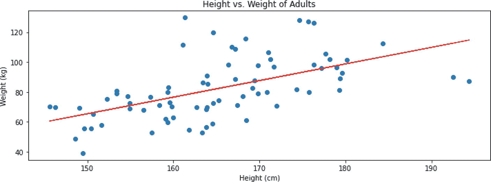

散点图标题为“成年人身高与体重”，显示身高（x 轴，单位厘米）与体重（y 轴，单位公斤）之间呈正相关。蓝色点代表单个数据点，红色趋势线指示整体趋势。图表表明，随着身高增加，体重也趋于增加。

图 15-7

带有回归直线的成年人身高与体重

线性回归通过最小化每个数据点的所有平方误差之和来计算这条直线。误差是数据点到直线的垂直距离，但在回归中，这通常被称为`残差`。计算总体误差有不同的方法，但传统的线性回归，即`普通最小二乘回归`，使用的是所谓的`误差平方和`（`SSE`），其计算方法是先对每个残差进行平方，然后将所有这些平方值相加。注意，我们对其进行平方是因为我们不希望过高的值与过低的值相互抵消——如果直接求和就会发生这种情况。这种方法几乎不可能手动完成，因为它实际上会尝试大量不同的直线，计算每条直线的误差平方和，然后选出和最小的那条。我们可以通过查看数据集中前 15 个数据点的残差来理解其工作原理，如图 15-8 所示。黑线连接了原始数据点与回归直线，残差值就是图表中黑色线段的长度。

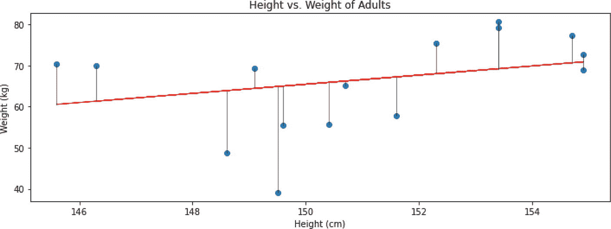

散点图标题为“成年人身高与体重”，显示身高（x 轴，单位厘米）与体重（y 轴，单位公斤）之间的关系。蓝色数据点代表各测量值，红色趋势线指示正相关。身高范围从 146 厘米到 154 厘米，体重范围从 40 公斤到 80 公斤。

图 15-8

显示残差的身高与体重数据中的前 15 个数据点

这就是那条直线的生成方式，但我们还需要知道实际模型是什么样的。幸运的是，这是一个可以追溯到高中数学的简单方程。它基本上就是我们学过用来绘制直线的 `y = mx + b` 公式。请记住，`y` 是绘制在 Y 轴上的值；`m` 是`斜率`，或者说量化后的直线角度，乘以 `x`（绘制在 X 轴上的值）；`b` 是`截距`，即直线与 Y 轴相交的点。这正是单变量线性回归输出的公式形式，其中各项被赋予了具体的拟合值。在线性回归中，还假设存在误差（每个模型都有误差，因为我们知道，除非变量之间完全相关，否则模型不可能完美），用公式中的 `e` 表示，并且截距通常被写在前面，作为一种“零”`X` 值。因此，在回归中，我们这样写：`Y = X[0] + mX + e`。如果你好奇，图 15-8 中直线的公式是 `Y[体重] = –101 + 1.11 × X[身高] + e`。
```


### 多元线性回归

大多数情况下，当数据科学家提到线性回归时，他们实际指的是*多元线性回归*，即用一个变量 `Y` 与多个 `X` 变量建立线性回归模型。在身高/体重的例子中，我们知道体重的影响因素远不止身高。有很多不同因素可能会影响体重，包括性别、健康水平、年龄等等。仅前三个因素就能使我们的模型比之前大幅改进。

要运行多元线性回归，上述提到的要求对所有纳入的特征都成立，这意味着每个特征都必须与目标变量相关，并且与其他特征相互独立。我们还需要检查每个特征与目标变量之间的线性关系。如果特征数量不多，我们仍然可以通过绘制每个特征与目标变量的散点图来直观地检查线性关系，确保其呈现线性趋势。实际上，检查这些条件有比我们上面提到的方法更系统的方式，但我将留给你自己去探索。

普通最小二乘回归还有一些额外的假设，这些假设可以在模型生成后进行检验。其中之一是残差的均值接近 0。残差还应服从正态分布，并且不存在自相关性，自相关性意味着数据中存在某种模型未能捕捉到的模式。你也可以自行查阅这些内容。

学习多元回归的一个挑战是，由于涉及两个以上的变量，我们无法绘制图表来可视化完整的回归过程（上面提到的三个额外特征将需要五维图表）。但好消息是，理解它并不需要可视化——我们只需查看公式就能了解其原理。多元回归所做的仍然是找到一条使残差（即直线与每个 `Y` 值之间的差值）最小化的直线。多元线性回归只是增加了更多的 `X` 特征，因此其形式为 `Y = X[0] + m[1]*X[1] + m[2]*X[2] + … + m[n]*X[n] + e`。

这个公式就是回归的输出结果，我们可以与利益相关者分享。它很容易解释。在我们的例子中，用身高、健康水平和年龄来预测体重，若要与利益相关者分享该公式，我们会重命名 `X` 值，最终得到类似这样的公式：`Y[体重] = X[0] + m[身高]*X[身高] + m[健康水平]*X[健康水平] + m[年龄]*X[年龄] + e`。不过，在实际展示公式之前，我们可能会让它看起来不那么数学化。特征的值需要确定，但假设身高以英寸为单位，健康水平是 1 到 5 的评分，年龄以年为单位（允许有小数）。这个公式的意思是，我们将每个这样的数值乘以回归计算出的特定乘数，然后将它们全部相加，得到以磅为单位的 `Y[体重]`。要预测一个新个体的体重，只需将其 `X[身高]`、`X[健康水平]` 和 `X[年龄]` 的值代入公式即可。

普通最小二乘法的原理与单特征回归相同，但它构建的直线位于多维空间中。如果你对此感到难以理解，首先尝试想象它在三维空间中如何运作——距离不再仅仅是“垂直”的，因此残差线不会像单特征回归那样都朝着同一个方向。从二维到三维的跳跃增加了复杂性，因此从三维到四维空间的跳跃则增加了更多我们无法可视化的东西。但它仍然是穿过该空间的一条“直线”。

#### 回归中的权重

在实践中，回归有时过于简单，我们需要进行调整才能使其良好运作。一种常见的技术是对某些项添加数值权重，这样在运行回归之前，加权的 `X` 值会乘以一个权重值。例如，想象一个模型，其 `X` 值的测量方式可能不同。这意味着，比如所有的 `X[1]` 测量值都比所有的 `X[2]` 测量值的精确度低。也许哈维尔用一把旧尺子测量某物的长度，不得不将测量值四舍五入到四分之一英寸，而莎拉测量高度时有一把更好的尺子，她的记录精确到 1/16 英寸。在这种情况下，哈维尔的测量值精确度较低，可以赋予较低的权重，以防止该特征在模型中产生过大的影响。

### 逻辑回归

逻辑回归使用一种称为 logit 模型的特定统计函数作为回归的基础。你不需要完全理解它就能进行逻辑回归，但其基本工作原理是：如果你取特征的线性组合（基本上是上述回归公式的右侧部分，如 `X[0] + m[1]*X[1] + m[2]*X[2] + … + m[n]*X[n] + e`），该值将等于一个涉及目标变量的特定分数的自然对数。我不展示具体的数学推导，但这会导致回归生成一条介于两个二值变量之间的曲线。

与其他技术一样，逻辑回归也有一些要求和假设。我们这里讨论的是二元逻辑回归，因此数据必须是二值的。另一个要求是数据集不能太小（这取决于你的数据，但通常几百条记录配上几个特征就足够了）。特征之间需要相互独立。

逻辑回归的运作方式与线性回归有些相似，它通过使用特定技术最小化某个函数，来确定一个目标值与另一个目标值之间的决策边界。它使用额外的数学计算来得出公式中的系数：`logit(Y) = X[0] + m[1]*X[1] + m[2]*X[2] + e`。模型会为每条记录分配属于类别 1 和类别 2 的概率（类别 2 的概率等于 1 减去类别 1 的概率），然后使用一个阈值（默认为 0.5）来应用适当的标签。概率高于 0.5 的归为类别 1。

如果我们再看一个实际例子，我们有另一个数据集，这次是关于儿童身高的。我们拥有性别、身高和年龄数据，并希望根据其他两项来预测性别。虽然男孩确实比女孩高，但仍有大量重叠，因此仅凭这两个特征，我们的模型不会很理想，但应该比随机猜测要好。我建立了模型，然后绘制了仅身高（在二维图中我只能绘制目标变量和一个特征）的值以及所谓的逻辑曲线，即决策边界。如图 15-9 所示，曲线为红色。在数据划分更清晰的数据集中，曲线更呈 S 形，顶部和底部更平坦，中间对角线更陡峭。

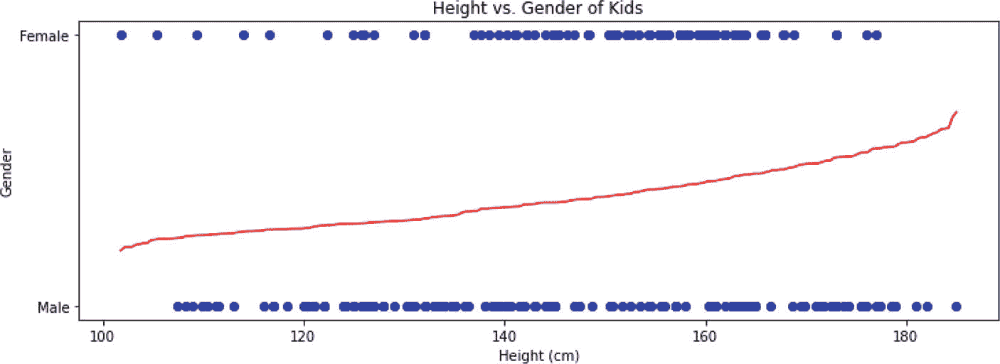

标题为“儿童身高与性别”的散点图，x 轴为身高（厘米），y 轴为性别。蓝色点代表男孩和女孩的个体数据点，女孩在上方，男孩在下方。一条红线表示整个数据集的趋势或平均身高。

**图 15-9** – 儿童数据集中身高与性别的逻辑曲线


#### 非线性回归

非线性回归是一种生成非线性函数的回归方法，该函数以非线性组合的方式结合了模型参数。某些数据可能并不呈直线分布，但仍能拟合出可识别且可量化的模式。非线性回归有多种类型，因为只要拟合函数能适配数据，它几乎可以是任意形式。然而，并非所有包含非线性函数的模型都算作非线性回归；因为如果该函数可以表示为模型参数的线性组合，那么它仍被视为线性回归。

将非线性函数线性化的一种常用方法是：如果至少有一个预测变量是自然常数`e`的幂次方，则对函数两边同时取自然对数。不必完全理解这一点。只要知道存在这种技术，就能在需要时找到它——即便你使用的大多数回归方法很可能是线性回归。

### 树

树是另一类非常流行、通用且实用的监督式机器学习算法。它们不需要数据呈线性，并且可用于分类和回归。更棒的是，它们还能处理类别型特征。树算法的基本原理是反复使用“如果-那么-否则”的场景对数据进行分割：从顶部包含所有数据开始，根据规则将数据分成多个组，然后沿着每个分支继续向下，直到达到某个停止点，并为当前这批数据赋予一个标签（在分类任务中）或一个数值（在回归任务中）。所生成的逻辑在可视化图中极为直观，看起来就像一棵家谱树。

我首先要介绍最简单的树算法，即所谓的决策树。从技术上讲，有几种不同的算法可被视为决策树，因此我只介绍最常见的一种。在讨论完决策树后，我还会介绍随机森林，它通过构建多棵决策树并将所有不同结果进行组合以得出单一结果，从而实现了对决策树的扩展。

#### 决策树

决策树很可能是目前最直观的机器学习方法。线性回归虽然易于解释，但仍需思考数学问题，这可能会让一些利益相关者思维停滞。而决策树可以被绘制出来，并且任何人都能直观理解。它之所以如此实用，还有另外几个原因：它不要求数据呈线性，并且能够处理类别型特征。我将展示一个基本的决策树示例，代表一个简单的垃圾邮件过滤器（严格来说是垃圾邮件标记器），供参考（图 15-10）。

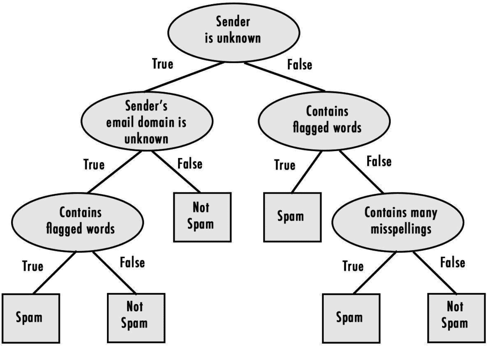

流程图描述了一个用于识别垃圾邮件的决策过程。流程图从“发件人未知”开始，分支为“真”和“假”。如果为真，则检查“发件人邮箱域名未知”，接着引导至“包含标记词”，并最终判定为“垃圾邮件”或“非垃圾邮件”。如果为假，则检查“包含标记词”，引导至“垃圾邮件”或“包含大量拼写错误”，并最终判定为“垃圾邮件”或“非垃圾邮件”。

**图 15-10** 一个用于标记邮件是否为垃圾邮件的简单决策树

决策树由节点和叶节点组成。*节点*表示对一组数据应用的分割点：我们有一批数据，要在节点处应用一个“如果-那么-否则”的问题，并根据答案将数据发送到两条（或多条）路径上。节点通常用椭圆表示。在图 15-10 中，所有椭圆都是节点，每个节点都包含在该点处用于将数据分割成两个不同组的问题。*叶节点*是任何分支的终点，表示一个被赋予特定标签或数值的组，它们通常用矩形显示。图中所有标注为“垃圾邮件”或“非垃圾邮件”的矩形都是叶节点。从一个节点到另一个节点，或从一个节点到叶节点的路径用单线表示。每个节点问题的答案显示在相应路径线旁边。以图中的树为例，所有问题都是二元的，因此它们都显示为“真”或“假”。还有一个特殊的节点——位于顶部的第一个节点，称为*根节点*（简称根）。图中的根节点是顶部的“发件人未知”。我们把从根节点到任意叶节点的完整路径称为*分支*。请注意，相同的问题可能出现在树的不同分支中，就像图中的“包含标记词”一样。

这是一个直观的展示。理解如何对一条新记录使用已构建好的决策树的方法是：首先根据该记录的值，询问并回答根节点中的问题；如果答案为真，则沿左侧路径向下；如果为假，则沿右侧路径向下。然后询问新节点的问题，并根据答案沿着正确的路径继续。依此类推，直到到达一个叶节点，无法再继续前进。该叶节点就是将被分配给这条记录的标签或数值。

以上就是如何使用已有的决策树，但如何创建它呢？如前所述，实际上有几种不同的算法用于训练决策树。它们有很多共同点，但我将描述其通用方法。基本概念是：对于给定的一批数据，你需要决定哪种分割最为有效。这意味着目标是找到一个能完美分割数据的问题，使得一个叶节点中的所有记录都拥有一个目标标签，而另一个叶节点中的所有记录都拥有与第一个叶节点不同的目标标签。这在理想情况下是叶节点形成时发生的；但在过程中，当找不到那个完美问题时，它必须对数据进行分割。因此，它会查看所有可能被询问的特征，并根据数据将如何被分割来计算一个指标。你不需要真正理解这些指标是什么，但熵（来自信息论）和信息增益是常用的指标。


我们将通过查看一小部分电子邮件数据集样本，来了解图 15-10 中的树是如何构建的。用于训练该决策树的数据见表 15-1。实际上，训练这个模型需要更多的数据，但我们仍然可以看到如何利用数据和问题来构建一棵树。我将沿着一个分支向下，逐步进行分析。

**表 15-1**
示例电子邮件数据集

| 邮件 ID | 发件人未知 | 邮件域名未知 | 包含被标记词汇 | 包含拼写错误 | 是否为垃圾邮件 |
| --- | --- | --- | --- | --- | --- |
| 1 | 是 | 否 | 是 | 否 | 否 |
| 2 | 是 | 是 | 是 | 是 | 是 |
| 3 | 是 | 是 | 否 | 否 | 否 |
| 4 | 是 | 是 | 是 | 是 | 是 |
| 5 | 是 | 是 | 否 | 是 | 否 |
| 6 | 否 | 是 | 否 | 是 | 是 |
| 7 | 否 | 否 | 是 | 是 | 是 |
| 8 | 否 | 是 | 否 | 否 | 否 |
| 9 | 否 | 否 | 是 | 否 | 是 |
| 10 | 否 | 否 | 否 | 否 | 否 |

首先询问发件人是否未知，数据被分成两个集合，分别如表 15-2（发件人未知 = 是）和表 15-3（发件人未知 = 否）所示。然后，算法会计算一个度量分数（无论它使用何种度量标准），并在考察其他分裂方式后，选择得分最高的那个。

**表 15-3**
第一个节点分裂后：发件人未知 = 否

| 邮件 ID | 发件人未知 | 邮件域名未知 | 包含被标记词汇 | 包含拼写错误 | 是否为垃圾邮件 |
| --- | --- | --- | --- | --- | --- |
| 6 | 否 | 是 | 否 | 是 | 是 |
| 7 | 否 | 否 | 是 | 是 | 是 |
| 8 | 否 | 是 | 否 | 否 | 否 |
| 9 | 否 | 否 | 是 | 否 | 是 |
| 10 | 否 | 否 | 否 | 否 | 否 |

**表 15-2**
第一个节点分裂后：发件人未知 = 是

| 邮件 ID | 发件人未知 | 邮件域名未知 | 包含被标记词汇 | 包含拼写错误 | 是否为垃圾邮件 |
| --- | --- | --- | --- | --- | --- |
| 1 | 是 | 否 | 是 | 否 | 否 |
| 2 | 是 | 是 | 是 | 是 | 是 |
| 3 | 是 | 是 | 否 | 否 | 否 |
| 4 | 是 | 是 | 是 | 是 | 是 |
| 5 | 是 | 是 | 否 | 是 | 否 |

现在，算法有两个不同的数据集需要考虑，每个数据集中都混合了不同的标签。我只沿着左侧分支（表 15-2）继续，因此我们需要对该表中的数据进行分裂，因为并非所有标签都相同。它会尝试不同的问题并计算每个问题的度量分数，发现询问邮件域名能获得最佳分数。我们据此在“发件人的邮件域名未知”这一特征上进行分裂。沿着`True`路径的数据见下表 15-4，沿着`False`路径的数据见下表 15-5。

**表 15-5**
第二个节点分裂后：发件人的邮件域名未知 = 否

| 邮件 ID | 发件人未知 | 邮件域名未知 | 包含被标记词汇 | 包含拼写错误 | 是否为垃圾邮件 |
| --- | --- | --- | --- | --- | --- |
| 1 | 是 | 否 | 是 | 否 | 否 |

**表 15-4**
第二个节点分裂后：发件人的邮件域名未知 = 是

| 邮件 ID | 发件人未知 | 邮件域名未知 | 包含被标记词汇 | 包含拼写错误 | 是否为垃圾邮件 |
| --- | --- | --- | --- | --- | --- |
| 2 | 是 | 是 | 是 | 是 | 是 |
| 3 | 是 | 是 | 否 | 否 | 否 |
| 4 | 是 | 是 | 是 | 是 | 是 |
| 5 | 是 | 是 | 否 | 是 | 否 |

此时，如表 15-5 所示，该分支上的所有数据只代表一个标签，因为它只有一行。这意味着应该有一个叶节点，其标签为“非垃圾邮件”。而在“发件人的邮件域名未知”这个分裂点上，数据仍然包含不同的标签，所以我们需要再次进行分裂。算法再次尝试不同的问题并评分，最终决定在“包含被标记词汇”上进行分裂。这次分裂的结果见表 15-6 和表 15-7。

**表 15-7**
第三个节点分裂后：包含被标记词汇 = 否

| 邮件 ID | 发件人未知 | 邮件域名未知 | 包含被标记词汇 | 包含拼写错误 | 是否为垃圾邮件 |
| --- | --- | --- | --- | --- | --- |
| 3 | 是 | 是 | 否 | 否 | 否 |
| 5 | 是 | 是 | 否 | 是 | 否 |

**表 15-6**
第三个节点分裂后：包含被标记词汇 = 是

| 邮件 ID | 发件人未知 | 邮件域名未知 | 包含被标记词汇 | 包含拼写错误 | 是否为垃圾邮件 |
| --- | --- | --- | --- | --- | --- |
| 2 | 是 | 是 | 是 | 是 | 是 |
| 4 | 是 | 是 | 是 | 是 | 是 |

现在，这次分裂产生了两个集合，每个集合中只包含一种标签，这意味着它们可以成为带有相应标签的节点。然后，如果我们对根节点的右侧分支重复此过程，我们就得到了一个训练好的决策树，可以用来对传入的新电子邮件进行分类。

当使用真实数据构建决策树时，分裂永远不会是完美的，大多数叶节点都会包含一些具有不同标签的记录。控制树构建的方式有很多种，这也是我们在训练中最终可能出现错误分类记录的主要原因。实际上，我们不希望树变得太深，而如果我们坚持每个叶节点只包含具有相同标签的记录，就会发生这种情况。同时，我们还会得到一些只有一个或极少量记录的叶节点。这些情况基本上就是过拟合（我们将在下面详细讨论）。因此，我们会施加一些限制，例如最大深度、分裂一个节点所需的最小记录数（一旦到达某个节点，对其进行分裂会导致节点规模过小，我们就会将其视为一个叶节点，并赋予最常见的标签）。

回归树的构建方式类似，但由于没有单一的标签，其过程并非那么直接。它会尝试将数值相近的值分组，而不是要求所有值都具有相同的标签。


# 随机森林

随机森林是一种基于决策树算法构建、通常能创建出性能更优模型的方法。它实际上是一种集成学习方法，归属于装袋方法。从根本上说，随机森林按照上述基本方法创建一组决策树，但其中有一些额外的技巧使其更加有效。由于它基于决策树，因此同样灵活且强大。它能完成分类或回归任务，并且除了数值型数据外，也能处理分类型数据。

与大多数机器学习方法一样，随机森林确实需要大量数据，但只要噪声是随机分布的，这些数据可以有相当的噪声。所创建的众多决策树需要彼此独立且平衡。在标准方法中（我将在下面描述），这两点都能得到保证。

随机森林方法的两个关键组成部分是：装袋——对原始数据进行随机抽样（有放回）；以及对每个样本的特征进行随机子集抽取。然后针对这些组合中的每一个训练单独的决策树，通常有数百棵。装袋部分生成了许多不同的数据子集。由于这些是有放回的随机样本，它们对数据具有很强的代表性，并且方差较低。这是基本的装袋方法，但随机森林还加入了特征子集抽取的技巧——通常包含的特征数量是总特征数的平方根。这个技巧确保了众多树不会过于相似或彼此高度相关。因此，数据的每个子集也只包含部分特征。这之所以强大，是因为它意味着结果不会只受最具影响力特征的主导——相反，不同的特征可以在更多的树中显示出重要性，从而能够捕捉更微妙的趋势。

在所有树都训练完成后，数据会通过所有树进行运行，输出结果要么通过多数投票（分类问题）决定，要么通过取平均值（回归问题）决定。

我之前提到的团队预测日门店销售额的项目，就是实践中决策树与随机森林差异的一个很好的例子。我们拥有超过 450 个特征和几千条记录，因此这非常适合使用随机森林。我们的特征包括针对美国七个主要节日的总共 18 个特征。这些特征类似于“圣诞节前 10 天”、“圣诞节前 9 天”等等，一直到“圣诞节当天”，然后从“圣诞节后 1 天”一直到“圣诞节后 7 天”。每个节日在产生影响的类型上都有不同的模式——圣诞节前的消费巨大，但之后会逐渐减少。但由于我们分析的是全年数据，一年中只有 18 天这些特征可能为真（即圣诞节特征可能为真的 18 天，对比 347 天均为假值，占比不到 5%）。因此，一棵普通的决策树不太可能捕捉到任何圣诞节特征——对于大部分数据而言，其他特征会重要得多——除非这棵树非常非常深。但深度决策树不是一个好主意，所以单纯的决策树方法效果不佳。而随机森林*确实*捕捉到了圣诞节及其他节日特征，并且表现非常出色。在针对同一问题的早期工作中，我们用时间序列方法取得了相当不错的结果，但随机森林优于我们测试过的所有算法。

随机森林的主要缺点是解释性较弱。通常，最好的方法是先解释决策树方法，以便人们能理解。然后你可以解释，数百棵这样的树在略有差异的数据上进行训练，最终的标签由多数投票或取平均值决定。根据我的经验，人们大多对此能够接受。

另一种解释方式是讨论重要的特征。随机森林算法会输出模型中总体最重要的特征，但这并不能告诉我们很多信息，尤其是针对特定预测。我之前提到过模型解释器，我们在日销售额预测中使用了其中一个，并获得了关于每次预测非常有用的信息。正是通过这种方式，我们才得知与节日相关的特征在一年中那些它们可能相关的极少数日子里变得重要。

## 朴素贝叶斯

`朴素贝叶斯` 是一种仅用于分类的方法，在早期的垃圾邮件过滤工作中崭露头角，因为它识别垃圾邮件的效果非常好。它不是某个特定的算法，因为可以使用多种算法，但它们都遵循相同的基本步骤。所有方法都依赖贝叶斯定理及其条件概率公式（其中各项可以互换）。它们还要求所有特征彼此独立，并且每个特征对结果的贡献相等。这些就是它被称为“朴素”的原因。这种方法的一个优点是它不需要大量的数据来进行训练。

这里遵循的基本方法是计算每个特征的后验概率（贝叶斯公式的一部分）。例如，在一个仅通过考虑单个单词或短语是否存在来判断垃圾邮件状态的分类器中，后验概率（例如，给定邮件中包含单词 *w*，则该邮件是垃圾邮件的概率）是基于任何邮件是垃圾邮件的概率（训练集中垃圾邮件的比例）和先验概率（给定邮件是垃圾邮件，单词 *w* 出现的概率）计算得出的。然后，可以合并该邮件中每个单词的后验概率，以确定其整体标签是否为垃圾邮件（根据定义的阈值）。

与其他方法相比，`朴素贝叶斯` 的一个缺点是我们无法获得关于单个特征的信息（请记住，其假设是所有特征同等重要）。这与回归方法和树方法明显不同。但它很简单，并且在许多领域都能很好地工作。


### 神经网络

神经网络（有时称为人工神经网络）是另一类主要为监督学习算法（也有一些用于无监督问题的变体）的模型。它们已经存在了很长时间，其流行度也经历了起伏。近十年来，由于许多新型神经网络的开发及其非常成功的应用，它们变得非常重要。当然，生成式人工智能也基于先进的神经网络（通常称为深度学习），因此它们的流行度呈爆炸式增长。你常会听到神经网络是通过模仿神经元和突触的结构与功能而受到人脑启发，这确实是真的，但这并不意味着神经网络就比其他机器学习算法更接近人类智能。许多从业者不喜欢这种比较，因为它有误导性的暗示，但神经网络确实源于此。不过，一种采用现代神经网络风格的简单网络早在 18 世纪就被用来预测行星运动（远在我们对动物大脑运作方式有任何了解之前）。

一个*神经网络*具有输入层、隐藏（中间）层和输出层的一般结构。参见图 15-11 了解神经网络的一般结构。这里有大量的连接，随着我们添加内部层，连接数量也会暴增。内部层是不透明的，并且由于数量众多，很难解释为什么网络将特定输出分配给某个输入。它们在许多领域都能非常强大，并且仍然被经常使用。注意，具有两个或更多隐藏层的神经网络被称为*深度神经网络*，这也是术语*深度学习*的由来。神经网络的优势之一是从错误中学习，这使得它们具有很强的适应性。

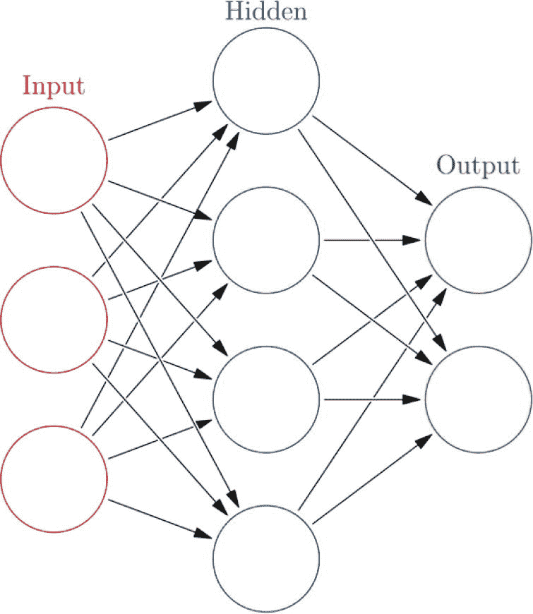

一个三层的神经网络流程图。左侧标有红色“输入”的层包含三个节点。中间标有蓝色“隐藏”的层有四个节点。右侧标有绿色“输出”的层包括两个节点。箭头表示从每个输入节点到所有隐藏节点，以及从每个隐藏节点到所有输出节点的连接，说明了信息在网络中的流动。

图 15-11

神经网络的一般视图。来源：来自“File:Colored neural network.svg”，可在 [`​commons.​wikimedia.​org/​wiki/​File:​Colored_​neural_​network.​svg`](https://commons.wikimedia.org/wiki/File:Colored_neural_network.svg) 获取，根据知识共享署名-相同方式共享 3.0 未本地化版本许可协议使用（[`​creativecommons.​org/​licenses/​by-sa/​3.​0/​deed.​en`](https://creativecommons.org/licenses/by-sa/3.0/deed.en)）

如前所述，神经网络有许多类型。我们不打算深入研究任何一个，但会讨论每种类型的基本知识，如果你想了解更多，可以去谷歌搜索。最早的现代神经网络是单层感知器，但它用处不大；接下来出现的是多层感知器，也称为前馈神经网络。前馈意味着数据仅沿一个方向流经网络，从输入层到下一层，再到下一层，最终到达输出层。这意味着数据在每一层只会到达一个节点。每个节点都有一个权重和阈值，用于决定是否将数据继续传递下去，但这些权重和阈值在训练过程中会被调整，它们最初是从随机值开始的。由于节点数量庞大，随机起点是最佳选择，调整会持续进行，直到网络输出的数据与每个标签对应，网络据此知道如何进行调节。一种常见的权重调整技术是*反向传播*，它从输出端开始，针对特定的输入-输出对，向后遍历不同的层，利用关于每个权重如何影响输出的知识来调整损失函数。这个过程使得权重得以改善。

另一个重要的神经网络是*卷积神经网络*（CNN），它是一种通过特定优化方式来确定特征的前馈神经网络。它是帮助改进图像处理和计算机视觉的主要创新，并且至今仍在使用，尽管有一些其他方法正在取代它。它之所以如此有价值，是因为它使用了一些技巧来显著减少网络中节点之间的连接数量，这使得它效率更高，并且不太容易出现过拟合——而这种情况在全连接前馈神经网络中可能发生。但它们仍然会消耗大量的计算资源。

*循环神经网络*（RNN）是一种不同类型的神经网络，适用于序列数据（如基于时间的数据和语言数据），其中每个输入并非相互独立——当前序列中先前的元素会通过一个传递下去的隐藏状态被“记住”，这会影响后续的权重。与我们讨论过的其他类型不同，这里的权重并非在每个节点上都不同。相反，同一层中节点上的权重具有相同的值。标准 RNN 在处理较长的序列时会出现问题，但在处理诸如句子中的单词或时间序列数据中的数值等较小规模数据时表现良好。一种具有更好且更长期“记忆”能力的 RNN 变体被称为*长短期记忆*（LSTM）神经网络。它们效果很好，但需要大量训练。

还有一种类型的神经网络是*Transformer*，这是一种新型网络，在某种程度上已经取代了 RNN 和 CNN，因为它没有同样的局限性，特别是在资源使用方面。它是生成式人工智能（ChatGPT 中的 GPT 代表“生成式预训练 Transformer”）的主要工具。这类模型在处理词语的方式上有一些创新。在输入时，一个句子会被转换为一个嵌入（embedding），它表示每个单词的语义（含义），然后每个单词被分配一个数字，表示其在序列中的位置。会使用一些函数来发现单词之间的关系。网络会对各层进行一些调整，然后像一个前馈神经网络那样工作。Transformer 仍然需要大量训练，但它们比 RNN 更高效，并且在处理新数据时运行速度更快。


### 生成对抗网络（GAN）

我要提及的最后一种神经网络是*生成对抗网络*（GAN），它实际上是由两个以特定方式相互交互以生成输出的神经网络组成。整体结构如图 15-12 所示。其中一个网络称为*生成器*，它基于随机数据生成数据。生成器的主要目标是生成合理的输出。这些生成的数据会作为负训练样本输入到第二个网络，即判别器。*判别器*是一个分类器，它也会接收真实数据作为输入，因此其任务是学会区分真实数据与来自生成器的虚假数据。生成器的输出直接馈送到判别器的输入中。

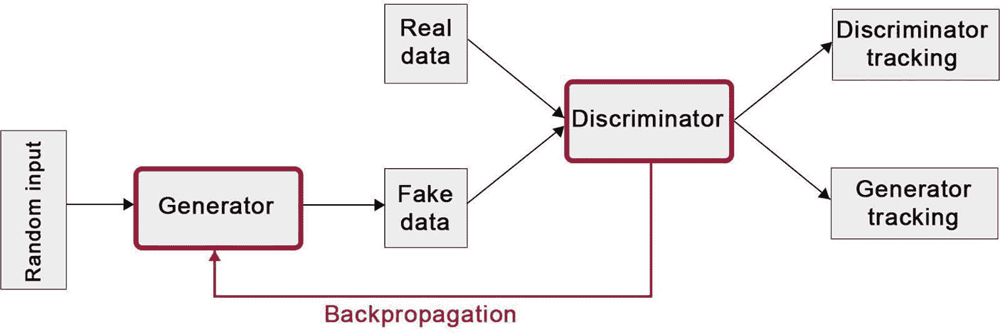

流程图展示了生成对抗网络（GAN）的过程。该图表显示“生成器”接收“随机输入”以生成“虚假数据”。这些数据连同“真实数据”被输入到“判别器”中。判别器输出至“判别器追踪”和“生成器追踪”。一个标记为“反向传播”的反馈回路将判别器连接回生成器。关键术语：生成器、判别器、虚假数据、真实数据、反向传播。

**图 15-12** 生成对抗网络的结构与训练行为

`反向传播` 从判别器的输出一直回溯到生成器，并利用计算结果调整生成器的权重（注意，为了行为的一致性，只有生成器的权重以这种方式被改变）。整个系统的目标被称为*收敛*——当判别器对其输入是真实还是虚假进行猜测（基本上是抛硬币决定）时，就是生成器表现最佳的时刻。这个系统的训练很棘手，因为很难知道收敛的确切点。如果生成器在收敛点之后还继续向判别器发送数据，那么判别器可能会开始表现异常，其（基本上是）随机的通过 `反向传播` 的反馈会对生成器产生负面影响。

一旦系统训练完成（达到并识别出收敛），生成器就可以用来生成数据。你仍然需要向生成器输入数据，但随机噪声就能生成图像。

### *k* 近邻算法

*k*近邻算法（*k*-NNs）是一种监督式机器学习算法，它在多个维度上观察数据，识别每个点的 *k* 个“最近邻”（*k* 可以是任意值，包括 1），并可用于分类和回归。它可以使用多种测量“邻近”距离的方法，而高维数据（即具有大量特征的数据）可能需要特殊方法。*k*-NNs 可以用于非线性数据，以及数值型和类别型数据。使用 *k*-NNs 时需要注意的一个重要事项是，数据必须进行标准化，使其全部处于同一尺度。

*k*-NNs 的一个有趣之处在于，它实际上并没有像我们之前看到的其他监督算法那样有一个真正的“训练”步骤。你仍然需要一个“训练”数据集，但这基本上只是一个参考集。该算法的工作方式意味着非常大的数据集处理时间可能会长到无法接受。请看图 15-13，这是我们之前看过的儿童数据集中的数据。它有 15 个标记的数据点，只有两个特征：身高和年龄，其中蓝色代表男孩，红色代表女孩。

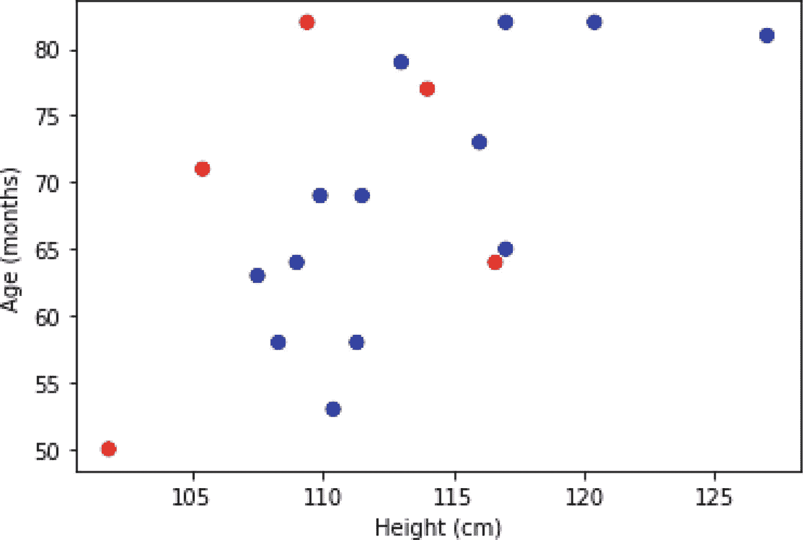

散点图展示了以厘米为单位的身高（x 轴）和以月为单位的年龄（y 轴）之间的关系。图表中包含红色和蓝色的数据点，表示两个不同的类别或分组。身高范围从 100 到 130 厘米，年龄范围从 50 到 80 个月。

**图 15-13** 提供给 k-NNs 的儿童身高数据集样本，其中蓝色代表男孩，红色代表女孩

如果我们将这个数据集作为“训练集”提供给 *k*-NNs，它将作为我们的参考集。我们将 *k*（即在分类中要考虑的近邻数量）设置为 3（这是一个常用值）。现在，如果我们有两个如图 15-14 所示的新数据点，我们可以看到分类是如何工作的。第一个新数据点是左上角的紫色点，第二个是新数据点是中上方的绿色点。我们可以通过肉眼识别出哪些三个参考点最接近紫色点和绿色点，并用黑线标记。对于紫色点，三个近邻点中有两个是红色，一个是蓝色，因此我们将紫色点分类为红色（女性）。绿色点有四个相当接近的点，虽然最近的那个是红色，但接下来两个都是蓝色，因此这个点会被分类为蓝色（男性）。

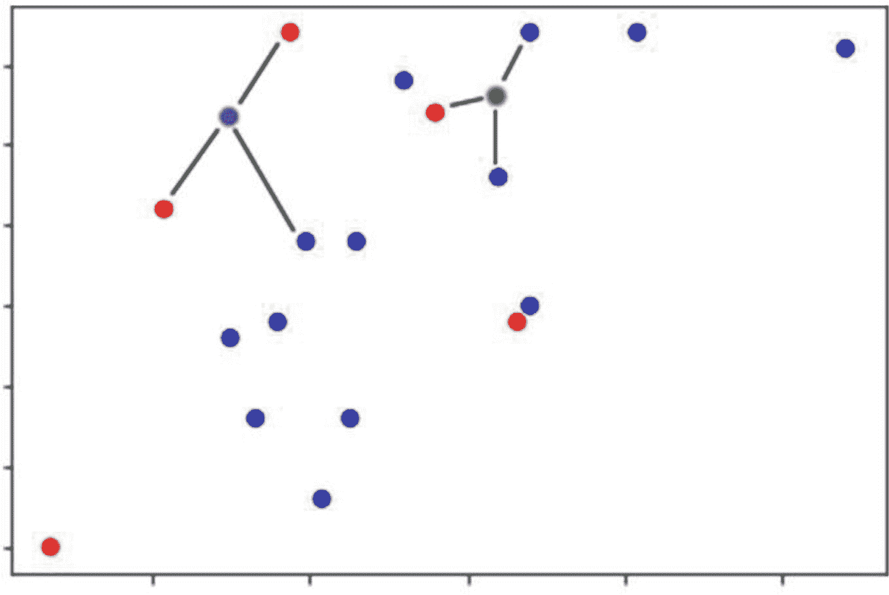

散点图展示了由线条连接的不同颜色的节点。红色、蓝色、绿色和紫色的节点分布在图表各处。一些节点由黑色线条连接，形成小的簇。该图没有具体的轴标签或数值数据。主要关注点是节点的排列和连接。

**图 15-14** 基于我们“训练”好的 k-NNs 对两个新数据点进行分类

*k*-NNs 在技术上是一个分类器，但也可以计算某个点最近的 k 个近邻的平均值用于回归。对于上面的新数据点，如果标签是数值而不是类别，我们只需取三个最近点的平均值。这也相当直观，且易于实现。通常，找到合适的 *k* 需要一些工作，但它在很多情况下都表现良好，尤其是当特征超过两个时。为了找到最佳的 *k*，你通常会创建多个具有不同 *k* 值的 *k*-NNs 模型，并在每个模型上运行测试集，以找出哪个 *k* 值效果最好。

*k*-NNs 现在不如以前那么常用了，但当特征数量不多时，它仍然是一种强大且简单的算法。它仍被用于许多领域，包括金融市场预测、某些推荐系统和图像处理。


# 支持向量机

*支持向量机*（SVM）是另一种主要用于分类的监督式机器学习算法，它可以找到一种将数据分组的方法。该算法能够处理线性和非线性数据，尽管针对这两种用途存在不同的变体。在线性变体中，它能在具有许多特征的问题中找到一个线性超平面。

## 超平面

超平面是穿过空间的一条“线”的通用名称，其维度比所在空间少一维。例如，在二维图表上，你可以在此空间内画一条线，它只是一条直线（直线被认为是一维的）。类似地，二维平面可以放置在三维空间中。在四维空间中，它就会是一个三维物体（一个长方体，像立方体但边长不同）。你可以想象出长方体，但无法想象那个空间。但由此开始就完全是抽象的概念了。只需将超平面想象成一条划分超空间的线，而这个超空间只有二维，从此往后都只是类比了。

超平面的作用在于划分空间以分离不同类别的物体。图 15-15 展示了 SVM 试图通过创建一条作为类别间边界的线来达到的目的。在标准 SVM 中，这条线是线性的，因此必须是一条直线，但存在其他可以生成非线性超平面的 SVM 变体。请注意，在图 15-15 中，存在一些被错误分类的点：一个蓝色点混入红色点中，两个红色点混入蓝色点中。有时这可以通过非线性超平面来解决，但错误在机器学习中是不可避免的。

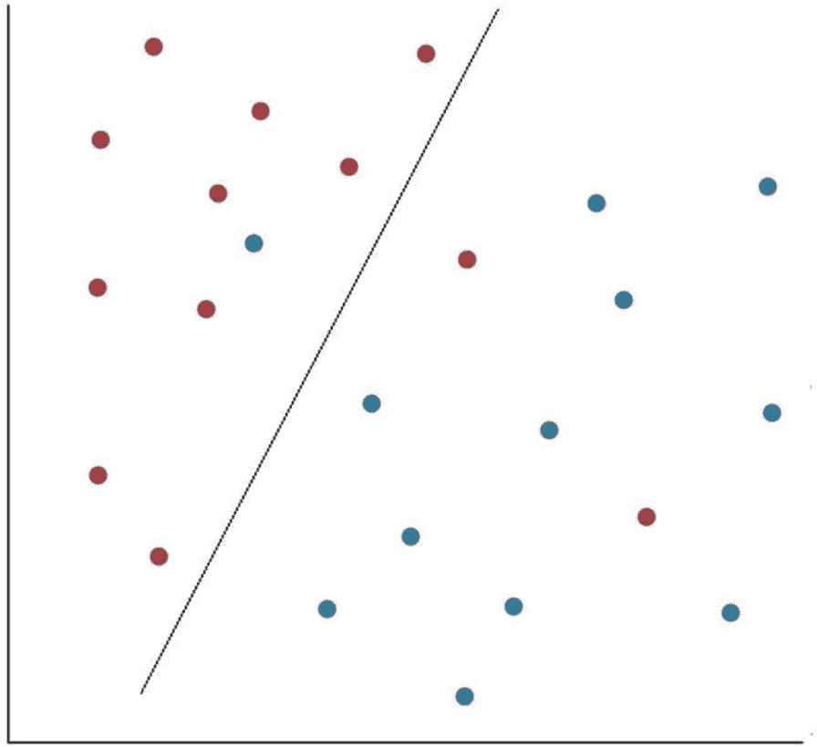

散点图显示了两个数据点组，一组为红色，另一组为蓝色，由一条对角线分隔开。红色点主要分布在左侧，而蓝色点分布在右侧，展示了分类边界。

图 15-15

SVM 在具有两个特征的数据中分离类别目标的示例

SVM 非常强大，但与其他算法一样，当特征数量过多时，由于维度灾难（我们将在下面讨论），它们可能会过拟合。它们被用于许多任务，包括文本分类和图像目标检测。同样值得一提的是，存在可以进行回归的 SVM 变体，尽管这种做法不太常见。

# 无监督技术

在无监督学习中，你只是想看看数据本身能告诉我们什么。你并非提供训练数据让其学习规则以应用于新数据。相反，你提供精心策划和准备的（数据）特征，告诉它放手去做，让它自行其是。它会返回关于它在数据中发现的信息给你。

在数据科学中，有两种主要的无监督学习类型被频繁使用：聚类和关联分析。在聚类中，方法会识别出彼此相似的数据组。而通过关联分析，这些技术会为你提供相互关联的更小的事物组。我将在下面分别讨论这两种类型，并提到它们各自的一些不同算法。

## 聚类

聚类是一种用于识别数据中相似点的流行方法。例如，一家零售店可能希望识别不同类型的顾客，以便对他们进行差异化营销。如果我们已经有一些标有类型的顾客数据，我们可以将这个问题视为一个监督问题进行解决。我们可以先在这些数据上训练一个模型，然后用它处理其余未标记的顾客数据。但这需要满足三个条件：知道有多少个组、这些组是什么、以及拥有标有这些组的数据。如果没有这些信息怎么办？聚类就来救场了，因为它不需要这些条件中的任何一个（从技术上讲，有一种方法确实要求你指定组的数量，但你可以通过实验来找到正确的数量）。

### *k*-均值聚类

`k`-均值是数据科学家通常最先学习和使用的聚类方法。`k`-均值聚类通过将每个数据点分配到与其最近的簇（由该簇的中心定义，即簇内所有点的均值）中，来识别预先指定数量的簇。但是，既然这些簇事先没有标记，它们是如何得到分组的呢？`k`-均值采用自上而下的方法，首先查看所有数据，并将其划分成所谓的泰森多边形（参见图 15-16，了解数据被分解成泰森多边形的示例）。


一幅彩色的泰森多边形示意图，展示了各种不同颜色的多边形区域，每个区域中心有一个白色点。这些区域形状不规则，共同铺满整个空间，说明了基于到一组点的距离来划分平面的概念。

图 15-16

针对一个包含 28 个点的随机数据集的泰森多边形

白点代表我们的数据集，多边形就是泰森多边形。请注意，它们并非随意确定的。要生成它们，你需要先在每个点与其直接相邻点之间画一条线，然后在每两个点之间的中点处画一条垂直于该线的线。将这条垂直线延伸直至碰到另一条线，最终你就会得到这些带有尖角的形状。

这是一个概念上的起点。如果你将 `k` 设置为 28，并且每个这些点都是你的簇中心，那么这个空间内的任何新点都将被分配到对应每个泰森多边形的簇中。计算 `k`-均值最常用的算法速度较慢但直观，被称为朴素 `k`-均值。你首先指定 `k`，然后算法会先分配 `k` 个随机的簇中心。接着，数据集中的每个点都被分配到最近的这 `k` 个簇中心之一。这时泰森多边形就发挥作用了，因为任何泰森多边形内的数据点都被分配给了该随机簇中心。

在此之后，我们开始调整簇。对于每个簇，我们计算该簇内所有点的均值，这个均值就成为该簇调整后的中心。这是一轮迭代。这个两步过程不断重复：先将每个点重新分配到最近的簇，然后重新计算中心。有一个衡量每个簇中心及其点距离的指标，称为*簇内平方和*，每次中心重新计算后都会计算该值。这个过程反复进行，直到簇内平方和停止变化，此时我们称算法已收敛。

关于 `k`-均值的一个有趣之处是它总是会收敛，尽管不能保证一定能找到最优的簇。这是因为起始点是随机选取的。通常的做法是运行几次，看看这些簇是相似的、不同的还是截然不同的。此外，除了上述方法之外，还有其他衡量“邻近度”的方式，但它们不像这种简单方法那样保证能收敛。

请注意，除了完全随机赋值之外，还有一些分配初始簇中心的方法（例如随机分区法和 Forgy 法）。你可以通过谷歌搜索了解这些方法。

我们已经讨论了如何运行 `k`-均值，但还没有讨论如何知道你的 `k` 到底应该取多少。有时你可能对数据中可能存在什么有所了解，因此你可能会有一些看起来值得尝试的数值。如果你试图识别一家商店的不同类型顾客，将 `k` 设为 50 可能是不合理的——公司如何为 50 种不同类型的顾客制定差异化的营销或其他服务？此外，你的 `k` 值越高，算法所需的数据就越多。


幸运的是，你无需事先知道正确的`k`值，因为有一些方法可以帮你系统地挑选出一个合适的值。这类方法有多种，在此我将介绍肘部法和轮廓系数法，更多信息可以自行搜索。

肘部法简单且常用，但由于难以明确界定“肘部”的位置，它被认为并非极其可靠。使用*肘部法*时，你需要确定可能的聚类数量，例如 2 到 10 个。然后对每个候选值运行 `k` 均值算法，并计算每次运行后最终的聚类内离差平方和，接着以聚类数量为横轴、该值为纵轴绘制图表。我们需要寻找的点是，随着聚类数量增加，聚类内离差平方和从快速下降转为显著减缓或趋于平稳的转折点。图 15-17 展示了几种可能的图表示例。

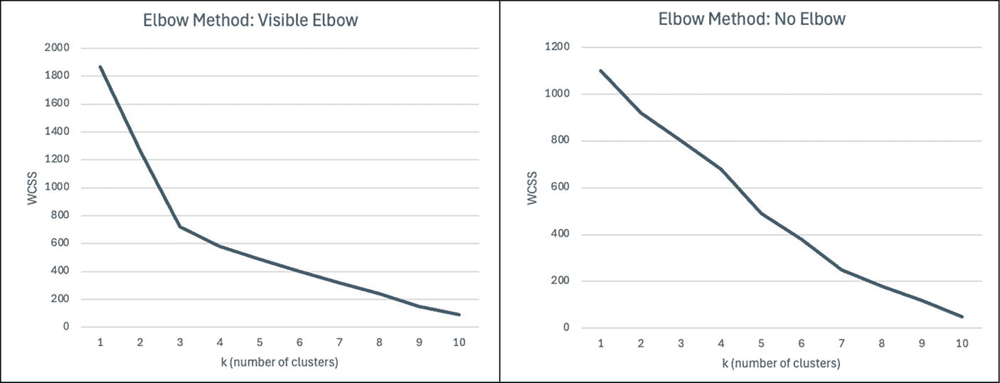

两个用于比较肘部法确定 k 均值聚类最佳聚类数量的 X-Y 图表。左侧图表标题为“肘部法：可见肘部”，在 k=3 处有一个明显的弯曲点，表明这是最佳聚类数。右侧图表标题为“肘部法：无肘部”，曲线下降较为平缓，没有明显弯曲点，表明没有清晰的最佳聚类数。两个图表均以聚类数量 (k) 为横轴、聚类内离差平方和 (WCSS) 为纵轴。

**图 15-17**  
用于确定最佳 `k` 值的两个肘部图。左侧图表有可检测到的肘部，而右侧图表则没有。

在图 15-17 的图表中，左图在 `k = 3` 时出现了我们寻找的转折点——即聚类内离差平方和下降速度发生改变的节点。但右图中并不存在这样的点。这就是该方法并非总被使用的原因。它被认为是主观的，如果你改变图表的比例或尺寸，肘部看起来可能会或多或少像“肘部”。不过，你总能快速生成这张图表，如果运气好，或许能看到一个明显的肘部。

另一种确定合适 `k` 值的常用方法是轮廓系数法。使用*轮廓系数法*时，通过衡量每个数据点与其所在聚类内其他点的相似程度，以及与相邻聚类内点的差异程度，来评估每个点的聚类效果。这需要计算每个点的得分，再综合整个结果，得分范围在 -1 到 1 之间，高分表示聚类效果好，低分则反之。该方法在特征数量较少的数据集上表现良好，但当特征数量众多时，维度灾难问题便会再次凸显。

事实上，如同许多机器学习算法一样，这里通常也需要反复试验。由于需要预先指定聚类数量，该方法需要花费一些功夫，但在识别有意义的群体方面，它可能极其强大。

## 层次聚类

还有其他一些聚类方法被称为层次聚类，主要有两种类型：凝聚层次聚类和分裂层次聚类。凝聚法采用自底向上的方式构建聚类，每个数据点初始时各自为一个簇，然后逐步向上合并合理的簇。分裂法则是自顶向下，我们从包含所有数据的一个大簇开始，根据每个簇的特征将其逐步分裂。所有层次聚类方法都会生成一个名为树状图的树形结构，该结构展示了从每个数据点为一个簇到所有数据点合为一个簇（凝聚法）或反之（分裂法）的层次关系。

这两种方法都使用距离度量来指导分裂或合并的决策。距离度量通过比较数据集中的单个数据点，来衡量所谓的相异性。另一种称为簇间链接的度量，则考察不同数据集合之间的差异。

在最常见的凝聚法中，每一步都会将两个簇合并。有趣的是，这个过程会一直持续到所有数据点最终合并成一个簇。待算法运行完毕后，你可以在树状图中选择一个层次进行“剪枝”，并将该层次下的簇作为最终的聚类结果。图 15-18 展示了这样一个例子。它演示了在鸢尾花数据集上执行的凝聚层次聚类，该数据集是一个著名的公开数据集，许多人在初学机器学习时都会使用它。该数据集包含了三种鸢尾花的标注数据。

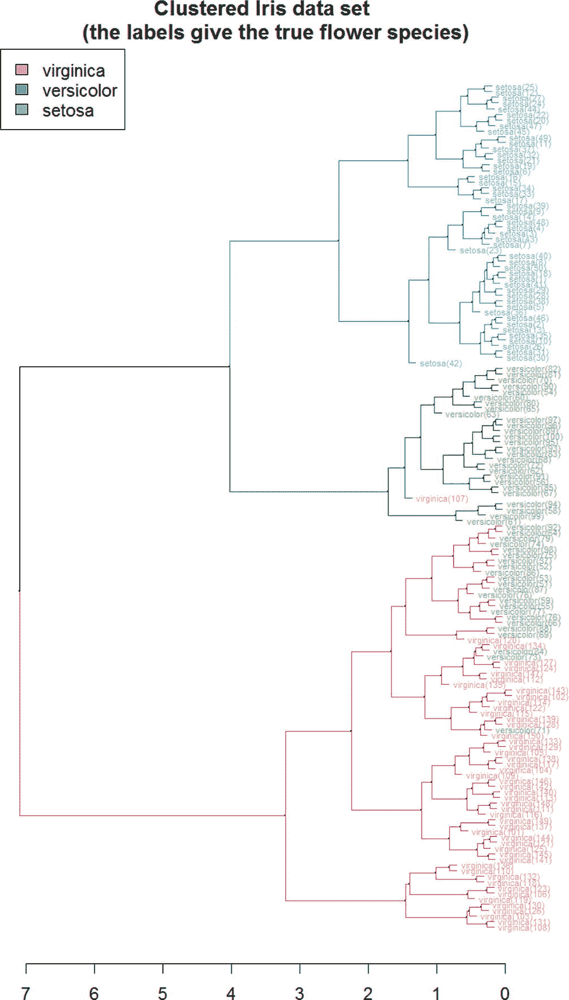

聚类后的鸢尾花数据集树状图，展示了三个物种（维吉尼亚鸢尾、杂色鸢尾和山鸢尾）之间的层次关系。每个物种用不同颜色标记——维吉尼亚鸢尾为粉色、杂色鸢尾为绿色、山鸢尾为蓝色。树状图结构展示了单个样本的聚类过程，标签指示了真实的花卉物种。x 轴代表用于聚类的距离度量。

**图 15-18**  
花卉数据集的凝聚层次聚类树状图。来源：“File:Iris dendrogram.png”，可从 [`commons.wikimedia.org/wiki/File:Iris_dendrogram.png`](https://commons.wikimedia.org/wiki/File:Iris_dendrogram.png) 获取，基于知识共享 署名-相同方式共享 4.0 国际许可协议 ([`creativecommons.org/licenses/by-sa/4.0/deed.en`](https://creativecommons.org/licenses/by-sa/4.0/deed.en)) 使用。

该算法从右侧开始，每个单独的花朵数据点自成一个簇，其类别用颜色表示。接着，算法开始逐一合并这些簇，每次合并两个，并向上移动以生成树状图的各个层次。你可以看到颜色变化之处，许多*杂色鸢尾*样本开始被聚在一起，最终与*维吉尼亚鸢尾*样本合并为一个簇。但你可以选择在树状图的某个位置进行剪枝，以查看具体的聚类情况。假设我们决定在 x 轴刻度为 3 的位置剪枝。想象一条从该点向上延伸的垂直线，它会穿过四条水平分支线，每条分支线代表一个不同的簇。此时可以观察花朵样本是如何被分组的。在垂直线右侧、该分支线之下的所有样本都属于同一个簇。因此，你可以看到有两个簇分裂了*维吉尼亚鸢尾*样本，而杂色鸢尾和*山鸢尾*各有一个簇，其中部分样本被分到了错误的簇中。

分裂层次聚类的工作原理与凝聚法基本相反，它从一个包含所有数据的簇开始，最终以每个数据点各自为一个簇结束。从视觉上看，它也会生成类似图 15-18 的树状图，只是构建方式不同。更多详情可自行搜索。


### 关联规则学习

关联规则学习是另一类无监督机器学习。你可能听说过啤酒与尿布的故事：男士们周五下班后会顺路去商店买尿布，并在去收银台的路上顺手拿一箱啤酒。这听起来像是个传闻，但显然并非虚构——曾有一个团队在药店进行关联规则挖掘，确实发现啤酒与尿布之间存在强关联，此外还有超过 20 种产品对。^(⁴¹)

`关联规则学习`（有时也称挖掘）着眼于项集——即成对或更大集合的物品组合——以识别那些会促使购买另一物品的商品。啤酒与尿布的故事之所以相关，是因为零售业是其典型应用场景。它甚至常被称为购物篮分析，因为我们分析的是某人购物车中的商品。规则本身包含方向性，基本可以理解为“如果-那么”的组合理念：如果他们买了一包尿布，那么他们也常会买一箱啤酒。

关联规则学习的主要方法是`Apriori`算法。我们曾在其他语境（包括朴素贝叶斯在内的贝叶斯统计）中听过这个术语，但在这里，它提出了一种利用特定概率进行关联规则学习的具体方法。该算法首先通过观察购物篮（即单次交易中的所有商品）来识别规则，然后创建由至少两个商品组成的项集。对于每个项集，会计算一个名为`支持度`的分数，即该潜在项集在所有交易中出现的百分比，并保留所有超过特定选定阈值的项集。支持度足够高的项集被称为`频繁项集`。然后从精简后的集合中生成所有可能的规则。请注意，如果频繁项集的数量不止几个，那么规则的数量将会极其庞大。规则写作形式如`{牛奶} ⇒ {面包}`或`{牛奶, 面包} ⇒ {黄油}`，我们将左侧称为`前件`，右侧称为`后件`。

下一步是计算每个可能规则的`置信度`分数，即同时包含前件和後件的交易百分比。置信度能很好地指示商品配对的显著性。正如我们丢弃支持度低于特定阈值的项集一样，我们也会丢弃置信度低于另一个定义阈值的规则。

这些信息很有用，但有时置信度本身可能具有误导性，因此我们还需要计算另一个分数，称为提升度。`提升度`基于支持度计算，它能告诉我们三种可能关系的存在性（及强度）：（1）第一件商品的出现是否会导致第二件商品的购买，（2）两者之间是否存在关联，或（3）两者是否具有相反效果（第一件商品的出现反而降低了第二件商品出现的可能性，这意味着替代关系）。提升度分数告诉我们第二件商品与第一件商品同时出现的概率提高了多少（提升度为 4 意味着比总体概率高四倍）。还有一个能让我们更深入了解关联有效性的分数，`确信度`，它也可以基于支持度和置信度计算得出。

还有其他一些用于计算关联规则的算法，但`Apriori`算法使用广泛且效率相当高。

## 模型解释器

与机器学习相关的一个领域是相对较新、仍在大力发展的模型解释器。`模型解释器`是一种工具，它接收一个已训练的模型以及针对未见数据的预测，并确定在已训练模型中哪些特征对每个单独预测的贡献最大。这在黑箱模型中，或者当模型可解释性较低时，具有无可估量的价值。正如我们讨论过的，决策树在可解释性方面表现出色，但它们存在一些缺点，而当我们改用随机森林时这些缺点可以得到缓解。然而，随机森林在很大程度上是不可解释的。你可以获得整个模型的特征重要性分数，但它无法告诉你关于某个特定预测的任何信息。我的团队曾为一个销售预测模型制作了可视化工具，你可以将鼠标悬停在某一天的预测值上，它会显示对该天预测贡献最大的前十项特征。这对利益相关者来说价值巨大，同时也让我们对自己的模型更有信心，因为模型从我们提供的众多特征中，为每一天捕捉到了有意义的特征。

目前市面上有几种模型解释器，各有优缺点。有些仅适用于线性数据，有些适用于任何模型，还有些仅适用于特定模型（算法）。我使用过且效果不错的一个叫做`LIME`（局部可解释模型无关解释），Python 和 R 语言中都有相应的库。你可以谷歌搜索这个主题来探索更多工具，从`SHAP`（沙普利加性解释）开始就是一个不错的选择。


# 机器学习的实现与编码

我已经介绍了一系列非常重要且实用的机器学习技术，以及它们的训练或运行方式。但当我们实际去实现它们——也就是编写代码时——还有一些其他非常重要的技巧。上面讨论的所有方法在 R 和 Python 的某些库中都能找到，这很棒。但你不能简单地把数据扔给一个机器学习函数，就期望得到良好的结果。

我在上面谈到了超参数调优的重要性，以及如何通过使用验证集或交叉验证来操作。有一些库可以帮助你完成这项工作。你需要提供数据、所使用的模型，以及你希望为每个参数尝试的所有可能值。网格搜索会尝试所有参数的所有组合，并追踪每次的表现。如果你尝试的参数超过几个，且每个参数的取值也很多，这显然会花费大量时间，因为这些值的组合数量会非常庞大。幸运的是，有一些库允许你从所有可能的参数组合中选择一个子集，只运行这些组合。这些工具会使用每种组合运行算法，存储性能，并报告表现最佳的参数集。

通过验证集上的网格搜索进行超参数调优很棒，但如果你只是在整个训练集和验证集上运行所有内容，最终得到的模型可能并非最适合处理新数据的模型。由于数据科学的很大一部分在于创建一个能够处理前所未见的数据并返回有意义结果的模型，这一点非常重要。一种称为*交叉验证*的技术会自动将你的数据分解成更小的训练子集，并在每个子集上运行所有内容（包括超参数调优）。这使得模型更加健壮，并有助于防止过拟合和偏差（我们将在下文讨论这两点）。R 和 Python 中也有用于此目的的库，使其相对容易实现。

与数据科学中的其他所有内容一样，有几种不同的交叉验证技术可供选择。你可以向谷歌询问更多关于这些技术以及它们何时最佳的信息，但一种常见的技术称为*k 折交叉验证*，即将训练数据集分成 `k` 个（通常为 10）子集。然后，你总共运行模型 `k` 次，每次使用不同的子集进行测试。这代替了使用特定的验证集。

最后值得一提的是，数据科学中的科学性有时会比其它方面更为突出。这并不意味着我们要严格遵循科学方法，但有些数据科学团队会尽可能系统化。而其他团队则可能会更随意一些。当我们测试不同类型的算法时，通常会说进行实验。当我们在研究一个解决方案，并知道我们将尝试不同的算法时，先运行一个我们预期表现不如其他算法（但仍比随机猜测要好）的算法，也是很常见的。我们称之为基线，在许多回归预测中，这通常是一个时间序列模型。拥有基线为我们尝试的所有其他算法提供了一个参考点。这可能是一种很有收获的工作方式，因为我们可以非常清晰地了解正在发生的事情。

# 建模中的挑战

机器学习有很多活动部件，也充满了出错或运气不佳的可能性。通过了解一些常见的陷阱，以及如何识别、处理甚至完全避免它们，可以减轻这些问题。我将讨论过拟合，即模型与特定训练数据过于紧密，导致泛化能力不佳；欠拟合，即模型遗漏了重要的模式；不平衡数据，即某一标签的数量远多于其他标签；维度灾难，即拥有过多维度导致难以获得良好结果；以及数据泄露，即给了模型一个它无法持续的不公平优势。

## 过拟合与欠拟合

过拟合和欠拟合都是模型表现不佳的情况，只是方式不同。我将讨论它们以及偏差-方差权衡，这是一种平衡模型以避免过拟合和欠拟合的方法。

*过拟合*是指模型学习了训练数据（和测试数据）中非常具体的特征，而这些特征在未来数据中可能不存在，因此模型无法很好地泛化。当数据质量低下且包含大量噪音时，也可能发生过拟合。如果模型“学习了噪音中的模式”，那就是过拟合了（而且也就是错的）。看看图 15-19，它与图 15-15 的数据相同。在图 15-15 中，我们有一条简单的直线，将图中的数据分成蓝色和红色标签，有三个数据点（两个红色和一个蓝色）被错误分类。与图 15-19 相比，我们有一条弯曲的线，代表模型的训练分隔器，它过于专注于这三个可能的异常值。当我们对未来的数据进行分类时，这会产生负面后果。

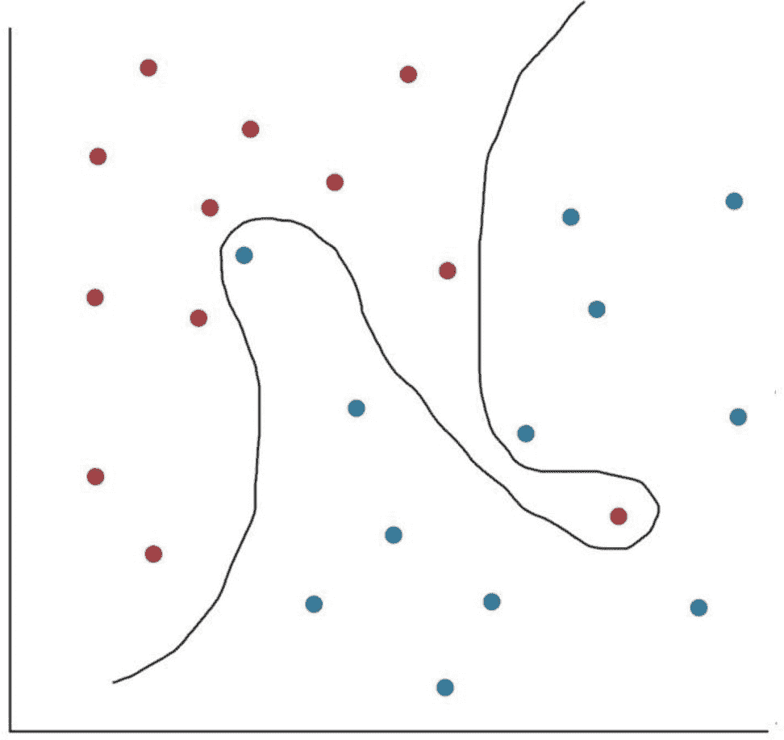

散点图显示了分布在 XY 轴上的两组数据点，一组为红色，另一组为蓝色。一条曲线将这两组分开，表示决策边界或分类线。红色点大多在线的一侧，而蓝色点在另一侧。该图说明了分类或聚类分析。

图 15-19

使用过拟合模型的数据

不难看出，这个模型很奇怪，而且很可能是错误的。假设有两个新点需要分类，如图 15-20 所示。图中显示了两个新数据点，其正确类别标记在绿色圆环的中心。但是，由于它们恰好位于迂回决策边界内的错误位置，因此会被错误分类。那个靠近许多其他红点的新红点会被标记为蓝色，而那个紧邻一个正确分类的蓝点的新蓝点会被标记为红色。很明显，这不是我们希望模型做到的事情。

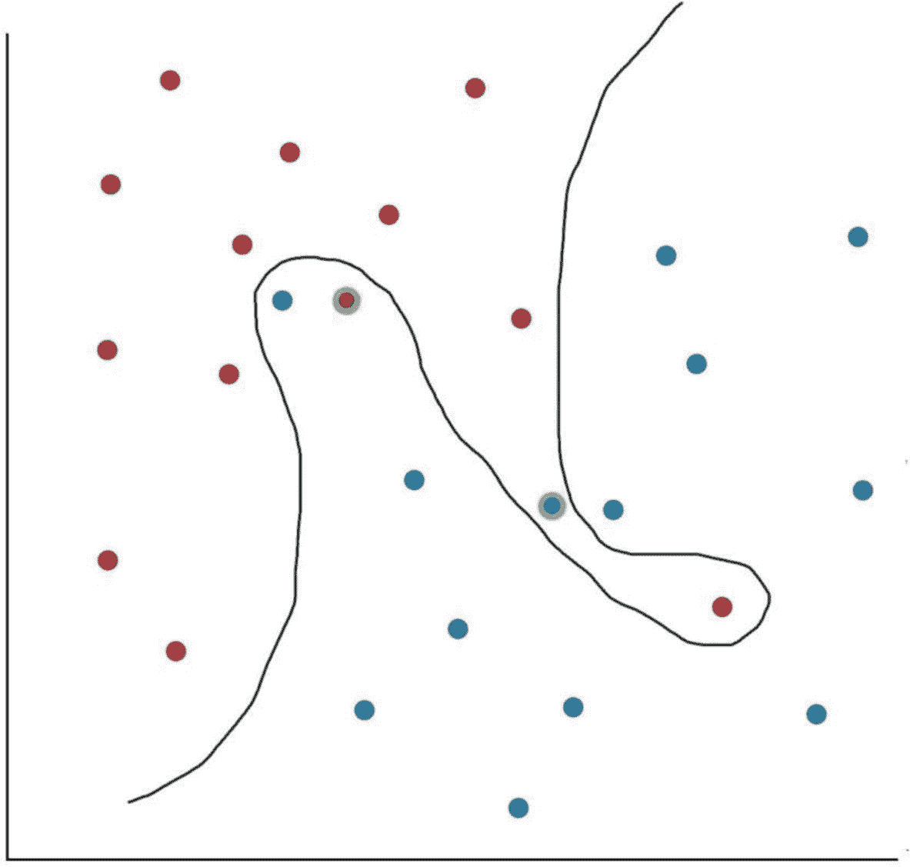

散点图显示了由决策边界分隔的两个数据点聚类，一个为红色，另一个为蓝色。边界由一条曲线表示。两个绿色高亮显示的点位于边界附近，表示潜在的支持向量。该图说明了一个分类场景，可能使用了支持向量机（SVM）模型。

图 15-20

两个需要由这个过拟合分类器分类的新数据点，正确类别在中心标示

过拟合的产生有很多不同的原因，包括维度灾难（下文讨论），其中特征过多会导致过拟合。模型也可能因为算法特定的特征或倾向而过拟合。例如，如果你让决策树变得过深，它可能会严重过拟合，因为它试图解释训练数据的每一个微小特征。随机森林不太容易出现这种情况，因为并非每个数据点都会出现在每棵构建的树中（在成百上千棵树中）。全连接前馈神经网络和 SVM 都容易随着特征数量的增加而出现过拟合。通常，仅仅训练时间过长（比如深度决策树）也会导致过拟合。基本上，如果你不了解算法是如何合理工作的，那么很容易最终导致过拟合。


防止过拟合有多种方法。如前所述，不要训练模型太久——**早停法**会很有帮助。如第 14 章中此前讨论过的，特征选择确实有效（既能减少特征数量，又能剔除那些贡献不大、可能混淆算法并导致对其重要性得出错误结论的特征）。**正则化**是另一种有用的技术，同样在第 14 章中讨论过。其他集成机器学习方法也很有价值，当不同模型开始陷入特征细节的死胡同时，它们可以相互抵消过拟合的倾向。

过拟合是一个问题，但相反的欠拟合问题也需要避免。*欠拟合*是指模型未能捕捉到数据中的模式。它可能由于模型训练时间不足、数据量不够或数据不具有代表性而导致。第一个问题的解决方案显然是训练更长时间（但不要*过*长）。第二个问题通常可以通过半监督技术来增加数据量，或通过其他方法（如下文"数据不平衡"小节所述）创建合成数据来缓解。但如果数据不具有代表性是因为我们没有足够的不同特征的样本，这些技术就帮不上忙了。我们只能寻找更多数据以获得更好的代表性。

可以看到，过拟合和欠拟合处于光谱的两端。我们实际上将管理这个光谱称为*偏差-方差权衡*。欠拟合模型存在*偏差*，因为它们做出了过于简单的假设，导致在训练集和测试集上的表现都很差。过拟合模型在训练集和测试集之间存在*方差*，这意味着它们在训练集上表现良好，在测试集上（或其他未见过的数据上）表现很差，因为它们对训练数据过于敏感。之所以称之为权衡，是因为某些用于减少偏差的方法实际上可能会增加方差，反之亦然。例如，特征选择可以降低方差，因为它使模型更简单，但也可能导致偏差增加。某些线性模型中的正则化会降低方差但增加偏差。在决策树中，树越深，方差越大。虽然有一些计算偏差和方差的方法，但它们相当复杂，对大多数日常工作来说并非必需。

### 数据不平衡

在分类问题中，我们特别容易遇到的另一个问题是数据不平衡，即不同标签的出现次数不均衡。例如，在异常检测中，绝大多数数据（根据定义）是正常的，因此我们只有相对较少的异常标签样本，而更多的非异常标签样本。这在训练模型检测异常时可能会带来问题。

异常标签场景是极端不平衡的一个例子，即一个标签占总数据量的比例不到 1%。但即便不那么严重的不平衡，在二分类问题中也可能产生影响。当标签出现比例仅为 20%时被认为是中度不平衡，比例达到 40%时为轻度不平衡。

处理不平衡有几种方法。一种是对多数类（出现频率高的标签）进行**下采样**并**提高权重**。*下采样*是指从多数类中抽取样本，以减少少数类与多数类之间的差距。例如，如果我们有 1 个异常样本对 100 个非异常样本，我们可以抽取 5%的多数类，这样最终只有 5 个非异常样本对 1 个异常样本，比例从 0.9%变为 17%。这种方法的下一个步骤是*提高权重*下采样后的多数类，即标记这些样本在训练过程中需要被更重视地对待。

另一种许多人常用的技术叫做*SMOTE*（合成少数类过采样技术），它与上述技术相反——它增加少数类样本的数量。它通过创建新的（合成的）具有异常标签的样本来用于训练，从而使数据集达到更好的平衡。该技术使用*k*-近邻法识别给定真实样本周围的区域，然后选择一个邻居，并在原始样本与邻居之间创建一个新的合成数据点。


### 维数灾难

我在上文已经提到了这个问题。*维数灾难* 指的是由于特征过多而引发一系列问题的情形。其中最明显的问题是，特征越多，数据就越难以可视化。显然，我们无法真正在三维以上空间中对数据进行可视化，但通常可以通过一些技巧来包含三个以上的特征，例如在散点图中使用颜色和点的大小。此外，有时我们可以通过解析数据，一次只查看少量特征；如果只有 10 个或 20 个特征，这还行得通，但特征越多，这种方法就越不实用。

第二个问题是*数据稀疏性*，即数据分布非常分散，数据点之间（有时只是部分数据点之间）存在大量空白区域。从图 15-21 和图 15-22 中，我们可以看到增加维度如何导致稀疏性。如果我们从一个虚构的祖孙群体中，以受教育年限数据的一维视图开始，只有一个轴上的一个特征，如图 15-21 所示，我们可以看到数据分布在一个小范围内，尽管 20 年那个点是一个异常值。（注意，我添加了抖动，这使得数值有轻微偏移，因此具有相同数值的点不会完全重叠。）


散点图显示了沿 x 轴（标记为“受教育年限”）的数据点，范围从 0 到 25。数据点均匀分布在 5 到 20 年之间。

图 15-21

一组人的总受教育年限的一维视图

但是，我们的数据集拥有的特征不止总受教育年限这一个。我们可以将年龄添加到图表中，创建一个标准的二维散点图，如图 15-22 所示。一旦我们这样做，就可以看到两个点距离所有其他点以及彼此之间都非常远。

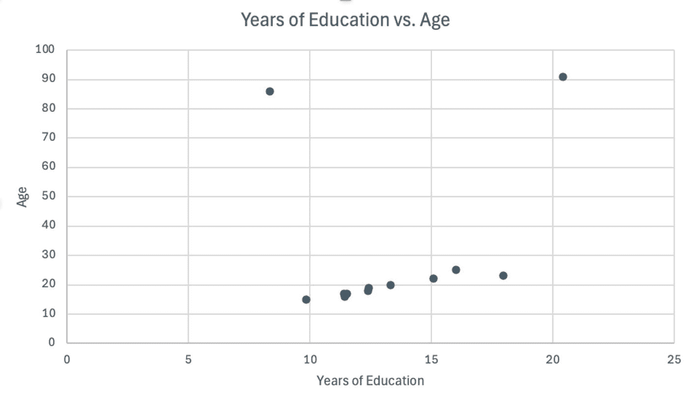

标题为“受教育年限与年龄”的散点图。x 轴表示受教育年限（范围 0 到 25），y 轴表示年龄（范围 0 到 100）。数据点分布散乱，大部分集中在受教育年限 10 到 20 年、年龄 10 到 30 岁之间。存在两个异常值：一个位于受教育年限约 10 年、年龄 90 岁处，另一个位于受教育年限 20 年、年龄 90 岁处。

图 15-22

将数据维度从一维增加到二维的影响

图 15-22 中的这些点距离如此之远，以至于很难将它们纳入模型而不会引发其他问题，例如过拟合。此外，这些距离较远的点恰好是整个数据集中的最低值和最高值。看起来，如果我们在模型中使用年龄，模型会无所适从——年龄较大与高学历还是低学历相关？那么，在大部分数据点聚集的区域与那两个较远的点之间的所有空间里，又发生了什么？我们完全不知道，因为我们没有足够的数据来支撑这么多的维度。如果仅增加一个维度数据就开始分散，想象一下在 10 个维度、50 个维度甚至更多维度下会发生什么。我们拥有的特征越多，就需要越多的数据来表现每个特征及其与其他特征之间关系的真实多样性。

如图所示，过拟合是维数灾难带来的另一个问题，这主要源于数据稀疏性。第四个问题是，特征越多，“距离”的概念就越模糊。因此，当我们处理高维数据时，一些用来衡量距离的典型指标就不再有效了。

另外两个问题与随着特征数量增加而必须进行的计算量有关。它会开始消耗越来越多的计算资源，运行时间也越来越长。根据特征的数量，这可能会达到完全不切实际（或成本过高）而无法运行的地步。

### 数据泄露

`Data leakage` 源于建模中最容易犯的错误之一——意外地将不应包含的数据放入了训练集中。这可能来自测试集中的行（很容易发生），或是任何关于目标变量的信息，而这些信息在进行真实预测时是无法获取的。

另一个容易犯的错误，尤其是在你刚开始时，就是意外地将训练集（和测试集）中存在的、但当你对未见/未来数据运行模型时不会存在的特征包含了进来。例如，假设你要预测一家餐厅未来一周（周一至周日）的每日披萨销量。你创建了一大堆很棒的特征，包括前一天的销量和上一周的销量。这在你的测试集中是可行的，因为你拥有完整的数据，可以计算所有这些特征。但当你要对即将到来的一周进行真正的预测时，你可能直到周日晚间才能获得所有销量数据，然后你会在周一清晨运行下一周的特征更新和预测。这没有问题，因为你已经有了前一天的销量。那周二呢？周一清晨你还没有周一的销量数据，因为餐厅甚至还没开门。如果你试图基于这些数据运行模型，你的特征生成或预测很可能会失败，因为它会缺失这些信息。但更糟糕的情况是，你的模型直接使用了空值（其影响未知，但肯定不好）。

数据科学要求注重细节，并始终思考你正在做什么。如果你得到了非常高的准确率或性能得分，那你很可能遇到了`数据泄露`。任何时候，当你在测试集上取得惊人好的性能时，都要检查这种错误。首先，检查训练集和测试集之间是否有重叠。然后，检查是否存在不合理的特征。此外，如果你在处理基于时间的数据，你几乎总是希望将测试集放在数据的时间序列末尾，而将训练集放在其前面。如果你包含了依赖于先前值的特征（例如上个月的销量），那么这就是一个必要条件。


# 关键要点与下章预告

本章我们涵盖了大量机器学习主题。首先重点定义了机器学习的三种关键类型：监督学习、无监督学习和强化学习，同时也介绍了半监督学习和集成学习，这两者对机器学习领域贡献颇多。随后我们深入探讨了几种监督学习算法，包括时间序列分析、广义线性模型、决策树、朴素贝叶斯、神经网络、`k`-最近邻和支持向量机。接着讨论了两种关键的无监督学习技术：聚类和关联规则挖掘，并涉及了`k`-均值和层次聚类两种聚类类型。我介绍了能够帮助解释黑箱模型预测结果的模型解释器，以及在代码中实践机器学习时的一些实用要点。最后，我阐述了进行机器学习建模时面临的主要挑战，包括过拟合与欠拟合（即模型泛化能力不足或遗漏重要模式的情况）、不平衡数据（不同标签的样本数量差异巨大）、维数灾难（模型中特征过多引发的问题）以及数据泄露（训练模型中混入了本不该存在的信息）。

下一章我们将探讨如何评估模型训练后的表现。由于分类任务和回归任务的评估方式差异较大，我们将介绍多种可用于衡量这两类模型性能的指标。同时也会探讨一些用于评估聚类算法性能的指标。

## 实践者简介：杰夫·埃尔莫尔

**姓名：** 杰夫·埃尔莫尔

**现任职位：** 首席高级数据科学家

**所属行业：** 能源行业，也曾涉足教育科技、读写能力研究和写作领域

**从业年限：** 技术领域 20 年，其中数据科学领域 13 年

**教育背景：**

*   应用数学理学学士

*此处观点仅代表杰夫本人，与其现任及历任雇主无关。*

### 背景经历

杰夫 12 岁时便迷上计算机，这份热爱从未消退。高中毕业后他成为程序员并乐在其中，但最终决定攻读学位。起初主修计算机工程，学习微积分后发现自己更热爱数学，于是转专业至应用数学。他痴迷于这种体验：面对棘手问题时，只需应用数学变换，难题便迎刃而解。他通过大学学习和经验丰富的上司接触了机器学习。当时所在公司提供了大量机遇，他开始探索机器学习的实际应用场景。

### 工作实践

他在公司的首个重大项目是与一位研究员合作改进一款产品——该工具通过分析书籍为其分配阅读难度评分，从而帮助孩子匹配适合的读物。为理解儿童阅读学习过程，他意识到自己缺乏相关领域知识，于是开始自学，但进程缓慢。最终他与研究员共同开发出解决该问题的产品。工作中他收获良多，尤其认识到集成学习在机器学习中的宝贵价值——它能从全局视角审视问题。他继续在该公司开发创新产品，但许多工作未被理解，看到成果被闲置令他沮丧，于是决定离职。他与几位伙伴共同创办公司，开发了一款辅助作家撰写小说的工具。这次创业未能成功，令人失望。但这段经历改变了他的观念，使他更重视工作与生活的平衡。如今他找到了热爱却不侵占生活的新工作，过得很愉快。他仍对用 AI 帮助他人充满兴趣，但觉得自己更像一名 AI 爱好者。

### 精彩语录

**工作最爱部分：** 数据科学是桥梁型角色，极具成就感。杰夫乐于解决他人无法自行解决的问题。他还喜欢将新工具（如机器学习）引入从未涉足该领域的行业，从而提升行业工作效率。

**工作最烦部分：** 人类创造并存于电子表格中的数据——质量通常堪忧。他也不满数据科学工作中 80%的时间仍耗费在数据清洗上——他疑惑为何现状难以改变，但事实如此。此外，当工作受限于特定范式或框架时，也会令人感到挫败。

**最得意项目：** 他开发了一套新的口语朗读评估系统，该项目有趣之处在于需融合多个领域知识：心理测量学教育评估（效度与信度）、读写能力发展（学习阅读）、计算语言学和机器学习。他成功找到了阅读能力与口语朗读之间的有效评估关联——能够基于默读能力高精度预测朗读者的每分钟正确字数。他对这项成果深感自豪，但遗憾的是公司不理解其价值也未能实现商业化。

**常用核心技能：** 深思数据——通过思考解决问题。沟通能力至关重要。可视化技能，包括概念构思和创建具体图表等。一张图能传递大量信息，尤其适合互动交流。他还学会了为重复性工作创建可复用的流水线，避免手动重复劳动。

**当前主要工具：** `Python`、`Jupyter Notebooks`、`LLMs`、`Retool`（拖拽式 UI 构建工具），通常使用大型开源生态系统

**数据科学未来：** AI 新进展正在彻底改变人们实现工作自动化的方式。随着越来越多人掌握自动化能力，这一趋势将持续发展。但 AI 很少达到完美，因为模型总可能遗漏更多信息——时间永远不够用，知识也常有缺失。

**优秀数据科学家特质：** 谦逊，善于倾听并暂缓判断，尤其是在进入陌生领域时。若不能保持开放心态，就无法理解事物并做出错误假设。同时需要具备灵活性。可视化能力，包括技术层面和非技术层面。

**给准数据科学家的建议：** 不要将自己局限于仅限商业使用的工具，因为优秀的开源工具比比皆是。总的来说，除了自身经验，永远要从他人的工作中学习。即使不打算写学术论文，也要学会阅读论文——至少能快速浏览以了解可行方向。有时解决问题只需借鉴他人已有的成果。

*杰夫是一位经验丰富的数据科学家，在读写能力研究和心理测量学领域有深厚积累。*

脚注 1 2 3 4 5

# 16. 做得如何？衡量机器学习技术的性能


## 引言

进行机器学习、构建模型、获取预测结果以及发现有趣的关联固然令人兴奋，但我们如何判断所做的一切是否真正正确？这时，性能指标便派上用场了。有多种方法可以衡量机器学习模型的特性，这些特性有助于我们理解模型是否按预期运行、其结论是否准确。如果结果实际上没有意义，我们就不应使用它们。有时，人们很容易只看表面结果就认为这些结果是好的。关于这种不良习惯，请参阅侧边栏了解更多。

模型性能的衡量主要通过计算特定的指标分数来完成。针对三类机器学习任务（分类、回归和聚类），存在不同的指标。我将逐一介绍目前各类任务中使用的各种指标。请注意，我们讨论过的另一种无监督方法是关联规则，但并没有用于全面评估生成规则的指标，因为每条规则在创建过程中已由特定指标评判，因此事后无需再衡量。

当我们谈论评估模型性能时，通常是指在监督学习中，模型在训练集上训练完成后，在测试集（以及验证集，如果使用了的话）上计算指标。在无监督学习中，尽管无法用所有指标衡量“正确性”，但仍有一些可计算的指标能让我们了解模型的质量。当我们使用了无监督算法但同时也拥有标签时，还可以使用额外的指标。

我将首先通过几个例子说明指标在现实场景中的重要性。然后，在讨论模型构建后需要关注的分类、回归和聚类指标之前，我会先概述内部模型构建指标。

## 未能评估机器学习结果

大多数专业数据科学家都足够负责，能确保他们的模型表现良好。但经常有刚入门的数据科学从业者可能不知道评估模型的正确方法（这正是本章内容如此重要的原因）。始终理解模型的表现如何至关重要。同样重要的是，通过检查工作来确保没有犯错误。我曾与一位经验不足的数据科学家共事，他在使用的工具中将论证周期设置为数天而非要求的数月，但他并未发现这个错误。一次快速的检查本应能告诉他，他的预测值比预期大了 30 倍。

经验不足的数据科学家犯的另一个错误是，他们确实会使用性能指标来评估模型，但却没有意识到其优异结果是源于数据泄露，而非模型本身神奇。任何时候，当你获得非常高的准确率或其他指标值时，都需检查是否存在这个错误。

但更大的问题是，许多公司实际上并不会去评估其结果在长远来看是否良好。他们可能会进行一些聚类以识别客户类型，但两年后却并未真正检查这能否以任何方式帮助到他们（特别是看它是否比旧方法有所改进）。他们可能会利用机器学习来帮助决定新店的选址，但若干年后，却可能不会比较由模型推荐的店铺与其他未被推荐店铺的业绩表现。造成这种情况的部分原因是，很难跟进多年前发生的事情，而且你也无法立即评估重大决策。

此外，源于技术沙文主义（认为机器学习本质上公平、正确，且通常优于人类工作的观念，详见第 9 章）的态度，意味着人们甚至不会质疑结果。数据科学可以非常强大，但结果真的具有价值吗？要确定这一点还需要付出一些努力。

# 现实世界中性能评估的例子

很多时候，数据科学家都有自己偏好的指标，但考虑不同的指标以及它们如何适配当前问题总是有益的。以下两个例子展示了指标的重要性，尤其是选择正确指标的重要性。

## 示例 1：指标驱动开发

客户关系管理（CRM）平台 Salesforce 拥有成千上万的客户。这些客户有不同的需求和用例，其中许多人希望在其 Salesforce 数据上进行机器学习。如果能在该平台内直接完成操作，对他们来说是最简单的，但五花八门的用例给 Salesforce 带来了难题。有时公司会为客户提供定制化帮助，但这成本高昂，且能帮助的客户数量有限。因此，Salesforce 创建了一个名为 Einstein Builder 的工具，允许客户生成定制的自助预测服务。^(⁴²) 该工具需要支持所有不同的用例，同时又要易于使用，因此 Einstein Builder 是一个无需编码的 Web 应用，但仍支持可实现自动化的机器学习管道。他们提供了用于回归、二分类和多分类的工具，这涵盖了多种情况。

你可能会想，在没完成我们花了数章学习的那些数据准备工作的情况下，他们如何进行建模？这是一个两难困境——除非用户自己知道如何做数据准备并且你提供了数据准备工具，否则你无法提供进行此类数据准备的自助服务工具。而自助服务工具的全部意义就在于用户不具备这些技能。现在你应该知道，这意味着结果不会太好。由于数据科学的普及，市场上出现了各种自助式机器学习工具，这是一个普遍存在的现实问题。

因此，他们面临一项艰巨的任务：让客户无需进行数据准备就能进行有用的机器学习。他们确实有一个不错的解决方案，该方案依赖于有效利用不同的性能指标。另外，请记住，客户使用的数据是 Salesforce 自有系统中的数据，因此他们了解这些数据的外观和结构。客户可能还有额外的自定义表，但至少部分数据是已知的实体。

尽管如此，他们解决方案的核心是衡量客户构建的模型的性能，以便根据需要对其进行调整。系统会观察模型的特性，看是否有可能进行改进。例如，在线性回归中，系统可以通过查找接近零的系数或变量过多的案例来检查过拟合。然后，他们可以添加正则化以减少特征空间。他们还能够使用不同的特征和参数（特征选择和超参数调优）进行实验，衡量每个实验模型的性能，并仔细跟踪所有内容。他们能做到的一件事是在实验的不同步骤计算各种指标，这在我们日常的数据科学工作中并不常见。这些实验中观察到的指标和整体结果有助于他们微调模型。

Einstein Builder 通过观察模型试图达成的目标以及所涉及数据的特性，来确定需要监控的正确指标。所有这些都推动了这款自助式机器学习工具的改进。


### 示例 2：模型测试与质量保证

在大多数公司中，质量保证（QA）通常应用于软件和报告，而很少涉及数据科学代码或模型本身。人们逐渐意识到这或许并不理想，一些公司正试图纠正这一情况。咨询公司 Scott Logic 已将机器学习模型测试整合到其流程中。^(⁴³) 该公司的一名测试工程师在一篇面向测试工程师的文章中阐述了他们的流程与方法，旨在帮助测试工程师理解如何从软件测试转向模型测试。

她提到模型测试与软件测试的诸多不同之处，包括：机器学习模型的输出无法预先得知，且完全依赖于数据中的具体内容。此外，模型的输出会随每次新数据运行而变化，但其性能通常会随时间推移而下降（由于模型漂移）。最后，传统的通过或失败简单测试的软件测试方法已不再适用，他们需要依赖各种机器学习性能指标，这也是本章对此感兴趣的原因。

对于这类测试，他们必须非常深入地了解所使用的数据。数据需要被分析和验证，尤其要检查是否存在缺失数据、重复数据以及任何偏见。他们进行的是模型测试，而非模型评估。模型评估是数据科学家在构建模型时，通过在测试集上进行测试来筛选最佳模型的过程。但在质量保证中，他们试图观察模型在现实世界中的表现。在测试中，他们会使用交叉验证。如果可能，他们会结合其他已知解决方案进行 A/B 测试。但最关键的是他们对性能指标的选择，他们会根据问题类型（分类或回归）来选取指标。他们的一贯做法是不依赖单一指标，而是使用多个指标以获得更全面的视图。并非所有指标都适用于所有数据。

## 分类指标

当人们谈论机器学习中的分类时，通常指的是二分类，通常被理解为对或错——是的，患者患有癌症，或者不，他们没有；是的，这是一封垃圾邮件，或者不，它不是——但也存在多标签分类问题。我们将在此讨论两者的衡量指标。

在二分类中，性能衡量的核心是混淆矩阵，这是一种直观展示模型性能的方法。大多数主要指标都以某种方式与混淆矩阵相关，因此我们将首先介绍混淆矩阵，然后介绍基于矩阵的指标。我们将讨论二分类中使用的另外几个指标，然后讨论多分类中使用的指标。

### 二分类指标

大多数分类问题都是二分类，即有两个可能的标签。它们可以是任何内容，但通常我们将一个视为正类，另一个视为负类。我们将讨论可用于二分类的各种指标。下一节将介绍如何处理多分类问题的性能衡量。

#### 混淆矩阵

对于二分类问题，每次预测都会出现四种情况之一，每种情况都有其名称：

-   **真正例（`TP`）**：预测标签为真，且由于实际实例也为真，因此预测正确。
-   **真负例（`TN`）**：预测标签为假，且由于实际实例也为假，因此预测正确。
-   **假正例（`FP`）**：预测标签为真，但由于实际实例为假，因此预测错误（统计学中也称为第一类错误）。
-   **假负例（`FN`）**：预测标签为假，但由于实际实例为真，因此预测错误（统计学中也称为第二类错误）。

通常，我们显然希望`TP`和`TN`的值高，而`FP`和`FN`的值低。但将这些值转化为矩阵视图，可以让我们更容易看清状况。*混淆矩阵*展示了这四个值的计数，以及预测和实际的标签。图 16-1 显示了癌症诊断的基本结构，其中“患有癌症”为正类，“未患有癌症”为负类。

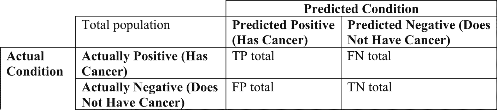

说明癌症预测结果的混淆矩阵表。该表分为实际条件和预测条件。实际条件包括“实际阳性（患有癌症）”和“实际阴性（未患有癌症）”。预测条件包括“预测阳性（患有癌症）”和“预测阴性（未患有癌症）”。交点处显示了真正例的“TP 总数”、假负例的“FN 总数”、假正例的“FP 总数”和真负例的“TN 总数”。左上角单元格表示“总人口”。

图 16-1

基本的混淆矩阵结构

通常，在创建矩阵时，我们仅在顶部和侧边标注“真”和“假”，并且我们知道顶部代表预测，侧边代表实际。在这种视图下，我们通常希望看到从左上角到右下角对角线上的数值高，而其他角的数值低。

请注意，在数据集不平衡（正类样本稀少）的情况下（例如欺诈检测或疾病诊断），我们会看到`TP`框中的数值很低，而`TN`框中的数值非常高。我们仍然希望`FP`和`FN`的数值低。

请记住，虽然我们总是希望`FP`和`FN`低，但在某些情况下，我们更希望尽量减少假正例的数量。例如，在欺诈检测这类情况下，高`FN`意味着我们遗漏了一些欺诈案例，那么该笔交易将不会被调查。我们宁愿处理更多的`FP`，也不愿面对高`FN`。在很多领域都存在这种情况，包括疾病检测（`FN`意味着患者不会被送去进一步检查，并且其疾病将得不到治疗）和安全检查（`FN`可能意味着有人将炸弹带入大楼）。另一方面，也存在`FP`代价极高而`FN`影响不大的情况，因此我们宁愿漏掉正类，也不愿错误地将负类标记为正类。例如，在商品推荐中，如果没有向用户推荐他们可能喜欢的商品（`FN`），并不会造成实际损害；但如果推荐了太多他们不喜欢的商品（`FP`），用户就会对推荐失去信任。其他高`FP`危害严重的案例包括死刑判决（错杀无辜远比放过有罪之人糟糕得多）和垃圾邮件检测（收到少量垃圾邮件（`FN`s）比错过一封重要邮件（`FP`）要好）。

混淆矩阵是二分类问题的良好起点，但仅凭它本身并不能给我们提供太多切实的信息。相反，我们会根据矩阵中的数值计算各种衡量指标。


# 基于混淆矩阵的指标

人们首先想到的指标通常是准确率，这个术语常被泛泛地用于表示“模型表现如何”，但它本身也是一个简单而具体的指标名称。*准确率*就是所有正确标记的数量除以总记录数。然而，这可能会是一个非常偏斜的指标，尤其是在数据集不平衡的情况下，即实际正例的总数与实际负例的总数不同。在极度不平衡的数据集中，即使将所有实际正例都错误分类，我们也可能获得非常高的准确率。例如，如果我们有 10,000 个信用卡交易实例，其中只有 50 个是欺诈性的，如果分类器简单地将每一个都分类为负例（非欺诈），那么分类器的准确率将达到 99.5%。这显然荒谬地具有误导性且毫无用处。

*精确率*是另一个重要的衡量指标，它关注分类器对其正例标签的处理效果，或者说，在其标记为正例的预测中，实际为正例的比例。因此，它侧重于假正例（FP）。当假正例代价高昂而假负例（FN）不那么严重时，这是一个重要的指标，例如在推荐系统中。但当假负例具有危险性时，它就不是最佳指标了。

`召回率` 被认为是精确率的反面，因为它强调的是假负例。`召回率` 这个术语衡量的是在整个数据集中被检测出来的总正例的比例。这是在欺诈检测和疾病检测等情况下我们关心的衡量指标。召回率有时也被称为灵敏度或真正例率。具体计算公式见表 16-1。

**表 16-1** 二分类中准确率、精确率、召回率和 F1 分数的计算

| 指标 | 基于混淆矩阵的计算公式 |
| --- | --- |
| 准确率 | `(TP + TN) / (TP + TN + FP + FN)` |
| 精确率 | `TP / (TP + FP)` |
| 召回率 | `TP / (TP + FN)` |
| F1 分数 | `2*TP / (2*TP + FP + FN)` |

精确率和召回率通常呈反比关系，我们常常希望在这两者之间找到平衡。此外，如果我们的模型表现非常糟糕，我们可能会得到误导性的结果。例如，如果一个欺诈检测器将每一笔交易都标记为欺诈，那么我们会得到非常高的召回率，但精确率（和准确率）会非常低。同样，在推荐系统中，如果我们只推荐了极少量的产品，但这些都是好的推荐，那么我们会获得很高的精确率——但与此同时，我们也错过了所有那些未被推荐产品的销售机会。你可以在表 16-1 中看到计算方法。

因此，无论在何种场景下两者中哪一个被认为最重要，我们仍然需要了解它们之间的平衡。幸运的是，我们正好有这样一个指标——`F1 分数`，它本质上是精确率和召回率的修正平均值（调和平均数）。它的计算比其他指标稍微复杂一些，但你可以在表 16-1 中看到计算方法。所以，当精确率或召回率更为重要时，常见的做法是查看该指标，同时还要查看 F1 分数，以确保模型没有做无用功。

尽管 F1 分数不错，但它在处理真负例（TN）方面存在局限性，因此有时会使用另外几个衡量指标，即马修斯相关系数或科恩卡帕系数。这两个指标的计算都稍微复杂一些，但都可以通过混淆矩阵的值来计算。你可以通过谷歌搜索找到更多信息。

我已经讨论过最常见的一些基于混淆矩阵的分类指标，但在实践中还有其他一些有用且常用的指标，包括假正例率和特异度（真负例率）。维基百科上关于精确率和召回率的页面有一个出色的扩展混淆矩阵，总结了所有这些指标。

# 其他指标

尽管混淆矩阵及其相关指标是二分类测量的核心，但数据科学家也会使用一些其他衡量指标。最常见的是相关的受试者工作特征曲线（ROC）和曲线下面积（AUC）。

`ROC` 曲线绘制了真正例率（召回率）和假正例率的对比关系，在一个完美的分类器中，绘制的曲线将是一条横跨图表顶部的水平线，就像你在图 16-2 左侧看到的那样。分类器永远不会完美，所以在右侧可以看到一个更真实的图形，它既展示了随机猜测模型的结果，也展示了一个真实模型在儿童身高数据上的表现。

``

**图 16-2** 两个并排的 XY 图表，比较 ROC 曲线。左侧图表显示一个完美模型，橙色线到达左上角，表明 AUC 为 1。右侧图表显示一个逻辑回归模型，橙色线位于对角线蓝色“无技能”线上方，表明 AUC 为 0.64。两个图表的 Y 轴均为“真正例率”，X 轴均为“假正例率”。图例区分了“无技能”模型和“逻辑回归”或“完美”模型。

`AUC` 字面上就是 ROC 曲线下的面积。它已包含在图 16-2 的图表中。当比较同一数据上模型的不同运行时，AUC 值较高的模型被认为是更好的。

另一个在模型中很有用的指标是当预测给出一个概率时，这个概率表示预测正确的可能性有多大。例如，在逻辑回归中，我们得到一个概率，并通常取一个阈值——通常是 0.5——高于该阈值的标记为 True，低于该阈值的标记为 False。有一个称为 `对数损失` 的指标，它直接利用这个概率，并根据每个实例的概率和实际值之间的差异来计算分数（实际计算涉及一些对数值，可以在线查找）。使用这个指标时，我们希望它的值较低。


### 多分类指标

上述所有指标都可以适用于多分类问题。可以创建混淆矩阵，但由于其顶部和侧面包含的标签不止于 `True` 和 `False`，因此该矩阵会有超过四个区域。

`Accuracy`（准确率）的计算方式相同，即所有正确预测结果除以所有预测结果。其他大多数指标则需要进行一些修改，特别是通过计算宏平均、加权平均或微平均版本。使用*宏平均*方法时，您通过每次仅关注单个类别，并计算所有这些指标的平均值。使用*加权平均*方法时，类似地，您会将每个单独的指标乘以具有该标签的样本总数所占的比例。

使用*微平均*方法时，您通过汇总所有单个类别的数值来生成整体的 `TP`（真正例）、`FP`（假正例）等，然后使用这些汇总值代入常规指标计算。但这种方法有一个问题：`accuracy`（准确率）、`precision`（精确率）、`recall`（召回率）和 `F-score`（F1 分数）都将得到相同的值。这是因为对于任何给定的类别，`TP` 仅是该类别的总数，但任何被正确标记为不属于该类别的样本都是该类别的一个"`TN`"（真负例）。因此，最终所有汇总值都相同。

您也可以为多分类问题生成 `ROC`（受试者工作特征曲线）和 `AUC`（曲线下面积），常见的做法是将每个类别作为 `ROC` 图上的单独曲线进行绘制。然后可以为每个类别计算一个 `AUC`。图 16-3 展示了一个针对鸢尾花数据的此类 `ROC` 图。

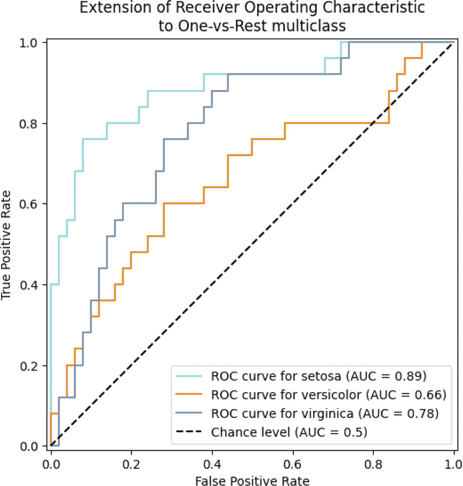

一对多（One-vs-Rest）多分类的受试者工作特征（`ROC`）曲线。图表显示了三条曲线：绿色代表山鸢尾，其 `AUC` 为 0.89；橙色代表变色鸢尾，其 `AUC` 为 0.66；蓝色代表维吉尼亚鸢尾，其 `AUC` 为 0.78。x 轴表示假阳性率，y 轴表示真阳性率。虚线表示随机分类水平，其 `AUC` 为 0.5。

**图 16-3** 一个多分类问题的 `ROC` 图

### 回归指标

衡量回归结果的性能是不同的，因为输出是数值型的，并且在大多数模型中可以是任意值。因此，一个给定值不能简单地判断对错——我们想要衡量的是它与正确数值的接近程度。

关于回归指标，首先要了解的是，回归问题不存在所谓的准确率指标，因为 `accuracy`（准确率）是分类问题特有的。虽然我们有时也会谈论回归中的准确率，但此时使用的是该词的一般含义（即“准确性”），而非一个特定的技术术语。

一个在广义线性模型中常见的指标是 `R-squared`（R 方）分数。从技术上讲，这是一个拟合优度指标——`R-squared` 分数表示生成的模型与数据的拟合程度，以及目标变量中的方差有多少是由特征解释的。在线性模型中，它有效地将实际的回归线与均值线进行比较，均值线是穿过图表上数据中所有 *Y* 值的平均值在 Y 轴上的点的一条水平线，但它也可以用于一些非线性模型中。在线性情况下，一个糟糕的模型会有一条接近均值线的回归线，并且 `R-squared` 分数非常低。对于在相同数据上构建的不同模型，`R-squared` 可能是一个良好的指标，因为它被认为是相对的。这意味着它不太适合跨不同数据集进行比较。

`R-squared` 的一个缺点是它假设所有特征对模型都很重要。此外，增加一个特征往往会提高 `R-squared` 值，这可能导致人们增加不必要的特征，最终得到一个过拟合的模型。有一种修改版的 `R-squared` 分数能更好地处理不同价值的特征。`Adjusted R-squared`（调整后 R 方）分数会评估每个特征带来的附加值，只有当特征对模型的改善程度超过了随机水平时，分数才会增加。由于这种改进，调整后的 `R-squared` 几乎总是小于 `R-squared`。

还有其他几个指标经常被用来替代 `R-squared` 和调整后的 `R-squared`，因为它们并不总是适合用来确定模型在测试集上的最佳性能。

一个流行的回归指标是*均方误差*（`MSE`），它涉及计算实际值与预测值之差的平方，求和，再除以总预测次数，从而得到一个“平均”值。对差值进行平方处理对于防止负值抵消正值很重要，但它也有一个问题，即由于平方运算，数值很容易变得非常大。一个完美的模型其 `MSE` 为 0，但也可能变得非常大。此外，该值可能难以解释，因为其单位是目标变量单位的平方。

`MSE` 的一个变体是*均方根误差*（`RMSE`），它仅仅是 `MSE` 的平方根，这使得指标的度量单位恢复到了与目标变量相同，因此更容易解释。在对差值进行平方运算之后再进行开方，可以避免正负误差相互抵消的问题。与 `MSE` 一样，完美的 `RMSE` 值为 0，但它也可能变得很大。

另一个流行的指标是*平均绝对误差*（`MAE`），它类似于 `MSE`，但为了处理正负值抵消效应，它采用差值的绝对值而非平方。与 `MSE` 一样，将这些值求和后除以总预测次数。但这种方法避免了 `MSE` 通过平方运算而导致的误差膨胀（尤其是较大的误差），因此通常被认为更真实，更受青睐。此外，它像 `RMSE` 一样，使用目标变量的单位。同时，像 `RMSE` 和 `MSE` 一样，一个完美的模型其 `MAE` 为 0，也可能变得很大。

另一个经常使用的指标是*平均绝对百分比误差*（`MAPE`），它是 `MAE` 的一个变体，将误差表示为百分比，使其能被广大受众立即理解。`MAPE` 先计算实际值与预测值的差值，除以实际值，然后取绝对值，再进行求和（再除以总预测次数）。百分比非常直观，我们无需考虑目标变量单位的含义。需要注意的一点是，当模型表现很差时，“百分比”也可能爆炸式增长，远高于 100%。另一点是，在计算误差百分比时，如果实际值为 0，则无法计算，因为这意味着除以零（尽管存在一些变通方法）。此外，该指标是相对于实际值而言的。如果实际值为 125，预测值为 100，我们得到误差 25，这将转化为 25%；但如果实际值为 75，预测值为 100（与前一个示例的误差差值相同），百分比则为 33%。因此，高于实际值的预测比低于实际值的预测会受到更大的惩罚。

### 聚类指标

由于聚类通常是无监督的，因此大多数指标都是内部指标，主要寻找聚类的一般特征，而不是将结果与已知值进行比较。然而，有时聚类是在已知标签的情况下进行的，并且有一些针对这种情况的特定指标（这些被视为外部度量）。我们将在此介绍这两种类型。


### 内部指标

内部聚类指标是指那些无需知道真实标签的评估方法。由于这些指标仅关注聚类的特征，比如各簇之间分离得如何以及簇内数据有多紧凑，这并不能说明聚类结果是否准确。它们只能告诉我们这些聚类看起来是一个不错的模型。

一种常用于评估聚类结果的指标称为*轮廓系数*，它衡量的是簇之间的分离度和簇内部的凝聚度。这些特性在聚类模型中至关重要，因为我们希望各簇之间能清晰分开（分离度），同时每个簇内的数据点之间差异不大（凝聚度）。其计算涉及每个数据点的两个平均值：该点与同一簇内其他点之间的平均距离，以及该点与不同簇中数据点之间最小的平均距离。该值的范围在 –1 到 1 之间，数值越大表示聚类效果越好（因为数据点与自身簇匹配良好），数值越小则表示簇之间存在重叠和模糊性。

第二种聚类指标是*戴维森-堡丁指数*，它衡量每个簇与其最相似簇之间的相似程度。该指标基于对所有簇的平均值计算，其中每个簇会与被认为最相似的另一个簇进行不相似性度量。该指标数值越小越好。

另一种名为*卡林斯基-哈拉巴斯指数*的指标则同时考虑了簇内方差和簇间方差。其计算涉及簇间与簇内的平方和、簇的数量以及数据点的总数。该指标数值越大越好。

我要提及的最后一个内部指标是*惯性*，它关注的是簇内平方和。该指标计算每个数据点位置与其所属簇质心之间的平方距离之和。分数越低越好，但如果分数过低，则可能表明过拟合。此外，随着簇的数量增加，惯性往往会减小，这就是为什么选择最佳簇数量非常重要。

### 外部指标

到目前为止我们讨论的所有指标都只是评估聚类结果（如同在无监督学习中那样），但还有一些外部指标，因为它们仅适用于拥有数据标签的情况（如同在监督学习中）。聚类本身仍然是无监督运行的，但名为*兰德指数*及其变体*调整兰德指数*的两个指标能让我们将聚类算法的输出与拥有的标签进行比较。兰德指数的计算涉及标签对的一致总数与总对数，其取值范围为 0 到 1，数值越高越好。调整兰德指数则利用计算出的 RI 值，并通过预期 RI 值进行机会校正。其取值范围与 RI 相同。

当标签已知时，另一个可用的指标是互信息（MI）。*互信息*衡量的是数据点的真实标签与预测标签（即所属簇）之间的相似度。其计算涉及真实标签、预测标签以及一些概率值。最低可能得分为 0，表示毫无关联；数值越高，则表明预测结果与已知标签越吻合。


# 要点总结与下章预告

本章我们讨论了分类、回归和聚类模型的性能度量方法。这三类机器学习模型所使用的评估指标截然不同。在分类问题中，大多数度量指标都基于混淆矩阵，它用来表示真正例、假正例、真负例和假负例的数量。在二分类中，“正例”与“负例”表明我们所测试的标签（例如，正例表示可能是欺诈交易，负例则表示可能不是欺诈交易）。“真”和“假”则用来指示预测标签是否与实际标签相符。其中一些指标包括：`accuracy`（预测正确比例）、`precision`（是否过度热衷于做出正例预测）、`recall`（成功识别出真正例的比例）以及 `F-score`（`precision` 和 `recall` 之间的平衡）。我还介绍了 `ROC` 曲线和 `AUC` 计算，它们关注的是真正例率和假正例率。

接着，我讨论了多种回归指标。`R-squared` 用于线性模型，它指示模型对数据的拟合程度。`MSE` 衡量实际值与预测值之间的误差，并通过平方消除正负号。`RMSE` 取该值的平方根，使单位恢复到与目标变量相同。`MAE` 取实际值与预测值之差的绝对值进行计算，其单位也与目标变量相同。`MAPE` 是 `MAE` 的百分比形式，对于非技术人员来说通常更直观。

最后，我们探讨了几种聚类指标，其中一些用于在不知道真实标签的情况下量化聚类模型的总体质量，另一些则可以在已知标签的情况下评估模型。第一组指标包括：`silhouette score`（考察簇的凝聚度和分离度）、`Davies–Boulding index`（衡量一个簇与其最相似邻簇的相似程度）、`Calinski–Harabasz index`（考察簇间方差与簇内方差）和 `inertia`（另一种对簇内平方和的度量）。后一类型的两个指标，`RI`（正确标记的对数与总对数之比）和 `MI`（衡量实际标签与预测标签之间的相似度），也都有其用武之地。

在下一章中，我们将探讨如何与语言打交道。数据科学家并非总是要涉足自然语言处理或语音处理，但这正变得越来越普遍，尤其是在大语言模型流行之后。我们将首先介绍 NLP 的基础知识，包括语言解析、句子分割、将文本转换为称为词元（token）的词片段、词干提取（将单词还原为其常见的基本形式）以及词性标注。接着，我们将涵盖语言理解与生成。最后，我们会花一点时间来探讨语音处理（包括识别与合成）。

# 从业者简介：迭戈·坦加西

**姓名：** 迭戈·坦加西

**现任职务：** 高级分析经理

**现任行业：** 零售业

**经验年限：** 8 年数据科学家经验，此前在精算与金融领域工作

**教育背景：**

*   精算科学学士学位

*此处表达的观点仅代表迭戈个人，与其过去或现在的任何雇主无关。*

### 背景

迭戈一直热爱工程、机器人以及各种系统。自从他拥有第一台个人电脑后，他就下载各种东西来捣鼓，开始摆弄软件，甚至越狱了他的 iPhone。他原本计划在大学学习机电一体化，但当他去学校参观时，负责接待他的教授毫无激情，这让他改变了主意，开始寻找其他方向。他发现了另一个让他着迷的领域——精算科学——并在大学里学习了这个专业。第一个学期后他就深爱上了它。在选修了一门由一位经验丰富的迷人教授教授的金融课程后，迭戈确信自己想在金融领域工作。

## 工作

迭戈如愿以偿地在金融领域找到了一份工作，在一个金融风险部门（处理养老金相关事务），但结果发现这份工作很无聊。日复一日，每天只是重复相同的步骤——获取输出，将其输入另一个模型，如此循环。六个月后他就感到极度厌倦。当一家咨询公司找到他，寻找具备统计和数学技能的人时，他果断跳槽。他非常享受这段经历，包括学习了更多关于数据和数据工程的知识，如 `ETL`、数据库、信息立方体和系统保证。他还更深入地了解了数据科学这个领域以及营收组合模型（一种确定哪些产品应该获得推广的方法）。他当时使用的工具非常基础，比如用 Microsoft Excel 求解器来优化方程，但利益相关者仍然印象深刻。工作大致分为两个阶段：首先是进行数据科学分析，其次是沟通结果。在咨询公司，他喜欢的一点是能够与零售公司的高层人士合作，这让他变得非常善于沟通。由于这些沟通技巧，他经常被“点名”委以重任。他后来离开了咨询业，但仍留在零售业担任现在的职位，并且仍然热爱这份工作。

## 精彩片段

**工作中最喜欢的部分：** 迭戈热爱数据科学工作中需要不断学习的一切。学习各种知识让他充满活力。他也喜欢与形形色色的人共事。最后，任何编码工作中最令人满足的事情之一，就是当你编写了一些有挑战性的代码，并且它成功运行了。

**工作中最不喜欢的部分：** 官僚主义。有时完成工作会遇到重重障碍，以至于利益相关者都失去了兴趣。有时公司文化也会令人感到棘手。

**最喜欢的项目：** 在他做咨询期间，曾有一个政府机构要求建立一个墨西哥毒品缉获案例数据库。他们需要大量细节，包括事发地点、涉案贩毒集团、涉案人数和车辆数、毒品藏匿地点等。他们必须创造性地解决问题，使用了多种数据源，但主要是报纸。他们抓取新闻网站的内容，进行 NLP 处理以提取所有细节，并将其存储到数据库中。这是一个非常令人满意且成功的项目。

**最常用的技能：** 分析性思维。能够将技术语言转换为商业语言，反之亦然。善于自学。

**当前主要使用的工具：** `R`、`Python`、`SQL`、`Snowflake`、`GitHub`、`Google Suite`（API 等）、`Visual Studio`

**数据科学的未来：** 过去，大多数数据科学家需要承担非常广泛的工作，包括数据工程、数据管理等。但现在分工更加明确，数据科学家可以专注于更典型的数据科学工作，而其他任务则由拥有特定职位头衔的人来完成。这种专业化、精细化的趋势将会持续下去。

**优秀数据科学家的特质：** 要明白数据科学确实包含技术内容，但最大的精力需要花在与非技术人员沟通、理解他们的需求以及告知他们可以期待什么结果上。

**他对准数据科学家们的建议：** 尝试为自己的职业生涯制定一个关于你想专注领域的计划，这样你就能了解不同的领域，以及你希望在何处工作。

*迭戈是一位经验丰富的数据科学家，在金融和零售领域拥有深厚的专业知识。*

脚注 1 2 3

# 17. 让计算机具备读写能力：文本与语音处理


## 引言

近来，每个人都在语言语境下对人工智能有了切实的认知，这主要得益于与 ChatGPT 等大语言模型（LLM）相关的工作。这便是真正的自然语言处理（NLP），并且它在过去几十年间蓬勃发展。如今，计算机在语言处理方面能做到的事情令人惊叹不已，现在正是投身该领域的激动人心的时刻。

我们中的许多人也知道，在过去几十年里，语音技术取得了进步，尤其是那些曾致电公司寻求帮助的人对此感触颇深。我个人还是想回到按数字键的时代，因为我打电话要咨询的事情似乎总与选项对不上，但这种情况不会再出现了。

多年来，语音处理工作主要由电气工程师承担，因为它被视为一个信号处理问题。因此，在此类工作中融入的语言学知识并不多。相比之下，自然语言处理（NLP）通常与计算语言学（一个类似的学科，但更侧重于语言学理论）一同设立在语言学系，有时也与计算机科学结合，因此文本处理涉及语言学知识的历史要长得多。但语音处理领域已经发生了变化，因为他们最终认识到，语音不仅仅是声音——我们说话和听到词语的方式取决于诸多因素，包括上下文、语气以及其他语言学特征。

围绕自然语言处理和语音处理，尤其是语言学领域，存在大量术语。请参阅侧边栏，了解与之相关的许多语言学领域的解释。下文还会出现更多术语。

**语言学分支**

**语音学**：研究语音，包括其生理机制和声学特性

**音系学**：研究语音，通常比语音学层级更高

**语义学**：研究语言中的意义

**句法学**：研究词语和短语如何排列才能符合语法且有意义

**韵律学**：研究语言中更高层次的语音特性，包括语调、重音和节奏

# 现实世界中自然语言处理（NLP）与语音处理的实例

自然语言处理（NLP）在工业界应用日益广泛，这里我们将看两个例子，一个来自苏格兰的鞋业公司，另一个来自法国医院，该医院使用语音识别来口述病历。

## 示例 1：自然语言处理（NLP）填补大空缺

苏格兰公司 schuh 是一家在英国和爱尔兰广为人知且正在扩张的鞋业公司，它在管理客户互动方面遇到了困难，试图加快并改善这一流程。^(⁴⁵) 他们以拥有良好的客户支持而自豪，并特别寻求处理客户投诉的方法，以期让客户满意，并使其仍然是未来的客户。

他们开始使用 Amazon Comprehend 的自然语言处理（NLP）和机器学习（ML）工具来识别客户电子邮件中的情感。该系统会判断一封新邮件是否包含正面或负面情感，这有助于将全新的邮件正确地分派给支持团队。不同的客户支持代理擅长不同类型的支持，因此将邮件更快地路由给正确的人可以节省宝贵的时间。这种优先级排序和分派以前是手动完成的，非常耗时。他们还使用这些工具分析外发邮件，以确保代理回复的质量。

他们发现该系统带来了巨大好处，主要体现在节省时间以及改善与客户的互动质量与及时性上，这意味着他们更有可能留住客户。

## 示例 2：口述病人病历

医生是出了名的忙碌，文书工作是他们最不喜欢的任务之一，但及时更新病历至关重要。2016 年，巴黎的圣约瑟夫医院以尽可能实现无纸化而自豪。作为这项努力的一部分，他们开始使用 Nuance 公司的语音识别系统，这是一家已在语音识别领域深耕近三十年的公司。^(⁴⁶) Nuance 拥有多种针对医疗保健的专业产品，巴黎医院使用了其产品 Dragon Medical Direct，并将语音识别集成到他们的电子病历系统中。

他们试图通过此解决方案解决的主要问题是完成和交付医院病历的速度。一家医疗监管机构要求他们在病人出院时提供病历，并在出院后一周内将病历送到其全科医生（GP）手中，而这一要求并未始终得到满足。病历的处理流程是医生做笔记，然后交给秘书，秘书必须重新录入所有内容。这需要大量的来回沟通，而且让第二方录入数据充满了出错的风险。阅读别人匆忙记下的笔记总是很困难，医生打的任何错字都极易被另一个人误解（即使医生自己能识别并纠正自己的错误）。但最重要的是，这个过程太慢了。如果他们能在不增加医生额外工作量的情况下，省去秘书重新录入的环节，那对每个人来说都将是一个胜利。

当他们开始测试时，遇到了阻力（任何系统变更都难免如此）。医生们认为它行不通，也不愿意改变他们的流程。然而，早期参与测试的医生对口述软件印象深刻，因为它既准确又快速。很快，该软件部署到了许多科室，其他科室也纷纷要求使用。他们发现，每个医生需要几周时间才能适应系统。例如，大多数医生选择在病人面前口述病历，这有点尴尬。但一旦习惯了，他们就很喜欢能在就诊期间完成这项工作，而不必在数小时或数天后与秘书协作处理，病人也有机会纠正任何错误。

该医院认为该项目取得了巨大成功。在采用该软件之前，有 32% 送到全科医生（GP）的病历错过了两周的截止日期。采用口述系统后，这一比例降至 5%，这是一个巨大的改进。近三分之一的病历在一天内发送。他们收到全科医生（GP）的反馈，称收到的病历清晰准确，部分原因是使用口述系统使医生说话更清晰、更简洁。患者也对这种新的透明度表示赞赏，因为他们清楚自己的病历里写了什么。所有医生都同意这节省了时间。

# 语言数据来源

我最初在第 1 章讨论非结构化数据时谈到了语言数据。来自新闻文章、推文和客户投诉邮件等文本数据都符合这个范畴。但我们不能简单地将这些数据输入到任何机器学习（ML）系统中，就能期望得到有用的输出。我们必须以某种方式准备数据。我们将在下一节中讨论可以采取的各种方法。


### 文字系统

语言的书写方式极为重要。历史上，自然语言处理领域的大量工作都集中在英语和其他欧洲语言上，但针对汉语及其他语言的研究也日益增多。原因之一在于处理不同类型的文字系统所面临的挑战。

英语并非唯一的游戏规则制定者，即便在自然语言处理领域它目前仍是主流。本节中我将使用一些语言学术语，请参考侧边栏查看相关定义。英语和大多数西欧语言属于所谓的音素文字系统，这意味着它包含代表（通常）特定发音的字母，这些字母组合成单词。严格来说，情况并非如此简单，因为发音和拼写可能取决于上下文和语言起源，但从概念上讲，音素文字系统使用代表发音的字母来构成单词。这类系统包含辅音和元音。类似的一种系统是音节文字，它通常用一个字符代表一个特定的音节，即一个辅音和一个元音的组合。大多数印度语言都采用这种书写方式。现代语言中最后一种文字系统是语素文字，它用一个单独的字符代表一个完整的单词（或短语）。目前仍在使用中的唯一代表是汉字，但它已被东亚地区的多种语言所吸纳。音素文字和音节文字在书写时都包含了发音信息，但语素文字系统则不然。有趣的是，大多数东亚语言也拥有次要的书写系统，该系统确实代表发音，并在与主要系统不同的语境中使用。

不同语言文本的另一个重要元素是字母表系统。英语和大多数欧洲语言使用拉丁字母横向从左到右书写。其他音素文字字母表包括西里尔字母（俄语等）、古希腊字母和阿拉伯字母（阿拉伯语、乌尔都语等）。使用阿拉伯字母的语言是横向从右到左书写的。一些类似音素文字的语言包括仅使用不同字母表的辅音，例如希伯来语，也是横向从右到左书写。大多数印度语言使用音节文字，横向从左到右书写。东亚语言通常竖向书写，从上到下阅读。

语言书写方式的最后一个重要方面是各种辅助要素，如标点符号（逗号、句号等）、变音符号（字母修饰符，如分音符或重音符号）以及空格。我们常常认为这些东西理所当然，但古拉丁文单词之间是没有空格的。当我们尝试进行自然语言处理时，所有这些因素都将发挥作用。

**文字系统的语言学术语**

`文字系统`：用于以书面形式传达特定语言单词的任何系统

`字母表`：语言书面部分的样式（多种语言可以使用同一种字母表）

`字母`：音素文字系统中一个单独的书写符号（`"alpha"` 包含五个字母）

`数字`：一个单独的书写数字（`"973"` 包含三个数字）

`元音`：可以发出并保持的可发音语言音素，通常张嘴（英语中的元音包括由 `"a"`、`"e"`、`"i"`、`"o"` 和 `"u"` 发出的各种音素）

`辅音`：通常部分或完全闭嘴发出的可发音语言音素（英语中，`"t"`、`"m"`、`"f"`、`"s"` 和 `"k"` 都是辅音）

`吸气音`：一种特定类型的辅音，由不同的舌头配置产生，通常包含爆破音或吸气音（在一些非洲语言中很常见）

`音节`：单个可发音的语言单位，包含一个元音，可选地包含一个辅音

`单词`：语言中一个独立的意义单位，无论它是由单个字符还是一系列字母或音节表示

`语素文字`：代表一个单词或短语的单个字符、符号或标记（例如汉字、埃及象形文字和英语中的速记符号）

`变音符号`：添加在字母上方或下方的符号，用以指示发音差异（常见的是重音符号和软音符）

`字符`：书面语言中任何单一且独立的单位，如果存在变音符号，通常也包含在内（在西方语言中，每个字母、数字和标点符号都是一个单独的字符；在汉语这样的语素文字语言中，它可以是一个由许多笔画构成的单独单词，或一个代表发音的单词组成部分；在其他语言中，它可以代表一个音节）

### 文本数据

实际的文本数据来源几乎是无穷无尽的。这是我们在第 1 章中讨论的一种非结构化数据。它只是任何经过数字化的、任何形式的文本。我曾在一家公司工作，我们分析书籍文本，因此我们扫描了整本书，每本书都作为一个字段存储在 SQL Server 数据库的某一行中。它可能是存储在服务器文件夹中作为文件的学生论文全文。它可能是实时涌入的推文。任何人类语言并以文本形式数字化呈现的内容都符合条件。

需要注意的是，无论文本数据是什么，几乎可以肯定在开始任何自然语言处理之前都需要进行一些预处理。这包括处理任何字符编码问题（接下来讨论），以及可能调整换行符和任何残留的杂乱字符（例如，如果从 Word 文件转换为纯文本，可能会产生奇怪的格式字符或其他残留物）。

文本数据的一个令人头疼的问题是编码（尽管这已经不像以前那么困难了）。有几种不同的文本编码（适用于所有文本文件，不特定于人类语言文本），其中 `UTF-8` 是最受欢迎的。对于西方语言，你仍然会看到的其他常见编码是 `Windows-1252` 和 `Latin-1`。大多数编程语言现在都能相当优雅地处理这个问题，但是当你查看代码从你提供的文件中读取的内容时，如果发现输出乱码，那几乎肯定是编码问题。你需要去搜索一下相关方案。

### 来自音频的文本数据

语音处理甚至更复杂，因为它实际上在自然语言处理的基础上增加了一层复杂性。通常，语音识别涉及将录制的语音转录成文本，然后可以使用与处理文本相同的自然语言处理技术来处理这些文本。即使系统从语音输入到语音响应从未生成中间文本文件，这在概念上也是成立的。自动转录过程容易出错。

语音合成通常也使用文本来创建音频，因为这是生成的起点。它还使用一些自然语言处理技术来确定发音。我们进行的许多语音数据准备工作将与文本数据类似，我们将在下面讨论这一点。


# 自然语言处理

自然语言处理本质上是一门（也是艺术）科学，它处理的是带有公认书写系统的文本语言数据，并将其分解成小块，以便作为数据进行处理。我们就拿前面那句话来看看如何将其转化为数据。请参阅侧边栏了解本节将提到的一些定义。

## NLP 术语

**文本**：使用公认书写系统书写的人类语言版本（在计算机世界里，这也指没有 Word 或其他文字处理软件中格式的最简单文本数据，例如在微软的记事本或 Mac 的 TextEdit 中找到的文本）

**文档**：包含一个连贯文本单元的单个对象，将被作为一个整体处理（在推文分析中，通常每条推文就是一个文档；而在处理学生论文时，每篇完整的论文就是一个文档）

**语料库**：多个文档的集合

NLP 包含许多不同的技术，其中很多可以结合使用。我将会介绍其中的大多数，但你还可以做很多其他事情，这些可以在网上找到。还有一种在处理语言时经常使用的技术，叫做正则表达式。严格来说它不属于 NLP，但非常有用，你可以在侧边栏中了解它。

## 正则表达式

文本处理的内容远不止 NLP，大部分只是使用不同编程语言的文本处理库。但有一个基本的文本处理工具，它不属于 NLP，但在合适的场景下却非常有用，并且经常与 NLP 项目一起使用，所以了解它是很有好处的。*正则表达式*（通常缩写为*regex*或简写为*re*）允许你指定要在文本中匹配的字符串模式。常见的用途是创建匹配 URL 或电子邮件的模式，以便在你处理的文本中查找它们。实际上，它们可能很快变得相当复杂，但你只需知道足够的知识来查找如何编写所需的模式即可，而不必记住所有语法。

举个例子，下面是一个匹配电子邮件标识符的模式可能的样子：

```
\b[\w.\-]+@\w[\w]*\.[a-zA-Z]+\b
```

这是你在使用它们之后才会学到的东西，所以不必因为它看起来很吓人而担心。我们将逐部分进行分解。理解反斜杠是一个转义字符，它会改变下一个字符的含义，这有助于理解。这里，`\b`确保开头有一个单词边界。方括号内的值表示括号内列出字符中的任意单个字符。`[\w.\-]`匹配三种可能情况中的一种：

- 任意字母或数字（即`\w`）
- 句点（`\.`）
- 连字符（`\-`）

`+`表示前面字符出现一次或多次（在这里，指方括号组中指定的任一字符）。`@`仅匹配该字符一次。`\w`匹配单个字母或数字。然后`[\w]*`匹配零个或多个字母或数字（与前面的`\w`以及紧接其后的`\w`结合，意味着`@`符号后面必须至少有一个字符）。`\.`匹配单个句点。`[a-zA-Z]+`匹配一个或多个字母。最后的`\b`再次表示一个单词边界。

我知道这看起来很不美观，但如果你开始使用正则表达式，你会惊讶地发现自己会逐渐记住这一切。即使你记得，你也可能会发现自己总是需要去查找具体细节，这也没关系。

### 解析语言

大多数人都凭直觉知道语言有规则，即使他们无法明确指出这些规则是什么。然而，他们在说话时遵循大部分规则，在写作时也遵循大部分规则，尽管很少有人能始终完全正确。关于语言规则，唯一的通用规则就是总会有例外。例外情况使得学习语言变得困难，而像英语这样的语言尤其困难，因为它借鉴了许多不同的语言，因此“规则的例外”极为常见。此外，在不同语境下也有不同的规则适用，例如当某种方言使用与该语言其他方言不同的词汇和发音时，或者当不同的群体（如青少年与退休人员）以不同方式使用语言时。即使在同一种语言内部，其书写方式在不同语境下也可能大相径庭。想想看，学术期刊上的文章与推文之间的区别。

尽管存在这些重要的差异，但所有形式的语言仍有一些共同的方面。有几种标准的语言分解方法。请参阅侧边栏中我将在此使用的一些更详细的语言学定义。将语言分解成具有语言学意义的部分通常称为解析语言。请参阅侧边栏中我将讨论的一些语言学和 NLP 术语。

### 更多 NLP 术语

**词元**：正在处理的文本中任何独立的单元，如单词、语素、数字（包括多位数）或标点符号（可以是相对的，像`$25.78`这样的可以算作一个词元）

**词缀**：前缀（加在单词开头的子词部分，如“un-”构成“unreliable”）、后缀（加在单词末尾的子词部分，如“-ness”构成“completeness”）或中缀（插入单词中间的词缀，在英语中不太常见）

**词干**：去掉一些词缀后的单词基本形式（并不总是对应一个实际存在的单词）

**词元**：去掉某些词缀等形态特征后的根词规范形式（总是对应一个实际存在的单词）

**标点符号**：表示语法方面的标记（如逗号、句号、分号和引号）

**词性**：单词在句子中所起的句法功能类型（常见的有名词（命名词）、动词（动作词）和形容词（描述词））

**句子**：作为一个有意义单元的一系列单词，包含一个名词和一个动词以及其他类型的词汇

解析有一个流程，通常大致按相同的顺序进行，但并非总是如此。此外，并非所有分析都需要每一个步骤。我在此概述基本任务，并在下面进行解释。第一个解析任务通常是分词（基本上是将文本分解成更小的部分，通常是“单词”和标点符号）或句子分割（识别一个句子在哪里结束，另一个句子在哪里开始）。接下来是词性标注，我们识别单词在句子中的语法角色（例如，名词与动词）。然后我们进行词干提取或词元化，这基本上涉及在单词可以以不同形式出现时，将其（词元）转换为基本形式。这些步骤的执行顺序并非固定不变，但我将按一种常见顺序介绍它们，并说明何时可能需要采用不同的顺序。

`R`和`Python`都有专门的库来完成这里讨论的大部分任务。根据你的领域和上下文，你很可能可以直接使用它们，或者可能需要进行一些调整。


### 分词（Tokenization）

大多数情况下，当数据科学家谈论分词时，他们指的是将文本拆分成我们通常所说的“单词”和标点符号。当我们处理语言并希望理解其含义时，这是有意义的。但有时，出于某些原因，可能需要将其拆分成其他片段。例如，将名词短语（如 `the green tree`）识别为一个独立的单元是很常见的做法。或者，从事语音研究的人可能希望将单词拆分成音节，或者将前缀和后缀分开。他们也可能想要将一个句子划分为不同的从句。分词的类型完全取决于后续的分析方式。其中大多数情况比数据科学家通常需要处理的情况更复杂，但了解现有各种可能性是好的。

对于单词级别的分词，我们思考时看似显而易见的事情，在实际操作中并不总是那么清晰，就像句子分割一样。最粗糙的分词是依据空白字符进行分割，但这会留下像 `there;` 这样的结果——其中的分号不应该和单词连在一起。因此，我们还需要将标点符号分离出来。但是，考虑像 `don't` 这样的单词，我们知道它是 `do not` 的缩写形式。它应该被当作一个词元（`don't`），还是两个词元（`do` 和 `n't`，或者 `do` 和 `not`），甚至三个词元（`do`、`'` 和 `not`）呢？答案很大程度上取决于你接下来要对这些词元做什么。有时，将“not”单独区分出来非常有价值，因为它会使其所修饰的单词含义相反。举个例子，如果我们试图理解文本的大致内容，某个词是否被否定可能并不那么重要。然而，如果我们试图弄清楚作者想要表达的确切含义（比如在情感分析中，我们想知道它是正面还是负面的），那么否定就至关重要了。

### 句子分割（Sentence Segmentation）

句子分割仅仅是指识别出一个句子的开始和结束。对于大多数有读写能力的人来说，这似乎非常简单。但在处理真实文本时，结果却并非那么显而易见。句号（`.`）是句子断句最常见的标志，但它并非总是如此。以下面这段文字为例：“That will be $6.32\. Cash or credit?” 这里有两个句号，但只有一个表示句子结束。这个特例处理起来并不太难，因为我们可以识别出那些两边（或者可能只是右边）带有数字，且数字与句号之间没有空格的句号。但一旦你开始深入研究，你会发现很多这样的特定情况不断涌现。此外，你如何处理像这样的文本：“I went to the bookstore…they didn’t have it… so I left.” 一个有经验的英语使用者会凭直觉认出这实际上是三个不同的句子。但这是某个群体在短信和在线帖子中对省略号的一种特殊用法，而在大多数其他文本中，省略号（`…`）通常不表示句子结束（它通常是同一个句子的延续）。此外，许多社交媒体上的文字是非正式写作的极端体现，其中可能根本没有可以通过可检测方式识别的句子断句标志。

### 停用词移除（Stop Word Removal）

停用词是指在特定上下文中无关紧要的词（词元）。一旦我们完成分词，移除它们是非常常见的做法。几乎总是被视为停用词的词元包括冠词，如 `the` 和 `an`；连词，如 `and` 和 `or`；介词，如 `of`、`by` 和 `in`；以及各种修饰词，如 `just` 和 `so`。正如上文所暗示的，否定词（`no`、`not` 及其缩写形式）可以被视为停用词，也可能至关重要。网上有通用目的的停用词列表。像大多数事情一样，停用词是相对的，但你几乎总是想要至少移除一些词，即使你需要根据你的特定领域自行微调你的停用词列表。

### 处理其他特殊词元（Processing Other Special Tokens）

许多真实文本包含非单词的内容。数字、电子邮件地址、URL、表情符号和颜文字，以及标点符号，都是我们必须处理的一些文本类型。处理它们每一种都需要考虑我们的具体目的，因为每种情况都不只有一种处理方法。例如，看看数字，它们对我们来说可能重要，也可能不重要。如果我们正在分析餐厅菜单以判断这是否是一家“高档”餐厅，那么价格对于识别就很重要。但如果我们正在浏览书评，试图找出被评论书籍的体裁，我们就不关心他们提到了哪些页码。

可能出现的特定类型的非单词词元也取决于我们正在处理的文本类型。例如，在学术写作中我们很少看到表情符号或颜文字（除了讨论它们的文章），但在短小的社交媒体帖子中我们会看到很多。而标点符号则很可能相反。

因此，如何处理这些内容取决于你的上下文和目的。通常存在一些既定的处理方法，稍微谷歌一下就能找到。有时，这需要在比分词器更高的层级上操作，因为分词器可能会将某些文本拆分成多个词元。例如，文本 `$65.70` 可能被拆分成四个词元：`$`、`65`、`.` 和 `70`，而我们可能希望将其视为一个整体。有时，你甚至需要在分词之前就进行这种处理。

### 词性标注（Part-of-Speech Tagging）

词性标注（POS tagging）是识别文本中每个单词的语法词性的过程。句子中的每个单词都承担着特定的语法功能。因此，词性标注通常需要知道句子的断点在哪里。词性标注会返回传递给它的每个词元的词性。请参见表 17-1，了解几个关键词性标注的示例。请注意，同一个单词可以是不同的词性，这取决于它在句子中的位置。

#### 表 17-1 常见的词性标注

| 词性 | 作用 | 示例 |
| --- | --- | --- |
| 名词 | 表示名称的词 | apple, book, training, beers, David |
| 代词 | 名词的一般性替代 | I, you, me, it, they, her |
| 动词 | 表示动作的词 | crash, running, races, read |
| 形容词 | 修饰名词 | green, funny, tiny, expensive |
| 副词 | 修饰动词 | often, happily, very, slowly, never |
| 介词 | 定义与名词的关系 | by, of, in, across, until |
| 连词 | 连接两个想法或从句 | and, but, or, although, where |

词性标注可能非常有价值，具体取决于你在做什么。例如，如果你正在查看一家视频游戏公司的客户投诉，想知道人们抱怨得最多的东西，你可能只需要关注被标注为名词的词元。但如果你想知道人们对特定游戏的看法，你可能希望看看他们在谈论这些游戏时使用了哪些形容词。


# 词干提取与词形还原

许多单词本质上都是同一基础词的不同形式。添加前缀、后缀以及一些拼写变化，都属于形态变化，这些变化可以表示动词时态的变化（例如，从`run`变为`ran`以表示从现在时变为过去时，或从`run`变为`running`以表示现在进行时），也可以表示单词的复数形式（如`book`变为`books`，或`goose`变为`geese`）。这些规则中的大多数都是相当可预测的，但并非万无一失。以单词`running`为例，它可以是动词（如“我正从洪水中*奔跑*”），也可以是名词（如“实验的*进行*很顺利”）。这时，通过分析句子来确定词性就显得很有价值了。

将单词分解为基础形式有两种略有不同的方法。*词干提取*主要是通过切除后缀来实现，比如去掉单词末尾的`-ing`和`-ed`，从而得到基础形式。这个基础形式，称为*词干*，是一个共同的概念基础，但其本身不一定是一个有效的单词。例如，我们可以将`bluffing`词干提取为`bluff`。但是，许多词干提取器会将`running`提取为`runn`，这显然不是一个真实存在的单词。此外，最常见的词干提取器也会犯一些严重错误，比如将`nothing`变成`noth`。它们也无法处理像`to be`这样的不规则动词，因为词干提取不会将`is`、`was`、`are`和`be`这些形式变成同一个词。

*词形还原*则是将不同形式的单词处理并返回其*原形*（*lemma*）的过程，原形是一个在语言学上有效的单词。它通常被认为更好，因为其基础形式是真实的单词。`Running`、`runs`和`ran`都会返回`run`。

虽然词形还原通常被认为更优，但它实现起来可能更困难，并且通常计算成本较高，而词干提取器则更简单、更快。如同本章其他所有内容一样，选择哪种方法取决于你的具体上下文。无论你选择哪一种，市面上都有多种词干提取器和词形还原器供你选择。以词云（一种最流行的 NLP 任务）为例。它通过按单词在数据集中出现的频率比例来调整单词大小，从而表示词频。请参考图 17-1，对比进行了一些归一化处理（本例中，是去除了复数单词末尾的`s`）前后的词云效果。

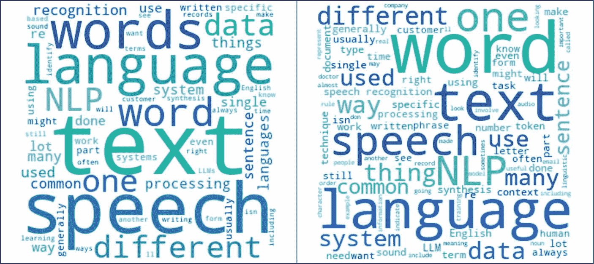

**图 17-1** 处理复数前后的两个词云对比

左侧的词云包含一些“重复词”，因为它将`word`和`words`视为不同的词。在左侧词云中出现的其他成对词还有`language`和`languages`、`system`和`systems`。在左侧词云中，`words`和`word`都比`text`和`speech`小，但仍然很大。但在右侧词云中，它们被合并统计为`word`，并且成为了该词云中最常见的词。

## 常见的自然语言处理表示与任务

上述所有预处理步骤都有助于将文本转化为可输入机器学习算法以完成各种任务的数据。在本节中，我将介绍人们可以利用自然语言处理完成的许多不同任务。但首先，简单提一下通用工具。大型语言模型已经彻底变革了自然语言处理。在此之前，人们使用多种技术来处理文本数据并完成各种任务。如今，由于种种原因，大型语言模型并非总是被使用，许多从事自然语言处理工作的人仍然会用到大量的“传统”技术，因为它们依然极其有用，有时甚至是特定领域的唯一选择——而且它们所需计算资源远少于大型语言模型。我将在下面专门用一个部分详细讨论大型语言模型，但请记住，**大型语言模型**是在海量数据上训练出来的语言模型。它们可用于多种目的，包括生成新的“原创”语言。

### 量化与表征单词和短语

在自然语言处理中，有很多表示语言的方法，但一些最有用的技术涉及如何有意义地表示单词或短短语。我首先要介绍的是**词嵌入**，这是一类将单词或文档以有意义的方式表示为数字的方法。最基本的方法是**词袋模型**，它会获取文档中的所有单词，并追踪每个独立的单词及其出现的次数（频率），但忽略单词的顺序。这有助于我们理解文档的主题。

**词频-逆文档频率** 是另一种词嵌入方法，它也计算文档内的词频。它将单个文档的词频与所有文档中单词的频率关联起来。它有助于识别那些能将不同文档区分开来的词汇。如果你的数据库是有关电子游戏评论的，像`gameplay`或`world`这样的词可能信息量不大，因为它们会出现在许多文档中；但那些只出现在部分文档中的词，比如特定游戏名称或像`bug`、`glitch`这类词，出现频率较低，在识别特定文档时会很有用。

一种较新的词嵌入方法叫做**Word2Vec**，它会扫描一组文档，并将单词量化为多维空间中的向量（线段）。由此，它可以测量两个向量之间的“角度”，以了解它们的相关程度。这是一种很好的技术，可以用来识别那些含义不同但在意义层面仍然存在关联的词，比如`cat`和`kitten`，或者`bag`和`purse`。词嵌入可以帮助我们理解`king`与`queen`之间的关系，类似于`man`与`woman`之间的关系。

**N 元语法**是指连续出现的*n*个单词（或短语）的组群。最常讨论的是二元组（两个连续词）或三元组（三个连续词）。在查找常被提及的事物时，二元组和三元组可能非常有用。有时，单个单词的信息量并不大，而查看更长的序列则能提供更多信息。像`ceiling fan`和`cracker jack`这样的术语，其含义都不同于其组成部分的单个词义。在其他情况下，这种词组可以表示其中某个词的非常特定的类型，比如`popcorn ceiling`或`soy milk`。因此，分析 N 元语法可以提供单个词语无法提供的信息。然而，大多数二元组和三元组并不那么有意义，要么是因为它们在语料库中出现得过于频繁，要么是出现得过于稀少，以至于没什么帮助。如果你没有移除停用词，一个非常常见的二元组可能会是`in the`或`she said`之类的，这对大多数目的来说都无法提供有用信息。


# 常见自然语言处理任务

上述讨论的单词和语言的不同表示方法可用于多种任务。通常，仅仅统计词频并没有太大价值。一个例外是*词云*，正如你之前所见，它是文档或语料库中单词及其频率的可视化表示。频率越高的词在显示中越大，因此你可以快速了解数据集中最重要的主题。虽然词云通常基于单个词，但你也可以包含其他内容，如二元词组或命名实体（下文将描述）。

最早且相当基础的自然语言处理任务之一是*命名实体识别*，即识别出被“命名”的单词或短语。这些包括人名、公司名、地名以及其他在英语中通常首字母大写的术语。实体也可以是其他内容，如货币金额或特定领域的项目，例如订单号或账号。实体可以预先定义（这是基于规则的系统在特定术语出现时进行识别的必要条件），但如今命名实体识别通常是一项监督学习任务，模型会根据提供的实体进行训练。模型不仅要学会识别提供的实体，还要识别出使其成为命名实体而非普通单词的模式。命名实体识别通常不是最终目标，而是被广泛应用于其他自然语言处理任务中。

*情感分析*是另一项常见的自然语言处理任务，涉及识别文本中的情感（感受）。这通常被分为正面或负面，但也可以包含中性。一个典型的应用是查看客户反馈，识别哪些是负面（投诉）、正面（赞扬）或中性（可能是在询问或提供信息）。这常用于监控品牌声誉和话题热度等。在这两种情况下，也可能用到命名实体识别。一些情感分析基于规则的系统，仅识别具有已知情感的特定词汇，如“expensive”（昂贵）、“broken”（损坏）或“high-quality”（高质量）。但大多数方法利用监督式机器学习。

共指是指一个词指向另一个词的现象，例如当代词指代之前提到的被命名的人。它也可能指隐喻中一个名词指代某种在缺乏上下文时不明确的具体事物。*共指消解*能识别出某个词指向另一个词的情况，比如`she`指代前一句中的单词`Mary`。*实体链接*则涉及识别后一个单词或短语指代的是哪个先前概念。与几乎所有自然语言处理任务一样，执行共指消解有基于规则和机器学习两种方法。监督学习需要所有共指关系都被标注的数据，但也有不依赖标注数据的聚类技术。此外，还有大语言模型等方法。

*词义消歧*（WSD）是在特定上下文中识别单词具体含义的任务。这对于在主流方言中有多重含义的单词很重要，尤其是在非常非正式的语言中更为关键，例如你在社交媒体上看到的内容。这是因为这类语言往往大量依赖俚语和反讽，它们常常以非标准甚至颠覆性的方式使用单词和短语。词义消歧可以通过基于规则和机器学习的方法实现。理想情况下，有一些标注的训练数据用于监督学习，但也可能使用半监督或无监督技术。

*文本分类*是给一段文本应用标签的任务，例如识别文本的主题。我们可能尝试在高中英语作文数据库中标注每篇作文的类型（如记叙文、说明文、议论文、描述文或辩论文）。这与主题建模有关，主题建模有时被用作分类过程中的一个步骤。*主题建模*会识别出能够表征一个或多个文档中不同主题组的关键词或短语。它们之间的主要区别在于，文本分类通常是作为监督任务执行的，而主题建模是无监督的。

另一项已存在一段时间的常见任务是*文本摘要*，它涉及将一段较长的文本缩短而不丢失核心含义。这一领域已被大型语言模型彻底变革。目前遵循几种不同的范式。抽取式摘要已存在一段时间，它提取文本中最有意义的句子并原样使用。有多种方法可以对句子重要性进行评分，然后根据评分决定保留哪些句子。而生成式摘要则是在大型语言模型出现后产生的。它根据原始文本生成新的文本，从而有效地进行摘要。生成式摘要主要通过三种方式生成新文本：句子压缩（使用基于规则的技术或监督学习来缩短长句）、信息融合（融合多个句子的观点）以及信息排序（将生成的文本按正确顺序排列）。

*机器翻译*，即将文本从一种人类语言自动翻译到另一种语言，同样历史悠久，并且也被大型语言模型彻底变革。最早的努力使用基于规则的系统，效果不佳，但随后的统计方法利用了海量文档取得了一定进展。监督学习技术被用于大量的训练数据。大型语言模型是当前的主流，但要做好这项任务仍然极其困难。

问答系统也已存在一段时间，同样被大语言模型彻底改变。最初，*问答系统*相当简单，目标是用自然语言回答简短的问题，这包括识别问题在问什么、找到答案（通常是一项信息检索任务）以及用答案形成文本回复。在监督学习方法被使用之前，这些最初是通过基于规则的系统实现的。它还需要在包含答案的数据上训练系统，因此使用了维基百科和整个网络等资源。如今，该领域的努力在客户服务和技术支持等领域非常有用。

*聊天机器人*是交互式系统，人类可以与之进行“对话”（更具体地说，是与机器人对话）。它们已经存在了一段时间，从最初基于规则的方法，到后来过渡到统计方法，再到如今的大语言模型。这涉及许多独立的组成部分。这与问答系统类似，都需要理解人类说的一段文本，然后制定出合适的回复。聊天机器人的一个目标是让对话“感觉”像真实的交谈，这通常意味着要识别何时轮到聊天机器人回应，并包含一些礼貌用语，例如“谢谢”。


### 大型语言模型

许多人并不认为大型语言模型（LLM）属于自然语言处理（NLP）的范畴，而更倾向于将其视为一个姊妹领域。我把 LLM 看作一种专门化的 NLP，只是比标准 NLP 技术要先进得多。大多数 NLP 使用监督学习（但并非全部），而 LLM 则主要采用半监督学习，因为其所需的数据量极为庞大，不可能拥有足够多的标注数据。

关于 LLM 的讨论热度很高，这也不无道理——它们所产出的结果，其令人印象深刻的程度远超 NLP 领域数十年来取得的任何成就。虽然它们在许多方面都很有用，但并非总能达到我们期望的实质性效果。事实上，*幻觉*——即模型凭空捏造并当作事实呈现的信息——非常普遍，以至于在许多应用场景下几乎无法使用。我认为这不会（也不应该）阻止我们使用它们，但它们并非万能解决方案。

使用其他公司训练好的现有 LLM 还存在一些严重的伦理问题。它们用于训练的大量数据都是未经许可使用的。目前有多起诉讼正在进行以解决这一问题。我认为在美国，这些诉讼可能不会导致任何法律上的改变，但在许多其他国家/地区情况可能并非如此。欧盟非常重视数据隐私和安全，我预计最终会出台与 LLM 相关的法律。根据你的具体用例，使用商用 LLM 可能存在法律风险。或者你可能只是不想使用来源存疑的模型。

对于拥有大量自有文本的大型公司来说，一个选择是训练自己的 LLM。还有许多其他数据源可以购买或免费获取，以补充公司的数据。但对于大多数中小型公司来说，这并不可行。训练 LLM 已经变得更容易，因为曾经的语言处理黄金标准——循环神经网络——已被前一章提到的新型神经网络架构——变换器（Transformer）所取代。它显著减少了训练时间。（但对大量训练数据的需求依然存在。）

主要的结论是，LLM 可能非常有用，但你在考虑使用它时，应保持谨慎，并思考其后果。

### 关于人类语言的最后思考

我们都知道人类语言有其规则，但所有语言中的首要规则就是：规则总有例外。某些语言形式比其他的更容易处理。学术写作非常正式，大多数作者都严格遵守语言规则——几乎没有人会以新颖的方式使用语言。但推文或短信呢？那完全是另一回事了。社交媒体和所有非正式交流中都充斥着错误和对语言规则的漠视，俚语随处可见，而且我们有各种各样的表情符号，它们对 X 世代、千禧一代和 Z 世代意味着不同的东西。歧义无处不在——他们是否在使用你不了解的一种方言特有的短语？当有人说喜欢你的帽子时，是讽刺、是阴阳怪气，还是真心实意？许多人类都分辨不清，对于计算机来说这几乎是个无解的问题。再加上母语者与非母语者之间的相互交流，情况就更加棘手了。微妙的讽刺对非母语者来说更难察觉。有时非母语者会将他们母语中的习语以不符合英语习惯的方式翻译成英语，但所有说那种语言的人都能识别并理解。在人类创造的所有系统中，语言一定是最复杂的——也是最强大的。

## 语音处理

如果说 NLP 是研究文本的学科，那么语音处理就是研究口语——即音频——的学科。语音识别旨在分析口语并试图识别其内容，而语音合成则负责生成语音。我将对它们进行进一步的介绍。

语音识别和语音合成通常都涉及文本，无论是作为输入还是输出。因此，根据所采用的方法，大量针对文本进行的 NLP 工作也会在语音处理中进行。最好将语音处理视为文本处理之上的一层。

### 语音识别

*语音识别*接收音频并试图理解其内容，从历史上看，这通常意味着转录——将语音转化为文本。首先，需要明确的是，语音识别和声纹识别并非同一回事，尽管它们都处理语音音频。语音识别识别的是所说的内容——即词语；而*声纹识别*则将声音识别为个体独有的生物特征标识，从而识别说话者。像 Alexa 这样的常见语音助手两者都会用到——它们利用声纹识别来区分家庭中的不同说话者，以防他们有不同的需求——但助手的主要功能是识别语音。

语音识别的第一步是以某种方式将音频数字化。这些技术源于信号处理，这是电气工程的一个分支。我不打算讨论这部分过程，因为大多数处理语音数据的人所做的工作是在音频被转换为数字表示形式之后进行的。

早期的一些语音识别工作依赖于语音学知识，语音学是关于语音的科学（基本上，是我们如何使用舌头、嘴唇和声带改变从肺部呼出的空气来发出语音，以及不同组合所能产生的特定音素）。但在隐马尔可夫模型出现之前，进展甚微。隐马尔可夫模型是一种概率模型，允许研究人员将各种语言信息及其他信息纳入其模型中。这些模型被使用了数十年，基本上直到 21 世纪初神经网络的出现，我们至今仍在使用神经网络。

如今，大多数语音识别都是通过一种名为*长短期记忆网络*（LSTM）的高级神经网络完成的，这是一种循环神经网络，它允许对许多步骤之前发生的事情具有“记忆”能力。一般而言，语音和语言都需要这种更长期的记忆，因为人类在说过一段时间后再次提及先前提到过的事物是非常自然的。LSTM 使得语音识别的性能取得了重大进步，现在人们也开始关注变换器（Transformer），这是一种已成功应用于文本处理的神经网络。

大多数语音识别系统包含多个组件，从数字化语音输入本身开始。特征提取和特征向量创建是接下来的两个步骤。提取的具体特征可能有所不同。一旦特征准备就绪，它们就会被送入解码器，解码器进而生成词语输出（文本）。

语音识别用途广泛，包括语音助手、转录、听写、自动客服以及实时语言翻译。正如上文所述，声纹识别通常被集成到系统中。


语音识别（`speech recognition`）的性能在过去几十年中取得了巨大进步，但通常仍未达到两人交谈的水平。适用于所有人、谈论任何内容的通用语音识别系统仍遥遥无期。我可能不是唯一一个在语音电话系统中反复重复单词“representative”，直到被转接给真人而感到沮丧的人。许多人在使用标准语音识别系统时会遇到困难，包括：语言的非母语使用者、使用系统未训练过的方言的人、有语言障碍的人，以及语速慢于常人的人。大多数英语系统都是基于白人、中产阶级美国男性的语音进行训练的，因此有时即使是使用相同方言的女性也可能难以被系统理解。此外，大多数人类语音都包含可变因素，这些因素取决于语境、情绪、语气以及许多其他会影响发音的因素，例如为了强调而延长元音、加重音节，或者仅通过升调来表示疑问。我们在自然说话时所做的所有“额外”的声音元素统称为**韵律**（`prosody`），处理它非常困难。

## 语音合成

**语音合成**（`speech synthesis`）实际上是语音识别的反向过程，我们从文本出发，生成音频。文本转语音（`Text-to-speech`）系统最为常见，它处理常规文本。还有其他合成器可以处理特定方式编码的文本，例如音标转录或其他专门指令。生成最终音频文件的步骤属于信号处理领域，此处不再赘述其细节。

由于合成器从文本开始处理，它会进行一些与自然语言处理（`NLP`）类似的预处理，包括分词（`tokenization`）和其他分析。这对于正确发音至关重要，因为同一个单词在不同语境下可能有不同的发音（例如“read”）。如果系统试图正确把握语调和其他韵律，这一点尤其重要。

该过程的下一步是确定如何组合声音单元。有不同的实现方法。最基本的是**拼接合成**（`concatenation synthesis`），它本质上是将预先录制的声音单元一个接一个地串起来。这些单元可以是音素（`phonemes`，如“o”或“ee”这样的元音，或“n”、“s”这样的辅音）、音节（`syllables`，包含一个节拍的多个音素，如“tree”、“cup”或“ah”），甚至可以是整个单词、短语或句子，具体取决于用途。

还有其他几种合成方法。另一种生成语音音频的方法称为**共振峰合成**（`formant synthesis`），它通过遵循声学模型的加法合成来生成语音，产生精确但机械的语音。另一种合成类型称为**调音合成**（`articulatory synthesis`），它基于对人类口腔和喉咙发音方式的理解来生成音频，因此是一种基于物理的模型。我要提到的另一种类型是**基于深度学习的合成**（`deep learning–based synthesis`），它使用在大量录音语音及相关文本和标签上训练的神经网络。

在自然度方面，拼接合成往往表现最佳，但在处理不常见组合时可能会产生瑕疵。共振峰合成通常会产生机器人般的语音，但通常具有很高的可懂度，所需计算资源较少，且生成速度快。基于最后这些原因，这种合成方式被用于视障人士的屏幕阅读器中。调音合成无疑有生成自然语音的潜力，但模拟人类声道并非易事，仍有很大的进步空间。深度学习合成在听起来自然方面能取得相当不错的效果，但当要求它处理缺乏足够训练样本的情况时，仍然存在问题。


# 要点回顾与下章预告

本章我们讨论了自然语言处理的多个主要方面，其内涵远不止预构建的 LLM。我们探讨了人类语言及其书面和口头形式，随后深入介绍了通过 NLP 解析语言的各种方法，包括分词、句子分割、去除停用词、处理特殊标记、词性标注，以及词干提取和词形还原。接着，我们讨论了在语言数据解析完毕并可供使用后可以进行的诸多操作，包括词频统计、多词术语分析、命名实体识别、情感分析、指代消解、词义消歧、文本分类、文本摘要、机器翻译、问答系统和聊天机器人。随后我介绍了 LLM，它近来已成为 NLP 的重要组成部分，尽管这并非 NLP 的全貌。随着对话系统日益普及，语音识别和语音合成都是重要的研究领域。

在下一章中，我们将探讨可视化和演示。在第二章中我们查看描述性统计时已经见过一些可视化内容，但第十八章将进行更深入的探讨。我们将讨论多种可视化类型，以及在何种情况下各类特性表现优劣。然后，我们将超越可视化本身，更广泛地探讨演示技巧。

## 从业者简介：安德拉·辛佩洛

**姓名：** 安德拉·辛佩洛

**职位：** 软件开发者/语言学专家，现任校对/编辑

**当前行业：** 问答软件与写作

**从业年限：** 软件/语言学领域 12 年，编辑领域 4 年

**教育背景：**

*   机器学习证书
*   语音与语言处理理学硕士
*   现代语言与语言学文学士

*此处观点仅代表安德拉个人，与其现任及历任雇主无关。*

### 背景

安德拉一直热爱语言并对此颇有天赋。她在高中学习了法语和德语，但大学主修政治学。她发现自己并不喜欢这个专业，因此转修语言学便顺理成章。她获得了现代语言与语言学学位，期间还学习了意大利语。毕业后她未能在该领域找到工作，当听说计算机在语言处理方面取得了开创性进展时，她产生了浓厚兴趣。她开始研究这个方向，与朋友讨论这个迷人的新领域，最终发现了一个相关主题的学位课程。同年晚些时候，她开始攻读语音与语言处理理学硕士。尽管大部分内容对她而言是全新的，但她热爱学位课程中学习的一切，尤其是语音学。她至今仍喜欢观察语音的波形图。她的论文是关于提高说话人识别（生物识别中专注于声纹识别而非语音识别的领域）的计算效率。该学位课程涉及大量编程和语言学内容。

## 工作

获得语音与 NLP 学位后，她搬回家乡，开始寻找与语言相关的工作。起初非常艰难，因为家庭责任使她只能在一个都市圈内求职，但她最终在当地一家问答公司找到了一份软件开发工作，专攻语言学领域，这堪称完美。初期工作涉及大量软件开发，同时也包含众多语言学任务，她负责算法及其他 NLP 相关工作。但公司被收购后，企业文化变得有害，她的工作只剩下修复漏洞，于是她辞职并专注于家庭。随着孩子们长大，她逐渐重返职场，现在是一名自由职业的校对和编辑——依然从事她热爱的语言工作。

### 金句摘要

**工作中最喜欢的部分：** 处理语言并运用自己的专业知识开发产品和完善写作。她也热爱在问答工作中努力提高答案相关性的过程，因为这充满挑战，但找到改进答案的方法时又极富成就感。

**工作中最不喜欢的部分：** 在公司里，政治斗争和有害的工作环境令人沮丧，因为你无法改变。自由职业在这方面更好，但也压力很大，因为你必须不断寻找工作机会。

**最喜欢的项目：** 其中一个最喜欢的项目是在问答公司时，团队专门致力于提高答案的相关性。基本流程是用户提问，系统基于关键词查询知识库寻找答案。安德拉能够深入分析这一过程，通过研究真实的查询和答案来改进它。她识别出其他可用于改进答案的重要方面，包括为任何系统生成的答案制定评分。在另一个很酷的项目中，经过一个通宵编码时灵光一现，她成功找到了一个绝佳的方法来可视化共现词汇，客户对此非常满意，皆大欢喜。

**最常用技能：** 在问答公司工作时，她主要运用编程技能，NLP/语言学知识用得较少（但在必要时很有帮助）。在目前的工作中，她通用的语言专长非常有价值。软技能在任何地方都很重要，自由职业尤其如此。另一个重要技能是时间管理。

**当前主要使用的工具：** 过去使用 `Java`、`JSP`、`JavaScript`、`NLTK`（自然语言工具包）和 `WordNet`。目前使用 `WordPress`、`Google Docs` 和 `Microsoft Office`。

**NLP 的未来：** 现在技术发展如光速般迅猛，一天比一天令人印象深刻，但也日益令人担忧。安德拉担心人工智能的快速发展速度，以及这对整个社会意味着什么。如今，我们查看任何东西时都必须谨慎，思考其真伪——但大多数人对此毫不在意。我们经常看到名人出面澄清某些照片是假的，但所有人原本都相信那些图像是真的。这令人担忧。

**优秀 NLP 从业者的特质：** 保持求知欲，这将是贯穿职业生涯的持续需求。事物总是在变化和进步。

**给未来 NLP 从业者的建议：** 找工作时不要过于狭窄地限定在一个领域。任何时候同时开放的这类职位数量都有限，你可能需要保持灵活性，在个人最感兴趣的领域之外寻找机会。在你的整个职业生涯中都需要不断学习，所以请放宽眼界去寻找。

*安德拉是一名自由职业编辑和撰稿人，拥有 NLP 和软件开发背景。*

脚注 1 2

# 18. 一种全新的叙事方式：数据可视化与演示


## 引言

可视化是数据科学的重要组成部分，尽管许多数据科学家并不需要频繁构建大量图表。这取决于具体岗位职责，但每位数据科学家至少偶尔都需要创建一些可视化。数据分析师则会发现自己需要构建许多图表。有些团队设有专职人员，负责根据数据科学家和数据分析师的工作成果搭建仪表板。无论你是否亲手创建可视化，理解如何制作优秀的可视化都至关重要。

可视化往往威力强大，常常能在瞬间让表格和数字需要大量解释才能说明白的事情变得一目了然。在第 2 章中，我提到挑战者号航天飞机工程师所使用的图表未能说服领导层推迟次日发射，而正确的图表本可以做到。你将在下文第一个例子中看到，可视化在呈现拿破仑远征俄国这场灾难时有多么震撼。知道何时创建可视化、创建哪种可视化才能有效传达观点，是一项无比宝贵的技能。

在本章中，我将探讨优秀可视化与演示的构成要素，并涵盖丰富的图表、表格和地图类型。一条提示是：一切都围绕用数据和发现讲述故事。最后，我将介绍 Tableau 和 Power BI，这是当今最流行的两种专业可视化工具。

# 现实世界中的数据可视化示例

在本书前面章节中，我举过几个强有力可视化的例子。第一个在第 2 章，我展示了一张简单的图表，它本可以更清楚地向决策者揭示低温下挑战者号发射的风险。然而，担心 O 型环在寒冷天气中性能的工程师们分享的图表只讲述了部分故事，并未说服管理层。第二个例子在第 5 章，是约翰·斯诺绘制的 1854 年伦敦霍乱死亡地图，这张图帮助他们识别出疾病源头是宽街水泵。一旦封住水泵，疫情便告终结。

现在，我将再讨论两个例子，一个回顾历史，另一个提醒我们可视化的重要性。两者都很棒，因为它们展示了正确可视化能产生多么巨大的影响。第一个是拿破仑向莫斯科进军的示意图，这是一场代价数十万生命的灾难性战役。第二个是著名的"安斯库姆四重奏"图解，它强调了超越基础描述性统计的重要意义。

## 示例 1：战争蠢行的视觉记录

尽管拿破仑·波拿巴被认为是最杰出的军事领袖之一，但他远征莫斯科的企图在他返回巴黎后，连他自己都承认是一场毫无意义且彻头彻尾的灾难。这次进军让拿破仑一无所获，却付出了数十万人的生命代价。关于具体数字很难达成一致，但大多数人认同拿破仑最初率领 45 万大军，而最终不到 10 万人返回家园。图 18-1 是 1869 年由法国人查尔斯·约瑟夫·米纳尔制作的一幅著名可视化作品，清晰地揭示了这场灾难的惨烈程度，这是单纯数字无法做到的。上方的米色线条代表从法国（左侧）到莫斯科（右侧）的进军路线，随后返回路线以黑色表示。


查尔斯·米纳尔绘制的拿破仑 1812-1813 年俄国战役流程图。该图展示了拿破仑军队在进军和撤离莫斯科时兵力规模的变化，条带宽度代表部队人数。米色条带表示进军，黑色条带表示撤退。图中标注了科夫诺、斯摩棱斯克和莫斯科等关键地点。下方温度图反映了撤退期间面临的严酷条件。该图表结合了地理与统计数据，以传达惊人的部队损失。

**图 18-1**

查尔斯·米纳尔对拿破仑灾难性莫斯科远征的再现。来源：摘自"File:Minard.png"，可在[`https://en.wikipedia.org/wiki/File:Minard.png`](https://en.wikipedia.org/wiki/File:Minard.png)获取，属于公共领域

军队于 1812 年初夏进入俄属立陶宛。俄国当时采取焦土撤退政策，因此军队觅食极为困难，甚至在进军早期就有士兵因疾病死亡。疾病从未消失，但他们仍继续向莫斯科挺进。8 月发生了一场战斗，拿破仑获胜，但约 9000 名士兵阵亡。9 月，他们在接近莫斯科时再次交战，35000 名法军阵亡，俄方伤亡更重（这被认为是现代战争史上最惨烈的单场战役之一）。拿破仑与约 10 万士兵占领了几乎完全空无一人的莫斯科。当地人在第二天焚烧了城市，约四分之三的区域被毁。拿破仑逗留数周，但食物获取困难，饥饿依然是大问题，疾病也持续困扰着他们。最终军队于 10 月底开始返乡。现代数据与图表上的数字在此存在差异，但众所周知，在返乡途中，深冬严寒降临在这支衣衫单薄的疲惫之师上，造成了巨大伤亡。饥饿、疾病和极端天气意味着只有极小部分士兵得以返回家园。

这幅可视化作品或许没有在实质上改变任何政策，但它极其清晰地揭示了那场战役的惨状，令人一目了然，远胜于查看表格和更简单的图表。通常，当你想展示某件事时，总存在一个完美的可视化方式，尽管找到它并不总是那么容易。


### 示例 2：统计上相同的数据，不同的面貌

描述性统计功能强大，人们长期以来一直用它来理解和描述数据。但是，正如统计学家弗朗西斯·安斯库姆（Francis Anscombe）在 20 世纪 70 年代绘制的四个简单却发人深省的图表所展示的那样，仅依赖单一视角是有风险的。他创建了四个不同的数据集，每个数据集都包含两个变量，且所有这些数据集都具有相同的基本统计特征（两个变量的均值与样本方差、两者之间的相关性、线性回归线以及回归的决定系数）。然后，他为每个数据集绘制了散点图，如图 18-2 所示。

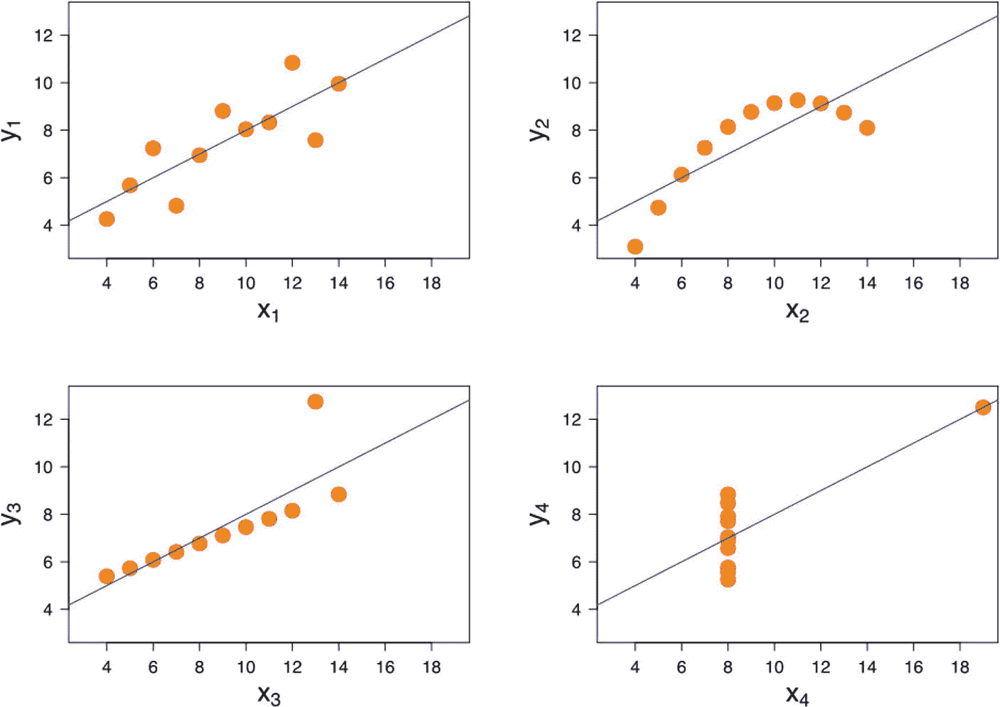

四面板 X-Y 图表，展示了具有相似线性回归线的不同数据集。每个面板显示一个散点图，包含橙色数据点和代表线性拟合的蓝色线条。左上角的图表绘制了`y_1`对`x_1`的散点图，显示出适度的正相关性。右上角的图表绘制了`y_2`对`x_2`的散点图，数据点呈曲线分布。左下角的图表绘制了`y_3`对`x_3`的散点图，除一个离群点外，大部分点沿直线聚集。右下角的图表绘制了`y_4`对`x_4`的散点图，数据点呈垂直聚集。每个坐标轴都标有相应的变量名称。

**图 18-2**

安斯库姆四重奏：四个图表展示了具有相同统计特性的不同数据集。来源：改编自“Anscombe’s quartet 3.svg”，可在[`https://en.wikipedia.org/wiki/File:Anscombe%27s_quartet_3.svg`](https://en.wikipedia.org/wiki/File:Anscombe%2527s_quartet_3.svg)获取，采用知识共享署名-相同方式共享 3.0 未本地化版本许可协议（[`https://en.wikipedia.org/wiki/en:Creative_Commons`](https://en.wikipedia.org/wiki/en:Creative_Commons)）。

这些图表让人立刻看出，这些数据集实际上并不相似，每个数据集都有其独特的特征。左上角的图表是我们所习惯看到的——数据散布开来，呈现出一种我们似乎能感知到的总体线性趋势。也许线性回归确实能告诉我们一些有用的信息，但我们确实需要更多数据才能确定。右上角的图表则清晰地显示了非线性数据，图上绘制的线性回归线看起来非常荒谬。显然，线性回归并非处理这些数据的正确方法。左下角的图表也很有趣，因为数据看起来极具线性，但一个离群点就完全扰乱了全局。很可能，线性回归是一种适用于这些数据的好技术，但在运行回归之前需要剔除那个离群点。但是，我们不应忘记它——需要记住这个数据集存在极端离群点。右下角的图表同样有趣，一个极端离群点也扰乱了图表，使得运行线性回归成为可能。实际上，变量`X`在任何模型中很可能都没什么用，因为它几乎总是同一个值——8。将其转化为一个“是否为 8”与“是否非 8”的二值特征可能更有用。

这些图表提醒我们，可视化既可以揭示问题、至关重要，同时也提醒我们，绝不应该对数据采取短视的看法，在没有先了解数据本质的情况下就随意运行相关性分析、线性回归或其他分析。

## 用数据讲故事

在正式展示你的发现之前，通常需要先制作一些可视化图表。但在制作幻灯片来展示你的发现之前，真正需要做的是决定你要向利益相关者讲述什么故事。你绝不应该只是把一堆图表和表格丢进幻灯片里就完事了。叙事在哪里？

有时人们会有点过度，试图将“用数据讲故事”与虚构故事中的叙事类比起来，我认为这没有必要。但是，拥有一个叙事脉络，意味着从一个想法过渡到另一个想法，并沿途触及关键点。通常，你需要依次回答以下这些问题：

1.  我们提出的问题或需要解决的问题是什么？
2.  我们拥有哪些信息可以帮助我们回答问题/解决问题？
3.  我们可以进行哪种模型或分析来回答问题/解决问题？
4.  答案/解决方案是什么？
5.  我们对该答案/解决方案有多大的信心？
6.  下一步的行动是什么？
7.  该解决方案的商业影响是什么？

这些也是你在汇报项目成果时需要回答的问题。从#1 开始，设定初始状态。我们试图解决的问题是什么？永远、永远、永远要回归到商业案例上。有时需要提醒人们他们为什么要听这个演示，特别是当你并非定期与这些人合作时。

在很多情况下，最好解释一下你用来解决问题的材料，如#2 所述。此处细节的详略程度取决于你的听众，但大多数利益相关者会想知道你使用了哪种类型的数据。他们可能想知道这是一个他们已经熟悉的数据源，还是一个他们自己也能使用的数据源。有时，他们还希望根据自己对数据源的了解来判断你的结果的可靠性或可信度。

通常也需要解释你是如何解决问题的，即#3。这时你会谈论技术细节，但要根据你的听众来定位合适的技术深度。你可能只是提到你对数据做了一些清理和修改，然后将其输入到一个机器学习模型中；或者你可以更具体地告诉他们使用了哪些模型，甚至展示模型结果（如线性回归公式或训练好的决策树）。请记住，我们所做的工作中有很大一部分是“隐性”的，因此这里的要点之一就是传达出我们做了大量工作，即使你并未提供太多细节。这一切都取决于如何迎合你的听众。

接下来，你将实际展示解决方案本身，即#4。解释你发现了什么，为什么它很重要，做出了哪些假设，信心水平如何，以及是否存在需要注意的任何弱点或局限性（这是#5 涉及的内容）。如果你要提出建议，也应在此处给出。这通常是演示文稿的主体部分，因为这正是项目的全部目的。此处的具体内容也取决于你正在进行的分析类型。描述性分析主要是图表和摘要，诊断性分析包括你发现的解释，预测性分析包括你的预测，处方性分析包括你的建议。

最后，通常会明确下一步行动，如#6 所述。如果项目仍在进行中，这些将是你下一步计划要做的工作（或供讨论的选项）。如果项目已经结束，这可能只涉及维护，或者可能真的没有更多工作可做。列出一些未来项目中可能做的事情仍然是常规做法。

如果项目完成至今已有足够的时间，那么#7 就是你谈论实际影响的地方。在商业领域，通常最好能以某种方式量化这种影响。


以故事形式讲述的要点之一不仅是条理清晰、逻辑严谨，故事还能在情感上打动人心，而单纯陈述事实通常无法做到这一点。当你向合适的利益相关者讲述你的解决方案时，甚至可以谈谈摸索过程中的挣扎以及最终如何取得胜利。这在向高层领导做简短汇报时可能并不合适，但那些定期与你开会的利益相关者或许会欣赏这种讲述方式。

请注意，可视化内容可能出现在这一过程的任何步骤中，尽管第 4 步应该包含最多。但切记不要用接二连三的可视化内容让听众应接不暇。利益相关者寻求的是帮助，以做出更好的决策。作为数据科学家，我们的职责是找到能够帮助他们的信息。显然，这可以有多种形式。在一个更侧重于理解过去和现在所发生事情的项目中（这将涉及数据分析类工作，可能还需要一些出色的可视化图表），沉浸于`EDA`的数据科学家很容易偏离最终目标。探索性工作固然重要，但我们真正想做的是创建*解释性*可视化图表，这些图表不仅能告诉我们“是什么”，还能揭示带有原因——即可被理解的解释——的联系。我们需要通过`EDA`来理解数据，找出最佳方式，发现那些能够向利益相关者解释有价值信息的有趣内容。

接下来，我将讨论你在叙事过程中可以制作的各种可视化图表，以及如何使它们发挥最大效用。

## 可视化图表的类型及其优秀之处

在第 2 章介绍描述性统计时，我已经讨论了几种基础但可靠的可视化图表。我将重温其中一些图表，并探讨它们在此处为何有效。我们还会研究图表的许多变体以及一些不常见的类型。但首先，我将讨论一些更普遍意义上的、能让图表变好的因素，以及一些需要避免的事项。

### 什么样的可视化是好的？

你需要知道你的可视化图表是为谁而作，以及你的利益相关者为何需要它。这意味着要了解你的受众，并尽可能做到具体。如果你想向你的数据科学家同事和高层领导展示同样的基本信息，很可能应该准备两种不同且独立的可视化图表。他们需要这个可视化图表的原因，显然与你试图向他们展示的内容相关。通常，当你制作可视化图表时，是为了帮助人们更好地理解某事，或帮助他们做出决策。

制作可视化图表时，另一个追求的目标是简洁——任何可视化图表都应在传达所需信息的前提下，尽可能做到简单。举一个大的禁忌为例，人们常常忍不住通过制作 3D 效果来“锦上添花”。往好了说，这是不必要的干扰；往坏了说，它会扭曲你所绘制的实际数值。要看出这一点，请看一下图 18-3，该图显示了同一个饼图的 2D 和 3D 版本，它们被平均分成三份（每个扇区包含相同数量的项目）。在左侧的 2D 版本图表中，比例一目了然，很明显它们各占饼图的三分之一。但在右侧的 3D 版本图表中，离我们最近的扇区看起来比另外两个更大。我发现，即使知道它们大小相同（而且我自认为数学头脑不错，空间感知能力良好），它*感觉上*还是更大。想象一下，如果这些扇区大小不一——那么大多数人的大脑基本上不可能在不付出巨大努力的情况下做出正确调整来准确解读。如果理解一个图表需要费很大力气，那它就不是一个好的图表。

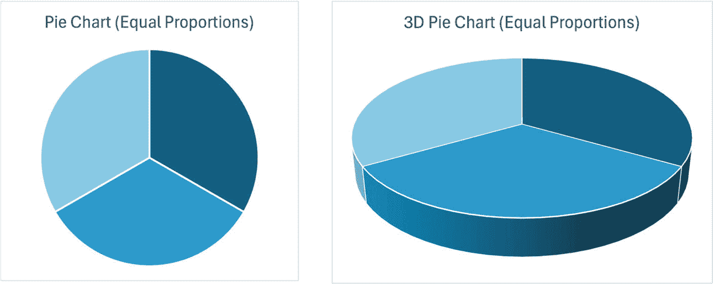  
图 18-3  
一个由三个等尺寸扇区组成的饼图：2D 版本和 3D 版本


### 散点图

图 18-4 展示了一个最基础图表——散点图的示例，我们在第 2 章中已经见过。它只是简单地将两个变量相互对应绘制，一个在 X 轴上，另一个在 Y 轴上。这是一种快速查看两个特征如何相互关联的方式——一个变量增大时另一个也增大，还是相反？或者根本不存在关联？散点图在商业中实际应用不多，但在科学领域更为常见，数据科学家在进行探索性数据分析（EDA）时也经常使用。

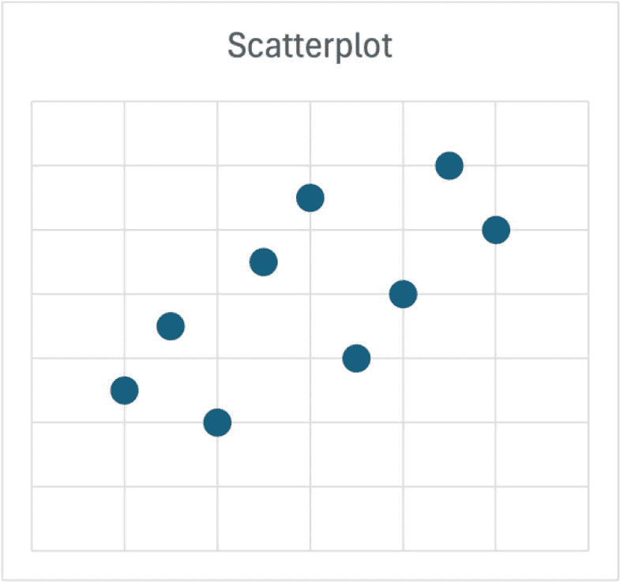

散点图，展示分布在网格上的一系列数据点。数据点呈现出正相关趋势，顶部标题为“散点图”。该图用于可视化两个变量之间的关系。

图 18-4：一个散点图

在图 18-4 中，似乎呈现出正相关关系，两个变量同步增长。散点图也能很好地展示当变量之间没有明确关联的情况。创建散点图时，注意比例尺很重要——虽然设置任何图表的坐标轴都可能需要一些技巧，但通常最好尽量让两个坐标轴的刻度比例与数据的整体范围相匹配。此外，只展示部分数据可能会产生误导。请查看图 18-5 中散点图的示例，当排除部分数据时，其呈现的形态可能会完全不同。

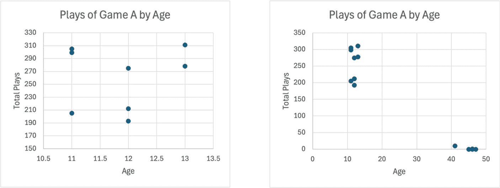

散点图，包含两个子图，标题为“游戏 A 的游玩次数按年龄分布”。左侧子图显示年龄在 10.5 至 13.5 岁之间的数据点，总游玩次数在 150 至 330 之间。右侧子图显示年龄在 0 至 50 岁之间的数据，总游玩次数在 0 至 350 之间。两张图都展示了年龄与总游玩次数之间的关系，但数据点分布不同。

图 18-5：两个不同坐标轴的散点图

在左侧图表中，年龄看起来分布相当分散，总游玩次数也高低不一。但是，当我们仅仅加入五个关于年长玩家的数据点后，首先，很明显第一个图表中的玩家年龄相对于人类的年龄范围来说较低。同样地，我们也能看到较年轻玩家的游玩次数远高于年长玩家。

我在第 2 章中讨论过散点图的两种变体，可以结合使用，使得在同一个图表上最多能绘制四个特征。这是通过为数据点添加颜色和/或大小来实现的。对于不同大小的数据点，我们通常称之为气泡图。

颜色既可以用于分类变量，也可以用于数值变量。对于分类变量，该变量的每个取值都对应一个图例中列出的离散颜色。对于连续变量，则使用单色渐变（也可以使用多种颜色渐变，但单色从浅到深更常见）。图 18-6 显示了一个气泡图，表示了四个变量：年龄（X 轴）、总游玩次数（Y 轴）、性别（颜色）和评分（气泡大小）。为了清晰起见，气泡采用了半透明效果。

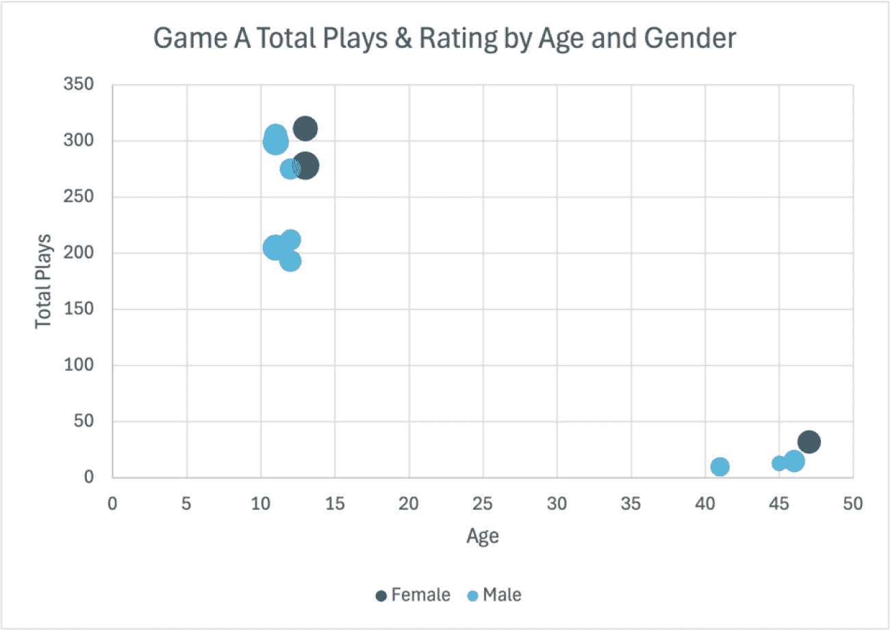

气泡图，标题为“游戏 A 的总游玩次数与评分按年龄和性别分布”。X 轴代表年龄，范围从 0 到 50；Y 轴代表总游玩次数，范围从 0 到 350。气泡按性别着色：深蓝色代表女性，浅蓝色代表男性。大多数气泡集中在 10 至 15 岁年龄段，总游玩次数在 200 到 300 之间；少数气泡分散在 45 岁左右，总游玩次数较低。

图 18-6：使用颜色和大小的四特征气泡图

散点图具有一定的灵活性，但请记住，许多商务人士对此并不熟悉，因此请务必留意你的利益相关者是否接受这类图表，以此判断它们是否适合你的受众。

举个例子，我们可以回顾一下第 2 章中的图表，图 2-8，此处作为图 18-7 再次引用。它展示了儿童身高和性别的散点图。这是一个非常简单的图表，仅显示了年龄、身高和性别三个特征。通过观察，我们可以看到身高随着年龄的增长而呈现上升趋势。从现有数据来看，女孩和男孩的身高在 14 岁左右之前差异不大，而 14 岁之后女孩的身高趋于平稳，但男孩的身高则继续增长，超过女孩。

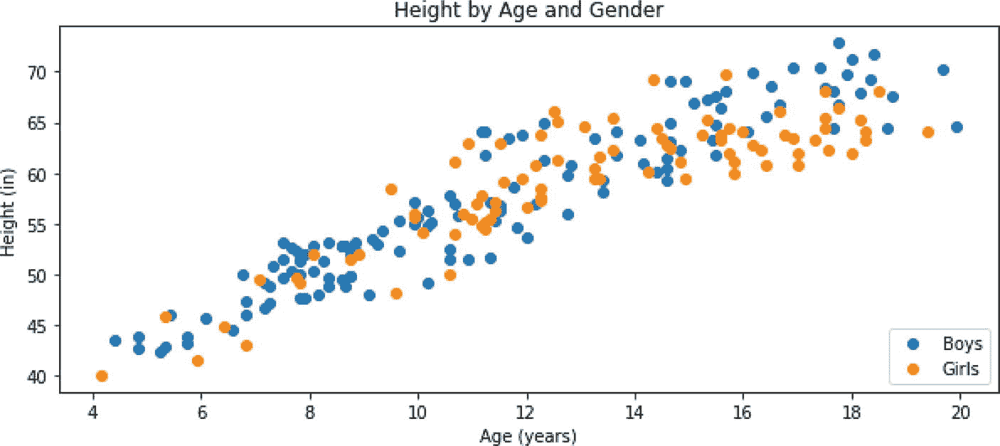

散点图，标题为“身高按年龄和性别分布”，展示了男孩和女孩年龄与身高的关系。X 轴代表年龄（以年为单位），范围从 4 到 20；Y 轴代表身高（以英寸为单位），范围从 40 到 75。蓝点代表男孩，橙点代表女孩。数据点呈现整体上升趋势，表明无论性别，身高都随年龄增长而增加。右下角的图例标识了男孩和女孩对应的颜色。

图 18-7：儿童身高与性别

虽然这可能是潜在有用的信息，但它并没有解释太多——我们早就知道男孩进入青少年时期后身高会超过女孩。此外，我们还可以发现，这个数据集中 11 岁以下的女孩似乎比男孩少。如果我们有更多女孩的数据，是否可能会注意到更年幼孩子之间的身高差异？这很难说。尽管这张图本身没有错误，但也没有什么特别吸引人的地方。除非利益相关者有特别要求，否则这张图可能不应该出现在发给他们的报告中。


### 柱状图与条形图

另一类主要展示单个变量（在最基础形式下）的重要图表是条形图。条形图是最直观的图表之一，既可以是水平方向，也可以是垂直方向（通常称为柱状图）。你可以在图 18-8 中看到这两种不同的版本，它们显示了相同的数据。

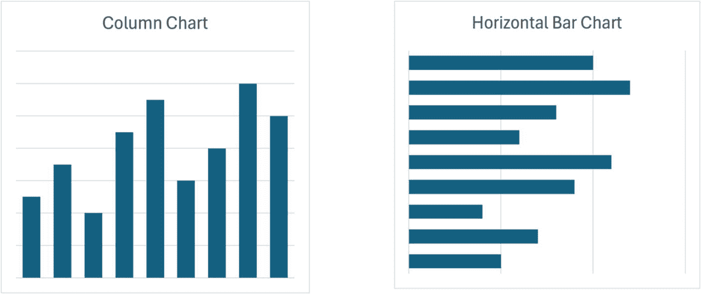

两个条形图并排显示。左侧图表是高度变化的垂直柱状图，标注为“柱状图”。右侧图表是长度不同的水平条形图，标注为“水平条形图”。两个图表都使用蓝色条形来代表数据值。

**图 18-8**  
垂直与水平条形图

你所绘制的数据通常能帮助你决定是采用垂直还是水平方向。通常这无关紧要，但在一种情况下你可能会选择水平方向，那就是当你的标签特别长时。对比图 18-9 中的两个图表。通过旋转图表以容纳左侧过长的 X 轴标签，便得到了右侧更易读的图表。

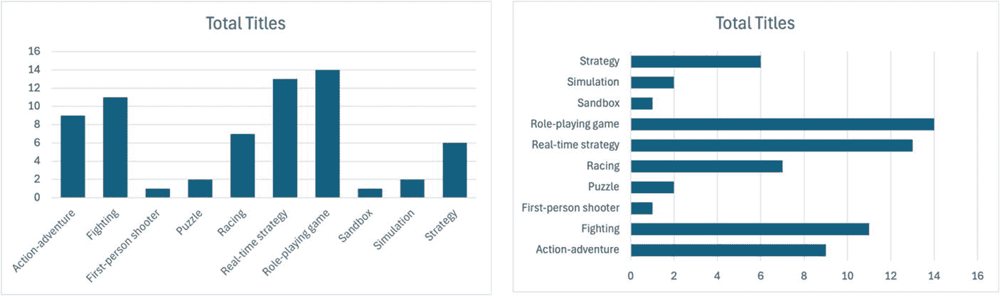

两个标题为“游戏总数”的条形图展示了不同游戏类型的数量。左侧图表是垂直的，显示的类型包括动作冒险、格斗和角色扮演游戏，其中角色扮演游戏数量最高。右侧图表是水平的，列出的类型包括策略、模拟和赛车，其中角色扮演游戏和即时战略游戏数量最高。两个图表都突出了不同类型中游戏数量的分布情况。

**图 18-9**  
按类型划分的视频游戏总数两种视图

调整这些基础条形图有多种方法，但需要注意一些最佳实践。通常认为，条形图的 Y 轴最好始终从 0 开始，否则可能会产生误导，让人难以快速理解条形之间的差异。此外，你可能见过一些图表中条形带有断点（通常是一条锯齿线），表示刻度发生了跳跃——这通常不被推荐，因为它破坏了视觉理解。这通常发生在某个条形远大于其他条形（即异常值）时，但通常更好的做法是保留较长的条形，并为其他条形添加标签，以便看清数值。你也可以另做一个图表，只显示非异常值的条形，这样更容易区分它们。

如果不在条形图中显示 Y 轴标签，而是将数值放在条形顶部，也是可行的。如果条形不多，这种方法尤其有效。例如，参见图 18-10，这是相同数据的两种视图。两者差异不大，但只有三个柱状图时，右侧的图表读起来更快。

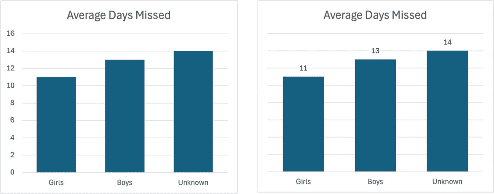

两个标题为“平均缺勤天数”的条形图比较了三组（女生、男生和未知）的平均缺勤天数。左侧图表显示女生约 12 天，男生约 13 天，未知约 14 天。右侧图表明确指出女生 11 天，男生 13 天，未知 14 天。

**图 18-10**  
一个小型柱状图的两种视图，展示了某个项目的学生缺勤情况

我们在第 2 章中讨论过其他类型的条形图。我们可以简单地分别显示多个分组，也可以将它们堆叠起来。选择哪种视图更合适取决于所展示的内容。我们将从观察不同分组的多个条形开始。假设我们使用在图 18-10 中看到的相同基础数据，即按性别分列的学生缺勤情况。如果我们增加一个按年份的细分，就有几种不同的方式来查看这些数据。请参见图 18-11 了解其中两种最基本的方式。

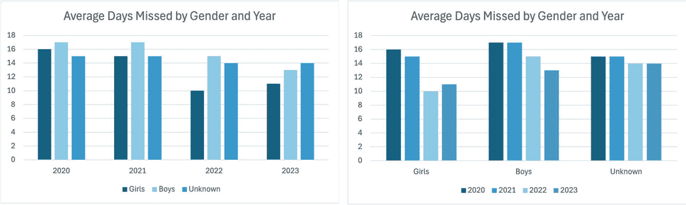

比较按性别和年份分列的平均缺勤天数的条形图。左侧图表显示了 2020 年至 2023 年女生、男生和未知类别的数据。右侧图表显示了相同年份的数据，但按性别类别分组：女生、男生和未知。两个图表都突出了不同年份和性别之间缺勤天数的变化。

**图 18-11**  
按性别和年份查看多年缺勤数据的两种方式

请注意，我们将分组数据聚类在一起。我们的数据同时按性别和年份进行了细分。在左侧图表中，我们将三种性别并排放置，并分别查看每年的情况。右侧图表的做法相反，将年份并排放置，每种性别分开显示。两个图表都相当容易看出缺勤率总体随时间下降的趋势，但通过右侧图表来理解每种性别自身的变化趋势要容易得多。

另一种常见的视图是堆积条形图，它将多个组包含在同一个条形中，这样我们既能看清各组的数量，又能立即看到总量。参见图 18-12 了解基本堆积柱状图的示例。两个不同的组被加在一起，我们可以看出每个组代表的数量以及总体总数。

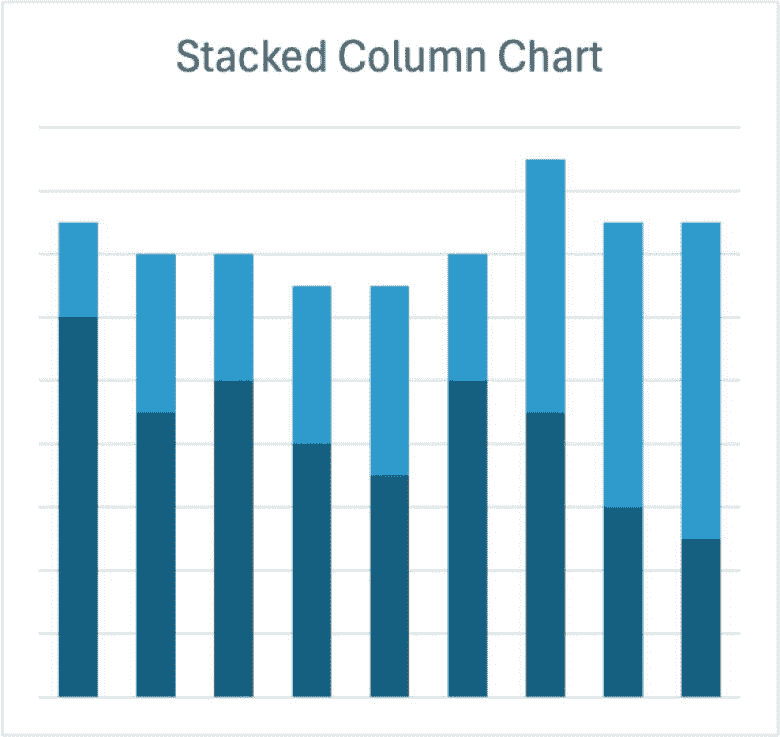

堆积柱状图显示多个垂直条形，每个条形被分成两个深浅不同的蓝色段。图表标题为“堆积柱状图”。这些条形代表跨类别的比较数据，其中较浅的蓝色段堆叠在较深的蓝色段之上。

**图 18-12**  
堆积柱状图

在我们的例子中，我们可以查看图 18-11 中两个图表的堆积版本。请参见图 18-13 了解图 18-11 中右侧图表的堆积版本。这清楚地表明男生的缺勤总数最多，但很难对每个单独的年份得出更多结论。折线图通常更自然地适合展示随时间的变化。

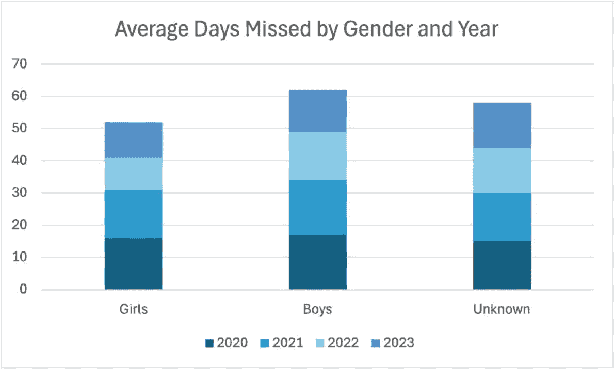

标题为“按性别和年份分列的平均缺勤天数”的堆积条形图。它展示了 2020 年至 2023 年女生、男生和未知类别的数据。每个条形被分成代表年份的四段，使用深浅不同的蓝色。Y 轴范围从 0 到 70 天。图例指示了每个年份的颜色：2020 年（最深的蓝色）、2021 年、2022 年和 2023 年（最浅的蓝色）。

**图 18-13**  
一个按年份和性别分列的平均缺勤天数堆积条形图

有一种更好的方式来利用这个想法，使得观察内部各组的变化更容易。图 18-14 展示了一种视图，其中每个内部组都有自己的条形，从而更容易观察每个组内的变化。这被称为“小多组图”。

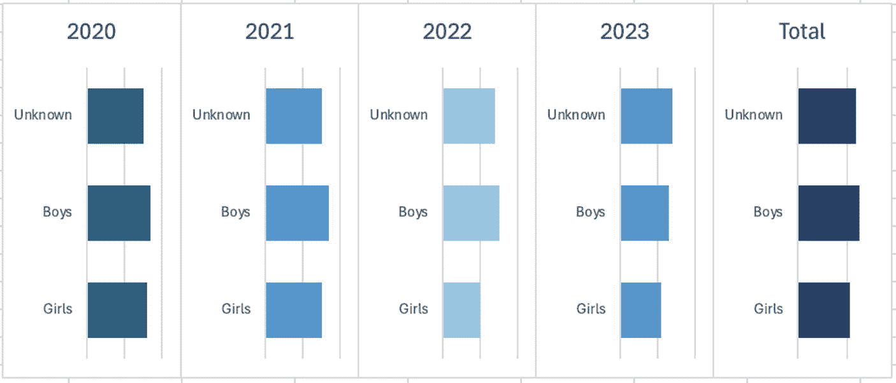

条形图显示了 2020 年至 2023 年的数据以及一个总计列。每年都有三个类别：未知、男生和女生，由深浅不同的蓝色水平条形表示。该图表展示了这些类别在历年中的分布情况，其中总计列汇总了数据。


### 图 18-14

一组小型多线图，展示了堆叠柱状图的替代方案，便于观察各组间的趋势

当你计划使用堆叠柱状图时，需要谨慎确保数据适合这种视图——要确认将数值相加是有意义的。图 18-15 展示了一个不应堆叠的数据示例。图 18-15 左侧的图表显示了我们在图 18-11 右侧图表中看到的数据，但将其修改为展示缺勤天数百分比而非总数。图 18-15 右侧的图表是一个无效的堆叠柱状图——以这种方式添加百分比是没有意义的。

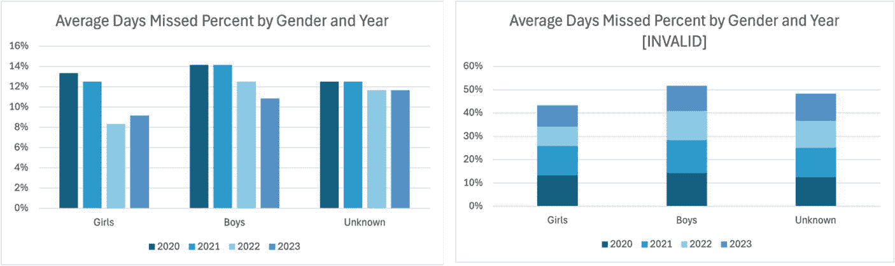

柱状图展示了“按性别和年份划分的平均缺勤天数百分比”。左侧图表显示了 2020 年至 2023 年女生、男生和未知类别的数据，百分比范围从 0%到 16%。右侧图表标记为“[无效]”，展示了相同类别和年份的堆叠柱状图，百分比高达 60%。每年用不同深浅的蓝色表示。

### 图 18-15

一个多组柱状图和一个无效的堆叠柱状图

另一种值得一提的柱状图是 100%堆叠柱状图。它与堆叠柱状图相同，但每个数值不是以原始数字表示，而是以该点总和的百分比表示。图 18-16 展示了几张与图 18-13 相似的图表，我们可以从中看到缺勤的原始计数而非平均值。

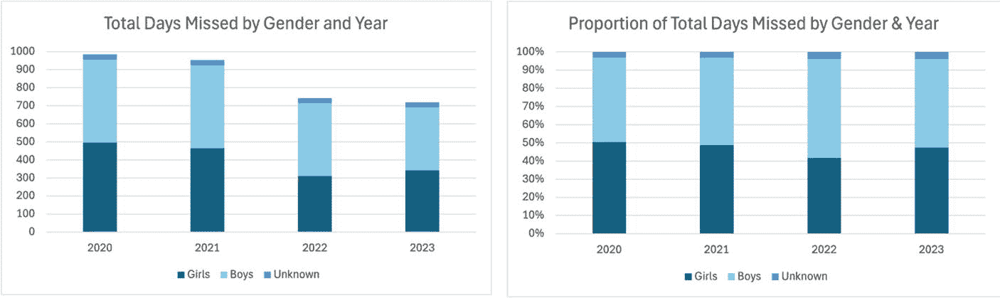

柱状图展示了 2020 年至 2023 年按性别和年份划分的总缺勤天数。左侧图表显示绝对数值，右侧图表显示比例。类别包括女生、男生和未知，用不同深浅的蓝色表示。两张图表均显示了逐年趋势，x 轴标记年份，y 轴标记天数或百分比。

### 图 18-16

两张图表分别展示了按性别和年份划分的缺勤天数原始总数和比例天数

左侧图表仅是按年份和性别分解的原始数值。该组中有 31 名女生、27 名男生和 2 名未知性别者。有趣的是，尽管女生人数更多，但男生的缺勤天数却更多。通过观察平均值可以更清楚地看到这一点。但有时我们只想查看总数。右侧图表显示了相同的数据，但原始值被转换为百分比，因此每列展示的是女生、男生和未知性别学生缺勤天数占所有缺勤天数的比例。

柱状图和条形图还有很多变体，因为它们非常灵活。如果这些都不适用，你可以在线深入探索。你也可以在 `Excel` 或 `Google Sheets` 等快速程序中使用一些数据来尝试所有不同的变体。此外，还可以组合不同的图表，例如在条形图上添加一条代表平均值或目标等重要数值的折线。

## 折线图及相关图表

标准折线图广为人知，但有一些修改方法以及一些相关的图表可能非常有用。本节我将讨论折线图、面积图和斜率图。

# 折线图

折线图是展示随时间变化的非常有效的方式。只要你不试图在一张图表上放置太多线条或进行过于复杂的操作，它们就直观且易于理解。X 轴通常是时间，且需要间距一致（你不能在同一张图表中先按年显示，然后突然切换到按月显示）。线条不必都从同一时间点开始或结束。一个经验法则是，在一张图表上放置超过四到五条需要清晰识别的线条可能会变得难以处理。图 18-17 展示了几张典型的折线图，左侧有一条线，右侧有两条线。

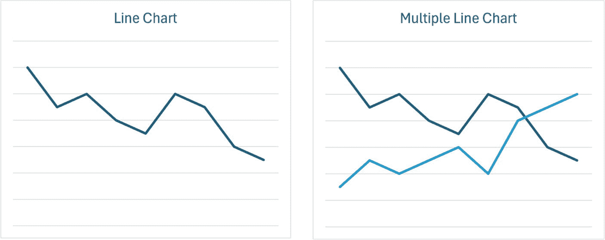

两张并排的图表：左侧图表标记为“折线图”，显示了一条呈下降趋势的单一折线。右侧图表标记为“多折线图”，包含两条重叠的折线，一条深蓝色，一条浅蓝色，显示出不同的趋势。两张图表都有水平网格线作为参考。

#### 图 18-17

单一折线图与多折线图

有时，即使柱状图和折线图都可行，折线图也可能比柱状图更直观。回顾图 18-11 中的左侧图表。我在图 18-18 中将其重新制作为折线图。

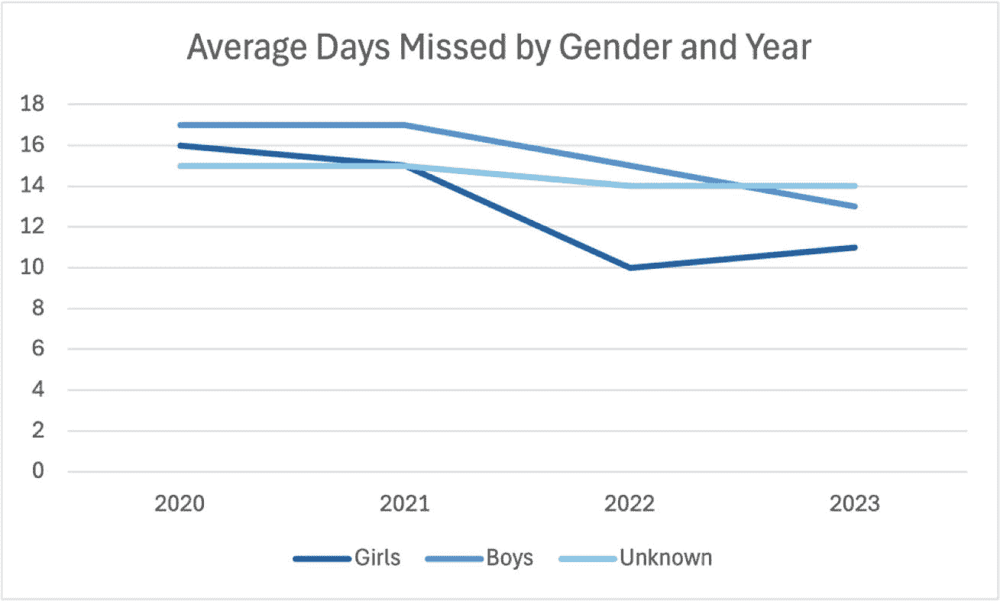

折线图标题为“按性别和年份划分的平均缺勤天数”，展示了 2020 年至 2023 年的数据。三条折线代表不同组别：女生、男生和未知。图表显示，所有组别的平均缺勤天数整体呈下降趋势。2020 年，女生和男生均从约 16 天开始，男生下降幅度更大，到 2022 年降至约 10 天，之后略有增加。未知组保持相对稳定，随时间略有下降。

#### 图 18-18

按性别和年份查看多年缺勤情况的另一种方式

你常会听说，折线图上的线条不应超过几条。这是因为当线条过多时，尤其是线条相互重叠时，很难追踪每条线。但具体效果取决于你绘制的内容，并且有一些方法可以将多张图表提取出来以达到相同的效果。例如，如果你绘制的线条中有一两条在某种程度上比其他线条更重要，你可以绘制所有线条，但让更重要的线条更加突出。例如，见图 18-19，该图显示了夏令营中每个孩子每天获胜的游戏总数，以及他们被分成的两个队伍的平均值。

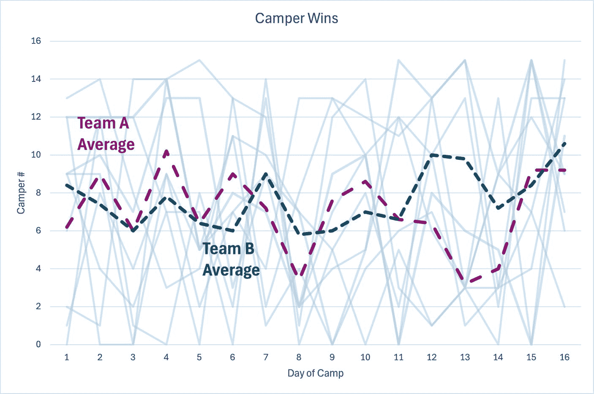

折线图标题为“营员获胜次数”，展示了营员在 16 天营地活动中的表现。x 轴代表营地天数，y 轴代表营员数量。两条主要线条被突出显示：一条紫色虚线代表 A 队平均值，一条深蓝色虚线代表 B 队平均值。背景中的众多浅蓝色线条代表单个营员的表现。A 队和 B 队平均值线条在营地活动期间显示出波动趋势。

#### 图 18-19

一张包含十二条线条的图表，其中两条更为突出

营员线条颜色较浅且相当细，因此不显眼，但我们仍然可以看到孩子们的不同线条。两条平均值线条更粗、更醒目，并使用深色虚线，因此很容易被看作图表中最重要的线条。

如果我们想查看每个营员的线条，也可以将每条线单独提取出来。有关示例，见图 18-20。


# 折线图

显示十名露营者（标记为露营者 1 至露营者 10）的数据折线图。每张图展示了在 x 轴标记为 1 至 15 的时期内数值的波动，y 轴的数值范围从 0 到 20。这些图说明了每位露营者的不同趋势和模式。

**图 18-20**

每位露营者单独一张折线图，而非全部合并在同一张图上

像这样分解图表时，必须确保所有 y 轴和 x 轴完全相同。这通常需要手动调整您所使用的工具。如果愿意，我们也可以在此处包含平均值，但假设我们关注的是每位露营者个体。

折线图的一个变体是添加置信区间。如果我们使用当前这批露营者来估算所有年份所有露营者的平均获胜次数，我们将生成一个置信区间。其在图表上的呈现方式可参见图 18-21。


标题为“估计平均获胜次数与置信区间”的折线图。x 轴范围从 1 到 16，y 轴范围从 0 到 12。图表显示了一条代表估计平均获胜次数的中央深色线条，周围较浅的线条表示置信区间。数据显示了波动，有峰值和低谷，最后急剧上升。

**图 18-21**

显示平均获胜次数置信区间的折线图

这是一个相当直观且易于解释的图表。有时，线条与其上下置信区间之间的区域会被着色，但这并非必需。通常，您需要确保主线条与置信区间线条区分开来。通常，主线条会更粗更醒目，如图 18-21 所示。

在第 2 章中，我谈到了具有双 y 轴的折线图。这意味着图表中至少有一条线遵循左侧的 y 轴，而至少另一条线则遵循右侧一个独立且不同的 y 轴。通常不建议在向利益相关者展示的图表中使用这种设计，尽管它在探索性数据分析（EDA）中可能有用。原因是这种图表可能令人困惑且难以阅读。它们需要观看者停下来思考，而我们真正希望观看者能够快速理解。泰勒·维根（Tyler Vigen）那个关于荒谬相关性的搞笑网站^((47))，我之前提到过，它展示了多少明显不相关的事物可以显得“相关”，几乎总是依赖于不同的 y 轴。这远不如单 y 轴那样直观。

## 面积图

另一种与折线图相似的图表是面积图。面积图就是一条折线图，其线条下方的区域一直着色到 x 轴。主要类型的示例，即简单面积图和堆叠面积图，请参见图 18-22。


并排显示了两张面积图。左侧图表标记为“面积图”，显示代表数据随时间趋势的重叠彩色区域。右侧图表标记为“堆叠面积图”，显示带有堆叠彩色区域的累积数据。两张图表均使用蓝色色调区分数据段。

**图 18-22**

*面积图：左侧允许重叠，右侧为堆叠*

左侧图表显示了重叠区域，这是通过对每个系列使用透明度来实现的。重叠区域是一种不同的颜色，因此您仍然可以识别出两个不同的系列。如果图表上有两个以上的系列，这种类型的图表将难以阅读，因此面积图最常见的变体是堆叠面积图，我们可以在图 18-22 的右侧看到。这与堆叠柱状图类似，每个点的数值是该点所有系列的总和。

请注意，尽管右侧图表读起来稍容易一些，但我们添加的线条越多，就越难真正理解数值。最容易理解的是最底部的系列，因为它位于 x 轴上。正因如此，通常将折线图的值总和设为 100%，这样每个值就稍微更容易理解一些。比较图 18-23 中的两张图，左侧是简单的堆叠图，右侧是每天总和为 100%的图表。


两张题为“露营者获胜次数”的面积图显示了 16 天露营期间的数据。左侧图表显示了每位露营者的获胜次数，y 轴标记为“露营者编号”，范围从 0 到 120。右侧图表以百分比形式呈现相同数据，y 轴标记从 0%到 100%。两张图表均使用不同的蓝色色调代表十名露营者，顶部有图例指示每位露营者的颜色。两张图表的 x 轴均标记为“露营天数”。这些图说明了露营者获胜次数随时间的变化。

**图 18-23**

两张堆叠面积图显示每天每位露营者的获胜次数：左侧为堆叠图，右侧为总和 100%的堆叠图

尽管这些图表不是特别容易阅读，但在图 18-23 的左侧图表中，很容易看出有些天的总获胜次数异常高，但在右侧版本中，更容易看出哪些露营者导致了这些情况。

面积图与折线图非常相似，但有时它们可能更具戏剧性或影响力。何时选择一种或另一种，是您将随着时间的推移而培养的技能。

## 斜率图

我将提到的最后一种折线图是斜率图。它用于显示两点的变化，基本上是前后对比。通常，斜率图有多条线，但请参见图 18-24 中的示例，该图显示了两支队伍在夏令营第一天和最后一天的平均获胜次数。


标题为“团队获胜次数”的折线图显示了 A 队和 B 队在 16 天内的获胜百分比。A 队从第 1 天的 6.2%开始，到第 16 天增加到 9.2%。B 队从 8.4%开始，在同一时期上升到 10.6%。图表突出了两支队伍的上升趋势。

**图 18-24**

显示夏令营开始和结束时团队平均获胜次数的斜率图

可以立即看出，两支队伍的平均获胜次数从第一天到最后一天都有所增加，但 A 队按比例增加得略多一些。

折线图及其相关图表的多种变体为您提供了众多随时间变化的数据图表选项。当数据非基于时间时，通常不适合使用折线图，因为数据点之间的连接表示连续性，而离散事物之间没有自然的顺序或中间状态。例如，将 x 轴设为“女孩”、“男孩”和“未知”来制作折线图是没有意义的。


### 饼图

许多数据可视化专家都看不起饼图，这可以理解，因为它们功能非常有限，并且通常无法像其他更好的方式那样揭示数据的许多信息。此外，众所周知，人们不擅长比较不同的扇区，因此饼图不一定能达成目标。但有时利益相关者想要使用饼图，如果你无法说服他们改用其他图表，那就只能让步制作一个。你应当首先尝试说服利益相关者接受条形图，但这场争论你可能会输。掌握一些知识后，你就能针对特定场景制作出尽可能好的（或者说最不糟糕的？）饼图。请参见图 18-25 中的饼图示例。


一个被分成三等份的饼图，每个部分使用不同深浅的蓝色。图表顶部标有“饼图”标签。

**图 18-25**  
饼图

如上所述，第一条规则是永远不要制作饼图的 3D 版本，因为它会完全扭曲各部分的占比，而占比正是饼图的全部意义所在。

使用饼图最困难的事情之一是比较不同饼图，尽管这是饼图的常见用途。想象一下，阿肯色州的一个夏令营试图查看其在两次不同营销活动前后营员的来源地，这两次活动分别于 2019 年和 2022 年针对邻近州开展。他们决定查看每次活动后的次年数据，并与 2015 年进行比较。图 18-26 展示了这一系列图表。


三个饼图比较了 2015 年、2020 年和 2023 年数据在四个州（阿肯色州、路易斯安那州、俄克拉荷马州和得克萨斯州）的分布情况。2015 年，得克萨斯州占比最大，为 39%，其次是俄克拉荷马州，占 23%，阿肯色州和路易斯安那州分别占 21% 和 17%。2020 年，得克萨斯州仍以 34% 的比例领先，俄克拉荷马州占 24%，阿肯色州和路易斯安那州均占 21%。到 2023 年，得克萨斯州降至 30%，俄克拉荷马州降至 23%，而阿肯色州升至 25%，路易斯安那州升至 22%。

**图 18-26**  
三个饼图展示了三年间营员来源州的比例变化

这一系列饼图确实能让人相当容易地看出变化。我们肯定能看到阿肯色州的比例随时间推移而缩小，而路易斯安那州和俄克拉荷马州的扇区在扩大。得克萨斯州在三年间变化不大。尽管这是基于时间序列的数据，但饼图比显示相同数据的折线图更简单、更易读。在每个扇区内部添加百分比（甚至原始数值）作为文字标注，会使信息更加清晰。

总之，要谨慎使用饼图，并认真考虑它们是否是最佳选择。另请参阅下文，了解一种名为**矩形树图**的饼图替代方案，它可能效果更好。

### 直方图及其变体

我们在第 2 章中介绍过直方图，因为在探索性数据分析（EDA）阶段经常生成它们。直方图在向利益相关者展示时不太常见，因为它们需要稍微多一些的解释，而且很多人对它们不熟悉。但如果你需要表示某个事物的分布情况，它们就是正确的首选图表。还有一些其他表示分布的方法，这些都将在此处讨论。

#### 直方图

图 18-27 展示了一个直方图的示例。每一列称为一个“箱”，它代表落在该箱定义范围内的值的数量。对于定义箱的数量或箱的大小，并没有严格的规则，尽管有一些基于统计特性的经验法则。通常，你用来生成直方图的工具可以自动确定这些参数，但如果效果不佳，你可以自行搜索解决方案。


标题为“直方图”的条形图，展示了不同类别间的频率分布。该图有多个高度不同的垂直条柱，表示每个类别中数据点的频率。最高的条柱位于中心位置，表明该类别频率较高。图表背景有网格线作为参考。

**图 18-27**  
直方图

直方图有几个值得理解的属性，其中**偏斜**最为重要。图 18-27 中的直方图略微向右偏斜，因为数据更多地集中在左侧。很多事物会因可能值的限制而向一侧或另一侧偏斜。成绩往往向左偏斜，因为更多成绩集中在 0-100 分的高分段。房价向右偏斜，因为房价不可能低于 0，但房价可以非常高，尽管价格越高，图表上的“邻居”就越少。在大多数地方，有很多价值 10 万美元的房子，但很少有价值 400 万美元的房子。这在与利益相关者沟通时会很有用。

#### 帕累托图

标准直方图有一种变体，称为帕累托图。图 18-28 展示了一个帕累托图，使用了与上面相同的直方图数据，但这次添加了标签。该数据展示了某大学 100 名一、二年级学生完成的学分总数。帕累托图在第二 Y 轴（这是少数情况下使用第二轴的好主意）上增加了**累积百分比**。


一个帕累托图，显示了一系列蓝色垂直条柱，代表 x 轴上标记为“箱终点”的数值（范围从 6 到 64）对应的计数。左侧 y 轴标记为“计数”，数值从 0 到 25。一条暗蓝色的累积百分比线叠加在条柱之上，对应于右侧标记为“累积 %”的 y 轴，数值从 0 到 100。该图突显了数据在不同箱之间的分布及累积影响。

**图 18-28**  
包含累积百分比的帕累托图

累积曲线并没有从根本上改变图表的外观，但很容易看出它强调了增长在接近末尾时放缓的事实，因为图表左侧有更多的数值。


### 箱线图

我们在第 2 章中看到的另一种图表是箱线图，它能显示多个组中每个组的分布情况。箱线图依赖于分布中的某些特定点来展示数据的分散程度。它们比其他一些基于统计的图表更直观，并且可以很快地向之前没见过的人解释清楚。它们还能很好地展示异常值。示例见图 18-29。


箱线图显示了两组数据。左侧的箱子较小，中位数较低且四分位距较窄，而右侧的箱子较大，中位数较高且四分位距较宽。右侧箱子上方存在一个异常值。该图突出了数据分布和变异性。

图 18-29：箱线图

图 18-29 展示了一个两组箱线图，其中第二组的值比第一组更高且更分散。在这张图中，彩色区域代表四分位距（`IQR`；介于`Q1`和`Q3`之间），中间的线代表中位数。在此版本中，“`x`”代表平均值，第二组的平均值明显高于中位数，这意味着分布是偏斜的。每组顶部和底部的水平线（“须”）代表最小值和最大值，但异常值除外。最小值和最大值都使用了`1.5`倍的`IQR`，最小值是`Q1`减去该计算值，最大值是`Q3`加上该值。此处的异常值定义为任何大于计算出的最大值或小于计算出的最小值的点。还可以包含极端异常值，它们是指任何小于`Q1`减去`3`倍`IQR`或大于`Q3`加上`3`倍`IQR`的值。

我们可以查看一些学生的学分数据，这次显示的是大一、大二和大三学生。见图 18-30。


箱线图标题为“按年级划分的总学分”，显示了大一、大二和大三学生的总学分。`y`轴代表总学分，范围从`0`到`80`。每个箱线图都显示了中位数、四分位数和异常值。与二、三年级相比，一年级的中位学分较低，其中三年级的中位学分和范围最高。

图 18-30：展示按学年划分的学生已完成总学分的箱线图

该图整体上符合我们的预期，每年级的中位数、最小值和最大值都在增加，而且每个年级的数据也有相当程度的分散。有些学生是兼职，而另一些学生则课程负担过重或通过其他方式获得大学学分，所以并非所有学生的情况都一样。有几位大二的“学霸”学生，但他们是仅有的异常值。大一和大二学生的平均值和中位数很接近，表明偏斜很小，但大三组的平均值低于中位数。

这种图表在探索性数据分析（`EDA`）中出现频率很高，而在给利益相关者的图表中则不那么常见，但如果有合适的数据和利益相关者，它仍然很有价值。

### 热力图

*热力图*是对表格的一种增强，其中值的范围由不同的颜色和渐变来表示，通常浅色到深色对应小数字到大数字。由于视觉方面的特性，它对于快速传达信息非常有帮助，但同时仍保留了表格的细节。图 18-31 是一个示例，展示了一个热力图，显示了中学生在一系列普通科目中的平均成绩。


热力图显示了`6`至`12`年级不同学科的平均成绩。学科包括数学、英语、科学、社会研究、艺术、音乐、乐队和外语。颜色强度代表成绩值，较深的阴影表示较高的成绩。例如，`6`年级在音乐和乐队方面成绩较高，而`12`年级在外语方面成绩较低。

图 18-31：`6`至`12`年级学生成绩的热力图

这张热力图清楚地表明，随着年级的升高，某些学科的平均成绩会下降，但其他学科则没有相同的趋势。核心科目往往遵循这种趋势，而选修课则不然。如果没有灰度着色，我们根本无法如此快速地看到这一点。

热力图的众多优点之一是，你可以在保持其比其他一些可视化图表更具可读性的同时，展示大量数据。这就是为什么在进行`EDA`时，制作相关矩阵热力图很常见的原因之一，特别是因为你可以使用两种不同的颜色，并以不同的颜色和不同的强度来表示正值和负值。

每当你处理表格数据时，检查热力图是否合适总是值得的。利益相关者通常也喜欢它们。

### 树图

我之前提到过树图，因为它们可以作为饼图的替代方案，当类别过多以至于无法制作清晰的饼图时，树图就很合适，而且它们还允许分组。图 18-32 是一个树图示例，显示了按地区分组的美国各州人口。矩形的大小代表了该州的人口。


树图标题为“美国人口树图”，展示了美国各地区和各州的人口分布。区域以不同颜色编码：中西部、山地西部、东北部、太平洋沿岸、南部、南中部和西海岸。每个州由一个矩形表示，其大小与该州的人口成比例。值得注意的州包括加利福尼亚州、德克萨斯州、佛罗里达州和纽约州。该图提供了各州人口在其所在区域内的视觉比较。

图 18-32：按地区分组的美国各州人口树图

分组是一个不错的加分项，但尽管有`51`个数据点，我们仍然可以读取其中的大部分。右下角是夏威夷和阿拉斯加，被归为“太平洋”组。将其与图 18-33 中的饼图相比，后者如果没有放大镜和极大的耐心是无法理解的。


饼图标题为“糟糕的美国人口饼图”，显示了各个美国州及其对应的彩色扇区。每个州用一种不同的颜色表示，下面有一个图例列出了各州，如阿拉巴马州、阿拉斯加州、亚利桑那州等。该图表以视觉方式展示了人口分布，但缺乏清晰的数据区分，因此难以解读具体的数值。

图 18-33：显示美国各州人口的糟糕饼图

这个饼图显然很荒谬，但树图实际上可读性很强且直观，并且还有一个额外的好处，即能够有意义地对各州进行分组。当你拥有包含一个或两个分类级别的数值数据时，可以考虑使用树图。利益相关者不常见到树图，但你向他们解释起来不会有任何困难。


### 分区统计图

每个人都见过分区统计图，但几乎没人知道这个名称。它是一种根据不同数值对区域进行着色的地理地图。新闻媒体在选举期间制作的美国地图，各州用蓝色或红色标注，都属于分区统计图。图 18-34 展示了 2008 年美国总统大选的地图，其中显示了县级和州级的投票结果。


2008 年美国总统大选按县统计的结果地图，显示了民主党（奥巴马）和共和党（麦凯恩）的得票比例。各县以不同深浅的蓝色和红色着色，表示获胜党派的得票率。图例解释了颜色编码的含义：颜色越深代表得票率越高。插图中还包括一张较小的选举人票分布图和显示普选票总数的饼图。该地图来自 `nationalatlas.gov`，并附有关于内布拉斯加州选举人票分配的注释。

**图 18-34**

一幅显示 2008 年美国总统大选结果的分区统计图。来源：[`https://www.usgs.gov/media/images/printable-map-2008-presidential-election-results`](https://www.usgs.gov/media/images/printable-map-2008-presidential-election-results)

在这幅地图中，蓝色表示该州的选举人票投给了民主党候选人，红色表示投给了共和党候选人。根据数值的渐变对地点进行着色也非常常见，就像这里县级地图的做法一样。这可以基于真正的渐变，即最低数值对应最浅的颜色，最高数值对应最深的颜色，所有颜色按比例过渡。另一种做法是，将数值分箱，使用有限数量的颜色或色度。两种方法各有优缺点。图 18-35 展示了一幅美国各州人口的渐变着色地图（未分箱）。


一幅使用色彩渐变显示美国各州人口的地图。颜色越深代表人口越多，其中加利福尼亚州和得克萨斯州人口最多。人口范围从 576,851 到 39,538,223。地图由 Bing、GeoNames、Microsoft 和 TomTom 提供技术支持。

**图 18-35**

一幅显示美国各州人口的分区统计图

这幅地图虽然可读，但有太多不同的色度需要辨别。这就是分箱方法有用的原因。我们可以使用等距分箱（只需将整个范围等分为若干份）、利用数据分布特征（如四分位数），或者干脆创建任意分箱。鉴于这幅地图中人口最少和最多的州之间差距巨大，自行创建分箱或许是合理的。分箱的一个缺点是，即使两个数值非常接近，也可能落入不同的分箱，从而造成误导。例如，如果我们把最低分箱的上限设为 300 万，那么内华达州（总人口 3,105,000）仅超出 105,000 人，而堪萨斯州（总人口 2,938,000）则低于这个上限 62,000 人。尽管两州实际人口非常接近，但它们会被分到不同箱中。堪萨斯州看起来会与几个人口不足 50 万的州有更多相似之处，而不是与人口只多出不到 17.5 万的内华达州。正确选择取决于你具体想要达到什么目的。

绘制地图时另一个需要考虑的问题是使用哪种投影，尤其是在绘制全球地图时。我们大多数人最熟悉的是墨卡托投影，它将地球变成一个矩形，使得北部和南部的陆地被显著拉伸。罗宾逊投影则保留了地球的球形感，拉伸程度较小。许多工具内置了墨卡托投影，并且大家都很熟悉，因此对许多用途来说，这是最简单的选择。

## 演示汇报

在大多数公司，你将通过创建和分享报告（例如使用 Microsoft Word 或 Google Docs）或者创建并演示幻灯片（例如使用 Microsoft PowerPoint 或 Google Slides）来展示你的发现。有时也可能被要求分享幻灯片。我将讨论应根据不同受众以及媒介（文档或幻灯片）来决定在演示中应包含哪些信息。


### 受众

通常，我们有理由创建多个版本的演示文稿，每个版本根据受众不同而包含不同的信息。为了方便起见，我将在此处为每种通用受众类型命名，以便下文引用。通常，你最先向其演示的将是你的项目所服务的利益相关方（“你的业务利益相关方”）。你可能会被要求向他们的更上级领导（“业务领导层”）或你自己的上级领导（“技术领导层”）进行演示。如果项目进展得特别顺利，可能还有其他团队，比如你最初的利益相关方，他们也会对你做类似的工作感兴趣（“其他业务团队”）。最后，非常常见的情况是，你被要求向你自己的团队或其他数据科学家（“你的同行”）演示你的工作。在所有情况下，你都将遵循本章前面提到的讲故事步骤 #1–#7。

这些受众中的每一个都需要了解正在解决的问题是什么，以及你的解决方案如何帮助利益相关方完成他们的工作（步骤 #1 和 #4，根据需要略加步骤 #5）。对于业务和技术领导层，这两点都要简明扼要，但在解决方案如何提供帮助方面，请尽量用节省的时间（减少利益相关方完成原始任务所花费的时间）、销售额的可能增长或成本削减来量化。数字是领导层的语言。这两类群体都希望从步骤 #2 和 #3 中获得最少量的信息。除非另有说明，否则请将步骤 #2 和 #3 保持在最低限度。但是，不要完全省略它们，因为如果你进行现场演示，其中有些人可能会提出问题。对于文档和幻灯片，将一些更详细的信息放在附录中可能会更好。分享下一步计划也是有益的。

你的业务利益相关方已经了解问题，因此你无需为他们深入赘述问题细节；而根据其他业务团队的不同，你可能需要详细说明，也可能需要快速总结（如果这是他们已有的问题，则不需要太多信息，但如果他们在不同领域工作，则可能需要更多信息）。对于这两类群体，“看情况”是处理步骤 #2 和 #3 的规则。如上所述，其中一些群体本身也在处理数据，因此他们可能希望更多地了解你是如何使用数据的，以防对他们有所帮助。然而，花一些时间在这上面对你来说可能是有益的，因为这是你最可能已经与你的利益相关方合作过、或者将来需要与未来的利益相关方合作的领域（例如，弄清楚数据的含义）。因此，让他们看到数据准备是一个重要且耗时的步骤对他们是有帮助的。他们都对解决方案、步骤 #4 和 #5 最感兴趣。应该向这些受众详细解释这一点（对于任何不熟悉你当前利益相关方工作的其他业务团队更是如此）。就像对领导层一样，要确保清楚地表明这在时间和质量上给他们带来了多大的好处。这两类群体也会对听到下一步计划感兴趣，对于一些群体，如果这些计划已被提上日程即将开展，你甚至可能希望深入探讨它们。

最后一种常见的受众是你的同行。对他们来说，你需要把问题讲清楚，但他们通常对细节不太感兴趣。解决方案和下一步计划也是如此。不要忽略提及它们，但他们可能对步骤 #2 和 #3 更感兴趣。他们会想了解你使用的数据源，以便看看他们是否能将这些数据源用于他们自己的工作。同样，他们会对你的解决方案的技术信息更感兴趣，尤其是如果你向他们自己可能使用的团队代码仓库中添加了任何代码，或者你解决了一个他们也一直面临的技术问题，等等。

### 媒介

如上所述，你的文档和幻灯片的长度将根据你的受众而变化。但讨论这些报告的结构仍然是有帮助的。

在文档式报告中，你基本上总结了你的受众想了解的所有内容。你还应该包括日期、作者以及参与项目的人员。你需要一个目录，并通常应将文档划分为与上述讲述数据故事的步骤大致对应的章节。你需要以适合受众的详细程度，阐述你想表达的所有要点。这确实意味着你可能需要为不同的受众创建多份报告。许多地方都想要的高级版本称为执行摘要，它可能具有内部定义的结构。其他报告则是“一页纸”，这是信息共享的常见方式，显然被总结到一页纸上。文档式报告的一个优点是，你可以链接到包含更多信息或细节的其他文档，这样读者可以自行决定深入阅读的程度。

幻灯片也将传达你想要受众了解的所有内容。你通常以标题页、日期和项目参与人员列表开始制作幻灯片。在此信息之后立即包含一个作为目录的议程幻灯片。如果你正在创建用于会议演示的幻灯片，一份真正优秀的幻灯片会省略很多细节，而这些细节将由你口头说出。这是优秀演示的标志，因为当你展示一张幻灯片时，人们要么阅读幻灯片，要么听你说话，但通常不会同时进行。因此，最好有一些要点——谈话要点——你将在这些要点上展开，这样他们就不会只顾着阅读幻灯片。

然而，问题之一是，会议上的人（非常）经常要求你分享幻灯片，以便他们之后可以查看。如果你像我上面提到的那样创建了幻灯片，那它实际内容会非常少，他们不会真正记得你说了什么。有几种方法可以处理这个问题。一种方法是将你的主要观点（你在演示中口头说出的关键点）包含在每张幻灯片的备注字段中，这在演示模式下浏览幻灯片时是看不到的。另一种选择是，准备一份包含所有解释和细节的独立幻灯片，然后分享那份来代替。

如果你创建了一个工具，比如一个仪表盘，供人们使用，那么通常也会在会议中对该工具进行现场演示。你也可以在文档或幻灯片中包含指向它的链接。确保要么让参加会议的人能够访问该仪表盘，要么明确说明他们如何请求访问权限。


# 可视化工具

市面上有许多可视化工具。数据科学家经常使用`Excel`和代码，比如 Python 中的 `matplotlib` 或 `seaborn`，或者 R 语言中的 `ggplot`。我在本章中几乎所有的图表都使用了`Excel`，因为它快速、简单且外观统一。在处理真实数据的探索性数据分析（EDA）时，更常见的是用代码来实现这些功能（因为你通常已经在代码中完成了大量数据操作）。但在向利益相关者展示时，你可以将数据准备为 CSV 文件，然后在`Excel`中使用，或者将其存放在数据库或电子表格中，以便在其他专业可视化工具（包括`Tableau`和`Power BI`）中使用。

`Tableau`和`Power BI`是目前最流行的两种专业可视化工具。`Power BI`由微软公司所有，通常被那些全面采用微软产品和 Azure 云平台的组织使用。`Tableau`则是一款独立工具，但它与许多其他工具集成了。如果你打算进入数据科学或数据分析领域，熟悉这两款工具都会很有帮助。

`Tableau`和`Power BI`都允许你从多个来源拉取数据，并在内部进行合并（这被称为**数据建模**）。你基本上可以在工具内部创建一个或多个类似电子表格的结构，并以此为基础构建图表和仪表板。它们的优点在于，允许你将数据保持在相当原始的状态，从而可以在工具内部进行聚合操作。这样一来，你无需为了生成多个图表而创建一堆具有不同聚合方式和结构的数据表格或数据库表。

这两款工具都内置支持我上面提到的所有可视化类型，并且在添加筛选器方面具有非常灵活的选项——例如选择年份以仅查看一年的数据、选择单个产品等——这些筛选器可以影响同一仪表板上的多个不同图表和表格。这使得最终用户使用起来极为便捷。不过，这两款工具都有一定的学习曲线，但只要你花点时间使用它们，并掌握它们的基本工作方式，学习它们每个工具的新功能就会变得越来越容易。

你可以通过其官网⁴⁸了解有关`Tableau`及其免费公共版的更多信息。这个网站实际上是一个绝佳的机会，既能学习一些`Tableau`技能，又能为你的作品集创建作品。看看一些真正有技能的人构建了什么也很有趣。`Power BI`也有一个可以下载的免费版本（仅限 Windows）⁴⁹。我强烈建议你尝试其中一个工具，这样在求职时，你就可以在简历中列出其中一款工具的基本技能。你无需学习两者，因为一款工具所需的技能可以相当容易地迁移到另一款工具上。


## 关键要点与下一步

在本章中，我们探索了广阔的可视化世界。首先通过几个有趣的例子展示了可视化令人惊讶且具有冲击力的效果，其中包括一幅著名的拿破仑入侵俄国地图，以及另一幅展示数据集可能拥有相同统计属性，但绘制出来却截然不同的图表。接着，我探讨了可视化与工作成果展示实际上是如何讲述故事的——数据以及你对其所做的工作讲述了怎样的故事？我介绍了多种不同的图表类型和其他可视化形式，包括散点图、柱状图和条形图、折线图、面积图、饼图、直方图、箱线图、热力图、树状图和等值区域图。随后讨论了向利益相关者及其他人员展示成果的方法，最后介绍了当今两种主要的专业可视化工具：`Tableau` 和 `Power BI`。

在下一章中，我将介绍机器学习和数据科学在多个领域的现代应用，从保险、医疗保健到教育等等。数据科学得到了广泛应用，且丝毫没有放缓的迹象。

## 从业者简介：梅根·伯杰

**姓名：** 梅根·伯杰

**现任职务：** 零售分析顾问与数据翻译员

**现任行业：** 一家数据与分析公司的咨询部门

**从业年限：** 10 年

**教育背景：**

*   证书：`认证 ScrumMaster (CSM)` 和 `Tableau Desktop 专家`
*   `商业分析硕士`
*   `商业管理学士`

*此处表达的观点仅代表梅根本人，与其现任或前任雇主无关。*

### 背景

梅根大学毕业后的前十年从事高端零售管理工作。在那里她学到了一些分析知识，并一直热衷于制作图表和计算数据，因为她喜欢这样做，并且这对工作有帮助，尽管她当时对分析并没有系统的了解。她会查看销售和库存数据，试图弄明白为什么某些商品销售不佳，或者是否有机会与其他门店调货。她还制作员工报告。这些都是必须完成的工作，但她乐在其中，因此投入的精力和时间超过了基本要求。她曾尝试结识公司里的一些分析人员并向他们学习，但当时学的内容都很基础，她觉得自己并没有得到满意的答案。最终，她意识到这是自己真正想做的事情，于是重返校园攻读分析学硕士学位。在读期间，她学到了很多知识，包括 `Python`、`R` 等，但尤其爱上了数据可视化。

## 工作

硕士毕业后，梅根在一家规模较小的数据与分析咨询公司找到了一份工作。她与几位不同的客户合作，开展了多种类型的分析和可视化工作。她发现，自己非常喜欢能够以当年做零售时渴望的方式帮助客户，而那时她还不具备这样的技能或工具。她在零售/消费品领域的可视化和分析中找到了自己的专长。

早期，她专注于使用 `Power BI` 和 `Qlik Sense` 等工具进行可视化开发。但随着职业生涯的发展，她承担了更多职责，包括在多个项目中领导数据可视化团队、产品管理（监督大规模分析项目的规划与执行），以及与整个组织中的业务用户建立关系，既指导他们进行自助式可视化，也为制定有效的分析解决方案提供业务洞察和策略。

### 妙语摘录

**工作中最喜欢的部分：** 每天的工作内容都不相同，所以从不枯燥。有不同的客户和不同的问题需要解决。她目前的处境也很好，因为公司规模很小，所以晋升机会很多。

**工作中最不喜欢的部分：** 有时作为顾问（取决于客户），利益相关者主要将她的团队视为技术分析师，而非业务伙伴。这限制了分享知识和就长期解决方案提供建议的机会。在建立现实的项目开发时间表与满足利益相关者期望之间保持平衡很有挑战性，尤其是在遇到预料之外的技术难题时。

**最喜欢的项目：** 她曾参与一个与零售缺货相关、时间较为紧迫的项目。她为此制作了一个非常有趣的可视化图表，因为它将两个独立的数据源结合到一个图表中，并且图表含义一目了然。在另一个涉及库存的项目中，她做了类似的工作，首次将三个数据源整合在一起，并添加了一些计算，帮助判断哪些产品可能延迟，从而为追踪订单和制定应对方案争取了更多时间。

**最常用的技能：** 她早期的工作偏技术性，主要是进行开发。但因为她现在的重点是可视化和指导，所以软技能更为重要。这些技能包括沟通、管理、领导力，以及规划并引导团队达成目标。

**当前主要使用的工具：** `SQL`、`Snowflake`、`DBT`、`BigQuery`、`Power BI`、`Qlik Sense`、`DOMO`、`Sigma`

**数据科学的未来：** 一个必然的趋势是，人工智能正在通过无代码或低代码选项让普通人更容易自行进行分析。这本身并非坏事，但对所处理的数据（以及如何将其与其他数据关联）的理解仍然至关重要。梅根认为，分析专业人士的角色可能会从开发和解决方案构建，转向对项目的更具战略性的监督。自助服务工具不会消失。这意味着数据文档将变得越来越重要。

**优秀的数据可视化专业人士的特质：** 真正理解最终的业务用途和目标。能够容忍大量的试错，以找到利益相关者能理解的正确的可视化方式，这一点同样重要。

**她对有志于从事数据和可视化工作的人的建议：** 学习永无止境。你必须不断学习该领域的新知识——新工具、新方法。你可能需要根据市场趋势在不同工具之间进行切换。同时，尝试在业务方面寻求合作伙伴，以深入了解你所在的工作领域也很重要。知识交流是建立关系的绝佳方式。

*梅根是一位经验丰富的分析与可视化专业人士，拥有深厚的零售背景。*

脚注 1   2   3

# 19. 这可不是我们的第一次：机器学习应用


## 引言

数据科学和机器学习总体上已存在数十年之久，并且其受欢迎程度正在稳步提升。随着像`ChatGPT`这样大量公开可用的基于机器学习的工具涌现，许多公司能轻松生成营销文案，程序员也能加速编码。随着分析和机器学习领域的日益普及，我们看到它们在众多领域的应用层出不穷。一些公司使用第三方工具，基于自身数据生成模型，就像我们在第 16 章中看到的`Salesforce`的机器学习工具那样，但也有许多公司正着手从零开始构建自己的数据科学解决方案和机器学习工具。

数据科学通过诸如 A/B 测试这类如今已司空见惯的方法，极大地帮助公司改善了营销工作。它使公司更容易利用聚类技术来迎合特定的客户群体，从而实现超个性化服务。通过精准的产品和服务推荐，它可以提升销售额。许多公司能够自动化执行各种任务，从而节省时间和人力。

`NLP`和语音处理技术使得客户支持的部分自动化变得更加容易，通过易于构建的聊天机器人减少了所需的客服人员数量。

让公司更容易采用机器学习的一个趋势是，企业正将数据存储和工具迁移到云端，而不再将所有内容托管在本地。云服务提供商在吸引公司的核心服务之上提供了多种服务，公司可以轻松加入一些机器学习选项，从而以最小的投入进行尝试。如果他们喜欢结果，就已经踏上了正轨。我们将在下一章讨论云服务。

这里需要提及很重要的一点是，你已经知道机器学习的许多应用——以及广义上的技术——都伴随着道德困境。我将提及的许多应用都存在不容忽视的问题，即使我们选择忽略并继续推进。通常，人们不了解事情是如何运作的，因此不知道其中存在道德问题。这既包括使用机器学习的公司，也包括使用其产品的客户。

尽管机器学习能让我们做许多令人兴奋的事情，但我们不能忘记更宏观的图景。即使其他人不思考，我们始终有责任去思考其中涉及的伦理问题。

下面，我们将探讨几个行业目前是如何使用数据科学和机器学习的。我们将从保险、银行和金融领域开始，然后研究零售业。接着，我们将进入医疗保健和生物信息学领域，之后跳转到游戏行业。最后，我们将审视刑事司法和教育领域。

## 保险业

统计方法几乎从保险业现代诞生的初期就成为其一部分，这可以追溯到 17 世纪富有的英国人承保货物运输和殖民者运往美洲殖民地的业务（*underwriting* 承保，指的是为获取费用而承担财务风险，并有可能需要支付巨额赔款）。在帕斯卡和费马解决了“点数问题”之后，承保人采纳了他们计算风险的技术，保险业很快就成了一个完整的行业。

因此，诸如线性回归和广义线性模型之类的统计和统计建模方法长久以来一直是保险业使用的传统技术。这些方法帮助他们在承保过程中（例如确定保费价格）平衡风险与利润，但该行业尚未在其核心业务中真正拥抱现代机器学习。然而，有许多潜在的应用，尤其是在增强现有方法方面。一种可能性是使用机器学习进行特征工程，为该领域的传统模型创建特征。例如，他们可以准备非线性特征，更有效地对现有特征进行分箱，或使用聚类来识别全新的特征。此外，一些机器学习方法（如决策树和正则化）在处理稀疏数据方面优于传统模型，因此一些人开始关注这些方法。以这种方式使用机器学习会带来伦理风险，尤其是在许多西方国家，基于受保护类别的严格法规禁止将这些类别纳入建模中。例如，在决定提供何种服务时不能纳入种族因素，因此数据科学家必须小心，确保没有任何新特征充当“种族”的代理变量，即使种族本身未被包含在内。

保险业的其他领域已经更多地接受了机器学习。例如，机器学习可以通过分析索赔的特征，并根据欺诈风险或其他需要特定专业知识的情况，更有效地将索赔案件分配给分析员，从而加快索赔处理速度。这缩短了处理时间。机器学习还可以用于预测索赔频率和严重程度。借助机器学习，欺诈检测和预防变得更加复杂，依靠异常检测方法，能捕捉到更多真正的欺诈性索赔，同时最大限度地减少被送去进一步分析的非欺诈性索赔数量。在合规监控方面，通过监控交易、索赔或通信来满足监管要求也存在可能性。甚至可以通过图像处理技术部分自动化索赔中的财产损失评估。在很大程度上，这些做法在伦理方面的风险不大，但一如既往，需要谨慎对待客户，尤其是在涉及受保护类别时，要公平对待他们。

通过更好的监控和产品推荐，客户管理和销售也能得到改善。机器学习可以为与现有客户的互动提供信息，并通过将客户分组以便采取不同行动来识别获取新客户的方法。他们开始应用机器学习的另一个领域是客户流失预测（预测离开的客户），并且效果显著。聊天机器人和其他工具可以辅助客户服务。这些在伦理方面风险也相对较低，但聊天机器人可能存在隐私风险，因此需要确保其安全性。


# 银行与金融

银行与金融领域中的`ML`（机器学习）与保险业有许多共同之处，两者都是得益于统计学和数学的古老领域。与保险业类似，机器学习最具影响力且应用最广泛的领域之一是欺诈检测。同样，它们也开始在核保阶段和信用评分中更多地使用`ML`，尤其是在评估信用风险和确定贷款利率方面。`ML`使得在这些决策中纳入更多信息变得更加容易，从而促成更多低风险的贷款。如同保险业一样，它们也必须谨慎对待关于受保护类别的法规，以确保这些信息不被纳入模型中。

由于可用的数据比以往任何时候都多，人们也在投入精力预测市场趋势，例如利率和股市行为。`NLP`（自然语言处理）使公司更容易利用来自新闻和其他非结构化来源的更多数据进行股市预测，以及其他任何可能用到这些数据的领域。另一个越来越受欢迎的领域是全自动股票交易，即算法交易。这里的道德风险并不显著，尤其当所使用的数据是公开可用的时。然而，如何利用这些预测结果，可能会引发在向客户呈现方式方面的道德问题。

洗钱一直是银行和金融业必须防范的问题，而`ML`通过异常检测使合规监管变得更容易。法规通常格外棘手，因为它们会定期变化，但存在一些方法可以在面对变化时实现合规自动化。

在银行和金融领域，`ML`还被应用于许多与客户相关的领域。它们使用`NLP`和聊天机器人来自动化或半自动化客户服务，尤其是在处理较简单的任务时。客户流失预测在此领域也得以应用，因为当客户打算离开时，尝试说服他们留下非常有用。个性化对于提升客户在网站使用中的体验至关重要，而产品推荐既能提升客户满意度，也能增加销售额。其中一些功能伴随着需要妥善处理的隐私风险。

# 零售

与其他行业一样，零售业通过客户细分、精准营销和个性化产品推荐来运用数据科学提升客户体验和销售额。这在零售业中至关重要，因为重复销售是其核心目标。忠诚客户在零售业中是无价之宝。

零售公司还在许多其他领域使用`ML`。它们通过监控竞争对手价格并频繁调整价格的定价策略来实现利润最大化，尤其是在线店铺。自动定价比人工管理高效得多。为此，定价系统需要能够将公司产品目录中的商品与竞争对手网站上的产品进行匹配，分析价格差异，并设定新价格。访问其他公司的网站和价格可能会引发道德问题。

零售业采用`ML`的另一个重要领域是供应链管理。如今，大多数公司的供应链都极其复杂，涉及多个供应商、不同的生产或仓储地点，以及不同的运输机制。使用计算机系统管理整个供应链很常见，例如通过企业资源规划（`ERP`）系统。这些系统通常内建了`ML`工具，由于系统本身已掌握大部分重要数据，使用起来非常便捷。无论是否在`ERP`系统中使用，`ML`都能通过预测使用量来帮助需求规划，从而确定何时重新订购产品、组件和供应品（补货），以维持库存。其他预测通常对于辅助业务决策也极有价值。总体而言，预测有助于业务的诸多方面，包括人员配置、产品摆放和产品发布。这些工具在道德问题上也相对安全。

与其他行业一样，数据科学在营销中也得到广泛应用。这包括管理促销价格或通用折扣。客户细分在营销中至关重要，而零售业长期以来一直在践行这一点。它有助于针对不同群体提供不同的促销活动。客户终身价值这一概念使公司能够预测特定客户的长期价值，从而帮助确定对不同客户的营销策略或优惠方案。与其他行业一样，客户流失预测在营销中也很有帮助。凡是涉及客户数据的情况，都会面临同样的道德问题。

借助`ML`工具，管理网站（尤其是描述和图片）可以变得更加容易，例如使用`GenAI`（生成式人工智能）来生成产品描述。`AI`也可用于图像润色。网站监控可以帮助公司了解客户行为，例如他们点击的位置和访问最频繁的页面，而`A/B`测试则允许公司尝试不同的方案，观察客户的反应。这些功能在道德问题上风险较低。

对于拥有实体零售店面的商店，甚至有工具可以在店内监控客户行为，例如统计进店人数、他们在店内的行走路线、停留观看的陈列以及拿起的商品。这对于确定店铺布局和货架优化具有极大的帮助。它甚至可以通过使用面部识别来识别已知的扒手以及通过监控行为来协助防盗。显然，一旦开始监控人员，隐私和道德风险的可能性就会随之而来。面部识别，尤其是针对已知罪犯的面部识别，存在一系列道德问题。有些风险可能不值得去冒。

那些生产销售产品（无论用于转售还是直接销售给客户）的公司，也会利用数据科学来确定要开发的新产品，甚至调整食品中的配料成分。配料和零部件可以从多种因素上进行优化，包括成本、口味、健康因素、可持续发展效益等等。根据评估标准的不同，可能会引发道德问题。


# 医疗保健与制药

数据科学已取得显著进展的另一个领域是医疗保健，其潜力巨大，有望带来更多益处。个性化医疗的承诺尚未完全实现，但我们已经取得了一些进展，并在诊断、风险评估、治疗建议、药物开发/发现、评估药物及其他治疗试验，以及自动化处理大量行政任务方面取得了重大改进。医疗保健是一个充斥着歧视的领域，因此，在问题出现时加以解决至关重要。

最大的改进领域之一是医学影像分析，如核磁共振成像、CT 扫描和 X 光片，这些过去完全由经过专门培训的人员完成。我们在第 15 章中讨论过一种有助于诊断难以发现的乳腺癌的工具——基于机器学习的图像评估系统尤其擅长检测人类通常会漏掉的非常微小的异常。此外，依赖机器学习进行这项分析可以节省医生的时间——他们仍然需要查看图像，特别是那些机器学习未检测到任何异常的图像，但当它检测到问题时，时间就节省下来了。这里主要的伦理风险是过度依赖机器学习。这些工具确实会犯错，人类仍然需要尽职尽责。使用这些工具的一个优点是，它们最大限度地降低了歧视风险。当只观察我们身体内部时，像种族和社会经济地位这样的因素是无形的。

机器学习还有望改进其他诊断方法以及治疗方案。能够建议患者是否应该接受某种特定药物或特定治疗的工具已在一些医院投入使用。这些工具能够发现医生因因素数量庞大而忽略的问题，因此它们可以非常强大。其中一些工具可以更进一步，根据不同的治疗组合实际预测患者的预后，帮助医生选择策略。我们发现的一个问题是，这些工具可能存在偏见，因为人类的偏见被内嵌其中。例如，已知某个系统不太可能为黑人患者推荐止痛药，因为存在着不准确的观念，认为他们对疼痛的耐受力更高、成瘾风险也更高，而这些偏见已被系统所使用的模型捕获。但事实是，如果能够创建公平的机器学习工具，这里也存在着克服医生自身偏见的巨大潜力。

通过患者的医疗记录和监测技术，也能为患者带来益处。我们在本书中讨论过对患者的病历口述进行自动转录，这种方法以及其他自然语言处理方法对于理解和利用患者记录来帮助他们是非常宝贵的。可以挖掘这些记录以发现漏诊，并在慢性病管理中发挥作用。许多患者可以受益于佩戴监测其健康指标的医疗设备，这甚至能让患者更好地管理自身状况。其中一些领域可能触及我们在医疗保健中看到的歧视问题，但还有额外的担忧与医疗设备的安全性需求相关（设备可能被黑客攻击），以及追踪设备产生的数据所有权问题——迄今为止，数据所有权通常归属于制造该产品的公司，而非患者。

还存在更高层面的潜在益处，例如改善医院管理和公共卫生效益。医院可以像零售业一样使用供应链管理工具来规划耗材使用、合理备货并及时订货。需求预测既可以用于物资和流程排程，也可以通过机器学习更轻松地规划人员配备。医疗保健领域还有各种任务可以实现自动化，包括沟通、计费和预约安排。这确实给患者带来了压力，要求他们能够以数字化方式与医疗系统互动，这对于那些无法使用或无法安全使用计算机的人来说可能是一个挑战。

机器学习可以在公共卫生领域有很多应用，包括预测疾病趋势并为此进行规划。我们甚至可以追溯到患者记录，以识别和了解疾病爆发的源头，尽管在处理敏感数据时需要谨慎。

药物发现和开发是另外两个开始运用机器学习且前景广阔的领域。长期以来，药物发现一直是一个昂贵且耗时的过程。研发项目可能需要十多年时间，花费数十亿美元，但绝大部分时候仍以失败告终。^(⁵⁰) 决定某种特定化合物是否具有潜在用途的因素众多，人类无法全部考虑周全，因此机器学习是解决这一问题的理想选择。然而，这并不容易，因为它需要处理高维数据，这非常消耗资源，但随着大量化学和生物数据集（公共和私有）的出现，获取有用数据变得越来越可行。机器学习可以在药物发现和开发过程的各个阶段提供帮助，包括识别可能有用的潜在化合物成分（预后生物标志物）、分析临床试验的各个方面以及优化化学性质。

目前，机器学习在药物发现和开发中面临的一个挑战是解释机器学习的结果，以及机器学习结果缺乏可重复性（当使用非确定性方法时）。药物研究人员正在努力的一个方向是更好地理解机器学习的技术层面，从而更擅长选择合适的方法和评估结果。在我看来，机器学习在药物发现和开发中最大的风险之一在于更高层面——企业试图为哪些疾病寻找治疗方法，以及哪些人群受这些特定疾病的影响最大？但它也将加速这一过程并降低失败率。这既为制药公司节省了资金，也帮助了患者，尽管定价常常将许多患者排除在外——但如果公司能秉持道德行事，它们可以压低新药的成本，因为它们的开发成本降低了。

我提到过，机器学习可在药物发现过程中用于评估临床试验，但它也可用于评估其他应用，包括治疗策略。此外，它还可用于帮助设计新的研究并选择要评估的因素。


# 生物信息学

生物信息学是一个通过生物学、计算机科学（及机器学习）、化学和物理学等多门传统学科来理解生物系统的领域。当数据集规模变得庞大时（生物数据通常如此），它的价值尤为突出。如上文所述，生物信息学在机器学习的应用方面，与医疗健康领域有很多共同点，尤其是在药物发现方面。

在引入机器学习之前，处理庞大的生物数据集十分困难，并且几乎不可能识别出所有重要的特征。自机器学习问世以来，特征工程便成为其在生物信息学中表现出色的领域之一。主成分分析（PCA）这一降维技术，在处理这些数据集通常拥有的极高维度特征时，具有无可估量的价值。

蛋白质组学是对蛋白质的研究，机器学习正在多个领域给予帮助。蛋白质结构预测与药物发现非常相似，类似的方法已被用于识别可能具有研究价值且值得进一步研究的结构。它还被用来预测不同蛋白质的功能以及它们之间潜在的相互作用。此外，还可以使用自然语言处理技术来注释与蛋白质相关的研究材料。

基因组学是机器学习应用日益广泛的另一个重要领域。人类基因组于 2003 年完成测序，这花费了十多年的时间——机器学习使这一过程得以加速，如今可在一天之内完成。此外，还有许多不同动物的基因组可供使用，因此基因组学工作涉及生物学的所有领域。基因组学与蛋白质组学在机器学习辅助的任务类型上也有共通之处，例如预测 RNA 的结构和基因的功能。机器学习还有助于寻找基因并识别其编码区域。在基因组学中，人们利用机器学习来识别`motifs`（基序），即重复出现的、具有特定结构的 DNA 子序列。基序被认为具有某种功能，而机器学习可以帮助阐明这一点，以及基序的其他各种特征。基因组学中还有许多与序列相关的工作，包括序列组装，机器学习对此亦有助益。

进化研究与其他生物信息学领域具有跨学科性，但机器学习特别帮助的一个领域是构建`phylogenetic trees`（系统发生树），即代表物种间进化关系的结构。关于鳞翅目（包括蝴蝶和蛾子）的系统发生树示例，请参见图 19-1。


树状图描绘了包括毛翅目、颚蛾亚目等在内的各类昆虫群体间的进化关系。顶部区域展示了一个地质时期的时间线，突出显示了中生代和新生代，并细分了三叠纪、侏罗纪和白垩纪等时期。时间线采用不同颜色编码以指示不同的时期和纪元。

图 19-1

鳞翅目系统发生树。来源：来自“File:Phylogenetic chart of Lepidoptera chronogram.svg”，获取地址为 [`https://en.wikipedia.org/wiki/File:Phylogenetic_chart_of_Lepidoptera_chronogram.svg`](https://en.wikipedia.org/wiki/File:Phylogenetic_chart_of_Lepidoptera_chronogram.svg)，采用知识共享署名-相同方式共享 3.0 未本地化版本许可协议（[`https://en.wikipedia.org/wiki/en:Creative_Commons`](https://en.wikipedia.org/wiki/en:Creative_Commons)）

大多数生物信息学工作并不涉及个人数据，因此伦理风险不大，但任何处理个体人类基因组的基因组学工作都需要具备数据隐私意识。个人基因组可能伴随着重大风险。例如，基因组测序公司 23andMe 曾向客户承诺绝不会共享他们的基因组，但在 2025 年破产后，其数据被出售给了另一家公司。出售的条件之一是，新公司必须遵守这一承诺，但实际上并没有真正的方法来确保这些数据在将来不会被另作他用。


# 游戏

机器学习与游戏在公众认知中的紧密关联，很大程度上源于 1996 年和 1997 年 IBM 人工智能代理`深蓝`与当时国际象棋世界冠军加里·卡斯帕罗夫之间的著名对局。他们进行了多场比赛，`深蓝`在 1996 年的对局中赢了几局，但卡斯帕罗夫赢得了整个比赛。然而第二年，他们再次交手，`深蓝`获胜。此后，计算机下棋技术不断进步，但最近的重磅新闻是，人工智能代理`阿尔法围棋`在 2016 年击败了当时的围棋世界冠军。围棋被认为比国际象棋更具挑战性，因此这算得上是一件大事。然而自那以后，结果喜忧参半，这些工具未能持续击败围棋冠军。这似乎取决于棋风，人工智能并非总能击败某些策略。

但古老的棋盘游戏并非机器学习应用的唯一领域。现代电子游戏行业以多种方式使用它。其一是改进非玩家角色与玩家的互动和行为。非玩家角色是玩家在游戏世界中移动时遇到的、不受其他人类玩家控制的角色。这些角色在任务或挑战中通常很重要，因此玩家需要与他们互动以获取信息。过去，这些互动是按照预设的脚本编写的，所以非玩家角色只能说或做有限的具体事情。作为玩家，你最终常常会碰到非玩家角色重复说过的内容，这时你就知道信息已经问完了。但借助机器学习，可以产生更自然的行为，并对玩家的特定动作做出反应。这让游戏世界显得更加逼真。

自然语言处理通过让对话更自然，从而改善了非玩家角色，但它也允许对游戏玩法进行其他改进，尤其是与语音处理相结合时。玩家可以通过语音向游戏下达指令，并从聊天机器人那里接收指示。

另一个领域是个性化，类似于零售业对顾客的做法。游戏可以监控玩家的行为，并根据他们采取的具体行动提供不同的游戏反馈。这对于在游戏内销售物品的公司尤其有价值，因为它可以通过在恰当时机提供玩家“恰好需要的东西”来鼓励购买。但这也同样有助于提供更好的游戏体验，提供更多玩家喜欢的部分，并减少他们不喜欢的部分。例如，许多游戏都有支线任务，这些任务对游戏整体故事影响不大，但可能很有趣；有些玩家可能喜欢涉及谜题的任务，而不喜欢与较弱的怪物战斗，而另一些玩家的偏好可能正好相反。游戏可以提供他们喜欢的内容。监控玩家行为也是一种了解玩家普遍好恶的方式，这可以影响游戏的改进或增强，甚至可以用来识别漏洞。这种程度的监控还能让游戏开发者最大限度地减少作弊行为。

以往，游戏中的所有内容都是由人类完全编写脚本的，就像非玩家角色的行为一样。但机器学习可以允许一些内容自动生成，这一过程被称为`程序化内容生成`。在开发过程中，这可以涵盖从整个游戏关卡、场景、特定的游戏内任务到许多其他内容。在游戏过程中动态生成内容也是可能的，尽管这并不常见。

对游戏开发的另一个好处是测试和质量保证。与其他方面一样，这过去完全依赖人类，由他们从头到尾玩通游戏，希望能找到任何存在漏洞的特定路径。自动化测试和质量保证通常通过查找游戏数据中的特定模式或异常，来更快速地识别漏洞和性能问题。自动化使得在各种不同硬件配置上进行测试变得更加容易。

我们已经看到人工智能的一些创新涉及图像处理和计算机视觉，因此这也能促进游戏改进就不足为奇了。现代图形和动画质量非常高，尤其是对于我们这些玩着像最初雅达利系统这样 8 位游戏长大的人来说。机器学习允许他们不必绘制游戏的每一个部分，而是创建一个角色模板，机器学习工具可以通过不同的动作来操控这个模板。

最后，游戏公司也在销售产品，因此他们像传统零售公司一样拥有客户。他们可以用同样的方式使用机器学习来管理客户互动并加快客户服务的各个环节。他们还可以利用它来辅助商业功能，例如规划新游戏、管理促销活动以及做出其他商业决策。预测与零售业同等重要。

# 刑事司法

我们在第 9 章中看到，一些法院系统正在使用基于机器学习的工具来辅助对被定罪的罪犯判刑。支持者普遍认为这有助于消除偏见，尽管大多数研究这些工具的发现恰恰相反，认为它加剧了偏见。与任何机器学习一样，它存在减少偏见的潜力，但这需要以不学习现实世界中已存在偏见的方式来训练模型。我将概述它目前的使用方式，但请记住，大多数现有用途都存在极其严重的伦理问题，因为没有人真正找到从训练数据中消除偏见的方法。

警察机构以多种方式使用机器学习。其一是分析视频和图像，包括识别人员和物体等相对简单的任务，以及检测闯红灯、车辆事故和犯罪现场（甚至可以通过安装在公共空间的摄像头实时进行）。还可以分析犯罪现场图像来寻找证据。众所周知，他们使用面部识别技术，这是很多人不喜欢的。同样，他们可以通过安装在公共空间的传感器检测枪声，这样在有人报警之前，警方就能得到枪击通知，并能确定枪手的位置。有许多著名的案例，机器学习被用于犯罪预防工具，通过确定增派警力的位置和实施某些政策来发挥作用。最后，法医部门现在使用机器学习进行 DNA 分析。法医检查员也在某些情况下使用图像处理技术，通过查看放射影像来帮助确定死亡原因和方式。

机器学习也应用于法院系统。正如我们在第 9 章中看到的，被定罪被告再次犯罪的可能性由机器学习工具预测，该数字用于影响量刑决定。这属于风险评估范畴，其他相关决定包括审判前的保释决定、定罪后的量刑决定、监禁期间的释放决定，以及释放后的缓刑和假释决定。

还有一些工具可用于帮助自动化部分行政任务，包括法院系统中的排期、文件管理工作流协调等。这显然可以节省时间并减少人为错误，但同时，它也可能引入其他类型的错误，给人们带来不好的体验。这意味着人类对此进行监控非常重要。


# 教育

机器学习也被应用于教育领域，这也许并不令人意外。学校使用许多工具来管理所有资源和学生，这些工具中经常包含以某种方式运用机器学习的组件。例如，有些工具会扫描学生的电脑，查看他们的写作、电子邮件和即时消息，以识别出有自杀风险的学生。

分轨制是一种传统的根据对学生能力的感知进行分组，并让他们接受不同课程（“轨道”）的方法，现在可以部分自动化。这决定了他们未来的选择机会。几十年来，高中一直在实行分轨制，但现在通常借助能够筛选大量数据的机器学习工具来辅助实施。分轨制对学生来说一直存在风险，他们可能因为他人做出的决定而几乎被大学录取机会拒之门外，而现在至少部分是由机器学习来处理。

分轨制并非利用海量学生数据能实现的唯一用途。它还能让学校识别出需要额外帮助的学生，如果学校资源充足，就可以提供这种帮助。大学也可以采用这些方法，一些大学发现，找出学习困难的学生并为他们提供支持，已经取得了非常积极的效果。

分轨制和挑选学生给予额外帮助这两者最大的问题在于，这些系统会再次加剧偏见，因为它们是基于已经带有偏见的系统所产生的数据训练出来的。此外，这两种做法都存在隐私风险。

个性化学习是机器学习应用的一个令人兴奋的教育领域。越来越多的教育软件被开发出来，尤其是针对低龄学生，这些软件通常包含机器学习功能，能够根据学生完成一课后的情况来决定接下来该学习什么。还有一些机器学习工具用于识别学习系统中的欺诈行为，这在直接用于评估学生时尤为重要。人工智能导师和聊天机器人也正变得流行起来。所有这些无疑都能带来积极影响，但我们需要注意让学生不要迷失在技术之中。这意味着我们需要将人类纳入这个系统，以确保学生得到公平的对待。


## 关键要点与下一步

在本章中，我们探讨了机器学习应用的八个不同领域。几乎所有这些领域都以某种形式涉及客户，而大多数公司都在利用分析技术来管理客户和营销。同样，许多公司也将其应用于供应链管理。保险、银行和金融领域面临许多相似的问题和应用场景，包括评估风险承担程度、处理欺诈与合规问题。零售业以多种方式运用机器学习，例如定价策略、网站管理以及产品开发或采购决策。机器学习在医疗保健领域影响深远，相关努力致力于改进诊断、治疗方案和药物发现。生物信息学与医疗保健有许多共通之处，包括类似药物发现中的流程，但机器学习在基因组学和蛋白质组学中也有应用。电子游戏行业以多种方式运用机器学习，主要是为了提升现代电子游戏的玩法和画面。刑事司法系统在执法（监控人员、侦查犯罪）和法庭系统（量刑、保释与释放决策）中都大量使用机器学习。机器学习也被应用于从小学到高等教育的各个阶段。

在下一章中，我们将探讨云与可扩展性。这意味着要比较传统方式（本地数据中心）与新型方式（去中心化云计算，即按需付费使用其他公司托管的资源）。云选项带来了许多优势，包括可扩展性、弹性、资源池化和按需付费模式，我将在下一章详细讨论。我们还将涉及并行计算和分布式计算，它们有助于加速处理大量数据。我们将了解最主流的云平台以及数据科学家最可能使用的部分工具。

## 从业者简介：凯特琳·泰特斯

**姓名：** 凯特琳·泰特斯

**现任职位：** 洞察与分析高级分析师（数据翻译员）

**所属行业：** 快速消费品

**从业经验：** 3 年数据分析师

**教育背景：**

-   商业分析硕士
-   工商管理硕士
-   声乐教学法硕士
-   表演艺术学士
-   声乐表演学士

*此处观点仅代表凯特琳本人，与其现任及历任雇主无关。*

### 背景

与书中的许多从业者一样，凯特琳从小就热爱数字和数学。她一直觉得这能给她带来能量。高中时，她最初期望走上科学、技术、工程和数学（STEM）的道路，但在爱上音乐剧后，她选择了另一条路，进入大学学习声乐表演和表演。她热爱其中的一点是讲故事，并在表演课上深入研究了人类行为。当她意识到自己并不想成为表演者时，她攻读了音乐教学硕士学位。作为学位的一部分，她进行了涉及大量定量分析的初级研究，并发现自己乐在其中。毕业后，她确实成为了一名小学音乐教师，同时经营和管理自己的音乐工作室。但她仍然觉得自己没有完全找到理想的状态，于是又回归定量分析工作，并计划进入商界。她攻读了工商管理硕士（MBA），以获得更广泛的商业视野，对商业分析部分尤其感兴趣，也是从那时起，她开始看到这一切如何融合在一起。她看到了将数据整合成故事在商业环境中所能产生的强大力量与影响。作为双硕士项目的一部分，她又攻读了商业分析理学硕士，从而全身心投入这条道路。

### 工作内容

凯特琳在研究生阶段就开始为初创企业做咨询，这让她得以在商业领域崭露头角。这项工作涉及多种活动，让她学到了各种实用技能。她学会了如何有效设置`Google Analytics`并分析网站流量，也做了一些分析工作。她热爱的事情之一是识别业务问题或需求，进行深入探究以理解问题所在，并找到最佳的推荐解决方案。

毕业后，凯特琳开始了现在的工作，在一个洞察团队工作。该团队负责分析工作，并开展大量直接的定性和定量研究，然后分析其结果。他们还在不同的分析中使用第三方数据，这是她当前角色的主要工作重点。目前，她与营销战略和营销创新团队合作，量化新兴品类和子品类，通过整体品类分析战略性地识别增长领域和机会，并利用多种数据源编织成连贯的故事，从而提供可执行的建议。与此同时，凯特琳仍在摸索自己的确切角色，因为她的公司本身也还在探索分析将在业务中扮演什么角色。因此，凯特琳正处于一个既令人兴奋又有些令人望而生畏的位置：她要弄清楚如何最大限度地发挥自己的作用，某种程度上也是在定义自己的角色。

### 语录精华

**工作中最喜欢的部分：** 凯特琳喜欢用数字和数据讲故事，尤其是当这涉及到解决问题，并且需要运用她的逻辑推理能力，利用现有资源创造性地找到解决方案时。她也喜欢与拥有不同背景和优先事项的人合作。

**工作中最不喜欢的部分：** 数据质量，特别是数据的整洁度和可用性，始终是一个挑战。分析前的准备工作耗时且常常令人沮丧。当需要使用不同的数据源来获取所有正确的信息时，这种情况尤其困难。

**最喜欢的项目：** 凯特琳最喜欢的项目之一是在一家初创企业孵化器工作时参与的。她量化了该孵化器运营的经济影响，以展示资金投入的成效，并生成了预测报告。通过展示对本地和区域经济的直接与间接影响，这项分析被直接用于向地方和州政府展示投资回报率（ROI），从而成功争取到了资金。这项工作的具体内容包括量化他们所资助的初创企业活动所创造的就业岗位和工资，并利用预设模型确定总体的间接经济影响。它为“将税收资金投入该组织能产生多少投资回报率？”这个问题赋予了具体的价值。

**最常用的技能：** 她最常使用的两项技能是逻辑推理和灵活叙事，这两项都依赖于沟通能力。推理还需要深刻理解，这来自于积极倾听利益相关者和其他知情人士的意见。积极倾听对于探究表面问题背后的本质、确定分析结果将如何被使用以及了解谁会受到影响至关重要。令她惊讶的一件事是，她每天使用的很多技能都来自于她在完全不同的领域（如表演和教学）的经历。另一个来自商业经验的重要技能，就是领域知识与商业敏锐度的结合，即从全局高度理解所在领域和业务。

**当前主要使用的工具：** 凯特琳大量使用`Excel`和`Google Sheets`，因为她所做的大部分工作相对基础。但她也在用`Python`将一些重复性的分析任务进行自动化处理。她还使用`Domo`和`Looker Studio`这两个非常简单的可视化工具。

**数据科学的未来：** `GenAI`（生成式人工智能）显然正在彻底改变游戏规则，并将在未来继续发挥重要作用。人类在很长一段时间内（如果可能的话）不会被排除在流程之外，但`GenAI`将继续产生影响。`GenAI`分析在处理非结构化数据（如业务报告和其他文本文档）时尤其有效，因为它们可以被自动摘要，这会改变分析师的工作流程。此外，计算能力和硬件的发展将确保`GenAI`处理能力不断增强。

**优秀数据分析师和科学家应具备的素质：** 倾听并善于提问的能力，包括明确目标、决策驱动因素以及利益相关者是谁。培养商业敏锐度和领域知识，并理解它们如何与你的具体工作相关联，这一点很重要。最后，解决问题的创造力非常有价值。这可以通过广泛思考分析的不同角度来找到最具影响力的方案。

**给未来数据科学家的建议：** 在你感兴趣的领域建立行业知识。这能让你的任何分析都更具洞察力，并使你更容易进入该行业。

*凯特琳是一位数据专业人士，她拥有帮助多个行业公司更好地理解其数据与影响力的经验。*

脚注 1


# 20. 规模的重要性：可扩展性与云

## 引言

“云”无疑是当下的热门词汇，但它是如何兴起的呢？从历史上看，企业依靠*本地部署*计算机（on-premise computers 的简称）运营——他们在服务器机房（塞满服务器机架的巨大会客）或更大的数据中心内，将许多称为服务器的、薄而宽的计算机塞进机架插槽中。*服务器*在很多方面与普通计算机相似，但体积更大、内存和磁盘容量也更大，不过它通常不连接显示器或键盘，而是通过公司网络进行访问。图 20-1 展示了几台服务器的外观。


一个装有多组机架的服务器机房，机架上摆满了黑色服务器单元和不同颜色的线缆。服务器带有指示灯和标签，线缆整齐地连接至各单元。房间光线充足，突出了设备的细节和结构。

**图 20-1**  多组服务器机架的外观。来源：“机柜中的网络服务器”，摄影：Sergei Starostin，可访问 `https://www.pexels.com/photo/network-servers-on-an-enclosure-6466141/`

本地数据中心对于企业的多数运营至关重要。公司的网站和内网都运行在服务器上。所有数据库、电子邮件以及公司为员工搭建的共享工具（用于那些无法直接安装在个人电脑上的功能）也都存放在数据中心的服务器中。数据中心还托管着公司的网络设备。

服务器曾是人们处理大量数据的唯一途径，因此对数据工作者来说也至关重要。当程序员或其他人员的个人电脑无法处理数据时，他们会登录到服务器上（通常运行着某种 Linux 操作系统），通过一些命令行操作来运行代码。有些公司偏爱 Windows 服务器，这类服务器可能更易用，因为它们拥有与个人电脑几乎完全相同的图形用户界面。

几十年来，企业一直以这种方式运营，但运行数据中心的成本高昂，原因有很多——硬件（服务器等）价格不菲，设备产生大量热量导致冷却房间既重要又昂贵，需要大量员工进行管理，物理安全也费时费力且可能花费不菲。因此，云计算提供了一种革命性的替代方案。公司虽然无法完全舍弃硬件，但可以大幅缩减其规模。

如今，*云计算*仅指使用可通过互联网访问的计算机，因此这些计算机可以位于几乎任何地方。我们将重点讨论云计算、并行与分布式计算，以及可扩展性在当今的重要性。

## 真实世界中可扩展性与云的例子

云技术开启了许多仅依靠数据中心无法实现或非常难以实现的可能性。这既源于位置因素（你所做的事情需要处于同一个有线网络中），也源于可扩展性——有时在短时间内需要的计算和存储能力超过了长期拥有这些资源的价值，有时又难以跟上需求。这里我们将看两个例子，两者都体现了可扩展性的重要性，其中一个例子还涉及了位置因素。

### 示例 1：数字网球锦标赛

2021 年澳大利亚网球公开赛正值疫情期间，但主办方仍希望举办一场有球迷和赞助商参与的大型活动。他们使用名为 Meridian（由 Infosys 创建）的云平台创建了一个名为“虚拟中心”的虚拟空间，为球迷和赞助商提供了沉浸式体验。[⁵¹] 事实上，他们在 2019 年澳网就已经开启了数字化转型，但在 2021 年将各方面都大幅扩展了。如果没有云技术，这几乎是无法实现的——它让人们能够观看比赛、与他人互动，并在比赛期间和场外获取大量额外信息和体验。他们开设了一家销售服装和其他装备的商店，虚拟模特可以从不同角度展示商品。对于比赛，他们提供了基于 3D 驱动的动画，并在每次击球时叠加数据图层，包括速度、旋转和发球落点等实时分析数据。他们利用机器学习技术提取比赛精彩片段，其中包含客观特征（如击球速度等物理方面）和略为主观的特征（如观众反应和球员情绪）。他们还提供了虚拟体验，如幕后参观、音乐会、网球训练营和其他现场活动。他们对结果非常满意，因此在疫情后的未来几届澳网中继续保留了大部分此类功能，并提供了关于击球类型、球员回合分析和比赛节奏的详尽统计数据和可视化图表。

### 示例 2：面向大众的音乐

音乐平台 Spotify 在几年前就转向了云，但其收益是立竿见影且持久的。[⁵²] 这家公司于 2008 年才成立，当时云服务尚未问世，因此他们的一切都内部完成，运营着自己的本地数据中心。他们在 2011 年突破了 100 万用户大关，并持续快速增长。到 2015 年，他们的四个数据中心已不堪重负，并考虑建造更多的数据中心来满足日益增长的用户群和工程师的需求。于是，他们开始考虑云解决方案。

即使在那个时候，谷歌、微软和亚马逊都已提供云平台，但功能还相对初级。经过一番考虑，他们选择了谷歌云平台（GCP）。实际上，他们的迁移过程非常顺利，仅由六人管理，但所有工程团队都参与其中，对其大部分基础设施进行了所谓的“直接迁移”，这意味着他们基本上按原样移动了数据和流程，而没有重写任何东西（尽管有一些必要的重写）。这涉及迁移来自 100 个不同团队的 1,200 个在线流程，每天执行这些流程超过 20,000 次，因此并非易事。

其影响是深远的，他们得以关闭数据中心——第一个于 2017 年关闭，另外三个于 2018 年关闭。最大的两个好处是：当数据存储需求增长时，扩展变得非常容易；以及 GCP 能完全确保客户数据的隐私。他们的客户每天播放音乐达数十亿次。Spotify 的工程师可以专注于他们的核心业务——利用 GCP 提供的自动化和其他省时工具来服务这些客户。他们还可以轻松使用 GCP 提供的许多其他服务，包括极具价值的数据分析和机器学习服务。


## 本地部署、虚拟机与云端

上文我谈到人们如何登录服务器处理更大规模的数据工作，但严格来说，他们通常并非直接登录服务器。相反，服务器上会创建多个*虚拟机*（`VM`），顾名思义，它们就像是虚拟的“计算机”——你可以登录进去，它看起来、用起来都像一台计算机，但实际上完全存在于某台特定的服务器上，并被分配了该服务器的一部分内存和磁盘空间。它可以配置任意操作系统。用户获得了该`VM`的访问权限后登录进去，感觉就像登录了一台普通计算机。用户可以安装软件、打开程序、正常运行，必要时还可以重启（只不过没有物理电源按钮）。实际上，`VM`中能进行的操作通常有限制（多出于安全原因），而且它们经常运行缓慢、延迟较高，但从概念上讲，它们的功能与普通计算机无异。

由于虚拟机是由软件创建的，因此可以配置成你需要的任何大小（取决于 IT 部门是否愿意给你分配一台足够大的）。尽管并非完美，但这些方案确实提供了一定的*可扩展性*，即代码处理更大规模且通常日益增长的数据量的能力。但这同时也意味着，*代码优化*（让程序运行更高效，从而减少时间和资源消耗的工作）对于大多数从事数据工作的人来说至关重要。另外两种计算方式——并行计算（将代码拆分成可同时运行的部分）和分布式计算（将代码片段发送到不同服务器，以利用更多的内存和磁盘空间）——也常常协同作用。

这几乎是唯一的方式，所以十五年前没人称之为“本地部署”。随着互联网的出现，选择范围得以扩展。如今，虽然本地部署依然存在，但云计算正日益普及。有一点很重要：也可以采用混合模式——一些公司既有数据中心，又使用云服务。有时这是因为监管要求，比如银行面临的那些问题。例如，最敏感的数据或任何与合规性相关的数据可能保留在公司自己的数据中心内，而其他所有数据则放在云端。不过，这并非绝对必要，因为云服务提供商也提供相关的监管服务，可以帮助管理此类事务。

## “大数据”与规模问题

我之前提到过“大数据”这个词，它被以多种方式使用，因为它还不是一个精确的术语，但基本上指代需要大量算力才能处理的海量数据，通常超出了单台计算机的处理能力。不过，它正变得日益规范化，现在大数据有几个“V”，具体取决于你参考的“专家”网站：体量（volume）、速度（velocity）、多样性（variability）和真实性（veracity）。

*大数据体量*指的是日常生活产生的海量数据，并且由于如今存储成本大幅降低，这些数据通常从许多不同来源汇集到更集中的地方。这也与*大数据多样性*相关，因为数据来源众多。*大数据速度*关乎数据生成的速度，来自购物交易、金融交易和社交媒体活动等实时数据采集。*大数据真实性*涉及数据的准确性和可靠性，因为这些特性至关重要。还有另一个 V 通常不被视为核心支柱，但却是隐含的前提——价值（value）。如果数据本身没有价值，其他 V 都毫无意义。

大数据的出现引发了规模问题。实际上，这个问题由来已久——代码或仪表板通常使用数据的子集编写（这实际上是标准做法，因为速度更快），但连接到真实数据时，性能表现会很差。这就是程序未能良好扩展的实例。通过代码优化来提高代码效率几十年来一直是软件工程的一部分。在过去，这需要深入了解程序将运行的特定硬件（处理器和磁盘），并在编程语言中直接管理和改进内存管理。大多数现代编程语言会自动处理内存管理，因此如今程序员通常无需过多处理这个问题。

当你试图处理大量数据时，无论这些数据是否被视为“大数据”，这个问题都会暴露出来。一些真正的大数据工具能让这变得容易，但了解一些提升代码效率的知识仍然很重要。这通常涉及理解`ML`算法的工作原理，以及其他技术，如交叉验证、网格搜索和其他常见的`ML`技术。同时，了解一些经典的计算机科学数据结构和算法也会有所帮助。


# 分布式与并行计算

传统上，当你运行一个程序时，它会在计算机的内存和磁盘驱动器中按步骤依次执行。一步接一步地运行称为*顺序计算*，而在本地机器上运行通常被称为本地运行。如今，这种基本方法在云环境中也很常见——你仍然在云中的单台机器上运行顺序程序，而非在个人电脑上。

有一种替代顺序计算的方法称为*并行计算*，它将程序拆分为不同步骤并同时（并行）运行。无论是你的个人电脑还是云计算系统，在多核处理器中，每个核心都能处理一个进程。因此，一个四核处理器可以同时运行四个并行进程。其主要优势显而易见：由于无需等待每个步骤完成后再开始下一步，总耗时将大大缩短。

从概念上看，并行计算非常理想，但这要求代码能够拆分为可独立运行的步骤。因此，你不能简单地将已有的顺序代码直接放入支持并行计算的系统中。代码必须告诉计算机如何进行拆分。虽然有工具可以在某种程度上自动实现这一点，但通常并没有那么简单。

假设你有一个机器学习流水线：清洗和准备游戏数据、训练模型、对数千款游戏运行预测、并将结果上传至数据表——你无法对整个流水线进行并行化。根据具体情况，其中几个步骤或许可以并行处理。数据清洗和准备工作可以部分并行，例如清洗和依赖于外部信息或仅基于行数据的特征生成。此时，我们可以将大型数据集拆分为若干较小的子集并分别执行这些步骤。然而，如果存在需要整列数值的聚合操作，则无法在拆分后的数据集上完成。部分并行训练可能可行也可能不可行（取决于算法），但最终所有结果都必须汇集在一起以完成最后步骤。预测很可能可以并行进行——只要有足够多的处理器，每款游戏都可以与其他游戏同时运行。

并行计算通常与*分布式计算*相伴相生，后者是指将不同的代码步骤分发到不同的计算机上执行。在并行计算的语境中，这意味着将程序拆分为多个部分，分别在不同计算机上运行，然后将结果传回原始计算机，由原始程序将结果拼接完整。但任何在不同计算机上运行并相互通信的系统都可算作分布式计算，例如万维网、分布式数据库、大型多人在线游戏，甚至蜂窝网络。

有时人们会这样区分并行计算和分布式计算：在并行计算中，代码所发送到的所有处理器共享同一块内存（比如利用个人电脑四核处理器但依然使用系统单一内存的程序）；而在分布式计算中，每个处理器都有各自独立的内存（比如一种病毒被发送到网络中的每台个人计算机上运行并传回信息）。

对于大多数数据科学家的日常工作而言，这些区别并不至关重要，但当处理大规模数据需要应用这些技术时，理解并行与分布式的基础知识会非常有用。

# 虚拟机与容器

上文我们讨论了虚拟机的概念，但它们的一个关键用途在于：每台虚拟机都是一个已知实体且被视为隔离环境——操作系统、编程语言、库等版本的更新都必须经过慎重考虑，因为这会影响到该机器上的所有内容。一个重要的问题是：由于我们希望各应用程序在各自的虚拟机中保持隔离，为每个应用程序运行一整个虚拟机的成本很高，因为它会占用大量分配的内存和处理器资源。

针对在单台虚拟机上运行多个应用程序的问题，一种流行的解决方案是容器。*容器*在概念上与虚拟机类似——它们也配置了特定的语言、库等——但不同容器可以共享底层的操作系统，从而显著降低成本，因为它们更高效地利用宿主系统的资源。这也使容器易于扩展。通常，你不会在一个容器中放入多个应用程序。请注意，你可以在任何计算机（包括虚拟机）上运行容器，关键在于每个容器都是隔离的。

如今，虚拟机与容器通常部署在云环境中，我们将在下文讨论这一点。


## DevOps 与 MLOps  

“DevOps”是你在技术领域经常会听到的另一个流行词。`DevOps` 并没有一个严格的定义，但它基本上既是一种源于敏捷思维的哲学，也是一种方法论，它鼓励从开发人员到测试人员，再到代码仓库管理者以及实际部署人员等所有参与软件部署的人员进行协作。它强调自动化、精益原则、衡量、协作和共享文化。数据科学家并不总是需要为此操心，但理解其运作方式会有所帮助，有时你也需要处理相关问题。  

自动化在 DevOps 中扮演着重要角色。软件测试，以及构建和发布（即软件在准备部署的状态下最终定型并实际部署的过程）通常都是自动化的。其他与开发相关的方面，例如为开发创建环境以及其他任何容易出错且可以自动化的工作，也会被自动化。它通常与另一个缩写词 `CI/CD`（持续集成/持续部署）联系在一起，这两者都需要上述提到的自动化。`CI` 指的是定期的代码集成和测试，而 `CD` 指的是代码可靠地、通过正确的环境进行部署。  

所有这些都意味着更快的开发和产品发布速度，以及更迅速的用户反馈。许多大公司都非常看重这种速度，据说亚马逊会让每一位新入职的软件工程师在入职第一天就对代码库做一次真实的修改并将其部署。但这不仅仅是更快，通常也会更好——更可靠、更安全。开发方与运维方之间的沟通与协作对这种方法论至关重要。  

`MLOps` 相当于机器学习领域的 DevOps。与 DevOps 一样，`MLOps` 关注的是机器学习解决方案的开发、部署以及两者之间的所有环节。这指的是将代码、特征存储（见下文）和模型部署到生产环境中（并非每次都必须全部部署）。在成熟度不高的组织中，数据科学家可能永远不需要完整的 MLOps，因为他们并不需要将代码部署到任何生产系统，但会遵循其中一部分，比如版本控制和某些自动化。许多建模前的工作，即使不投入生产，也能从 MLOps 实践中受益。  

与 DevOps 一样，MLOps 也由自动化驱动。我们首先来谈谈机器学习工具的一般流程，通常称为*管道*。我们从数据准备开始，可能还会创建一个*特征存储*（一组经过定义和微调的特征，可以从使用的通用数据中派生出来），以及后续需要的训练和测试数据集。下一步是训练和调优，基本上就是准备模型。我们进行实验来选择算法和参数，然后训练最终模型。最后一步是部署（隐含的第四步是监控，以便检测模型漂移和其他需要重新训练的情况）。在部署中，模型和特征存储，以及任何处理传入数据的代码都会被部署到位。这就是从开发到部署的端到端流程，现在系统已准备好供最终用户使用。  

## 云服务与云计算  

从根本上说，云计算就是在互联网上进行计算。任何你使用的、通过网站而不是下载软件（无论是否联网都能工作）来操作的服务，都是云计算。那些要求你联网才能使用的软件，即使程序本身安装在你的电脑上，也属于云计算。Gmail 和大多数电子邮件服务都是云服务，即使你使用的是电脑上安装的 Outlook。你的电子邮件实际上是一个运行在云端的应用程序，因为它位于某个服务器上，而网站（或 Outlook）只是让你能够查看它。Slack、Steam 和 Zoom 是基于云的应用的另外一些例子，你虽然安装了软件，但必须联网才能完全使用它。像在线购物、网上银行和社交媒体这类网页应用则完全只在浏览器中运行。那些在线管理许可证，但不需要你使用时一直联网的产品，比如 Adobe 产品和 Microsoft Office 360，尽管可以离线工作，但同样使用了云服务。  

然而，当我们在数据科学领域谈论云计算时，我们关心的并非便利的基于互联网的应用。相反，我们指的是通过互联网交付和使用计算资源，如磁盘存储、处理能力（通常简称为“算力”）和软件。这使得用户无需使用公司内部的数据中心，甚至无需使用用户电脑上的实际资源（除了网页浏览器和运行它所需的东西）就能访问所有这些资源。这很有价值，因为它意味着我们可以获得可扩展性（使用大量资源）、弹性（根据当前需求自动调整所使用的资源）、资源池化（多种计算资源可供多位用户使用）以及按需付费（只为使用的内容付费）等好处。  

云计算产品使用起来很方便。但用户通常对数据、自行编写的软件和管道的控制权较少，这些内容可能以专有方式存储，这带来了被供应商锁定的风险。*供应商锁定*指的是你无法轻易从一个程序或平台切换到另一个。例如，如果你在微软的云平台 Azure 上创建了一个数据管道，可能没有明确的方法将其导出到其他地方运行。当你根本无法将数据移出时，也会发生锁定。在你使用任何平台（例如我们接下来要讨论的主要云平台之一）时，这都是一个需要考虑的问题，在选择开发软件和管道的工具时应该加以考虑。  

### 主要云平台  

我们在上面看到，云平台基本上取代了数据中心，而数据中心基本上提供计算和内存。但云产品和服务仅仅是任何在互联网上运行的软件，它们数量众多，有些只提供一种或少数几种特定服务，但也有三个大型的、功能全面的平台（在 Spotify 的例子中提到过）：Microsoft Azure（微软 Azure）、Amazon Web Services（AWS，亚马逊云服务）和 Google Cloud Platform（GCP，谷歌云平台）。如今，这三个平台都提供了海量且多样化的产品和服务，从数据存储、定时数据加载等基础服务，到聊天机器人、推荐引擎等高级 AI 服务，不一而足。由于可用的服务如此之多，很容易找到你需要的那一个并开始使用。  

需要注意的是，本节中我讨论的服务更多是面向企业的。云平台可能非常昂贵，这通常是希望开始使用它们的公司（或者希望给员工足够权限以进行实际工作的公司）面临的一大障碍。  

云平台对个人而言也可能很昂贵，并且很难弄清楚如何避免产生意外的费用。我下面提到的所有平台都提供免费选项，所以如果你真的想熟悉它们，值得去探索一下。


# Microsoft Azure

Azure 始于 2008 年，经过多年的发展，现已包含超过 200 种产品和服务。他们在线提供了一个涵盖所有当前可用产品的详尽列表，并按类型进行了分类。这些产品包括存储、数据库、媒体、分析、AI + 机器学习等等。其中一些工具的功能可能存在重叠，这通常是因为它们针对略微不同的用途进行了优化。

我将在此处介绍一些最常用的产品。有很多数据存储选项以及迁移工具，可以轻松地将公司的数据迁移到 Azure。最流行的对象存储产品之一是 Azure Blob Storage，它具有高度的可扩展性和安全性，常用于机器学习应用。Azure Data Lake Storage 支持高性能分析。Azure Files 适用于文件存储，并且安全且可扩展。

一些最受欢迎的服务是 Azure 上的 SQL Server（也可以存在于虚拟机中）、Cosmos DB 以及 Azure 自家的 SQL Database。SQL Server 是微软的数据库产品，早在云出现之前就已存在。Azure 还支持另外两种流行的 SQL 数据库：MySQL 和 PostgreSQL。Cosmos DB 旨在用于高性能应用程序中的数据，并提供良好的可扩展性。Azure 还有一个简单的名为 Table Storage 的 NoSQL 键值数据库。Azure Backup 是一项流行的服务，可用于备份您在 Azure 中的所有数据。

还有许多用于移动和处理数据（提取、转换和加载，简称 ETL）的工具，但其中最受欢迎的是 Azure Data Factory (ADF)。它是一个工作流风格的工具，这意味着您可以将不同的节点拖到工作区上，并以数据可以从左到右流经它们的方式连接起来。每个节点执行一个特定的任务，比如从数据库提取数据，对其执行操作（通常是转换），以及写入数据库。它在很大程度上无需编码，这使得更多人能够使用它。它提供了许多转换和任务，包括许多分析任务。该工具可以从超过 90 个不同的来源提取数据，包括来自其他云提供商的数据。

`ADF` 是一个很好的低代码 ETL 工具。还有其他流行的工具，尤其是一个更高级的工具叫做 Databricks，它可以轻松地使用 Spark（一个分布式处理系统）进行大规模数据处理和分析，并且还允许轻松管理机器学习模型。Databricks 可用于执行许多其他操作，包括 ETL。前面提到的 Power BI 是一款流行的可视化工具，它在 Azure 中可用，使得与客户共享仪表板变得容易。Microsoft Fabric 是一个相对较新的综合性平台，内置了 AI，专为数据科学家和其他数据专业人士设计。

Azure 提供的另一类产品属于“计算”标签。这些基本上是允许您使用计算机（处理器和内存）来运行代码的产品。Azure 虚拟机 (VM) 允许您创建和配置一台“计算机”，可以用于特定产品——例如，安装特定的操作系统、安装特定版本的编程语言发行版、安装所有必需的库、代码库驻留并运行在其中，并设置好所有配置文件。您还可以在虚拟机内设置数据库。虚拟机可以是 Windows 或 Linux 系统。

如上所述，虚拟机可能很昂贵，因此在应用基础架构世界中出现了容器和其他无服务器工具。Azure Kubernetes Service 允许您轻松设置包含代码等内容的容器来运行应用程序。另一个流行的服务是 Azure Functions，它允许您在已设置的任何专用服务器（计算机）之外运行代码，这可以在其他现有的 Azure 对象上完成。Azure Functions 的一大优点是，您可以将它们绑定到这些对象并分配触发器，当另一个 Azure 对象上发生特定定义的事件时，它就会运行。

组织中另一个流行的产品是 Azure DevOps，它主要用于改善协作、规划和管理开发过程。它通过代码仓库、测试工具以及对持续集成和持续交付（CI/CD；一种管理代码部署到生产环境的方法）的支持来支撑软件开发。它还提供了看板和其他敏捷工具（我们将在下一章讨论的软件开发概念）。

这只是对 Azure 部分产品和服务的介绍——基本上只是冰山一角。此外，如上所述，这些产品之间存在大量的重叠和互连——例如，您可能正在 Databricks 代码中从 Azure SQL Server 读取数据，或者在虚拟机内设置任意数量的服务。

# Amazon Web Services

Amazon 在 2006 年推出了他们的云存储解决方案 Amazon Simple Storage Service (S3)，不久后又推出了其计算产品 Amazon Elastic Compute Cloud (EC2)。这些是 AWS 平台中的前两个产品，但现在已有更多产品。他们还提供了一个在线列表，其中包含所有产品的可搜索区域。

与 Azure 一样，他们拥有许多服务，超过 200 种。每个产品类别都有自己的“决策指南”，可以帮助您根据自身情况选择合适的产品。例如，存储类别的指南讨论了不同类型的存储（块存储、文件存储和对象存储）以及针对每种类型的各种产品。Amazon S3 是一个对象存储，可以通过 AWS Storage Gateway 与一些本地系统集成，这使得存储文件和迁移数据变得容易。AWS Backup 是另一个有用的产品，可用于备份系统中的不同类型文件。

AWS 也有几个数据库可供选择，用于常规数据库负载，包括两个关系型服务：RDS（支持 PostgreSQL、MySQL 和 SQL Server 等引擎）和 Aurora（为 PostgreSQL 和 MySQL 工作负载提供高性能和可扩展性），以及几个 NoSQL 数据库。它还提供 Redshift，用于快速处理非常大量的数据。

有几个分析工具可以让人们（即使是非技术人员）相对快速地处理数据并从中提取信息。Amazon Athena 允许用户快速进行实时数据探索、分析和可视化。AWS Glue DataBrew 可以快速进行数据准备，Amazon QuickSight 让您可以快速进行可视化。还有更高级的工具供数据科学家使用，其中一些需要编码，例如全面的机器学习服务 Amazon SageMaker，它支持从数据准备到模型训练和部署的所有环节。它还集成了流行的 PyTorch 和 TensorFlow 框架，用于神经网络工作。其他工具不需要太多编码，例如用于自然语言处理的 Amazon Comprehend、用于构建聊天机器人的 Amazon Lex 以及用于基于视频任务的 Amazon Rekognition。

在计算领域，Amazon EC2 是经典选择，允许您运行虚拟服务器。Amazon Linux 允许您快速启动基于 Linux 的环境。Amazon Lambda 提供由事件触发的无服务器计算。AWS Batch 允许您运行大型批处理作业，而无需管理大量基础设施。

AWS 还拥有许多开发人员工具，包括用于内部应用程序的 AWS App Studio、用于编写和测试代码的 AWS CodeBuild，以及几个与特定语言相关的工具。


#### Google Cloud

Google 于 2008 年推出了 Google App Engine 的预览版，允许人们创建易于扩展的 Web 应用。该服务于 2011 年结束预览，并成为主要的云平台提供商之一，如今提供超过 150 种产品和服务，详情可见其产品列表。^(⁵⁶)

`BigQuery` 是一个可用于多种用途（包括分析）的数据仓库。`Cloud Storage` 支持针对非结构化数据（如图片和视频）的对象存储，而 `Filestore` 为用于企业应用的网络文件系统提供全托管文件存储。`Cloud SQL` 支持三种关系型数据库，并提供其他适用于 SQL Server 和 PostgreSQL 的选项。此外，还有 NoSQL 选项 `Datastore`、`Cloud Spanner` 以及 `Cloud Bigtable`。`Dataform` 允许您在 `BigQuery` 中运行 SQL 工作流。

Google Cloud 中有多个可用于 ETL 流程的产品，包括 `Cloud Data Fusion` 和 `Datastream`。`Cloud Data Fusion` 是一个全托管工具，允许用户通过可视化界面构建、管理和调度 ETL 任务。`Datastream` 是一种变更数据捕获和复制服务，支持在数据库和存储服务之间移动数据。

另一个重要工具是 `Dataplex`，它有助于管理即使分散在不同孤岛中的数据。`Spanner` 允许将多种数据库（包括关系型数据库和 NoSQL）整合在一起。

在分析领域，`BigLake` 统一了数据湖和数据仓库中的数据进行分分析，`Dataflow` 是一个无服务器流式及批处理工具，专注于 ETL 和实时分析。`Document AI` 支持一些 NLP 工作，而 `Recommendations AI` 是一个推荐引擎。`Vertex AI` 是一个通用型的分析和 AI 平台，提供多项具体功能，包括智能体构建器。

在计算领域，有多个实用工具。`Dataproc` 控制 `Spark` 和 `Hadoop` 集群，可用于处理大数据。`Compute Engine` 允许运行可定制的虚拟机。还有一些针对特定需求的计算工具，包括 `Cloud GPUs`（用于高负载处理和机器学习训练）和 `Cloud TPUs`（用于加速神经网络计算）。`Cloud Workstations` 是另一个适用于开发环境的选项。`Cloud Run` 允许对容器化应用进行无服务器部署，`App Engine` 则提供了一个用于托管 Web 应用的无服务器平台。他们还通过 `Knative` 提供了基于 Kubernetes 的无服务器功能。


## 关键要点与下一步

在本章中，我们讨论了云、可扩展性以及与此相关的一切。这包括理解过去本地数据中心与现代云计算之间的差异，以及可扩展性、弹性、资源池化，以及按需付费的理念。我们谈到了大数据和可扩展性的重要性。我们还讨论了分布式计算和并行计算，这两者对于提升大规模作业的计算速度都至关重要。最后，我们了解了三大主流云平台及其部分功能。

在下一章中，我们将深入探讨数据科学项目管理，首先了解传统项目管理与现代软件开发管理。我们将概述如何使用看板方法管理数据科学项目，还会讨论项目完成后的相关步骤。

# 从业者档案：布米卡·沙阿

**姓名：** 布米卡·布里延·沙阿

**现任职位：** 容器技术工程经理

**现任行业：** 零售业

**工作经验：** 科技领域 17 年，其中包含 3 年数据分析师、7 年云 DevOps、4 年平台解决方案经验

**教育背景：**

*   持有 Kubernetes、Azure 和谷歌云平台认证
*   计算机科学硕士
*   计算机科学学士

*以下观点仅代表布米卡个人，与她的任何现任或历任雇主无关。*

### 背景

青少年时期，布米卡就热爱计算机，并在学校里正式学习了计算机科学。顺理成章地，她攻读了计算机科学学士学位。大学期间，她实习并接触了软件工程、测试及其他重要环节，开始真正培养起软件开发者思维。此后，她继续攻读了计算机科学硕士，并持续参加课程以不断成长。

### 工作经历

她的第一份工作是 ETL 开发工程师（提取、转换、加载——基本就是数据搬运），这是她首次在商业领域真正接触"数据"。她非常看重转换步骤的价值——将难以使用的数据变得有用。随后她转型为数据分析师，并持续提升数据技能。她享受数据可视化，因为它能展现数据中难以察觉的规律。沿着这条路径，她逐步迈向数据科学领域，学习了数据脱敏，随后对数据安全产生兴趣，这促使她的职业生涯再次小步转型。她调入云 DevOps 岗位，负责自动化基础设施和解决方案的开发，并热爱编写脚本。在该领域深耕后，她转入容器平台工程领域，如今带领着一个团队。

## 语录精选

**最喜欢的工作部分：** 布米卡热爱所有工作中解决问题的环节，以及持续学习的过程。她还喜欢跨团队协作，让解决方案落地。她尤其享受打造可扩展的解决方案。

**最不喜欢的工作部分：** 平衡相互冲突的优先级有时令人沮丧。作为经理，她需确保团队工作与公司目标愿景一致，同时让利益相关者满意，这有时颇具挑战。更令人沮丧的是，别人对你的工作所需事项擅自决策。

**最喜欢的项目：** 她曾参与一个项目，旨在构建安全且可扩展的 Kubernetes 环境以缩短部署时间。她成功将部署时间缩短了 40%，帮助开发者避免了宕机。这对数据科学家尤其有用，因为他们也开始使用 Kubernetes。该平台提供了数据工具，包括数据脱敏功能。项目中值得关注的方面包括自动扩缩容、优化、降低运营成本，以及将单体工具迁移至微服务架构。

**最常用技能：** 按重要性排序：解决问题、批判性思维、沟通能力、领导力、技术专长

**当前主要使用工具：** `Kubernetes`、`Terraform`、`Jenkins CI/CD`流水线、云服务（`GCP`和`Azure`）、`Golang`、`SQL`

**云的未来：** 所有行业都在向云计算和自动化迈进。这简化了应用部署，意味着 AI 工具既作为云和自动化工具的一部分，也作为被部署应用的一部分被广泛使用。

**优秀技术人才的必备素质：** 好奇心、创造力与扎实的技术能力相结合。坚实的统计学基础。在恰当的时机进行沟通（不早不晚）。还需懂得如何从 AI 工具中获益——明确目标而非盲目使用。

**给未来技术从业者的建议：** 参加开放日，结识同行，了解公司及各类岗位角色。然后专注打造你目标领域坚实的技术基础。

*布米卡是一位容器平台工程经理，拥有跨数据及其他技术领域的多元背景。*

脚注 1 2 3 4 5 6

# 21. 融会贯通：数据科学解决方案管理

## 引言

上份工作求职面试时，我必问的问题之一是："你们使用什么开发方法论？"我问这个是因为前公司强迫我们在同一看板上使用 Scrum，与软件开发者、数据开发者和 BI 开发者共事，结果行不通。

但现实是，目前还没有公认的、成熟的数据科学项目管理方法。人们只是用 Scrum 等方式凑合。我将探讨管理数据科学项目时至关重要的各个方面，然后分享一种可能适合某些数据科学团队的管理方法。

## 项目管理

项目管理是一门历史悠久的完整学科，在软件开发和工程领域已有许多相当标准的方法。所有这些方法都旨在明确需要完成的工作、制定时间表，并在项目过程中监控进度，确保一切落实。传统上只有一种管理方法——我们现在称之为瀑布模型。在瀑布范式下，一切都需要预先精心规划。当变更成本高昂或耗时费力时，这种方法尤为合理，因此大型建筑工程和工程项目确实需要它。

大学时代"错误已铸成"的轶事至今仍让我忍俊不禁。有传言说，我就读的工程学院那栋相对较新的建筑，顶层有一个永远空着的喷泉。据说在注水之前，他们核查了设计图，工程师显然忘记了计算水在楼板上的重量，装满水的喷泉会超过承重极限。这不像大多数软件 bug——你不能随手多扔几根工字钢来修补。这就是规划和管理如此重要的原因。


### 通用项目管理方法论

`项目管理知识体系`（`PMBOK`）是一套许多项目经理遵循的知识、术语和指南集合。其权威来源是`项目管理协会`出版的一本书，截至撰写本文时最新版本为 2021 年发布的第七版。该协会提供两种认证，为进入项目管理领域的人们提供了常见途径。`PMBOK`相对传统且严谨，但在 2017 年的倒数第二个版本中增加了更灵活的做法。另一种项目管理方法是`受控环境下的项目`（`PRINCE2`）。该方法侧重于组织与控制，但也强调持续改进，使其比传统的`PMBOK`更具灵活性。然而，它在结构上仍然严谨，并最终需要大量的文档工作。

这两种方法都将项目划分为若干阶段。它们都定义了五个阶段，以下是`PMBOK`的五个阶段：

1. **项目启动**：定义商业案例和项目目标，并识别利益相关者。
2. **项目规划**：定义范围，识别任务和子任务，制定时间表，确定资源（完成工作的人员和工具），制定预算，识别第三方供应商或工具需求，识别风险及缓解计划，定义质量和成功衡量标准，并确定与利益相关者的沟通方式。
3. **项目执行**：开展实际工作。
4. **项目监控**（与执行并行）：确保基于既定因素和成功衡量标准，目标得以实现，工作按需正常推进。
5. **项目收尾**：总结经验教训，并报告整个项目情况。

这两种方法都源自瀑布式项目管理方法论，该方法属于前期工作繁重型，需要在工作开始前进行大量规划。在`PMBOK`中，据说任何项目约 50%的时间都花在第二个阶段，即项目规划上。其余大部分时间则花在项目执行上。我们将在下文进一步讨论这些内容。

在传统项目管理中，*项目经理*（`PM`）是监督整个流程的人，对项目的成功至关重要，包括为项目成功获取外部资源，无论是人员、工具还是数据。`PM`是代表项目向公司其他部门展示项目的人，而项目规划步骤正是他们提出申请以获取资金和资源的地方。

## 项目规划

在传统项目规划中，“做什么”和“怎么做”至关重要，“做什么”决定了项目的整体目标，“怎么做”则明确了实现方式。以下是十个基本步骤，将在下文讨论：

1. 定义项目目标和范围。
2. 描述项目。
3. 制定详细工作计划。
4. 定义里程碑和可交付成果。
5. 确定所需人员。
6. 定义时间表。
7. 制定预算。
8. 定义变更控制流程。
9. 识别风险。
10. 定义政策和指导方针。

流程中的第一个实际步骤是定义清晰的项目目标，并界定该目标的边界（即范围）。这包括获取利益相关者的需求。接下来，应对项目进行描述。这需要提出几个问题，包括（但不限于）将要做什么以及何时做？将交付什么？谁负责验收项目完成？开发者和用户的责任是什么？如何衡量进度？至此，我们已定义了客户的需求以及项目范围。接下来，必须制定包含细节的实际工作计划，包括里程碑和可交付成果。

流程中的后续步骤涉及定义项目的不同方面，包括人员需求、时间表、预算、变更控制流程、风险以及政策和指导方针。这通常由项目经理向公司获取信息来完成，许多公司拥有可自动处理部分工作的工具。一旦分配了人员，结合详细的工作计划，就可以帮助制定时间表。进而可以制定出预算。政策和指导方针对于明确项目中人员的角色和职责是必需的。最后，定义变更控制流程。这涉及任何类型的变更，包括人员、角色以及项目产品本身的修改。

在传统方法中，任何正在创建的系统或对象的设计都会在规划阶段完成，因为这是制定时间表、预算、识别资源等工作的前提。

## 项目执行

当所有事项都已规划好，资源也已到位时，项目执行就开始了。这就是实际的工作，无论是设计、编码还是其他活动。人们将致力于达成里程碑、准备可交付成果。此时，`PM`的职责是确保一切按计划进行，如果需要额外支持（例如，更多的人手或工具），他们将为此争取。`PM`还需让利益相关者了解最新情况。在此阶段可能会提出变更请求，`PM`会将其带回团队讨论。

当所有工作都达到既定的完成点（通常由规划阶段确定的一个人员或团队来决定）时，项目执行便终止。

## 软件项目管理

尽管上述两种通用项目管理方法相对严谨，但它们已适应了`敏捷`方法（这是一种全新的、比瀑布式方法适应性更强的管理方式，下文将讨论），因此在软件开发中相当常见。尽管我强烈认为适用于软件开发的项目管理方法不能未经修改就直接用于数据科学，但数据科学团队被迫遵循这些方法的现象却非常普遍。该领域尚未确立管理数据科学项目的良好方法论，这正是它们退而求其次采用其他方法的原因。尽管如此，`敏捷`软件开发方法论仍然为数据科学项目管理提供了良好的参考点。

几十年来，瀑布式方法一直是管理软件项目的方式。但一种名为`敏捷`的、完全不同的方法论范式已基本取代了它。`敏捷`的关键方面是由客户需求驱动的迭代式开发，并伴有来自客户的持续反馈。专注于尽早提供可工作的软件，并通过添加功能来改进它，是该方法的基本组成部分。最小可行产品（或`MVP`）是一个功能性的软件片段，它包含部分所需功能，随着产品开发会添加更多功能。这些方面使得流程异常灵活。它与前期工作极其繁重的瀑布式方法截然相反。只要确定好了基础框架和初始概念，你甚至可以在获取项目所有需求之前就开始`敏捷`项目的开发。两种最常见的特定`敏捷`方法是`Scrum`和`看板`。


## 项目规划

尽管你可以更快地启动一个敏捷项目，但仍有项目前期工作要做。确定项目目标和范围（这涉及获取关键需求）仍然至关重要。项目需要被描述清楚，包括最终的需求收集，并且需要制定一份工作计划。在敏捷项目中，工作计划将是具体工作项的列表，保存在最常见的敏捷管理类型 Scrum（我们将在下文讨论）中所谓的“产品待办列表”中。由于项目刻意采用了敏捷性质，这个产品待办列表不一定是所有待办事项的完整记录。执行过程中可能会出现更多需求，这些需求可以添加到产品待办列表中。重要的里程碑和可交付成果会被确定，但这些在执行过程中也可能发生变化。其余文档不会像传统管理项目那样具体，但它们应该以某种形式存在。风险和相关人员需要被识别，并创建进度表和预算。最后，要定义变更控制流程，以及相关的政策和指南。

## 项目执行

在软件项目中，进一步的系统设计可能发生在执行阶段，同样，所有的编码、基础测试、性能测试、质量保证和实施也都在此阶段进行。

对于项目执行，Scrum 的特点是称为冲刺（两到四周）的短开发周期、产品待办列表、冲刺各个阶段的一些特定会议，以及一个物理或虚拟的看板，所有进行中的用户故事都在上面跟踪。开发人员在每个冲刺开始时从产品待办列表中挑选用户故事，这些就是他们在该冲刺期间要完成的工作。各种会议被称为“仪式”，包括每日站会（非常简短的工作进展检查会议）、冲刺回顾（检视上一个冲刺的情况）、产品待办列表梳理（随着了解更多信息，向产品待办列表添加用户故事并改进其中的信息）、冲刺评审（演示开发进度）和冲刺计划。Scrum 的理念是赋能开发人员和自我组织。

看板则稍微宽松一些，但也有一个用于跟踪工作的可视化看板，任务卡片（虚拟或物理）在开发阶段从左向右移动。它也是迭代式的，旨在鼓励专注于较少量的任务（通常会对同时处理的任务数量进行限制）。它也很灵活，能够赋能开发人员，鼓励协作，并更容易快速发现障碍。

看板和 Scrum 看板都应定期更新，理想情况下是每天更新。许多团队都会有每日会议，他们会在会上通过移动物理或虚拟看板上的任务卡片来共同更新看板，或者只是回顾自上次会议以来所做的更改。

图 21-1 展示了一个典型的看板。状态分区几乎可以是任何内容，具体取决于它所用于的工作类型。这里展示的是用于软件开发的状态分区。在这个看板中，一个任务卡片/任务会从“用户故事”分区（产品待办列表）移动到“待办”，当它即将被开始处理时；然后一旦开始处理，就移动到“进行中”；接着当测试工作开始后，移动到“测试中”；最后当完成时，移动到“已完成”。Scrum 看板看起来非常相似。Scrum 中唯一必需的状态是“待办”、“进行中”和“已完成”，但其他常见的状态还有“搁置”、“测试中”和“受阻”。


一个说明项目管理流程的流程图，包含五个列，分别标记为：`用户故事`、`待办`、`进行中`、`测试中`和`已完成`。每列上方都有一个图标：`用户故事`列上方是云朵图标，`待办`列上方是箭头图标，`进行中`列上方是一个人正在工作的图标，`测试中`列上方是一只手按按钮的图标，`已完成`列上方是一个勾选标记图标。该流程图直观地展示了从初始想法到任务完成的各工作流程阶段。

**图 21-1** 一个看板示例。来源：来自 [`https://pixabay.com/illustrations/work-work-process-to-organize-4057334/`](https://pixabay.com/illustrations/work-work-process-to-organize-4057334/) 的“工作，工作流程，组织免版税库存插图”

为了理解上述软件开发看板的工作方式，我们来看一个从零开始开发的餐厅销售点系统。销售点系统是餐厅用来接单和收款的系统。首先要做的是收集需求，这涉及到开发人员和/或项目经理与系统所服务的利益相关者进行沟通。这将包括确定诸如能够从菜单中选择食品项目这样的需求，这需要预先输入价格；以及能够创建包含多个项目的订单、计算小计、添加适当的税费、允许自定义小费、获取总金额、为总金额接受现金和/或刷信用卡、处理退货以及打印和/或通过电子邮件发送收据等能力。

一旦开发人员获得了利益相关者的需求，他们就会深入挖掘并提出一个解决方案，详细说明技术需求。由此，他们可以为系统需要完成的特定事项创建一个产品待办列表。这些通常被称为用户故事，并且它们应该尽可能小且边界明确，目标是尽可能少地依赖其他人或其他用户故事。以下是一些可能出现在产品待办列表中的示例：

- **数据库**：创建一个数据库来存储订单等。
- **数据库**：创建一个表来存储项目。
- **数据库**：创建一个表来存储项目价格。
- ……
- **前端**：创建项目显示界面。
- **前端**：使显示的项目可点击以弹出更多信息。
- **前端**：为每个显示的项目添加可点击按钮和数量选择，以将其添加到数据库中的订单。
- **前端**：添加一个可点击的结账按钮，该按钮会打开一个订单摘要界面。
- ……

请注意，产品待办列表通常不包含在看板上，因为产品待办列表中的用户故事通常比看板上的空间多得多。上面的列表与需要完成的工作相比显然微不足道，并且也很清楚，某些用户故事依赖于其他用户故事完成后才能开始。这在大多数项目中是不可避免的。总会有许多用户故事彼此不依赖，可以由不同的开发人员同时处理，这就是为什么它在软件开发中运作得如此之好。

一旦有了产品待办列表中的用户故事，开发人员就会选择即将开始处理的用户故事，这些故事会进入上面图表中的“待办”列。这个分区能清晰地展示即将到来的工作。一旦开发人员开始处理某个用户故事，它就会被移到“进行中”列。准备就绪后，它会被移到“测试中”列，当测试完成（以及所有必要的更新）后，进入“已完成”列。当发现错误时，用户故事经常会被从“测试中”移回“进行中”，这个过程可能会重复，直到所有测试都通过。然后它就可以被移到“已完成”列。

值得指出的是，目标始终是让产品待办列表是“完整的”——列出所有需要完成的事项——但即使在软件开发中，这也很难做到，而且流程足够灵活，允许随时向产品待办列表添加用户故事。

由于 Scrum 和看板都非常适合软件开发，人们自然而然地尝试将这些方法应用于数据科学项目，但结果并不总是很好。在下一节中，我们将进一步讨论在数据科学项目中开展工作的方法。


# 数据科学解决方案开发方法论

数据科学在许多方面看起来类似于软件开发，但大部分工作实际上截然不同。有时数据科学家会创建可部署的软件，这种情况下确实与软件开发相似。然而，大量数据工作、探索性分析、特征工程、不同模型的开发与测试、可视化方案的选择与准备，以及最终成果的整理，这些都无法完全套用软件开发方法。

在工作中，即使并不理想，你可能会被迫遵循 Scrum 或软件开发的看板方法，因此了解这些方法的运作方式会有所帮助。但若是你的团队尚未选定方法论呢？如果你足够幸运，能帮助团队确定运行数据科学项目的最佳方式，请继续往下阅读。

残酷的现实是，没有任何一种方法论能够统治数据科学的所有场景。但这并不意味着没有好的实践方法。

## 项目规划

即使你能更快地启动一个敏捷式项目，仍然需要完成项目的前期准备工作。虽然项目规划在软件项目中已很成熟，但在数据科学项目中却并非如此。不过，许多步骤是相同或相似的。让我们再次参考 CRISP-DM 框架，其前两个步骤就与项目的规划阶段相关。


流程图展示了数据分析过程：从“业务理解”开始，接着是“数据理解”、“数据准备”、“探索性分析与建模”、“验证与评估”，最后到“可视化与呈现”。箭头指示各阶段之间的流向，并从“可视化与呈现”返回“业务理解”，形成一个迭代循环。

图 21-2 CRISP-DM 数据科学生命周期

业务理解是规划的一部分。数据理解也部分包含在规划中，但它同样可以是执行阶段的内容。规划步骤列举如下：

1.  定义项目目标、范围和高层需求（业务理解）。
2.  确定候选数据源、获取访问权限的方法以及数据所有者（数据理解）。
3.  进行预探索性数据分析，以确定数据中的候选字段以及它们是否能提供必要信息（数据理解）（根据需要返回步骤 2）。
4.  创建当前已知任务的待办列表，主要是探索性数据分析任务。
5.  定义里程碑和可交付成果。
6.  确定所需人员。
7.  制定时间表。
8.  确定预算。
9.  定义变更控制流程。
10. 识别风险。
11. 定义政策和指南。

第一步是定义项目目标、范围和高层需求。如果工作涉及仪表盘，此时还需创建其原型。在数据科学项目中，数据至关重要，因此在规划时必须考虑这一点。需要识别并充分探索可能的数据源，以确保它们能够满足利益相关者的需求。其余任务也应完成，但与软件项目一样，它们不像传统项目规划那样严格或完备。接下来创建待办列表，但由于此时只了解所有任务的一小部分，因此大部分任务会后续添加。可以定义关键的里程碑和可交付成果。此时可以确定人员、制定时间表、确定预算并识别风险，但所有这些都可能需要根据项目执行过程中的实际情况进行修订。变更管理流程以及任何必要的政策和指南也可以在此处创建。

## 项目执行

对于项目执行而言，无论是软件开发中使用的看板还是 Scrum，都不完全适合数据科学，但经过调整的看板方法可行性更高。幸运的是，看板方法本身很灵活。使用看板时，核心思路是存在一个“工作项”，可以将其从左到右在不同状态间移动，直到最终进入“已完成”列。在软件开发中，这个工作项是一个独立的软件组件或任务，可以与其他组件或任务并行处理，但数据科学任务并非如此。数据科学中的大部分工作都依赖于前期探索的发现，无法像软件开发那样预先详细规划。很多时候，我们原本认为某个方向可行，但深入研究后发现并非良策，于是便不再继续。或者我们发现实际工作量远超预期，从而衍生出更多工作。

例如，考虑一个“准备用于模型的数据源”这样的任务。它并不像其他任务那样直接明了。假设这是关于 B 商店所有产品的销售数据，与之相关的基本任务如下（有些任务与其他事项相关，且并非所有任务都必须执行）：

1.  查找所有相关数据源。
2.  获取 B 商店销售数据的访问权限（数据库访问）。
3.  对 B 商店销售数据进行探索性数据分析。
4.  探索识别出的任何异常数据。
5.  判断 B 商店销售数据是否足以用于建模，或者是否需要补充其他数据。
6.  清理 B 商店销售数据。
7.  再次对 B 商店销售数据进行探索性数据分析。
8.  对 B 商店销售数据进行数据预处理。
9.  将 B 商店销售数据与其他数据合并。
10. 对数据进行特征工程。

至此，该数据源才可用于建模。现在，考虑创建一个用于预测的模型的任务。这部分工作甚至要等到特征工程数据准备就绪后才能开始，因此它远在项目启动之后。数据准备工作通常占据项目 80%-90% 的时间。此外，即便我们准备好开始构建模型，它本身也并非单一任务。通常会有实验环节——我们会尝试几种不同的算法、不同的数据拆分方式和不同的参数。为每种算法创建一个独立的用户故事可能更合理。每个故事的工作内容包括：为特定算法准备必要的数据变更、编写运行交叉验证和超参数调优的代码、执行代码并收集性能指标。至此，该故事可能就算完成了。后续可能还有一个故事，负责评估所有针对不同算法的故事结果。

另一方面，一个成熟的团队或许可以通过自动化将“构建模型”视为一个单一任务。可以编写代码，让系统自动尝试所有指定的算法，并运行指定的交叉验证和超参数值。实际运行时间可能相对较短——对于较小的数据集甚至只需几分钟。但编写运行这些实验的代码则需要更长的时间。与软件开发一样，这段代码也需要经过测试。而在之前那种为每种算法创建单独故事的方法中，每个故事也都需要编写相应的代码。

显然，建模任务与数据源准备任务截然不同。很难看出它们有哪些共同的具体状态。但它们确实拥有基本状态：待办、进行中和已完成。考虑到这一点，并再次参考 CRISP-DM 生命周期，我们便能找到前进的方向。见图 21-2 以再次查看 CRISP-DM 模型。


### 分步式数据科学看板

我们可以做的是将生命周期中的每个阶段设置为一个*泳道*，即简单看板上的横向分组。你知道，在这个过程中存在大量交互，需要返回前一个阶段重新审视某些内容或处理新事务。大部分交互发生在数据理解、数据准备、探索性分析和建模步骤中。业务理解通常会在项目开始时完成，而可视化、演示、验证和评估可能要到接近尾声时才会进行。即便如此，这也并非定论，而这里提议的看板结构可以适应任何情况。我们将沿用基本的状态，但增加一个`Blocked`（受阻）列，以便在出现挑战时提高可见性。提议的看板样式见图 21-3。


看板表格，列标题为`待办`、`进行中`、`受阻`和`完成`。行包括`业务理解`、`数据理解`、`数据准备`、`分析与建模`、`验证与评估`以及`可视化与演示`。该表用于跟踪项目任务和进度。

**图 21-3**  
分步式数据科学看板

### 看板上的示例项目

为了说明分步式数据科学看板如何运作，以及我们如何运行一个数据科学项目，我将以近期参与的一个真实项目为例进行讲解。在该项目中，我们希望通过一些计算来确定*增量*，即新产品发布所带来的真正新销售额。每当我们发布新产品时，它在潜在客户方面通常与其他一个或多个产品相似。我们知道有些客户会转换——他们会购买新产品，但停止购买旧产品。这种情况被称为旧产品的*蚕食*，即我们因自己的另一款产品而失去销售额。如果只有这些人在购买新产品，那将毫无益处。我们希望看到的是，新旧产品的总销售额高于如果从未发布新产品时的销售额。因此，我们根据旧产品的历史销售数据，预测了新产品发布后的销售额。蚕食和增量是基于预测和实际销售值的快速计算。这个项目的数据科学部分在于对原产品的预测。

我将逐步讲解我们在几个月内所完成的项目工作，并每月展示一次看板的快照。实际上，看板的变动频率会高得多，但通过这种方式，你可以看到事情随着时间的推移是如何进展的。内容非常详细，你可能会发现，仅仅浏览这些月度看板就能让你对项目的流程有一个充分的了解。另一方面，如果你从未在公司做过数据科学工作，这可以帮助你理解实际项目的工作方式。

我们首先与利益相关者召开了启动会议来收集基本需求，因此这部分内容在项目第一周结束时，已位于图 21-4 的`完成`列中。他们的需求相当直接，但数据情况要复杂得多。我总是会先建立一个项目文档，概述总体计划和粗略的时间估算，该文档不仅记录了利益相关者的需求，还作为一个工作文档，我们可以随着项目推进进行修改，保存数据来源等信息。同时，我们还根据他们已知的信息探索了可能的数据来源，并联系了其他人员（这感觉有点像大海捞针，偶尔才能成功）。这两项都处于`进行中`状态。我们有两项已知且即将开展的工作列在`待办`列中：获得项目文档完成草稿的批准，以及确定我们将使用的数据来源的最终列表（我们不会再添加新的）。请注意，所有内容仍位于`业务理解`泳道中，因为我们才刚刚起步。


第 1 周项目管理的看板。列：`待办`、`进行中`、`受阻`和`完成`。行：`业务理解`、`数据理解`、`数据准备`、`分析与建模`、`验证与评估`和`可视化与演示`。任务包括`获取项目计划批准`、`列出数据来源`、`创建项目计划`、`探索可能的数据来源`和`与利益相关者会面（第一次）`。

**图 21-4**  
增量项目第一周结束时的分步式数据科学看板


四周后，我们取得了不错的进展，你可以在图 21-5 中看到。这次，我们在“业务理解”和“数据理解”泳道中都有故事。不过，大部分“业务理解”的故事已经完成了——这个项目的数据并不确定，我们不断听到其他可能性。严格来说，我曾说过不会加入任何新的数据源，但利益相关者希望我们尽可能多地使用数据，所以我们一直在密切关注。我们主要在“数据理解”泳道中工作，在与某位了解第一份销售数据源的人开会以更好地理解某些列之后，我们仍在对该数据源进行`EDA`。我们开始对市场份额数据进行`EDA`，但发现缺少`SKU`，因此无法将其与我们现有的`SKU`列表进行关联。我们想出了如何利用另一张表从`UPC`获取`SKU`，却发现在那个数据源中的`UPC`是错误的，末尾数字被截断了。一位数据工程师正在修复这个问题，因此我们不得不暂停该项工作等待他们。我们粗略地看了一眼第二个销售数据源，意识到我们需要更多知识，因此我们正试图与该数据源的一位`SME`安排一次会议。


第 5 周看板，包含列：待办、进行中、受阻、已完成。行包括：业务理解、数据理解、数据准备、分析与建模、验证与评估、可视化与展示。任务包括：探索数据源、对销售数据进行`EDA`、与`SME`会议、创建项目计划。任务按列分布以显示其状态。

**图 21-5** 增量性项目第 5 周末的看板

到第 9 周结束时，我们取得了很大进展，现在正在“数据准备”泳道中工作。见图 21-6。我们仍在假设等待更多数据源的信息，尽管这项工作即将结束，因为项目进行到这一步，我们无法再接受任何新内容。但过去一个月发生的一件事是，我们必须添加一个新的数据源，因此对其进行`EDA`的任务被添加到了“数据理解”的“待办”列中。我们已经完成了三个“数据准备”故事，完成了市场份额数据和第一份销售数据源的查询，并完成了对市场份额数据的预处理，因为它相当简单和干净。我们正在积极处理第一份销售数据源的预处理，并且在“数据准备”的“待办”列中有三个待处理的故事。


第 9 周项目任务流程图，按列组织：“待办”、“进行中”、“受阻”、“已完成”。行代表阶段：业务理解、数据理解、数据准备、分析与建模、验证与评估、可视化与展示。任务包括：探索数据源、对销售数据进行`EDA`、特征工程、与利益相关者会议。“已完成”列包括创建项目计划和预处理数据等任务。

**图 21-6** 增量性项目第 9 周末的分步数据科学看板

到第 13 周结束时，如图 21-7 所示，取得了相当大的进展。我曾说过到那时我们绝对不会再接受新的数据源，因此最后一个“业务理解”故事以及所有“数据理解”故事都移到了“已完成”。我们在“数据准备”泳道开始了特征工程，并为市场份额和分销（我们从第一个销售数据源获得的额外特征）完成了这项工作。我们还完成了第一个销售数据源的预处理，并且我们意识到想要将三个数据源合并在一起，并在这个合并数据集上进行特征工程，因此我们添加了一个故事，并修改了针对第一个销售数据源的特征工程故事。我们在“待办”列中又添加了一个关于重构（重新设计）数据准备代码的故事，以便于在更多产品上使用。（这将在之后完成。）

我们在“分析与建模”泳道开始编写用于运行所有实验（不同算法、交叉验证和超参数调优）的代码。我们还对剩余工作和需要做的额外工作进行了规划。一旦所有特征工程完成，我们就必须修改实验代码，然后才能运行它，因此该故事被添加到了“分析与建模”的“待办”列中。另外两个新故事是为每个`SKU`编写并运行最佳性能模型的代码，以及编写并运行计算增量性和蚕食效应的代码。该泳道中的最后一个新故事是重构进行建模的代码，也将在之后完成。

然后，我们将已知必须完成的事情的故事添加到了“验证与评估”和“可视化与展示”泳道的“待办”列中。


流程图描绘了第 13 周的项目管理过程，分为列：“待办”、“进行中”、“受阻”、“已完成”。行代表阶段：业务理解、数据理解、数据准备、分析与建模、验证与评估、可视化与展示。任务包括：“重构数据准备/特征工程代码”、“对合并销售数据进行特征工程”、“为每个 SKU 编写并运行最佳模型代码”、“创建可视化”。该图表按状态和阶段组织任务，提供了项目活动的结构化概览。

**图 21-7** 增量性项目第 13 周末的分步数据科学看板

在第 13 周之后，一个重大难题出现了，因为我们在第 11 周被要求纳入两个新的市场份额数据源。有时很难拒绝，因此我们必须满足这一要求。请参见图 21-8 中的第 17 周看板。我们正在对这两个数据源进行`EDA`，回到了“数据理解”泳道，同时开始对两者进行预处理和特征工程（我们将之前针对市场份额数据的特征工程故事从“已完成”移回“进行中”）在“数据准备”泳道。这通常不是你想要的情况，但我们需要能够尽快包含这些特征，因此我们在已知可能需要根据`EDA`的结果进行一些微调的情况下编写代码。“分析与建模”泳道中的实验代码除了添加市场份额特征外已经完成，因此它卡在“进行中”状态。我们仍然能够开始一些代码的编写工作，并微调我们评估实验结果的流程，因此这些被移到了“进行中”。我们还能够在“验证与评估”泳道开始验证数据准备代码（除与新的数据源相关的部分外）。我们在“可视化与展示”泳道添加了另一个故事，用于创建最终的幻灯片，并开始制作最初仅解释项目和其他预备事项的幻灯片。


# 排版后内容


流程图展示第 17 周的项目管理时间线，分为"待办"、"进行中"、"受阻"和"已完成"四列。行代表各阶段：业务理解、数据理解、数据准备、分析与建模、验证与评估、可视化与呈现。任务包括利益相关者会议、数据探索、市场份额数据探索性数据分析、数据预处理、特征工程、模型代码编写以及可视化创作。该图表追踪了不同项目阶段中任务的进度与状态。

**图 21-8** 第 17 周末增量项目分步数据科学看板

新的数据源接入后，我们争分夺秒地完成了所有任务，通过连续数日加班，终于在迫在眉睫的截止日期前全部搞定。看板状态如图 21-9 所示。我们完成了数据理解泳道中两个新数据源的探索性数据分析。随后在数据准备泳道中，我们对两个数据源完成了预处理，将其合并，并最终确定了特征工程代码。该泳道仅剩重构任务，暂缓执行。在分析与建模泳道，我们完成了所有"进行中"的任务，仅剩重构任务留待后续。在验证与评估泳道，我们对代码进行了充分验证，确认其准确性，尽管我们没时间像往常一样进行严格代码审查。最后，我们完成了可视化与呈现泳道的全部任务，并向利益相关者展示了演示文稿。


流程图展示第 21 周的项目管理看板，分为"待办"、"进行中"、"受阻"和"已完成"四列。行代表各阶段：业务理解、数据理解、数据准备、分析与建模、验证与评估、可视化与呈现。任务包括会见利益相关者、探索数据源、重构代码、预处理数据、分析实验以及创建可视化。"已完成"列填满了完成的任务，而"待办"列列出了诸如重构代码等任务。"进行中"和"受阻"列均为空。

**图 21-9** 第 21 周末增量项目分步数据科学看板

希望这能让你了解看板如何应用于数据科学项目。请注意，在实体看板上，通常会将所有便利贴留在"已完成"列，但显然这样会变得拥挤，因此有时也会将其移除。而在虚拟看板上，如果设置为可见状态，它们会一直保留在那里。

## 项目后期工作

各类项目通常都有始有终，数据科学项目也不例外。我们讨论过数据科学项目的生命周期，但并未涉及项目完成后的工作。在软件领域，存在公认的项目后阶段——维护。对软件而言，维护仅意味着确保其持续运行。但在数据科学领域，情况则更为复杂。

就项目后期工作而言，有些数据分析与数据科学项目并无直接基于项目工作的后续任务。例如，当你被要求执行某项分析并提交报告后，可能会被要求重复或更新该分析，但这只需重新运行程序（但愿你的代码能使之如此简便），而非真正调整实际项目中的工作。在其他两种典型情况下，则存在项目后期责任。接下来我们将讨论这些情况。

### 代码维护

一种需要项目后期工作的场景是：项目中创建了需要定期刷新的仪表板，因此无论仪表板是在商业智能工具内还是外部，都需要编写代码来准备数据。第二种场景是：创建了将持续使用的模型（无论通过 API 查询，还是在你自己编写的定期刷新代码中使用，或其他场景）。

在这两种情况下，任何计划任务或商业智能工具中的代码转换都需按预期运行。代码的优势在于，除非发生某些变化或出现短暂的随机计算机故障，否则它将始终如一地运行。随机计算机故障可能包括：在依赖云端数据的代码运行时网络连接中断，或计算机宕机导致任务无法触发。关键在于，故障并非源于代码本身，而是其依赖的运行机制。通常的解决办法是，在其他系统恢复运行后手动启动该流程一次，之后它应能在下次计划时间恢复正常运行。

"发生变化"的场景则更为棘手。这涵盖众多可能性，包括：数据库结构变更（例如某个表中列被删除或新增）、用于连接数据库的账户权限变更、你所用表的刷新时间推迟到允许范围之外等。基本上，导致代码出错的潜在原因数不胜数。这确实令人头疼，因为你现在必须排查问题；若不巧只收到一条毫无帮助的错误信息（不幸的是，这很常见），那就可能意味着任何问题——因此故障排查非常耗时。有时你可能需要询问他人，若对方正忙，你便只能等待回复。若必须让系统恢复运行，你就得持续排查直至找到原因。

### 模型漂移与维护

当模型已部署（无论是训练后静态使用还是定期重新训练），另一个重要概念是模型漂移。*模型漂移*指模型性能随时间发生变化，通常是性能下降。因此，我们需要监控模型随时间的性能变化。例如，假设你有一个已投产的模型，每晚运行并预测所有门店未来七天的销售额。该模型本身不重新训练，因此运行时间越长，数据就越"过时"。大部分时间性能指标可能表现良好（例如平均绝对百分比误差低于 10%）。但运行一年后，更多平均绝对百分比误差分数可能升至 10%以上。解决方案是重新训练模型，但这需要评估结果并测试不同算法和参数，因此并非快速修复。

对于销售预测而言，通常更好的选择是定期重新训练模型，若可行甚至可每晚训练。这将降低模型漂移的可能性，但无法完全消除。以我们的例子来说，假设引入了你最初编写代码生成模型时未考虑到的常规促销活动。这些信息很可能极大改善模型，因为促销通常会改变购买模式；但在你修改代码添加该特征之前，这些信息会丢失，模型性能将不佳。

另一种需要调整的情况是：新增了模型此前未考虑但当前必须包含的内容。例如，若你需要按不同方式预测特定产品的销售量，新产品不会立即被纳入模型。你需要进行相应工作将其包含进来。


### 项目后时间管理

这里需要记住的重点是，如果项目正式结束后出现了需要干预的情况，你未必有“空闲”时间来处理。那时你可能正在处理其他事务。你很可能无法自行决定优先处理有问题的代码或仪表盘而搁置当前工作，但这很可能会占用你当前工作的时间，这对你以及对该项目感兴趣的其他所有人来说都令人沮丧。

## 关键要点与下一步

在本章中，我讨论了管理数据科学项目所面临的挑战。目前没有既定的方法，人们通常只是拼凑出各种项目管理方式。我介绍了传统的项目管理，特别是与项目规划和执行相关的内容，接着讨论了在此基础上衍生的软件项目管理变体。我提出了一种使用渐进式数据科学看板来管理数据科学项目的方法，该方法在典型的看板基础上增加了泳道来定义项目阶段。随后，我谈到了项目结束后必须完成的一些后续工作。

在下一章中，我将讨论可能影响数据科学家和数据科学项目的各种已知偏见与谬误。了解它们将有助于你避免或至少减轻其影响。

### 从业者简介：哈德莉·康布林克

**姓名：** 哈德莉·康布林克

**现任职位：** 技术项目经理

**当前行业：** 零售业，曾涉足医疗保健和 IT 咨询

**从业年限：** 6 年数据科学管理经验

**教育背景：**

*   认证 Scrum Master
*   公共管理硕士
*   英语与社会学学士学位

*此处观点仅代表哈德莉本人，不代表其过去或现在的任何雇主。*

**背景**

完成本科学业后，哈德莉继续攻读硕士学位，并在之后几年里在该项目中任教。在此期间，她也接触到了分析学并乐在其中。她总体上被 IT 领域吸引，曾在一家医院与数据库管理员共事，这让她学到了更多。很快，她转到另一个 IT 团队担任新的职务，负责基础设施项目管理，并成为了一名技术项目经理。在这个职位上，她管理着仍可能影响业务的技术推广项目，例如 SharePoint 和 Internet Explorer。她逐渐感觉自己对各方面都略知一二。在另一份工作中，她担任了类似的职位，之后在医院找到了新的角色，成为一名业务解决方案分析师。

**工作**

在担任业务解决方案分析师期间，哈德莉职责多样，身兼产品负责人、Scrum Master、业务分析师等数职，并管理着多种类型的项目。这份工作也涉及大量与客户的互动，她还在此阶段尝试了一些编码工作。但最有趣的是，团队中有多个职位，包括数据科学家，这也是她开始更深入了解该领域的起点。她很快发现自己专注于管理数据科学项目，并一直从事至今。

**精彩语录**

**管理数据科学项目最喜爱的部分：** 日常工作的多样性，以及与拥有不同背景和专业特长的各类人士共事。她也喜欢在不担任人员管理者的前提下，帮助设定优先级并引导业务价值。

**管理数据科学项目最不喜欢的部分：** 官僚作风，以及当她看不到如何能产生影响时，比如遇到自己无法控制的事情。

**最喜爱的项目：** 她曾在医院参与过一个移动设备管理项目，该项目非常考验人际交往能力。他们需要说服医生使用手机进行工作，但必须让他们相信医院不会窃取他们的照片或侵入手机的其他区域。在那个项目中，她不得不充分运用自己的沟通技巧，最终项目取得了成功。

**管理数据科学项目时最常用的技能：** “牧猫”式的协调能力以及各种组织技巧，比如管理电子邮件、待办事项清单，以及用于管理和组织项目工作的系统（如敏捷管理工具）。

**当前主要使用的工具：** 哈德莉仍然喜欢笔和纸，尤其是在处理待办事项清单时。在项目管理方面，她使用过 Jira、ServiceNow 以及其他敏捷工具。此外，还有 Google Suite 和 Canva。

**数据科学的未来：** 它仍然是未来方向，同时为所有工作打下坚实的数据基础至关重要。总体而言，数据方面仍有工作要做。但优秀的沟通者仍将非常重要。

**优秀数据科学家和数据科学项目经理的特质：** 数据科学家应该具备强烈的好奇心，愿意与业务方和利益相关者合作，拥有技术技能，并始终考虑不同的方案。数据科学项目经理需要具备灵活性，因为它不同于其他技术项目的管理。

**给潜在数据科学家的建议：** 多问问题，不要自负。建立人脉关系，特别是如果可能的话，找一位导师，因为数据科学圈子很小。

*哈德莉是一位经验丰富的项目经理，在管理数据科学及其他 IT 项目方面拥有丰富经验。*

# 22. 判断失误：偏见、谬误与悖论

## 引言

我们都知道人们存在认知偏见，记忆和信念也容易出错——或者至少我们知道*别人*会这样。但很难记住我们自己也有这些问题。这实际上有一个专门的名称——*偏见盲点*，即我们假设自己比其他人更少偏见。没有真正的方法能完全消除这种原始大脑的非理性，但我们可以意识到这些不准确的信念，并有意识地纠正或补偿它们。

当然，在一本关于数据科学的书中，我们更关心那些影响我们开展高质量、公平数据科学工作的因素，但其中很多因素会以令人惊讶的方式影响我们的数据科学工作。

在本章中，我将涵盖各种偏见、谬误和悖论，它们如何在数据科学工作中体现，以及我们能做什么。首先，我们将看几个偏见或谬误导致问题的例子。

## 现实世界中的偏见与谬误实例

我们将分析的两个例子包括亚马逊带有性别偏见的简历筛选系统，我们最初在第 9 章中看到过。这个例子展示了本章将要讨论的几种不同的偏见。第二个例子是医疗保健中使用的一个工具，它无意中对黑人群体产生了偏见，因为它使用了一种经济指标，错误地使黑人显得比实际病情更轻。这也揭示了几个问题，尤其是我们下面还将讨论的一个悖论。


### 示例 1：亚马逊的性别歧视简历自动筛选系统

2014 年，亚马逊开始研发一款工具，旨在通过自动审阅简历来识别优质应聘者。这款工具本应能自动抓取网络上的优秀候选人，并尝试将他们纳入招聘流程。到 2015 年，亚马逊发现其筛选系统存在严重性别歧视，明显偏向男性应聘者。这并非初衷，公司随后叫停了这个项目（不过表面上他们又尝试了新的方法）。那么，这个系统是如何变得带有性别歧视的呢？

这个筛选系统原本是一个分类器，用来识别值得进入评估流程的候选人。团队使用了十年的应聘者简历作为训练集，并为每个职位和地点分别建立模型，总共约 500 个。接着，他们利用自然语言处理技术解析简历，识别出数万个潜在特征，基本就是词语和词组组合。模型首先发现大多数特征毫无用处，因此忽略了同一职位下所有简历中普遍存在的某些特征（例如软件开发工程师的编程技能）。到目前为止，一切顺利。

但此时，情况开始急转直下。模型开始识别并偏好“强动词”——比如“执行”和“捕获”这类在男性简历中比女性简历中更常出现的词汇，因为被录用的人中男性数量远超女性。同时，系统还会惩罚那些明显与女性简历相关的词汇，例如“女性”（如“女子橄榄球”）以及某些女子学院的名称。

根本问题在于，团队陷入了技术沙文主义——他们相信只要实现了自动化，就一定会比人工操作更好。他们想从网络上海量挖掘“遗珠”。但他们忘记了一点：他们所做的一切，不过是让系统精确复现了他们一直以来的做法——带着性别偏见进行招聘。

这其中还涉及其他几种偏见，我们将在下文进一步讨论。其一是选择性偏见——他们的训练集仅包含向亚马逊投递简历的人。亚马逊以门槛高著称，因此任何缺乏自信的人都不太可能应聘，而女性的“冒名顶替综合征”远比男性普遍。众所周知，男性即使不完全符合所有技能要求也倾向于申请职位，而女性通常不会。另一种是幸存者偏差，即只考虑那些已经通过某个筛选阶段的人。在这个案例中，十年的训练期内被录用的女性数量极少，以至于关于她们（及其能力）的信息完全不被考虑。系统可以判断算法是否主要放行了那些可能成功的候选人，但他们无法得知是否有其他更优秀的候选人被拒之门外。他们完全不了解那些被筛除者的素质。

当前，各行各业都在全速推进利用人工智能进行招聘，尽管这类案例已表明其难度有多大。此外，这一切似乎都基于一个假设：简历能提供关于候选人的有价值信息。任何参与过招聘的人都知道，候选人的简历与其真实经验和技能之间，可能存在巨大出入。

### 示例 2：带有种族偏见的医疗风险预测

另一个充满歧视的领域是医疗保健，尤其体现在教科书、医疗实践和从业人员对黑人群体的系统性偏见。在疼痛管理方面，黑人的医疗待遇非常糟糕，因为存在错误观念，认为他们的疼痛阈值高于白人，且更倾向于寻求药物，但总的来说，他们的诉求常常被忽视。就连网球巨星塞雷娜·威廉姆斯在产后也险些丧命，因为她对严重病症的报告被忽视（在美国医疗体系中，既是黑人又是女性，处境尤为危险）。

一项在 2010 年代中期广泛使用的工具被发现会导致对黑人的歧视性医疗，因为它依赖于有偏见的数据和特征。该工具旨在帮助医院和保险公司识别哪些慢性病患者应纳入“高风险护理管理”项目。进入这些项目的患者通常会获得更好的治疗，因为他们能得到额外护理和专科护士的照料。其理念是，对病情更重的患者在此进行干预，可以预防更严重的并发症，从而降低医疗成本，让患者更健康、更满意。

这听起来是个好主意，但该工具使用了一个旨在反映患者医疗需求的特征：既往医疗支出。换言之，就是该患者过去在医疗上的花费。显然，这是医疗领域机器学习中一个常用指标，而如果你对美国医疗体系有所了解，就应该立刻警铃大作。这个指标在全民医保的国家可能更公平，但众所周知，美国医疗费用高昂，对许多人来说负担过重。人们因无力承担费用而避免定期就医，导致一些本可相对轻易治愈的小问题久拖不治，最终恶化到需要急诊、住院甚至死亡。一切只因金钱问题。因此，比较不同患者的既往医疗支出，更多反映的是他们的经济阶层，而非实际健康状况。此外，由于遭受歧视的经历，黑人群体普遍对医疗系统信任度更低，这也是他们不常就医的另一个原因。因此，这个特征本身带有偏见，不应被使用。

研究人员在分析这一特定工具时发现，该工具分配给黑人患者的风险等级低于应有水平。平均而言，黑人的收入低于白人，因此他们在医疗上的支出自然更少，因为他们更难负担得起。当研究人员比较支出水平相同的白人和黑人患者时，发现黑人患者的健康状况更差。在风险评分极高的患者群体中，黑人患者的慢性病数量比白人患者高出 26.3%。这一切都意味着，本可从额外护理中受益的黑人患者，被该工具推荐的机会却少于需求水平相同的白人患者，因为他们的医疗支出更少。如此一来，歧视性医疗的恶性循环便持续下去。

显然，这里涉及多个问题，包括数据缺失，但其中一个是伯克森悖论，我将在下文详述。当系统或人们因为未考虑某些条件信息而得出错误结论时，就会出现该悖论。在这个案例中，被忽略的信息正是黑人患者的实际需求，而这一需求被“既往医疗支出”这一误导性指标掩盖了。


# 保持好奇

作为数据科学家或数据分析师，最重要的一点是必须倾听数据的声音——可以说是成为数据的“低语者”。我们需要渴望知道数据将告诉我们什么。这意味着，虽然你可以带着知识、挖掘意义的技巧以及对相似事物的理解进入工作，但一定要避免先入为主的观念和仓促下结论。

有许多认知偏见会削弱这种好奇心。*锚定偏见*是指我们执着于某事物的一个想法或特征，而忽视其他方面，通常是我们最先了解到的事物特征。经典例子是：逛街时看到一件 300 美元的衬衫，又看到一件 150 美元的衬衫，你会倾向于认为第二件很划算，因为你最先看到的是 300 美元。如果顺序颠倒，你很可能不会觉得 150 美元划算，反而会觉得 300 美元是敲竹杠。在数据科学中，这可能导致过早结束探索性数据分析（EDA），因为你以为自己发现了有趣的东西。想象你有一个来自十所本地高中青少年阅读习惯的数据集。开始 EDA 后，你很快发现大部分阅读书籍的作者是男性，惊悚和科幻是最流行的两种类型。如果你已经读到这里，就知道不该就此止步并下结论。但如果你真的认为“大多数作者是男性”这个事实意味着现在的孩子仍然主要阅读男性作者的作品——这就会玷污你对其他所有内容的看法。

锚定偏见与*保守偏见*相关，即即使在获得相矛盾的新信息时，我们也不愿改变原有信念。假设你将读者分为女生和男生两组，发现实际上女生更倾向于阅读女性作者的作品。但如果你仍坚持“青少年总体上阅读男性作者更多”的观点，这就是保守偏见。如果你最终发现数据集中包含三所男校，其余为混合学校，这应该破除你的执念，因为数据本身就明显存在偏差，但保守偏见仍可能阻止你改变看法。

如果你查看更多关于青少年读者的数据，并对新数据集（已确认全部来自混合高中）进行探索性工作，却无法摆脱先入为主的念头，你可能会把对男性读者的轻微偏好看得比实际更显著。这就是*确认偏见*，即我们倾向于关注、解读眼前呈现的信息（并记住它们），使其符合我们已有的信念。确认偏见的另一个方面是，人们会主动寻找更多支持自己信念的信息，这可能影响驱动工作的假设。

还有一种可能陷入的偏见叫*信念偏见*，即当结论感觉“可信”时，人们更容易认为其论证逻辑合理。类似的是*虚幻真相效应*，即我们更倾向于相信更容易理解或更熟悉的事物。如果我们已经认为“人们总体上阅读男性作者多于女性”，这个初步发现可能感觉可信、合理且熟悉——从而轻易接受。

所有这些偏见都会损害我们做好数据科学的能力。如果所见的正是我们期望看到的，我们就更容易陷入其中。要应对锚定偏见和保守偏见，强迫自己问：你确定吗？是否还有其他可能？我该如何证明这是真的？应对确认偏见、信念偏见和虚幻真相效应的方法类似。你需要识别其他真正可能的解释，并将其排除。但你必须诚实地去做——不要编造虚假的“替代解释”来测试并排除。始终努力退一步思考，尽可能压制个人情感。

基本要点是：保持好奇心，不要急于下结论或接受简单的答案。

## 数据科学实践

在开展数据科学工作、解读和报告结果时，有许多重要的偏见和谬误需要考虑和处理。我将首先讨论在规划和执行数据科学工作时应重视的偏见，然后转向解读结果时重要的偏见，最后是在向利益相关者及其他人员传达结果时需要留意的偏见。


### 规划与执行

根据你所从事的数据科学工作，你可能需要设计实验或研究，或者仅仅是处理现有数据。某些偏见和谬误是规划实验时所特有的，而另一些则与我们在规划和执行分析与建模时的其他情境相关。

我们之前曾在实验和研究设计的背景下讨论过*选择性偏差*，这种偏差是指在看似随机的统计抽样中，实际并未做到真正的随机，可能受到实验者认知偏差的影响，或者仅仅是由于抽样过程中的系统性或技术性问题。如果我们遵循标准的选择方法（例如第 3 章中概述的方法），这些问题都是可以解决的。

在设计实验和研究时，还有其他一些因素需要考虑。*预期偏差*是一种确认偏差，即实验者只根据其先入为主的观念寻找他们想看到的结果；而*观察者期望效应*则是指实验者为了看到自己期望的结果，通常会通过影响参与者行为的方式，操纵（通常是无意识地）实验或其数据解读。带有诱导性问题的问卷调查就是观察者期望效应的典型例子。在你的设计中寻找这些偏差至关重要。你需要以这样一种方式开展工作，让你的研究宿敌无法在你的实验中找到纰漏。

*观察者悖论*是一种在社会科学（基本上是在人类研究中）中出现的现象，即研究者观察某个行为的举动本身就会改变该行为。它最早出现在社会语言学中，当语言学家试图研究人们的说话方式时，他们作为观察者的存在改变了人们说话的方式。每当涉及人类研究时，都应考虑到这一点。

正如我们在上一节中看到的，保持开放的心态很重要。有一些现象可能会与此相悖。*群体思维*是一种现象，当一群人因认为群体和谐至关重要，而导致群体决策不合逻辑或功能失调时，就会发生这种情况。这对数据科学团队的运作方式可能很重要。如果你知道某事有问题，请努力成为那个勇敢发声的人。

保持开放并不意味着忽略重要信息。一种被称为*领域忽视*的框架偏差会导致我们在跨学科背景下工作时，忽略某个领域的重要知识。你有责任确保自己收集了关于某件事的所有相关信息，尤其是当可能存在你因为来自其他领域或业务部门而不了解的观点时。彻底的研究或与来自其他学科和团队的同事交谈可以解决这个问题。

确保自己走在正确的道路上也很重要。首先，始终要确保你的项目值得去做，并且不会带来意想不到的负面后果。*自动化偏差*是技术沙文主义的另一种说法，指的是我们过于信任自动化系统，而牺牲了人类的决策。仅仅因为项目很酷，并不意味着我们就该去做。项目一旦开始，定期审视进展情况也很重要。*沉没成本谬误*是指人们即使计划看起来有问题，也坚持原计划，而这一切仅仅是因为他们已经投入了成本。如果在项目进行到一半时你意识到它行不通，那么重新开始可能比试图将已经完成的工作改造成可行的东西更好。在工作领域，当你面临截止日期时，这尤其困难。没有人想从头再来。但有时候，这却是最好的方法。

在规划和执行任何数据科学项目时——无论是涉及设计实验或研究、分析数据，还是利用现有数据创建预测模型——始终思考你正在做什么，这一点至关重要。


### 解读

在解释和分析数据时，有许多需要考虑的重要偏见和谬误。

前面提到的`领域忽视`，即倾向于不在本专业领域之外寻找思路，在这一阶段同样重要。你可能会在结果中看到一个自己无法解释的效应，但心理学或财务团队的同事或许能解释。虽然在规划阶段就处理好这个问题（并与同事建立关系）会更好，但你可能需要重新联系最初的联络人或进行更多搜索。

一个重要的悖论是`伯克森悖论`，它直接影响数据科学工作，发生在人们因忽略关键的条件信息而得出错误结论时。当样本存在偏差时，就会出现典型情况。例如，想象一位家长得出结论，认为青少年小说比成人小说长得多，因为他们的样本是家里的书，而家里的藏书包括他们自己的温馨悬疑小说和浪漫小说，以及他们孩子的青少年奇幻小说。在青少年类别中，奇幻小说通常比当代或浪漫小说长得多；而在成人类别中，温馨悬疑小说和许多浪漫小说往往篇幅较短。这并非“青少年书籍”和“成人书籍”的代表性样本。

有几种偏见属于`扩展忽视`，即实验者在判断结果时没有考虑样本量。其中最重要的是`基础概率谬误`，当人们只关注与特定案例相关的信息而忽略更重要的总体信息时就会出现。术语“基础概率”基本上指的是总体情况，有时人们会为了更有趣的信息而忽略它。一个与数据科学家特别相关的例子是：我们有一个分类器，用于测试某种相对罕见的事物，且精度较低（假阳性相对于真阳性很多）；我们必须避免陷入相信所有阳性结果的陷阱。这被称为`假阳性悖论`，是基础概率谬误的一种特定类型。

`阿波菲尼亚`（Apophenia）是指我们倾向于在不相关的事物之间看到联系和关系。这就是为什么“相关性不等于因果性”的警告如此重要——识别我们世界中的联系是人类的本能。这意味着我们必须小心。如果你认为看到了某种联系，就需要确认它是否真实。不要仅仅因为感觉有趣就草率下结论。这也是使用统计检验的原因之一。仅仅因为一个数字比另一个高，并不意味着它真实反映了现实，而可能只是随机性的结果。

有一个著名的（但真实性存疑的）故事说明了另一种偏见：`幸存者偏差`。当我们审视某个结果时，只考虑那些通过了某种过滤而幸存下来的东西，而忽略了那些没有幸存下来的。这个例子是关于二战期间从轰炸任务返回的美国轰炸机的损伤情况。军方想要给飞机增加装甲，但不能覆盖所有地方，因此需要保护最重要的区域。军方将飞机的损伤汇总在一张图上，如图 22-1 中飞机上的红点所示。


*一张飞机的俯视草图，机翼、机身和机尾上散布着红点。这些点代表损伤点，标示了被敌方火力击中的区域。该草图强调了幸存者偏差的概念，表明未受损区域对于生存至关重要。关键词：飞机，草图，损伤，幸存者偏差，红点。*

**图 22-1** 二战期间飞机损伤汇总图，说明了幸存者偏差。来源：来自维基百科文件“File:Survivorship-bias.svg”，网址：[`https://en.wikipedia.org/wiki/File:Survivorship-bias.svg`](https://en.wikipedia.org/wiki/File:Survivorship-bias.svg)，基于知识共享署名-相同方式共享 4.0 国际许可协议使用（[`https://creativecommons.org/licenses/by-sa/4.0/deed.en`](https://creativecommons.org/licenses/by-sa/4.0/deed.en)）

许多人乍看之下会认为，那些聚集了大量红点的区域应该用装甲加固。但实际上，恰恰相反——这些是成功返回（幸存）的飞机。那些在发动机、机头、机翼中央部位或从炮手位置到尾翼前方的机身区域受损的飞机，都没有返回。这是因为飞机在这些部位被击中后会坠毁。这个真实度存疑的故事说，当所有人都落入这个偏见陷阱时，一位名叫亚伯拉罕·沃尔德的统计学家指出了这一点。同样的情况也出现在亚马逊招聘工具的例子中，他们只关注被录用的人，却没有考虑那些未被录用的人中是否有人才。思考问题时，永远要考虑那些你尚未看到的数据。

另一个非常有趣的问题是`辛普森悖论`，当数据的不同子集中显现的趋势在子集合并后变得不同，甚至相反时，就会出现此悖论。这听起来不可能，但在真实数据中经常出现。这也是以不同方式对数据进行切片和切块分析很重要的原因之一。图 22-2 展示了它在视觉上可能呈现的样子。


*包含两个面板的散点图。左图显示多个彩色数据簇，呈现正相关关系，由红色趋势线表示。相关性值分别为 0.74，0.82，0.75，0.72 和 0.69。右图显示一组黑色的单个数据点，呈现 -0.74 的负相关，也由一条红色趋势线标出。两个面板都有 X 轴和 Y 轴标签。*

**图 22-2** 辛普森悖论的一个例子，显示了各个分组内的正相关（左图）以及整个数据集上的负相关（右图）。来源：来自维基百科文件“File:Simpsons_paradox—animation.gif”，网址：[`https://en.wikipedia.org/wiki/File:Simpsons_paradox_-_animation.gif`](https://en.wikipedia.org/wiki/File:Simpsons_paradox_-_animation.gif)，基于知识共享署名-相同方式共享 4.0 国际许可协议使用（[`https://creativecommons.org/licenses/by-sa/4.0/deed.en`](https://creativecommons.org/licenses/by-sa/4.0/deed.en)）

你可以从图中看到，每个组内的效应看起来有多强，但同样重要的是不能忽视整体趋势。这并不意味着组内趋势不重要，但整体图景是重要的。

最后值得一提的谬误是`麦克纳马拉谬误`，即人们只通过定量指标来衡量成功，而忽略其他重要因素（定性因素）。当数据科学工作通过公共政策、医疗决策等影响人们时，这一点尤其重要。想象一家热门视频游戏公司只看新游戏的销量，却忽略了所有人都讨厌它、评论糟糕、人们说它漏洞百出。如果他们*只*看销量，就错过了极其重要的信息——这些信息表明销量很快就会下滑。最初的销售数字是靠公司的声誉支撑的，而不是游戏本身的受欢迎程度。应对这一问题的唯一方法是强迫自己超越数字本身去思考。

在分析数据科学的结果时，很容易陷入各种陷阱，但只要你留心并了解这些陷阱是什么，就能避开它们。


### 沟通

上述许多偏见和谬误在沟通中都很重要，部分原因在于你的利益相关者可能也持有同样的偏见，你可能需要指出这些问题，以解释它们何以不准确。不过，还有一些偏见则与沟通本身密切相关。

当专家忘记如何从普通（非专家）人的视角看问题时，就会产生*知识的诅咒*。这是我反复强调的一点——你必须善于以非技术受众能理解的方式，向他们解释技术性内容。忘记考虑他们的背景和知识水平绝不是好事。在与利益相关者沟通前，请尽力了解他们的技术层次以及他们所理解和相信的内容。

还有一种有趣的自我评估现象，称为*邓宁-克鲁格效应*，它表现为专家低估自己的技能水平，而新手或完全无技能的人却认为自己的能力远超实际水平。对你来说似乎不难的事情，你可能会忘记自己的知识有多专业，对他人而言又是多么难以企及。沟通中的另一个挑战可能源自该效应的另一半：当你的非技术利益相关者认为自己比实际懂得更多时，情况就会变得棘手。因为他们可能会说出完全错误的话，而在会议上纠正别人，尤其是当对方比你资历更深时，这很难处理。明智的做法取决于诸多因素。最好的办法是观察其他经验更丰富的同事如何应对。老实说，有时你只能忽略它，继续前进。

最后一种对沟通至关重要的偏见是*创新偏见*，它与技术沙文主义相关，指人们认为创新或新颖的事物对社会的好处可能被夸大，这很大程度上是由于忽视了其负面方面。不要让自己陷入这个陷阱，也不要让你的利益相关者陷入其中。这意味着要思考更广泛的后果，而不是忽略负面因素或风险。

## 职业

作为一名数据科学家，通常意味着要在这个领域或相关领域拥有长期的职业生涯。我们有很多方式会自我破坏，或者至少错失提升和成长的机会。有两个关键领域的偏见会影响我们的职业生涯。大多数与自我认知及其偏差有关。还有几个与规划相关，这会影响你在职业道路上能取得多大的成功。发展你的事业是你自己的责任，了解自己、自己的优势和局限，是知道如何提升的最佳途径。

### 自我认知

最著名的偏见之一是*冒充者综合征*，你会觉得自己是个骗子——你实际上并不称职，而你周围的每个人*都*很称职，并且很快他们就会意识到你一无是处。显然，这种情况理论上是可能发生的，但现实中很少见。大多数人表现得比他们实际感受的更自信，内心充满自我怀疑，所以你并不孤单。应对这个问题的最佳方法是真正反思你的技能，看看你是如何努力培养它们的，从而确信它们的真实性。找出你拥有而同事不具备的技能，即使你的本能是认为它们不重要而忽略它们。如果你擅长人际交往，这是很多人不具备的技能。如果你会说多种语言，并且比一些同事更擅长 NLP，那也是一种优势。

在任何职业（乃至生活中），自我意识都是宝贵的财富。对自己的优势和劣势有现实的认识，能让你更容易选择正确的道路并实现自我成长。但有一些偏见会影响你准确认识自己的能力，它们都与冒充者综合征相反，属于*自我中心偏见*的范畴，即我们高估自己的观点，认为我们通常比他人眼中的自己更好。我上面提到了盲点偏见，即我们假设自己比他人偏见更少。还有*虚假独特性偏见*，即我们认为自己异常独特、比实际更特别，比如可能因为身边的同事在编写优化代码方面不那么擅长，就认为自己在这方面特别出色。*虚假共识效应*让我们认为他人比实际更同意我们的观点，这可能导致我们认为所有人都同意我们的解决方案，即使有些人心里存疑。人们当时不发言可能有很多原因，并不仅仅是因为他们同意你。最后，*有效性错觉*指人们认为自己的观点和判断比实际更准确。*解释深度错觉*则让我们认为自己对某个事物的理解远超实际水平。这两者都可能让我们对自己的解决方案过于自信。

所有这些都是自然的。我们生活在自己的头脑世界里，当然会觉得自己的视角是最好的。但更好地了解这一点，可以帮助我们避免让这种自我中心阻碍自身的进步。要应对这些问题，你首先必须意识到每个人（包括你）都以各种方式抱有偏见。认识到这一点就是一种力量，如果你倾听他人并观察他们的偏见，这也能像一面镜子反映出你自己的偏见。你不必到处宣扬自己的偏见是什么，但如果你知道自己有这些偏见，就可以在心里进行调整，并选择不同的行动。如果你的某个偏见被公开指出，不要产生防卫心理。相反，要倾听，承认错误，并做得更好。

独特性偏见和虚假共识偏见实际上有些相反，所以我们同时拥有两者，这有点讽刺。这两者以及有效性错觉，在你与他人合作时都特别重要。独特性偏见让我们认为自己总体比他人优秀，有效性错觉则让我们认为自己的想法更出色。当你在一个团队中工作时，这些并非普遍成立。即使你确实拥有独特的经验或知识，你仍然并非全知全能。此外，记住其他人有时拥有你不知道的经验或知识，这点也很重要。当你在团队中试图做决策时，切忌陷入虚假共识效应。通过重申你们刚刚达成的共识来确保意见统一，并邀请大家提出批评意见。

我前面提到了邓宁-克鲁格效应，即专家低估自己的技能，而非专家则假定自己比实际懂行。不要让自己低估你的技能。你付出了努力才培养出这些技能。这显然与冒充者综合征有关，但它的重点不总是让你自我感觉良好，而是你根本没意识到自己的某些技能有多重要。如果有人把你当作导师，你可能觉得自己没什么可教；但他们来找你这一事实本身就说明你是有价值的。

最后一个值得提及的自我认知偏见是*冷热移情鸿沟*，当我们不承认情绪对我们的信念和行为影响有多大时，就会出现这种情况。我们都是人类，没有人能百分之百冷静和理性，无论我们自认为有多理性。作为人类是可以的，但这只意味着你应该尝试识别任何影响你决策的情绪，并评估它们与你正在做出的决策是否相关。


### 规划

职场中每个人都需要培养的技能之一就是规划能力，包括估算工作量和时间。这众所周知地困难，主要归咎于两个谬误。其一是*难易效应*，即人们会高估自己完成困难任务的能力，却低估自己完成简单任务的能力。这进一步引发了*规划谬误*，即人们相信事情实际耗费的时间会比需要的更少。这两者相辅相成，在技术领域屡见不鲜。提供估算本质上就很困难，而精通此道的唯一方法就是关注自己的估算，并从其偏差中学习。

### 其他偏见与谬误

还有许多其他偏见与谬误影响着我们，即便它们并非总是直接作用于数据科学工作。然而，任何形式的人性弱点都可能影响工作，因此这里再列举一些值得思考的内容。

我们在准确思考未来方面表现极差，尤其是在涉及不确定性时。*赌徒谬误*导致人们认为未来事件的可能性会受到过去事件的影响，即使两者毫无关联。这个名称源于赌博者会根据已发生的情况来预测未来。例如，玩老虎机的人可能会想：“我已经连输 20 局了——很快该赢了。”这种思维过程也与*乐观偏差*相关，即人们高估积极结果的可能性，低估消极结果的可能性。*概率忽略*也很常见，即我们在面对不确定情况时干脆无视概率。老虎机玩家忘记了每次拉下杠杆获胜的概率都是相同的。在数据科学中，这些会影响我们规划项目的能力。

我们常常难以理解复杂情况，尤其是（但不仅限于）涉及不确定性时。*零和偏差*指人们认为某种情况是零和博弈而实际上并非如此（*零和博弈*指一人获利必然意味着另一人受损）。认为给别人东西就必须从他人那里拿走什么，这显然不对。我们还常常将模棱两可的情况视作固有威胁或负面，这被称为*解释偏差*。如果更仔细地观察，或许会得出不同的理解。然而，我们常常渴望获得关于情况的更多信息，即使这些信息对理解毫无帮助，这种偏差称为*信息偏差*。

其他与理解情况相关的偏差包括*范围忽略*，即人们在思考解决方案时忽视问题的规模或影响程度；以及*零风险偏差*，即人们倾向于完全消除微小风险，而不是在更大范围内降低风险。范围忽略意味着人们可能不会立刻意识到，向非洲贫困学校运送一万张课桌的成本远高于运送一千张。对于零风险偏差，人们往往不满足于仅仅降低风险（这意味着在广泛条件下仍存在一定风险），而更倾向于在特定条件下完全消除风险。这方面的例子来自针对假设性危险场地清理的问卷调查。^( ⁵⁹ ) 假设有两个危险废物场址 A 和 B。A 每年平均导致八例癌症，B 导致四例。有三种清理方案。前两种方案使总病例数降至六例，但两个场址都仍有病例。第三种方案完全消除了 B 的病例，但 A 仅减少一例，因此总病例数更高，为七例。近半数受访者倾向于第三种方案而非前两种之一，尽管总体减少的病例更少。

我们在回顾过去方面通常表现不佳。认知偏差*近因偏差*导致人们更偏爱最近的记忆。*近因错觉*使人认为刚学到的事物本身是新颖的。我们也强烈希望世界合乎逻辑，*后见之明偏差*导致人们认为过去的事件是可预测的。当回顾往事时，人们容易说：“哦，那当然会发生——从他后来的行为来看显而易见。”但当时我们毫无头绪，也不可能知道，因为这实际上并不可预测。

我们也不擅长等待好事。*现时偏差*指人们高估近期回报而低估远期回报。这就是为何那么多人难以进行投资——他们宁愿现在就拥有那辆悬浮滑板车，也不愿未来能买五辆同等的产品。

另一个困扰我们的领域是容易被事物间的细微差别分散注意力。有几种偏差属于*框架效应*，即想法的呈现方式会影响我们的感知。其中之一是*默认效应*，即当人们面临多个选项时，会倾向选择被设为默认的那一个。*区分偏差*是指同时比较事物时，会比分开看待时觉得它们差异更大。*诱饵效应*是一种营销中利用的现象：当某人正在比较两个事物并偏向其中一个时，引入具有特定特征的第三个选项（诱饵），可能导致此人转而偏好第二个选项。诱饵明显比原有两个选项中的一个更差，但与另一个相比则好坏参半（某些方面更好，某些方面更差）。

均值回归是本书前面讨论过的统计学概念，但值得牢记。它指出，当我们看到一个极端值时，下一个值很可能不那么极端。这与*热手谬误*截然相反，后者认为有成功经历的人会继续成功。这个名称源于体育迷认为某人“手感火热”——比如在比赛中因状态正佳而连续投进异常多的篮球。不过，值得一提的是，由于心理因素，有人相信热手谬误未必总是谬误——处于连胜状态的篮球运动员可能认为自己不会失误而更加自信，这反而促使他们实际表现更好。但这不适用于老虎机上的连胜者，因为获胜完全由概率决定，与个人自信无关。

这些偏见和谬误都会影响我们日常运作和决策的能力，进而可能影响我们在工作和职业生涯中的表现与抉择。


# 要点总结与下章预告

在本章中，我们讨论了一系列认知偏差、谬误和悖论。我首先举了几个例子说明偏差如何对机器学习系统产生负面影响。接着，我讨论了若干阻碍我们保持开放心态的偏差和谬误，而这种开放心态正是做好数据科学、成为优秀数据科学家所必需的。随后，我谈到了一些直接关系到数据科学工作的规划、执行、解读与沟通的偏差与谬误。再之后，我探讨了可能影响你职业生涯的偏差和谬误，最后介绍了一些更普遍但可能在工作和生活中引发麻烦的其他问题。

在下一章中，我将讨论如何“亲自动手”进行真正的数据科学实践。获得实践经验对于技能成长和建立个人作品集都至关重要。我还会介绍可以用来获取这些经验的各种工具和平台，以及如何寻找可用的数据源。

## 从业者简介：丹尼尔·塔拉松·巴贝拉

**姓名：**丹尼尔·塔拉松·巴贝拉

**现任职位：**高级数据科学家

**现任行业：**通过咨询涉足多个行业，包括零售、银行和天然气

**从业年限：**6 年，另有 2 年数据工程师经验

**教育背景：**

*   物理学学士学位

*此处表达的观点仅代表丹尼尔本人，而非其历任或现任雇主。*

### 背景

丹尼尔热爱物理，因此在大学主修了该专业。但随着学位接近尾声，他不确定毕业后想做什么。他对核物理或医学工作感兴趣，但这些工作机会难得。医学领域的相关岗位每年只有寥寥几个，而参加考试争夺这大约 12 个职位的人却成千上万。随着毕业临近，他感到不确定且越来越焦虑，因为他知道那条路希望渺茫。一位家人偶然发现了一门关于大数据的课程并告诉了他，于是他开始研究这个领域。他对此一无所知，也从未听说过数据科学，但当他在研究过程中偶然发现它时，他知道这就是正确的道路。即使在攻读物理学学位期间，他也一直热爱编程和处理数据。他开始了数据科学的硕士学习，并完成了课程作业，只差毕业论文尚未完成——因为他成功找到了一份数据相关的工作。

### 工作经历

在转入数据科学岗位之前，丹尼尔做了两年数据工程师。数据工程工作本身不太有趣，但他确实在工作中学到了很多关于数据处理的知识。他非常喜欢做数据科学家，因为他热爱编程。这个岗位很适合他，因为他注重细节，信奉严谨和把事情做对，包括检查统计显著性。他的数据科学工作一直在一家咨询公司进行，因此他能在不同公司和不同行业从事多种类型的工作，这让他觉得很有趣。

### 妙语精选

**工作中最喜欢的部分：** 他在数据科学中最喜欢的是使用优化技术（如 SIMPLEX 和遗传算法）的模型。他喜欢数据科学的另一点是，它能够对社会诸多方面产生积极影响。

**工作中最不喜欢的部分：** 尤其是在做咨询顾问时，你并不总能掌控为哪些公司工作或从事何种工作，丹尼尔有时会对数据科学领域正在进行的某些工作感到道德冲突。他也不喜欢探索性数据分析及数据科学其他方面存在如此多的不确定性。他经常在事后质疑自己的工作，心想如果换一种方式或者多花些时间探索，结果会不会更好。

**最喜欢的项目：** 丹尼尔有几个自己特别引以为傲的项目。一个是为其所在地区的公共图书馆创建图书推荐系统。他们仅对借阅量最高的前 5000 本书（而非图书馆系统中的数百万本）使用协同过滤进行了试点，但效果确实非常好。由于资金不足，项目未能超越试点阶段，但很明显，如果资金充足，它会是一个优秀的系统。第二个项目是为一家燃气零售商在时间非常紧迫的情况下完成的。他们想要优化燃气配送，这涉及两个方面：一是决定哪个客户由哪个工厂供应，二是优化从工厂到客户的路线。他们在一个月内完成了所有工作，公司采纳了研究结果，因此取得了巨大的成功。

**最常用的技能：** 务实精神，以及对透明度和可解释性的重视。想想奥卡姆剃刀原理——其在数据科学中的要义是，如果两个解决方案都能用，较简单的那个可能最好。更简单的解决方案通常在透明度、对利益相关者的可解释性以及数据科学家本身的易理解性（比如了解模型使用了哪些特征）方面更胜一筹。丹尼尔总记得一句西班牙谚语，翻译过来是“杀鸡焉用牛刀”。例如，你可能不需要用生成式 AI 来对文本进行分类，因为十年来我们早就知道怎么做了。

**目前主要使用的工具：** Python 或 R（取决于客户）、SQL 和 Excel（有时用 Excel 快速制作图表比打开 `matplotlib` 或 `ggplot` 更容易）

**数据科学的未来：** 不幸的是，未来属于生成式 AI，尽管他觉得这很大程度上是在解决一个“没人有”的问题。他不信任它，因为它会胡编乱造，同时还“听起来头头是道”。他认为接下来会有几年糟糕的时期，每个人都想用生成式 AI，但他们会发现它实际上没那么有价值，然后我们就会回归传统的数据科学工作方式。

**优秀数据科学家的特质：** 理解统计学很重要，因为很多人（甚至包括数据科学家）都不懂。坚持自己的原则很重要，否则，如果基于错误或误导性的结果，企业可能会做出糟糕的决策。这种情况经常发生，因为业务人员通常不理解统计显著性这类概念，所以认为它们无关紧要。在质量和严谨性方面设定标准，并在别人希望你妥协时坚持正确的东西（有趣的是，这恰恰是为了他们好）至关重要。另一点是，你不应该寻找特定的结果，因为你总是可以操纵数据，让它“说出”你想听的话——相反，你需要保持开放的心态，让自己去发现数据中真正蕴含的信息。

**他对未来数据科学家的建议：** 好好学统计。大多数人（甚至包括许多数据科学家）对统计学的理解都流于表面。另外，不要过分担心编程等技术技能是否完美。你可以在工作中磨练自己的技术能力。

*丹尼是一位拥有多个行业经验的数据科学家。他还做过一些数据工程工作，目前正在接受培训，希望成为一名教师。*

脚注 1 2 3

# 第三部分：未来

## 23. 亲自动手：如何投身数据科学


## 引言

数据科学并不是那种你只需阅读就能掌握并能成功实践的领域，尽管网上有很多骗子会这样告诉你。大多数技术领域都是如此，但要想培养数据科学技能，你必须亲自实践。是的，你可以在工作中发展这些技能——这种情况总会发生——但与过去相比，现在没有任何经验就想进入入门级数据科学岗位要困难得多。好消息是，你的经验不必非得来自公司工作（尽管那通常是最好的方式）——如今几乎所有人，无论有无经验，都需要建立一个可以向潜在雇主展示的作品集。这确实意味着即使你有工作经验，如果这些经验涉及专有内容，你可能无法直接分享，而需要经过修改。你总是可以谈论*你完成的项目，但通常最好有一些有形的东西可以向他人展示。

如何制作作品集呢？你必须做一些项目，无论是个人项目、在学校进一步发展的项目，还是通过像 `Kaggle` 这样的平台参与的竞赛或公开挑战项目。我将在本章中讨论如何着手进行。我将从如何培养你的技能（以及哪些技能需要培养）的基础知识开始，接着介绍可帮助你发展作品集和技能的工具和平台，最后讨论众多可用的数据来源。

# 技能培养

如上所述，真正进行一些实际数据科学工作最具体的目标是创建一个可用于求职的作品集。但真正的目标是发展你的数据科学技能，这样你就能进入你心仪的数据科学家岗位并立即进入工作状态。

## 数据思维

我之前提到过数据思维。它基本上是一种以好奇心和没有预设前提的视角来看待数据和世界的观点，让数据向你展示它所蕴含的内容，而不是将你的信念强加于数据，让它说出你想要的结果。但它也与拥有良好的数据直觉有关，这意味着知道如何审视数据，以及何时和何处需要深入挖掘。好奇心方面极为重要。数据科学确实是一门艺术，因为找到创造性的方法来揭示数据中的秘密，不仅仅需要知道如何编写几个简单的图表代码。想要知道数据真正在说什么，是成为一名优秀数据科学家的关键。

一个好的数据科学箴言是：带着目的去审视，不要预设结论。

## 现实世界中的数据

在我采访的几乎所有从业者中，有一个观点反复出现，那就是人们在分析课程中使用的数据与现实世界中的数据之间存在差异。关键的区别在于数据混乱程度。我通篇都在讨论这一点，而现实世界的数据确实非常、非常混乱。在数据准备和建模上花费的时间比例为 80:20，这并非夸大其词。

那么，为什么你在大学课程中没有获得这方面的经验呢？说实话，每个分析学位课程都应该至少有一个学期专门用于学习如何处理混乱的数据，尽管大多数课程并没有这样做。你在其他课程中没有学到这一点的主要原因在于，这些课程旨在教授你某些特定内容，如果因为花费 80% 的时间来准备数据，而只花 20% 的时间来学习那个特定内容，这显然不太合理。但这却低估了数据准备的重要性，并让你对数据科学的真实面貌产生了错误的印象。

所以请记住，真实数据会包含缺失数据、异常离谱的离群值，以及由于各种原因而完全错误的值——这些你都不容易识别出来。或者，你有一个想要与另一个包含非常有价值数据的表进行连接的表，结果却发现只有一小部分记录同时存在于两个表中。挑战总是存在的。你已经得到提醒了。

## 问题解决与创造力

有些人天生比其他人更擅长解决问题，但学会如何有效地解决问题也是完全可能的。学习解决问题（或只是想变得更好）的最佳方法之一就是通过实践。找到一些数据分析和数据科学问题（最好是真实的），然后按照下面的步骤来弄清楚它们。每解决一个问题，你获得的只是和经验都将帮助你解决未来的另一个问题。

有很多方法可以找到可以用来练习的项目。通常最好是选择你感兴趣、好奇甚至有所了解（即拥有领域知识）的内容。这会让学习过程更有趣，也更容易让你对如何推进产生真正的见解。你总可以做一些关于自己生活中数据的个人项目。或者，你可以在网上找到一个常见问题，比如 `Kaggle` 上的 `泰坦尼克号` 问题，或者 `Kaggle` 或其他网站上不那么常见的问题。我建议你在刚开始时不要选择复杂的问题，因为在你应该培养整体技能的时候，你不希望被某个特定问题的细节所困扰。我还强烈建议在进入建模之前，先做一些数据分析项目，以培养你的 `EDA` 和分析能力。

一旦你选定了一个问题并进行了初步的可行性检查（基本上，确保有可供你处理的数据），就可以开始遵循 `CRISP-DM` 方法。这意味着你应从业务理解开始，即明确你计划进行的分析能为谁带来益处，以及他们想要什么。如果是个人项目，那个人就是你，你应该问问自己的目标是什么。无论你是在练习还是在线找到了一个问题，都要设想这项工作可能产生什么结果，并确定一些需要回答的问题。

从这一点出发，继续遵循 `CRISP-DM` 方法，你将逐步找到解决方案，并将大部分时间花在数据理解、数据准备、探索性分析和建模上。验证和评估是另一个重要步骤，你基本上需要检查你的工作，以确保对自己的结果有信心。最后，你要进行的可视化和展示将取决于你的练习目标。我将在下面讨论这一点。

如果你想变得更好，就做一个项目，然后循环往复。尝试寻找不同类型的问题，或者在同一领域中难度递增的问题，特别是如果你想将这个领域作为你的职业方向。

## 展示与可视化技能

我们已经详细讨论过展示和可视化技能的重要性。在这里，我更多地谈论展示你的发现，而不是在作品集或面试展示中，你在进行 `EDA` 时制作的图表和其他可视化内容。你应该让你的结论和发现尽可能清晰和简洁。

你需要确保你所有的可视化作品看起来都很整洁，坐标轴标注清晰，并且有标题和其他适当的标注（如图例等）。确保文本清晰可读（字体足够大且不是花哨的字体），并尽量在整个作品中保持样式和配色方案的一致性。如果你创建了一个包含多个组件的仪表盘，最好在放大状态下截取屏幕截图，以防你无法进行现场演示。确保所有内容都易于阅读。

总的来说，但在你为了创建作品集而练习这些技能时尤其如此，你需要针对不同类型的受众创建不同的作品，从非技术领导者到数据科学同行。这是你可以展示沟通能力的一个方面。


# 作品集

对于作品集，你需要整理你的工作成果，以便能够展示它，并制作一些漂亮的图表和一份简洁清晰的演示文稿（格式不限）。你完全可以沿用课堂上完成的项目，但很可能需要对其进行调整和优化，使其看起来更专业。

你的作品集内容应该面面俱到，从探索性数据分析（EDA）到部分代码、一些可视化图表、相应的解释性文字，以及你的结论。一种常见的展示方式是使用 notebook，例如 JupyterLab notebook，这对技术同行来说非常合适。但你可能还需要准备一套面向非技术人员的幻灯片演示。你可以将任何样式保存为 PDF 文件。不过，分享作品集的最佳方式是将其放在一个公共平台上。这可以是你的个人网站，也可以是众多数据科学和可视化公共分享平台中的任何一个，例如 Kaggle 或 Tableau（下文将详细介绍）。

# 工具与平台

有各种各样的工具和平台可用于进行和分享数据科学工作。我将首先介绍编码选项，然后介绍可视化、演示和分享。

## 编码

关于编写代码和编译结果，你有三种基本选择。第一种是个人环境，无论是你自己的电脑、公司电脑，还是像你大学网络那样的共享计算空间中的虚拟机。第二种是在像 Kaggle 这样的公共数据科学平台上。第三种是在通用云平台上，例如 Azure、AWS 或 GCP。对于个人而言，前两种很可能是唯一真正可行的选择，因为它们是免费的，而云平台可能非常昂贵（即使听起来很便宜，也容易意外产生费用）。

### 个人环境

如果你打算在个人电脑或虚拟机上编写代码，除非它已经配置妥当，否则你需要为进行数据科学工作准备环境。这意味着要选择一种语言（R 或 Python）并进行安装，然后安装进行数据科学所需的所有基本库。有关设置个人数据科学环境的详细信息，请参阅附录，但这里我将介绍基础知识。

你可以从 R 语言的项目页面安装 R。^(⁶⁰) 有多种 Python 发行版可供选择。对于 Python，黄金标准一直是 Anaconda，^(⁶¹) 它是一个完整的 Python 发行版，预装了许多重要的库。它过去在企业中很常见，但出现了一些问题导致公司逐渐弃用，不过对个人用户来说仍然安全。另一种选择是，你可以从 `Python.org` 安装基础的 Python 发行版。^(⁶²)

第 11 章列出了一些 R 和 Python 中最常用的库。你可以等到需要时再安装其中的一部分，但大多数人会至少一次性安装所有常用的库。如果你打算在 Python 中以 notebook 风格工作，你还需要安装 JupyterLab。

如果你使用的是 R，或者希望在 Python 中有更多选择，你还需要安装一个*集成开发环境*（IDE）。IDE 是编写代码的文本编辑器，大多数 IDE 在安装插件后几乎可以让你使用任何语言进行编写。IDE 非常棒，因为它们有许多方便实用的功能，例如代码的彩色格式化，这可以清晰地表明特定文本片段是哪种“东西”——比如函数、变量或一些文本。它还会包含行号（对调试非常有帮助）以及其他有用的功能和工具。对于 R，首选的 IDE 是 RStudio Desktop。^(⁶³) Python 可以在许多 IDE 中使用，目前 Visual Studio Code^(⁶⁴)（VS Code）很流行。VS Code 的一个优点是它支持在其中使用 JupyterLab，并且你还可以使用其他语言和格式。此外，你也可以用它来编写 R 语言。安装好 IDE 后，你可以安装必要的插件（再次提醒，更多细节请参阅附录）。

数据科学家最重要的技能之一是 SQL，而在个人电脑上安装 SQL 比安装 R 或 Python 要复杂一些。你可以安装一个免费的数据库引擎和与之交互的图形化工具，这允许你创建和查询数据库。这类工具有 MySQL^(⁶⁵) 和 MySQL Workbench^(⁶⁶)，或者 PostgreSQL^(⁶⁷) 和 `pgAdmin`。^(⁶⁸) 使用这些工具有一定的学习曲线，但为了获得更多实践，这可能还是值得的。或者，你也可以直接寻找在线 SQL 课程和练习工具。这些将在下一章讨论。

### 免费平台

Kaggle^(⁶⁹) 是另一个优秀的免费选择，特别是如果你想轻松分享你的作品。Kaggle 也是一个你可以通过参与竞赛（如泰坦尼克号项目）来检验自己数据科学技能的地方。它提供了海量的数据集供你探索，我们将在下面讨论。

如果你想使用可以编写 R 或 Python 代码的 notebook 工具，你需要创建一个账户。我建议你前往“代码”板块，探索那里众多的公共 notebook。你可以搜索自己感兴趣的内容，看看别人都做了些什么。在 Kaggle 中你可以做的一件好事是*复刻*（fork）一个 notebook，意思是把现有的 notebook 复制到你自己的空间，然后你可以随意修改（而不会影响原始 notebook）。

如果你感觉自己不知从何入手，Kaggle 在“代码”板块提供了一些免费课程，完成课程后你可以获得证书，甚至可以在平台之外分享。这些课程非常注重实践，能为你的起步提供绝佳起点。

当你感到得心应手后，可以去看看“泰坦尼克号”挑战赛，在“数据集”板块寻找数据，或者甚至看看一些竞赛。创建一个 notebook，然后开始吧。

### 云平台

我不打算深入探讨云选项，因为它们很复杂，而且很可能不适合你，主要是因为成本问题。但 Azure、AWS 和 GCP 确实存在，你可以相当容易地注册。它们都会提供免费试用，并且有些方案在达到一定使用量之前确实提供免费服务，但你只需要非常小心，坚持使用免费选项。Azure 有一个页面^(⁷⁰) 列出了免费选项，AWS^(⁷¹) 和 GCP^(⁷²) 也是如此。

显然，他们提供这些免费选项是为了说服你开始花钱，所以要谨慎行事。在我曾经的一份工作中，我们举办了一个黑客马拉松来学习 Azure，我的一个同事创建了一个 SQL Server 实例，之后却从未启动过。他阅读了所有文档以确保不产生任何费用，但当我们第二天上班时，仅仅放置在那里什么都没做，它还是产生了 75 美元的费用。另一个例子是，我的团队在 GCP 中创建了一些服务器，我们可以在上面运行虚拟机，但实际上什么都没运行，结果不到一周就产生了 300 美元的费用。与定价相关的文档通常非常复杂复杂难懂。企业里有专人负责管理这些服务，他们了解规则，因此可以避免意外产生巨额费用，但对个人来说这是一种风险。你必须清楚自己在做什么。

## 可视化、演示和分享

前面讨论的所有编码选项都包含了可视化功能，并提供了一些演示选项，但它们可能并非最佳方案。此外，并非所有选项都便于分享。在本节中，我将讨论满足所有这些需求的整体选项。


### 个人场景

如果你在个人电脑或空间上完成所有工作，分享工作成果（包括可视化和演示）最明显的方式是使用笔记本。你可以在面试中直接分享这些笔记本（通过共享屏幕），或者将其下载为 PDF 甚至原始笔记本文件（`.ipynb`）格式，与潜在雇主分享。

如果你使用的是自己下载的可视化工具，也会有类似的选项。但可能存在一些公共空间，你可以将在电脑上创建的仪表板上传到其中，以便广泛分享。

即使所有开发工作都在你的电脑或虚拟机上完成，另一个公开分享代码和笔记本的选项是 `GitHub`，我将在下一节中介绍。

分享代码的最后一个选项是你自己的专用网站或博客。这个选项有很多可能性，包括 `Squarespace` 和 `Wix` 等免费或低成本网站。你不需要做任何特别花哨的事情，但如果你想做任何事，这个选项都能满足。你可能需要为此付费购买域名，特别是如果你认为将来可能会以更大的规模发展这个方向。

### 免费平台

如前所述，`Kaggle` 是一个在公共笔记本中开发代码的明显场所，你可以在其中包含可视化效果并包含格式精美的笔记本以展示你的项目。很多人使用 `Tableau Public` 来公开分享他们实时、交互式的仪表板。

著名的平台 `GitHub` 本质上是一个存储代码并带有版本控制（即跟踪对代码的更改，以便在引入错误或不希望保留的内容时快速回滚到旧版本）的地方。但它也非常适合分享和协作。其工作方式是：代码必须存放在某台电脑上，并与 `GitHub` 网站上的一个代码副本（称为仓库）绑定。当你在自己的电脑上更新代码时，可以将其推送到仓库网站。如果其他人有权限，他们也可以从自己的电脑向同一仓库推送代码。你可以在仓库中包含你的笔记本和结果。与 `Kaggle` 不同，你无法在 `GitHub` 中运行任何东西，但人们可以直接在 `GitHub` 网站上查看你的代码。此外，你可以使用一种名为 `markdown` 的简单语言通过文本文件分享你的结果，从而创建格式更精美的结果和 `README` 文件。`GitHub` 还能够创建所谓的分支，这涉及在某个时间点对仓库进行快照，然后仅在该分支内进行编辑。这是当今大多数编码工作的方式，每个人创建自己的分支并在其中工作，当完成一个工作单元后再将分支合并回原始仓库。积累一些 `GitHub` 经验对你的职业生涯也有好处。

另一个不那么常见的选项（类似于运行你自己的网站或博客）是使用像 `Medium` 或 `Substack` 这样的写作平台，进行博客式的写作，并有机会接触到内置的潜在读者。这涉及撰写人们可以订阅的文章。如果你确实通过这种方式生产了足够多的内容，你甚至可以将其变现，并在一些大型数据科学网站（如 `Towards Data Science`）上发表文章。

### 云平台

云平台总是一个选项，但我仍然不建议个人使用。但如果你选择了这条路，请寻找免费选项中那些用于可视化和分享演示文稿的好工具。

## 数据来源

在你的项目中找到可供使用的数据可能是一个挑战。但同时，如果你知道去哪里找，互联网上几乎有无限多的数据集。你需要自己尽职调查，以确定其质量和潜在的偏见。有些数据集在其托管地或其他地方有良好的文档，而另一些数据集则文档极少，以至于很难证明使用这些数据的合理性（因为你不知道它的真正含义）。

`Kaggle` 是我们已经讨论过的一个明显的来源。那里有成千上万个上传的数据集，其中一些附带有几个笔记本，而另一些则自上传以来从未有人查看过。它们的质量参差不齐，因此你在查看时需要考虑这一点。`GitHub` 上也有很多数据集。有时，云平台和学习平台会在其课程中提供数据，你可以在课程教授内容之外使用这些数据。

各级政府和组织通常拥有数据存储库，用于分享可供下载的数据。大量的政府数据是公开的，但也有一些潜在的来源你可以请求访问。在美国，《信息自由法》要求相关机构在请求下提供某些数据，例如可能不在网上但被视为公开的法庭记录。

请参见表格 23-1 获取相当多的数据集来源列表。网站 `KDnuggets` 维护着一个数据来源列表^(⁷³)，你可以通过谷歌搜索找到更多，特别是如果你对某些特定数据有特殊兴趣的话。也有一些数据提供商并非免费，但如果你愿意花钱，他们可能正好有你想要的东西。例如，如果你对体育非常感兴趣，有很多公司拥有用于梦幻体育或真实体育的体育数据。有人会向你出售大量此类数据。

**表 23-1** 一些数据集来源

| 名称 | 类型 | 网址 |
| --- | --- | --- |
| `Kaggle` | 多种类型 | [`https://www.kaggle.com/datasets`](https://www.kaggle.com/datasets) |
| `GitHub` | 多种类型 | [`https://github.com/search?q=datasets&type=repositories`](https://github.com/search?q=datasets&type=repositories) |
| `UCI Machine Learning Depository` | 多种类型 | [`https://archive.ics.uci.edu/ml/datasets.php`](https://archive.ics.uci.edu/ml/datasets.php) |
| `Google Dataset Search` | 多种类型 | [`https://datasetsearch.research.google.com/`](https://datasetsearch.research.google.com/) |
| `Data.gov` | 美国人口和社会数据 | [`https://data.gov/`](https://data.gov/) |
| `Data.world` | 多种类型 | [`https://data.world/`](https://data.world/) |
| `World Bank Open Data` | 全球人口和社会数据 | [`https://data.worldbank.org/`](https://data.worldbank.org/) |
| `DataHub` | 多种类型 | [`https://datahub.io/collections`](https://datahub.io/collections) |
| `Humanitarian Data Exchange` | 全球人口和社会数据 | [`https://data.humdata.org/dataset`](https://data.humdata.org/dataset) |
| `FiveThirtyEight` | 多种类型 | [`https://data.fivethirtyeight.com/`](https://data.fivethirtyeight.com/) |
| `Academic Torrents Data` | 来自科学论文的数据 | [`https://academictorrents.com/browse.php?cat=6`](https://academictorrents.com/browse.php?cat=6) |
| `AWS Datasets` | 多种类型 | [`https://registry.opendata.aws/`](https://registry.opendata.aws/) |
| `Pew Research Center` | 多种类型 | [`https://www.pewresearch.org/datasets/`](https://www.pewresearch.org/datasets/) |
| `Nasdaq Data Link` | 金融和经济数据 | [`https://data.nasdaq.com/`](https://data.nasdaq.com/) |
| `The Global Health Observatory` | 世界健康数据 | [`https://www.who.int/data/gho/`](https://www.who.int/data/gho/) |
| `UNICEF Datasets` | 世界社会数据 | [`https://data.unicef.org/resources/resource-type/datasets/`](https://data.unicef.org/resources/resource-type/datasets/) |


# 要点总结与下章预告

在本章中，我们探讨了如果你想将数据科学作为职业，就需要开始实践数据科学。只有通过在真实项目上实际练习，你才能最有效地提升技能。在现代求职中，拥有一份作品集也至关重要，这样你就能用实际成果而非空谈来展示你的能力。有许多方法可以让你开始编写代码并从事数据科学，从使用自己的电脑到寻找像`Kaggle`这样的在线编程平台。最后，数据集来源非常丰富，你一定能找到一些与你兴趣相关的数据集。

在下一章中，我将进一步探讨在直接从事数据科学之外，如何学习和提升你的技能。最佳的学习资源取决于你想学什么以及你的学习方式。选择多种多样，包括博客、加入组织、社交媒体、线下活动等等。

## 从业者简介：Caroline Wei

**姓名：** Caroline Wei

**现任职位：** 高级分析经理

**现任行业：** 零售业，此前为金融业（风险管理）

**从业年限：** 7 年

**教育背景：**

*   `理学硕士：分析学`
*   `荣誉学士：工商管理`

*此处观点仅代表 Caroline 本人，与她过去或现在的任何雇主无关。*

### 背景

Caroline 是在本科商科学位期间的一次实习中初次接触分析的，当时她需要用 Excel 分析亚马逊的数据。她凭直觉知道一定有更好的方法。于是她开始研究这个领域，并学习了`VBA`和一些自动化处理的方法。她热爱数据分析，尤其是当分析结果能帮助公司做出更明智的决策时。毕业时，她对商科学生的典型职业路径（咨询或投资银行）并不感兴趣。分析在当时仍是一个相当新的领域（那时只有三个学位课程），但这引起了她的兴趣，她找到了一个分析学速成学位课程并报读了。尽管学习过程并不轻松，但她乐在其中。

## 工作

Caroline 毕业后的第一份工作是在一家银行从事深度分析。起初她感到有些畏惧，因为她的同事大多是博士，且多数拥有计算机科学背景，而她需要学习一切（尤其是数学和机器学习），但最终她爱上了这个过程。在那份工作中，她遇到了一位很棒的导师，这位导师让她明白，只要你具备软技能并愿意付出努力，几乎可以学到任何工作所需的知识。当她终于认识到自己与那些资历更深的同事同样有价值时，她的冒名顶替综合症也渐渐消失了。无论是在那份工作还是现在的工作中，都有许多有趣的问题需要解决，她可以端到端地构建解决方案，并亲眼看到自己工作的影响力。

### 感悟点滴

**最喜欢工作的部分：** Caroline 性格外向，所以她非常喜欢数据科学中与各方利益相关者打交道的过程。倾听他们的疑问和所面临的难题很有趣，同样，想出帮助他们解决问题的方法也令她着迷。她还喜欢这个领域日新月异的特性，这要求她不断学习，所以工作永远不会枯燥。

**最不喜欢工作的部分：** Caroline 的烦恼主要集中在两个关键挑战上。首先是数据孤岛和遗留系统的普遍存在，这常常阻碍数据无缝集成，并限制了分析项目的潜力。这些过时的基础设施使得访问和利用数据成为一个耗时且复杂的过程。其次是缺乏健全的数据治理。如果没有明确的所有权、标准化的流程和质量控制措施，数据往往会变得碎片化且不可靠，从而难以生成准确且可操作的洞察。这些问题凸显了为了释放数据科学真正价值而需要填补的基础性空白。

**最喜欢的项目：** Caroline 最喜欢的项目是她端到端构建的一个推荐系统。她是在了解到所在团队处理推荐的方式后开始这个项目的。由于这个问题实际上是多个团队的痛点，她向几个团队推介了这个项目。这个想法源于她从另一家公司的朋友那里了解到推荐系统，于是她主动承担起责任，构建了这个系统。该系统包含了超过 2000 个特征，使用了机器学习模型，覆盖了加拿大超过 400 家门店的 90 个产品类别。项目非常成功，以至于其他几个团队也对此产生了兴趣。

**最常用的技能：** 问题解决能力和实用性——你不需要最花哨的模型，只需要能解决当前问题的模型。预期对齐——确保你的利益相关者理解整个过程需要多长时间、预期会得到什么交付成果，并随时向他们同步状态，这一点非常重要。沟通总的来说很重要，包括学习你所处领域/行业的行话和术语。最后一项重要的技能是韧性，因为并非所有事情都会成功——有时项目会失败，但这并不意味着你失败了。

**当前主要使用的工具：** `Python`、`SQL`，此前使用过`PySpark`、`SparkSQL`、`Airflow`、`Google Cloud Platform`、`Azure`

**数据科学的未来：** 当前的数据科学家角色可能会被淘汰。仅仅构建模型和进行分析很快就不足以体现价值。一个成功的数据科学家有两条路径：（1）深入融入业务，成为该业务领域的领域专家，或者（2）成为一名具备端到端技能的全栈数据科学家（这更像是现在的机器学习工程师）。

**优秀数据科学家的特质：** 做一个好奇且务实的问题解决者。对真正的业务问题保持好奇。要务实，找到最佳解决方案（而不仅仅是使用你最喜欢的算法），并确保你能交付商业价值。

**给有志于数据科学人士的建议：** 如果你想成为一名典型的数据科学家，不一定要有学位，因为你需要的是技能，所以就去学习这些技能，并创建一个能证明你掌握这些技能的作品集。别忘了软技能——很多人能理解技术内容，而软技能能让你在求职和工作中都脱颖而出。同样别忘了大局观，展示你能从战略、领域知识和业务需求的高度思考。

*Caroline 是一位经验丰富的数据科学家，在金融和零售领域不同类型的机器学习应用方面拥有广泛经验。*

脚注 1 2 3 4 5 6 7 8 9 10 11 12 13 14

# 24. 学习与成长：拓展你的技能与知识


## 引言

数据科学的一个特点是该领域在不断变化，而且几乎有学不完的知识。这不仅仅关乎技术技能，甚至也不仅是我之前谈到的软技能。更重要的是要理解围绕数据科学在世界中定位、其局限性以及伦理后果的宏观理念。

我为本书记录人物侧写而采访的从业者们提到了他们在自身学习和成长过程中使用过的海量资源。在本章中，我将讨论你可以用来学习数据科学各个方面的众多资源。没有人会用到所有这些资源，但你可以决定哪些对你最有益。

一条通用建议是，寻找与你特定兴趣领域相关的资源，而非泛泛的数据科学技能提升资源。你可以通过查看你感兴趣职位的在线职位描述，来了解你可能需要瞄准哪些技能。

# 社交媒体

虽然社交媒体可能会耗费大量时间，但如果你找对地方，它实际上能提供很多内容。具体的热门平台会此消彼长，但我采访的许多人都推荐 YouTube 作为一个好资源，尤其是为了了解不同视角下的操作方法和学习专业术语。它既有来自该领域从业者的个人职业建议，也有更正式的频道。`#datasciencetiktok` TikTok 上有很多面向初学者和寻求实用职业建议的人的资源。我采访的一位从业者说，正是关注数据科学推特（Data Science Twitter）让他对数据科学充满热情，并接触到了各种可能实现的想法。那个社区已经不复存在，但总会有新的社区出现。社交媒体的一点好处在于，你可以每天以短小精悍的方式听到个人的见解，而不是通过文章接收到更宏大的信息。你可以了解到什么样性格的人会投身数据科学。

# 博客与文章

博客和在线文章是学习特定技能、了解数据科学和人工智能现状、获取实用职业信息以及几乎所有其他相关内容的绝佳信息来源。

Medium 是一个任何人都可以发表文章的在线平台。那里有一个非常强大的数据科学社区，尤其体现在 Medium 的出版物《走向数据科学》（Towards Data Science）上^(⁷⁴)，我采访的几位从业者都特别提到了它。上面有很多作者定期发布数据科学内容，值得关注，但你会发现他们中的很多人会高产一段时间，然后就停更了。不过他们所有的旧内容仍然存在。找到这些人的一个好方法是阅读《走向数据科学》，并关注你在其中读到的最佳文章的作者。Medium 的一个优点是它涵盖了所有类型的主题——技术指南、教程、职业建议、宏观理念等等。Medium 的部分内容设有付费墙（由创作者自行设置），但对我来说，网站上众多优质文章的价值足以抵消每月那点微薄费用。还有一点值得注意的是，由于任何人都可以发表文章，Medium 上也充斥着大量质量平平的内容，或者只是老生常谈、了无新意地翻炒基础知识。因此，阅读时需要谨慎对待。

LinkedIn 上的文章也被多次提及。有很多数据科学家在上面撰写内容，一个不错的做法是找到你感兴趣的公司（那些在你关注的领域运作的公司），然后开始关注他们的一些数据科学家，看看他们有什么见解。关注行业巨头也是个好主意。

还有一些人们推荐的独立博客和网站。几位从业者提到了与杰森·布朗利（Jason Brownlee）相关的 Machine Learning Mastery^(⁷⁵)。Daily Dose of Data Science^(⁷⁶) 每周发表文章，深入探讨各种主题。KDnuggets 是一个历史悠久的网站，运营着一个信息丰富的博客^(⁷⁷)和一个文章库。^(⁷⁸) The Sequence^(⁷⁹) 提供多份新闻简报，从不同角度解读人工智能世界，有些是付费的，有些是免费的。

# 课程与培训

我提到过 Kaggle 提供一些免费课程，但网上还有很多其他的学习机会，其中许多是免费的，或者费用很低。

如果你已经在某处工作，你的公司可能会提供对 LinkedIn Learning、DataCamp 或 Udemy 等按需学习资源的访问权限。所有这些平台都提供了一些学习数据科学的选项，个人也可以以相对较低的成本获取。DataCamp 尤其受到我采访的许多从业者的推荐（特别是对于转行者而言）。另一个不错的选择是 Coursera，它提供多门数据科学课程。大多数课程都提供认证证书，其中一些需要额外付费。这些证书在为你求职加分方面通常价值不大，尤其是如果你已经拥有（或正在攻读）数据科学学位的话，但如果你喜欢有结构的学习方式，这些学习机会本身还是不错的。如果认证和课程针对的是非常具体的技能——比如某些云平台或 Python 深度学习——那么它们更有可能具有价值。MIT OpenCourseWare 和斯坦福大学也提供一些优质课程。

主要的云平台及其相关工具通常会提供免费培训，以激发人们对其平台的兴趣。Tableau 有培训视频^(⁸⁰)，微软提供了 Power BI 培训课程。^(⁸¹) Google for Developers 有一个网站^(⁸²)，提供涵盖各种主题的众多课程。Google Cloud Skills Boost^(⁸³) 提供针对云计算的特定课程。微软提供 Azure 培训^(⁸⁴)、Fabric 培训^(⁸⁵)以及数据科学家专项培训^(⁸⁶)，他们还时常举办一些你可以参与的学习挑战赛。AWS 也提供免费培训和认证。^(⁸⁷) 这些工具的认证通常比通过 Coursera 等平台获得的一般认证更有价值，因为它们代表了更具体的技能。但你应该根据自己的职业发展方向来选择这些认证，而不是把它们全部拿下。

最后关于课程的一点建议：我强烈建议不要报名参加社交媒体上那些个人内容创作者所谓的“课程”。这些人大多经验甚少，往好了说是经验不足，往坏了说就是彻头彻尾的骗子。要寻找公认的课程和资源。


# 书籍与论文

一些人推荐了书籍和论文，特别是那些能提供宏观视野而非单纯技能培养的读物。具体推荐的书籍包括：布莱恩·克里斯汀的《*对齐问题*》、佩德罗·多明戈斯的《*终极算法*》、纳特·西尔弗的《*信号与噪声*》以及纳西姆·尼古拉斯·塔勒布的《*黑天鹅*》。凯茜·奥尼尔的《*数学杀伤性武器*》和萨菲亚·乌莫贾·诺布尔的《*算法霸权*》这两本书也非常出色。在日新月异的数据科学领域，其中一些书或许已略显陈旧，但它们以及其他同类著作对于理解数据科学如何影响世界至关重要。你可以在亚马逊上搜索或在书店中浏览，以寻找更多近期的书籍。

还有少数人推荐阅读学术论文，其中包括 E·维格纳的《数据的非凡有效性》和 L·布雷曼的《统计建模：两种文化》。关注谷歌（谷歌研究院和谷歌云白皮书均可查阅）、微软、奈飞和优步等大型公司发布的数据科学相关白皮书、文章和演示文稿，也是不错的选择。搜索某公司名称加上“技术论文”或“白皮书”，就能找到更多资源。白皮书就是由某个组织撰写并公开发布、但未经正式出版的文档。不过，许多公司设有研究部门，他们也会在技术期刊上发表文章。你能找到大量此类内容。此外，如果你还是一名学生，请善用学校图书馆提供的期刊订阅资源，进行深度阅读。

# 研究、谷歌与 ChatGPT

有一个显而易见但有时会被遗忘的选择：直接研究你感兴趣、想深入了解的话题。`Google`和`ChatGPT`都非常适合做这件事。特别是使用`ChatGPT`时，你可以非常具体地深入探讨，基于一个答案提出你的下一个问题。当然，务必核实你所找到的信息的准确性。

# 语言、库和工具文档

查阅你感兴趣使用的语言、库和其他工具的文档也是一个绝佳的主意。你可以在线找到`R`和`Python`的官方文档，以及几乎所有你会用到的库或工具的文档。熟悉文档通常是有益的，因为你在编写代码时会频繁参考它们。而且，很多工具文档都包含教程和示例，值得你仔细阅读，以了解能实现什么功能以及如何实现。你会发现，这些内容非常具体地针对某个特定工具、甚至某个函数或类；而你在 Medium 等平台找到的上述教程，则可能涵盖多个工具，以完成更广泛的目标。两者都很有用。

# 活动

线下会议和用户组会议对于学习和建立人脉都非常有益。行业会议通常非常昂贵，因为参会费用多由公司承担。如果你已经参加工作，或许可以说服雇主为你支付参会费用，前提是你能证明这在某种程度上与你当前的工作相关。不过，也有一些会议价格不贵，甚至是免费的。此外，值得留意的是，一些昂贵的会议是否为个人或特别是学生提供优惠价格。如果你是一个非常外向、能从社交和人际关系中获益良多的人，那么自掏腰包参加一个昂贵的会议或许也是值得的。如果你不擅长社交，我不建议这么做。

许多大城市都有各种工具的用户组，他们会每月或定期举行线下或线上会议，比如`Tableau`、`Databricks`和`AWS`，在我所在的地区都有这些用户组。这对于结识同地区的其他人很有帮助（建立人脉确实有助于找到工作）。而且，你也能学到很多东西。

至于如何找到可以参加的活动，那就用`Google`搜索吧。寻找你感兴趣、并认为最终想要从事的领域相关的活动，或者当地的活动，因为届时会有更多当地人可以交流。也有一些组织会维护活动列表，这很有帮助。有些会议更侧重于商业，而另一些则技术性更强。因此，在考虑参加任何活动之前，务必查看其议程，确保你能从中收获良多。一些值得关注的大会包括：Data Summit、Analytics and Data Summit、ICML（国际机器学习大会）、NeurIPS（神经信息处理系统大会）和 ICLR（国际学习表征大会）。世界各地都有各种会议。

请注意，许多活动都提供线上参与方式。一些昂贵的会议会免费提供线上参会名额。当然，这些线上活动非常有教育意义，但你会错过人际交往的机会。不过，这是了解数据科学领域当前动态的一个好方法。

关于所有这些活动，最后一点说明：许多活动都有供应商赞助或允许供应商参与，因此他们可能会咄咄逼人，充满强力推销。这本身并无不妥，但请注意这一点，并据此调整你的认知。

# 加入组织

另一种学习方式是加入与数据科学及其他领域相关的专业组织。许多组织会为其成员提供指导计划、研讨会、会议和其他活动。有些组织还提供可以考取的认证。这些服务并非免费，但它们是面向个人设计的，并且通常有学生优惠价。一些常见的组织包括：数据科学家协会 (ADaSci)、数据科学协会、美国统计协会和分析学会。

还有许多旨在服务代表性不足群体的组织。例如：全球数据科学女性组织、Black in AI、R-Ladies、LatinX in AI 和 Out In Tech。还有更多针对不同社群的组织——只需花点时间在`Google`上搜索，就能找到这些细分领域。这些团体也可能提供奖学金以及通过志愿服务或指导来回馈社区的机会。


## 工作与志愿服务

显然，获取经验的最佳途径之一是在数据科学领域进行实习，这是你求职简历上最亮眼的内容。这类实习机会确实存在，在科技行业通常薪资不错，但竞争也非常激烈，所以如果没能拿到 offer 也不必气馁。申请实习的流程与申请全职工作基本相同——提交包含简历的申请、参加一轮或多轮面试，可能还需要完成带回家的任务或展示你的作品集。因此，即便最终没有获得录用通知，经历整个申请过程对你未来的求职也是很好的锻炼。如果你成功获得实习机会，一定要尽可能从中汲取更多收获——尝试建立人脉，了解公司在你具体任务之外的其他工作。实习期间（以及正式工作中）通常鼓励进行信息访谈，你可以与不同团队的经理或其他同事交流，了解公司在进行的其他工作。这同样是拓展人脉的方式。如果表现出色，实习也有可能转化为全职工作邀约。

获取经验的另一个选择是加入非营利组织或其他需要数据工作支持的机构做志愿者。但需谨慎对待承诺，要意识到这类组织往往并不清楚自己的需求或数据能实现什么，因此你可能需要花更多精力来明确他们的需求与可能性。不过，这样的经历可以成为作品集里不错的素材。

## 其他学习方式

还有其他学习方法。在可视化领域，经常被提及的挑战赛如`Tableau`的"周一改头换面"（Makeover Monday）项目——他们会分享一个图表，邀请人们重新设计并提交作品。

其他有趣的网站会展示图表或事物的糟糕案例，并解释其问题所在。`Junk Charts`¹⁰⁵专注于可视化领域的案例，而泰勒·维根之前提到的`虚假相关性`¹⁰⁶则专注于相关性分析。

`用数据讲故事`（Storytelling with Data）是一个完整的品牌，旗下包含网站¹⁰⁷、书籍（科尔·努斯鲍默·克纳夫利克的《*用数据讲故事*》简洁精辟）、播客、YouTube 频道、研讨会等多种内容。


# 关键要点与下一章预告

本章探讨了用于深入学习数据科学的丰富资源，涵盖从技术技能、职业信息到其对社会影响的方方面面。你知道得越多，就越能成为一名出色的数据科学家。社交媒体提供了了解数据科学社群的机会；博客和文章涵盖了大量有价值的主题；书籍和论文尤其适合把握宏观思想；网络调研是一种久经考验的方式；阅读你即将使用的工具文档非常有用；线下活动既能促进学习，也能拓展人脉；加入相关组织能带来众多机会；而通过实习和志愿工作获得实际经验则大有裨益。

在下一章中，我将具体讲述如何踏入数据科学领域并将其作为职业。我会介绍当前存在的多种数据科学类型及相关工作，然后讨论求职时的重要考量因素，包括选择合适的行业与领域、合适的角色类型以及合适的组织形态。我还会提供一些实用小贴士，并探讨薪资问题。

# 实践者简介：瑞秋·贝克

**姓名：** 瑞秋·贝克

**职位：** 语言学习产品学术顾问

**行业：** 语言教育

**经验年限：** 20 年（含博士深造；14 年行业经验）

**教育背景：**

-   语言学博士
-   言语与语言处理理学硕士
-   认知科学理学学士

### 背景

瑞秋一直热爱语言，但她本科院校没有语言学专业，因此她选择了认知科学。认知科学是语言学、心理学和计算机科学的交叉学科。事实证明，这对她来说是完美的选择，因为她热爱跨学科工作。她发现，跨学科工作是避免陷入单一学科预设研究误区的好方法，这一信念贯穿了她的职业生涯。完成本科学业后，她在法国教了一年英语，这是她第一次亲身接触语言教学。之后，她继续攻读了一年的言语与语言处理硕士，仍属于语言学范畴，但更偏向计算机应用。在该学位期间，她发现自己热爱语音学、音系学和韵律学（语言学中专注于声音和表达方式的分支）。临近毕业时，她觉得自己仍然所知甚少，不足以在该领域开始工作，于是她继续攻读语言学博士学位，研究方向是韵律学和语言习得。

## 工作

在读期间，她热爱进行研究并分析研究结果。但毕业后，瑞秋想做更多应用型工作，因此进入了行业。她被一家语言学习领域的巨头公司聘用，并在那里工作了十年。她很快意识到，硕士毕业后“知识储备不足以开始工作”的想法其实并不正确——她完全有能力胜任。但博士学位让她具备了某些硕士学历无法企及的岗位资格，并帮助她培养了日常所需的技能，因此对她来说依然非常有价值。她的第一份工作是参与语言学习产品的开发，涉及分析数据以支持产品开发。总的来说，在行业里做学术工作者意味着要身兼多职。她的主要职责涵盖三个领域：规划和开发教育材料，协助数字产品开发，以及分析教师和学生的数据。工作中的数据分析部分相当复杂，因为她要进行课堂观察、访谈和对教师的问卷调查。她参与的大多数教育产品是由教师在课堂上使用，而非学生直接使用。此外，她还分析了来自产品的教师和学生使用数据及成绩数据。身兼多职意味着要与各种不同的人合作，从教育工作者到产品设计师，再到软件开发人员。不同的人有不同的视角，她必须学会与那些不像学术研究者（通常条理清晰、细致严谨）的人共事。行业的节奏快得多，团队为了更快获取所需信息，常常使用不那么精确的方法论。她在公司的另一个职责是担任公司与合作大学研究人员之间的联络人，她觉得这份工作非常有意义。

自第一份工作以来，她先后为另外几家教育公司工作过，现在是一名专注于语言学习产品的专家顾问。她热爱这份工作带来的自由度和灵活性，因为她是远程兼职工作，可以自行设定工作时间和日程，这很适合她目前的家庭责任。此外，她喜欢有机会为不同的人和不同类型的组织从事更广泛的项目。这也让她有时间开展自己的项目，例如与一位前同事合作，将一门语言考试备考课程推向更大的市场。她还在考虑基于那些在研究中被证明有效、但尚未被商业化产品采纳的语言学习技术来创造新产品。

## 金句摘录

**工作中最喜欢的部分：** 她喜欢与团队一起，致力于解决真实问题并吸引用户的产品。不断改进产品让她很有成就感。她也喜欢鼓励教师采用更具交流性的课堂和更基于实证的教学方法。

**工作中最不喜欢的部分：** 有时工作上的冲突会带来很大压力。她不喜欢当身居要职的人在没有充分理由或数据支持的情况下为团队做决定，并否决那些更有知识或经验的团队成员。在这种环境下，想做出成功的产品尤其困难。

**最喜欢的项目：** 瑞秋有两个让她引以为傲的项目。一个是在她职业生涯早期，她与大学研究人员合作开发了一个语言学习者写作语料库。这个项目令人兴奋，因为它填补了现有语言学习者数据的空白。他们创建的语料库涵盖了不同水平的学生（包括较低水平），并且数据来源于教育场景而非应试场景。另一个项目是为高中英语教学开发一款数字产品。该产品为教师提供学生表现的实时数据，教师可以据此在课堂内外做出决策。

**最常用的技能：** 首先是她在语言学习方面的深厚知识。她还经常使用数据分析技能，包括为可视化而组织数据、在适当的时候进行统计分析，以及解释研究发现和数据局限性。她还运用更高级的分析技能，特别是整合来自不同来源的各种类型数据和信息，并将其汇聚成有意义、准确、可操作且能区分优先级的建议。

**当前主要使用的工具：** 对于较简单的分析，她主要使用`Excel`；对于更复杂的工作，她使用`R`。

**数据科学的未来：** 瑞秋认为生成式 AI 是一大变数，但它的存在已成定局，我们必须学会与之共存。她对其最大的不满在于它的欺骗性——它让非专业人士很容易就能炮制出看似不错但实则糟糕的东西。其他非专业人士觉得它很出色，但专家一瞥就能看出问题。对于事实性文本和有特定语言要求的文本，它可能并不会节省时间，因为你需要花时间核实事实和进行编辑。因此，她在工作中只发现了它的有限用途，但她已经开始为公司如何改进自己的生成式 AI 产品提供建议。

**优秀数据分析师的特质：** 最根本的技能是逻辑思维能力，这能奠定扎实的数据分析能力。你需要能够“见树又见林”，因为很容易迷失在数字中、盲目信任它们，而忘记思考数据是如何产生的。要始终质疑：数据是否捕捉到了你认为它在捕捉的东西？或者，根据其收集方式，它是否可能实际上在测量别的东西？你发现的结果也是如此——它们真的像你想的那样吗？此外，保持谦逊并能够与各种人沟通也很重要，其中一些人对数据或其收集方式的理解可能与你不同。跨领域寻求建议，是获得不同视角的好方法，这可能会加深你对数据的理解。

**她对未来的数据分析师和科学家的建议：** 对于即将开始职业生涯的人，请思考你想解决世界上的哪些问题，并让这指引你的求职（或学术生涯）。瑞秋觉得自己很幸运，多少算是“误打误撞”找到了适合自己的职业，但她在最初求职时，有很多工作是她不知道的。此外，要注意你是想成为领域专家还是领域通才。学术界人士通常对某一领域有非常深入的研究，很难在该领域之外工作。但数据科学家、软件工程师和许多其他数据岗位可以是通才——你可以在银行公司工作，然后轻松地转到零售公司。两种方式没有绝对的对错，但在考虑开始职业生涯时，思考这一点是很有益的。

**她推荐用于深入学习数据科学的出版物：** 瑞秋推荐由经济学家蒂姆·哈福德主持的播客《More or Less》。该节目深究新闻中的统计数据，判断其是否可靠，并为原始数据及其分析提供急需的背景和上下文信息。该节目通过展示现实生活中数据收集、分析和沟通中常见的陷阱，为任何对数据科学感兴趣的人提供了一个有用且易于理解的视角。她还推荐哈福德的书，例如《How to Make the World Add Up》，该书更深入地探讨了类似的主题。

*瑞秋是一位拥有二十余年工作经验的语言教学法和技术专家，致力于让语言教育变得更好。*

脚注 1 2 3 4 5 6 7 8 9 10 11 12 13 14 15 16 17 18 19 20 21 22 23 24 25 26 27 28 29 30 31 32 33 34


# 第 25 章 这是你的未来吗？—— 投身数据科学领域的职业之路

## 引言

如果你正在阅读本书，你很可能对成为一名数据科学家感兴趣。但事实上，数据科学领域包含诸多角色，一旦你有所了解，可能会发现自己对其他角色同样感兴趣，甚至更感兴趣。本章我将讨论三类不同的工作。第一类以数据为核心，包括数据科学家、数据分析师和商业智能工程师。第二类属于工程领域，该范畴下包含不少职位，例如机器学习工程师、软件工程师和数据工程师。最后一类是销售、商务及管理岗位，包括销售工程师、商业分析师和项目经理等。我还会探讨如何选择适合申请的具体职位，以及如何真正获得这份工作。

## 数据科学及相关职位

目前市场上有很多职位名称，而不同公司对这些名称的使用方式也各不相同。如果你开始浏览招聘信息，比对职位名称和职位描述，你会发现情况相当混乱。在本节中，我将尝试逐一介绍每个职位名称及其"金发姑娘"式的标准描述——即大多数人使用该术语时的普遍理解。但请记住，这些定义也在不断变化。职场世界是一个需要持续研究才能跟得上变化的领域。

### 补充说明：继续深造

有一点我想提一下：如果你即将完成数据科学的本科学习，并非一定要直接进入职场。你始终可以选择继续攻读研究生，比如硕士学位，甚至博士学位或其他博士学位。你甚至可能发现仅凭本科学历求职困难，而硕士学位会让你更具竞争力。数据科学是一个应用性较强的领域，因此大多数学习该专业的人会进入职场，但你所学的技能同样让你有资格学习其他学科。我建议，如果攻读硕士，最好深入某个具体学科，而不是再读一个数据科学学位。例如，如果你热爱统计学部分，可以攻读统计学硕士或博士。应用统计学是另一个硕士选择，它通常更贴近行业需求，大多数人将其作为终极学位攻读。你可能想专注于机器学习或深度学习，可以寻找相关学科的专业。也可能想往技术方向发展，攻读计算机科学学位，或提升编程技能后攻读软件工程学位。或许你想稍作转型，进入更广泛的人工智能领域，或者更深入地研究自然语言处理。或者你可以专注于特定行业，寻找医疗分析或金融方向的学位。选择很多，尤其是如果你计划自费深造的话。

如果你想攻读有资助的博士学位，需要提前做好更多准备。你需要积累一些研究经验，最好能与某位教授建立指导关系，帮助你获得录取和资助，还需要其他教授为你提供热情的推荐信。如果你认为这可能是一条你想走的道路，请尽早开始获取研究经验。

如果你觉得自己倾向于在中学或高等教育阶段从事教学工作，可以攻读教学硕士（针对中学）或其他硕士（针对高等教育）。中学教育对 STEM 学科教师的需求正在增长。仅凭本科学历通常无法获得终身教职，但拥有硕士学位可以担任兼职教师或社区大学教师。许多技术领域的人士会通过参与继续教育项目、担任兼职教师或在社区大学任教来补充收入。

### 以数据为核心的职位

我将数据核心类职位分为三种：数据科学家、数据分析师和商业智能工程师。我认为它们处于一个连续统上，因为有很多重叠的技能和职责，而不同公司对此的定义也各不相同。在一些公司，数据科学家永远不会为利益相关者制作仪表盘，但在其他公司他们可能会这样做。图 25-1 展示了目前存在的连续统。


流程图描绘了从"商业智能工程师"到"数据科学家"的线性递进。该图包含三个主要阶段：左侧的"可视化"、中间的"分析"和右侧的"建模"。"数据分析师"角色位于"分析"下方。箭头指示从"商业智能工程师"到"数据科学家"的方向。

图 25-1 商业智能工程—数据分析—数据科学连续统

由于这些职位名称具有流动性，请参见本节末尾的表格 25-1，了解这三个角色可能对应的其他职位名称。

表 25-1 以数据为核心职位常见的其他名称（非详尽列表，其中一些更常见的含义可能不同，如商业分析师）

| 商业智能工程师 | 数据分析师 | 数据科学家 |
| --- | --- | --- |
| 商业智能分析师<br>商业智能架构师<br>商业智能开发者<br>商业分析师<br>数据分析师 | 分析经理<br>商业智能开发者<br>商业智能工程师<br>商业分析师<br>数据经理<br>数据科学家<br>研究分析师<br>研究科学家 | 分析经理<br>商业分析师<br>数据分析师<br>数据工程师<br>数据建模师<br>数据讲述者<br>机器学习工程师<br>统计学家 |

我先从中间位置开始，谈谈*数据分析师*。我之前谈到过数据分析与数据科学之间存在大量重叠，但它们是不同的概念。一位标准的数据分析师会使用各种数据源，进行探索性数据分析（EDA）和其他类型的分析，以识别数据中的趋势并得出结论。他们通常侧重于描述性和诊断性分析。他们也可能对数据进行统计分析，甚至帮助设计和运行符合统计规范的实验。虽然他们经常使用 SQL 查询数据，但通常不会编写大量代码，也不会使用超出统计检验范围的非常先进的技术，尽管有些人可能会进行线性回归。当他们从事这两类工作时，就偏向数据科学工作了。在另一个极端，大多数数据分析师会在分析过程中使用基础工具制作可视化图表，有些人可能会在企业级工具中创建仪表盘，这些仪表盘会定期刷新，供利益相关者常规使用。当他们使用公司可视化工具制作仪表盘时，就偏向商业智能这一端了。数据分析师有时会像商业智能工程师和数据科学家一样进行同行评审，但这种评审往往不如许多角色那样结构化。他们还会花大量时间验证工作，特别是关注数据和分析质量以及统计假设。


# 数据科学与工程职位

基于此，`商业智能工程师`主要为客户制作可视化图表。通常，他们无需进行大量数据准备工作，因为所使用的大多是其他团队为多个领域准备就绪的数据源。因此，BI 工程师通常不进行广泛的探索性数据分析 (EDA) 或其他分析，但可能会做一些探索和验证工作，以确保所掌握的数据符合预期。他们会使用企业的（专业的、官方的，通常也是全公司范围的）可视化工具，通常是 `Tableau` 或 `Power BI`，但也存在一些公司试图采用的其他廉价工具，或是公司已承诺使用的其他工具中内嵌的特定工具。大部分 BI 工作涉及创建相当复杂的仪表板，其中包含多个独立的图表、表格和其他组件。如果他们的工作内容超出仪表板构建范畴，那么职位就偏向于这个连续谱系的中间地带。BI 工程师会测试自己的系统，与团队成员进行同行（代码）审查，并接受他人对其工作的审查。他们通常专注于仪表板的准确性和数据的实时性。

在这个连续谱系的另一端是`数据科学家`。本书已聚焦于这一角色的职责，因此您对其工作内容已相当了解。他们像数据分析师一样处理数据以发现趋势并得出结论，但倾向于使用更复杂的工具（如机器学习），并通过预测性和规范性分析将工作推进得更深入。数据科学家主要使用代码完成工作，通常是 `SQL` 和 `Python` 或 `R`，但有时也会使用其他语言。当他们在进行更基础的工作甚至创建可视化图表向利益相关者分享时，其职位无疑偏向于该连续谱系的中间地带。在许多不太成熟的公司，数据科学家实际上确实涵盖了整个连续谱系。最后值得提及的一点是，数据科学家可能负责将他们的模型部署到生产环境（将其放置到其他人员或其他软件可以使用的环境中）。这理想情况下应由 ML 工程师（见下一节）完成，但数据科学家最终往往承担此责。根据公司可用的平台和基础设施，这项工作可能简单也可能困难。数据科学家还必须验证自己的工作，测试并审查自己和他人的代码。他们将确保其模型经过严格测试、性能优良且可复现。

这里的教训是，你必须努力弄清楚某个特定职位招聘信息代表的是哪种工作类型，并且在寻找特定类型的工作时要广泛浏览。

## 工程职位

有许多工程角色为数据科学工作提供支持。与数据相关的职位类似，这些工程角色可能涉及以各种其他标签归属的工作，有些职位则需要身兼多职。但我将讨论四种与数据科学感兴趣者可能也相关的不同工程职位。请注意，所有这些职位都涉及大量的同行（代码）审查、对所开发代码和系统的测试，以及在涉及数据时的验证工作。关于你可能找到的每种职位的其他头衔，请参见表 25-2。

`数据工程师`基本上是负责准备数据以供其他人使用的人员。这是一个技术性很强的职位，需要精通多种工具，通常也需要编写代码。其主要任务是数据建模和 ETL（抽取-转换-加载）或 ELT（抽取-加载-转换），具体取决于平台选项。数据建模是指设计用于存储数据的表或其他位置，然后进行准备工作，例如创建一个包含所有正确数据类型的数据表。ETL 基本上就是从一处抽取数据，进行适当的转换，然后加载到他们在数据建模步骤中设计并准备好的新位置。ETL 中的转换可以是微不足道的小操作，也可能是大规模、复杂且耗时的操作。目前正从 ETL 向 ELT 转变，许多云平台都支持 ELT，它允许先将数据加载到中央位置，然后再进行转换。用于完成这些工作的工具各公司不尽相同。许多公司使用为此设计的工具，这些工具无需编写大量代码就能处理大部分工作，而另一些公司仍需要编写代码。大多数公司都会需要 `SQL`，即使其他方面是低代码的。

`分析工程师`实际上是专业化的数据工程师，对分析以及数据分析师、数据科学家甚至 BI 工程师的特定需求有更深入的了解。他们的任务实质上差别不大，区别在于他们了解更多专业转换知识，并可能采用不同的数据存储方法。他们有时会使用特定工具来准备数据，以供自助式分析使用。

`机器学习工程师`与数据科学家紧密合作，以部署他们的模型。这项工作可能简单到将模型放置到其他系统可以访问的生产位置，或者将数据科学家编写的代码放入生产系统，也可能复杂得多，例如重写甚至完全重写代码。在重写代码时，ML 工程师可能会使用相同的语言，但优化代码使其运行更快、规模效率更高；他们也可能使用另一种更高效的语言（出于相同目的）重写代码，或者在另一个工具中实现它。ML 工程师非常擅长编写高效代码，并且对分析需求也了如指掌。他们中的许多人拥有超越许多数据科学家的深度学习（神经网络）技能。通常，ML 工程师精通整个数据科学流水线，从数据摄取（通常是数据工程师的领域）到数据准备和其他数据科学步骤，再到部署。他们通常遵循 MLOps，并经常使用容器化、编排等专用工具。在某些地方，数据科学家也可以掌控整个流水线，但区别在于，ML 工程师在编码和基础设施方面更具技术性，而数据科学家则更擅长数据准备和建模步骤。决定 ML 工程师具体任务的是他们所在的团队。


# *软件工程师* 是一个经典角色，其本身与数据科学或机器学习并无直接关联。不过，有时这些角色可能存在于数据科学团队中，而其他时候，该角色的职责范围可能超出软件工程，甚至会涵盖数据科学。在数据科学团队中，他们的职责可能既包括数据工程，也包括机器学习工程。他们可能以多种方式为数据科学家提供支持，包括构建将机器学习模型暴露在互联网上的 API、为数据管道设计基础设施，以及确保所有团队代码遵循 CI/CD 工作流。软件工程师从根本上说就是编写软件，通常是通过在自己的电脑上或特定平台内编写代码来实现。但有些人可能会使用其他工具来开发将在另一个系统内运行的软件，例如通过拖拽界面（尽管使用这些界面通常仍需编写一些代码）。特定软件工程师的日常工作实际情况因公司而异。软件工程师使用像 `Git` 这样的版本控制系统，并且经常使用集成的测试和部署基础设施。这涉及到为他们编写的软件编写测试并进行各种程度的测试。软件工程角色的一个关键特征是，他们确实将大部分时间花在编写代码上，而所有其他工程师（和数据科学家）角色的任务组合则更为多样，不会花费那么多时间在编码上。

就像关注数据的工作一样，你需要进行一些深入探索才能找出你可能感兴趣的角色。

**表 25-2**

你将会看到的工程职位下的其他一些职位名称（并非详尽列表）

| 数据工程师与分析工程师 | 机器学习工程师 | 软件工程师 |
| --- | --- | --- |
| 大数据工程师<br/>数据架构师<br/>数据科学家<br/>数据仓库工程师<br/>ETL 开发人员 | 人工智能工程师<br/>分析工程师<br/>数据科学家<br/>深度学习工程师<br/>机器学习分析师<br/>MLOps 工程师<br/>机器学习科学家 | 应用程序工程师<br/>后端开发人员<br/>开发人员<br/>前端开发人员<br/>全栈开发人员<br/>程序员<br/>软件开发者<br/>软件开发工程师 |

## 业务分析师职位

有些职位适合那些理解并喜爱数据科学领域，但对日常技术工作可能不那么感兴趣的人。这些职位需要技术专长，但不需要达到数据科学家或工程师那样的水平。有一个特定的职位头衔，在一百家公司可能意味着一百种不同的含义，但我在这里使用 *业务分析师* 指的是那些了解业务（公司内的特定领域）并分析数据和流程以找出更好的做事方法的人。他们也能理解并与数据和数据分析人员协作。这个角色可能类似于数据分析师，但大多数拥有这个头衔的人技术性没有那么强。他们肯定会广泛使用 `Excel`，甚至可能使用 `SQL` 来获取他们所需的数据。业务分析师会提出改进其所负责事项的解决方案。他们通常参与其负责领域的项目规划。这份工作涉及与公司内部不同的人进行大量沟通，有时需要传达技术信息。这个角色出现在许多不同的职位头衔下。与数据相关的头衔包括数据分析师和分析翻译师。

## 销售职位

如果你喜欢说服别人去做事情，那么技术销售可能适合你。销售领域有几种不同的角色，涉及到不同程度的技术知识。请注意，这些职位通常部分是佣金制，这确实意味着如果你能力出色，可以赚很多钱，但如果你在销售方面的能力不如自己预期的那样好，收入就会少得多。所有这些工作都需要出色的人际交往能力，而且你会经常向高级别人员做演示或与他们交谈，尤其是在客户是初次接触时。这些角色需要很强的自信和魄力，或许还需要一点点愿意夸大事实的精神。根据公司的不同，可能还需要出差，因此有时你还要负责与潜在或现有客户周旋和应酬。最重要的是，在这些角色中你实际上不会做太多数据科学方面的工作，但你对这个领域的知识会很有用。

有几种角色需要很少的技术知识，如果你想利用你在数据科学方面新获得的专业知识，你可能应该避开这些角色。销售（或业务）拓展代表负责接触潜在客户，但随后会将线索移交给客户经理。客户经理基本上负责完成销售，然后客户关系会移交给客户成功经理，后者在其他更具技术性的人员协助下管理客户关系。

*销售工程师* 职位与其他销售人员合作，为潜在客户制定解决方案，所有这一切都是为了促成交易。这个角色需要对公司产品有良好的技术理解，以及对类似产品的行业和宏观格局有广泛的了解。它还需要出色的人际交往能力和有说服力的个性。

*客户成功经理* 的角色是与客户经理及其客户紧密合作，帮助他们在销售完成后采用并使用公司的产品。这其中尤其（通过追加产品或服务）涉及销售，但这主要是客户经理的职责。这个角色需要中等水平的技术专长，因为他们需要充分了解公司的产品，以便能够指导客户使用。因此，他们需要的知识不仅仅是泛泛的，还需要在工作中学习公司的产品。拥有良好的技术基础是快速入门的好方法。这仍然需要大量的人际交往能力，因为他们与客户的关系应该是密切且长期的。他们还应该代表客户发声，这意味着他们可以将客户需求反馈给公司，并随后指导产品的开发。

在一些公司，*解决方案架构师* 的角色与客户成功经理几乎相同，但在其他公司，它的技术性要强得多。顾名思义，这个角色涉及为（或与）客户真正构建解决方案。目标当然是为了销售——留住客户并向他们销售更多东西——但这更多是依靠技术专长，而不是觥筹交错。它仍然需要与客户沟通并理解他们真正需要什么（即使客户自己也不知道）的良好技能，然后知道如何利用这些信息。

我要提到的最后一个销售角色是 *合作伙伴销售经理*，这个角色有一定的技术性。但这个角色不直接与客户打交道，而是与中介机构合作，即那些使用公司产品来服务自己客户的其他公司。这与客户成功经理的角色类似，区别在于关系对象是这些中介机构，而不是直接使用产品的公司。但他们仍可能参与将客户需求反馈给公司。本节末尾的表格 25-3 总结了一些现有的职位。

**表 25-3**

销售职位名称和技术知识水平（并非详尽列表）

| 较低技术知识 | 中等技术知识 | 较高技术知识 |
| --- | --- | --- |
| 销售拓展代表<br/>业务拓展代表<br/>入站销售代表<br/>客户经理<br/>客户成功经理 | 客户成功经理<br/>合作伙伴销售经理 | 销售工程师<br/>解决方案架构师 |


# 管理工作

与数据科学相关的最后一类工作涉及产品、项目或人员管理。和上一类工作类似，如果你喜欢数据科学但不想整天埋头于技术工作，这些职位或许值得关注。过去，技术专长对于这类岗位通常只是加分项，但如今其价值日益凸显。这些角色的职位名称变化不多，入门级机会也较少，但有经验的人很容易转入其中。

`项目经理`负责启动项目、把控进度并确保项目最终完成。具体职责可能有所不同，但通常他们会接手一个新建或现有项目，并与分配到项目中各角色的人员协作。他们一般负责制定计划；创建和管理预算与时间表；安排适当的常规及专题会议；监督工作进展以确保按时推进；协助扫清出现的障碍；与高层领导、利益相关者和项目成员沟通；并确保所有工作完成后，完成收尾流程。他们会使用合适的企业工具来辅助项目管理。如上所述，在许多公司，项目经理是通才，并不具备真正的技术专长（甚至除了项目管理之外也没有特定领域的专长），因此可以被指派到任何项目。但在其他地方，拥有技术专长可能会让你有资格负责特定项目，或只是让工作轻松很多。这绝对是一个需要领导力、沟通能力和通用人际技能的角色，尤其是激励他人的能力。有时，这个角色还需要有点强势，无论是推动项目内部成员，还是在面对外部人员需要清理障碍时。有时团队会配备自己的项目经理，所以如果你对管理数据科学项目特别感兴趣，可以寻找此类职位。此外，如果你对此感兴趣，可以考取项目管理认证来提升竞争力。

一个相关的职位是`项目集经理`，它基本上是进阶版的项目经理——项目集经理通常管理一个更大计划（项目集）下的多个项目，并负责其战略一致性。许多公司没有这个职位，因为它只存在于较大型的企业中。这个角色的基本职责与项目经理相同，但责任更重，并且比普通项目经理更频繁地与高级领导沟通。这通常是为有经验的项目经理准备的资深职位。

另一个与项目经理相似的职位是`产品经理`，两者有很多重叠之处。但产品经理更专注于某个特定产品，管理其生命周期，而非一个个独立的项目。与项目集管理类似，可能同时有多个围绕特定产品开展的项目。许多实际任务与项目管理非常相似，但范围更广。然而，产品经理对自己负责的特定产品具备专业知识和深入理解，甚至会参与产品本身的构思。他们常常负责最初组建产品团队，或为团队寻找新成员，并规划短期和长期工作。他们处理与利益相关者的大部分沟通，还负责关注竞品、管理策略和规划产品发布。他们也会考察产品的表现和用户反馈，收集并分析意见。与项目经理一样，领导力和软技能至关重要。

一个与项目经理职责部分重叠的角色是`敏捷教练`，但两者在关键方面其实大不相同。首先，敏捷教练是敏捷方法论中的特定角色，而正如我之前所说，敏捷方法并不适合数据科学。因此，如果你想留在数据科学领域，这可能不是一个值得追求的角色；但如果你对更广泛的技术领域感兴趣，则值得考虑。敏捷的关键特征之一是团队应主要实现自我组织和运作，这使得该角色与传统项目经理截然不同。敏捷教练主要负责确保每个人都正确遵循敏捷方法论，并主持和安排每日站会以及所有仪式性会议（回顾会、冲刺规划会和冲刺演示会）。他们帮助保护团队免受干扰性工作的影响，确保团队成员定期更新工作追踪工具，并向领导层汇报进度。他们还会根据需要帮助清除障碍并管理团队内部冲突。这里所需的技能与之前角色相似——领导力、沟通能力和同理心。尽管不总是强制要求，但敏捷教练通常需要了解所管理工作的相关技术技能，因为需要有精细的理解才能有效管理工作。如果你想进入这个角色，也可以考虑考取相关证书。

我要谈的最后一个角色是`人员经理`，通常简称为经理（但如今很多职位名称中包含"经理"一词，实际并非真正的管理岗位）。经理通常领导一个团队，团队成员通常被称为个人贡献者，以区别于领导职位。经理负责团队的日常运作，包括与每位团队成员就绩效、目标、职业发展及纪律问题等方面进行沟通。他们为整个团队提供指导，并通常帮助定义团队愿景。他们分配任务、规定截止日期，并酌情安排培训。他们还需要在必要时处理人际关系和其他冲突。人际交往技能是优秀经理最重要的素质。经理会花大量时间参加关于战略、目标与时间表、项目选择与规划等高层话题的会议。核心技能包括领导力、沟通能力、果断力以及（理想情况下）技术专长。在许多公司，并不要求人员经理具备技术知识，但许多地方也明白，了解业务工作的经理才是更好的经理。这很可能不是一个刚拿到数据科学本科学位就能直接担任的角色，但如果你对此感兴趣，可以将其作为努力的方向。


### 职位等级

几乎所有工作都有不同的级别。你会在招聘信息中看到这些级别，但它们往往让人一头雾水，因为大多数级别并没有什么规律或道理可言。你必须查看招聘信息以及它们所要求的经验年限才能弄明白。有些公司使用三个级别，最低的是`初级`，最高的是`高级`，中间角色则没有标签。这些标签本身也没有任何意义——`高级`在一家公司可能意味着五年经验，而在另一家公司则可能意味着十五年。`首席`是另一个常见的标签，通常指在其领域拥有广泛专业知识的人。这通常是职位层级中的顶端。有些公司使用`主管`来指代类似于高级或介于高级与首席之间的职位。你还会看到在职位名称前加上`助理`这个词，表示初级职位。其他公司则使用数字来表示级别（通常用罗马数字，让事情更显混乱），但每个公司可以定义任意数量的级别。还有一些公司使用`骨干`一词来表示经验更丰富的人。其他公司则使用`科学家`一词。在寻找初级职位时，令人沮丧的一点是，几乎没有人会这样标注他们的招聘信息。你必须点进去才能知道他们是否要求工作经验。更令人沮丧的是，他们有时确实标注了“初级职位”，但你点进去后发现他们要求一年的工作经验。在你找工作的过程中，你会开始了解不同公司如何使用这些级别，因此如果你发现自己符合某家公司二级数据科学家的资格，你就可以开始在同一家公司的其他职位中根据这个标签进行筛选。

## 选择合适的工作

找到一份你热爱的工作并非易事。如果你从未在企业界工作过，这一点尤其困难，因为你很难想象日常工作究竟是什么样子。我会讨论一些最重要的考量因素，但我建议你深入浏览招聘网站，开始看看有哪些职位（LinkedIn 和 Indeed 是不错的起点）。

请注意，招聘信息通常遵循一个基本结构。它们会先介绍一些公司和职位的信息，试图说服你这为什么是一个很棒的工作场所以及这个机会有多好。然后，它们会以段落形式列出该职位的基本职责，接着是一个列有必备技能和经验的要点列表。可能还会有更多信息，然后有时它们会以段落或另一个要点列表的形式列出优先考虑的技能。通常，接下来会包含一些福利信息。最后，招聘信息底部会附上法律用语（平等机会雇主等等）。

### 角色类型

尝试确定你真正想每周五天、每天做八小时以上的事情，坦白说很难。如果你读了上一节中关于许多可能职位的描述，有没有什么比其他的更吸引你？想想当你深入进行项目编码、或者在进行探索性数据分析（EDA）、试图确定最佳算法、创建可视化图表或撰写结果报告时，你的感受如何？你最喜欢哪部分？你在小组项目中工作时喜欢与他人合作吗？（然而，值得一提的是，大学里的小组项目与在工作中与他人合作并不太相似，尽管通常仍然会有那么一个不怎么干活的人。）你是否有机会展示你的工作？如果有的话，你喜欢策划演示、制作幻灯片以及进行演示吗？你喜欢解释复杂的事情吗？你喜欢总体上的策划工作吗？你喜欢在小组项目中协调他人吗？

这些都是你在考虑角色类型时需要思考的事情。请记住，你不仅要确定自己想要的特定职位，还要考虑这个职位名称下的具体角色类型。如果你真的认为自己永远学不会与利益相关者沟通，那你会极大地限制自己，但这也意味着你需要仔细查看职位描述，并看是否能揣摩出你将与利益相关者共事的程度。有些职位在这方面肯定比其他职位多。

同样值得一提的是，仅凭职位描述很难判断一份工作会是什么样子，因为很多职位描述都是荒谬的、不切实际的技能愿望清单。在一家公司，领导们对人工智能兴奋不已（太神奇了！它无所不能！），以至于当我们只需要招聘一位处理零售数据的普通数据科学家时，他们却把机器人技术、语音技术和图像处理列为了希望具备的技能。而且，不，他们并没有什么秘密项目在进行；他们只是不知道自己在做什么。这种情况在招聘人员中很常见，甚至（不幸的是）有时也发生在招聘经理身上。

招聘人员不知所以的问题也体现在上述职位名称使用不一致上，比如数据分析师职位要求深度学习技能。职位以不准确的名称列出可能有多种原因。有时是公司为了给一个地位较低的职位名称支付更少的薪水，有时是因为发布职位的人不知道自己在做什么，还有时是因为公司内部有一些奇怪的遗留职位名称。

你在选择角色时一定要考虑的一个因素是职业发展。招聘信息本身可能会提及这一点，这是个好迹象。但你也可以通过查看同一家公司其他类似职位（尤其是不同级别的职位）来了解。如果有明确命名的级别，那是个好迹象，表明你能够逐步晋升。如果你看中的职位是在一家小型非营利组织担任唯一的数据科学家，那里的明确发展潜力就不那么大。这并不意味着这对你不是一份好工作，但这可能是你在面试中可以谈论的话题，或者至少在你想要快速晋升时需要考虑的一点。但也请注意，在当今的工作环境中，接受这样一个孤立职位、积累一些经验、然后跳槽到一家新公司是完全正常的。

#### 咨询职位还是直接聘用

上面我讨论的所有职位都好像它们是某家公司的直接聘用职位。但实际上几乎所有职位都可以通过咨询公司来完成。你绝对应该考虑是否想要尝试咨询工作。有时很难判断招聘信息中的职位是否来自咨询公司。

为咨询公司工作可能是获得广泛经验的好方法，如果你正在纠结该往哪个方向发展，那么探索这个选项或许值得一试，因为你可以接触到不同类型的工作。作为顾问工作有其积极和消极的方面。

咨询工作因你所工作的咨询公司而异。你的项目任务可能相对较短，也可能你最终会在同一家公司待上一段时间，甚至数年。你在项目任务中的经历也可能大相径庭。在一些公司，顾问会受到轻视，被当作二等员工对待，尤其当公司长期聘用顾问是因为他们不想支付足够的费用来为顾问提供福利（如果他们将顾问转为正式员工就必须提供这些福利）时。其他一些咨询公司规模庞大，并且总体来说在行业内以及领导层中享有相对较高的声誉。


### 行业现状

正如我们在前面章节中所见，几乎没有任何领域未曾涉足数据科学。你可能对某些行业情有独钟，也可能觉得另一些索然无味。如果你对公司的核心工作至少有一点点兴趣，这会有助于你在工作中保持愉悦。但同时，这并非必需条件。

对于想要进入数据科学领域的人来说，不同行业在该领域的成熟度各不相同。保险和金融业使用统计学家已有数十年，因此人人都信任这份工作，你无需不断证明自己的工作有价值、有用且值得信赖。而这一点，你在许多其他刚刚开始踏上机器学习这趟列车的行业中都将会遇到。

如果你对数据科学较新的行业感兴趣，可以特别关注这些行业中公司的市场营销岗位，因为其中许多公司从事更高级分析的时间比公司其他部门要长。

### 思考你的价值观

但选择在哪个行业工作，也可能关系到你的价值观和信念带来的影响与选择。并非每个人都适合所有行业，因此在求职前你应该思考这些问题。

我以自己的职业生涯举几个例子。我个人对整个保险行业，尤其是健康保险行业心存疑虑，因此我绝不会申请这类工作。我曾申请一家宗教医院的工作，面试时被告知，他们所有会议开始时都要祈祷，每个人都必须念一段祷词。我虽感意外，但这信息很有用，因为我不希望个人生活与工作如此混淆，所以我没再申请那家医院的任何职位。

在其他例子中，也许你不想为大麻公司、枪支公司、含糖饮料公司或国防承包商工作。许多大型科技公司利用其巨额财富左右政治领导人，以制定有利于自身和股东的法律。这些公司也常常在客户数据上随心所欲、不负责任。有些公司明知故犯地伤害本就处于劣势的群体。如果这些问题中有任何是你所不喜欢的，那么在求职时应避开这些公司。在申请前做足功课，这取决于你自己。

此外，有时公司整体还行，但公司内的某些岗位可能会让你犹豫。例如，成为人力资源团队的数据科学家可能涉及“优化岗位”，换句话说是为裁员做准备。总会有人做那份工作，但如果你不想是自己，就可以避开。或者，有些团队在别人看来可能糟糕的情境下努力做好事。例如，在马斯克入主之前的推特时代，尽管许多人对网站上的某些内容感到困扰，但有团队负责监控并试图消除仇恨、错误信息和其他有害内容。你可能会乐于在这样的团队工作，但不愿在公司其他部门任职。

同样值得指出的是，并非每个人都对这些事情有强烈看法，这也没问题。如果这些事情不会让你耿耿于怀，那就无需担心。但如果你确实在意，就不要让自己陷入做一份不喜欢或不认同的工作、或为一家让你不舒服或羞耻的公司效力的境地。

### 组织类型

现实中有许多不同类型的组织，并非每个人都能在其中享受工作或茁壮成长。你可以在 Glassdoor^(¹⁰⁸) 网站上了解不同公司的情况，那里的人们评价雇主、工作，并分享他们的薪资。

许多理工科学生梦想为美国西海岸的大型科技公司工作（通常称为 FAANG 公司，即 Facebook、Amazon、Apple、Netflix 和 Google）。这些公司本身没什么问题。它们很难进入，但提供高薪、声望，并且当别人问你在哪里工作时，能得到品牌认可。你通常会从事有趣且富有挑战的工作，这对职业发展和专业能力提升很有帮助。但它们内部竞争激烈，有些甚至残酷无情，对员工要求很高。它们频繁重组，所以即使你加入了一个很棒的团队，一年后也可能被调到其他岗位，面对糟糕的上司。你必须灵活应变，把工作放在首位。这些公司对女性尤其不易，特别是当她们经历孕期时。它们都说你的工作安全无虞，但大多数公司都会想办法惩罚那些将孩子置于职业之上的女性。这些公司还会定期裁员，没有人真正安全。好消息是，从这样的地方被解雇或辞退，并不会在你的简历上留下污点，因为这种事常有发生。

初创公司可能存在于许多行业，但数据科学岗位大多集中于科技初创公司。为初创公司工作可能令人兴奋——成为新事物的一部分非常酷，尤其是如果它成功了。工作内容多样化，但薪资有时处于中等水平，因为你通常会获得大量股权（股票），如果你真的非常幸运，公司大获成功，这些股权有可能让你发财。公司文化通常充满干劲，每个人都争先恐后地用比科技巨头更少的资源，快速完成尽可能多的工作。但有时你被期望长时间工作，因为其他人都在加班，而且没人能保证公司不会倒闭。

还有一些是人们耳熟能详、历史悠久的大型企业，比如希尔顿、高露洁、美国航空和哈雷戴维森。这些公司之间差异很大，但那些比个人电脑历史更悠久的公司，通常有独特甚至老派的文化，非常看重资历和等级制度。它们变革缓慢，对数据科学能实现什么（或者速度有多快）常常持有非常不切实际的看法。老牌公司还倾向于拥有噩梦般的遗留数据系统，它们可能一直试图清理这些系统，但由于极其复杂，尝试往往以失败告终。取决于你的个性，在这样的大型公司里很容易迷失。这在很大程度上取决于你加入了什么样的团队，而这在事先很难了解。这类公司的薪资通常不错，而且通常有可观的年度奖金。

规模较小的公司在企业文化上差异很大。它们通常比大公司更年轻，因此不那么老派，更容易结识领导者和不同层级的人，这对某些人（尤其是擅长社交的人）来说很有用。有时你能找到一家正从初创公司向企业转型的公司。如果它们即将上市，你可能有机会获得一些不错的股票期权，这些期权可能会带来长期回报。这类公司的薪资可能不错，但你获得年度奖金的可能性较小。


你也能在规模非常小的非科技公司找到机会，比如那些员工不到 50 人的公司。在这些公司里，大家基本上都互相认识，就像生活在一个小镇里。有时他们会刻意倡导一种“家庭”文化，但这种做法可能奏效，也可能行不通。这有助于你脱颖而出。如果他们刚涉足数据科学领域，那么你就有很大机会大展拳脚。但如果你难以做出真正有价值的成果，你也更容易被注意到——这很可能仅仅是因为他们没有足够多合适的数据供你使用。这类公司通常数据质量不佳，而且对数据科学的运作方式知之甚少。薪资通常偏低，一般也没有奖金。

大学和其他教育机构可能规模庞大且缺乏人情味，也可能小巧温馨。这些地方的工作通常相当稳定，而且竞争远不如企业界激烈。它们行事可能比较缓慢，但同时也可能极具创新性，具体取决于你所在的部门。薪资水平一般，而且没有奖金。

非营利组织也会雇佣数据科学家，但他们在这一领域通常非常不成熟。这些组织规模通常较小，所以如果你做得好，能产生显著的影响力，但也面临失败被放大的风险。薪资通常一般（这也在预料之中），但工作本身可能非常有成就感，尤其是如果你在一个你充满激情的领域工作。

工作机会多种多样，比我在上面列举的要多得多，但这对于你进行思考很有帮助。一定要对不同类型的公司做足调研，看看自己适合哪里。

## 这并非终身承诺

需要记住重要的一点：虽然你希望自己的第一份数据科学工作能称心如意，但如果结果证明它并不适合你，那也没关系——你并非一辈子困在那里，也不会永远被局限在那个行业或公司类型里。如果你跟婴儿潮一代的人聊聊，他们会告诉你公司忠诚度有多重要，但在当今世界，这已经完全不适用了。你欠雇主的，不过是他们付钱让你做的工作而已。他们对你也是同样的想法。在科技界，每两到三年换一次工作被视为健康的状态。通常这指的是在同一公司内部调岗，但你的简历显示你在七年内换了三家公司，这也没问题。大多数人不会在意。你确实需要为每一次离职提供一个理由，而答案应该始终是类似“在那里我没有好的成长机会”。请注意，在同一家公司甚至同一个岗位上待上好几年也是可以的，但很多潜在雇主会怀疑你是否对职业发展感兴趣（专业提示：他们希望你有上进心）。

## 薪资

虽然薪资很重要，我在上面也提到了，但它绝不应该成为你求职中最重要的事情。是的，你需要确保自己能拿到一份体面的薪水。大多数公司一旦决定给你录用通知，都会允许你协商薪资。为你心仪的工作确定一个合适的薪资是出了名的困难。如果你要搬到新的地方，这一点尤其如此。最好的做法是去类似 `salary.com` 和（前面提到的）`Glassdoor` 这样的网站，搜索职位名称、地点和经验水平。你会看到薪资范围，也可以尝试相关的职位名称，以便更准确地了解实际范围。你还应该通过查找公寓租金以及其他开销（比如汽车、停车费或公共交通费用）来了解生活成本。

你也可以询问年度奖金，因为很多公司都有这项福利，数额从很少到非常丰厚不等。但在审视录用通知上的薪资时，务必将这一点考虑进去。

其他福利——假期、病假、健康保险、退休储蓄匹配金——以及有时还有其他一些福利也很重要。很多职业建议听起来好像你可以就这些不同项目进行协商。虽然理论上有可能，但在大多数公司，你能得到的就是规定的那些。不同公司之间的差异可能很大，有时在入职若干年后，你还能获得额外福利（尤其是更长的假期或更高的退休储蓄匹配金）。请务必关注这些方面，并考虑哪些对你是重要的。有些公司允许你将未使用的假期或病假滚存到下一年的（把一年未用的保留到下一年）；有些则不行。有些公司甚至还有理论上的无限假期政策。

## 如何获得工作

正如我之前所暗示的，你甚至在开始投简历之前就应该做一些调研，这样整个过程才不会漫无目的。这意味着要调研你感兴趣的行业、公司和职位。也要开始研究招聘网站，这样你才能了解市场上有哪些机会。保存你感兴趣的工作。

确保你持续完善你的作品集，让它尽可能令人印象深刻。完善你的简历，使其在视觉上具有吸引力（但不要花哨），留有适当的空白，并确保没有拼写错误或格式不一致（让一个语文水平好的人帮你检查——如果你还在上学，可以去学校的写作中心或就业指导中心）。

### 申请

一旦你准备好开始申请，请确保你的简历和作品集都准备妥当。回顾一下你之前保存的工作。我建议的一点是，尽量避免通过招聘网站直接申请，而是直接找到发布该职位的公司，在其职业发展网站上找到该职位并申请。这样你就能避免中间人型招聘人员的干扰。在某些情况下，你无法确定公司是哪家，那就直接通过招聘网站申请。与独立招聘人员合作的一个缺点是，如果公司聘用了你，他们会得到一笔介绍费，所以他们只关心拿到这笔费用，而不在乎你是否适合这个职位。关于公司职业发展网站的一个提醒：它们通常有极其繁琐的申请流程，你需要把简历上的所有信息手动填充到那些笨拙的表格里，这要花费大量时间。但如果你第一次向这家公司申请，还是得这么做。

请注意，招聘网站通常会让你觉得求职信是可选的。但务必每次都附上一份。很多公司不会在意，但你可能会因此错过一个完美的工作机会，因为招聘人员会因为没看到求职信而感到不满。求职信基本上就是突出简历中与职位要求相关的最重要的特点。也尽量找人通读一遍，尤其是如果你的文笔不够干净利落的话。对于注意到的人来说，拼写错误非常损害印象。投递简历，然后投递更多，持续进行。

请注意，你投递几十份简历后，收到的最多的回应将是石沉大海。即使你完全满足了每一项要求，甚至包括了所有期望的技能，你也可能得不到任何回复。不要绝望——现实就是如此。公司的一个职位常常会收到数百份申请。需要了解的一个重要点是，简历筛选人员会在你的简历上寻找与工作相关的特定关键词。上网搜一下，弄清楚哪些关键词需要确保出现在你的简历中。


### 面试流程

恭喜！你获得了第一次面试机会。现在，你需要开始研究这家公司，并尽可能了解该职位的信息。

通常，第一步是与公司的招聘人员进行快速面试，这通常被称为筛选面试。这主要是为了确保没有明显的问题，并确认你对职位有更多了解，且明确表示仍有兴趣。这些面试通常完全不涉及技术问题（众所周知，招聘人员的技术知识非常有限），但这是一个很好的机会，让你可以询问关于工作和公司的问题。你应该随时准备展示自己对公司的了解，并主动提问。只是要避免显得贪婪，在面试早期就提及薪资被视为不妥（除非是他们主动提起）。

如果你通过了最初的筛选，你会发现不同公司的做法各不相同。你可能会面对的一些环节（按随机顺序排列）包括：与招聘经理的面试、与团队的小组面试、与若干团队成员的一对一面试、脑筋急转弯面试、带回家的作业（可能有时间限制，也可能没有；规模或大或小）、现场编程环节、非现场编程的技术面试、行为面试、与团队和/或招聘经理共进午餐、一整天在白板前的连续面试，等等。通常情况下，如果你通过了筛选，招聘人员会告知你后续流程——如果他们没说，一定要主动询问。你也可以在网上搜索，了解更多关于这些常见的招聘活动类型的信息。

我会给出一些小建议。每次面试你都要准备一些问题，并且要确保这些问题能显示出你做过功课（例如，不要问公司是什么时候成立的——任何人都能在网上找到这类信息）。你的问题应该既能给面试官留下印象，又能为你提供信息。尽量多了解工作和团队的情况。

永远不要说任何负面的话。即使你上一任老板是个刻薄、记仇的混蛋，并且特别喜欢无缘无故地折磨你，也不要对任何人提起。你离开一份工作的原因始终应该是“那里没有足够多的职业发展机会”，或者是“你在寻找更有挑战性和更有趣的事情”。

对于行为面试，一定要提前做好研究，准备好应对他们可能提出的问题。这类问题通常是“请讲一个你……的经历”，比如不得不处理与同事的冲突、发现有人做不道德的事、犯了一个没人注意到的错误等等。你的例子越具体越好。但回答要力求简洁。始终保持积极的态度。如果你必须承认自己有过失，一定要谈谈你如何从错误中吸取了教训。另外，不知道某些事也没关系——承认自己不知道，并在合适的时候询问答案，反而更好。我曾经被问到 SQL 命令 `UNION` 和 `UNION ALL` 的区别，当时我不知道。我如实说了，并请教了答案，他们告诉了我，最后我得到了那份工作，并且再也忘不了它们的区别。假装懂你不懂的东西风险很高，因为这会让你显得不可信，他们也会怀疑你是否能接受批评并成长，或者是否会永远不肯认错（这是一个很糟糕的特质）。

当被问及你觉得自己哪些方面需要提升时，你总可以用那个老套的说法：“有时候我有点完美主义，对自己要求太苛刻。”但这句话现在已经相当俗套了，所以看看你能不能想出一些至少基本真实，但听起来又像是在变相表扬自己的话。总的来说，在面试中撒谎不好，但把一切都往积极的方向去表达是常规做法。

### 录用通知

恭喜！他们想录用你了！这可能是非常激动人心的时刻，尤其是如果你已经找了一段时间的工作。如果你已经做好了研究，并确信这个团队和职位很适合你，那么这很可能是一件大好事。你不必马上接受录用。有时他们会想在给出薪资方案之前先与你谈谈，所以尽量别在此时流露出你有多兴奋（但也不要显得不感兴趣——要表现出热情和高兴）。这就像任何谈判一样。通过提问来准确了解他们提供的薪酬细节。有时他们可能会问你是否有其他待定的录用通知。你可以诚实回答，或者暗示你正在与另外一两家公司进行深入的流程，正在等待他们完成其他面试。等你和他们谈完后，你可以挂断电话或合上笔记本电脑，*然后*再蹦蹦跳跳几下。但你必须坐下来，决定你想怎么做。如果你确实还有其他正在推进的机会，那么现在正好可以联系其他招聘人员，了解最新进展。你可以解释说你已经收到了一个录用通知，希望能尽快做出决定。如果你确信自己更想要其他某家公司的职位，这一点就尤其重要。但你也别让最初那家公司的录用通知等太久。只要保持尊重和理性，你就能做出正确的决定。

祝你好运。


# 关键要点与下章预告

在本章中，我介绍了与数据科学相关的各类职位，从显而易见的数据科学家、数据分析师和 BI 工程师，到不同的工程角色、项目管理、业务分析师，甚至是销售岗位。随后，我探讨了超越职位头衔的角色类型、行业考量，以及在求职过程中坚守自身价值观的重要性。我还提醒你，一份工作并非终身承诺，薪资固然重要，但并非最重要的事情。最后，我简要讨论了求职、申请和面试流程，并以如何处理工作录用通知作为本章的结尾。

## 从业者简介：亚历克斯·鲍尔

**姓名：** 亚历克斯·鲍尔  
**现任职位：** 高级解决方案架构师（全栈数据科学家）  
**当前行业：** 科技行业，并曾短暂涉足其他几个行业，包括大麻、化工和电信  
**从业年限：** 8 年  
**教育背景：**

-  化学学士，辅修创业学

*此处表达的观点仅代表亚历克斯本人，与其任何现任或前任雇主无关。*

### 背景

亚历克斯一直热爱化学，因此在大学主修了化学，但他同时也怀有创业精神，所以辅修了创业学。他的第一份工作是化工销售，但他真正想做的是化学中更具科学性的部分。于是他开始学习其他领域的知识，并发现了数据科学。他在 Coursera 上完成了约翰霍普金斯大学的数据科学证书课程，随后疯狂地进行社交联络，最终在一家大麻公司获得了他的第一份数据科学家工作。

### 工作经历

亚历克斯的新工作并不完全是纯粹的数据科学角色，他做了很多市场营销、销售和网站分析的工作，但确实也开始用 `R` 进行一些建模。他最早的项目之一是创建一个网络节点图，展示所有大麻品系的传承谱系。他仍为主要收入渠道做了大量广告推广，但也开始着手对访问他们网站的用户进行分类。他离开那家公司成立了一家咨询公司，为各种客户（包括大麻和金融行业的客户，以及一位“英国公爵”）提供分析和营销服务；此外，他还创立了第二家咨询公司，致力于帮助大麻药房更好地管理库存。

在与商业伙伴发生矛盾后，亚历克斯最终在一家零售公司找到了一份数据科学家的工作。起初他做了很多预测和分类工作，随后参与了一个解决供应链问题（货物轮船滞港）的项目。他创建了一个非常成功的算法，能够有效地对库存进行分类。接着，他被抽调参与一些项目，期间学习了通用的云服务以及 Databricks 平台，最终获得了一份需要身兼数职的工作。他帮助创建可长期部署的自动化 MLOps 工具包，以便团队能够快速上手。

### 观点摘录

**工作中最喜欢的部分：** 做好数据科学，实际上是真正的技术洞察与真人沟通相结合的结果。他擅长这两方面，并享受其中一系列不同的挑战。成功地将技术工作翻译给非技术人员听，有时感觉像变魔术一样。

**工作中最不喜欢的部分：** 数据清洗。另外，数据科学真正作为业务的一部分被应用存在滞后性。人们在概念上认可数据科学的想法，但他们不明白这是一个过程，需要耐心等待它结出果实。他们也很难理解我们永远无法给出 100% 确定的答案，但这仍然可以提供帮助。

**最喜欢的项目：** 为一个庞大的全球零售组织优化海运集装箱的供应链问题，既困难又迷人。他的工作确保了诸如圣诞树和高价值玩具等物品能在圣诞节前而非一月份抵达。这为该公司节省了价值 33.5 亿美元的库存浪费。

**最常用的技能：** 系统的架构与设计，以及可视化。他对现有的、新兴的以及涌现中的机器学习技术有广泛的了解，并懂得如何将其与云基础设施结合；同时，他也理解成功应用机器学习和人工智能的细微差别。能够与任何层级的人就技术和非技术话题进行沟通。

**当前主要使用的工具：** `Databricks`、`Python`、`PySpark`、`SQL`、`Azure`、`AWS`、`GCP` 和 `Fabric`

**数据科学的未来：** 永不变的是对高质量、及时且相关数据的需求。未来不会那么强调数据科学家必须理解特定机器学习算法的细微差别。我们似乎正处在一个更加复合的人工智能时代，我们更关心输出如何帮助业务，而非其内部机制。

**优秀数据科学家的特质：** 实用技能，如强大的 `Python` 编码能力（`C++` 和 `C#` 在某些角色中也很有帮助）、扎实的 `SQL` 技能以及可靠的统计学知识（以便你确保数据确实在说你所认为的东西）。软技能，如与各种不同类型的人（包括技术人员和非技术人员）合作与沟通。一个值得努力的目标是：面对一个问题，能够立即看到机器学习或人工智能可以如何实现利益相关者的目标并驱动业务价值。

**他对未来数据科学家的建议：** 擅长清洗数据。大学应该开设一整年的课程来教如何清洗数据。但通常不会，而这将是工作中很大的一部分，所以靠自己去精通它。

*亚历克斯是一位数据科学家和 MLOps 领导者，在多个行业拥有丰富经验。*


# 脚注

1 2

# 索引

## A
- 精算科学
- 聚合/交互
- 亚马逊简单存储服务 (S3)
- 亚马逊网络服务 (AWS)
- Anaconda
- 分析项目
  - 高级技术
  - 聚合/粒度方法和工具
  - 篮球队
  - 商业智能
  - 商业报告
  - 霍乱疫情等级
  - 描述性分析
  - 诊断性分析
  - 成熟度
  - 预测性/规范性
- 应用程序编程接口 (API)
- 人工智能 (AI)
  - 分析项目
  - 大数据与深度学习
  - 热情/乐观
  - 启发式方法
  - 人类智能术语
  - 寒冬
- 人工神经网络 *参见* 神经网络
- 关联规则学习（挖掘）
- 自回归积分滑动平均模型 (ARIMA)
- Azure
- Azure 数据工厂 (ADF)

## B
- 词袋模型
- 银行与金融
- 贝叶斯概率
- 贝叶斯定理
- 伯努利分布
- 偏见/谬误
  - 亚马逊的性别歧视简历筛选器
  - 锚定偏见
  - 自动化偏见
  - 沟通
  - 确认/信念偏见
  - 保守主义偏见
  - 好奇心
  - 区分偏见
  - 领域忽视
  - 期望
  - 虚假独特性偏见
  - 框架效应
  - 赌博偏见
  - 难易效应
  - 医疗保健系统
  - 热手谬误
  - 冒名顶替综合症
  - 解释/信息偏见
  - 解释/分析数据
    - 基率谬误
    - 舒适推理/浪漫叙事
    - 假阳性悖论
    - 麦克纳马拉谬误
    - 悖论
    - 辛普森悖论
    - 幸存者偏差
  - 长期职业发展
  - 观察者期望效应
  - 乐观偏见
  - 规划
  - 规划谬误
  - 支持创新偏见
  - 选择
  - 自我认知偏见
  - 统计概念
  - 零和博弈
- 二项分布
- 生物信息学
- 博客与在线文章
- 布鲁萨德，梅雷迪斯
- 数据分桶
- 商业智能 (BI)
  - 开发者
  - 成熟度模型
  - 报表创建
  - 自助式报表

## C
- 加州消费者保护法案 (CCPA)
- 加州隐私权法案 (CPRA)
- 中心极限定理
- 云计算
  - AWS 平台
  - Azure
  - 代码优化
  - 分布式计算
  - Google Cloud
  - 供应商锁定
  - 在线服务
  - 本地部署
  - 并行计算
  - 平台
  - 可扩展性 *参见* 可扩展性/云计算
  - 虚拟机
- 云提供商
- 聚类方法
  - 凝聚式
  - 定义
  - 分裂聚类
  - 层次方法
  - *k*-均值
  - 杂色鸢尾
- 整群抽样
- 收集与存储
  - 自动化数据
  - 数据预处理
  - 定义
  - 基础设施方法
  - 波多黎各地址
  - 定性/定量数据
  - 质量
    - 录入/存储
    - 指法错误/拼写错误
    - 不一致数据
    - 局限性
    - 缺失数据
    - 问卷
  - 科学家
  - 半自动化
  - 追踪
  - Shutterfly
  - 存储 *参见* 存储数据
  - urbanización
- 逗号分隔值 (CSV) 文件
- 持续集成与部署 (CI/CD)
- 便利抽样
- 卷积神经网络 (CNN)
- 相关/协方差
  - 因果关系概念
  - 协方差矩阵
  - 矩阵
  - 皮尔逊
  - 正值
  - 散点图
  - 强正相关
- 犯罪/法院系统
- 跨行业数据挖掘标准流程 (CRISP-DM)
  - 业务利益相关者
  - 业务理解
  - 数据分析过程
  - 数据准备
  - 差异
  - 探索性分析/建模
  - 生命周期
  - 线性回归
  - 演示
  - 验证/评估
  - 可视化
- 交叉验证
- 客户关系管理 (CRM)

## D
- 数据分析 *参见* 分析项目
- 数据库管理员 (DBA)
- 数据库管理系统 (DBMS)
  - NoSQL
  - RDBMS *参见* 关系数据库管理系统 (RDBMS)
  - 模式层级
  - 存储管理
- 数据定义语言 (DDL)
- 数据信息
  - 抽象表示
  - 分类/定性
    - 二元（布尔）类型
    - 名义数据
    - 有序数据
  - 普查信息
  - 收集/存储
  - 数据收集器
  - 数据集
  - 数据项
  - 定义
  - 家庭聚会
  - 弄清楚
  - 治理/质量
  - 区间数据
  - 智商数据
  - 局限性
  - 数值天气数据
  - 元数据
  - 尼罗河水尺
  - 数值/定量
  - 组织业务问题
  - 数据爆炸
  - DIKW 金字塔
  - 非关系型数据库系统
  - 关系型数据库系统
  - 制表机
  - 质量
  - 比率数据
  - 原始/衍生数据
  - 现实世界表示
  - 结构化/非结构化/半结构化数据
  - 转换类型
- 数据操作语言 (DML)
- 数据运维（数据管理）
- 数据保护官 (DPO)
- 数据查询语言 (DQL)
- 数据科学
  - AI 炼金术
  - 定义模糊
  - 分析 *参见* 分析项目
  - 偏见/谬误
  - CRISP-DM 生命周期
  - CRISP-DM 流程
  - 水晶球
  - 数据驱动公司
  - 领域知识
  - 伦理 *参见* 伦理考量
  - 可解释性
    - 黑盒 *vs.* 白盒解决方案
    - 决策树方法
    - 线性回归
    - 透明度
  - 探索性分析/建模
  - 复杂数学
  - 欺诈检测
  - 密集型技术
  - 交叉领域
  - 工作 *参见* 招聘版面/职位名称
  - 字面编程
  - 组织自动化规划
  - 流程理解
  - Python 包
  - 素质/角色
  - 声誉
  - R 包
  - 解决方案 *参见* 软件开发
  - 验证/评估值
    - 确定性/非确定性过程
    - 可解释性
    - 可复现性
    - 简洁性
    - 可信度
    - 可理解性/可共享性
  - 维恩图
  - 虚拟环境
  - *vs.* 系统
  - 可视化/演示
- 数据集来源
- 深度学习
- 拒绝服务 (DoS)
- 描述性统计 *参见* 统计学
  - 精算科学特征
  - 直方图
  - 推断性统计
  - 位置度量
    - 均值（平均值）
    - 中位数/众数
    - 修正均值
    - 异常值
    - 截尾均值
  - 离散度量指标
    - 四分位距
    - 峰度
    - 最小值/最大值
    - 百分位数
    - 四分位数
    - 偏度
    - 标准差
    - 方差
  - 电子游戏评分
  - 可视化
    - 条形图
    - 分箱
    - 箱线图
    - 直方图
    - 折线图
    - 饼图
    - 散点图
- DevOps
- 分布式计算
- 领域知识
  - 鸡
  - 服装/配饰组件
  - 客户视角
  - DeepMind 系统
  - 定义
  - 经验/学习
  - 专家
  - 预测系统
  - 医疗保健/客户服务/市场营销
  - 法律法规
  - 会员编号
  - 个性化
  - 预处理
  - 安全/隐私问题
  - 主题专家 (SME)
  - 技术领域理解
  - 利益相关者
  - 维恩图
- 药物发现与开发
- 邓宁-克鲁格效应

## E
- 教育
- 自我中心偏见
- 弹性计算云 (EC2)
- 集成机器学习
  - 装袋
  - 提升
  - 误差/偏差/方差
  - 异质/同质
  - 元学习
  - 堆叠
- 企业资源规划 (ERP)
- 实体关系 (ER)
- 伦理考量
  - 偏见
  - 黑盒系统
  - 便利文化
  - 定义
  - 歧视性评估系统 (IMPACT)
  - 公平性
  - 寻找模式
  - 框架/指南
  - 希波克拉底誓言
  - 招聘决策
  - 正当性阶段很重要
  - Northpointe 系统
  - 从业者
  - 代理变量
  - 问卷筛选程序
  - 技术沙文主义
  - 实用性
- 探索性数据分析 (EDA)
- 提取、转换、加载 (ETL)

## F
- 特征工程技巧
  - 平衡方法
  - 共线性
  - 数据准备
  - 因变量
  - 领域专家
  - 虚拟变量
  - 嵌入方法
  - 编码分类特征
    - 聚合
    - 频率
    - 最小-最大缩放
    - 缩放/归一化/二值化
    - 目标编码
  - 转换
    - 特征爆炸
    - 过滤方法
    - 插补
    - 异常值
  - 交互
  - 过拟合
  - 数据透视
  - 多项式特征
  - 投影/降维
  - 辐射检测
  - 正则化/特征选择
  - 数据重塑
  - 数据拆分与合并
  - 转换
  - 欠拟合
  - 包装器选择
- 费曼，理查德
- FORTRAN 语言
- 函数式编程

## G
- 游戏行业
- 收集数据
  - 哮喘患者数据 *参见* 预处理技术
  - 特征工程
  - 主办竞赛
  - 集成
  - 肺炎患者
  - 准备
- 通用数据保护条例 (GDPR)
- 广义线性模型
- 生成对抗网络 (GAN)
- 生成式预训练变换器 (GPT)
- 基因组学
- Google Cloud
- Google 云平台 (GCP)
- 格兰特，约翰

## H
- 医疗保健/制药
- 希波克拉底誓言
  - 特许数据科学家
  - 合规性
  - 反直觉
  - 定义劣势
  - 本科生视角
- 超文本标记语言 (HTML)
- 假设检验

## I
- 推断性统计
  - 偏见/代表性
  - 中心极限定理
  - 实验
    - A/B 测试
    - 病例对照设计
    - 随意网络调查
    - 观察性研究
    - 准实验
    - 回复率
    - 响应变量
    - 严肃调查
  - 调查基础
    - 符号/术语
    - 结果变量
    - 预测变量
  - 概率 *参见* 概率论
  - 抽样
    - 便利抽样
    - 定义
    - 市场调研
    - 非随机反问题
    - 随机
    - 替换
    - 样本量
    - 简单随机抽样
    - 自愿/滚雪球抽样
  - 统计检验 *参见* 统计检验
- 信息安全 (InfoSec)
- 保险行业
- 集成开发环境 (IDE)
- 交互
- 物联网 (IoT)

## J
- JavaScript 对象表示法 (JSON)
- 招聘版面/职位名称
  - 分析工程师
  - 申请
  - 业务分析师
  - 咨询公司
  - 客户成功经理角色
  - 数据相关工作
  - 直接职位
  - 教育
  - 工程角色
  - 保险/金融
  - 面试流程
  - 级别
  - 终身承诺
  - 机器学习工程师
  - 管理提供选项
  - 组织
  - 合作伙伴销售经理
  - 人员管理角色
  - 薪资
  - 销售筛选面试
  - Scrum 方法论
  - 软件工程师
  - 解决方案架构师角色
  - 大学/教育机构
  - 价值观/信念
- Jupyter 安装

## K
- 看板方法
- 关键绩效指标 (KPI)
- `k-Means` 聚类
  - 肘部法则
  - 轮廓系数法
  - 两步法
  - 维诺图
- `k-近邻 (k-NN)`
- 知识/技能集
  - 书籍/论文
  - 云平台
  - 课程/培训
  - 文档
  - 活动
  - 语言/库
  - 学习/社交
  - 专业组织
  - 研究/Google/ChatGPT
  - 故事讲述
  - 技术论文/白皮书
  - 志愿服务

## L
- 语言数据来源
  - 语言学
  - 文本数据
  - 书写系统
- 大型语言模型 (LLM)
- 线性判别分析 (LDA)
- 线性回归
  - 决策树
  - 外推
  - 截距
  - 线性/强相关
  - 多元线性回归
  - 数值权重
  - 残差
  - 直接/直观/最简单技术
  - 误差平方和 (SSE)
  - 变量
- 局部可解释模型无关解释 (LIME)
- 逻辑回归
- 长短期记忆网络 (LSTM)

## M
- 机器学习 (ML)
  - AI *参见* 人工智能 (AI)
  - 分析项目
  - 应用
  - 编码/实现
  - 维度灾难
  - 数据泄露
  - 数据稀疏性
  - 领域知识
  - 降采样
  - 工程 *参见* 特征工程技巧
  - 工程师
  - 集成
  - 评估
  - 超参数调优
  - 不平衡数据
  - `k-fold` 交叉验证
  - 指标
  - 模型解释器
  - Netflix 奖金
  - 神经网络
  - NLP *参见* 自然语言处理 (NLP)
  - 过拟合与欠拟合
    - 偏差-方差权衡
    - 分类数据模型
    - 特征选择
  - 性能 *参见* 性能评估
  - 流水线/特征存储
  - 概率/统计
  - X 光摄影
  - 强化学习
  - 半监督学习
  - 监督学习 *参见* 监督学习 (SL)
  - 术语
  - 传统编程
    - 分类/回归
    - 确定性流程图
    - 输出/确定性
    - 随机数种子设置
  - 无监督学习
    - 关联挖掘
    - 聚类
- 最大似然估计 (MLE)
- 平均绝对误差 (MAE)
- 平均绝对百分比误差 (MAPE)
- 均方误差 (MSE)
- 医疗记录/监测技术
- 元数据
  - 定义
  - 不同类型
  - 语义分析
  - 非结构化数据
- 指标
  - 分类
    - 曲线下面积 (AUC)
    - 二元
    - 二分类准确率
    - 混淆矩阵
    - F 值
    - 精确率/召回率指标
    - 分类问题
  - 聚类
    - 调整兰德指数 (ARI)
    - Calinski-Harabasz 指数
    - Davies-Bouldin 指数
    - 外部度量
    - 内部度量
    - 互信息 (MI)
    - 兰德指数 (RI)
    - 轮廓分数
  - 宏/加权/微版本
  - 多类分类
  - 接收者操作特征曲线 (ROC)
  - 回归指标
  - ROC 图
  - R 方分数
- Miniconda

## N
- 自然语言处理 (NLP)
  - 聊天机器人
  - 分类/建模
  - 共指消解
  - 实体识别
  - 医院患者记录
  - 人类语言
  - 语言数据 *参见* 语言数据来源
  - LLM
  - 语言特征
  - 机器翻译
  - N-gram
  - 语言解析
  - 正则表达式
  - 表示/任务
  - 苏格兰公司
  - 情感分析
  - 摘要
  - 术语
  - 词嵌入方法
- 神经网络
  - 反向传播
  - 收敛
  - 卷积神经网络
  - 定义
  - 判别器/生成器
  - 生成对抗网络
  - 神经网络结构
  - 循环神经网络
  - 语义
  - 单层感知机
  - 变换器
- 非线性回归
- 非参数检验
  - 卡方检验
  - 费希尔精确检验
  - 拟合优度
  - 独立性
  - 麦克尼马尔检验
  - 数值数据
    - 弗里德曼检验
    - 柯尔莫哥洛夫-斯米尔诺夫检验
    - 克鲁斯卡尔-沃利斯检验
    - 威尔科克森秩检验
  - 正确检验选择要求
- 非玩家角色 (NPC)
- 正态分布
  - 钟形/高斯曲线
  - 特征
  - 高尔顿的著名
  - 柯尔莫哥洛夫-斯米尔诺夫检验
  - 非正态数据
  - Q-Q 图
  - 随机正态数据
  - 标准正态分布
  - 磨损模式
  - Z 值
- NoSQL 数据库（不仅仅是 SQL）
  - 类别
    - 文档存储
    - 图数据库
    - 键值对
    - 键值存储
  - 存储数据
  - 宽列存储

## O
- 面向对象编程
- 本地计算机

## P
- 并行计算
- 语言解析
  - 定义
  - 例外
  - 词形还原
  - 非词令牌
  - 词性标注
  - 分句
  - 词干提取
  - 停用词移除
  - 分词
  - 词风格分词
- 词性 (POS)
- 词性标注 (POS tagging)
- 性能评估
  - 指标 *参见* 指标
  - 分类
  - 指标驱动开发
  - 模型测试
  - 质量保证
  - 自助预测
- 个人身份信息 (PII)
- 系统发育树
- 泊松分布
  - 指数/威布尔分布
  - 不规则事件/发生
  - λ (lambda)
- 警察组织
- 项目后工作
  - 代码维护
  - 数据转换
  - 模型漂移/维护
  - 责任
  - 时间管理
- 预处理技术
  - 重复行
  - 特征选择/投影
  - 格式化/标准化
  - 插补
  - 异常值
- 演示
  - 观众
  - 文档式报告
  - 媒介
  - 幻灯片
- 主成分分析 (PCA)
- 隐私
  - 人权
  - 个人数据
  - PII 数据
  - 限定
  - 敏感类型
  - 违规
  - 漏洞
- 概率论
  - 生日问题
  - 组合
  - 计数分布
    - 二项分布
    - 正态分布
    - 泊松分布
  - 独立性
  - 蒙提霍尔问题
  - 排列理论
- 程序化内容生成
- 过程式编程
- 编程语言
  - 控制流/迭代
  - 约定/标准/实践
  - 数据框
  - 数据类型
  - 历史
  - 人类语言
  - 语言选择
  - ML/NLP 包
  - 操作
  - Python/R *参见* Python/R 编程
  - 结构
  - 语法/语义
  - 网页开发
- 项目管理
  - 执行
  - 方法论
  - 规划过程
  - 软件开发敏捷项目方法
    - 待办事项列表
    - 仪式
    - 执行阶段
    - 看板和 Scrum 板
    - 规划过程
    - 冲刺
  - 软件工程
- 项目管理知识体系 (PMBOK)
- 蛋白质组学
- Python/R 编程
  - 注释
  - 比较运算符
  - 数据类型
  - 错误处理
  - 金融科技 (FinTech)
  - 函数
  - 处理错误
  - 对冲基金公司
  - If-else 结构
  - 安装 Anaconda
  - 编码 (VS Code)
  - `python.org` 下载页面
  - 关键字
  - 语言选择
  - 库/包
  - `for` 循环代码
  - 循环
  - 数学运算符
  - ML/NLP 包
  - 变量命名
  - 运算符
  - 运算顺序
  - 组织/格式化
  - 包
  - Pandas 包
  - ProperCase
  - 伪代码/代码步骤
  - 安全性
  - 技能发展
  - 源代码
  - 统计工具
  - 技术栈
  - 变量
  - `while` 循环代码

## Q
- 质量保证 (QA)

## R
- 随机抽样
- 原始/衍生数据
- 循环神经网络 (RNN)
- 强化学习
  - 定义
  - 探索/利用
- 关系数据库管理系统 (RDBMS)
  - 优点
  - DML/DQL 操作
  - 平面表
  - 外键
  - 专业/导师/学校表
  - 规范化
  - NoSQL 操作
  - 主键
  - 关系数据模型
- 负责任的数据科学 (RDS)
  - 问责制
  - 审计
  - 汇编
  - 文化
  - 公平性
  - 框架
  - 正当性
  - 无害
  - 准备
  - 原则
  - 阶段
  - 透明度
- 零售公司
- 均方根误差 (RMSE)
- R 编程
  - 扩展
  - 标签图标
  - 安装包
  - RStudio 桌面版
  - VS Code
- R/Python 编程
  - 数据类型
  - `lopsided_square` 函数
  - 包/库
  - Python 变量

## S
- 可扩展性/云计算
  - 大数据
  - 容器
  - DevOps/MLOps
  - 硬连线网络
  - Meridian/虚拟中心
  - Spotify 工程师
  - 3D 驱动动画
  - 虚拟机
  - 体量/速度/多样性/真实性
- 科学 *参见* 数据科学
- 安全/隐私
  - 应用程序安全
  - 风险评估
  - 攻击
  - 可用性
  - 备份
  - 黑帽/白帽
  - CIA 安全三元组
  - 云安全
  - 计算机病毒概念
  - 机密性
  - 便利性 *vs.* 风险
  - 网络攻击定义
  - 领域知识
  - 领域
  - DoS 攻击
  - 要素
  - 加密
  - Equifax 系统
  - 黑客
  - InfoSec
  - 基础设施安全
  - 完整性
  - 键盘记录器
  - 法律
  - 恶意软件
  - 掩码方法/技术
  - 监控
  - 网络安全
  - 密码猜测
  - 人际互动
  - 钓鱼邮件
  - 物理盗窃
  - 规划与策略
  - 隐私 *参见* 隐私
  - 生产环境
  - 保护要求
  - 勒索软件
  - 勒索软件运作
  - 替换掩码
  - 诈骗者
  - 诈骗
  - 打乱
  - 混淆/替换
  - 社会工程
  - 鱼叉式钓鱼
  - 间谍软件
  - 特洛伊木马
  - 用户授权
  - 语音钓鱼
  - 捕鲸
  - 擦除恶意软件
  - 蠕虫
- 半结构化数据 *参见* 结构化 *vs.* 非结构化 *vs.* 半结构化数据
- 半监督学习
  - 基础模型/伪标签
  - 定义
  - 自训练模型
- 顺序计算
- 服务器
- SHapley 加法解释 (SHAP)
- 技能发展
  - 编码选项
  - 云选项
  - 免费选项
  - Kaggle
  - 个人电脑数据思维
  - 作品集展示/共享/可视化
    - 云平台
    - 个人电脑平台
    - 代码仓库网站
  - 问题解决者/创造力
  - 真实世界数据工具/平台
- 滚雪球抽样
- 社交媒体
- 软件开发方法
  - 侵蚀
  - CRISP-DM 生命周期
  - 交叉验证/超参数调优
  - 数据准备
  - 数据理解泳道
  - 执行实验
  - 增量项目
  - 看板
  - 方法论
  - 规划阶段
  - 项目后工作
- 语音处理
  - 发音的
  - 拼接
  - 深度学习
  - 共振峰合成
  - NLP
  - 韵律
  - 识别系统
  - 口语合成
  - 语音识别
- 统计建模
- 统计检验
  - 邦费罗尼校正
  - 概念
  - 置信水平
  - 相关/协方差
  - 自由度
  - 疾病建模
  - 效应量
  - 预测
  - 德国坦克历史
  - 假设
  - 误差幅度
  - 方法
  - 非参数检验
  - 单尾/双尾检验
  - 参数检验 *参见* Z 统计检验
  - p 值/效应量检验
  - 限制/显著性
  - 检验统计量
  - 处理
  - 第一类和第二类错误
- 统计学
  - 天文学家
  - 人口统计学
  - 易出错过程
  - 历史
  - 工业革命
  - 推断性统计 *参见* 推断性统计
  - 测量/经验主义
  - 点问题
  - 职业赌徒
  - 技术/工业灾难
- 存储数据
  - 分析
  - 工程师
  - 清洗/准备
  - CSV
  - 数据库系统
  - 定义
  - 分布式计算
  - 文件格式
  - 硬盘/固态硬盘
  - 信息组织
  - 数据湖的优缺点
  - 质量/治理
  - 安全性
  - 数据孤岛
  - 电子表格
    - Excel 表格
    - 额外行
    - 样本数据
    - 表格结构
  - 文本编辑器
  - 数据仓库
- 分层随机抽样
- 结构化查询语言 (SQL)
- 结构化 *vs.* 非结构化 *vs.* 半结构化数据
  - 矩阵
  - 元数据
  - 患者详细信息
  - 记录/实例/实体/案例
  - 半结构化数据
  - 表格结构
  - 非结构化数据
- 主题专家 (SME)
- 监督学习 (SL)
  - 决策树
    - 决策表示
    - 电子邮件数据集
    - 直观展示
    - 指标
    - 节点/叶子
    - 回归树
  - 定义
  - 广义线性模型
  - 推断
  - `k-NN` *参见* `k-近邻 (k-NN)`
  - 线性超平面
  - 朴素贝叶斯
  - 神经网络
  - 预测
    - 交叉验证
    - 特征流程图
    - 高级流程
    - 超参数调优迭代
    - 训练测试分割
    - 两步法
  - 支持向量机 (SVM)
  - 时间序列分析
  - 树算法
    - 分类特征
    - 决策树
    - 随机森林
- 合成少数类过采样技术 (SMOTE)

## T
- t-分布随机邻域嵌入 (t-SNE)
- 词频-逆文档频率 (TF-IDF)
- 文本数据来源
  - 音频
  - 自动转录过程
  - 字符编码问题
- 时间序列分析

## U
- 非结构化数据 *参见* 结构化 *vs.* 非结构化 *vs.* 半结构化数据
- 无监督学习
  - 关联挖掘
  - 聚类
  - 特征流程图

## V
- 虚拟机 (VM)
- 虚拟专用网络 (VPN)
- 可视化
  - 安斯库姆四重奏
  - 等值区域图
  - 柱状/条形图
    - 数据建模
    - 类型信息
    - 多图表
    - 堆叠条形图
    - 类型
    - 垂直/水平图表
  - 定义
  - 描述性统计
  - 解释性
  - 热力图
  - 直方图/变体
    - 箱线图
    - 直方图
    - 帕累托图
    - 属性
  - 折线图
    - 面积图
    - 露营者线
    - 置信区间
    - 左侧图表
    - 重叠区域
    - 单条/多条
    - 斜率图
    - 拿破仑·波拿巴
  - 饼图
  - 演示 *参见* 演示
  - 散点图
    - 气泡图
    - 分类/数值变量图表
    - 不同轴高度/性别
    - 简洁性
    - 故事讲述
  - Tableau/Power BI
  - 树状图
- Visual Studio Code (VS Code)
- 自愿抽样

## W
- 威布尔分布
- 词嵌入
- 词义消歧 (WSD)
- Word2Vec（词嵌入方法）
- 包装器特征选择

## X, Y
- XML（可扩展标记语言）

## Z
- Z 统计检验
  - 方差分析 (ANOVA)
    - 协方差分析
    - 协变量
    - 因子
    - 单因素方差分析
  - 独立样本 t 检验
  - 含义
  - 单样本 t 检验
  - 配对 t 检验
  - t 分布
  - t 检验
  - 韦尔奇 t 检验

# 脚注

1 2 3 4 5
