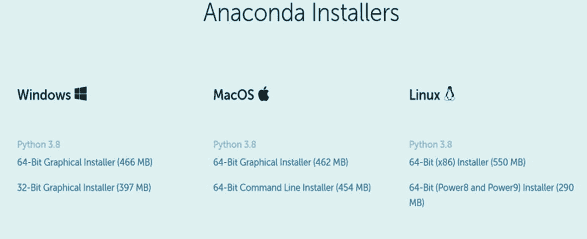
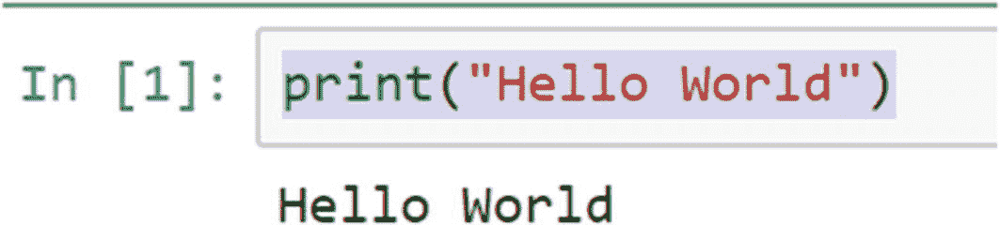
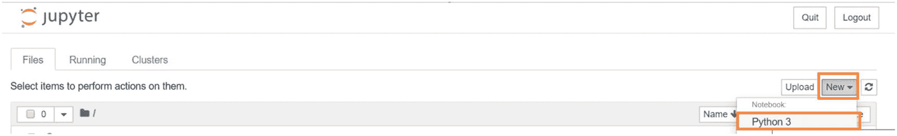
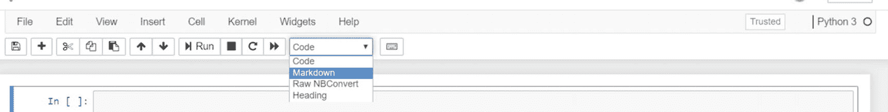
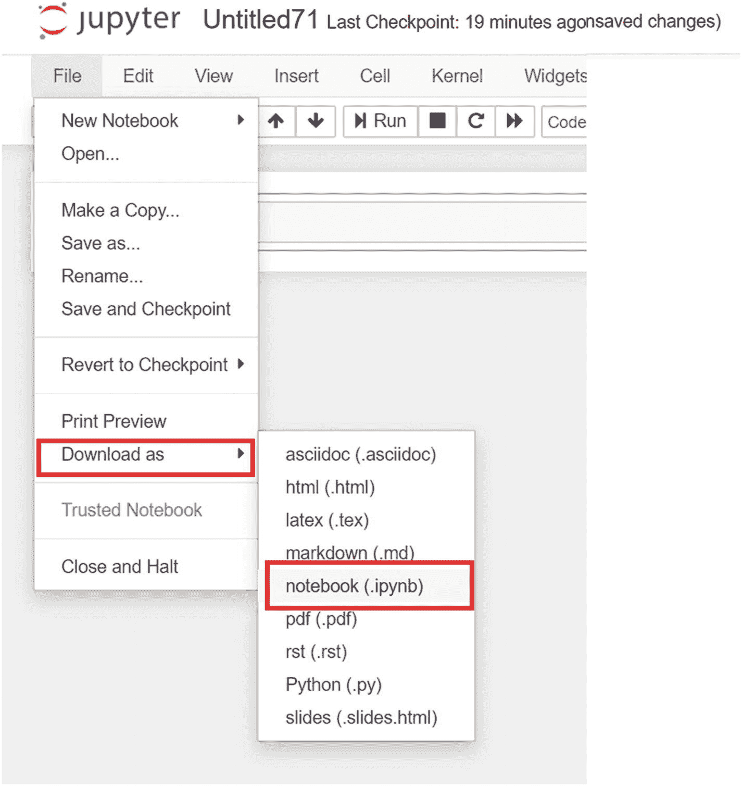
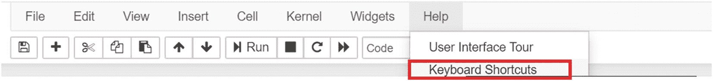
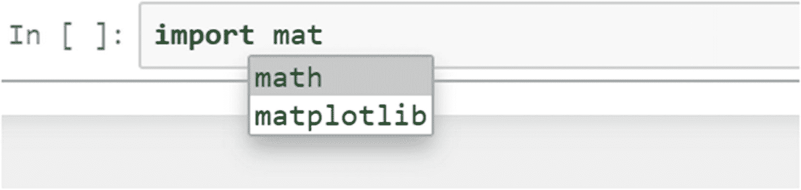
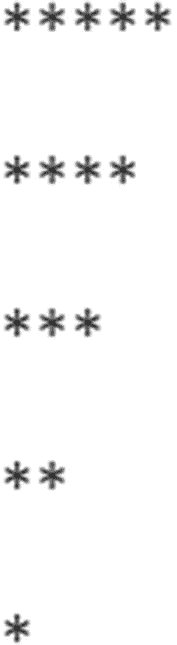

# 1. 熟悉 Python

Python 是一种开源编程语言，由荷兰程序员吉多·范罗苏姆创建。以英国喜剧团体 Monty Python 命名，Python 是一种高级、解释型、开源语言，是当今世界上最受欢迎且增长最快的编程语言之一。它也是数据科学和机器学习的首选语言。

在本章中，我们首先介绍 Jupyter notebook——一个用于运行 Python 代码的 Web 应用程序。然后，我们介绍 Python 中的基本概念，包括数据类型、运算符、容器、函数、类、文件处理和异常处理，以及编写代码和模块的标准。

本书的代码示例使用 Python 3.7.3 版本和 Anaconda 4.7.10 版本编写。

## 技术要求

`Anaconda` 是一个被 Python 程序员和数据科学家广泛使用的开源平台。安装该平台会同时安装 Python、Jupyter notebook 应用程序以及数百个库。以下是安装 `Anaconda` 发行版所需遵循的步骤。



图 1-1 安装 Anaconda

1. 打开以下网址：[`https://www.anaconda.com/products/individual`](https://www.anaconda.com/products/individual)
2. 点击适用于您操作系统的安装程序，如图 1-1 所示。安装程序将下载到您的系统。


图 1-2 启动 Jupyter

1. 打开安装程序（上一步下载的文件）并运行它。
2. 安装完成后，通过在开始菜单旁边的资源管理器（搜索栏）中输入 `jupyter notebook` 或 `jupyter` 来打开 Jupyter 应用程序，如图 1-2 所示（以 Windows 操作系统为例）。

请按照以下步骤下载本书使用的所有数据文件：
*   点击以下链接：[`https://github.com/DataRepo2019/Data-files`](https://github.com/DataRepo2019/Data-files)
*   选择绿色的 `Code` 菜单，然后从该菜单的下拉列表中点击 `Download ZIP`
*   从下载的 zip 文件夹中解压文件，并将这些文件导入到您的 Jupyter 应用程序中

现在我们已经安装并启动了 Jupyter，接下来让我们在下一节中了解如何使用这个应用程序。

## Jupyter notebook 入门

在讨论 Jupyter notebook 的基本要素之前，我们先讨论一下什么是集成开发环境（或 `IDE`）。`IDE` 将编程中涉及的各种活动整合在一起，例如编写和编辑代码、调试以及创建可执行文件。它还包括自动补全（补全用户想要输入的内容，从而使用户能够专注于逻辑和问题解决）和语法高亮（高亮显示语言的各种元素和关键字）等功能。除了 Jupyter 之外，Python 还有许多 `IDE`，包括 Enthought Canopy、Spyder、PyCharm 和 Rodeo。Jupyter 之所以成为数据科学领域无处不在、事实上的标准，有几个原因。这些原因包括易于使用和定制、支持多种编程语言、平台独立性、便于访问远程数据，以及将输出、代码和多媒体整合于一体的优势。

`JupyterLab` 是 Jupyter notebook 的 `IDE`。Jupyter notebook 是在用户机器上本地运行的 Web 应用程序。它们可用于加载、清理、分析和建模数据。您可以在 Jupyter notebook 中添加代码、公式、图像和 Markdown 文本。Jupyter notebook 兼具运行代码以及作为向他人展示和分享工作的平台的双重目的。让我们来看看这个应用程序的各种功能。



图 1-4 Jupyter 单元格中的简单代码语句

1.  **输入和执行代码**
    点击笔记本中的第一个单元格内部，输入一行简单的代码，如图 1-4 所示。通过从 `Cell` 菜单中选择 `Run Cells` 来执行代码，或使用快捷键 `Ctrl+Enter`。



图 1-3 创建新的 Jupyter notebook

1.  **打开仪表板**
    在开始菜单旁边的搜索栏中输入 `jupyter notebook`。这将打开 Jupyter 仪表板。仪表板可用于创建新的笔记本或打开现有的笔记本。
2.  **创建新笔记本**
    通过从 Jupyter 仪表板右上角选择 `New`，然后从出现的下拉列表中选择 `Python 3` 来创建新的 Jupyter notebook，如图 1-3 所示。



图 1-5 将模式更改为 Markdown

1.  **添加 Markdown 文本或标题**
    在新单元格中，通过选择 `Markdown`（如图 1-5 所示）或按键盘上的 `Esc+M` 键来更改格式。您还可以通过从下图所示的下拉列表中选择 `Heading` 或按快捷键 `Esc+(1/2/3/4)` 来为您的 Jupyter notebook 添加标题。


图 1-6 更改文件名

1.  **重命名笔记本**
    点击笔记本的默认名称并输入新名称，如图 1-6 所示。您也可以通过选择 `File ➤ Rename` 来重命名笔记本。



图 1-7 下载 Jupyter notebook

1.  **保存笔记本**
    按 `Ctrl+S` 或选择 `File ➤ Save and Checkpoint`。
2.  **下载笔记本**
    您可以通过使用 `File ➤ Download as ➤ notebook(.ipynb)` 选项下载笔记本，然后通过电子邮件发送或分享您的笔记本，如图 1-7 所示。

### Jupyter 中的快捷键与其他功能

让我们来看看 Jupyter notebook 的一些关键功能，包括快捷键、Tab 补全和魔法命令。

表 1-1 列出了 Jupyter notebook 中一些常见的图标、对应的菜单功能以及键盘快捷键。

**表 1-1** `Jupyter Notebook` 工具栏功能

| 工具栏图标 | 功能 | 键盘快捷键 | 菜单功能 |
| --- | --- | --- | --- |
|  | 保存 Jupyter notebook | `Esc+s` | *文件 ➤ 另存为* |
|  | 在 Jupyter notebook 中添加新单元格 | `Esc+b` (在当前单元格下方添加单元格)，或 `Esc+a` (在当前单元格上方添加单元格) | *插入 ➤ 在上方插入单元格* 或 *插入 ➤ 在下方插入单元格* |
|  | 剪切选中的单元格 | `Esc+x` | *编辑 ➤ 剪切单元格* |
|  | 复制选中的单元格 | `Esc+c` | *编辑 ➤ 复制单元格* |
|  | 在另一个选中单元格的上方或下方粘贴单元格 | `Esc+v` | *编辑 ➤ 在上方粘贴单元格* 或 *编辑 ➤ 在下方粘贴单元格* |
|  | 运行指定单元格 | `Ctrl+Enter` (运行选中的单元格)；`Shift+Enter` (运行选中的单元格并插入一个新单元格) | *单元格 ➤ 运行选中单元格* |
|  | 中断内核 | `Esc+ii` | *内核 ➤ 中断* |
|  | 重启内核 | `Esc+00` | *内核 ➤ 重启* |

如果你不确定使用哪个键盘快捷键，可以前往：*帮助 ➤ 键盘快捷键*，如图 1-8 所示。



**图 1-8** Jupyter 中的帮助菜单

常用的键盘快捷键包括：
*   `Shift+Enter` 运行当前单元格中的代码并移动到下一个单元格。
*   `Esc` 离开一个单元格。
*   `Esc+M` 将单元格模式更改为“Markdown”模式。
*   `Esc+Y` 将单元格模式更改为“代码”。

### Tab 补全

这是 Jupyter notebook 中的一个功能，可以帮助你完成正在编写的代码。使用 Tab 补全可以加快工作流程、减少错误，并快速补全函数名，从而减少拼写错误，让你无需记住所有模块和函数的名称。

例如，如果你想导入 `Matplotlib` 库但记不住拼写，可以输入前三个字母 `mat`，然后按 `Tab` 键。你会看到一个下拉列表，如图 1-9 所示。该库的正确名称是下拉列表中的第二个名称。



**图 1-9** Jupyter 中的 Tab 补全

### Jupyter 中使用的魔法命令

魔法命令是以一个或多个 `%` 符号开头，后跟命令的特殊命令。以一个 `%` 符号开头的命令适用于单行代码，而以两个 `%%` 符号开头的命令适用于整个单元格（单元格内的所有代码行）。

下面展示了一个常用的魔法命令，用于在 notebook 内部显示 `Matplotlib` 图形。添加此魔法命令可以避免单独调用 `plt.show` 函数来显示图形（`Matplotlib` 库将在第 7 章详细讨论）。

```
%matplotlib inline
```

像 `timeit` 这样的魔法命令也可以用来计时脚本的执行时间，如下所示。

```
%%timeit
for i in range(100000):
    i*i
```

输出：

```
16.1 ms ± 283 μs per loop (mean ± std. dev. of 7 runs, 100 loops each)
```

现在你已经了解了使用 Jupyter notebook 的基础知识，让我们开始学习 Python，并理解这门语言的核心方面。

## Python 基础

在本节中，我们将熟悉 Python 的语法、注释、条件语句、循环和函数。

### 注释、打印和输入

在本节中，我们将介绍一些基础知识，例如打印、获取用户输入以及添加注释以帮助他人理解你的代码。

#### 注释

注释用于解释一行代码的作用，程序员用它来帮助他人理解他们所编写的代码。在 Python 中，注释以 `#` 符号开头。

在 Python 中，正确的空格和缩进至关重要。虽然 `Java` 和 `C++` 等其他语言使用花括号来包含代码块，但 Python 使用四个空格的缩进来指定代码块。需要注意缩进以避免错误。像 Jupyter 这样的应用程序通常会处理缩进，并自动在代码块的开头添加四个空格。

#### 打印

`print` 函数将内容输出到屏幕或任何其他输出设备。

通常，我们将字符串和变量的组合作为参数传递给 `print` 函数。参数是包含在函数括号内的值，函数使用这些值来产生结果。在下面的语句中，`"Hello!"` 是 `print` 函数的参数。

```
print("Hello!")
```

要打印多行代码，我们在字符串的开头和结尾使用三引号，例如：

```
print('''Today is a lovely day.
It will be warm and sunny.
It is ideal for hiking.''')
```

输出：

```
Today is a lovely day.
It will be warm and sunny.
It is ideal for hiking.
```

请注意，与某些其他语言不同，在 Python 中我们不需要使用分号来结束语句。

`format` 方法可以与 `print` 方法结合使用，用于在字符串中嵌入变量。它使用花括号作为变量的占位符，这些变量作为参数传递给该方法。

让我们看一个使用 `format` 方法打印变量的简单示例。

```
weight=4.5
name="Simi"
print("The weight of {} is {}".format(name,weight))
```

输出：

```
The weight of Simi is 4.5
```

上述语句也可以不使用 `format` 方法重写如下：

```
print("The weight of",name,"is",weight)
```

请注意，只有 `print` 参数的字符串部分被引号括起来。变量名不在引号内。同样，如果 `print` 参数中有任何常量，它们也不在引号内。在以下示例中，布尔常量（`True`）、整数常量（`1`）和字符串被组合在一个 `print` 语句中。

```
print("The integer equivalent of",True,"is",1)
```

输出：

```
The integer equivalent of True is 1
```

格式字段可以指定浮点数的精度。浮点数是指带有小数点的数字，小数点后的位数可以使用格式字段指定，如下所示。

```
x=91.234566
print("The value of x upto 3 decimal points is {:.3f}".format(x))
```

输出：

```
The value of x upto 3 decimal points is 91.235
```

我们可以指定传递给方法的变量的位置。在此示例中，我们使用位置 `1` 来引用参数列表中的第二个对象，使用位置 `0` 来指定参数列表中的第一个对象。

```
y='Jack'
x='Jill'
print("{1} and {0} went up the hill to fetch a pail of water".format(x,y))
```

输出：

```
Jack and Jill went up the hill to fetch a pail of water
```

#### 输入

`input` 函数接受来自用户的输入。用户提供的输入被存储为 `String` 类型的变量。如果你想对任何数字输入进行数学计算，你需要将输入的数据类型更改为 `int` 或 `float`，如下所示。

```
age=input("Enter your age:")
print("In 2010, you were",int(age)-10,"years old")
```

输出：

```
Enter your age:76
In 2010, you were 66 years old
```

关于 Python 输入/输出的进一步阅读：[`https://docs.python.org/3/tutorial/inputoutput.html`](https://docs.python.org/3/tutorial/inputoutput.html)

### 变量和常量

常量或字面量是一个不会改变的值，而变量包含的值可以改变。在 Python 中，我们不需要声明变量，即指定其数据类型，这与 Java 和 C/C++等其他语言不同。我们通过给变量命名并为其赋值来定义它。根据值，会自动为其分配一个数据类型。值通过赋值运算符（`=`）存储在变量中。Python 中变量命名的规则如下：

*   变量名不能包含空格
*   变量不能以数字开头
*   变量名只能包含字母、数字和下划线（`_`）
*   变量不能使用保留关键字作为名称（例如，像`class`、`continue`、`break`、`print`等词，它们是 Python 语言中预定义的术语，具有特殊含义，不能作为变量名）

### 运算符

以下是 Python 中一些常用的运算符。

**算术运算符**：接受两个整数或浮点数值，执行运算，并返回一个值。

Python 支持以下算术运算符：

*   `**`（指数）
*   `%`（取模或余数）
*   `//`（取整商）
*   `*`（乘法）
*   `-`（减法）
*   `+`（加法）

运算顺序至关重要。括号优先于指数，指数优先于除法和乘法，除法和乘法优先于加法和减法。有一个缩写——`P.E.D.M.A.S.`（Please Excuse My Dear Aunt Sally）——可以用来记住这些运算的顺序，以理解在算术表达式中应首先应用哪个运算符。示例如下：

```
(1+9)/2-3
```

输出：

```
2.0
```

在上述表达式中，首先执行括号内的运算，得到`10`，然后是除法，得到`5`，最后是减法，最终输出为`2`。

**比较运算符**：这些运算符比较两个值，并得出`true`或`false`值。Python 支持以下比较运算符：

*   `>`：大于
*   `<`：小于
*   `<=`：小于或等于
*   `>=`：大于或等于
*   `==`：等于。请注意，这与赋值运算符（`=`）不同
*   `!=`（不等于）

**逻辑（或布尔）运算符**：与比较运算符类似，它们也得出`true`或`false`值。这些运算符作用于布尔变量或表达式。Python 支持以下逻辑运算符：

*   `and`运算符：使用此运算符的表达式，仅当其所有子表达式都为`True`时才计算为`True`。否则，如果其中任何一个为`False`，则表达式计算为`False`。

    `and`运算符的使用示例如下所示。

    ```
    (2>1) and (1>3)
    ```

    输出：

    ```
    False
    ```

*   `or`运算符：使用`or`运算符的表达式，如果表达式中的任何一个子表达式为`True`，则计算为`True`。如果所有子表达式都计算为`False`，则表达式计算为`False`。

    `or`运算符的使用示例如下所示。

    ```
    (2>1) or (1>3)
    ```

    输出：

    ```
    True
    ```

*   `not`运算符：使用`not`运算符的表达式，如果表达式为`False`，则计算为`True`，反之亦然。

    `not`运算符的使用示例如下所示。

    ```
    not(1>2)
    ```

    输出：

    ```
    True
    ```

### 赋值运算符

这些运算符用于为变量或操作数赋值。以下是 Python 中使用的赋值运算符列表：

- `=`（将值赋给变量）
- `+=`（将右侧的值加到左侧的操作数上）
- `-=`（从左侧的操作数中减去右侧的值）
- `*=`（将左侧的操作数乘以右侧的值）
- `%=`（返回左侧操作数除以右侧值后的余数）
- `/=`（返回左侧操作数除以右侧值后的商）
- `//=`（返回左侧操作数除以右侧值后商的整数部分）

下面给出了一些使用这些赋值运算符的示例。

```
x=5 #将值 5 赋给变量 x
x+=1 #该语句将 x 加 1（等价于 x=x+1）
x-=1 #该语句将 x 减 1（等价于 x=x-1）
x*=2 #将 x 乘以 2（等价于 x=x*2）
x%=3 #等价于 x=x%3，返回余数
x/=3 #等价于 x=x/3，返回商的整数和小数部分
x//=3 #等价于 x=x//3，返回 x 除以 3 后商的整数部分
```

### 身份运算符（`is` 和 `not is`）

这些运算符用于检查两个对象是否相等，即两个对象是否指向相同的值，并根据它们是否相等返回一个布尔值（`True`/`False`）。在下面的示例中，三个变量 `x`、`y` 和 `z` 包含相同的值，因此，当比较 `x` 和 `z` 时，身份运算符（`is`）返回 `True`。

示例：

```
x=3
y=x
z=y
x is z
```

输出：

```
True
```

### 成员运算符（`in` 和 `not in`）

这些运算符用于检查特定值是否存在于字符串或容器（如列表和元组，将在下一章讨论）中。如果值存在，`in` 运算符返回 `True`；如果值不存在于字符串或容器中，`not in` 运算符返回 `True`。

```
'a' in 'and'
```

输出：

```
True
```

## 数据类型

数据类型是变量的类别或类型，基于其存储的值。

可以使用 `type` 函数获取变量或常量的数据类型。

```
type(45.33)
```

输出：

```
float
```

一些常用的数据类型见表 1-2。

**表 1-2** Python 中的常见数据类型

| 数据类型 | 数据类型名称 | 示例 |
| --- | --- | --- |
| 数值数据 | `int`：用于不带小数点的数字<br>`float`：用于带小数点的数字 | `#int`<br>`a=1`<br>`#float`<br>`b=2.4` |
| 序列 | 序列存储多个值。Python 中的一些序列包括：<br>`list`<br>`range`<br>`tuple` | `#tuple`<br>`a=(1,2,3)`<br>`#list`<br>`b=[1,2,3]`<br>`#range`<br>`c=range(5)` |
| 字符或文本 | `str` 是用于在引号内存储单个字符或字符序列的数据类型 | `#单个字符`<br>`X='a'`<br>`#多个字符`<br>`x='hello world'`<br>`#多行`<br>`x='''hello world`<br>`good morning'''` |
| 布尔数据 | `bool` 是用于存储 `True` 或 `False` 值的数据类型 | `X=True`<br>`Y=False` |
| 映射对象 | `dict` 是字典（将键映射到值的对象）的数据类型 | `x={'Apple':'fruit','Carrot':'vegetable'}` |

### 表示日期和时间

Python 有一个名为 `datetime` 的模块，它允许我们定义日期、时间或持续时间。

我们首先需要导入此模块，以便使用该模块中可用的函数来定义日期或时间对象，使用以下语句。

```
import datetime
```

让我们使用该模块中的方法来定义各种日期/时间对象。

#### 日期对象

可以使用 `date` 方法定义包含日、月、年的日期，如下所示。

```
date=datetime.date(year=1995,month=1,day=1)
print(date)
```

输出：

```
1995-01-01
```

请注意，`date` 方法的三个参数——日、月和年——都是必需的。如果在定义 `date` 对象时省略了其中任何一个参数，就会发生错误，如下所示。

```
date=datetime.date(month=1,day=1)
print(date)
```

输出：

```
TypeError                         Traceback (most recent call last)
 in 
----> 1 date=datetime.date(month=1,day=1)
2 print(date)
TypeError: function missing required argument 'year' (pos 1)
```

#### 时间对象

要在 Python 中定义存储时间的对象，我们使用 `time` 方法。

可以传递给此方法的参数包括小时、分钟、秒或微秒。请注意，与 `date` 方法不同，`time` 方法的参数不是必需的（可以省略）。

```
time=datetime.time(hour=12,minute=0,second=0,microsecond=0)
print("midnight:",time)
```

输出：

```
midnight: 00:00:00
```

#### Datetime 对象

我们还可以使用 `datetime` 方法定义一个同时包含日期和时间的 datetime 对象，如下所示。对于此方法，日期参数——日、月和年——是必需的，但时间参数（如小时、分钟等）可以省略。

```
datetime1=datetime.datetime(year=1995,month=1,day=1,hour=12,minute=0,second=0,microsecond=0)
print("1st January 1995 midnight:", datetime1)
```

输出：

```
1st January 1995 midnight: 1995-01-01 12:00:00
```

#### Timedelta 对象

`timedelta` 对象表示特定的时间段，并使用 `timedelta` 方法创建。

让我们创建一个存储 17 天时长的 `timedelta` 对象。

```
timedelta1=datetime.timedelta(weeks=2,days=3)
timedelta1
```

输出：

```
datetime.timedelta(days=17)
```

在创建 `timedelta` 对象时，您还可以添加其他参数，如秒、分钟和小时。

`timedelta` 对象可以添加到现有的日期或 datetime 对象中，但不能添加到时间对象中。

将持续时间（`timedelta` 对象）添加到 `date` 对象：

```
#支持将持续时间添加到日期对象
date1=datetime.date(year=1995,month=1,day=1)
timedelta1=datetime.timedelta(weeks=2,days=3)
date1+timedelta1
```

输出：

```
datetime.date(1995, 1, 18)
```

将持续时间（`timedelta` 对象）添加到 `datetime` 对象：

```
#支持将持续时间添加到 datetime 对象
datetime1=datetime.datetime(year=1995,month=2,day=3)
timedelta1=datetime.timedelta(weeks=2,days=3)
datetime1+timedelta1
```

输出：

```
datetime.datetime(1995, 2, 20, 0, 0)
```

将持续时间添加到 `time` 对象会导致错误：

```
#不支持将持续时间添加到时间对象
time1=datetime.time(hour=12,minute=0,second=0,microsecond=0)
timedelta1=datetime.timedelta(weeks=2,days=3)
time1+timedelta1
```

输出：

```
TypeError                             Traceback (most recent call last)
 in 
2 time1=datetime.time(hour=12,minute=0,second=0,microsecond=0)
3 timedelta1=datetime.timedelta(weeks=2,days=3)
----> 4 time1+timedelta1
TypeError: unsupported operand type(s) for +: 'datetime.time' and 'datetime.timedelta'
```

## 延伸阅读

了解更多关于 Python `datetime` 模块的信息： [`https://docs.python.org/3/library/datetime.html`](https://docs.python.org/3/library/datetime.html)

### 字符串操作

字符串是由一个或多个字符组成的序列，用引号括起来（单引号和双引号均可）。字符串的数据类型是 `str`。与 Java 和 C 等较老的语言不同，Python 不支持字符数据类型。即使是单个字符，如 `'a'`、`'b'`，也作为字符串存储。字符串在内部以数组形式存储，并且是不可变的（无法修改）。让我们看看如何定义字符串。

#### 定义字符串

单行字符串可以使用单引号或双引号定义。

```python
x='All that glitters is not gold'
#或者
x="All that glitters is not gold"
```

对于多行字符串，请使用三引号：

```python
x='''Today is Tuesday.
Tomorrow is Wednesday'''
```

#### 字符串操作

可以对字符串使用各种函数，下面将解释其中一些。

1.  **查找字符串长度**：可以使用 `len` 函数计算字符串的长度，如下所示。

    ```python
    len('Hello')
    ```

    输出：

    ```
    5
    ```

2.  **访问字符串中的单个元素**：

    可以使用索引运算符 `[]` 提取字符串中的单个字符。

    ```python
    x='Python'
    x[3]
    ```

    输出：

    ```
    'h'
    ```

3.  **字符串切片**：切片是指提取对象（此处为字符串）的一部分或子集。切片也可以用于其他可迭代对象，如列表和元组，我们将在下一章讨论。冒号运算符用于切片，带有可选的起始、结束和步进索引。下面提供了一些切片示例。

    ```python
    x='Python'
    x[1:] #从第二个字符到末尾
    ```

    输出：

    ```
    'ython'
    ```

    更多切片示例：

    ```python
    x[:2] #前两个字符。起始索引假定为 0
    ```

    输出：

    ```
    'Py'
    ```

    ```python
    x[::-1]#反转字符串，最后一个字符的索引为 -1
    ```

    输出：

    ```
    'nohtyP'
    ```

4.  **对齐**：

    要在右侧或左侧添加空格，或使字符串居中，可使用 `rjust`、`ljust` 或 `center` 方法。传递给此类方法的第一个参数是新字符串的长度，可选的第二个参数是用于填充的字符。默认情况下，使用空格进行填充。

    ```python
    '123'.rjust(5,"*")
    ```

    输出：

    ```
    '**123'
    ```

5.  **更改大小写**：要更改字符串的大小写，可使用 `upper` 或 `lower` 方法，如下所示。

    ```python
    'COLOR'.lower()
    ```

    输出：

    ```
    'color'
    ```

6.  **检查字符串内容**：

    要检查字符串是否以给定字符开头或结尾，可使用 `startswith` 或 `endswith` 方法。

    ```python
    'weather'.startswith('w')
    ```

    输出：

    ```
    True
    ```

7.  **移除字符串中的空白**：

    要移除字符串中的空格，可使用 `strip` 方法（移除两端的空格）、`rstrip`（移除右端的空格）或 `lstrip` 方法（移除左端的空格）。示例如下。

    ```python
    '  Hello'.lstrip()
    ```

    输出：

    ```
    'Hello'
    ```

8.  **检查字符串内容**：

    有几种方法可以检查字符串包含的内容，例如 `isalpha`、`isupper`、`isdigit`、`isalnum` 等。只有当字符串中的所有字符都满足给定条件时，所有这些方法才返回 `True`。

    ```python
    '981'.isdigit()#检查是否为数字
    ```

    输出：

    ```
    True
    ```

    ```python
    'Abc'.isupper()
    #检查所有字符是否为大写。由于并非所有字母都是大写，因此条件不满足
    ```

    输出：

    ```
    False
    ```

9.  **连接字符串列表**：

    `join` 方法将字符串列表合并为一个字符串。在 `join` 方法的左侧，我们在引号中指定用于连接字符串的分隔符。在右侧，我们传递各个字符串的列表。

    ```python
    ' '.join(['Python','is','easy','to','learn'])
    ```

    输出：

    ```
    'Python is easy to learn'
    ```

10. **拆分字符串**：

    `split` 方法的作用与 `join` 方法相反。它将一个字符串分解为单个单词的列表并返回该列表。如果我们只向此方法传递一个单词，它将返回一个仅包含该单词的列表，并且不会进一步拆分字符串。

    ```python
    'Python is easy to learn'.split()
    ```

    输出：

    ```
    ['Python', 'is', 'easy', 'to', 'learn']
    ```

### 条件语句

顾名思义，条件语句用于评估一个条件或一组条件。在 Python 中，使用 `if-elif-else` 结构来实现此目的。Python 没有某些其他语言中用于条件执行的 `switch-case` 结构。

条件语句以 `if` 关键字以及要评估的表达式或条件开头。后面跟着一个代码块，该代码块仅在条件评估为 `True` 时执行；否则将跳过。

`else` 语句（不包含任何条件）用于在 `if` 语句中提到的条件不满足时执行一个代码块。`elif` 语句用于评估特定条件。`elif` 语句的顺序很重要。如果其中一个 `elif` 语句评估为 `True`，则其后的 `elif` 语句将根本不会执行。`if` 语句也可以单独存在，无需提及 `else` 或 `elif` 语句。

以下示例演示了 `if-elif-else` 结构。

```python
#if-elif-else
color=input('请输入以下颜色之一 - red, orange 或 blue:')
if color=='red':
    print('你最喜欢的颜色是红色')
elif color=='orange':
    print('你最喜欢的颜色是橙色')
elif color=='blue':
    print('你最喜欢的颜色是蓝色')
else:
    print("你输入了错误的颜色")
```

输出：

```
请输入以下颜色之一 - red, orange 或 blue:pink
你输入了错误的颜色
```

条件语句可以嵌套，这意味着我们可以在一个条件语句（外层）中包含另一个条件语句（内层）。在使用嵌套语句时，需要特别注意缩进。下面是一个嵌套 `if` 语句的示例。

```python
#嵌套条件语句
x=20
if x<10:
    if x<5:
        print("数字小于 5")
    else:
        print("数字大于 5")
else:
    print("数字大于 10")
```

输出：

```
数字大于 10
```

延伸阅读：查看更多关于 `if` 语句的内容： [`docs.python.org/3/tutorial/controlflow.html#if-statements`](https://docs.python.org/3/tutorial/controlflow.html%2523if-statements)

### 循环

循环用于重复执行部分代码。代码块的单次执行称为一次迭代，循环通常会经历多轮迭代。Python 中使用两种类型的循环——`for` 循环和 `while` 循环。

#### While 循环

当我们需要在某个条件为 `True` 时重复执行特定指令，就会使用 `while` 循环。代码块执行完毕后，执行流程会回到代码块的开头。下面是一个示例。

代码：

```python
#while loop with continue statement
while True:
    x=input('Enter the correct color:')
    if(x!='red'):
        print("Color needs to be entered as red")
        continue
    else:
        break
```

输出：

```
Enter the correct color:blue
Color needs to be entered as red
Enter the correct color:yellow
Color needs to be entered as red
Enter the correct color:red
```

在上面的示例中，第一条语句（`while True`）用于执行一个无限循环。一旦用户输入了正确长度的用户名，`break` 语句就会将执行流程带出循环；否则，会向用户显示一条消息，要求输入正确长度的用户名。请注意，在代码块的最后一条语句执行完毕后，执行流程会自动回到循环的开头。

`break` 语句用于将控制权带出循环。当我们有一个想要跳出的无限循环时，它非常有用。

`continue` 语句则相反——它将控制权带回循环的开头。关键字 `break` 和 `continue` 都可以与循环和条件语句（如 `if/else`）一起使用。

延伸阅读：

了解更多关于以下内容：

- `break` 和 `continue` 语句： [`https://docs.python.org/3/tutorial/controlflow.html#break-and-continue-statements-and-else-clauses-on-loops`](https://docs.python.org/3/tutorial/controlflow.html%2523break-and-continue-statements-and-else-clauses-on-loops)
- `while` 语句： [`https://docs.python.org/3/reference/compound_stmts.html#while`](https://docs.python.org/3/reference/compound_stmts.html%2523while)

#### For 循环

`for` 循环用于执行一个预定次数的代码块。`for` 循环可以与任何类型的可迭代对象一起使用，即可供循环重复运行实例或迭代的值序列。这些可迭代对象包括列表、元组、字典和字符串。

`for` 循环也常与 `range` 函数一起使用。`range` 函数会创建一个 `range` 对象，这是另一种可迭代对象，它是一个间隔均匀的整数序列。考虑以下示例，我们使用 `for` 循环计算前五个奇数的和。

代码：

```python
#for loop
sum=0
for i in range(1,10,2):
    sum=sum+i
print(sum)
```

输出：

```
25
```

`range` 函数有三个参数：起始参数、停止参数和步长参数。这三个参数都不是必须的。从 0 到 9（包括 0 和 9）的数字可以通过 `range(10)`、`range(0,10)` 或 `range(0,10,1)` 生成。默认的起始参数是 0，默认的步长参数是 1。

`for` 循环也可以嵌套（包含一个外层循环和任意数量的内层循环），如下所示。

代码：

```python
#nested for loop
for i in 'abcd':
    for j in range(4):
        print(i,end=" ")
    print("\n")
```

输出：

```
a a a a
b b b b
c c c c
d d d d
```

延伸阅读：了解更多关于 `for` 语句： [`https://docs.python.org/3/tutorial/controlflow.html#for-statements`](https://docs.python.org/3/tutorial/controlflow.html%2523for-statements)

### 函数

函数可以被看作一个“黑箱”（用户无需关心函数的内部工作原理），它接收输入，进行处理，并产生输出。函数本质上是一组执行特定任务的语句块。

在 Python 中，使用 `def` 关键字定义函数。其后跟函数名和一个或多个可选参数。参数是仅存在于函数内部的变量。在函数内部定义的变量具有局部作用域，这意味着它们不能在函数外部被访问。它们也被称为局部变量。外部代码或函数不能操作在函数内部定义的变量。

函数可以有一个可选的返回值。返回值是函数产生的输出，并被返回给主程序。调用函数意味着向函数提供输入（参数）以执行其任务并产生输出。

函数的实用性在于其可重用性。它们还有助于避免代码冗余，并将代码组织成逻辑块。我们只需提供它运行指令所需的一组输入即可。可以重复调用一个函数，而无需手动输入相同的代码行。

例如，假设你想找出给定数字列表中的质数。一旦你编写了一个用于检查整数是否为质数的函数，你就可以简单地将列表中的每个数字作为参数传递给该函数并调用它，而无需为你想要测试的每个整数编写相同的代码行。

代码：

```python
def checkPrime(i):
    #Assume the number is prime initially
    isPrime=True
    for j in range(2,i):
        # checking if the number is divisible by any number between 2 and i
        if i%j==0:
            #If it is divisible by any number in the j range, it is not prime
            isPrime=False
    # This is the same as writing if isPrime==True
    if isPrime:
        print(i ,"is prime")
    else:
        print(i, "is not prime")

for i in range(10,20):
    checkPrime(i)
```

输出：

```
10 is not prime
11 is prime
12 is not prime
13 is prime
14 is not prime
15 is not prime
16 is not prime
17 is prime
18 is not prime
19 is prime
```

延伸阅读：了解更多关于定义函数： [`https://docs.python.org/3/tutorial/controlflow.html#defining-functions`](https://docs.python.org/3/tutorial/controlflow.html%2523defining-functions)

#### 匿名函数或 Lambda 函数

匿名函数或 lambda 函数使用 `lambda` 关键字定义。它们是单表达式函数，提供了一种紧凑的定义函数的方式，而无需将函数对象绑定到名称上。这些函数被称为“匿名”的原因在于它们不需要名称。考虑以下示例，我们使用 lambda 函数计算两个数的和。

代码：

```python
(lambda x,y:(x+y))(5,4)
```

输出：

```
9
```

请注意匿名函数的语法。它以 `lambda` 关键字开头，后跟参数（本例中为 `x` 和 `y`）。然后是冒号，冒号之后是一个会被计算并返回的表达式。无需提及 `return` 语句，因为此类函数中存在隐式返回。注意，该函数也没有名称。

# 语法错误与异常

语法错误是用户在编写代码时可能无意中犯下的错误，例如拼写错误的关键字、未缩进代码等。而异常则是在程序执行过程中发生的错误。用户在运行程序时可能输入了不正确的数据。如果你想用一个数（比如 `a`）除以另一个数（比如 `b`），但给分母（`b`）赋值为 0，就会产生异常。这些由 Python 自动生成并显示给用户的异常，可能无法清晰地传达问题所在。通过使用 `try-except` 结构进行异常处理，我们可以构建用户友好的消息，帮助用户更好地纠正错误。

异常处理包含两个部分。首先，我们将可能导致错误的代码放在 `try` 子句下。然后，在 `except` 子句中，我们尝试处理 `try` 块中导致错误的原因。我们在 `except` 子句中提及异常类的名称，后跟一个代码块，在其中处理错误。处理错误的一种直接方法是打印一条消息，向用户提供更多关于需要纠正什么的信息。

请注意，所有异常都是派生自 `BaseException` 类的对象，并遵循一个层次结构。

延伸阅读：Python 中异常的类层次结构可在此处找到：[`https://docs.python.org/3/library/exceptions.html#exception-hierarchy`](https://docs.python.org/3/library/exceptions.html%2523exception-hierarchy)

下面是一个简单程序的示例，分别展示了有无异常处理的情况。

```
while True:
    try:
        n=int(input('请输入你的分数：'))
        print('你获得了 ',n,' 分')
        break
    except ValueError:
        print('请输入一个整数值')
```

输出：

```
请输入你的分数（不含小数点）：abc
请输入一个整数值
请输入你的分数（不含小数点）：45.5
请输入一个整数值
请输入你的分数（不含小数点）：90
你获得了  90 分
```

相同程序（无异常处理）：

代码：

```
n=int(input('请输入你的分数：'))
print('你获得了 ',n,' 分')
```

输出：

```
请输入你的分数：ninety three

ValueError                         Traceback (most recent call last)
<ipython-input-1-5d3a2f685c72> in <module>
----> 1 n=int(input('请输入你的分数：'))
      2 print('你获得了 ',n,' 分')

ValueError: invalid literal for int() with base 10: 'ninety three'
```

上述代码中可能导致错误的语句是：`int(input('请输入你的分数：'))`。`int` 函数需要一个整数作为参数。如果用户输入浮点数或字符串值，就会产生 `ValueError` 异常。当我们使用 `try-except` 结构时，`except` 子句会打印一条消息，要求用户更正输入，这使得提示信息更加明确。

# 处理文件

我们可以使用 Python 中的方法或函数来读取或写入文件。换句话说，我们可以创建文件、向其中添加内容或文本，并使用 Python 提供的方法读取其内容。

这里，我们讨论如何读取和写入逗号分隔值（CSV）文件。CSV 文件或逗号分隔文件是 Excel 电子表格的文本版本。

所有这些操作的函数都在 CSV 模块中定义。要使用其各种方法，必须首先使用 `import csv` 语句导入此模块。

## 从文件读取

从 Python 读取文件涉及以下步骤：

1.  使用 `with open` 语句，我们可以打开一个现有的 CSV 文件，并将生成的文件对象分配给一个变量或文件句柄（在以下示例中命名为 `f`）。请注意，我们需要使用绝对路径或相对路径指定文件的路径。之后，我们需要指定打开文件的模式。对于读取，模式是 `r`。如果我们不指定模式，文件默认以读取模式打开。

2.  接下来，有一个代码块，首先使用 `csv.reader` 函数将文件内容存储在一个读取对象中，其中我们将文件句柄 `f` 作为参数传递。

3.  然而，此文件的内容不能直接通过此读取对象访问。我们创建一个空列表（在以下示例中命名为 `contents`），然后使用 `for` 循环逐行遍历我们在步骤 2 中创建的读取对象，并将其追加到此列表中。然后可以打印此列表以查看我们创建的 CSV 文件的行。

代码：

```
#从文件读取
import csv
with open('animals.csv') as f:
    contents=csv.reader(f)
    lines_of_file=[]
    for line in contents:
        lines_of_file+=line
lines_of_file
```

## 写入文件

写入文件涉及以下步骤。

1.  使用 `open` 函数，打开一个现有的 CSV 文件，或者如果文件不存在，`open` 函数会创建一个新文件。如果你想覆盖内容或写入新文件，请将文件名（带绝对路径）放在引号中传递，并将模式指定为 `w`。如果你只想向现有文件追加一些行，请使用 `a` 或 `append` 模式。由于我们在此情况下不想覆盖，我们使用追加（`a`）模式打开文件。将其存储在一个变量或文件句柄中，并给它一个名称，比如 `f`。

2.  使用 `csv.writer()` 函数，创建一个写入器对象来添加内容，因为我们无法直接写入 CSV 文件。将变量（文件句柄）`f` 作为参数传递给此函数。

3.  对上一步创建的写入器对象调用 `writerow` 方法。要传递给此方法的参数是要添加的新行（作为列表）。

4.  在你的系统上打开 CSV 文件，查看更改是否已生效。

代码：

```
#写入文件
with open(r'animals.csv',"w") as f:
    writer_object=csv.writer(f,delimiter=",")
    writer_object.writerow(['sheep','lamb'])
```

可用于 `open` 函数打开文件的模式有：

*   `r`：仅以读取模式打开文件。
*   `w`：仅以写入模式打开文件。如果文件已存在，则会覆盖它。
*   `a`：以在文件末尾写入的模式打开文件。它会保留原始文件内容。
*   `w+`：以读取和写入模式打开文件。

延伸阅读：查看更多关于在 Python 中读写文件的内容：[`https://docs.python.org/3/tutorial/inputoutput.html#reading-and-writing-files`](https://docs.python.org/3/tutorial/inputoutput.html%2523reading-and-writing-files)

# Python 中的模块

模块是一个扩展名为 `.py` 的 Python 文件。可以将其想象成实体图书馆的一个分区。正如图书馆的每个分区（例如，小说、体育、健身）都包含性质相似的书籍一样，模块包含彼此相关的函数。例如，`matplotlib` 模块包含所有与绘制图表相关的函数。一个模块也可以包含另一个模块。例如，`matplotlib` 模块就包含一个名为 `pyplot` 的子模块。Python 中有许多内置函数，它们是标准库的一部分，使用它们无需导入任何模块。

可以使用 `import` 关键字后跟模块名称来导入模块：

```
import matplotlib
```

你也可以使用 `from` 关键字导入模块的一部分（子模块或函数）。这里，我们从 `math` 模块中导入 `cosine` 函数：

```
from math import cos
```

在 Python 中创建和导入自定义模块需要以下步骤：

1.  在开始菜单旁边的搜索栏中输入“idle”。Python shell 打开后，通过选择 *File ➤ New File* 创建一个新文件。

2.  创建一些功能相似的函数。作为示例，这里我们创建一个简单的模块，其中包含两个函数——`sin_angle` 和 `cos_angle`。这些函数计算角度（以度为单位）的正弦和余弦。

    ```
    import math
    def sin_angle(x):
        y = math.radians(x)
        return math.sin(y)
    def cos_angle(x):
        y = math.radians(x)
        return math.cos(y)
    ```

3.  保存文件。文件应保存的目录与 Python 运行的目录相同。你可以使用以下代码获取当前工作目录：

    ```
    import os
    os.getcwd()
    ```

4.  使用 `import` 语句，导入并使用你刚刚创建的模块。

# Python 增强提案 (PEP) 8 – 代码编写标准

Python 增强提案 (PEP) 是一份技术文档，为 Python 语言中引入的新特性提供文档说明。PEP 文档有多种类型，其中最重要的是 PEP 8。PEP 8 文档为用 Python 编写代码提供了风格指南。PEP 8 的主要重点是提供一套一致的规则，以提高代码的可读性——任何阅读你代码的人都应该能够理解你在做什么。你可以在此处找到完整的 PEP8 文档：[`https://www.python.org/dev/peps/pep-0008/`](https://www.python.org/dev/peps/pep-0008/)

PEP8 针对代码的不同方面提供了若干指南，其中一些总结如下。

*   **缩进**：缩进用于指示代码块的开始。在 Python 中，使用四个空格进行缩进。应避免使用制表符进行缩进。

*   **行长度**：一行代码的最大字符长度为 79 个字符。对于注释，限制为 72 个字符。

*   **命名约定**：PEP 8 也规定了 Python 中不同类型对象的命名约定。应使用短名称，并可使用下划线来提高可读性。对于函数、方法、变量、模块和包的命名，请使用小写（全小写字母）表示法。对于常量，使用大写（全大写字母）表示法；对于类，使用 CapWords（两个单词，每个单词以大写字母开头，单词间无空格）表示法进行命名。

*   **注释**：推荐使用以 `#` 开头并描述整个代码块的块注释。应避免使用内联注释，即与代码行位于同一行的注释，如下所示。如果确实要使用，则应与代码之间用两个空格隔开。

    ```
    sum += 1  # 将 sum 增加 1
    ```

*   **导入**：在导入模块以在代码中使用时，应避免通配符导入（使用 `*` 表示法），如下所示。

    ```
    from module import *
    ```

    不应在同一行导入多个包或类。

    ```
    import a, b
    ```

    它们应分别在不同的行导入，如下所示。

    ```
    import a
    import b
    ```

    应尽可能使用绝对导入，例如：

    ```
    import x.y
    ```

    或者，我们可以使用这种表示法来导入模块：

    ```
    from x import y
    ```

*   **编码**：在 Python 3 中编写代码应使用的编码格式是 UTF-8。

# 总结

*   Python 的语法与 Java 和 C 等其他语言不同，Python 中的语句不以分号结尾，并且使用空格（四个空格）进行缩进，而不是花括号。

*   Python 具有基本数据类型，如 `int`、`float`、`str` 和 `bool` 等，以及根据变量的数据类型对其进行操作的运算符（算术、布尔、赋值和比较）。

*   Python 使用 `if-elif-else` 关键字来实现语句的条件执行。它还使用 `for` 循环和 `while` 循环来重复程序的特定部分。

*   函数有助于重用部分代码并避免冗余。每个函数应只执行一个任务。Python 中的函数使用 `def` 关键字定义。匿名函数或 `lambda` 函数提供了一种快捷方式，可以在不将函数绑定到名称的情况下，在一行内编写函数。

*   模块是相似函数的集合，是一个简单的 Python 文件。除了属于标准库的函数外，任何属于外部模块的函数都需要使用 `import` 关键字导入该模块。

*   Python 具有用于创建、读取和写入文本及 CSV 文件的函数。文件可以以多种模式打开，具体取决于你是要读取、写入还是追加数据。

*   异常处理可用于处理程序执行期间发生的异常。使用 `try` 和 `except` 关键字，我们可以处理程序中可能引发异常的部分。

*   PEP 8 为 Python 中一系列与编码相关的方面设定了标准，包括空格、制表符和空行的使用，以及命名和编写注释的约定。

下一章将深入探讨容器等主题，例如列表、元组、字典和集合。我们还将讨论一种称为面向对象编程的编程范式，以及如何使用类和对象来实现它。

# 复习题

**问题 1**

使用嵌套循环计算从 1 到 5 的阶乘。

**问题 2**

函数是使用以下哪个关键字定义的？

1. `def` 关键字
2. `function` 关键字
3. `void` 关键字
4. 不需要关键字

**问题 3**

以下代码的输出是什么？

```
x=True
y=False
z=True
x+y+z
```

**问题 4**

编写一个 Python 程序来打印以下序列：



**问题 5**

以下哪个变量使用了正确的语法进行定义？

1. `1x=3`
2. `x 3=5`
3. `x`
4. `x_3=5`
5. `x$4=5`

**问题 6**

以下代码的输出是什么？（提示：`id` 函数返回对象的内存地址。）

```
str1="Hello"
str2=str1
id(str1)==id(str2)
```

**问题 7**

将字符串 `"123-456-7890"` 转换为 `"1234567890"` 格式。请使用 `join` 和 `split` 字符串函数。

**问题 8**

编写一个执行以下任务的函数（文件名作为参数传递）：

- 创建一个以传递给函数的参数为名称的新文本文件
- 向文件中添加一行文本（`"Hello World"`）
- 读取文件内容
- 再次打开文件，在第一行下方添加另一行（`"This is the next line"`）
- 重新读取文件并在屏幕上打印内容

## 答案

**问题 1**

解决方案：

```
#问题 1
for i in range(1,6):
    fact=1
    for j in range(1,i+1):
        fact=fact*j
    print("数字 ",i," 的阶乘是:",fact)
```

**问题 2**

选项 1：Python 中的函数需要 `def` 关键字。

**问题 3**

输出：2

解释：布尔值 `True` 被视为值 1，`False` 被视为值 0。对布尔变量应用加法运算符是有效的。

**问题 4**

解决方案

```
#问题 4
l=range(6)
for i in l[::-1]:
    print("*"*i)
    print("\n")
```

**问题 5**

选项 4 是正确的。

让我们逐一检查各个选项：

1. `1x=3`：不正确，因为变量不能以数字开头
2. `x 3=5`：不正确，因为变量名不能包含空格
3. `x`：不正确，因为变量需要一个初始值
4. `x_3=5`：正确；下划线是定义变量时可接受的字符
5. `x$4=5`：不正确；不允许使用像 `$` 这样的特殊字符

**问题 6**

两个字符串具有相同的值和内存地址。

输出：

```
True
```

**问题 7**

这个问题可以用一行代码解决——只需分割字符串，将其转换为列表，然后再将其连接回字符串。

代码：

```
"".join(list("123-456-7890".split("-")))
```

**问题 8**

解决方案：

```
#问题 8
def filefunction(name):
    #以写入模式打开文件
    with open(name+".txt","w") as f:
        f.write("Hello World")
    #读取并打印文件内容
    with open(name+".txt","r") as f:
        print(f.read())
    #再次以追加模式打开文件
    with open(name+".txt","a") as f:
        f.write("\nThis is the next line")
    #重新读取并打印文件中的行
    with open(name+".txt","r") as f:
        print(f.read())
filename=input("请输入文件名 ")
filefunction(filename)
```