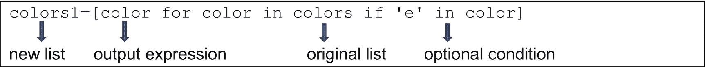

# 2. 探索容器、类与对象

在本章中，我们将深入学习 Python 中其他一些基本概念——各种类型的容器、可用于每种容器的方法、面向对象编程、类以及对象。

## 容器

在上一章中，我们看到变量可以具有像 `int`、`float`、`str` 等数据类型，但只能保存单个值。容器是可以包含多个值的对象。这些值可以具有相同的数据类型或不同的数据类型。Python 中四种内置的容器是：

- 列表
- 元组
- 字典
- 集合

容器也被称为可迭代对象；也就是说，你可以访问或遍历给定容器对象中的每一个值。

在接下来的章节中，我们将更详细地讨论每种容器及其方法。

### 列表

列表是按顺序存储的一组值。列表是可变的，也就是说，可以修改、添加或删除列表中的值，因此它是一种灵活的容器。

可以通过索引访问单个列表项，索引是方括号内的整数，表示该项的位置。列表的索引从 0 开始。

现在让我们看看如何定义和操作列表。

#### 定义列表

可以通过为列表指定名称和一组用方括号括起来的值来定义列表。

```python
colors=['violet','indigo','red','blue','green','yellow']
```

#### 向列表添加元素

可以使用不同的方法向列表添加值，如表 2-1 所述。下表中的示例使用了前面代码中创建的 `colors` 列表。

**表 2-1** 向列表添加元素

| 方法 | 描述 | 示例 |
| --- | --- | --- |
| `Append` | 在列表末尾添加一个元素。该方法只接受单个值作为参数。 | `colors.append('white')` `#将值'white'添加到'colors'列表的最后一个元素之后` |
| `Insert` | 在指定位置或索引处添加一个元素。该方法接受两个参数——索引和要添加的值。 | `colors.insert(3,'pink')` `#将值'pink'添加到'colors'列表的第四个位置` |
| `Extend` | 在给定列表末尾添加多个元素（作为一个列表）。该方法接受另一个列表作为参数。 | `colors.extend(['purple','magenta'])` `#将值'purple'和'magenta'添加到'colors'列表的末尾` |

#### 从列表中删除元素

就像有多种方法可以向列表添加元素一样，也有多种方法可以从列表中删除值，如表 2-2 所述。请注意，这些方法每次只能删除一个元素。

**表 2-2** 从列表中删除元素

| 方法 | 描述 | 示例 |
| --- | --- | --- |
| `Del` | `del` 关键字删除指定位置的元素。 | `del colors[1]` `#删除'colors'列表的第二个元素` |
| `Remove` | 当知道要删除的元素名称但不知道其位置时使用此方法。 | `colors.remove('white')` `#从'colors'列表中删除元素'white'` |
| `Pop` | 此方法删除并返回列表中的最后一个元素。 | `colors.pop()` `#删除最后一个元素并显示被删除的元素` |

#### 查找列表中对象的索引（位置）

`index` 方法用于查找列表中特定元素或值的位置（或索引），如下所示。

```python
colors.index('violet')
```

输出：

```

```

#### 计算列表的长度

`len` 函数返回列表中元素的数量，如下所示。列表的名称作为参数传递给此函数。请注意，`len` 是一个函数，而不是方法。方法只能与对象一起使用。

```python
len(colors)
```

输出：

```

```

#### 对列表进行排序

`sort` 方法按升序或降序对列表中的值进行排序。默认情况下，此方法按升序对元素进行排序。如果列表包含字符串，则按字母顺序排序（使用每个字符串的第一个字母），如下所示。

```python
colors.sort()
colors
```

输出：

```
['blue', 'green', 'purple', 'red', 'violet', 'white', 'yellow']
```

请注意，要使 `sort` 方法正常工作，列表必须是同质的（列表中的所有值应为相同的数据类型）。如果列表包含不同数据类型的元素，应用 `sort` 方法会导致错误。

如果希望按字母降序对元素进行排序，则需要添加 `reverse` 参数并将其设置为 `True`，如下所示。

```python
colors.sort(reverse=True)
colors
```

输出：

```
['yellow', 'white', 'violet', 'red', 'purple', 'green', 'blue']
```

请注意，如果只想反转列表中元素的顺序而不进行排序，可以使用 `reverse` 方法，如下所示。

```python
colors=['violet','indigo','red','blue','green','yellow']
colors.reverse()
colors
```

输出：

```
['yellow', 'green', 'blue', 'red', 'indigo', 'violet']
```

延伸阅读：

查看更多可用于列表的方法：

[`https://docs.python.org/3/tutorial/datastructures.html#more-on-lists`](https://docs.python.org/3/tutorial/datastructures.html%2523more-on-lists)

#### 列表切片

当我们从列表中创建切片时，我们通过根据元素的位置或使用条件选择列表中的特定值，来创建原始列表的子集。列表切片的工作方式与我们在前一章学习的字符串切片类似。

要使用索引创建切片，我们使用冒号运算符（`:`）并指定需要选择的索引的起始值和结束值。

如果在冒号前后没有提供起始值或结束值，则假定起始值是第一个元素的索引（0），结束值是最后一个元素的索引，如下所示。

```python
colors[:]
```

输出：

```
['Violet', 'Indigo', 'Blue', 'Green', 'Yellow', 'Orange', 'Red']
```

如果使用步长索引，我们也可以使用两次冒号运算符。在下面的语句中，通过指定步长索引为 2，提取了列表中的间隔元素。

```python
colors[::2]
```

输出：

```
['Violet', 'Blue', 'Yellow', 'Red']
```

与字符串一样，列表同时支持正索引和负索引。负索引（从 –1 开始，即列表中最后一个元素的索引）从右向左工作，而正索引（从 0 开始，即列表中第一个元素的索引）从左向右工作。

下面是一个使用负索引进行切片的示例，我们从列表中的最后一个值开始提取间隔元素。

```python
colors[-1:-8:-2]
```

输出：

```
['Red', 'Yellow', 'Blue', 'Violet']
```

#### 从现有列表创建新列表

从现有列表创建新列表有三种方法：列表推导式、`map()` 函数和 `filter()` 函数，下面将逐一介绍。

1. **列表推导式**

列表推导式提供了一种简洁直观的方式，可以从现有列表创建新列表。

我们通过一个示例来理解：从之前创建的列表（`colors`）中创建一个新列表（`colors1`）。这个新列表只包含原列表中包含字母 `'e'` 的元素。

代码：

```python
colors1=[color for color in colors if 'e' in color]
colors1
```

输出：

```
['violet', 'red', 'blue', 'green', 'yellow']
```

列表推导式的结构如图 2-1 所示。首先是新列表中元素的输出表达式（`color`）。接下来是一个 `for` 循环，用于遍历原列表（注意，列表推导式中不会使用 `while` 循环等其他循环方式）。最后，你可以使用 `if/else` 结构添加一个可选条件。



图 2-1 列表推导式

如果我们不使用列表推导式，而是用循环和条件来创建相同的列表，代码会冗长得多，如下所示。

代码：

```python
colors1=[]
for color in colors:
if 'e' in color:
colors1.append(color)
```

使用列表推导式时，需要牢记的关键点是：不应牺牲代码的可读性。如果创建新列表涉及过多的条件表达式和循环，最好避免使用列表推导式。

延伸阅读：了解更多关于列表推导式的内容：[`https://docs.python.org/3/tutorial/datastructures.html#list-comprehensions`](https://docs.python.org/3/tutorial/datastructures.html%2523list-comprehensions)

2. **Map 函数**

`map()` 函数用于通过对现有列表应用用户自定义函数或内置函数来创建新列表。`map()` 函数返回一个 map 对象，我们需要使用 `list()` 函数将其转换为列表。

`map()` 函数接受两个参数：
- 要应用的函数
- 要应用该函数的列表

在下面的示例中，我们从 `colors` 列表创建了一个新列表（`colors1`），并将其元素转换为大写。这里使用了一个匿名（lambda）函数，其后跟着原列表的名称。

代码：

```python
colors=['violet','indigo','red','blue','green','yellow']
colors1=map(lambda x:x.upper(),colors)
colors1
```

输出：

```
该函数返回一个 map 对象，需要使用 `list()` 函数将其转换为列表。
```

代码：

```python
list(colors1)
```

输出：

```
['VIOLET', 'INDIGO', 'RED', 'BLUE', 'GREEN', 'YELLOW']
```

3. **Filter 函数**

`filter()` 函数的语法与 `map()` 函数类似。`map()` 函数在应用函数后会返回原列表中的所有对象，而 `filter()` 函数只返回满足调用 filter 函数时指定条件的那些元素。与 `map()` 函数类似，我们传递两个参数（一个 lambda 函数或用户自定义函数，后跟列表名称）。

在下面的示例中，我们从原列表创建了一个新列表，只保留字符数少于五个的元素。

代码：

```python
colors2=filter(lambda x:len(x)<5,colors)
list(colors2)
```

输出：

```
['red', 'blue']
```

现在我们来讨论如何同时遍历两个或多个列表。

**使用 `zip()` 函数遍历多个列表**

`zip()` 函数提供了一种组合列表并对这些列表联合执行操作的方法，如下所示。需要组合的列表作为参数传递给 `list()` 函数。

代码：

#### `zip` 函数与列表

```python
colors=['Violet','Indigo','Blue','Green','Yellow','Orange','Red']
color_ids=[1,2,3,4,5,6,7]
for i,j in zip(colors, color_ids):
    print(i,"has a serial number",j)
```

输出：

```
Violet has a serial number 1
Indigo has a serial number 2
Blue has a serial number 3
Green has a serial number 4
Yellow has a serial number 5
Orange has a serial number 6
Red has a serial number 7
```

`zip` 函数返回一个元组列表，这些元组存储在一个类型为 `zip` 的对象中。需要将该对象的类型转换为 `list` 类型才能查看这些元组。

代码：

```python
list(zip(colors,color_ids))
```

输出：

```
[('Violet', 1),
('Indigo', 2),
('Blue', 3),
('Green', 4),
('Yellow', 5),
('Orange', 6),
('Red', 7)]
```

下一个函数 `enumerate` 帮助我们访问列表中元素的索引。

#### 访问列表中元素的索引

当你想要同时访问给定列表中的对象及其索引时，`enumerate` 函数非常有用。该函数返回一系列元组，每个元组包含元素及其索引。下面展示了该函数的使用示例。

代码：

```python
colors=['Violet','Indigo','Blue','Green','Yellow','Orange','Red']
for index,item in enumerate(colors):
    print(item,"occurs at index",index)
```

输出：

```
Violet occurs at index 0
Indigo occurs at index 1
Blue occurs at index 2
Green occurs at index 3
Yellow occurs at index 4
Orange occurs at index 5
Red occurs at index 6
```

#### 拼接列表

列表的拼接，即合并两个或多个列表，可以使用 `+` 运算符完成。

代码：

```python
x=[1,2,3]
y=[3,4,5]
x+y
```

输出：

```
[1, 2, 3, 3, 4, 5]
```

我们可以拼接任意数量的列表。请注意，拼接操作不会修改任何被合并的列表。拼接操作的结果存储在一个新对象中。`extend` 方法也可用于列表的拼接。与 `+` 运算符不同，`extend` 方法会改变原始列表。

代码：

```python
x.extend(y)
x
```

输出：

```
[1, 2, 3, 3, 4, 5]
```

其他算术运算符，如 `-`、`*` 或 `/`，不能用于合并列表。要找出包含数字的两个列表中元素的差值，我们使用列表推导式和 `zip` 函数，如下所示。

代码：

```python
x=[1,2,3]
y=[3,4,5]
d=[i-j for i,j in zip(x,y)]
d
```

输出：

```
[-2, -2, -2]
```

### 元组

元组是 Python 中的另一种容器，与列表类似，它按顺序存储元素。与列表中的元素一样，元组中的值可以通过其索引进行访问。然而，元组有一些属性使其与列表区分开来，如下所述。

1. **不可变性**：元组是不可变的，这意味着你不能在元组中添加、删除或更改元素。而列表则允许所有这些操作。
2. **语法**：定义元组的语法使用圆括号（或小括号）来括起各个值（而列表则使用方括号）。
3. **速度**：在访问和检索单个元素的速度方面，元组的性能优于列表。

现在让我们学习如何定义元组以及可以与元组一起使用的各种方法。

#### 定义元组

元组可以带括号或不带括号定义，如下面的代码所示。

代码：

```python
a=(1,2,3)
# 也可以不带括号定义
b=1,2,3
# 元组可以只包含一个元素
c=1,
# 注意，即使后面没有元素，我们也需要添加逗号，因为这是在告诉解释器这是一个元组。
```

与列表一样，元组可以包含任何内置数据类型的对象，例如浮点数、字符串、布尔值等。

#### 与元组一起使用的方法

虽然元组不能被更改，但仍有一些操作可以在元组上执行。这些操作如下所述。

##### 元组中对象的频率

`count` 方法用于统计给定值在元组中出现的次数：

代码：

```python
x=(True,False,True,False,True)
x.count(True)
```

输出：

```

```

#### 元组项的位置/索引

`index` 方法可用于查找元组中某项的位置。使用上一条语句创建的元组，我们来查找值 `"False"` 出现的位置。

代码：

```python
x.index(False)
```

输出：

```

```

`index` 方法仅返回该项首次出现的位置。

#### 元组解包

元组解包是指提取元组中的各个值，并将每个值分别存储到不同变量中的过程。

代码：

```python
a,b,c,d,e=x
```

如果我们不知道元组中项的数量，可以使用 `*_` 符号将第一个元素之后出现的元素解包到一个列表中，如下所示。

代码：

```python
a,*_=x
print(a,_)
```

输出：

```
True [False, True, False, True]
```

#### 元组的长度

可以使用 `len` 函数计算元组的长度：

代码：

```python
len(x)
```

输出：

```

```

#### 元组的切片

可以对元组执行切片操作，即创建更小的值子集（在这方面与列表和字符串类似）。示例如下。

代码：

```python
x[::-1]
```

输出：

```
(True, False, True, False, True)
```

### 元组的应用
以下是元组的一些使用场景。

1.  **使用元组创建字典**  
    字典（我们将在下一节详细讨论）是一种包含一组项的容器（其中键映射到值）。在创建字典时，可以使用元组来定义项。字典项是一个元组，可以使用 `dict` 方法将字典定义为一个元组列表，如下所示。

    代码：

    ```python
    x=dict([('color','pink'),('flower','rose')])
    x
    ```

    输出：

    ```
    {'color': 'pink', 'flower': 'rose'}
    ```

2.  **多重赋值**  
    如前所述，元组解包是将元组拆分为其组成部分的过程。这一原理可用于在一行中初始化多个变量，如下所示。

    代码：

    ```python
    #元组解包
    (a,b,c,d)=range(4)
    print(a,b,c,d)
    ```

    输出：

    ```
    0 1 2 3
    ```

延伸阅读：在此处查看更多关于元组的内容：[`https://docs.python.org/3/tutorial/datastructures.html#tuples-and-sequences`](https://docs.python.org/3/tutorial/datastructures.html%2523tuples-and-sequences)

### 字典
字典是一种包含一组项的容器，每个项将“键”映射到“值”。每个单独的项也称为键/值对。关于字典，还需要注意以下几点：

*   与列表和元组中的值不同，字典中的项不是按顺序存储的。
*   字典是可变的，与列表类似（即可以对字典对象进行修改）。
*   字典中的项用花括号括起来。

让我们了解如何定义字典以及可用于字典对象的不同方法。

#### 定义字典
字典定义为一组用逗号分隔的键/值对，并用一对花括号括起来，如下代码所示。

代码：

```python
numbers={'English':'One','Spanish':'Uno','German':'Ein'}
numbers
```

输出：

```
{'English': 'One', 'Spanish': 'Uno', 'German': 'Ein'}
```

`"English"`、`"Spanish"` 和 `"German"` 构成键，而 `"One"`、`"Uno"` 和 `"Ein"` 是字典中的值。

也可以使用 `dict` 函数定义字典，正如我们在讨论元组时前面所解释的那样。该函数的参数是一个元组列表，每个元组代表一个键/值对，如下所示。

```python
numbers=dict([('English','One'),('Spanish','Uno'),('German','Ein')])
```

#### 向字典添加项（键/值对）
使用键作为索引，可以向字典添加新项，如下所示。

代码：

```python
numbers['French']='un'
numbers
#已添加一个新的键/值对，键为'French'，值为'un'。
```

输出：

```
{'English': 'One', 'Spanish': 'Uno', 'German': 'Ein', 'French': 'un'}
```