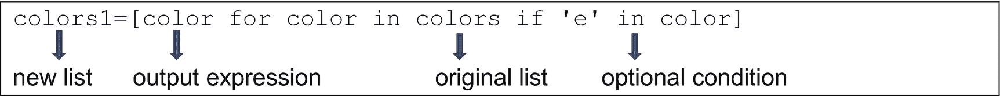

# 2. 探索容器、类与对象

在本章中，我们将深入学习 Python 中其他一些基本概念——各种类型的容器、可用于每种容器的方法、面向对象编程、类以及对象。

## 容器

在上一章中，我们看到变量可以具有像 `int`、`float`、`str` 等数据类型，但只能保存单个值。容器是可以包含多个值的对象。这些值可以具有相同的数据类型或不同的数据类型。Python 中四种内置的容器是：

- 列表
- 元组
- 字典
- 集合

容器也被称为可迭代对象；也就是说，你可以访问或遍历给定容器对象中的每一个值。

在接下来的章节中，我们将更详细地讨论每种容器及其方法。

### 列表

列表是按顺序存储的一组值。列表是可变的，也就是说，可以修改、添加或删除列表中的值，因此它是一种灵活的容器。

可以通过索引访问单个列表项，索引是方括号内的整数，表示该项的位置。列表的索引从 0 开始。

现在让我们看看如何定义和操作列表。

#### 定义列表

可以通过为列表指定名称和一组用方括号括起来的值来定义列表。

```python
colors=['violet','indigo','red','blue','green','yellow']
```

#### 向列表添加元素

可以使用不同的方法向列表添加值，如表 2-1 所述。下表中的示例使用了前面代码中创建的 `colors` 列表。

**表 2-1** 向列表添加元素

| 方法 | 描述 | 示例 |
| --- | --- | --- |
| `Append` | 在列表末尾添加一个元素。该方法只接受单个值作为参数。 | `colors.append('white')` `#将值'white'添加到'colors'列表的最后一个元素之后` |
| `Insert` | 在指定位置或索引处添加一个元素。该方法接受两个参数——索引和要添加的值。 | `colors.insert(3,'pink')` `#将值'pink'添加到'colors'列表的第四个位置` |
| `Extend` | 在给定列表末尾添加多个元素（作为一个列表）。该方法接受另一个列表作为参数。 | `colors.extend(['purple','magenta'])` `#将值'purple'和'magenta'添加到'colors'列表的末尾` |

#### 从列表中删除元素

就像有多种方法可以向列表添加元素一样，也有多种方法可以从列表中删除值，如表 2-2 所述。请注意，这些方法每次只能删除一个元素。

**表 2-2** 从列表中删除元素

| 方法 | 描述 | 示例 |
| --- | --- | --- |
| `Del` | `del` 关键字删除指定位置的元素。 | `del colors[1]` `#删除'colors'列表的第二个元素` |
| `Remove` | 当知道要删除的元素名称但不知道其位置时使用此方法。 | `colors.remove('white')` `#从'colors'列表中删除元素'white'` |
| `Pop` | 此方法删除并返回列表中的最后一个元素。 | `colors.pop()` `#删除最后一个元素并显示被删除的元素` |

#### 查找列表中对象的索引（位置）

`index` 方法用于查找列表中特定元素或值的位置（或索引），如下所示。

```python
colors.index('violet')
```

输出：

```

```

#### 计算列表的长度

`len` 函数返回列表中元素的数量，如下所示。列表的名称作为参数传递给此函数。请注意，`len` 是一个函数，而不是方法。方法只能与对象一起使用。

```python
len(colors)
```

输出：

```

```

#### 对列表进行排序

`sort` 方法按升序或降序对列表中的值进行排序。默认情况下，此方法按升序对元素进行排序。如果列表包含字符串，则按字母顺序排序（使用每个字符串的第一个字母），如下所示。

```python
colors.sort()
colors
```

输出：

```
['blue', 'green', 'purple', 'red', 'violet', 'white', 'yellow']
```

请注意，要使 `sort` 方法正常工作，列表必须是同质的（列表中的所有值应为相同的数据类型）。如果列表包含不同数据类型的元素，应用 `sort` 方法会导致错误。

如果希望按字母降序对元素进行排序，则需要添加 `reverse` 参数并将其设置为 `True`，如下所示。

```python
colors.sort(reverse=True)
colors
```

输出：

```
['yellow', 'white', 'violet', 'red', 'purple', 'green', 'blue']
```

请注意，如果只想反转列表中元素的顺序而不进行排序，可以使用 `reverse` 方法，如下所示。

```python
colors=['violet','indigo','red','blue','green','yellow']
colors.reverse()
colors
```

输出：

```
['yellow', 'green', 'blue', 'red', 'indigo', 'violet']
```

延伸阅读：

查看更多可用于列表的方法：

[`https://docs.python.org/3/tutorial/datastructures.html#more-on-lists`](https://docs.python.org/3/tutorial/datastructures.html%2523more-on-lists)

#### 列表切片

当我们从列表中创建切片时，我们通过根据元素的位置或使用条件选择列表中的特定值，来创建原始列表的子集。列表切片的工作方式与我们在前一章学习的字符串切片类似。

要使用索引创建切片，我们使用冒号运算符（`:`）并指定需要选择的索引的起始值和结束值。

如果在冒号前后没有提供起始值或结束值，则假定起始值是第一个元素的索引（0），结束值是最后一个元素的索引，如下所示。

```python
colors[:]
```

输出：

```
['Violet', 'Indigo', 'Blue', 'Green', 'Yellow', 'Orange', 'Red']
```

如果使用步长索引，我们也可以使用两次冒号运算符。在下面的语句中，通过指定步长索引为 2，提取了列表中的间隔元素。

```python
colors[::2]
```

输出：

```
['Violet', 'Blue', 'Yellow', 'Red']
```

与字符串一样，列表同时支持正索引和负索引。负索引（从 –1 开始，即列表中最后一个元素的索引）从右向左工作，而正索引（从 0 开始，即列表中第一个元素的索引）从左向右工作。

下面是一个使用负索引进行切片的示例，我们从列表中的最后一个值开始提取间隔元素。

```python
colors[-1:-8:-2]
```

输出：

```
['Red', 'Yellow', 'Blue', 'Violet']
```

#### 从现有列表创建新列表

从现有列表创建新列表有三种方法：列表推导式、`map()` 函数和 `filter()` 函数，下面将逐一介绍。

1. **列表推导式**

列表推导式提供了一种简洁直观的方式，可以从现有列表创建新列表。

我们通过一个示例来理解：从之前创建的列表（`colors`）中创建一个新列表（`colors1`）。这个新列表只包含原列表中包含字母 `'e'` 的元素。

代码：

```python
colors1=[color for color in colors if 'e' in color]
colors1
```

输出：

```
['violet', 'red', 'blue', 'green', 'yellow']
```

列表推导式的结构如图 2-1 所示。首先是新列表中元素的输出表达式（`color`）。接下来是一个 `for` 循环，用于遍历原列表（注意，列表推导式中不会使用 `while` 循环等其他循环方式）。最后，你可以使用 `if/else` 结构添加一个可选条件。



图 2-1 列表推导式

如果我们不使用列表推导式，而是用循环和条件来创建相同的列表，代码会冗长得多，如下所示。

代码：

```python
colors1=[]
for color in colors:
if 'e' in color:
colors1.append(color)
```

使用列表推导式时，需要牢记的关键点是：不应牺牲代码的可读性。如果创建新列表涉及过多的条件表达式和循环，最好避免使用列表推导式。

延伸阅读：了解更多关于列表推导式的内容：[`https://docs.python.org/3/tutorial/datastructures.html#list-comprehensions`](https://docs.python.org/3/tutorial/datastructures.html%2523list-comprehensions)

2. **Map 函数**

`map()` 函数用于通过对现有列表应用用户自定义函数或内置函数来创建新列表。`map()` 函数返回一个 map 对象，我们需要使用 `list()` 函数将其转换为列表。

`map()` 函数接受两个参数：
- 要应用的函数
- 要应用该函数的列表

在下面的示例中，我们从 `colors` 列表创建了一个新列表（`colors1`），并将其元素转换为大写。这里使用了一个匿名（lambda）函数，其后跟着原列表的名称。

代码：

```python
colors=['violet','indigo','red','blue','green','yellow']
colors1=map(lambda x:x.upper(),colors)
colors1
```

输出：

```
该函数返回一个 map 对象，需要使用 `list()` 函数将其转换为列表。
```

代码：

```python
list(colors1)
```

输出：

```
['VIOLET', 'INDIGO', 'RED', 'BLUE', 'GREEN', 'YELLOW']
```

3. **Filter 函数**

`filter()` 函数的语法与 `map()` 函数类似。`map()` 函数在应用函数后会返回原列表中的所有对象，而 `filter()` 函数只返回满足调用 filter 函数时指定条件的那些元素。与 `map()` 函数类似，我们传递两个参数（一个 lambda 函数或用户自定义函数，后跟列表名称）。

在下面的示例中，我们从原列表创建了一个新列表，只保留字符数少于五个的元素。

代码：

```python
colors2=filter(lambda x:len(x)<5,colors)
list(colors2)
```

输出：

```
['red', 'blue']
```

现在我们来讨论如何同时遍历两个或多个列表。

**使用 `zip()` 函数遍历多个列表**

`zip()` 函数提供了一种组合列表并对这些列表联合执行操作的方法，如下所示。需要组合的列表作为参数传递给 `list()` 函数。

代码：

#### `zip` 函数与列表

```python
colors=['Violet','Indigo','Blue','Green','Yellow','Orange','Red']
color_ids=[1,2,3,4,5,6,7]
for i,j in zip(colors, color_ids):
    print(i,"has a serial number",j)
```

输出：

```
Violet has a serial number 1
Indigo has a serial number 2
Blue has a serial number 3
Green has a serial number 4
Yellow has a serial number 5
Orange has a serial number 6
Red has a serial number 7
```

`zip` 函数返回一个元组列表，这些元组存储在一个类型为 `zip` 的对象中。需要将该对象的类型转换为 `list` 类型才能查看这些元组。

代码：

```python
list(zip(colors,color_ids))
```

输出：

```
[('Violet', 1),
('Indigo', 2),
('Blue', 3),
('Green', 4),
('Yellow', 5),
('Orange', 6),
('Red', 7)]
```

下一个函数 `enumerate` 帮助我们访问列表中元素的索引。

#### 访问列表中元素的索引

当你想要同时访问给定列表中的对象及其索引时，`enumerate` 函数非常有用。该函数返回一系列元组，每个元组包含元素及其索引。下面展示了该函数的使用示例。

代码：

```python
colors=['Violet','Indigo','Blue','Green','Yellow','Orange','Red']
for index,item in enumerate(colors):
    print(item,"occurs at index",index)
```

输出：

```
Violet occurs at index 0
Indigo occurs at index 1
Blue occurs at index 2
Green occurs at index 3
Yellow occurs at index 4
Orange occurs at index 5
Red occurs at index 6
```

#### 拼接列表

列表的拼接，即合并两个或多个列表，可以使用 `+` 运算符完成。

代码：

```python
x=[1,2,3]
y=[3,4,5]
x+y
```

输出：

```
[1, 2, 3, 3, 4, 5]
```

我们可以拼接任意数量的列表。请注意，拼接操作不会修改任何被合并的列表。拼接操作的结果存储在一个新对象中。`extend` 方法也可用于列表的拼接。与 `+` 运算符不同，`extend` 方法会改变原始列表。

代码：

```python
x.extend(y)
x
```

输出：

```
[1, 2, 3, 3, 4, 5]
```

其他算术运算符，如 `-`、`*` 或 `/`，不能用于合并列表。要找出包含数字的两个列表中元素的差值，我们使用列表推导式和 `zip` 函数，如下所示。

代码：

```python
x=[1,2,3]
y=[3,4,5]
d=[i-j for i,j in zip(x,y)]
d
```

输出：

```
[-2, -2, -2]
```

### 元组

元组是 Python 中的另一种容器，与列表类似，它按顺序存储元素。与列表中的元素一样，元组中的值可以通过其索引进行访问。然而，元组有一些属性使其与列表区分开来，如下所述。

1. **不可变性**：元组是不可变的，这意味着你不能在元组中添加、删除或更改元素。而列表则允许所有这些操作。
2. **语法**：定义元组的语法使用圆括号（或小括号）来括起各个值（而列表则使用方括号）。
3. **速度**：在访问和检索单个元素的速度方面，元组的性能优于列表。

现在让我们学习如何定义元组以及可以与元组一起使用的各种方法。

#### 定义元组

元组可以带括号或不带括号定义，如下面的代码所示。

代码：

```python
a=(1,2,3)
# 也可以不带括号定义
b=1,2,3
# 元组可以只包含一个元素
c=1,
# 注意，即使后面没有元素，我们也需要添加逗号，因为这是在告诉解释器这是一个元组。
```

与列表一样，元组可以包含任何内置数据类型的对象，例如浮点数、字符串、布尔值等。

#### 与元组一起使用的方法

虽然元组不能被更改，但仍有一些操作可以在元组上执行。这些操作如下所述。

##### 元组中对象的频率

`count` 方法用于统计给定值在元组中出现的次数：

代码：

```python
x=(True,False,True,False,True)
x.count(True)
```

输出：

```

```

#### 元组项的位置/索引

`index` 方法可用于查找元组中某项的位置。使用上一条语句创建的元组，我们来查找值 `"False"` 出现的位置。

代码：

```python
x.index(False)
```

输出：

```

```

`index` 方法仅返回该项首次出现的位置。

#### 元组解包

元组解包是指提取元组中的各个值，并将每个值分别存储到不同变量中的过程。

代码：

```python
a,b,c,d,e=x
```

如果我们不知道元组中项的数量，可以使用 `*_` 符号将第一个元素之后出现的元素解包到一个列表中，如下所示。

代码：

```python
a,*_=x
print(a,_)
```

输出：

```
True [False, True, False, True]
```

#### 元组的长度

可以使用 `len` 函数计算元组的长度：

代码：

```python
len(x)
```

输出：

```

```

#### 元组的切片

可以对元组执行切片操作，即创建更小的值子集（在这方面与列表和字符串类似）。示例如下。

代码：

```python
x[::-1]
```

输出：

```
(True, False, True, False, True)
```

### 元组的应用
以下是元组的一些使用场景。

1.  **使用元组创建字典**  
    字典（我们将在下一节详细讨论）是一种包含一组项的容器（其中键映射到值）。在创建字典时，可以使用元组来定义项。字典项是一个元组，可以使用 `dict` 方法将字典定义为一个元组列表，如下所示。

    代码：

    ```python
    x=dict([('color','pink'),('flower','rose')])
    x
    ```

    输出：

    ```
    {'color': 'pink', 'flower': 'rose'}
    ```

2.  **多重赋值**  
    如前所述，元组解包是将元组拆分为其组成部分的过程。这一原理可用于在一行中初始化多个变量，如下所示。

    代码：

    ```python
    #元组解包
    (a,b,c,d)=range(4)
    print(a,b,c,d)
    ```

    输出：

    ```
    0 1 2 3
    ```

延伸阅读：在此处查看更多关于元组的内容：[`https://docs.python.org/3/tutorial/datastructures.html#tuples-and-sequences`](https://docs.python.org/3/tutorial/datastructures.html%2523tuples-and-sequences)

### 字典
字典是一种包含一组项的容器，每个项将“键”映射到“值”。每个单独的项也称为键/值对。关于字典，还需要注意以下几点：

*   与列表和元组中的值不同，字典中的项不是按顺序存储的。
*   字典是可变的，与列表类似（即可以对字典对象进行修改）。
*   字典中的项用花括号括起来。

让我们了解如何定义字典以及可用于字典对象的不同方法。

#### 定义字典
字典定义为一组用逗号分隔的键/值对，并用一对花括号括起来，如下代码所示。

代码：

```python
numbers={'English':'One','Spanish':'Uno','German':'Ein'}
numbers
```

输出：

```
{'English': 'One', 'Spanish': 'Uno', 'German': 'Ein'}
```

`"English"`、`"Spanish"` 和 `"German"` 构成键，而 `"One"`、`"Uno"` 和 `"Ein"` 是字典中的值。

也可以使用 `dict` 函数定义字典，正如我们在讨论元组时前面所解释的那样。该函数的参数是一个元组列表，每个元组代表一个键/值对，如下所示。

```python
numbers=dict([('English','One'),('Spanish','Uno'),('German','Ein')])
```

#### 向字典添加项（键/值对）
使用键作为索引，可以向字典添加新项，如下所示。

代码：

```python
numbers['French']='un'
numbers
#已添加一个新的键/值对，键为'French'，值为'un'。
```

输出：

```
{'English': 'One', 'Spanish': 'Uno', 'German': 'Ein', 'French': 'un'}
```

# 访问字典中的键
`keys`方法用于访问字典中的键：

```
numbers.keys()
```

输出：

```
dict_keys(['English', 'Spanish', 'German', 'French'])
```

# 访问字典中的值

`values`方法用于访问字典中的值：

```
numbers.values()
```

输出：

```
dict_values(['One', 'Uno', 'Ein', 'un'])
```

# 访问字典中的所有键/值对
`items`方法用于访问字典中的键/值对列表：
```
numbers.items()
```

输出：
```
dict_items([('English', 'One'), ('Spanish', 'Uno'), ('German', 'Ein'), ('French', 'un')])
```

# 访问单个值
可以使用键作为索引来检索给定键对应的值，如下所示：

```
numbers['German']
```

输出：

```
'Ein'
```

`get`方法也可用于检索值。键作为参数传递给此方法，如下所示：

```
numbers.get('German')
```

输出与上一条语句获得的结果相同。

# 为键设置默认值

前面讨论的`get`方法也可用于添加键/值对并为键设置默认值。如果键/值对已定义，则忽略默认值。还有另一种方法`setdefault`，也可用于此目的。

请注意，`get`方法不会更改字典对象，而`setdefault`方法确保更改反映在对象中。

## `setdefault` 方法示例

以下是`setdefault`方法的使用示例：

```
numbers.setdefault('Mandarin','yi')
numbers
```

输出：

```
{'English': 'One',
'Spanish': 'Uno',
'German': 'Ein',
'French': 'un',
'Mandarin': 'yi'}
```

如我们所见，添加了一个新的键/值对。

## `get` 方法示例

以下是`get`方法的使用示例：

```
numbers.get('Hindi','Ek')
numbers
```

输出：

```
{'English': 'One',
'Spanish': 'Uno',
'German': 'Ein',
'French': 'un',
'Mandarin': 'yi'}
```

`get`方法设置的值不会添加到字典中。

# 清空字典

`clear`方法移除字典中的所有键/值对，换句话说，它清空字典的内容，但不会从内存中移除变量。

```
#removing all the key/value pairs
numbers.clear()
```

输出：

```
{}
```

进一步阅读：了解更多关于字典的信息：[`https://docs.python.org/3/tutorial/datastructures.html#dictionaries`](https://docs.python.org/3/tutorial/datastructures.html%2523dictionaries)

## 集合

集合是一个容器，包含无序且无索引的元素。集合的主要特征是它是*唯一*元素的集合。请注意，如果在创建集合时添加重复元素，Python 不会抛出错误。但是，在对集合执行操作时，所有重复元素都会被忽略，只考虑不同的元素。

### 集合定义

与字典一样，集合使用花括号声明，并且元素无序。然而，字典中的值可以通过键作为索引访问，而集合中的值不能通过索引访问。

以下是集合定义的示例：

```
a={1,1,2}
a
```

输出：

```
{1, 2}
```

从输出中可以看出，集合定义中存在的重复值 1 被忽略。

### 集合操作

可用于集合的方法和函数在表 2-3 中说明。

进一步阅读：了解更多关于集合的信息：[`https://docs.python.org/3/tutorial/datastructures.html#sets`](https://docs.python.org/3/tutorial/datastructures.html%2523sets)

**表 2-3 集合操作**

| 操作 | 方法/函数 | 示例 |
| --- | --- | --- |
| 查找集合的长度 | `len`函数计算集合中元素的数量，仅考虑不同的值。 | `len(a)` |
| 集合迭代 | `for`循环可以遍历集合并打印其元素。 | `for x in a:` `print(x)` |
| 添加项或值 | 可以使用`add`方法向集合添加单个项。要添加多个值，使用`update`方法。 | `a.add(3)` `#or` `a.update([4,5])` |
| 移除项 | 可以使用`remove`或`discard`方法移除项。 | `a.remove(4)` `# Or` `a.discard(4)` `#注意：当我们尝试删除集合中不存在的元素时，discard 方法不会报错，而 remove 方法会引发 KeyError。` |

现在我们已经涵盖了 Python 语言的所有要点——我们在前一章学到的概念以及本章对各种容器及其方法的理解——我们需要决定使用哪种风格或编程范式。在各种编程范式中，包括过程式、函数式和面向对象编程，我们将在下一节讨论面向对象编程。

## 面向对象编程

面向对象编程（通常也称为“OOPS”）作为过程式编程的替代方案出现，过程式编程是传统的编程方法。

过程式编程涉及使用一系列步骤顺序执行程序。过程式编程的一个主要缺点是存在容易意外操作的全局变量。OOPS 相对于过程式编程提供了几个优势，包括代码重用能力、消除全局变量、防止对数据的未授权访问以及管理代码复杂性的能力。

Python 遵循面向对象范式。类和对象构成了面向对象编程的构建块。类提供蓝图或结构，而对象实现此结构。类使用`class`关键字定义。

例如，假设你有一个名为“Baby”的类，其属性包括婴儿的名字、性别和体重。这个类的方法（或在类内部定义的函数）可以是婴儿执行的动作，如微笑、哭泣和进食。实例/对象是类的实现，并拥有自己的一组属性和方法。在这个例子中，每个婴儿都有其独特的特征（数据）和行为（功能）。

一个类可以有一组属性或变量，这些变量可以是类变量或实例变量。类的所有实例共享类变量，而实例变量对每个实例是唯一的。

让我们通过以下示例了解如何在 Python 中定义类：

```
#example of a class
class Rectangle:
    sides=4
    def __init__(self,l,b):
        self.length=l
        self.breadth=b
    def area(self):
        print("Area:",self.length*self.breadth)
my_rectangle=Rectangle(4,5)
my_rectangle.area()
```

输出：

```
Area: 20
```

`class`关键字后面跟着类名和冒号。接下来，我们定义一个名为`sides`的类变量，并将其初始化为`4`。这个变量对该类的所有对象都是通用的。

之后，有一个构造函数用于设置或初始化变量。请注意构造函数的特殊语法——`def`关键字后面跟两个下划线，然后是`init`关键字，再跟两个下划线。

类中定义的任何方法的第一个参数都是`self`关键字，它指向类的一个实例。然后是初始化参数`l`和`b`，分别表示矩形的长度和宽度。这些值在创建对象时作为参数提供。实例变量`self.length`和`self.breadth`使用前面提到的参数进行初始化。接下来是另一个计算矩形面积的方法。请记住，在定义类的任何方法时，都需要将`self`作为参数添加。

类定义完成后，我们可以定义该类的一个实例，也称为对象。创建对象就像创建变量一样，给它一个名字并初始化它。`my_rectangle`是创建的对象/实例的名称，后面跟着`=`号。然后我们提到类的名称以及构造函数中用于初始化对象的参数。我们正在创建一个长度为`4`、宽度为`5`的矩形。然后我们调用`area`方法来计算面积，该方法计算并打印面积。

进一步阅读：在 Python 中了解更多关于类的信息：[`https://docs.python.org/3/tutorial/classes.html`](https://docs.python.org/3/tutorial/classes.html)

### 面向对象编程原则

面向对象编程的主要原则是封装、多态、数据抽象和继承。让我们逐一了解这些概念。

**封装**：封装指的是将数据（在类中定义的变量）与可以修改它的功能（方法）绑定在一起。封装还包括数据隐藏，因为类中定义的数据对于类外部定义的任何函数来说都是安全的，不会被篡改。一旦我们创建了类的对象，其变量只能通过与该对象关联的方法（或函数）来访问和修改。

让我们考虑以下示例：

代码：

```
class Circle():
    def __init__(self, r):
        self.radius = r
    def area(self):
        return 3.14 * self.radius * self.radius
c = Circle(5)
c.radius  # 访问实例变量的正确方式
```

这里，`Circle`类有一个实例变量`radius`和一个方法`area`。变量`radius`只能通过该类的对象访问，而不能通过其他任何方式访问，如下面的语句所示。

代码：

```
c.radius  # 访问实例变量的正确方式
radius    # 错误，会导致错误
```

**多态**：多态（一个接口，多种形式）提供了使用相同接口（方法或函数）而无需考虑数据类型的能力。

让我们通过`len`函数来理解多态原则。

代码：

```
# 使用 len 函数处理字符串
len("Hello")
```

输出：

```

```

代码：

```
# 使用 len 函数处理列表
len([1, 2, 3, 4])
```

输出：

```

```

代码：

```
# 使用 len 函数处理元组
len((1, 2, 3))
```

输出：

```

```

代码：

```
# 使用 len 函数处理字典
len({'a': 1, 'b': 2})
```

输出：

```

```

`len`函数用于计算其参数的长度，它可以接受任何类型的参数。我们将字符串、列表、元组和字典作为参数传递给该函数，函数返回了每个对象的长度。无需为每种数据类型编写单独的函数。

**继承**：继承指的是从其父类创建另一个类（称为子类）的能力。子类继承父类的一些属性和函数，但也可能拥有自己的功能和变量。

下面演示了 Python 中继承的一个示例。

```
### 继承
class Mother():
    def __init__(self, fname, sname):
        self.firstname = fname
        self.surname = sname
    def nameprint(self):
        print("Name:", self.firstname + " " + self.surname)
class Child(Mother):
    pass
```

父类名为`Mother`，其属性`firstname`和`surname`通过`init`构造函数方法进行初始化。子类名为`Child`，继承自`Mother`类。在定义子类时，父类的名称作为参数传递。关键字`pass`告诉 Python 子类不需要做任何事情（这个类只是继承父类的一切，而不添加任何内容）。

然而，即使子类没有实现任何其他方法或添加任何额外属性，关键字`pass`对于防止抛出任何错误也是必不可少的。

进一步阅读：了解更多关于继承的信息：[`https://docs.python.org/3/tutorial/classes.html#inheritance`](https://docs.python.org/3/tutorial/classes.html%2523inheritance)

**数据抽象**：数据抽象是只呈现功能而隐藏实现细节的过程。例如，WhatsApp 的新用户只需要学习其基本功能，如发送消息、附加照片和拨打电话，而不需要了解编写该应用程序代码的开发人员是如何实现这些功能的。

在下面的示例中，我们声明了一个`Circle`类的对象，并使用`area`方法计算面积，在调用`area`方法时，我们不需要知道面积是如何计算的。

```
class Circle():
    def __init__(self, r):
        self.r = r
    def area(self):
        return 3.14 * self.r * self.r
circle1 = Circle(3)
circle1.area()
```

输出：

```
28.259999999999998
```

## 总结

- 容器是基本数据类型（如`int`、`float`、`str`）对象的集合。Python 中有四种内置容器——列表、元组、字典和集合。
- 每种容器都有不同的属性，并且可以应用于容器的各种函数彼此不同，这取决于元素是否可以排序和更改（可变性）。列表是可变的且有序的，元组是不可变的且有序的，字典和集合是可变的且无序的。
- Python 遵循面向对象编程的原则，如继承（从一个类派生另一个类）、数据抽象（只呈现相关细节）、封装（将数据与功能绑定）和多态（能够使用一个接口处理多种数据类型）。
- 类包含构造函数（使用特殊语法定义）、实例变量以及操作这些变量的方法。所有方法都必须包含关键字`self`作为参数，它指向类的一个对象。

在下一章中，我们将学习 Python 如何应用于正则表达式以及解决数学问题，并了解用于这些应用的库。

## 复习练习

**问题 1**：如何将列表转换为元组，反之亦然？

**问题 2**：

与列表推导式类似，字典推导式是从现有可迭代对象创建字典的快捷方式。使用字典推导式创建以下字典（基于两个列表，一个包含键（`a`–`f`），另一个包含值（`1`–`6`））：

```
{'a': 0, 'b': 1, 'c': 2, 'd': 3, 'e': 4, 'f': 5}
```

### 问题 3

以下哪条代码语句*不会*导致错误？

1.  `'abc'[0]='d'`
2.  `list('abc')[0]='d'`
3.  `tuple('abc')[0]='d'`
4.  `dict([('a',1),('b',2)])[0]=3`

### 问题 4

编写一个程序，计算句子“Every cloud has a silver lining”中元音字母的数量。

#### 问题 5

以下代码的输出是什么？

```
x=1,2
y=1,
z=(1,2,3)
type(x)==type(y)==type(z)
```

#### 问题 6

以下代码的输出是什么？

```
numbers={
'English':{'1':'One','2':'Two'},
'Spanish':{'1':'Uno','2':'Dos'},
'German':{'1':'Ein','2':'Zwei'}
}
numbers['Spanish']['2']
```

#### 问题 7

考虑以下字典：

```
eatables={'chocolate':2,'ice cream':3}
```

使用以下方法向此字典添加另一个条目（键为`"biscuit"`，值为`4`）：

*   `If` 语句
*   `setdefault` 方法

#### 问题 8

创建一个包含 1 到 20 之间奇数的列表，并使用适当的列表方法执行以下操作：

*   在末尾添加元素 `21`
*   在第 4 个位置插入数字 `23`
*   向此列表添加另一个包含 1 到 20 之间偶数的列表
*   查找数字 `15` 的索引
*   移除并返回最后一个元素
*   删除第 10 个元素
*   过滤此列表，创建一个包含所有小于或等于 `13` 的数字的新列表
*   使用 `map` 函数创建一个包含列表中数字平方的新列表
*   使用列表推导式从现有列表创建一个新列表。如果原数字是奇数，则新列表包含该数字；否则，包含该数字的一半。

## 答案

### 问题 1

使用列表方法将元组转换为列表：

```
list((1,2,3))
```

使用元组方法将列表转换为元组：

```
tuple([1,2,3])
```

### 问题 2

代码：

```
#包含键的列表
l=list('abcdef')
#包含值的列表
m=list(range(6))
#字典推导式
x={i:j for i,j in zip(l,m)}
x
```

### 问题 3

正确选项：b 和 d。在选项 a 和 c 中，代码语句试图分别更改字符串和元组中的元素，而它们是不可变对象，因此不允许这些操作。在选项 b（列表）和 d（字典）中，允许元素赋值。

### 问题 4

解决方案：

```
message="Every cloud has a silver lining"
m=message.lower()
count={}
vowels=['a','e','i','o','u']
for character in m:
if character.casefold() in vowels:
count.setdefault(character,0)
count[character]=count[character]+1
print(count)
```

#### 问题 5

输出：

```
True
```

这三种方法都是定义元组的可接受方式。

#### 问题 6

输出：

```
'Dos'
```

此问题使用了嵌套字典（字典中的字典）的概念。

#### 问题 7

解决方案：

```
eatables={'chocolate':2,'ice cream':3}
#If 语句
if 'biscuit' not in eatables:
eatables['biscuit']=4
#setdefault 方法（替代方法）
eatables.setdefault('biscuit',4)
```

#### 问题 8

解决方案：

```
odd_numbers=list(range(1,20,2))
#在末尾添加元素 21
odd_numbers.append(21)
#在第 4 个位置插入数字 23
odd_numbers.insert(3,23)
#向此列表添加另一个包含 1 到 20 之间偶数的列表
even_numbers=list(range(2,20,2))
odd_numbers.extend(even_numbers)
#查找数字 15 的索引
odd_numbers.index(15)
#移除并返回最后一个元素
odd_numbers.pop()
#删除第 10 个元素
del odd_numbers[9]
#过滤此列表，包含所有小于或等于 13 的数字
nos_less_13=filter(lambda x:x<=13,odd_numbers)
list(nos_less_13)
#使用 map 函数创建一个包含平方的列表
squared_list=map(lambda x:x**2,odd_numbers)
#使用列表推导式创建新列表
new_list=[x/2 if x%2==0 else x for x in odd_numbers]
new_list
```

