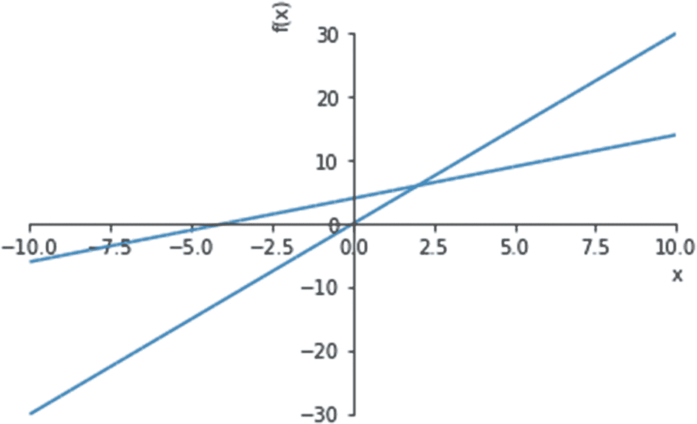

# 3. Python 中的正则表达式与数学运算

在本章中，我们将讨论 Python 中的两个模块：`re`，其中包含可用于正则表达式的函数；以及 `SymPy`，用于解决代数、微积分、概率和集合论中的数学问题。我们在本章中将学习的概念，例如搜索和替换字符串、概率以及绘制图表，将在后续涉及数据分析和统计的章节中派上用场。

## 正则表达式

正则表达式是一种包含字符（如字母和数字）和元字符（如 `*` 和 `$` 符号）的模式。当我们想要搜索、替换或提取具有可识别模式的数据时，例如日期、邮政编码、HTML 标签、电话号码等，都可以使用正则表达式。它们还可以用于验证密码和电子邮件地址等字段，通过确保用户的输入格式正确。

### 使用正则表达式解决问题的步骤

Python 中的 `re` 模块提供了对正则表达式的支持，可以使用以下语句导入：

```
import re
```

如果你尚未安装 `re` 模块，请转到 Anaconda Prompt 并输入以下命令：

```
pip install re
```

导入模块后，你需要遵循以下步骤。

1.  **定义并编译正则表达式**：导入 `re` 模块后，我们定义正则表达式并编译它。搜索模式以前缀 `"r"` 开头，后跟字符串（搜索模式）。`"r"` 前缀代表原始字符串，它告诉编译器特殊字符应按字面意义处理，而不是作为转义序列。请注意，此 `"r"` 前缀是可选的。`compile` 函数将搜索模式编译为字节码，如下所示，搜索字符串（`and`）作为参数传递给 `compile` 函数。

    代码：

    ```
    search_pattern=re.compile(r'and')
    ```

2.  **在字符串中定位搜索模式（正则表达式）**：在第二步中，我们尝试使用 `search` 方法在要搜索的字符串中定位此模式。此方法在我们上一步定义的变量（`search_pattern`）上调用。

    代码：

    ```
    search_pattern.search('Today and tomorrow')
    ```

    输出：返回一个匹配对象，因为搜索模式（`"and"`）在字符串（`"Today and tomorrow"`）中被找到。

**快捷方式（合并步骤 2 和 3）**：上述两个步骤可以合并为一个步骤，如下面的语句所示：

代码：

```
re.search('and','Today and tomorrow')
```

使用如上定义的一行代码，我们将定义、编译和定位搜索模式的三个步骤合并为一个步骤。

延伸阅读：参考此文档了解如何在 Python 中使用正则表达式：[`https://docs.python.org/3/howto/regex.html#regex-howto`](https://docs.python.org/3/howto/regex.html%2523regex-howto)

## 用于正则表达式的 Python 函数

我们使用正则表达式进行匹配、分割和替换文本，每个任务都有对应的函数。表 3-1 列出了所有这些函数及其用法示例。

**表 3-1** Python 中用于处理正则表达式的函数

| Python 函数 | 示例 |
| --- | --- |
| `re.findall()`：搜索正则表达式的*所有*可能匹配项，并返回在字符串中找到的所有匹配项的列表。 | 代码：`re.findall('3','98371234')`<br>输出：`['3', '3']` |
| `re.search()`：搜索单个匹配项，并返回与字符串中找到的第一个匹配项对应的匹配对象。 | 代码：`re.search('3','98371234')`<br>输出：`<re.Match object; span=(2, 3), match="3">` |
| `re.match()`：此函数与`re.search`函数类似。其局限性在于，仅当模式*位于字符串开头*时，它才会返回匹配对象。 | 代码：`re.match('3','98371234')`<br>由于搜索模式（`3`）不在字符串开头，`match`函数不返回对象，因此看不到任何输出。 |
| `re.split()`：在搜索字符串中找到搜索模式的位置分割字符串。 | 代码：`re.split('3','98371234')`<br>输出：`['98', '712', '4']`<br>字符串在找到搜索模式“`3`”的每个位置被分割成更小的字符串。 |
| `re.sub()`：用另一个字符串或模式替换搜索模式。 | 代码：`re.sub('3','three','98371234')`<br>输出：`'98three712three4'`<br>字符串中的字符“`3`”被替换为字符串“`three`”。 |

**延伸阅读：**

了解上表中讨论的函数的更多信息：

*   搜索和匹配函数：[`https://docs.python.org/3.4/library/re.html#search-vs-match`](https://docs.python.org/3.4/library/re.html%2523search-vs-match)
*   分割函数：[`https://docs.python.org/3/library/re.html#re.split`](https://docs.python.org/3/library/re.html%2523re.split)
*   替换函数：[`https://docs.python.org/3/library/re.html#re.sub`](https://docs.python.org/3/library/re.html%2523re.sub)
*   查找所有函数：[`https://docs.python.org/3/library/re.html#re.findall`](https://docs.python.org/3/library/re.html%2523re.findall)

## 元字符

元字符是在正则表达式中具有特殊含义的字符。以下将对这些元字符进行解释，并附有示例以演示其用法。

### 1. 点（`.`）元字符

此元字符匹配单个字符，可以是数字、字母，甚至是它本身。

在以下示例中，我们尝试匹配以字母“`ba`”开头的三个字母的单词（来自逗号后给定列表中的单词）。

代码：

```
re.findall("ba.","bar bat bad ba. ban")
```

输出：

```
['bar', 'bat', 'bad', 'ba.', 'ban']
```

请注意，输出中显示的结果之一“`ba.`”是`.`（点）元字符匹配自身的一个实例。

### 2. 方括号（`[]`）作为元字符

要匹配一组字符中的任意一个字符，我们使用方括号（`[]`）。在这些方括号内，我们定义一组字符，其中必须有一个字符与文本中的字符匹配。

让我们通过一个例子来理解。在以下示例中，我们尝试匹配所有包含字符串“`ash`”且以以下任意字符开头的字符串：`c`、`r`、`b`、`m`、`d`、`h`或`w`。

代码：

```
regex=re.compile(r'[crbmdhw]ash')
regex.findall('cash rash bash mash dash hash wash crash ash')
```

输出：

```
['cash', 'rash', 'bash', 'mash', 'dash', 'hash', 'wash', 'rash']
```

请注意，字符串“`ash`”和“`crash`”不匹配，因为它们不符合条件（字符串需要以方括号内定义的字符之一开头）。

### 3. 问号（`?`）元字符

当需要匹配最多一个字符时，使用此元字符。这意味着我们要查找的字符可能在搜索字符串中不存在或只出现一次。考虑以下示例，我们尝试匹配以字符“`Austr`”开头、以字符“`ia`”结尾，并且每个字符“`a`”、“`l`”、“`a`”、“`s`”出现零次或一次的字符串。

代码：

```
regex=re.compile(r'Austr[a]?[l]?[a]?[s]?ia')
regex.findall('Austria Australia Australasia Asia')
```

输出：

```
['Austria', 'Australia', 'Australasia']
```

请注意，字符串“`Asia`”不符合此条件。

### 4. 星号（`*`）元字符

此元字符可以匹配给定搜索模式的零次或多次出现。换句话说，搜索模式可能在字符串中根本不出现，或者出现任意次数。

让我们通过一个例子来理解，我们尝试匹配所有以字符串“`abc`”开头，后跟零个或多个数字“`1`”的字符串。

代码：

```
re.findall("abc[1]*","abc1 abc111 abc1 abc abc111111111111 abc01")
```

输出：

```
['abc1', 'abc111', 'abc1', 'abc', 'abc111111111111', 'abc']
```

请注意，在此步骤中，我们将正则表达式的编译和搜索合并为一步。

### 5. 反斜杠（`\`）元字符

反斜杠符号用于表示字符类，这是一组预定义的字符。表 3-2 解释了常用的字符类。

**表 3-2** 字符类

| 字符类 | 涵盖的字符 |
| --- | --- |
| `\d` | 匹配一个数字（`0`–`9`） |
| `\D` | 匹配*非*数字的任何字符 |
| `\w` | 匹配一个字母数字字符，可以是小写字母（`a`–`z`）、大写字母（`A`–`Z`）或数字（`0`–`9`） |
| `\W` | 匹配*非*字母数字的任何字符 |
| `\s` | 匹配任何空白字符 |
| `\S` | 匹配任何非空白字符 |

**反斜杠符号的另一种用法：转义元字符**

正如我们所见，在正则表达式中，像`.`和`*`这样的元字符具有特殊含义。如果我们想按字面意思使用这些字符，我们需要通过在它们前面加上`\`（反斜杠）符号来“转义”它们。例如，要搜索文本`W.H.O`，我们需要转义`.`（点）字符，以防止它被用作常规元字符。

代码：

```
regex=re.compile(r'W\.H\.O')
regex.search('W.H.O norms')
```

输出：

### 6. 加号（`+`）元字符

此元字符匹配一个或多个搜索模式的出现。以下是一个示例，我们尝试匹配所有以至少一个字母开头的字符串。

代码：

```
re.findall("[a-z]+123","a123 b123 123 ab123 xyz123")
```

输出：

```
['a123', 'b123', 'ab123', 'xyz123']
```

### 7. 花括号（`{}`）作为元字符

使用花括号并在其中指定一个数字，我们可以指定搜索模式重复的次数范围或具体次数。

在以下示例中，我们找出格式为“`xxx-xxx-xxxx`”（三位数字，后跟另一组三位数字，最后是一组四位数字，每组之间用“`-`”分隔）的所有电话号码。

代码：

```
regex=re.compile(r'[\d]{3}-[\d]{3}-[\d]{4}')
regex.findall('987-999-8888 99122222 911-911-9111')
```

输出：

```
['987-999-8888', '911-911-9111']
```

只有搜索字符串中的第一个和第三个数字（`987-999-8888`，`911-911-9111`）匹配该模式。`\d`元字符代表一个数字。

## 正则表达式中的量词与边界匹配

如果我们没有重复次数的确切数字，但知道最大和最小重复次数，可以在花括号内指定上下限。在以下示例中，我们搜索所有包含最少 6 个字符、最多 10 个字符的字符串。

代码：

```python
regex=re.compile(r'[\w]{6,10}')
regex.findall('abcd abcd1234,abc$$$$$,abcd12 abcdef')
```

输出：

```python
['abcd1234', 'abcd12', 'abcdef']
```

### 8. 美元符号（`$`）元字符

如果模式出现在搜索字符串的末尾，此元字符会匹配该模式。

在以下示例中，我们使用此元字符检查搜索字符串是否以数字结尾。

代码：

```python
re.search(r'[\d]$','aa*5')
```

输出：

```
由于字符串以数字结尾，因此返回了一个匹配对象。
```

### 9. 脱字符（`^`）元字符

脱字符（`^`）元字符在字符串开头查找匹配。

在以下示例中，我们检查搜索字符串是否以空白字符开头。

代码：

```python
re.search(r'^[\s]','   a bird')
```

输出：

进一步阅读：了解更多关于元字符的信息：[`https://docs.python.org/3.4/library/re.html#regular-expression-syntax`](https://docs.python.org/3.4/library/re.html%2523regular-expression-syntax)

现在让我们讨论另一个库——`Sympy`，它用于解决各种数学问题。

# 使用 `SymPy` 解决数学问题

`SymPy` 是 Python 中的一个库，可用于解决广泛的数学问题。我们首先了解 `SymPy` 函数如何在代数中使用——用于求解方程和因式分解表达式。之后，我们介绍集合论和微积分中的一些应用。

可以使用以下语句导入 `SymPy` 模块。

```python
import sympy
```

如果你尚未安装 `sympy` 模块，请转到 Anaconda Prompt 并输入以下命令：

```bash
pip install sympy
```

现在让我们将此模块用于各种数学问题，从表达式的因式分解开始。

### 代数表达式的因式分解

表达式的因式分解涉及将其拆分为更简单的表达式或因子。将这些因子相乘得到原始表达式。

例如，代数表达式 `x² − y²` 可以因式分解为：`(x-y)*(x+y)`。

`SymPy` 为我们提供了用于因式分解表达式以及展开表达式的函数。

代数表达式包含变量，这些变量在 `SymPy` 中表示为“符号”。在应用 `SymPy` 函数之前，必须将 Python 中的变量转换为符号对象，该对象使用 `symbols` 类（用于定义多个符号）或 `Symbol` 类（用于定义单个符号）创建。然后我们导入 `factor` 和 `expand` 函数，并将需要因式分解或展开的表达式作为参数传递给这些函数，如下所示。

```python
#importing the symbol classes
from sympy import symbols,Symbol
#defining the symbol objects
x,y=symbols('x,y')
a=Symbol('a')
#importing the functions
from sympy import factor,expand
#factorizing an expression
factorized_expr=factor(x**2-y**2)
#expanding an expression
expanded_expr=expand((x-y)**3)
print("After factorizing x**2-y**2:",factorized_expr)
print("After expanding (x-y)**3:",expanded_expr)
```

输出：

```
因式分解 x**2-y**2 后: (x - y)*(x + y)
展开 (x-y)**3 后: x**3 - 3*x**2*y + 3*x*y**2 - y**3
```

### 求解代数方程（一个变量）

代数方程包含一个表达式，该表达式由一系列项组成，并等于零。现在让我们使用 `SymPy` 中的 `solve` 函数求解方程 `x² − 5x + 6 = 0`。

我们从 `SymPy` 库中导入 `solve` 函数，并将要解的方程作为参数传递给此函数，如下所示。`dict` 参数以结构化格式生成输出，但包含此参数是可选的。

```python
#importing the solve function
from sympy import solve
exp=x**2-5*x+6
#using the solve function to solve an equation
solve(exp,dict=True)
```

输出：

```
[{x: 2}, {x: 3}]
```

### 求解联立方程（两个变量）

`solve` 函数也可用于同时求解两个方程，如下面的代码块所示。

```python
from sympy import symbols,solve
x,y=symbols('x,y')
exp1=2*x-y+4
exp2=3*x+2*y-1
solve((exp1,exp2),dict=True)
```

输出：

```
[{x: -1, y: 2}]
```

进一步阅读：查看更多关于 `solve` 函数的信息：[`https://docs.sympy.org/latest/modules/solvers/solvers.html#algebraic-equations`](https://docs.sympy.org/latest/modules/solvers/solvers.html%2523algebraic-equations)

### 求解用户输入的表达式

我们可以不定义表达式，而是让用户使用 `input` 函数输入表达式。问题在于用户输入的输入被视为字符串，而 `SymPy` 函数无法处理此类输入。

`sympify` 函数可用于将任何表达式转换为与 `SymPy` 兼容的类型。请注意，用户在输入时必须输入数学运算符，如 `*`、`**` 等。例如，如果表达式是 `2*x+3`，用户在输入时不能省略星号符号。如果用户输入 `2x+3`，则会产生错误。下面的代码块提供了一个代码示例来演示 `sympify` 函数。

```python
from sympy import sympify,solve
expn=input("Input an expression:")
symp_expn=sympify(expn)
solve(symp_expn,dict=True)
```

输出：

```
输入一个表达式:x**2-9
[{x: -3}, {x: 3}]
```

### 图形化求解联立方程

代数方程也可以通过图形方式求解。如果在图形上绘制方程，两条线的交点代表解。

`sympy.plotting` 模块中的 `plot` 函数可用于绘制方程，将两个表达式作为参数传递给此函数。

```python
from sympy.plotting import plot
%matplotlib inline
plot(x+4,3*x)
solve((x+4-y,3*x-y),dict=True)
```

输出（如图 3-1 所示）。



**图 3-1** 用图形求解联立方程

## 创建和操作集合

集合是唯一元素的集合，并且可以对集合应用多种操作。集合使用维恩图表示，维恩图描述了两个或多个集合之间的关系。

`SymPy` 为我们提供了创建和操作集合的函数。首先，你需要从 `SymPy` 包中导入 `FiniteSet` 类，以便处理集合。

```python
from sympy import FiniteSet
```

现在，声明此类的对象以创建集合，并使用你希望在集合中包含的数字对其进行初始化。

```python
s=FiniteSet(1,2,3)
```

输出：

```
{1,2,3}
```

我们也可以从列表创建集合，如下面的语句所示。

```python
l=[1,2,3]
s=FiniteSet(*l)
```

### 集合的并集和交集

两个集合的并集是两个集合中所有不同元素的列表，而两个集合的交集包含两个集合共有的元素。

`SymPy` 为我们提供了一种使用 `union` 和 `intersect` 函数计算两个集合的并集和交集的方法。

我们使用 `FiniteSet` 类创建集合，然后对它们应用 `union` 和 `intersect` 函数，如下所示。

```python
s1=FiniteSet(1,2,3)
s2=FiniteSet(2,3,4)
union_set=s1.union(s2)
intersect_set=s1.intersect(s2)
print("Union of the sets is:",union_set)
print("Intersection of the sets is:",intersect_set)
```

输出：

```
集合的并集为: {1, 2, 3, 4}
集合的交集为: {2, 3}
```

## 计算事件的概率

事件的概率是指事件发生的可能性，用数值来定义。通过使用集合来定义事件和样本空间，我们可以借助 `SymPy` 函数解决概率问题。

让我们考虑一个简单的例子：在前十个自然数中找出 3 的倍数的概率。要回答这个问题，我们首先定义样本空间 `s`，它是一个包含数字 1 到 10 的集合。然后，我们定义事件，用字母 `a` 表示，即出现 3 的倍数。接着，我们通过使用 `len` 函数，用该事件中的元素个数除以样本空间中的元素个数，来计算该事件（`a`）的概率。具体演示如下。

```python
s=FiniteSet(1,2,3,4,5,6,7,8,9,10)
a=FiniteSet(3,6,9)
p=len(a)/len(s)
p
```

输出：

```
0.3
```

延伸阅读：查看更多可以在集合上执行的操作：[`https://docs.sympy.org/latest/modules/sets.html#compound-sets`](https://docs.sympy.org/latest/modules/sets.html%2523compound-sets)
`SymPy` 中与集合相关的所有信息：[`https://docs.sympy.org/latest/modules/sets.html#module-sympy.sets.sets`](https://docs.sympy.org/latest/modules/sets.html%2523module-sympy.sets.sets)

## 解决微积分问题

我们将学习如何使用 `SymPy` 计算函数的极限值、导数以及定积分和不定积分。

### 函数的极限

函数 `f(x)` 的极限值是指当 `x` 趋近于某个特定值时函数的值。例如，对于函数 `1/x`，我们看到随着 `x` 增大，`1/x` 的值不断减小。当 `x` 趋近于无穷大时，`1/x` 趋近于 0。极限值使用 `SymPy` 的 `limit` 函数计算，如下所示。

```python
from sympy import limit,Symbol
x=Symbol('x')
limit(1/x,x,0)
```

输出：

```
∞
```

### 函数的导数

函数的导数定义了该函数相对于自变量的变化率。如果我们将距离视为函数，时间视为自变量，那么该函数的导数就是距离相对于时间的变化率，也就是速度。

`SymPy` 有一个 `diff` 函数，它接受表达式（需要计算其导数）和自变量作为参数，并返回该表达式的导数。

```python
from sympy import Symbol,diff
x=Symbol('x')
#定义需要求导的表达式
expr=x**2-4
#对该表达式应用 diff 函数
d=diff(expr,x)
d
```

输出：

```
2𝑥
```

### 函数的积分

函数的积分也称为反导数。函数在两点（例如 `p` 和 `q`）之间的定积分是这两个极限之间曲线下的面积。对于不定积分，这些极限没有定义。

在 `SymPy` 中，可以使用 `integrate` 函数计算积分。让我们计算上一个例子中函数微分（`2x`）的不定积分。

```python
from sympy import integrate
#应用 integrate 函数
integrate(d,x)
```

输出：

```
𝑥2
```

让我们使用 `integrate` 函数计算上述输出的定积分。`integrate` 函数接受的参数包括极限值 1 和 4（以元组形式给出），以及变量（符号）`x`。

```python
integrate(d,(x,1,4))
```

输出：

```

```

延伸阅读：查看更多关于微分、积分和计算极限的函数：[`https://docs.sympy.org/latest/tutorial/calculus.html`](https://docs.sympy.org/latest/tutorial/calculus.html)

## 总结

1.  正则表达式是字面量和元字符的组合，具有多种应用。

2.  正则表达式可用于搜索和替换单词、在系统中定位文件以及网络爬虫或抓取程序。它还在数据整理和清洗操作、验证电子邮件和 HTML 表单中的用户输入以及搜索引擎中有所应用。

3.  在 Python 中，`re` 模块为正则表达式提供支持。Python 中用于正则表达式匹配的常用函数有：`findall`、`search`、`match`、`split` 和 `sub`。

4.  元字符是在正则表达式中具有特殊意义的字符。每个元字符都有特定的用途。

5.  字符类（以反斜杠符号开头）用于匹配预定义的字符集，例如数字、字母数字字符、空白字符等。

6.  `SymPy` 是一个用于解决数学问题的库。`SymPy` 中使用的基本构建块称为“符号”，它代表一个变量。我们可以使用 `SymPy` 库的函数来分解或展开表达式、求解方程、对函数进行微分或积分，以及解决涉及集合的问题。

在下一章中，我们将学习另一个 Python 模块 NumPy，它用于创建数组、计算统计聚合度量以及执行计算。NumPy 模块也是 Pandas 的基础，Pandas 是一个用于数据整理和分析的流行库，我们将在第 6 章中详细讨论。

## 复习练习

**问题 1**

选择不正确的陈述：

1.  元字符即使在集合中使用时也被视为元字符
2.  `.`（点/句点）元字符用于匹配除换行符之外的任何（单个）字符
3.  正则表达式不区分大小写
4.  默认情况下，正则表达式只返回找到的第一个匹配项
5.  以上都不是

**问题 2**  
解释正则表达式的一些用例。

**问题 3**  
转义元字符的目的是什么，使用哪个字符进行转义？

**问题 4**

以下语句的输出是什么？

```python
re.findall('bond\d{1,3}','bond07 bond007 Bond 07')
```

**问题 5**

将以下元字符与其功能匹配：

1. `+` | a. 匹配零个或一个字符
2. `*` | b. 匹配一个或多个字符
3. `?` | c. 匹配字符集
4. `[ ]` | d. 匹配搜索字符串末尾的字符
5. `$` | e. 匹配零个或多个字符
6. `{ }` | f. 指定一个区间

**问题 6**

将以下元字符（用于字符类）与其功能匹配：

1. `\d` | a. 匹配单词的开头或结尾
2. `\D` | b. 匹配除空白字符之外的任何字符
3. `\S` | c. 匹配非数字
4. `\w` | d. 匹配数字
5. `\b` | e. 匹配字母数字字符

**问题 7**

编写一个程序，要求用户输入密码并进行验证。密码应满足以下要求：

*   长度至少为六个字符
*   至少包含一个大写字母、一个小写字母、一个特殊字符和一个数字

**问题 8**  
考虑两个表达式 `y=x**2-9` 和 `y=3*x-11`。使用 `SymPy` 函数解决以下问题：

*   分解表达式 `x**2-9`，并列出其因子
*   求解这两个方程
*   绘制这两个方程并图形化显示解
*   对表达式 `x**2-9` 在 `x=1` 处求导
*   求表达式 `3*x-11` 在点 `x=0` 和 `x=1` 之间的定积分

**答案**

**问题 1**  
不正确的选项是选项 1 和 3。  
选项 1 不正确，因为当元字符在集合中使用时，它不被视为元字符，而是采用其字面含义。  
选项 3 不正确，因为正则表达式区分大小写（“hat” 与 “HAT” 不同）。  
其他选项是正确的。

**问题 2**

正则表达式的一些用例包括

## 正则表达式应用

1. 用户输入验证（HTML 表单）。正则表达式可用于检查用户输入，确保输入符合表单中各字段的要求。
2. 网络爬虫与网页抓取：正则表达式常用于从网站搜索通用信息（爬取），以及从网站提取特定类型的文本或数据（抓取），例如电话号码和电子邮件地址。
3. 在操作系统中定位文件：使用正则表达式，你可以搜索系统中具有相同扩展名或遵循其他模式的文件名的文件。

### 问题 3

我们通过转义元字符来使用其字面含义。反斜杠字符（`\`）位于要转义的元字符之前。例如，符号`*`在正则表达式中具有特殊含义。如果你想使用此字符而不带特殊含义，则需要使用`\*`。

### 问题 4

输出

```
['bond07', 'bond007']
```

### 问题 5

```
1-b; 2-e; 3-a; 4-d; 5-c; 6-f
```

### 问题 6

```
1-d; 2-c; 3-b; 4-e; 5-a
```

### 问题 7

代码：

```python
import re
special_characters = ['$','#','@','&','^','*']
while True:
    s = input("Enter your password")
    if len(s) < 6:
        print("Enter at least 6 characters in your password")
    else:
        if re.search(r'\d', s) is None:
            print("Your password should contain at least 1 digit")
        elif re.search(r'[A-Z]', s) is None:
            print("Your password should contain at least 1 uppercase letter")
        elif re.search(r'[a-z]', s) is None:
            print("Your password should contain at least 1 lowercase letter")
        elif not any(char in special_characters for char in s):
            print("Your password should contain at least 1 special character")
        else:
            print("The password you entered meets our requirements")
            break
```

### 问题 8

代码：

```python
from sympy import Symbol, symbols, factor, solve, diff, integrate, plot
#creating symbols
x, y = symbols('x,y')
y = x**2 - 9
y = 3*x - 11
#factorizing the expression
factor(x**2 - 9)
#solving two equations
solve((x**2 - 9 - y, 3*x - 11 - y), dict=True)
#plotting the equations to find the solution
%matplotlib inline
plot(x**2 - 9 - y, 3*x - 11 - y)
#differentiating at a particular point
diff(x**2 - 9, x).subs({x:1})
#finding the integral between two points
integrate(3*x - 11, (x, 0, 1))
```