# 描述性数据分析

## 基础

在前面的章节中，你学习了 Python 语言——语法、函数、条件语句、数据类型以及不同类型的容器。你还回顾了更高级的概念，如正则表达式、文件处理以及使用 Python 解决数学问题。现在，我们的重点转向本书的核心内容：描述性数据分析（也称为探索性数据分析）。

在描述性数据分析中，我们借助汇总、聚合和可视化等方法分析过去的数据，以得出有意义的见解。相比之下，当我们进行预测性分析时，我们尝试使用各种建模技术对未来做出预测或预报。

在本章中，我们将探讨数据的各种类型、如何对数据进行分类、根据数据类别执行哪些操作，以及描述性数据分析过程的工作流程。

## 描述性数据分析 - 步骤

图 4-1 逐步说明了描述性数据分析中遵循的方法论。

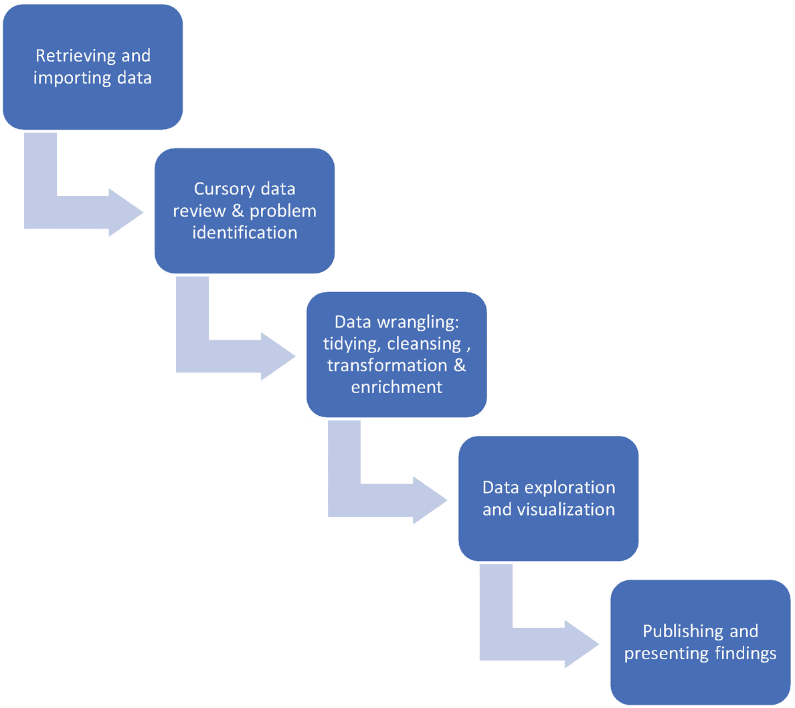
图 4-1 描述性数据分析的步骤

让我们详细了解每个步骤。

1.  **数据检索**：数据可以以结构化格式（如数据库或电子表格）或非结构化格式（如网页、电子邮件、Word 文档）存储。在考虑数据成本和结构等参数后，我们需要找出如何检索这些数据。像`Pandas`这样的库提供了导入多种格式数据的函数。

2.  **粗略数据审查与问题识别**：在此步骤中，我们对要分析的数据形成初步印象。我们旨在理解各个列或特征、数据集中使用的各种缩写和符号的含义、记录或数据代表什么，以及数据存储使用的单位。我们还需要提出正确的问题，并在深入分析之前弄清楚需要做什么。这些问题可能包括：哪些特征与分析相关？各列是否存在上升或下降趋势？是否看到任何缺失值？我们是否试图开发预测模型并预测某个特征？等等。

3.  **数据整理**：此步骤是数据分析的核心，也是最耗时的活动，数据分析师和科学家大约 80%的时间都花在这上面。

原始形式的数据通常不适合分析，原因如下：存在缺失值和冗余值、异常值、不正确的数据类型、存在无关数据、使用了多种度量单位、数据分散在不同来源、以及列未被正确识别。

数据整理或数据清洗是将原始数据转换为适合数学处理和绘制图表的过程。它涉及删除或替换缺失值和不完整条目、去除分隔符和逗号等填充值、过滤数据、更改数据类型、消除冗余以及将数据与其他来源合并。

数据整理包括数据整理、数据清洗和数据丰富。在数据整理中，我们识别数据集中的变量并将其映射到列。我们还沿正确的轴组织数据，并确保行包含观测值而非特征。将数据转换为整洁形式的目的是使数据具有便于分析的结构。数据清洗涉及处理缺失值、不正确的数据类型、异常值和错误输入的数据。在数据丰富中，我们可能从其他来源添加数据，并创建可能有助于分析的新列或特征。

4.  **数据探索与可视化**：数据准备好后，下一步涉及在数据中寻找模式、总结关键特征以及理解各特征之间的关系。通过可视化，你可以实现所有这些目标，并且还能清晰地呈现关键发现。用于可视化的 Python 库包括`Matplotlib`、`Seaborn`和`Pandas`。

5.  **呈现与发布分析结果**：`Jupyter`笔记本兼具执行代码和提供分析高级摘要平台的双重用途。通过添加注释、标题、注释和图像，你可以美化笔记本，使其更易于向更广泛的受众展示。笔记本可以下载为多种格式，如 PDF，之后可以与他人共享以供审阅。

现在，我们继续讨论数据的各种结构和级别。

## 数据的结构

我们需要分析的数据可能具有以下任何一种结构，如图 4-2 所示。

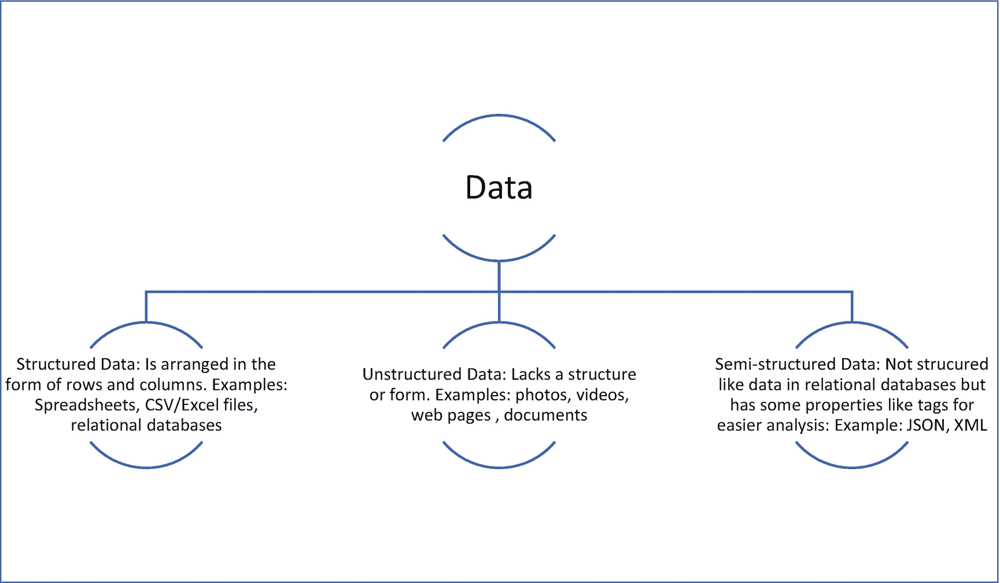
图 4-2 数据的结构

## 将数据分类为不同级别

数据大致有两个级别：连续型和分类型。连续型数据可进一步分为比率数据和间隔数据，而分类型数据可以是名义数据或有序数据。数据的级别如图 4-3 所示。

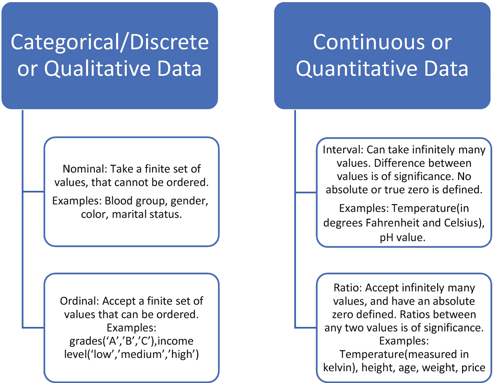
图 4-3 数据的层级

以下是一些需要注意的要点：

- `分类变量的数值表示`：分类数据并不局限于非数值形式。例如，学生的排名（可取值为 1/2/3 等）就是一个包含数值的有序（分类）变量。然而，这些数值不具备数学意义；例如，计算平均排名就没有意义。
- `真正零点的意义`：我们已指出，区间变量没有绝对的零点作为参考点，而比率变量则具有有效的零点。绝对零点表示数值的缺失。例如，当我们说身高和体重这类变量是比率变量时，意味着这些变量的值为 0 表示一个无效或不存在的数点。对于像温度（以摄氏度或华氏度为单位）这样的区间变量，值为 0 并不表示数据缺失。0 只是温度变量可以取的值之一。另一方面，当以开尔文标度测量温度时，它是一个比率变量，因为该标度定义了一个绝对零点。
- `识别区间变量`：区间变量没有绝对的零点作为参考点，但识别具有此特征的变量可能并不明显。当我们谈论某个数值的百分比变化时，它是相对于其先前值而言的。例如，通货膨胀率或失业率的百分比变化是以时间上的最后一个值作为参考点来计算的。这些都是区间数据的实例。区间变量的另一个例子是在 GRE（研究生入学考试）等标准化考试中获得的分数。最低分是 260，最高分是 340。评分是相对的，并非从 0 开始。对于区间数据，虽然可以执行加法和减法运算，但不能对数值进行除法或乘法运算（这些是比率数据允许的操作）。

### 可视化不同层级的数据

每当需要分析数据时，首先要理解数据是结构化的还是非结构化的。如果数据是非结构化的，请将其转换为具有行和列的结构化形式，这样便于使用 `Pandas` 等库进行进一步分析。一旦数据采用这种格式，就将每个特征或列归类到四个数据层级中，并据此进行分析。

请注意，在本章中，我们仅旨在理解如何对数据集中的变量进行分类，并识别适用于每个类别的操作和图表。编写代码以实际可视化数据的方法将在第 7 章中解释。

我们将使用著名的 *泰坦尼克号* 数据集来探讨如何对特征进行分类并执行各种操作。该数据集可从此处导入：[`https://github.com/DataRepo2019/Data-files/blob/master/titanic.csv`](https://github.com/DataRepo2019/Data-files/blob/master/titanic.csv)

关于该数据集的背景信息：英国客轮 RMS *泰坦尼克号* 在 1912 年 4 月 15 日从南安普敦驶往纽约的处女航中与冰山相撞后沉没。在 2,224 名乘客中，有 1,500 人遇难，使这一事件成为一场规模空前的悲剧。该数据集描述了乘客的生存状况以及他们的其他详细信息，包括舱位等级、姓名、年龄和亲属数量。

图 4-4 提供了该数据集的概览。

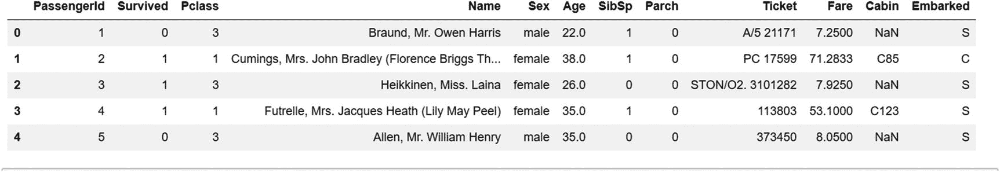
图 4-4 泰坦尼克号数据集

该数据集中的特征，根据数据层级分类，详见表格 4-1。

表 4-1 泰坦尼克号数据集 – 数据层级

| 数据集中的特征 | 表示内容 | 数据层级 |
| --- | --- | --- |
| `PassengerId` | 乘客身份编号 | 名义型 |
| `Pclass` | 乘客等级（1：一等舱；2：二等舱；3：三等舱），乘客等级用于衡量乘客的社会经济地位 | 有序型 |
| `Survived` | 生存状态（0：未幸存；1：幸存） | 名义型 |
| `Name` | 乘客姓名 | 名义型 |
| `Sibsp` | 船上兄弟姐妹/配偶数量 | 比率型 |
| `Ticket` | 船票编号 | 名义型 |
| `Cabin` | 船舱编号 | 名义型 |
| `Sex` | 乘客性别 | 名义型 |
| `Age` | 年龄 | 比率型 |
| `Parch` | 船上父母/子女数量 | 比率型 |
| `Fare` | 乘客票价（英镑） | 比率型 |
| `Embarked` | 登船港口（C 代表瑟堡，Q 代表皇后镇，S 代表南安普顿） | 名义型 |

现在让我们理解该数据集中特征分类背后的原理。

1.  **名义型变量：**
    像 `PassengerId`、`Survived`、`Name`、`Sex`、`Cabin` 和 `Embarked` 这样的变量，其取值没有内在的顺序。请注意，其中一些变量具有数值，但这些数值的数量是有限的。我们不能对这些值进行加、减、乘、除等算术运算。名义型变量常用的一种操作是计数。`Pandas` 中一个常用的方法 `value_counts`（将在下一章讨论）用于确定名义型变量每个唯一类别的值数量。我们还可以计算众数（出现频率最高的值）。条形图常用于可视化名义型数据（也可以使用饼图），如图 4-5 所示。

    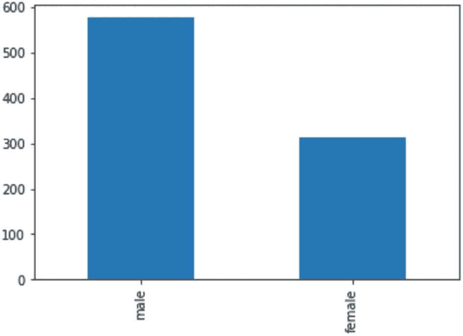
    图 4-5 显示每个类别计数的条形图

2.  **有序型变量：**
    `Pclass`（或乘客等级）是一个有序型变量，因为其取值遵循一定的顺序。值为 1 对应一等舱，值为 2 对应二等舱，以此类推。这些等级值反映了社会经济地位。

    我们可以计算中位数和百分位数。我们还可以计算每个类别中的值数量、计算众数，并使用条形图和饼图等图表，就像我们对名义型变量所做的那样。

    在图 4-6 中，我们针对有序型变量 `Pclass` 使用了饼图。

    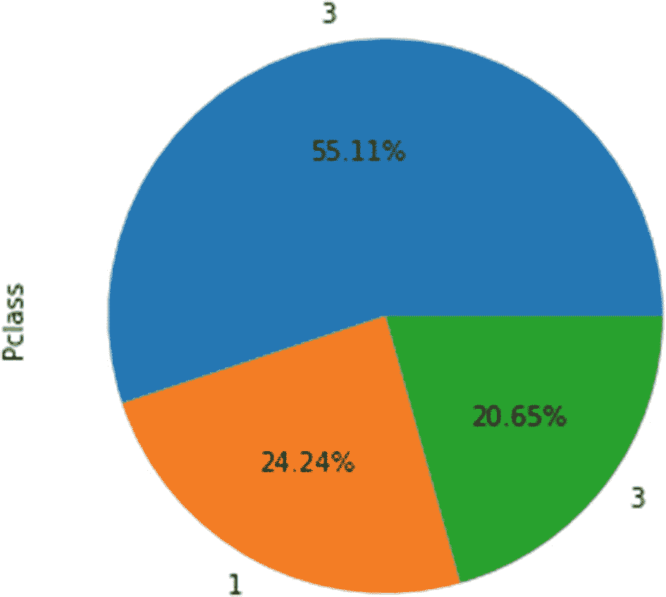
    图 4-6 显示每个等级百分比分布的饼图

3.  **比率型数据：**
    `Age` 和 `Fare` 变量是比率型数据的例子，以零值作为参考点。对于这类数据，我们可以执行广泛的数学运算。

    例如，我们可以将所有票价相加，然后除以乘客总数来求平均值。我们还可以计算标准差。如图 4-7 所示的直方图，可用于可视化这种连续数据，以了解其分布情况。

    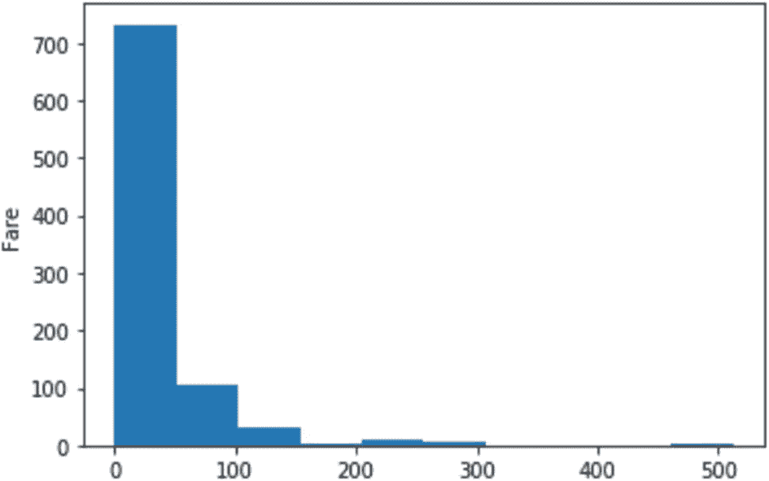
    图 4-7 显示比率型变量分布的直方图

在上述图表中，我们查看了用于绘制单个分类变量或连续变量的图形。在下一节中，我们将了解当有多个变量，或变量组合属于不同尺度或层级时，应该使用哪些图形。

### 绘制混合数据

在本节中，我们将探讨三种场景，每种场景包含两个可能属于同一层级也可能不属于同一层级的变量，并讨论每种场景应使用哪种图表（使用相同的 *泰坦尼克号* 数据集）。

1.  一个分类变量和一个连续变量：箱线图可以展示连续变量的分布、对称性和异常值。箱线图也可以展示连续变量相对于分类变量的情况。在图 4-8 中，展示了名义变量 `Survived`（0 代表未幸存乘客，1 代表幸存乘客）的每个取值对应的 `Age`（比率变量）的分布。

    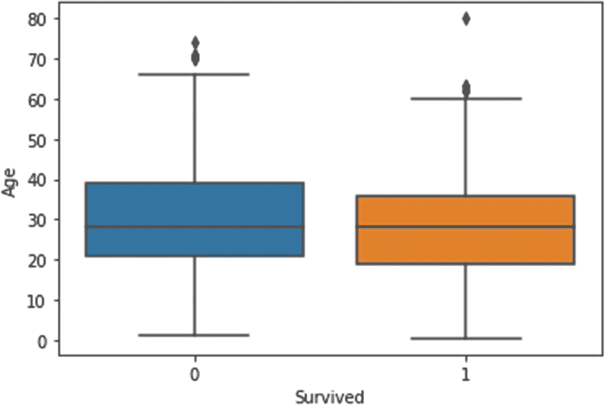
    图 4-8 箱线图，展示不同类别下的年龄分布

2.  两个连续变量：散点图用于描述两个连续变量之间的关系。在图 4-9 中，我们将两个比率变量 `Age` 和 `Fare` 分别绘制在 x 轴和 y 轴上，生成一个散点图。

    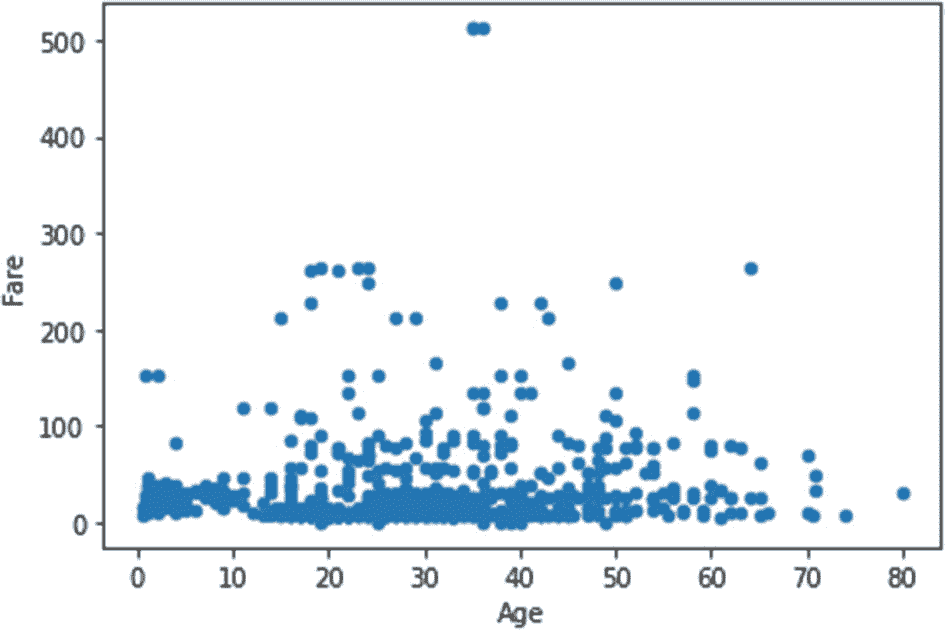
    图 4-9 散点图

3.  两个分类变量：使用簇状柱形图（图 4-10），可以将两个分类变量组合起来，将柱形并排绘制，以表示两个变量所有取值的组合。

    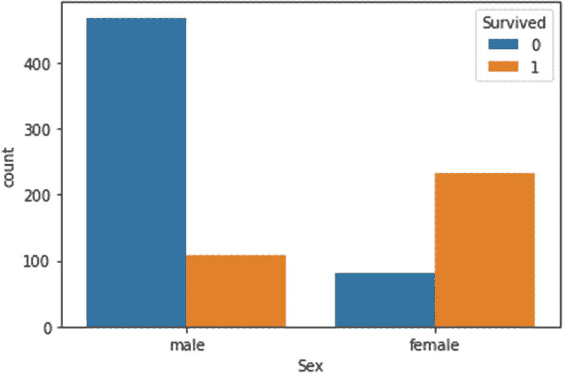
    图 4-10 簇状柱形图

    我们也可以使用堆叠柱形图来绘制两个分类变量。考虑图 4-11 中所示的堆叠柱形图，它绘制了两个分类变量——`Pclass` 和 `Survived`。

    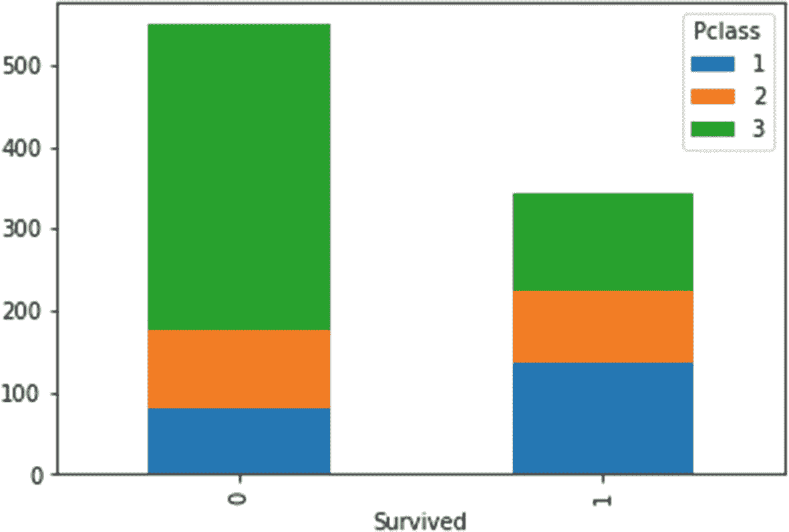
    图 4-11 堆叠柱形图

总之，对于两个连续变量，可以使用散点图；对于两个分类变量，可以使用堆叠或簇状柱形图；当你想展示一个连续变量在分类变量不同取值下的情况时，可以使用箱线图。

## 总结

1.  描述性数据分析是一个五步过程，它利用历史数据并遵循逐步方法论。该过程的核心——数据整理——涉及处理缺失值和其他异常情况，还包括数据重构、合并和转换。

2.  数据可以根据其结构（结构化、非结构化或半结构化）进行分类，也可以根据其包含的值的类型（分类或连续）进行分类。

3.  分类数据可分为名义数据和有序数据（取决于值是否可以排序）。连续数据可以是比率类型或区间类型（取决于数据是否以 0 作为绝对参考点）。

4.  可使用的数学运算和图形图表的种类会因数据层级的不同而有所差异。

现在你已经对描述性数据分析过程有了高层次的了解，我们将在下一章深入探讨数据分析的细节。在接下来的章节中，我们将介绍如何使用 `Pandas` 库编写代码，以执行数据整理和准备过程中的各种任务。

## 复习练习

**问题 1**

根据数据类型对以下变量进行分类。

*   pH 值
*   语言熟练程度
*   李克特量表（用于调查）
*   工作经验
*   一天中的时间
*   社会保障号码
*   距离
*   出生年份

**问题 2**

将以下五个步骤按照数据分析过程中发生的顺序进行排列。

1.  可视化
2.  分析结果的发布与展示
3.  导入数据
4.  数据整理
5.  问题陈述的制定

**问题 3**

针对以下每种运算或统计量，列出其兼容的数据类型。

- `除法`
- `加法`
- `乘法`
- `减法`
- `均值`
- `中位数`
- `众数`
- `标准差`
- `极差`

**问题 4**

针对以下每种图表，列出其兼容的数据类型。

- `条形图`
- `直方图`
- `饼图`
- `散点图`
- `堆叠条形图`

## 答案

### 问题 1

- `pH 值`：定距
    pH 值没有绝对零点。虽然可以比较数值，但无法计算比率。

- `语言熟练度`：定序
    语言熟练度有“初级”、“中级”和“高级”等不同等级，这些等级是有序的，因此属于定序尺度。

- `李克特量表（用于调查）`：定序
    李克特量表常用于调查，其值包括“不满意”、“满意”和“非常满意”。这些值构成逻辑顺序，因此任何代表李克特量表的变量都是定序变量。

- `工作经验`：定比
    由于该变量存在绝对零点，并且可以进行算术运算（包括比率计算），因此该变量是定比变量。

- `一天中的时间`：定距
    时间（以 12 小时制计）没有绝对零点。我们可以计算两个时间点之间的差值，但无法计算比率。

- `社会保障号码`：定类
    像社会保障号码这样的标识符的值没有顺序，也不适合进行数学运算。

- `距离`：定比
    以 0 为参考点，且数值可以进行加、减、乘、除运算，因此距离是定比变量。

- `出生年份`：定距
    此类变量没有绝对零点。你可以计算两个年份之间的差值，但无法计算比率。

### 问题 2

正确的顺序是 3, 5, 4, 1, 2

### 问题 3

- `除法`：定比数据
- `加法`：定比数据、定距数据
- `乘法`：定比数据
- `减法`：定距数据、定比数据
- `均值`：定比数据、定距数据
- `中位数`：定序数据、定比数据、定距数据
- `众数`：所有四个层级的数据（定比、定距、定类、定序）
- `标准差`：定比数据和定距数据
- `极差`：定比数据和定距数据

### 问题 4

- `箱线图`：定序、定比、定距
- `直方图`：定比、定距
- `饼图`：定类、定序
- `散点图`：定比、定距
- `堆叠条形图`：定类、定序