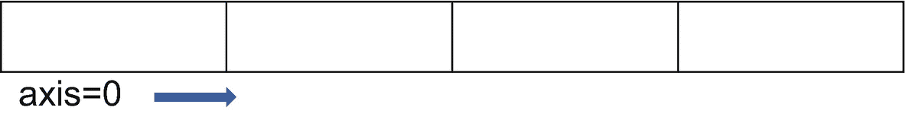
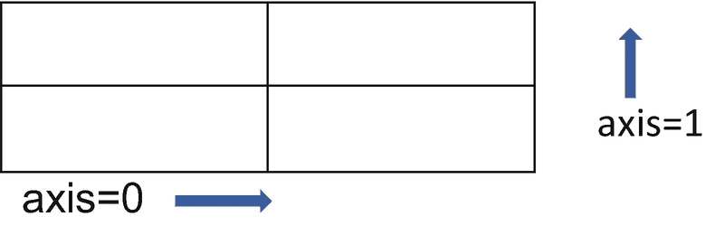
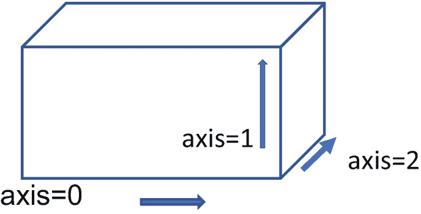

# 5. 使用 NumPy 数组

NumPy，即 Numerical Python，是一个基于 Python 的库，用于数学计算和数组处理。Python 不支持超过一维的数据结构，其列表、元组和字典等容器都是一维的。Python 内置的数据类型和容器无法重构为多维结构，也不适合进行复杂计算。这些缺点限制了数据分析与模型构建中的某些任务，这使得数组成为一种至关重要的数据结构。

NumPy 数组可以重塑形状，并利用向量化原理（即应用于数组的运算会反映在其所有元素上）。

在上一章中，我们了解了描述性数据分析中使用的基本概念。NumPy 是我们在数据分析中执行的许多任务不可或缺的一部分，也是 Pandas 中许多函数和数据类型的基石。在本章中，我们将学习如何使用多种方法创建 NumPy 数组、合并数组、切片、重塑形状以及对其进行计算。

## 熟悉数组和 NumPy 函数

在这里，我们将介绍创建和合并数组的各种方法，以及常用的 NumPy 函数。

**导入 NumPy 包**
在使用 NumPy 的函数之前，必须先导入该包，如下所示。NumPy 的简写或别名是 `np`。

```python
import numpy as np
```

如果你尚未安装 `NumPy`，请打开 Anaconda Prompt 并输入以下命令：

```
pip install numpy
```

## 创建数组

`NumPy` 中的基本单元是数组。在表 5-1 中，我们将了解创建数组的各种方法。

**表 5-1** NumPy 数组的创建方法

| 方法 | 示例 |
| --- | --- |
| 从列表创建数组 | `np.array` 函数用于从列表创建一维或多维数组。代码：`np.array([[1,2,3],[4,5,6]])` 输出：`array([[1, 2, 3], [4, 5, 6]])` |
| 从范围创建数组 | `np.arange` 函数用于创建整数范围。代码：`np.arange(0,9)` `#替代语法：np.arange(9)` `#生成从 0 开始的 9 个等间距整数` 输出：`array([0, 1, 2, 3, 4, 5, 6, 7, 8])` |
| 创建等间距数值的数组 | `np.linspace` 函数在两个边界之间创建指定数量的等间距值。代码：`np.linspace(1,6,5)` `# 生成 1 到 6 之间的 5 个等间距值` 输出：`array([1.  , 2.25, 3.5 , 4.75, 6.  ])` |
| 创建全零数组 | `np.zeros` 函数创建具有指定行数和列数的数组，数组中所有值均为“0”。代码：`np.zeros((4,2))` `#创建一个 4*2 的全零数组` 输出：`array([[0., 0.], [0., 0.], [0., 0.], [0., 0.]])` |
| 创建全一数组 | `np.ones` 函数与 `np.zeros` 函数类似，区别在于数组中重复的值是“1”。代码：`np.ones((2,3))` `#创建一个 2*3 的全一数组` 输出：`array([[1., 1., 1.], [1., 1., 1.]])` |
| 创建指定值重复的数组 | `np.full` 函数使用用户指定的值创建数组。代码：`np.full((2,2),3)` `#创建一个 2*2 的全 3 数组` 输出：`array([[3, 3], [3, 3]])` |
| 创建空数组 | `np.empty` 函数生成一个没有特定初始值的数组（数组被随机初始化）。代码：`np.empty((2,2))` `#创建一个填充随机值的 2*2 数组` 输出：`array([[1.31456805e-311, 9.34839993e+025], [2.15196058e-013, 2.00166813e-090]])` |
| 从重复列表创建数组 | `np.repeat` 函数从重复指定次数的列表创建数组。代码：`np.repeat([1,2,3],3)` `#将列表中的每个值重复 3 次` 输出：`array([1, 1, 1, 2, 2, 2, 3, 3, 3])` |
| 创建随机整数数组 | `randint` 函数（来自 `np.random` 模块）生成包含随机数的数组。代码：`np.random.randint(1,100,5)` `#生成一个包含 5 个 1 到 100 之间随机数的数组` 输出：`array([34, 69, 67, 3, 96])` |

需要注意的一点是，数组是**同质**的数据结构，这与容器（如列表、元组和字典）不同；也就是说，数组应包含相同数据类型的元素。例如，我们不能让一个数组同时包含整数、字符串和浮点数（小数）。虽然在编写代码时，定义包含不同数据类型元素的 `NumPy` 数组不会导致错误，但应避免这样做。

现在我们已经了解了定义数组的各种方法，接下来我们将探讨可以对数组执行的操作，首先从数组的重塑开始。

## 重塑数组

重塑数组是改变数组维度的过程。`NumPy` 的 `reshape` 方法非常重要，常用于将一维数组转换为多维数组。

考虑一个包含十个元素的简单一维数组，如下所示。

代码：

```
x=np.arange(0,10)
```

输出：

```
array([0, 1, 2, 3, 4, 5, 6, 7, 8, 9])
```

我们可以将一维数组 `x` 重塑为五行两列的二维数组：

代码：

```
x.reshape(5,2)
```

输出：

```
array([[0, 1],
[2, 3],
[4, 5],
[6, 7],
[8, 9]])
```

再举一个例子，考虑以下数组：

代码：

```python
x=np.arange(0,12)
x
```

输出：

```
array([ 0, 1, 2, 3, 4, 5, 6, 7, 8, 9, 10, 11])
```

现在，应用 `reshape` 方法创建两个子数组——每个子数组有三行两列：

```python
x=np.arange(0,12).reshape(2,3,2)
x
```

输出：

```
array([[[ 0, 1],
[ 2, 3],
[ 4, 5]],
[[ 6, 7],
[ 8, 9],
[10, 11]]])
```

重塑后数组各维度大小的乘积必须等于原数组的元素个数。在本例中，数组 `(2,3,2)` 的维度相乘等于 12，即数组的元素个数。如果不满足此条件，重塑将无法生效。

除了 `reshape` 方法，我们还可以使用 `shape` 属性来改变数组的形状或维度：

```python
x.shape=(5,2)
#5 是行数，2 是列数
```

请注意，`shape` 属性会直接修改原数组，而 `reshape` 方法则不会改变原数组。

重塑过程可以通过 `ravel` 方法逆转：

```python
x=np.arange(0,12).reshape(2,3,2)
x.ravel()
```

输出：

```
array([ 0, 1, 2, 3, 4, 5, 6, 7, 8, 9, 10, 11])
```

延伸阅读：查看更多关于数组创建例程的内容：[`https://numpy.org/doc/stable/reference/routines.array-creation.html#`](https://numpy.org/doc/stable/reference/routines.array-creation.html)

## 数组的逻辑结构

用于指定点位置的笛卡尔坐标系，由一个带有两条垂直直线（称为 `x` 轴和 `y` 轴）的平面组成。点的位置通过其 x 和 y 坐标来指定。这种使用轴来表示不同维度的原理也应用于数组中。

一维数组有一个轴（`axis=0`），因为它只有一个维度，如图 5-1 所示。



图 5-1 一维数组表示

二维数组的轴值为 `0` 表示行轴，值为 `1` 表示列轴，如图 5-2 所示。



图 5-2 二维数组表示

三维数组有三个轴，代表三个维度，如图 5-3 所示。



图 5-3 三维数组表示

依此类推，具有 `n` 个维度的数组就有 `n` 个轴。请注意，前面的图示仅表示数组的逻辑结构。在内存存储方面，数组中的元素占据连续的位置，无论其维度如何。

## NumPy 数组的数据类型

`type` 函数可用于确定 NumPy 数组的类型：

```python
type(np.array([1,2,3,4]))
```

输出：

```
numpy.ndarray
```

## 修改数组

数组的长度在定义时就被设定。让我们考虑以下数组 `a`：

```python
a=np.array([0,1,2])
```

上述代码语句将创建一个长度为 3 的数组。此后数组长度不可修改。换句话说，数组定义后我们无法向其添加新元素。

以下语句试图向该数组添加第四个元素，会导致错误：

```python
a[3]=4
```

输出：

```
IndexErrorTraceback (most recent call last)
 in 
----> 1a[3]=4
IndexError: index 3 is out of bounds for axis 0 with size 3
```

但是，你可以更改现有元素的值。以下语句可以正常工作：

```python
a[0]=2
```

总之，虽然你可以修改数组中现有元素的值，但不能向其中添加新元素。

现在我们已经了解了如何定义和重塑数组，接下来看看组合数组的方法。

## 组合数组

组合数组有三种方法：追加、拼接和堆叠。

1.  **追加** 是指将一个数组连接到另一个数组的末尾。`np.append` 函数用于追加两个数组。

```python
    x=np.array([[1,2],[3,4]])
    y=np.array([[6,7,8],[9,10,11]])
    np.append(x,y)
```

输出：

```
    array([ 1, 2, 3, 4, 6, 7, 8, 9, 10, 11])
```

2.  **拼接** 是指沿某个轴（垂直或水平）连接数组。`np.concatenate` 函数用于拼接数组。

```python
    x=np.array([[1,2],[3,4]])
    y=np.array([[6,7],[9,10]])
    np.concatenate((x,y))
```

输出：

```
    array([[ 1, 2],
    [ 3, 4],
    [ 6, 7],
    [ 9, 10]])
```

默认情况下，`concatenate` 函数垂直连接数组（沿 `0` 轴）。如果你希望数组并排连接，则需要添加值为 `1` 的 `axis` 参数：

```python
    np.concatenate((x,y),axis=1)
```

`append` 函数内部使用了 `concatenate` 函数。

3.  **堆叠**：堆叠可分为垂直堆叠和水平堆叠两种类型，如下所述。

### 垂直堆叠

顾名思义，垂直堆叠是将数组一个接一个地上下堆叠。要成功进行垂直堆叠，被堆叠的数组中每个子数组的元素个数必须相同。`np.vstack` 函数用于垂直堆叠。

```python
    x=np.array([[1,2],[3,4]])
    y=np.array([[6,7],[8,9],[10,11]])
    np.vstack((x,y))
```

输出：

```
    array([[ 1, 2],
    [ 3, 4],
    [ 6, 7],
    [ 8, 9],
    [10, 11]])
```

注意，数组 `x` 和 `y` 的每个子数组中都有两个元素。

### 水平堆叠

水平堆叠是将数组并排堆叠。被水平堆叠的每个数组的子数组数量必须相同。`np.hstack` 函数用于水平堆叠。

在以下示例中，数组 `x` 和 `y` 各有两个子数组。

```python
    x=np.array([[1,2],[3,4]])
    y=np.array([[6,7,8],[9,10,11]])
    np.hstack((x,y))
```

输出：

```
    array([[ 1, 2, 6, 7, 8],
    [ 3, 4, 9, 10, 11]])
```

在下一节中，我们将了解如何使用逻辑运算符来测试 NumPy 数组中的条件。

## 条件测试

NumPy 使用逻辑运算符（`&`、`|`、`~`）以及 `np.any`、`np.all` 和 `np.where` 等函数来检查条件。返回满足条件的数组元素（或其索引）。

考虑以下数组：

```python
x=np.linspace(1,50,10)
x
```

输出：

```
array([ 1\.        , 6.44444444, 11.88888889, 17.33333333, 22.77777778,
28.22222222, 33.66666667, 39.11111111, 44.55555556, 50\.        ])
```

让我们检查以下条件，看看哪些元素满足它们：

*   检查是否所有值都满足给定条件：仅当条件对数组的所有元素都成立时，`np.all` 函数才返回值 `True`，如下例所示。

```python
    np.all(x>20)
    #仅当所有元素都大于 20 时返回 True
```

输出：

```
    False
```

*   检查数组中是否有任何值满足条件：如果任何元素满足条件，`np.any` 函数返回值 `True`。

```python
    np.any(x>20)
    #如果数组中任何一个元素大于 20，则返回 True
```

输出：

```
    True
```

*   返回满足条件的元素的索引：`np.where` 函数返回数组中满足给定条件的值的索引。

```python
    np.where(x<10)
    #返回小于 10 的元素的索引
```

输出：

```
    (array([0, 1], dtype=int64),)
```

`np.where` 函数也可用于有选择地检索或过滤数组中的值。例如，我们可以使用以下代码语句检索满足条件 `x<10` 的项：

代码：

```
x[np.where(x<10)]
```

输出：

```
array([1\.        , 6.44444444])
```

- **检查多个条件**：

NumPy 使用以下布尔运算符来组合条件：

- `&` 运算符（相当于 Python 中的 `and` 运算符）：当所有条件都满足时返回 `True`：

代码：

```
x[(x>10) & (x<50)]
#返回所有值大于 10 且小于 50 的项
```

输出：

```
array([11.88888889, 17.33333333, 22.77777778, 28.22222222, 33.66666667,
       39.11111111, 44.55555556])
```

- `|` 运算符（相当于 Python 中的 `or` 运算符）：当给定条件集合中的任意一个条件满足时返回 `True`。

代码：

```
x[(x>10) | (x<5)]
#返回所有值大于 10 或小于 5 的项
```

输出：

```
array([ 1\.        , 11.88888889, 17.33333333, 22.77777778, 28.22222222,
       33.66666667, 39.11111111, 44.55555556, 50\.        ])
```

- `~` 运算符（相当于 Python 中的 `not` 运算符）：用于否定一个条件。

代码：

```
x[~(x<8)]
#返回所有大于 8 的项
```

输出：

```
array([11.88888889, 17.33333333, 22.77777778, 28.22222222, 33.66666667,
       39.11111111, 44.55555556, 50\.        ])
```

现在我们继续讨论 NumPy 中的其他一些重要概念，如广播和向量化。我们还将讨论算术运算符在 NumPy 数组中的使用。

## 广播、向量化和算术运算

### 广播

当我们说两个数组可以广播时，意味着它们的维度兼容，可以进行算术运算。只要遵循广播规则（如下所述），数组就可以使用算术运算符进行组合。

1.  **两个数组具有相同的维度。**

    在此示例中，两个数组的维度均为 `2*6`。

    代码：
    ```python
    x=np.arange(0,12).reshape(2,6)
    y=np.arange(5,17).reshape(2,6)
    x*y
    ```

    输出：
    ```
    array([[  0,   6,  14,  24,  36,  50],
           [ 66,  84, 104, 126, 150, 176]])
    ```

2.  **其中一个数组是单元素数组。**

    在此示例中，第二个数组只有一个元素。

    代码：
    ```python
    x=np.arange(0,12).reshape(2,6)
    y=np.array([1])
    x-y
    ```

    输出：
    ```
    array([[-1,  0,  1,  2,  3,  4],
           [ 5,  6,  7,  8,  9, 10]])
    ```

3.  **一个数组与一个标量（单个值）组合。**

    在此示例中，变量`y`在运算中用作标量值。

    代码：
    ```python
    x=np.arange(0,12).reshape(2,6)
    y=2
    x/y
    ```

    输出：
    ```
    array([[0\. , 0.5, 1\. , 1.5, 2\. , 2.5],
           [3\. , 3.5, 4\. , 4.5, 5\. , 5.5]])
    ```

我们可以使用算术运算符（`+`/`-`/`*` 和 `/`）或函数（`np.add`、`np.subtract`、`np.multiply` 和 `np.divide`）对数组进行加、减、乘、除运算。

代码：
```python
np.add(x,y)
#或者
x+y
```

输出：
```
array([[ 6,  8],
       [11, 13]])
```

类似地，你可以使用`np.subtract`（或 `-` 运算符）进行减法，使用`np.multiply`（或 `*` 运算符）进行乘法，使用`np.divide`（或 `/` 运算符）进行除法。

延伸阅读：查看更多关于数组广播的内容：[`numpy.org/doc/stable/user/basics.broadcasting.html`](https://numpy.org/doc/stable/user/basics.broadcasting.html)

### 向量化

利用向量化原理，你可以方便地将算术运算符应用于数组中的每个对象，而无需遍历元素——就像对列表等容器中的项应用操作时那样。

代码：
```python
x=np.array([2,4,6,8])
x/2
#将每个元素除以 2
```

输出：
```
array([1., 2., 3., 4.])
```

### 点积

我们可以获取两个数组的点积，这与两个数组的乘法不同。两个数组相乘得到的是逐元素乘积，而两个数组的点积计算的是元素的内积。

以两个数组为例：
```
|P Q|
|R S|
和
|U V|
|W X|
```

点积的计算方式为：
```
|P Q| . |U V| = |P*U+Q*V  P*V+Q*X|
|R S|   |W X|   |R*U+S*W  R*V+S*X|
```

数组相乘则得到以下结果：
```
|P Q| * |U V| = |P*U  Q*V|
|R S|   |W X|   |R*W  S*X|
```

如前所述，数组可以使用乘法运算符（`*`）或 `np.multiply` 函数进行相乘。用于获取点积的 NumPy 函数是 `np.dot`。

代码：
```python
np.dot(x,y)
```

输出：
```
array([[21, 24],
[47, 54]])
```

我们还可以将数组与标量结合。在下一个主题中，我们将讨论如何获取数组的各种属性或特征。

## 获取数组的属性

数组的属性，如大小、维度、元素数量和内存使用情况，可以通过属性来获取。

考虑以下数组：
- `size` 属性给出数组中元素的数量。

代码：
```python
x.size
```

输出：
```

```
- `ndim` 属性给出维度的数量。

代码：
```python
x.ndim
```

输出：
```

```
- 数组占用的内存（总字节数）可以使用 `nbytes` 属性计算。

代码：
```python
x.nbytes
```

输出：
```

```
每个元素占用 4 个字节（因为这是一个整数数组）；因此，十个元素占用 40 个字节。
- 该数组中元素的数据类型可以使用 `dtype` 属性计算。

代码：
```python
x.dtype
```

输出：
```
dtype('int32')
```
```python
x=np.arange(0,10).reshape(5,2)
```
请注意数组的 `dtype` 和 `type` 之间的区别。`type` 函数给出容器对象的类型（在本例中，类型是 `ndarray`），而 `dtype` 是一个属性，它给出数组中各个元素的类型。

延伸阅读：了解更多 NumPy 支持的数据类型列表：[`numpy.org/devdocs/user/basics.types.html`](https://numpy.org/devdocs/user/basics.types.html)

## 数组的转置

数组的转置是其镜像。

考虑以下数组：
代码：
```python
x=np.arange(0,10).reshape(5,2)
```

有两种方法可以转置数组：
- 我们可以使用 `np.transpose` 方法。

代码：
```python
np.transpose(x)
```
- 或者，我们可以使用 `T` 属性来获取转置。

代码：
```python
x.T
```
两种方法都会得到相同的输出：
```
array([[0, 2, 4, 6, 8],
[1, 3, 5, 7, 9]])
```

## 掩码数组

假设你正在使用一个 NumPy 数组来存储一个班级学生的考试成绩。虽然你有大多数学生的数据，但有些值是缺失的。掩码数组用于存储包含无效或缺失条目的数据，在这种情况下非常有用。

可以通过创建 `ma.masked_array` 类（属于 `numpy.ma` 模块）的对象来定义掩码数组：
代码：
```python
import numpy.ma as ma
x=ma.masked_array([87,99,100,76,0],[0,0,0,0,1])
#最后一个元素是无效的或被掩码的
x[4]
```

输出：
```
Masked
```
向 `ma.masked_array` 类传递两个数组作为参数——一个包含数组中各项的值，另一个包含掩码值。掩码值为 `0` 表示对应的项值是有效的，掩码值为 `1` 表示该项缺失或无效。例如，在前面的例子中，值 87、99、100 和 76 是有效的，因为它们的掩码值为 `0`。第一个数组中的最后一项（0），其掩码值为 `1`，是无效的。

掩码值也可以使用 `mask` 属性来定义。
代码：
```python
x=ma.array([87,99,100,76,0])
x.mask=[0,0,0,0,1]
```

要取消掩码一个元素，可以为其赋值：
代码：
```python
x[4]=82
```
该元素的掩码值会变为 0，因为它不再无效。

现在，让我们看看如何从数组中创建子集。

## 数据切片或选取子集

数组的切片操作与 Python 中字符串和列表的切片类似。切片是数据结构（此处指南数组）的一个子集，它可以代表一组值或单个值。考虑以下数组：
```python
x=np.arange(0,10).reshape(5,2)
```

输出：
```
array([[0, 1],
[2, 3],
[4, 5],
[6, 7],
[8, 9]])
```

下面给出了一些切片示例。
* 选取第一个子数组 `[0,1]`：
```python
x[0]
```

输出：
```
array([0, 1])
```
* 选取第二列：
```python
x[:,1]
#这将选取所有行和第二列（索引为 1）
```

输出：
```
array([1, 3, 5, 7, 9])
```
* 选取第四行第一列的元素：
```python
x[3,0]
```

输出：
```

```
* 我们也可以基于条件创建切片：
```python
x[x<5]
```

输出：
```
array([0, 1, 2, 3, 4])
```

当我们对数组进行切片时，原始数组不会被修改（会创建数组的一个副本）。现在我们已经学习了如何创建和操作数组，接下来我们将学习 NumPy 的另一个重要应用——使用各种函数计算统计量。

## 获取描述性统计量/聚合度量

NumPy 中有一些方法可以简化复杂计算并确定聚合度量。让我们找出这个数组的集中趋势度量（均值、方差、标准差）、总和、累积和以及最大值：
```python
x=np.arange(0,10).reshape(5,2)
#均值
x.mean()
```

输出：
```
4.5
```
计算方差：
```python
x.var() #方差
```

输出：
```
2.9166666666666665
```
计算标准差：
```python
x.std()  #标准差
```

输出：
```
1.707825127659933
```
计算每列的总和：
```python
x.sum(axis=0) #计算列方向的总和
```

输出：
```
array([ 6, 15])
```
计算累积和：
```python
x.cumsum()
#每次计算两个元素的和，并将此和添加到下一个元素
```

输出：
```
array([ 0,  1,  3,  6, 10, 15, 21, 28, 36, 45], dtype=int32)
```
找出数组中的最大值：
```python
x.max()
```

输出：
```

```

在结束本章之前，让我们学习一下矩阵——NumPy 包支持的另一种数据结构。

## 矩阵

矩阵是一种二维数据结构，而数组可以包含任意数量的维度。使用 `np.matrix` 类，我们可以创建一个矩阵对象，语法如下：
```python
x=np.matrix([[2,3],[33,3],[4,1]])
#或者
x=np.matrix('2,3;33,3;4,1') #使用分号分隔行
x
```

输出：
```
matrix([[ 2,  3],
[33,  3],
[ 4,  1]])
```
大多数可以应用于数组的函数也可以用于矩阵。矩阵使用一些算术运算符，使得矩阵运算更加直观。例如，我们可以使用 `*` 运算符来获取两个矩阵的点积，这复制了 `np.dot` 函数的功能。由于矩阵只是数组的一种特殊情况，并且可能在未来的 NumPy 版本中被弃用，因此通常更推荐使用 NumPy 数组。

## 总结

* NumPy 是一个用于数学计算和创建数据结构的库，这种数据结构称为数组，它可以包含任意数量的维度。
* 创建数组有多种方法，并且数组也可以被重塑以增加更多维度或更改现有维度。
* 数组支持向量化，这提供了一种快速直观的方法来对数组的所有元素应用算术运算符。
* 可以使用简单的 NumPy 函数（如 `np.mean`、`np.var`、`np.std` 等）计算各种统计量和聚合度量。

## 复习练习

**问题 1**

创建以下数组：
```python
array([[[ 1,  2,  3,  4],
[ 5,  6,  7,  8]],
[[ 9, 10, 11, 12],
[13, 14, 15, 16]],
[[17, 18, 19, 20],
[21, 22, 23, 24]]])
```

对上述数组进行切片以获取以下内容：
* 第三个子数组中的元素 (17,18,19,20,21,22,23,24)
* 最后一个元素 (24)
* 第二列中的元素 (2,6,10,14,18,22)
* 对角线上的元素 (1,10,19,24)

**问题 2**

使用适当的 NumPy 函数创建以下每个数组：
* 一个包含七个随机数的数组
* 一个未初始化的 `2*5` 数组
* 一个包含十个在 `1` 到 `3` 之间等间距浮点数的数组
* 一个所有值都为 `100` 的 `3*3` 数组

**问题 3**

为以下各项编写简单的代码语句：
* 创建一个数组来存储前 `50` 个偶数
* 计算这些数字的均值和标准差
* 将此数组重塑为一个包含两个子数组的数组，每个子数组有五行五列
* 计算此重塑后数组的维度

**问题 4**

计算这两个数据结构的点积：
```python
[[ 2,  3],
[33,  3],
[ 4,  1]]
和
[[ 2,  3, 33],
[ 3,  4,  1]]
```

使用
1. 矩阵
2. 数组

**问题 5**

第 1 部分和第 2 部分中编写的代码有什么区别，输出会有什么不同？

第 1 部分：
```python
x=np.array([1,2,3])
x*3
```

第 2 部分：
```python
a=[1,2,3]
a*3
```

## 答案

**问题 1**
* 第三个子数组中的元素 (17,18,19,20,21,22,23,24)：
```python
x=np.arange(1,25).reshape(3,2,4)
```

* 最后一个元素 (24)：
```python
x[2]
```

* 第二列中的元素 (2,6,10,14,18,22)：
```python
x[2,1,3]
```

* 对角线上的元素 (1,10,19,24)：
```python
x[:,:,1]
```
```python
x[0,0,0],x[1,0,1],x[2,0,2],x[2,1,3]
```

**问题 2**
* 一个包含七个随机数的数组：
```python
np.random.randn(7)
```

* 一个未初始化的 `2*5` 数组：
```python
np.empty((2,5))
```

* 一个包含十个在 `1` 到 `3` 之间等间距浮点数的数组：
```python
np.linspace(1,3,10)
```

* 一个所有值都为 `100` 的 `3*3` 数组：
```python
np.full((3,3),100)
```

**问题 3**
```python
#创建前 50 个偶数的数组
x=np.arange(2,101,2)
#计算均值
x.mean()
#计算标准差
x.std()
#重塑数组
y=x.reshape(2,5,5)
#计算其新维度
y.ndim
```

**问题 4**

使用矩阵计算点积需要使用 `*` 算术运算符：
```python
x=np.matrix([[2,3],[33,3],[4,1]])
y=np.matrix([[2,3,33],[3,4,1]])
x*y
```

使用数组计算点积需要使用 `dot` 方法：
```python
x=np.array([[2,3],[33,3],[4,1]])
y=np.array([[2,3,33],[3,4,1]])
x.dot(y)
```

**问题 5**

输出：
1. `array([3, 6, 9])`
数组支持向量化，因此 `*` 运算符应用于每个元素。
2. `[1, 2, 3, 1, 2, 3, 1, 2, 3]`
对于列表，不支持向量化，应用 `*` 运算符只是重复列表，而不是将元素乘以给定的数字。需要对每个项目应用算术运算符时，需要使用 `for` 循环。