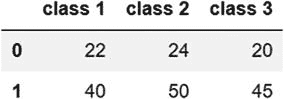
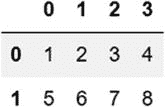
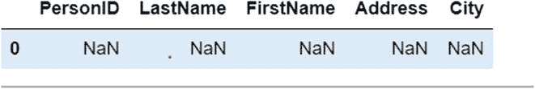
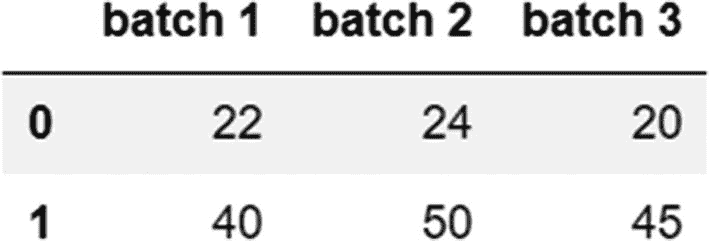
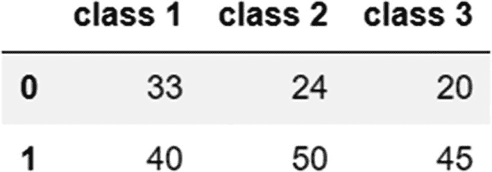
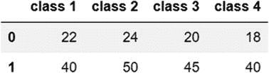
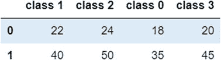
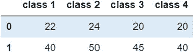
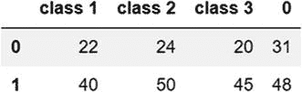

# 6. 使用 Pandas 准备数据

## Pandas 数据整理

随着互联网、社交网络、移动设备和大数据的爆发式增长，可用的数据量变得极其庞大。管理和分析这些数据以得出有意义的推论，可以推动决策、提高生产力并降低成本。在上一章中，你学习了 `NumPy`——这个库帮助我们处理数组和执行计算，同时也是本章讨论的 `Pandas` 库的基础。`Pandas` 是用于数据整理的 Python 库，其优势在于它是一个功能强大的工具，具备多种数据处理能力。

Python 作为首选编程语言的日益流行，与其在数据科学领域的广泛应用密切相关。在 2019 年对 Python 开发者进行的一项调查中发现，`NumPy` 和 `Pandas` 是最受欢迎的数据科学框架（来源：[`https://www.jetbrains.com/lp/python-developers-survey-2019/`](https://www.jetbrains.com/lp/python-developers-survey-2019/)）。在本章中，我们将学习 `Pandas` 的基本构建块（`Series`、`DataFrames` 和 `Indexes`），并了解该库中用于在 `Pandas` 中整理、清洗、合并和聚合数据的各种函数。本章比你目前读过的其他章节涉及的内容更多，因为我们涵盖了广泛的主题，这些主题将帮助你培养准备数据所需的技能。

## Pandas 概览

Wes McKinney 于 2008 年开发了 `Pandas` 库。其名称（`Pandas`）源于计量经济学中用于分析时间序列数据的术语“面板数据”。`Pandas` 具有以下列出的许多特性，使其成为数据整理和分析的热门工具。

1. `标签和索引`：`Pandas` 提供了数据标签或索引的功能，这加快了数据检索的速度。

2. `输入和输出支持`：`Pandas` 提供了从不同文件格式（如 JSON、CSV、Excel 和 HDF5）读取数据的选项。它还可以用于将数据写入数据库、Web 服务等。

3. `数据组合`：分析所需的大部分数据并非来自单一来源，我们通常需要合并数据集来整合分析所需的数据。同样，`Pandas` 通过定制的数据组合函数来解决问题。

4. `速度和增强性能`：`Pandas` 库基于 `Cython`，它结合了 Python 的便利性和易用性以及 C 语言的速度。`Cython` 有助于优化性能并减少开销。

5. `数据可视化`：为了从数据中获取洞察并以易于呈现的方式展示给受众，使用可视化手段查看数据至关重要，而 `Pandas` 以 `Matplotlib` 为基础库，提供了大量内置的可视化工具。

6. `对其他库的支持`：`Pandas` 与 `Numpy`、`Matplotlib`、`Scipy` 和 `Scikit-learn` 等其他库无缝集成。因此，我们可以在进行数据操作的同时，执行数值计算、可视化、统计分析和机器学习等其他任务。

7. `分组`：`Pandas` 支持“拆分-应用-合并”方法，我们可以将数据分组到不同类别，对它们分别应用函数，然后合并结果。

8. `处理缺失数据、重复数据和填充字符`：数据中经常包含缺失值、重复项、空白、特殊字符（如 `$`、`&`）等，这些可能需要删除或替换。借助 `Pandas` 提供的函数，你可以轻松处理此类异常。

9. `数学运算`：可以在 `Pandas` 中执行许多数值运算和计算，后端使用 `NumPy` 来实现此目的。

## 技术要求

本章所需的库和外部文件详述如下。

### 安装库

如果你尚未安装 `Pandas`，请转到 Anaconda Prompt 并输入以下命令。

```
>>>pip install pandas
```

一旦安装了 `Pandas` 库，你需要在使用其函数之前导入它。在你的 Jupyter notebook 中，输入以下内容来导入此库。

```
import pandas as pd
```

这里，`pd` 是 `Pandas` 的标准简写名称或别名。在某些示例中，我们还会使用 `NumPy` 库中的函数。请确保 `Pandas` 和 `NumPy` 库都已安装并导入。

### 外部文件

你需要下载一个数据集 `"subset-covid-data.csv"`，该数据集包含特定日期各国与 COVID-19 疫情相关的病例数和死亡数数据。请使用以下链接下载数据集：[`https://github.com/DataRepo2019/Data-files/blob/master/subset-covid-data.csv`](https://github.com/DataRepo2019/Data-files/blob/master/subset-covid-data.csv)

## Pandas 的构建块

`Series` 和 `DataFrame` 对象是 `Pandas` 中的底层数据结构。简而言之，`Series` 类似于一列（只有一维），而 `DataFrame`（有两维）类似于一个包含行和列的表或电子表格。存储在 `Series` 或 `DataFrame` 中的每个值都有一个与之关联的标签或索引，这加快了数据的检索和访问速度。在本节中，我们将学习如何创建 `Series` 和 `DataFrame`，以及用于操作这些对象的函数。

### 创建 Series 对象

`Series` 是一个一维对象，包含一组值及其关联的索引。表 6-1 列出了创建 Series 的不同方法。

**表 6-1：创建 Series 对象的各种方法**

| 方法 | 语法 |
| --- | --- |
| 使用标量值 | `pd.Series(2)` `#创建一个仅包含一个值的简单 Series。这里，0 是索引标签，2 是 Series 对象包含的值。` 输出：`0 2` `dtype: int64` |
| 使用列表 | `pd.Series([2]*5)` `#通过将单个值 (2) 括在列表中并重复 5 次来创建 Series。0,1,2,3,4 是自动生成的索引标签。` 输出：`0 2` `1 2` `2 2` `3 2` `4 2` `dtype: int64` |
| 使用字符串中的字符 | `pd.Series(list('hello'))` `#通过将字符串 "hello" 中的每个字符作为 Series 中的单独值来创建 Series。` 输出：`0 h` `1 e` `2 l` `3 l` `4 o` `dtype: object` |
| 使用字典 | `pd.Series({1:'India',2:'Japan',3:'Singapore'})` `#键/值对对应于 Series 对象中的索引标签和值。` 输出：`1 India` `2 Japan` `3 Singapore` `dtype: object` |
| 使用范围 | `pd.Series(np.arange(1,5))` `#使用 NumPy 的 arrange 函数从 4 个数字 (1-4) 的范围创建 Series，确保也已导入 NumPy 库` 输出：`0 1` `1 2` `2 3` `3 4` `dtype: int32` |
| 使用随机数 | `pd.Series(np.random.normal(size=4))` `#使用 np.random.normal 函数创建一组 4 个随机数` 输出：`0 -1.356631` `1 1.308935` `2 -1.247753` `3 -1.408781` `dtype: float64` |
| 创建具有自定义索引标签的 Series | `pd.Series([2,0,1,6],index=['a','b','c','d'])` `#列表 [2,0,1,6] 指定 Series 中的值，索引列表 ['a','b','c','d'] 指定索引标签` 输出：`a 2` `b 0` `c 1` `d 6` `dtype: int64` |

## 总结

总之，你可以从单个（标量）值、列表、字典、一组随机数或一个数字范围创建`Series`对象。`pd.Series`函数会创建一个`Series`对象（注意“Series”中的字母“S”是大写的；`pd.series`将无法工作）。如果你想自定义索引，请使用`index`参数。

### 检查`Series`的属性

在本节中，我们将介绍用于查找`Series`对象更多信息的方法，例如元素数量、其值以及唯一元素。

#### 查找`Series`中的元素数量

有三种方法可以查找`Series`包含的元素数量：使用`size`参数、`len`函数或`shape`参数。

`size`属性和`len`函数返回单个值——序列的长度，如下所示。

代码：

```python
#series definition
x=pd.Series(np.arange(1,10))
#using the size attribute
x.size
```

输出：

```

```

我们也可以使用`len`函数来计算元素数量，它会返回相同的输出（9），如下所示。

代码：

```python
len(x)
```

`shape`属性返回一个包含行数和列数的元组。由于`Series`对象是一维的，`shape`属性只返回行数，如下所示。

代码：

```python
x.shape
```

输出：

```
(9,)
```

#### 列出`Series`中各个元素的值

`values`属性返回一个包含`Series`中每个项目值的 NumPy 数组。

代码：

```python
x.values
```

输出：

```
array([1, 2, 3, 4, 5, 6, 7, 8, 9])
```

#### 访问`Series`的索引

`Series`的索引可以通过`index`属性访问。索引是一个具有数据类型和一组值的对象。索引对象的默认类型是`RangeIndex`。

代码：

```python
x.index
```

输出：

```
RangeIndex(start=0, stop=9, step=1)
```

索引标签形成一个从 0 开始的数字范围。默认步长或一个索引标签值与下一个索引标签值之间的差值为 1。

#### 获取`Series`中的唯一值及其计数

`value_counts()`方法是一个重要的方法。当与`Series`对象一起使用时，它会显示该对象中包含的唯一值以及每个唯一值的计数。通常的做法是将此方法与分类变量一起使用，以了解其包含的不同值。

代码：

```python
z=pd.Series(['a','b','a','c','d','b'])
z.value_counts()
```

输出：

```
a    2
b    2
c    1
d    1
dtype: int64
```

上述输出显示，在名为“z”的`Series`对象中，值“a”和“b”出现了两次，而字符“c”和“d”出现了一次。

#### `Series`的方法链

我们可以对序列应用多个方法并连续应用它们。这称为方法链，可以应用于`Series`和`DataFrame`对象。

示例：
假设我们想找出下面定义的序列“z”中值“a”和“b”出现的次数。我们可以通过链式调用将`value_counts`方法和`head`方法组合起来。

代码：

```python
z=pd.Series(['a','b','a','c','d','b'])
z.value_counts().head(2)
```

输出：

```
a    2
b    2
dtype: int64
```

如果需要将多个方法链接在一起并应用于`Series`对象，最好将每个方法放在单独的一行上，每行以反斜杠结尾。这将使代码更具可读性，如下所示。

代码：

```python
z.value_counts()\
.head(2)\
.values
```

输出：

```
array([2, 2], dtype=int64)
```

我们已经介绍了与`Series`对象一起使用的基本方法。如果你想了解更多关于`Series`对象以及与`Series`对象一起使用的方法，请参考以下链接。

[`https://pandas.pydata.org/pandas-docs/stable/reference/api/pandas.Series.html`](https://pandas.pydata.org/pandas-docs/stable/reference/api/pandas.Series.html)

我们现在转向`DataFrames`，这是另一个重要的 Pandas 对象。

## 数据框（DataFrame）

`DataFrame` 是 `Series` 的扩展。它是一种用于存储数据的二维数据结构。`Series` 对象包含两个组成部分——一组值以及附加在这些值上的索引标签——而 `DataFrame` 对象则包含三个组成部分——列对象、索引对象以及一个包含值的 NumPy 数组对象。索引和列统称为轴。索引构成轴“0”，列构成轴“1”。

我们在表 6-2 中查看创建 `DataFrame` 的各种方法。

### 表 6-2 创建 DataFrame 的不同方法

| 方法 | 语法 |
| --- | --- |
| 通过组合 `Series` 对象 | 代码：`student_ages=pd.Series([22,24,20]) #系列 1` `teacher_ages=pd.Series([40,50,45])#系列 2` `combined_ages=pd.DataFrame([student_ages,teacher_ages]) #DataFrame` `combined_ages.columns=['class 1','class 2','class 3']#命名列` `combined_ages` 输出： 这里，我们定义了两个 `Series`，然后使用 `pd.DataFrame` 函数创建一个名为“combined_ages”的新 `DataFrame`。我们在单独的步骤中为列命名。 |
| 通过字典 | 代码：`combined_ages=pd.DataFrame({'class 1':[22,40],'class 2':[24,50],'class 3':[20,45]})` `combined_ages` 输出： 将一个字典作为参数传递给 `pd.DataFrame` 函数（列名作为键，每列的值包含在一个列表中）。 |
| 通过 NumPy 数组 | 代码：`numerical_df=pd.DataFrame(np.arange(1,9).reshape(2,4))` `numerical_df` 输出： 这里，我们首先使用 `np.arange` 函数创建一个 NumPy 数组。然后将该数组重塑为一个包含两行四列的 `DataFrame`。 |
| 使用一组元组 | 代码：`combined_ages=pd.DataFrame([(22,24,20),(40,50,45)],columns=['class 1','class 2','class 3'])` `combined_ages` 输出： 我们使用一组元组重新创建了“combined_ages” `DataFrame`。每个元组相当于 `DataFrame` 中的一行。 |

总而言之，我们可以使用字典、一组元组以及通过组合 `Series` 对象来创建 `DataFrame`。这些方法都使用了 `pd.DataFrame` 函数。请注意，此方法中的字符“D”和“F”是大写的；`pd.dataframe` 不起作用。

### 通过从其他格式导入数据创建 DataFrame

Pandas 可以使用其读取函数从多种格式读取数据（在此处查看支持的格式完整列表：[`https://pandas.pydata.org/pandas-docs/stable/user_guide/io.html`](https://pandas.pydata.org/pandas-docs/stable/user_guide/io.html)）。以下是一些常用的格式。

#### 从 CSV 文件

`read_csv` 函数可用于将 CSV 文件中的数据读取到 `DataFrame` 中，如下所示。

代码：

```
titanic=pd.read_csv('titanic.csv')
```

从 CSV 文件读取数据是创建 `DataFrame` 最常见的方法之一。CSV 文件是用于存储和检索值的逗号分隔文件，其中每一行相当于一条记录。在调用 `read_csv` 函数之前，请记得使用 Jupyter 主页上的上传按钮将 CSV 文件上传到 Jupyter 中（图 6-1）。


**图 6-1** Jupyter 文件上传

#### 从 Excel 文件

Pandas 支持使用 `pd.read_excel` 函数从 xls 和 xlsx 文件格式导入数据，如下所示。

代码：

```
titanic_excel=pd.read_excel('titanic.xls')
```

## 从 JSON 文件读取

JSON 是 JavaScript 对象表示法的缩写，是一种跨平台文件格式，用于在客户端和服务器之间传输和交换数据。Pandas 提供了 `read_json` 函数来从 JSON 文件读取数据，如下所示。

```
titanic=pd.read_json('titanic-json.json')
```

## 从 HTML 文件读取

我们也可以使用 `pd.read_html` 函数从网页导入数据。在下面的示例中，该函数将网页上的表格解析为 `DataFrame` 对象。此函数返回一个 `DataFrame` 对象列表，这些对象对应于网页上的表格。在下面的示例中，`table[0]` 对应于所提及 URL 上的第一个表格。

```
url="https://www.w3schools.com/sql/sql_create_table.asp"
table=pd.read_html(url)
table[0]
```

输出：


延伸阅读：查看 Pandas 支持的完整格式列表以及从这些格式读取数据的函数：[`https://pandas.pydata.org/pandas-docs/stable/reference/io.html`](https://pandas.pydata.org/pandas-docs/stable/reference/io.html)

## 访问 DataFrame 中的属性

在本节中，我们将学习如何访问 `DataFrame` 对象中的属性。我们使用以下 `DataFrame`：

```
combined_ages=pd.DataFrame({'class 1':[22,40],'class 2':[24,50],'class 3':[20,45]})
```

### 属性

当 `index` 属性与 `DataFrame` 对象一起使用时，它会给出索引对象的类型及其值。

```
combined_ages.index
```

输出：

```
RangeIndex(start=0, stop=2, step=1)
```

`columns` 属性提供有关列的信息（它们的名称和数据类型）。

```
combined_ages.columns
```

输出：

```
Index(['class 1', 'class 2', 'class 3'], dtype="object")
```

索引对象和列对象都是索引对象的类型。索引对象的类型是 `RangeIndex`，而列对象的类型是 `Index`。索引对象的值充当行标签，而列对象的值充当列标签。

### 访问 DataFrame 中的值

使用 `values` 属性，您可以获取存储在 `DataFrame` 中的数据。如您所见，输出是一个包含这些值的数组。

```
combined_ages.values
```

输出：

```
array([[22, 24, 20],
[40, 50, 45]], dtype=int64)
```

## 修改 DataFrame 对象

在本节中，我们将学习如何更改列的名称以及如何添加和删除列与行。

### 重命名列

可以使用 `rename` 方法更改列的名称。一个字典作为参数传递给此方法。该字典的键是旧的列名，值是新的列名。

```
combined_ages.rename(columns={'class 1':'batch 1','class 2':'batch 2','class 3':'batch 3'},inplace=True)
combined_ages
```

输出：



我们使用 `inplace` 参数的原因是为了让更改应用于实际的 `DataFrame` 对象。重命名也可以通过直接访问 `columns` 属性并在数组中指定新的列名来完成，如下例所示。

```
combined_ages.columns=['batch 1','batch 2','batch 3']
```

使用字典格式进行重命名是一种更直接的重命名列的方法，并且更改会应用于原始的 `DataFrame` 对象。这种方法的缺点是需要记住 `DataFrame` 中列的顺序。当我们使用 `rename` 方法时，我们使用了一个字典，我们知道正在更改哪些列名。

### 替换 DataFrame 中的值或观测值

`replace` 方法可用于替换 `DataFrame` 中的值。我们同样可以使用字典格式，其中键/值对代表旧值和新值。这里，我们将值 22 替换为值 33。

```
combined_ages.replace({22:33})
```

输出：



### 向 DataFrame 添加新列

有四种方法可以在 `DataFrame` 中插入新列，如表 6-3 所示。

**表 6-3** 向 DataFrame 添加新列

| 列插入方法 | 语法 |
| --- | --- |
| 使用索引运算符 `[]` | `combined_ages['class 4']=[18,40]` `combined_ages` 输出： 通过在索引运算符内将列名作为字符串提及并为其赋值，我们可以添加一列。 |
| 使用 `insert` 方法 | `combined_ages.insert(2,'class 0',[18,35])` `combined_ages` 输出： `insert` 方法可用于添加列。需要向此方法传递三个参数，如下所述。第一个参数是您要插入新列的索引（在本例中索引为 2，这意味着新列将作为我们 `DataFrame` 的第三列添加）。第二个参数是您要插入的新列的名称（本例中为 `class 0`）。第三个参数是包含新列值的列表（本例中为 18 和 35）。这三个参数对于 `insert` 方法成功添加列都是必需的。 |
| 使用 `loc` 索引器 | `combined_ages.loc[:,'class 4']=[20,40]` `combined_ages` 输出： `loc` 索引器通常用于从 Series 和 DataFrame 中检索值，但它也可用于插入列。在前面的语句中，使用 `:` 运算符选择了所有行。该运算符后面跟着要插入的列的名称。该列的值包含在一个列表中。 |
| 使用 `concat` 函数 | `class5=pd.Series([31,48])` `combined_ages=pd.concat([combined_ages,class5],axis=1)` `combined_ages` 输出： 首先，将要添加的列（本例中为 `class5`）定义为一个 `Series` 对象。然后使用 `pd.concat` 函数将其添加到 `DataFrame` 对象中。需要将轴指定为 `1`，因为新数据是沿着列轴添加的。 |

总之，我们可以使用索引运算符、`loc` 索引器、`insert` 方法或 `concat` 函数向 `DataFrame` 添加列。最直接且常用的添加列的方法是使用索引运算符 `[]`。

### 在 DataFrame 中插入行

有两种方法可以在 `DataFrame` 中添加行，要么使用 `append` 方法，要么使用 `concat` 函数，如表 6-4 所示。

**表 6-4** 向 DataFrame 添加新行

| 行插入方法 | 语法 |
| --- | --- |