# 6. 使用 Pandas 准备数据

## Pandas 数据整理

随着互联网、社交网络、移动设备和大数据的爆发式增长，可用的数据量变得极其庞大。管理和分析这些数据以得出有意义的推论，可以推动决策、提高生产力并降低成本。在上一章中，你学习了 `NumPy`——这个库帮助我们处理数组和执行计算，同时也是本章讨论的 `Pandas` 库的基础。`Pandas` 是用于数据整理的 Python 库，其优势在于它是一个功能强大的工具，具备多种数据处理能力。

Python 作为首选编程语言的日益流行，与其在数据科学领域的广泛应用密切相关。在 2019 年对 Python 开发者进行的一项调查中发现，`NumPy` 和 `Pandas` 是最受欢迎的数据科学框架（来源：[`https://www.jetbrains.com/lp/python-developers-survey-2019/`](https://www.jetbrains.com/lp/python-developers-survey-2019/)）。在本章中，我们将学习 `Pandas` 的基本构建块（`Series`、`DataFrames` 和 `Indexes`），并了解该库中用于在 `Pandas` 中整理、清洗、合并和聚合数据的各种函数。本章比你目前读过的其他章节涉及的内容更多，因为我们涵盖了广泛的主题，这些主题将帮助你培养准备数据所需的技能。

## Pandas 概览

Wes McKinney 于 2008 年开发了 `Pandas` 库。其名称（`Pandas`）源于计量经济学中用于分析时间序列数据的术语“面板数据”。`Pandas` 具有以下列出的许多特性，使其成为数据整理和分析的热门工具。

1. `标签和索引`：`Pandas` 提供了数据标签或索引的功能，这加快了数据检索的速度。

2. `输入和输出支持`：`Pandas` 提供了从不同文件格式（如 JSON、CSV、Excel 和 HDF5）读取数据的选项。它还可以用于将数据写入数据库、Web 服务等。

3. `数据组合`：分析所需的大部分数据并非来自单一来源，我们通常需要合并数据集来整合分析所需的数据。同样，`Pandas` 通过定制的数据组合函数来解决问题。

4. `速度和增强性能`：`Pandas` 库基于 `Cython`，它结合了 Python 的便利性和易用性以及 C 语言的速度。`Cython` 有助于优化性能并减少开销。

5. `数据可视化`：为了从数据中获取洞察并以易于呈现的方式展示给受众，使用可视化手段查看数据至关重要，而 `Pandas` 以 `Matplotlib` 为基础库，提供了大量内置的可视化工具。

6. `对其他库的支持`：`Pandas` 与 `Numpy`、`Matplotlib`、`Scipy` 和 `Scikit-learn` 等其他库无缝集成。因此，我们可以在进行数据操作的同时，执行数值计算、可视化、统计分析和机器学习等其他任务。

7. `分组`：`Pandas` 支持“拆分-应用-合并”方法，我们可以将数据分组到不同类别，对它们分别应用函数，然后合并结果。

8. `处理缺失数据、重复数据和填充字符`：数据中经常包含缺失值、重复项、空白、特殊字符（如 `$`、`&`）等，这些可能需要删除或替换。借助 `Pandas` 提供的函数，你可以轻松处理此类异常。

9. `数学运算`：可以在 `Pandas` 中执行许多数值运算和计算，后端使用 `NumPy` 来实现此目的。

## 技术要求

本章所需的库和外部文件详述如下。

### 安装库

如果你尚未安装 `Pandas`，请转到 Anaconda Prompt 并输入以下命令。

```
>>>pip install pandas
```

一旦安装了 `Pandas` 库，你需要在使用其函数之前导入它。在你的 Jupyter notebook 中，输入以下内容来导入此库。

```
import pandas as pd
```

这里，`pd` 是 `Pandas` 的标准简写名称或别名。在某些示例中，我们还会使用 `NumPy` 库中的函数。请确保 `Pandas` 和 `NumPy` 库都已安装并导入。

### 外部文件

你需要下载一个数据集 `"subset-covid-data.csv"`，该数据集包含特定日期各国与 COVID-19 疫情相关的病例数和死亡数数据。请使用以下链接下载数据集：[`https://github.com/DataRepo2019/Data-files/blob/master/subset-covid-data.csv`](https://github.com/DataRepo2019/Data-files/blob/master/subset-covid-data.csv)

## Pandas 的构建块

`Series` 和 `DataFrame` 对象是 `Pandas` 中的底层数据结构。简而言之，`Series` 类似于一列（只有一维），而 `DataFrame`（有两维）类似于一个包含行和列的表或电子表格。存储在 `Series` 或 `DataFrame` 中的每个值都有一个与之关联的标签或索引，这加快了数据的检索和访问速度。在本节中，我们将学习如何创建 `Series` 和 `DataFrame`，以及用于操作这些对象的函数。

### 创建 Series 对象

`Series` 是一个一维对象，包含一组值及其关联的索引。表 6-1 列出了创建 Series 的不同方法。

**表 6-1：创建 Series 对象的各种方法**

| 方法 | 语法 |
| --- | --- |
| 使用标量值 | `pd.Series(2)` `#创建一个仅包含一个值的简单 Series。这里，0 是索引标签，2 是 Series 对象包含的值。` 输出：`0 2` `dtype: int64` |
| 使用列表 | `pd.Series([2]*5)` `#通过将单个值 (2) 括在列表中并重复 5 次来创建 Series。0,1,2,3,4 是自动生成的索引标签。` 输出：`0 2` `1 2` `2 2` `3 2` `4 2` `dtype: int64` |
| 使用字符串中的字符 | `pd.Series(list('hello'))` `#通过将字符串 "hello" 中的每个字符作为 Series 中的单独值来创建 Series。` 输出：`0 h` `1 e` `2 l` `3 l` `4 o` `dtype: object` |
| 使用字典 | `pd.Series({1:'India',2:'Japan',3:'Singapore'})` `#键/值对对应于 Series 对象中的索引标签和值。` 输出：`1 India` `2 Japan` `3 Singapore` `dtype: object` |
| 使用范围 | `pd.Series(np.arange(1,5))` `#使用 NumPy 的 arrange 函数从 4 个数字 (1-4) 的范围创建 Series，确保也已导入 NumPy 库` 输出：`0 1` `1 2` `2 3` `3 4` `dtype: int32` |
| 使用随机数 | `pd.Series(np.random.normal(size=4))` `#使用 np.random.normal 函数创建一组 4 个随机数` 输出：`0 -1.356631` `1 1.308935` `2 -1.247753` `3 -1.408781` `dtype: float64` |
| 创建具有自定义索引标签的 Series | `pd.Series([2,0,1,6],index=['a','b','c','d'])` `#列表 [2,0,1,6] 指定 Series 中的值，索引列表 ['a','b','c','d'] 指定索引标签` 输出：`a 2` `b 0` `c 1` `d 6` `dtype: int64` |

## 总结

总之，你可以从单个（标量）值、列表、字典、一组随机数或一个数字范围创建`Series`对象。`pd.Series`函数会创建一个`Series`对象（注意“Series”中的字母“S”是大写的；`pd.series`将无法工作）。如果你想自定义索引，请使用`index`参数。

### 检查`Series`的属性

在本节中，我们将介绍用于查找`Series`对象更多信息的方法，例如元素数量、其值以及唯一元素。

#### 查找`Series`中的元素数量

有三种方法可以查找`Series`包含的元素数量：使用`size`参数、`len`函数或`shape`参数。

`size`属性和`len`函数返回单个值——序列的长度，如下所示。

代码：

```python
#series definition
x=pd.Series(np.arange(1,10))
#using the size attribute
x.size
```

输出：

```

```

我们也可以使用`len`函数来计算元素数量，它会返回相同的输出（9），如下所示。

代码：

```python
len(x)
```

`shape`属性返回一个包含行数和列数的元组。由于`Series`对象是一维的，`shape`属性只返回行数，如下所示。

代码：

```python
x.shape
```

输出：

```
(9,)
```

#### 列出`Series`中各个元素的值

`values`属性返回一个包含`Series`中每个项目值的 NumPy 数组。

代码：

```python
x.values
```

输出：

```
array([1, 2, 3, 4, 5, 6, 7, 8, 9])
```

#### 访问`Series`的索引

`Series`的索引可以通过`index`属性访问。索引是一个具有数据类型和一组值的对象。索引对象的默认类型是`RangeIndex`。

代码：

```python
x.index
```

输出：

```
RangeIndex(start=0, stop=9, step=1)
```

索引标签形成一个从 0 开始的数字范围。默认步长或一个索引标签值与下一个索引标签值之间的差值为 1。

#### 获取`Series`中的唯一值及其计数

`value_counts()`方法是一个重要的方法。当与`Series`对象一起使用时，它会显示该对象中包含的唯一值以及每个唯一值的计数。通常的做法是将此方法与分类变量一起使用，以了解其包含的不同值。

代码：

```python
z=pd.Series(['a','b','a','c','d','b'])
z.value_counts()
```

输出：

```
a    2
b    2
c    1
d    1
dtype: int64
```

上述输出显示，在名为“z”的`Series`对象中，值“a”和“b”出现了两次，而字符“c”和“d”出现了一次。

#### `Series`的方法链

我们可以对序列应用多个方法并连续应用它们。这称为方法链，可以应用于`Series`和`DataFrame`对象。

示例：
假设我们想找出下面定义的序列“z”中值“a”和“b”出现的次数。我们可以通过链式调用将`value_counts`方法和`head`方法组合起来。

代码：

```python
z=pd.Series(['a','b','a','c','d','b'])
z.value_counts().head(2)
```

输出：

```
a    2
b    2
dtype: int64
```

如果需要将多个方法链接在一起并应用于`Series`对象，最好将每个方法放在单独的一行上，每行以反斜杠结尾。这将使代码更具可读性，如下所示。

代码：

```python
z.value_counts()\
.head(2)\
.values
```

输出：

```
array([2, 2], dtype=int64)
```

我们已经介绍了与`Series`对象一起使用的基本方法。如果你想了解更多关于`Series`对象以及与`Series`对象一起使用的方法，请参考以下链接。

[`https://pandas.pydata.org/pandas-docs/stable/reference/api/pandas.Series.html`](https://pandas.pydata.org/pandas-docs/stable/reference/api/pandas.Series.html)

我们现在转向`DataFrames`，这是另一个重要的 Pandas 对象。

## 数据框（DataFrame）

`DataFrame` 是 `Series` 的扩展。它是一种用于存储数据的二维数据结构。`Series` 对象包含两个组成部分——一组值以及附加在这些值上的索引标签——而 `DataFrame` 对象则包含三个组成部分——列对象、索引对象以及一个包含值的 NumPy 数组对象。索引和列统称为轴。索引构成轴“0”，列构成轴“1”。

我们在表 6-2 中查看创建 `DataFrame` 的各种方法。

### 表 6-2 创建 DataFrame 的不同方法

| 方法 | 语法 |
| --- | --- |
| 通过组合 `Series` 对象 | 代码：`student_ages=pd.Series([22,24,20]) #系列 1` `teacher_ages=pd.Series([40,50,45])#系列 2` `combined_ages=pd.DataFrame([student_ages,teacher_ages]) #DataFrame` `combined_ages.columns=['class 1','class 2','class 3']#命名列` `combined_ages` 输出：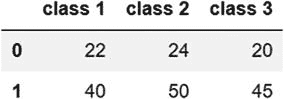 这里，我们定义了两个 `Series`，然后使用 `pd.DataFrame` 函数创建一个名为“combined_ages”的新 `DataFrame`。我们在单独的步骤中为列命名。 |
| 通过字典 | 代码：`combined_ages=pd.DataFrame({'class 1':[22,40],'class 2':[24,50],'class 3':[20,45]})` `combined_ages` 输出： 将一个字典作为参数传递给 `pd.DataFrame` 函数（列名作为键，每列的值包含在一个列表中）。 |
| 通过 NumPy 数组 | 代码：`numerical_df=pd.DataFrame(np.arange(1,9).reshape(2,4))` `numerical_df` 输出：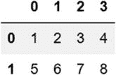 这里，我们首先使用 `np.arange` 函数创建一个 NumPy 数组。然后将该数组重塑为一个包含两行四列的 `DataFrame`。 |
| 使用一组元组 | 代码：`combined_ages=pd.DataFrame([(22,24,20),(40,50,45)],columns=['class 1','class 2','class 3'])` `combined_ages` 输出： 我们使用一组元组重新创建了“combined_ages” `DataFrame`。每个元组相当于 `DataFrame` 中的一行。 |

总而言之，我们可以使用字典、一组元组以及通过组合 `Series` 对象来创建 `DataFrame`。这些方法都使用了 `pd.DataFrame` 函数。请注意，此方法中的字符“D”和“F”是大写的；`pd.dataframe` 不起作用。

### 通过从其他格式导入数据创建 DataFrame

Pandas 可以使用其读取函数从多种格式读取数据（在此处查看支持的格式完整列表：[`https://pandas.pydata.org/pandas-docs/stable/user_guide/io.html`](https://pandas.pydata.org/pandas-docs/stable/user_guide/io.html)）。以下是一些常用的格式。

#### 从 CSV 文件

`read_csv` 函数可用于将 CSV 文件中的数据读取到 `DataFrame` 中，如下所示。

代码：

```
titanic=pd.read_csv('titanic.csv')
```

从 CSV 文件读取数据是创建 `DataFrame` 最常见的方法之一。CSV 文件是用于存储和检索值的逗号分隔文件，其中每一行相当于一条记录。在调用 `read_csv` 函数之前，请记得使用 Jupyter 主页上的上传按钮将 CSV 文件上传到 Jupyter 中（图 6-1）。


**图 6-1** Jupyter 文件上传

#### 从 Excel 文件

Pandas 支持使用 `pd.read_excel` 函数从 xls 和 xlsx 文件格式导入数据，如下所示。

代码：

```
titanic_excel=pd.read_excel('titanic.xls')
```

## 从 JSON 文件读取

JSON 是 JavaScript 对象表示法的缩写，是一种跨平台文件格式，用于在客户端和服务器之间传输和交换数据。Pandas 提供了 `read_json` 函数来从 JSON 文件读取数据，如下所示。

```
titanic=pd.read_json('titanic-json.json')
```

## 从 HTML 文件读取

我们也可以使用 `pd.read_html` 函数从网页导入数据。在下面的示例中，该函数将网页上的表格解析为 `DataFrame` 对象。此函数返回一个 `DataFrame` 对象列表，这些对象对应于网页上的表格。在下面的示例中，`table[0]` 对应于所提及 URL 上的第一个表格。

```
url="https://www.w3schools.com/sql/sql_create_table.asp"
table=pd.read_html(url)
table[0]
```

输出：
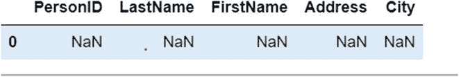

延伸阅读：查看 Pandas 支持的完整格式列表以及从这些格式读取数据的函数：[`https://pandas.pydata.org/pandas-docs/stable/reference/io.html`](https://pandas.pydata.org/pandas-docs/stable/reference/io.html)

## 访问 DataFrame 中的属性

在本节中，我们将学习如何访问 `DataFrame` 对象中的属性。我们使用以下 `DataFrame`：

```
combined_ages=pd.DataFrame({'class 1':[22,40],'class 2':[24,50],'class 3':[20,45]})
```

### 属性

当 `index` 属性与 `DataFrame` 对象一起使用时，它会给出索引对象的类型及其值。

```
combined_ages.index
```

输出：

```
RangeIndex(start=0, stop=2, step=1)
```

`columns` 属性提供有关列的信息（它们的名称和数据类型）。

```
combined_ages.columns
```

输出：

```
Index(['class 1', 'class 2', 'class 3'], dtype="object")
```

索引对象和列对象都是索引对象的类型。索引对象的类型是 `RangeIndex`，而列对象的类型是 `Index`。索引对象的值充当行标签，而列对象的值充当列标签。

### 访问 DataFrame 中的值

使用 `values` 属性，您可以获取存储在 `DataFrame` 中的数据。如您所见，输出是一个包含这些值的数组。

```
combined_ages.values
```

输出：

```
array([[22, 24, 20],
[40, 50, 45]], dtype=int64)
```

## 修改 DataFrame 对象

在本节中，我们将学习如何更改列的名称以及如何添加和删除列与行。

### 重命名列

可以使用 `rename` 方法更改列的名称。一个字典作为参数传递给此方法。该字典的键是旧的列名，值是新的列名。

```
combined_ages.rename(columns={'class 1':'batch 1','class 2':'batch 2','class 3':'batch 3'},inplace=True)
combined_ages
```

输出：

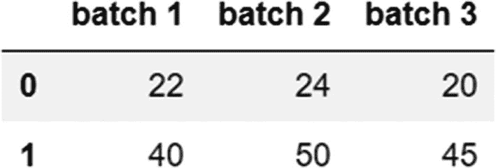

我们使用 `inplace` 参数的原因是为了让更改应用于实际的 `DataFrame` 对象。重命名也可以通过直接访问 `columns` 属性并在数组中指定新的列名来完成，如下例所示。

```
combined_ages.columns=['batch 1','batch 2','batch 3']
```

使用字典格式进行重命名是一种更直接的重命名列的方法，并且更改会应用于原始的 `DataFrame` 对象。这种方法的缺点是需要记住 `DataFrame` 中列的顺序。当我们使用 `rename` 方法时，我们使用了一个字典，我们知道正在更改哪些列名。

### 替换 DataFrame 中的值或观测值

`replace` 方法可用于替换 `DataFrame` 中的值。我们同样可以使用字典格式，其中键/值对代表旧值和新值。这里，我们将值 22 替换为值 33。

```
combined_ages.replace({22:33})
```

输出：

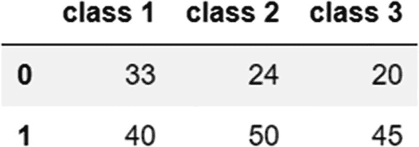

### 向 DataFrame 添加新列

有四种方法可以在 `DataFrame` 中插入新列，如表 6-3 所示。

**表 6-3** 向 DataFrame 添加新列

| 列插入方法 | 语法 |
| --- | --- |
| 使用索引运算符 `[]` | `combined_ages['class 4']=[18,40]` `combined_ages` 输出：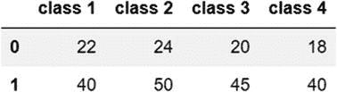 通过在索引运算符内将列名作为字符串提及并为其赋值，我们可以添加一列。 |
| 使用 `insert` 方法 | `combined_ages.insert(2,'class 0',[18,35])` `combined_ages` 输出：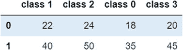 `insert` 方法可用于添加列。需要向此方法传递三个参数，如下所述。第一个参数是您要插入新列的索引（在本例中索引为 2，这意味着新列将作为我们 `DataFrame` 的第三列添加）。第二个参数是您要插入的新列的名称（本例中为 `class 0`）。第三个参数是包含新列值的列表（本例中为 18 和 35）。这三个参数对于 `insert` 方法成功添加列都是必需的。 |
| 使用 `loc` 索引器 | `combined_ages.loc[:,'class 4']=[20,40]` `combined_ages` 输出：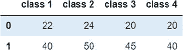 `loc` 索引器通常用于从 Series 和 DataFrame 中检索值，但它也可用于插入列。在前面的语句中，使用 `:` 运算符选择了所有行。该运算符后面跟着要插入的列的名称。该列的值包含在一个列表中。 |
| 使用 `concat` 函数 | `class5=pd.Series([31,48])` `combined_ages=pd.concat([combined_ages,class5],axis=1)` `combined_ages` 输出：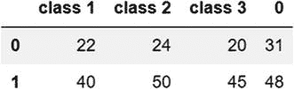 首先，将要添加的列（本例中为 `class5`）定义为一个 `Series` 对象。然后使用 `pd.concat` 函数将其添加到 `DataFrame` 对象中。需要将轴指定为 `1`，因为新数据是沿着列轴添加的。 |

总之，我们可以使用索引运算符、`loc` 索引器、`insert` 方法或 `concat` 函数向 `DataFrame` 添加列。最直接且常用的添加列的方法是使用索引运算符 `[]`。

### 在 DataFrame 中插入行

有两种方法可以在 `DataFrame` 中添加行，要么使用 `append` 方法，要么使用 `concat` 函数，如表 6-4 所示。

**表 6-4** 向 DataFrame 添加新行

| 行插入方法 | 语法 |
| --- | --- |

## 使用 `append` 方法

代码：
```
combined_ages = combined_ages.append({'class 1': 35, 'class 2': 33, 'class 3': 21}, ignore_index=True)
```
`combined_ages`

输出：
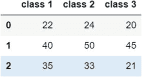

`append`方法的参数——需要添加的数据——被定义为一个字典。然后，这个字典作为参数传递给`append`方法。设置`ignore_index=True`参数可以防止抛出错误。该参数会重置索引。在使用`append`方法时，我们需要确保要么使用`ignore_index`参数，要么在将 Series 追加到 DataFrame 之前为其命名。请注意，`append`方法没有`inplace`参数来确保更改反映到原始对象中；因此，我们需要将原始对象指向使用 append 创建的新对象，如前面的代码所示。

# 使用 `pd.concat` 函数

## 添加新行

代码：
```python
new_row = pd.DataFrame([{'class 1': 32, 'class 2': 37, 'class 3': 41}])
```

`pd.concat([combined_ages, new_row])`

输出：
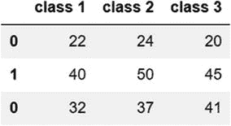

`pd.concat` 函数用于添加新行，如上语法所示。要添加的新行被定义为一个 `DataFrame` 对象。然后调用 `pd.concat` 函数，并将两个 `DataFrame`（原始 `DataFrame` 和定义为 `DataFrame` 的新行）的名称作为参数传递。

总之，我们可以使用 `append` 方法或 `concat` 函数向 `DataFrame` 添加行。

## 从 DataFrame 中删除列

可以使用三种方法从 `DataFrame` 中删除列，如表 6-5 所示。

**表 6-5** 从 `DataFrame` 中删除列

| 删除列的方法 | 语法 |
| --- | --- |
| `del` 函数 | 代码：`del combined_ages['class 3']` `combined_ages` 输出：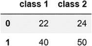 上述语句删除最后一列（名称为 `"class 3"`）。请注意，删除操作是就地进行的，即在原始 `DataFrame` 本身中执行。 |
| 使用 `pop` 方法 | 代码：`combined_ages.pop('class 2')` 输出：`0    24` `1    50` `Name: class 2, dtype: int64` `pop` 方法就地删除一列，并将删除的列作为 `Series` 对象返回。 |
| 使用 `drop` 方法 | 代码：`combined_ages.drop(['class 1'], axis=1, inplace=True)` `combined_ages` 输出：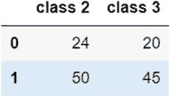 需要删除的列在列表中作为字符串提及，然后作为参数传递给 `drop` 方法。由于 `drop` 方法默认删除行（`axis=0`），如果要删除列，我们需要将轴值指定为 `"1"`。与 `del` 函数和 `pop` 方法不同，使用 `drop` 方法进行的删除不会发生在原始 `DataFrame` 对象中，因此，我们需要添加 `inplace` 参数。 |

总而言之，我们可以使用 `del` 函数、`pop` 方法或 `drop` 方法从 `DataFrame` 中删除列。

## 从 DataFrame 中删除行

有两种方法可以从 `DataFrame` 中删除行——要么使用布尔选择，要么使用 `drop` 方法，如表 6-6 所示。

**表 6-6** 从 `DataFrame` 中删除行

| 删除行的方法 | 语法 |
| --- | --- |
| 使用布尔选择 | 代码：`combined_ages[~(combined_ages.values < 50)]` 输出：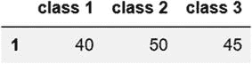 我们使用非运算符（`~`）来删除我们不想要的行。这里，我们删除 `DataFrame` 中所有小于 50 的值。 |
| 使用 `drop` 方法 | 代码：`combined_ages.drop(1)` 输出：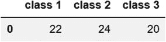 这里，我们删除第二行，其行索引为 1。如果要删除多行，我们需要在列表中指定这些行的索引。 |

因此，我们可以使用布尔选择或 `drop` 方法从 `DataFrame` 中删除行。由于 `drop` 方法同时适用于删除行和列，因此可以统一使用。请记住向 `drop` 方法添加所需的参数。对于删除列，需要添加 `axis`（`=1`）参数。要使更改反映在原始 `DataFrame` 中，需要包含 `inplace`（`=True`）参数。

# 索引

索引是 Pandas 的基础，也是使其数据检索和访问速度比其他工具快得多的原因。设置合适的索引以优化性能至关重要。索引在 NumPy 中实现为一个不可变（无法修改）的数组，并包含可哈希对象。可哈希对象是指可以根据其内容转换为整数值的对象（类似于字典中的映射）。具有不同值的对象将具有不同的哈希值。

Pandas 有两种类型的索引——行索引（垂直），带有附加到行的标签；以及列索引，为每一列带有标签（列名）。

现在让我们探索索引对象——它们的数据类型、属性以及它们如何加速数据访问。

### 索引对象的类型

索引对象具有数据类型，下面列出了一些。

*   `Index`：这是一种通用索引类型；列索引具有此类型。
*   `RangeIndex`：Pandas 中的默认索引类型（当未单独定义索引时使用），实现为递增整数的范围。此索引类型有助于节省内存。
*   `Int64Index`：一种包含整数作为标签的索引类型。对于此索引类型，索引标签不必等间距，而对于 `RangeIndex` 类型的索引则需要等间距。
*   `Float64Index`：包含浮点数（带小数点的数字）作为索引标签。
*   `IntervalIndex`：包含区间（例如，两个整数之间的区间）作为标签。
*   `CategoricalIndex`：一组有限且固定的值。
*   `DateTimeIndex`：用于表示日期和时间，例如在时间序列数据中。
*   `PeriodIndex`：表示季度、月份或年份等时间段。
*   `TimedeltaIndex`：表示两个时间段或两个日期之间的持续时间。
*   `MultiIndex`：具有多个级别的分层索引。

**延伸阅读：** 在此处了解有关索引类型的更多信息：[`https://pandas.pydata.org/pandas-docs/stable/reference/api/pandas.Index.html`](https://pandas.pydata.org/pandas-docs/stable/reference/api/pandas.Index.html)

### 创建自定义索引并使用列作为索引

当创建 Pandas 对象时，会创建一个默认的 `RangeIndex` 类型索引，如前所述。此类型的索引的第一个标签值为 0（对应于 Pandas Series 或 DataFrame 的第一个项目），第二个标签为 1，遵循公差为 1 的算术级数。

我们可以使用 `index` 参数或属性来设置自定义索引。在我们之前创建的 Series 和 DataFrame 对象中，我们只是为各个项目设置值，并且在缺少索引对象标签的情况下，使用了默认索引（`RangeIndex` 类型）。

我们可以在定义 Series 或 DataFrame 时使用 `index` 参数为索引标签提供自定义值。

代码：

```
periodic_table = pd.DataFrame({'Element': ['Hydrogen', 'Helium', 'Lithium', 'Beryllium', 'Boron']}, index=['H', 'He', 'Li', 'Be', 'B'])
```

输出：

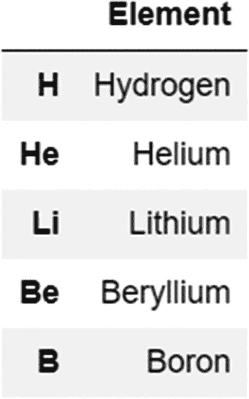

如果在创建对象时省略了 `index` 参数，我们可以通过 `index` 属性来设置标签，如下所示。

```
periodic_table.index=['H','He','Li','Be','B']
```

`set_index` 方法可用于利用现有列来设置索引，如下所示：

```
periodic_table=pd.DataFrame({'Element':['Hydrogen','Helium','Lithium','Beryllium','Boron'],'Symbols':['H','He','Li','Be','B']})
periodic_table.set_index(['Symbols'])
```

输出：

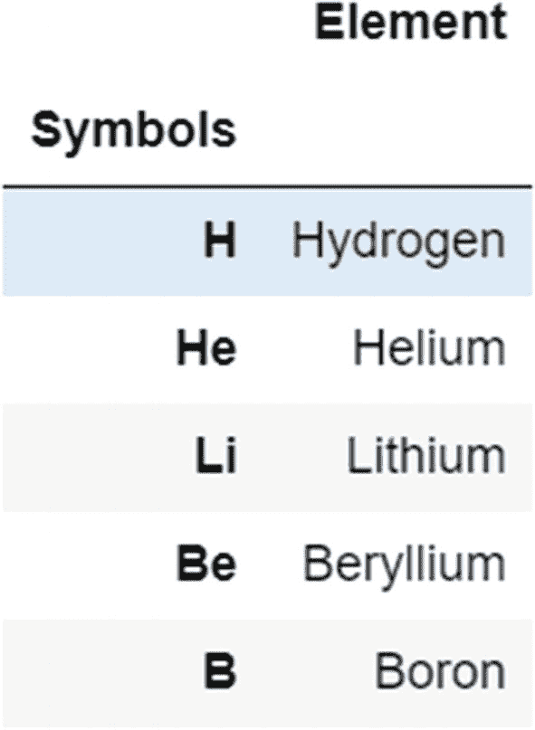

可以使用 `reset_index` 方法将索引再次变为列或重置索引：

```
periodic_table.reset_index()
```

输出：

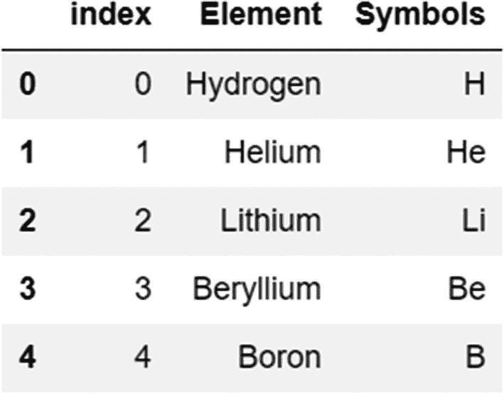

我们也可以在从外部文件读取数据到 DataFrame 时，使用 `index_col` 参数来设置索引，如下所示。

```
titanic=pd.read_csv('titanic.csv',index_col='PassengerId')
titanic.head()
```

输出：

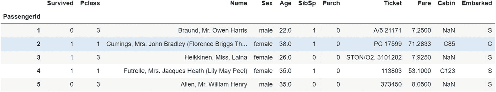

### 索引与数据检索速度

我们知道索引能显著提升数据访问速度。让我们通过一个例子来理解这一点。考虑以下 DataFrame：

```
periodic_table=pd.DataFrame({'Atomic Number':[1,2,3,4,5],'Element':['Hydrogen','Helium','Lithium','Beryllium','Boron'],'Symbol':['H','He','Li','Be','B']})
```

输出：


#### 不使用索引进行搜索

现在，尝试在不使用索引的情况下检索原子序数为 2 的元素，并使用 `timeit` 魔法函数测量检索所需时间。当不使用索引时，会执行线性搜索来检索元素，这相对耗时。

```
%timeit periodic_table[periodic_table['Atomic Number']==2]
```

输出：

```
1.66 ms ± 99.1 μs per loop (mean ± std. dev. of 7 runs, 1000 loops each)
```

#### 使用索引进行搜索

现在，将 `Atomic Number` 列设置为索引，并使用 `loc` 索引器查看搜索所需时间：

```
new_periodic_table=periodic_table.set_index(['Atomic Number'])
%timeit new_periodic_table.loc[2]
```

输出：

```
281 μs ± 14.4 μs per loop (mean ± std. dev. of 7 runs, 1000 loops each)
```

不使用索引执行搜索操作时，耗时在毫秒级别（约 `1.66 ms`）。而使用索引后，检索操作耗时降至微秒级别（`281 μs`），这是显著的性能提升。

### 索引的不可变性

如前所述，索引对象是不可变的——一旦定义，索引对象或其标签便无法修改。例如，让我们尝试更改刚刚定义的 `periodic_table` DataFrame 中的一个索引标签，如下所示。由于我们试图操作一个不可变对象，输出中会出现错误。

```
periodic_table.index[2]=0
```

输出：

```
TypeError                                 Traceback (most recent call last)
 in 
----> 1periodic_table.index[2]=0
~\Anaconda3\lib\site-packages\pandas\core\indexes\base.py in __setitem__(self, key, value)

3937def __setitem__(self, key, value):
-> 3938raiseTypeError("Index does not support mutable operations")

3940def __getitem__(self, key):
TypeError: Index does not support mutable operations
```

虽然 `Index` 对象的值无法更改，但我们可以通过其属性来检索索引的相关信息，例如 `Index` 对象中包含的值、是否存在空值等。让我们通过一些示例来了解部分索引属性：考虑以下 DataFrame 中的列索引：

```python
periodic_table = pd.DataFrame({'Element': ['Hydrogen', 'Helium', 'Lithium', 'Beryllium', 'Boron']}, index=['H', 'He', 'Li', 'Be', 'B'])
column_index = periodic_table.columns
```

列索引的部分属性如下：

- **`values` 属性**：返回列名称。

```python
column_index.values
```

输出：

```
array(['Element'], dtype=object)
```

- **`hasnans` 属性**：根据是否存在空值返回布尔值 `True` 或 `False`。

```python
column_index.hasnans
```

输出：

```
False
```

- **`nbytes` 属性**：返回在内存中占用的字节数。

```python
column_index.nbytes
```

输出：

```

```

延伸阅读：有关属性的完整列表，请参考以下文档：[`https://pandas.pydata.org/pandas-docs/stable/reference/api/pandas.Index.html`](https://pandas.pydata.org/pandas-docs/stable/reference/api/pandas.Index.html)

### 索引的对齐

当两个 Pandas 对象相加时，会检查它们的索引标签是否对齐。对于索引匹配的项，其值会相加或拼接。对于索引不匹配的项，结果对象中对应索引的值为空（`np.NaN`）。

让我们通过一个示例来理解这一点。这里，我们看到 `s1` 中的索引标签 0 在 `s2` 中没有匹配项，而 `s2` 中的最后一个索引标签（10）在 `s1` 中没有匹配项。当对象合并时，这些值等于空值。所有其他索引标签对齐的值都会相加。

```python
s1 = pd.Series(np.arange(10), index=np.arange(10))
s2 = pd.Series(np.arange(10), index=np.arange(1, 11))
s1 + s2
```

输出：

```
0      NaN
1      1.0
2      3.0
3      5.0
4      7.0
5      9.0
6     11.0
7     13.0
8     15.0
9     17.0
10     NaN
dtype: float64
```

### 索引的集合运算

我们可以对不同对象的索引执行并集、差集和对称差集等集合运算。

考虑上一节中从两个 Series 对象（`s1` 和 `s2`）创建的以下索引 `i1` 和 `i2`：

```python
i1 = s1.index
i2 = s2.index
```

#### 并集运算

返回两个集合中存在的所有元素。

```python
i1.union(i2)
```

输出：

```
Int64Index([0, 1, 2, 3, 4, 5, 6, 7, 8, 9, 10], dtype="int64")
```

#### 差集运算

返回一个集合中存在但另一个集合中不存在的元素。

```python
i1.difference(i2)  # 存在于 i1 但不存在于 i2 中的元素
```

输出：

```
Int64Index([0], dtype="int64")
```

#### 对称差集运算

返回两个集合中不共有的元素。此操作与差集操作的不同之处在于，它考虑了两个集合中不共有的元素。

```python
i1.symmetric_difference(i2)
```

输出：

```
Int64Index([0, 10], dtype="int64")
```

你还可以对两个索引对象执行算术运算，如下所示。

```python
i1 - i2
```

输出：

```
Int64Index([-1, -1, -1, -1, -1, -1, -1, -1, -1, -1], dtype="int64")
```

## Pandas 中的数据类型

Pandas 中使用的数据类型源自 NumPy，但用于定性数据的 `category` 数据类型除外，该类型是在 Pandas 中定义的。常见的数据类型包括：

- `object`（用于存储混合数据，如数字、字符串等）
- `int64`（用于整数值）
- `float64`（用于带小数点的数字）
- `Datetime`（用于存储日期和时间数据）
- `Category`（用于仅包含少量不同值的变量，如 `True`/`False`，或一些有限的有序类别，如 `one`/`two`/`three`/`four`）

### 获取数据类型信息

我们现在了解如何检索列的数据类型信息。

导入 `subset-covid-data.csv` 文件并将数据读入 DataFrame，如下所示。

```python
data = pd.read_csv('subset-covid-data.csv')
data.head()
```

输出：

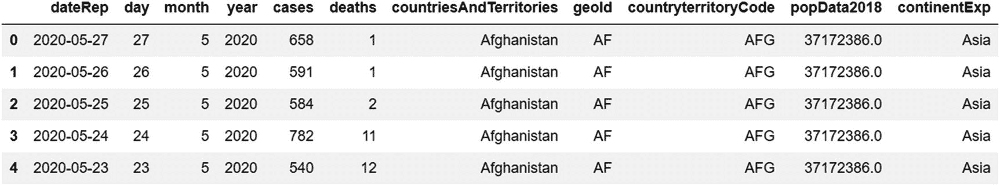

使用 `dtypes` 属性，我们可以获取此 DataFrame 中列的类型。

```python
data.dtypes
```

输出：

```
country          object
continent        object
date             object
day               int64
month             int64
year              int64
cases             int64
deaths            int64
country_code     object
population      float64
dtype: object
```

正如我们在前一章中讨论的，可用于分类变量和连续变量的数学运算和图形类型是不同的。了解列的数据类型有助于我们弄清楚如何分析变量。具有 Pandas 数据类型 `object` 或 `category` 的列是分类变量，而具有 `int64` 和 `float64` 等数据类型的变量是连续变量。

### 获取每种数据类型的计数

为了获取属于每种数据类型的列数，我们使用 `get_dtype_counts` 方法：

```python
data.get_dtype_counts()
```

输出：

```
float64    1
int64      5
object     4
dtype: int64
```

### 选择特定的数据类型

使用 `select_dtypes` 方法，我们可以根据要选择的数据类型来过滤列：

```python
data.select_dtypes(include='number').head()
# 这将选择所有具有整数和浮点数据的列，并排除其余列。head 参数用于限制显示的记录数。
```

输出：

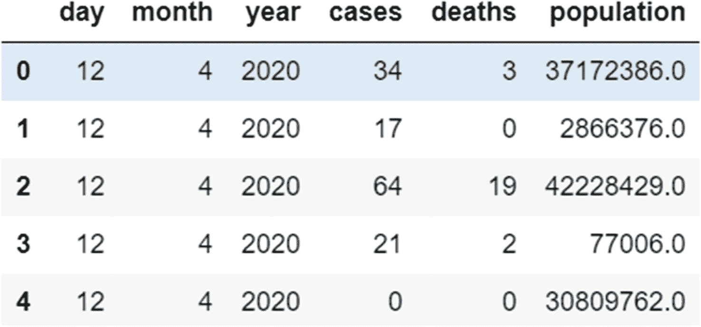

## 计算内存使用量并更改列的数据类型

我们可以通过使用 `memory_usage` 方法来查找 `Series` 或 `DataFrame` 的内存使用量（以字节为单位）。在使用此方法时，我们包含 `deep` 参数，以便在系统级别更全面地了解内存使用情况。

```python
data['continent'].memory_usage(deep=True)
```

输出：

```

```

让我们看看是否可以减少此列的内存使用量。首先，让我们找到其当前的数据类型。

```python
data['continent'].dtype
```

输出：

```
dtype('O')
```

正如我们所见，此列占用 13030 字节内存，数据类型为 `O`。Pandas 的分类数据类型适用于存储只有少量唯一值的定性变量，因为这可以减少内存使用量。由于洲列只有少量唯一值（`Europe`、`Asia`、`America`、`Africa`、`Oceania`），让我们将此列的数据类型从 `object` 更改为 `categorical`，看看这是否会减少内存使用量。我们使用 `astype` 方法来更改数据类型。

```python
data['continent'] = data['continent'].astype('category')
data['continent'].memory_usage(deep=True)
```

输出：

```

```

更改数据类型后，内存使用量似乎减少了不少。让我们计算一下确切的减少百分比。

```python
(13030 - 823) / 13030
```

输出：

```
0.936838066001535
```

通过将数据类型从 `object` 更改为 `categorical`，内存使用量显著减少了约 93%。

## 索引器与数据子集的选择

在 Pandas 中，有多种选择和访问数据的方法，如下所列：

- `loc` 和 `iloc` 索引器
- `ix` 索引器
- `at` 和 `iat` 索引器
- 索引运算符 `[]`

数据检索的首选方法是使用 `loc` 和 `iloc` 索引器。索引器和索引运算符都可以使用索引访问对象。请注意，索引器不同于索引运算符，后者是一对包含索引的方括号。虽然我们使用索引运算符 `[]` 从列表、元组和 NumPy 等对象中选择数据，但不建议使用此运算符。

例如，如果我们想在 Pandas 中选择第一行，我们将使用下面给出的第一个语句。

```python
data.iloc[0]  # 正确
data[0]       # 错误
```

### 理解 `loc` 和 `iloc` 索引器

`loc` 索引器通过使用索引标签来选择数据，这类似于 Python 中字典使用键来关联值进行数据选择的方式。而 `iloc` 索引器则通过整数位置来选择数据，这类似于列表和数组中选取单个元素的方式。

请注意，`loc` 和 `iloc` 是索引器，后面跟的是方括号，而不是圆括号（像函数或方法那样）。逗号前的索引值指代行索引，逗号后的索引值指代列索引。

让我们通过一些示例来理解 `loc` 和 `iloc` 索引器的工作原理。我们再次使用 COVID-19 数据集（`subset-covid-data.csv`）进行演示。

```python
data=pd.read_csv('subset-covid-data.csv',index_col='date')
```

这里，我们将 `date` 列用作索引。

### 选择连续的行

我们可以使用 `iloc` 来实现，因为我们知道要检索的行的索引（前五行）：

```python
data.iloc[0:5]
```

输出：

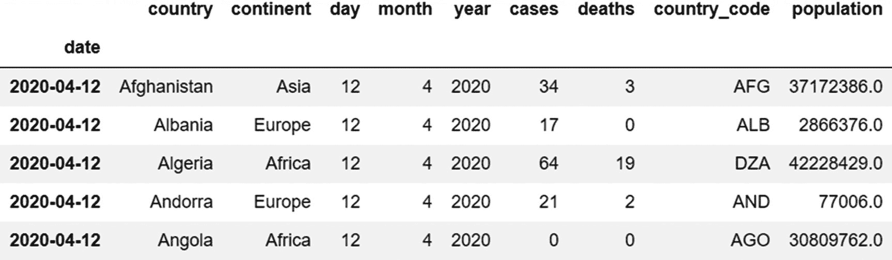

请注意，我们只指定了行索引，在没有指定列索引的情况下，默认会选择所有列。

### 选择连续的列

我们可以使用 `iloc` 来实现，因为前三列的索引值（0, 1, 2）是已知的。

```python
data.iloc[:,:3]
```

或者

```python
data.iloc[:,0:3]
```

输出（仅显示前五行）：

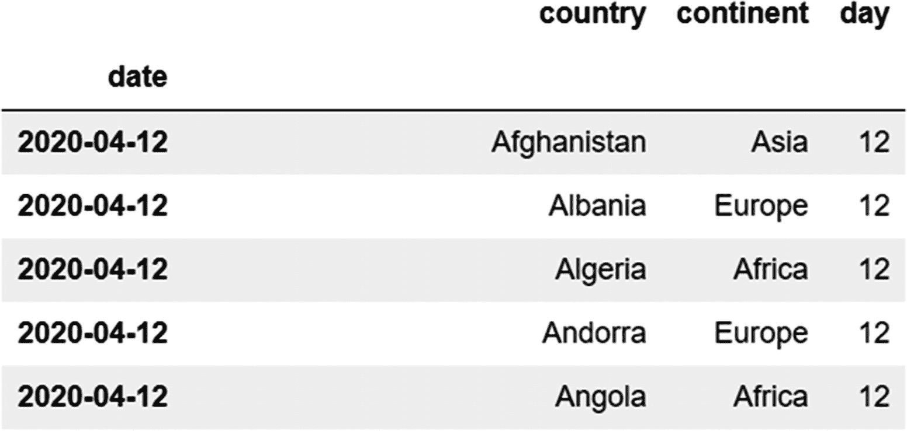

虽然我们可以省略列索引，但不能省略行索引。以下语法将无法工作：

```python
data.iloc[,0:3] # 错误
```

在这个例子中，我们选择了所有行和三列。在冒号（`:`）符号的两侧，分别有起始值和结束值。如果起始值和结束值都缺失，则表示选择所有值。如果起始索引缺失，则默认值为 0。如果结束索引值缺失，则默认为索引的最后一个可能位置值（列数或行数减一）。

### 选择单行

让我们使用 `iloc` 索引器选择第 100 行。第 100 行的索引是 99（因为索引编号从 0 开始）。

```python
data.iloc[99]
```

输出：

```
country             Jamaica
continent           America
day                      12
month                     4
year                   2020
cases                     4
deaths                    0
country_code            JAM
population      2.93486e+06
Name: 2020-04-12, dtype: object
```

### 使用索引标签选择行

选择日期为 `2020-04-12` 的行。这里，我们使用 `loc` 索引器，因为我们知道需要选择的行的索引标签，但不知道它们的位置。

```python
data.loc['2020-04-12']
```

输出（仅显示前五行）：

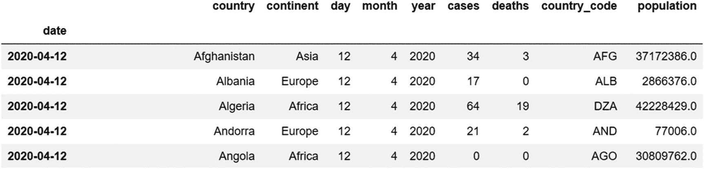

### 使用列名选择列

让我们选择名为 `cases` 的列。由于列名充当其索引标签，我们可以使用 `loc` 索引器。

```python
data.loc[:,'cases']
```

输出：

```
date
2020-04-12       34
2020-04-12       17
2020-04-12       64
2020-04-12       21
2020-04-12        0
```

### 使用负索引值进行选择

让我们选择前五行和最后三列。这里，我们使用负索引来选择最后三列。最后一列的位置索引值为 –1，倒数第二列的索引值为 –2，依此类推。步长为 –1。我们省略了行切片（`:5`）的起始值，因为默认值为 0。

```python
data.iloc[:5,-1:-4:-1]
```

输出：

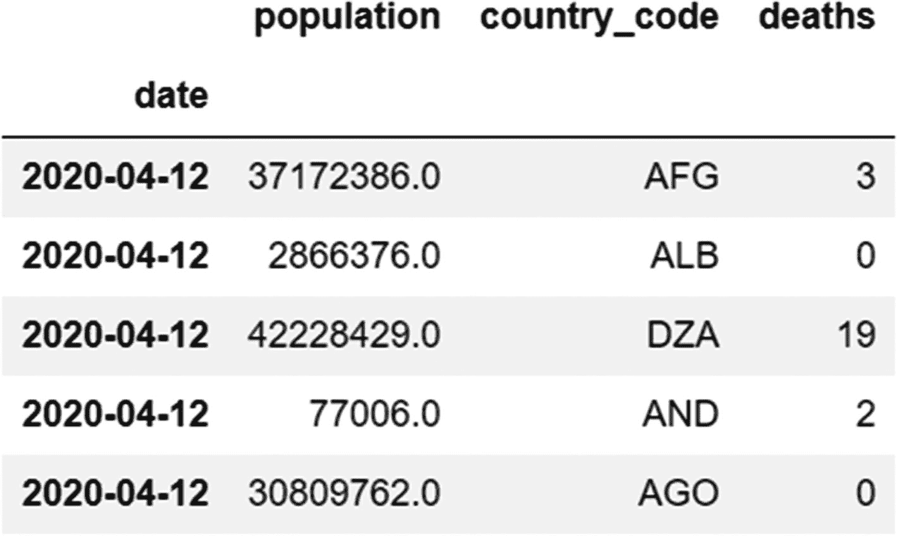

### 选择非连续的行与列

若要选择一组不连续的行或列，需要将行或列的索引位置或标签放入一个列表中。在以下示例中，我们选择第二行和第五行，以及第一列和第四列。

代码：

```python
data.iloc[[1,5],[0,3]]
```

输出：

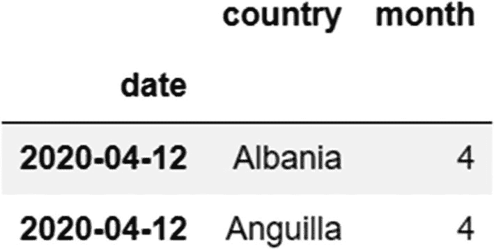

### 其他（较少使用的）数据访问索引器

推荐使用索引器 `loc` 和 `iloc` 对 `Series` 和 `DataFrame` 对象进行切片或子集选择，是因为它们有明确的规则：要么完全通过标签（`loc`）选择数据，要么完全通过位置（`iloc`）选择数据。然而，了解 Pandas 支持的其他索引器也很重要，下文将对此进行说明。

#### `ix` 索引器

`ix` 索引器允许我们通过结合索引标签和位置来选择数据。这种选择方法与 `loc` 和 `iloc` 索引器使用的方法不同，后者不允许混合使用位置和标签。由于 `ix` 索引器没有明确的数据选择规则，因此存在很大的歧义空间，该索引器现已被弃用（这意味着虽然它仍受支持，但不应再使用）。为了演示，我们来看看 `ix` 索引器是如何工作的。让我们选择数据集中 `cases` 列的前五行。

代码：

```python
data.ix[:5,'cases']
```

输出：

```
C:\Users\RA\Anaconda3\lib\site-packages\ipykernel_launcher.py:1: DeprecationWarning:
.ix is deprecated. Please use
.loc for label based indexing or
.iloc for positional indexing
See the documentation here:
http://pandas.pydata.org/pandas-docs/stable/indexing.html#ix-indexer-is-deprecated
"""Entry point for launching an IPython kernel.
date
2020-04-12    34
2020-04-12    17
2020-04-12    64
2020-04-12    21
2020-04-12     0
Name: cases, dtype: int64
```

请注意，使用 `ix` 索引器会触发一个警告，要求用户改用 `loc` 或 `iloc`。

#### 索引运算符 - `[]`

尽管索引运算符并非 Pandas 中数据选择或切片的首选方式，但它仍有其用途。该运算符的一个恰当应用是从 `DataFrame` 中选择列。其参数是列的名称，以字符串形式（用引号括起来）给出。例如，以下语句将从我们的 COVID 数据集中选择 `population` 列。

代码：

```python
data['population']
```

输出（仅显示前五行）：

```
date
2020-04-12     37172386.0
2020-04-12      2866376.0
2020-04-12     42228429.0
2020-04-12        77006.0
2020-04-12     30809762.0
```

要选择多列，我们将列名作为字符串放入列表中传递，如下例所示：

代码：

```python
data[['country','population']]
```

输出（已截断）：

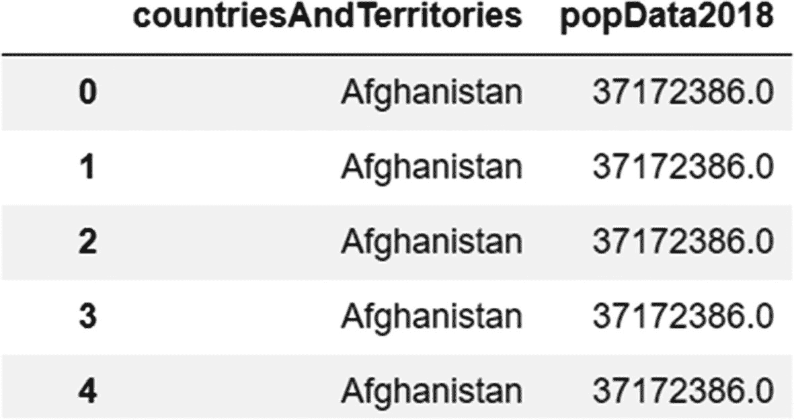

索引运算符也可用于选择一组连续的行。

代码：

```python
data[:3]
```

输出：

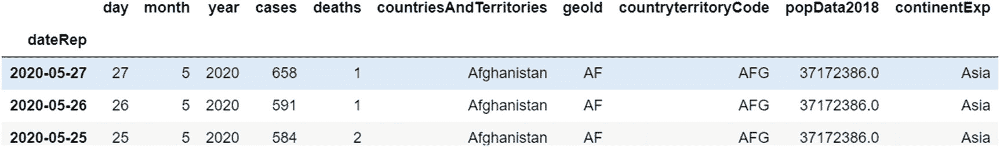

然而，它不能用于选择一系列不连续的行，因为这会引发错误。以下语句将无法工作。

代码：

```python
data[[3,5]] # 错误
```

索引运算符的另一个限制是它不能同时选择行和列。以下语句同样无法工作。

代码：

```python
data[:,3] # 错误
```

#### `at` 和 `iat` 索引器

还有另外两个较少使用的索引器——`at`（类似于 `loc`，使用标签）和 `iat`（类似于 `iloc`，使用位置）。`at` 和 `iat` 索引器的三个主要特点是：

- 它们只能用于从 `Series` 或 `DataFrame` 中选择标量（单个）值。

- 行和列索引都需要作为参数传递给这些索引器，因为它们返回单个值。我们无法像使用其他索引器那样，通过此索引器获取一组行或列。
- 这些索引器在检索数据时比`loc`和`iloc`更快。

让我们通过一个示例来理解这些索引器的工作原理。

导入`subset-covid-data.csv`数据集。

```python
data=pd.read_csv('subset-covid-data.csv')
```

`at`索引器的工作方式与`loc`类似，你需要传递行索引标签和列名作为参数。
让我们尝试检索第一行中的`population`值。由于我们尚未为此`DataFrame`设置索引，因此索引标签和位置将相同。

代码：

```python
data.at[0,'population']
#0 is the index label as well as the position
```

输出：

```
37172386.0
```

`iat`索引器与`iloc`索引器类似，行/列索引作为参数传递。

代码：

```python
data.iat[0,9]
#0,9 is the position of the first record of the population column
```

输出与上一条语句的输出相同。

### 用于选择数据子集的布尔索引

在我们之前查看的示例中，我们使用了各种索引器来根据位置或标签检索数据。使用布尔索引，我们使用条件语句根据其值过滤数据。可以指定单个条件，也可以使用位运算符——`&`（与）、`|`（或）、`~`（非）组合多个条件。
让我们考虑一个示例来理解这一点。在这里，我们选择所有大洲名称为“Asia”且国家名称以字母“C”开头的记录。

代码：

```python
data[(data['continent']=='Asia') & (data['country'].str.startswith('C'))]
```

输出：

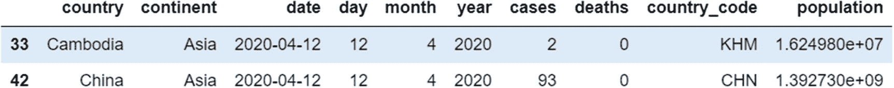

### 使用 `query` 方法检索数据

当我们像上一个示例那样组合多个条件时，代码的可读性可能会受到影响。在这种情况下，可以使用`query`方法。
让我们检索所有大洲名称为“Asia”且病例数大于 500 的记录。请注意语法，我们将每个条件括在双引号内，并使用逻辑`and`运算符，而不是位运算符`&`。

代码：

```python
data.query("(continent=='Asia')""and (cases>=500)")
```

输出：

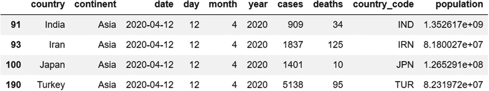

## 延伸阅读

查看更多关于：

*   `query`方法：[`https://pandas.pydata.org/pandas-docs/stable/reference/api/pandas.DataFrame.query.html`](https://pandas.pydata.org/pandas-docs/stable/reference/api/pandas.DataFrame.query.html)
*   Pandas 中的索引：[`https://pandas.pydata.org/docs/user_guide/indexing.html`](https://pandas.pydata.org/docs/user_guide/indexing.html)

## Pandas 中的运算符

Pandas 使用以下可以应用于整个`Series`的运算符。虽然 Python 需要循环来遍历列表或字典中的每个元素，但 Pandas 利用了 NumPy 中实现的向量化特性，使得这些运算符可以应用于序列中的每个元素，从而消除了迭代和循环的需要。不同类型的运算符列于表 6-7 中。

**表 6-7** Pandas 运算符

| 运算符类型 | 包含的运算符 |
| :--- | :--- |
| 算术运算符 | `+`（加法），`-`（减法），`*`（乘法），`**`（幂运算），`%`（取余运算符），`/`（除法），`//`（向下取整除法，用于获取商）。算术运算符的功能可以使用以下方法复制：`add`对应`+`，`sub`对应`-`，`mul`对应`*`，`div`对应`/`，`mod`对应`%`，`pow`对应`**`。 |
| 比较运算符 | `==`（等于），`<`（小于），`>`（大于），`<=`（小于等于），`>=`（大于等于），`!=`（不等于） |
| 逻辑运算符 | `&`，`|`，`~`。Pandas 像 NumPy 一样，使用位运算符（`&`，`|`，`~`）作为逻辑运算符，因为这些运算符对`Series`的每个元素进行操作。请注意，这些运算符与 Python 中使用的逻辑运算符不同，Python 中使用关键字`and`、`or`和`not`。 |

## 在 Pandas 中表示日期和时间

在 Pandas 中，有一个单一的 `Timestamp` 函数可用于定义日期、时间或日期和时间的组合。这与 Python 中的实现形成对比，Python 需要单独的对象来定义日期或时间。`pd.Timestamp` 函数等同于 Python 中的以下函数：`datetime.date`、`datetime.time`、`datetime.datetime`。

例如，让我们使用 `pd.Timestamp` 函数在 Pandas 中表示 2000 年 12 月 25 日这个日期。

代码：

```python
pd.Timestamp('25/12/2000')
```

输出：

```
Timestamp('2000-12-25 00:00:00')
```

`Timestamp` 函数非常灵活，可以接受多种格式的参数。上述输出也可以使用以下任何语句复制。

```python
#different input formats for creating a Timestamp object
pd.Timestamp('25 December 2000')
pd.Timestamp('December 25 2000')
pd.Timestamp('12/25/2000')
pd.Timestamp('25-12-2000')
pd.Timestamp(year=2000,month=12,day=25)
pd.Timestamp('25-12-2000 12 PM')
pd.Timestamp('25-12-2000 0:0.0')
```

`pd.Timestamp` 函数帮助我们定义日期、时间以及这两者的组合。但是，如果我们需要定义一个时间段，此函数将不起作用。一个单独的函数 `pd.Timedelta` 帮助我们创建存储时间持续时间的对象。这等同于 Python 中的 `datetime.timedelta` 函数。

让我们使用 `Timedelta` 函数在 Pandas 中定义一个时间段。

代码：

```python
pd.Timedelta('45 days 9 minutes')
```

输出：

```
Timedelta('45 days 00:09:00')
```

与 `Timestamp` 函数一样，`Timedelta` 函数在接受的输入参数方面也很灵活。上述语句也可以写成如下形式。

```python
pd.Timedelta(days=45,minutes=9)
```

我们还可以添加 `unit` 参数来创建一个 `Timedelta` 对象。在下面的代码行中，值为 `'m'` 的参数 `unit` 表示分钟，我们将 500 分钟添加到基准时间 00:00:00 小时。

```python
pd.Timedelta(500,unit='s')
```

输出：

```
Timedelta('0 days 08:20:00')
```

### 将字符串转换为 Pandas Timestamp 对象

日期通常表示为字符串，需要转换为 Pandas 可以理解的类型。`pd.to_datetime` 函数将日期转换为 `Timestamp` 对象。将其转换为这种格式有助于比较两个日期、在给定日期上增加或减去一个时间段，以及从给定日期中提取单个组件（如日、月和年）。它还有助于表示非传统“日-月-年”或“月-日-年”格式的日期。

让我们考虑一个示例来理解这一点。考虑表示为字符串“11:20 AM, 2^(nd) April 1990”的日期。我们可以将其转换为 `Timestamp` 对象，并指定 `format` 参数，以便正确解析日、月、年等单个组件。`pd.to_datetime` 函数中的 `format` 参数及其格式化代码（如 `%H`、`%M`、`%d`、`%m`、`%Y`）有助于指定此日期的书写格式。`%H` 表示小时，`%M` 表示分钟，`%d` 表示日，`%m` 表示月，`%Y` 表示年。

```python
a=pd.to_datetime('11:20,02/04/1990', format='%H:%M,%d/%m/%Y')
a
```

输出：

```
Timestamp('1990-04-02 11:20:00')
```

现在这个日期已被转换为 `Timestamp` 对象，我们可以对其执行操作。一个 `Timedelta` 对象可以添加到一个 `Timestamp` 对象上。

让我们给这个日期增加四天：

```python
a+pd.Timedelta(4,unit='d')
```

输出：

```
Timestamp('1990-04-06 11:20:00')
```

### 提取时间戳对象的组成部分

使用 `pd.to_datetime` 函数将日期转换为 Pandas 时间戳对象后，可以通过相关属性提取日期变量的各个组成部分。

```python
#提取月份
a.month
```

输出：

```
4
```

```python
#提取年份
a.year
```

输出：

```
1990
```

```python
#提取日期
a.day
```

输出：

```
2
```

我们还可以使用 `minute` 和 `hour` 属性从日期中提取分钟和小时。

## 延伸阅读

了解更多关于 Pandas 时间戳函数的信息：[`pandas.pydata.org/pandas-docs/stable/reference/api/pandas.Timestamp.html`](https://pandas.pydata.org/pandas-docs/stable/reference/api/pandas.Timestamp.html)

## 分组与聚合

聚合是将一组值汇总为单个值的过程。

统计学家哈德利·威克汉姆提出了“拆分-应用-合并”方法论（论文可在此处访问：[`www.jstatsoft.org/article/view/v040i01/v40i01.pdf`](https://www.jstatsoft.org/article/view/v040i01/v40i01.pdf)），该方法包含三个步骤：

1.  将数据拆分为更小、可管理且相互独立的组。在 Pandas 中，这通过 `groupby` 方法实现。
2.  对每个组应用函数。我们可以应用任何聚合函数，包括最小值、最大值、中位数、均值、总和、计数、标准差、方差和大小。每个聚合函数都会计算整个组的聚合值。请注意，我们也可以编写自定义的聚合函数。
3.  将每个组应用函数后的结果合并为单个组合对象。

在接下来的部分中，我们将介绍 `groupby` 方法、聚合函数、`transform`、`filter` 和 `apply` 方法，以及 `groupby` 对象的属性。这里我们再次使用相同的 COVID-19 数据集，该数据集显示了 2020 年 4 月 12 日所有国家的病例数和死亡数。

```python
df=pd.read_csv('subset-covid-data.csv')
df.head()
```

输出：

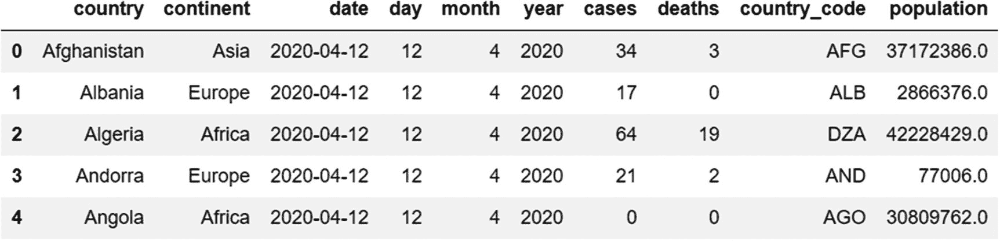

如我们所见，有多个国家属于同一大洲。让我们找出每个大洲的总病例数和死亡数。为此，我们需要使用“continent”列进行分组。

```python
df.groupby('continent')['cases','deaths'].sum()
```

输出：

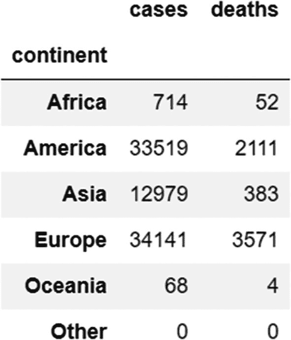

在这里，我们按“continent”列进行分组，该列成为*分组列*。我们聚合病例数和死亡数的值，这使得名为“cases”和“deaths”的列成为*聚合列*。`sum` 方法成为我们的*聚合函数*，它计算属于给定大洲的所有国家的病例和死亡总数。每当你执行 `groupby` 操作时，建议在一开始就确定这三个要素（分组列、聚合列和聚合函数）。

以下十三个聚合函数可以应用于组：`sum()`、`max()`、`min()`、`std()`、`var()`、`mean()`、`count()`、`size()`、`sem()`、`first()`、`last()`、`describe()`、`nth()`。

我们还可以使用 `agg` 方法，并将 `np.sum` 作为属性，这将产生与上一条语句相同的输出：

```python
df.groupby('continent')['cases','deaths'].agg(np.sum)
```

`agg` 方法可以接受任何聚合方法，例如 `mean`、`sum`、`max` 等，并且这些方法在 NumPy 中实现。

我们还可以将聚合列和聚合方法作为字典传递给 `agg` 方法，如下所示，这同样会产生相同的输出。

```python
df.groupby('continent').agg({'cases':np.sum,'deaths':np.sum})
```

如果有多个分组列，请使用列表将列名保存为字符串，并将此列表作为参数传递给 `groupby` 方法。

关于聚合函数的延伸阅读：[`pandas.pydata.org/pandas-docs/stable/user_guide/groupby.html#aggregation`](https://pandas.pydata.org/pandas-docs/stable/user_guide/groupby.html%2523aggregation)

### 检查 groupby 对象的属性

应用 `groupby` 方法的结果是一个 groupby 对象。这个 `groupby` 对象有几个属性，本节将对此进行说明。

#### groupby 对象的数据类型

可以使用 `type` 函数访问 groupby 对象的数据类型。

```python
grouped_continents=df.groupby('continent')
type(grouped_continents)
```

输出：

```
pandas.core.groupby.generic.DataFrameGroupBy
```

groupby 对象的每个组都是一个独立的 DataFrame。

#### 获取组的名称

`groupby` 对象有一个名为 `groups` 的属性。在 `groupby` 对象上使用此属性将返回一个字典，该字典的键是组的名称。

```python
grouped_continents.groups.keys()
```

输出：

```
dict_keys(['Africa', 'America', 'Asia', 'Europe', 'Oceania', 'Other'])
```

#### 使用 nth 方法返回每个组中相同位置的记录

假设你想查看每个大洲中第四个国家的详细信息。使用 `nth` 方法，我们可以通过使用位置索引值 3（对应第四个位置）来检索这些数据。

```python
grouped_continents.nth(3)
```

输出：

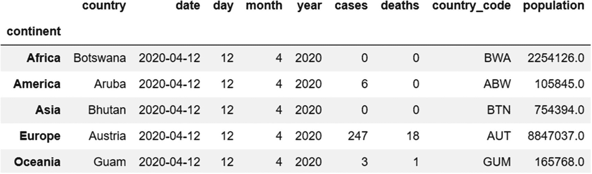

#### 使用 get_group 方法获取特定组的所有数据

使用 `get_group` 方法，并将组名作为该方法的参数。在此示例中，我们检索名为“Europe”的组的所有数据。

```python
grouped_continents.get_group('Europe')
```

输出（包含 54 条记录；以下仅显示前四条记录）：

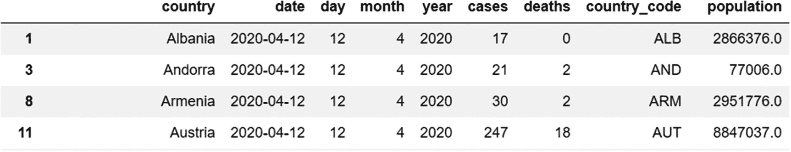

我们已经了解了如何将聚合函数应用于 groupby 对象。现在让我们看看其他一些函数，例如 `filter`、`apply` 和 `transform`，它们也可以与 groupby 对象一起使用。

#### 过滤组

`filter` 方法根据特定条件移除或过滤掉组。`agg`（聚合）方法为每个组返回一个值，而 `filter` 方法则根据条件是否满足，从每个组中返回记录。

让我们通过一个例子来理解这一点。我们想要返回平均死亡率大于 40 的大洲的所有行。`filter` 方法在 groupby 对象上调用，其参数是一个 lambda 函数或预定义函数。这里的 `lambda` 函数计算每个组的平均死亡率，由参数“x”表示。该参数是一个代表每个组（在我们的示例中是大洲）的 DataFrame。如果该组满足条件，则返回其所有行。否则，该组的所有行都将被排除。

```python
grouped_continents=df.groupby('continent')
grouped_continents.filter(lambda x:x['deaths'].mean()>=40)
```

输出（仅显示前五行）：

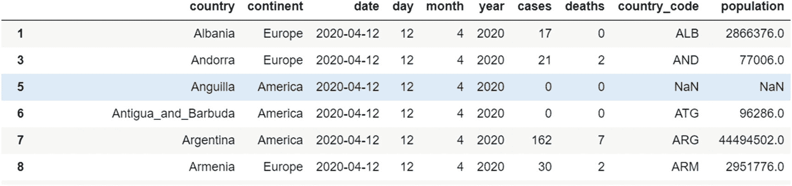

在输出中，我们看到只返回了“America”和“Europe”组（大洲）的行，因为只有这些组满足条件（组平均死亡率大于 40）。

### Transform 方法与 groupby

`transform` 方法是可与 `groupby` 对象配合使用的另一种方法，它对组内的每个值应用一个函数。该方法返回一个对象，其行数与原始 DataFrame 或 Series 相同，并且索引方式也类似。

让我们对人口列使用 `transform` 方法，将行中的每个值除以 1000000，从而得到以百万为单位的人口数据。

```python
grouped_continents['population'].transform(lambda x:x/1000000)
```

输出（仅显示前五行和后两行；实际输出包含 206 行）：

```
0       37.172386
1        2.866376
2       42.228429
3        0.077006
4       30.809762
.
..
...
204     17.351822
205     14.439018
Name: population, Length: 206, dtype: float64
```

请注意，`filter` 方法返回的记录数比其输入对象少，而 `transform` 方法返回的记录数与输入对象相同。

在前面的示例中，我们对一个 Series 应用了 `transform` 方法。我们也可以对整个 DataFrame 使用它。`transform` 方法的一个常见应用是填充空值。让我们用值 0 填充 DataFrame 中的缺失值。在输出中，请注意国家“安圭拉”的国家代码和人口值（之前缺失）现在已被替换为值 0。

```python
grouped_continents.transform(lambda x:x.fillna(0))
```

输出：

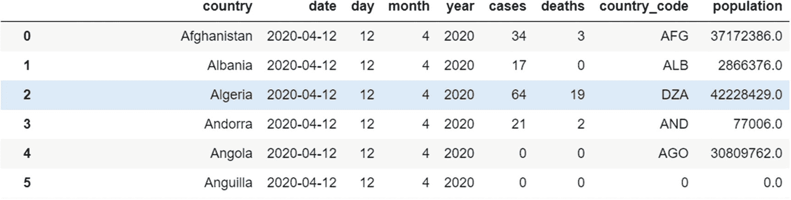

`transform` 方法可以用于任何 Series 或 DataFrame，而不仅仅是 `groupby` 对象。从现有列创建新列是 `transform` 方法的一个常见应用。

### Apply 方法与 groupby

`apply` 方法将函数“应用”到 `groupby` 对象的每个组。`apply` 方法与 `transform` 方法的区别在于，`apply` 方法更加灵活，它可以返回任意形状的对象，而 `transform` 方法需要返回相同形状的对象。

`apply` 方法可以返回单个（标量）值、Series 或 DataFrame，并且输出不必与输入具有相同的结构。此外，`transform` 方法对组内的每一列应用函数，而 `apply` 方法则对整个组应用函数。

让我们使用 `apply` 方法计算每个组（大洲）中的缺失值总数。

```python
grouped_continents.apply(lambda x:x.isna().sum())
```

输出：

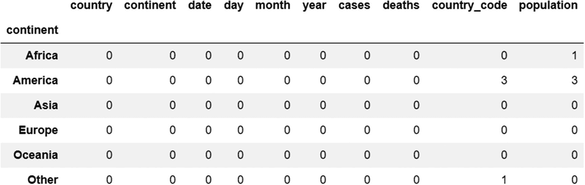

与 `transform` 方法类似，`apply` 方法除了可以用于 `groupby` 对象外，还可以用于 Series 和 DataFrame 对象。

## 如何在 Pandas 中合并对象

在 Pandas 中，有多种函数可用于合并两个或多个对象，具体取决于我们是希望水平合并还是垂直合并。在本节中，我们将介绍用于合并对象的四种方法：`append`、`join`、`concat` 和 `merge`。

## 用于添加行的 Append 方法

此方法用于向现有的 `DataFrame` 或 `Series` 对象添加行，但不能用于添加列。让我们通过一个示例来了解：

让我们创建以下 `DataFrame`：

代码：
```python
periodic_table=pd.DataFrame({'Atomic Number':[1,2,3,4,5],'Element':['Hydrogen','Helium','Lithium','Beryllium','Boron'],'Symbol':['H','He','Li','Be','B']})
```

现在，我们通过将一个新行（以字典对象的形式）作为参数传递给 `append` 方法来添加它。我们还需要记住将 `ignore_index` 参数的值设置为 `True`。将其设置为 `True` 会用新索引替换旧索引。

代码：
```python
periodic_table.append({'Atomic Number':6,'Element':'Carbon','Symbol':'C'},ignore_index=True)
```

输出：

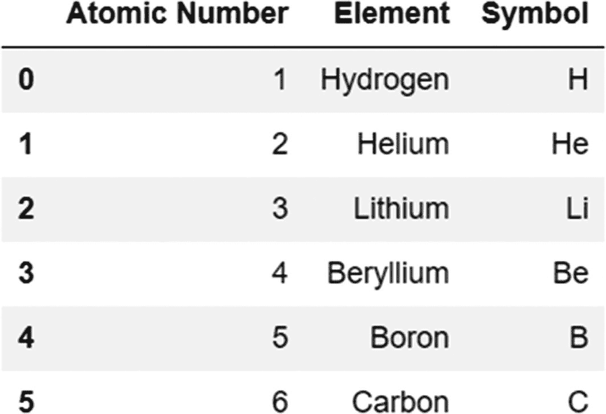

注意，如果在使用 `append` 函数时跳过 `ignore_index` 参数，将会出现错误，如下所示：

代码：
```python
periodic_table.append({'Atomic Number':6,'Element':'Carbon','Symbol':'C'})
```

输出：

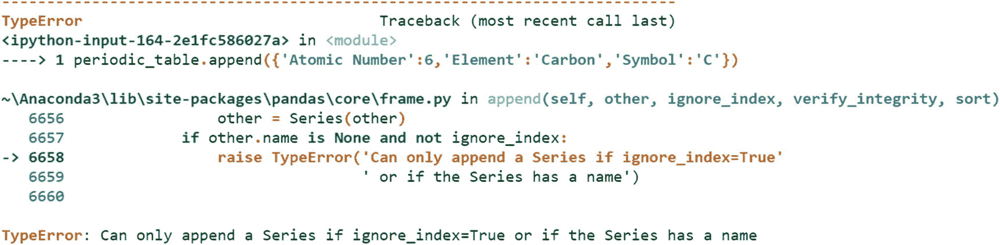

使用 `append` 方法，我们还可以通过将每一行定义为 `Series` 对象，并将这些 `Series` 对象作为列表传递给 `append` 方法来添加多行。`pd.Series` 方法有一个 `name` 属性，可以为 `Series` 分配索引标签。

代码：
```python
series1=pd.Series({'Atomic Number':7,'Element':'Carbon','Symbol':'C'},name=len(periodic_table))
series2=pd.Series({'Atomic Number':8,'Element':'Oxygen','Symbol':'O'},name=len(periodic_table)+1)
periodic_table.append([series1, series2])
```

输出：

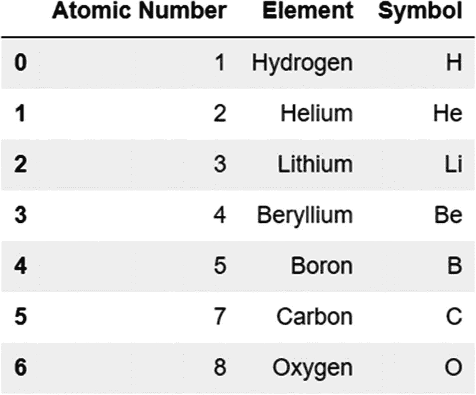

注意，这次我们没有使用 `ignore_index` 参数，因为我们使用了 `name` 参数（请参考前面显示的错误消息，其中提到我们可以对 `append` 方法使用 `ignore_index` 参数或 `name` 参数）。使用 `name` 参数可以防止索引重置，而包含 `ignore_index` 参数时会发生索引重置。

## 理解各种类型的连接

在继续学习组合 Pandas 对象的其他方法之前，我们需要理解内连接、外连接、左连接和右连接的概念。当连接两个对象时，连接类型决定了这些对象中的哪些记录会包含在最终结果集中。

*   **左连接**：左侧对象的所有行都包含在组合对象中。右侧对象中与左侧匹配的行也包含在内。
*   **右连接**：右侧对象的所有行都包含在组合对象中。左侧对象中与右侧匹配的行也包含在内。
*   **外连接**：两个对象的所有行都包含在组合对象中（无论是否匹配）。
*   **内连接**：仅包含两个对象中匹配的行。

## `concat` 函数（从其他对象添加行或列）

此函数允许我们向 Pandas 对象添加行和列。默认情况下，它作用于行轴并添加行。让我们通过一个示例来看 `concat` 函数是如何工作的。这里，我们垂直连接两个 `DataFrame` 对象。第二个 `DataFrame` 对象被添加到第一个 `DataFrame` 对象的最后一行之后。

代码：
```python
periodic_table=pd.DataFrame({'Atomic Number':[1,2,3,4,5],'Element':['Hydrogen','Helium','Lithium','Beryllium','Boron'],'Symbol':['H','He','Li','Be','B']})
periodic_table_extended=pd.DataFrame({'Atomic Number':[8,9,10],'Element':['Oxygen','Fluorine','Neon'],'Symbol':['O','F','Ne']})
#使用 concat 函数垂直连接这两个刚创建的 DataFrame：
pd.concat([periodic_table,periodic_table_extended])
```

输出：

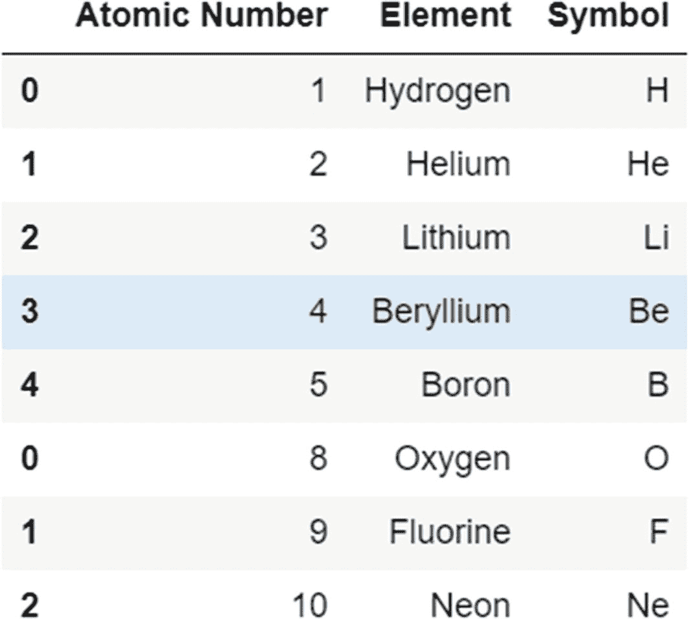

我们也可以沿列轴并排连接对象，如下所示。

代码：
```python
pd.concat([periodic_table,periodic_table_extended],axis=1)
```

输出：

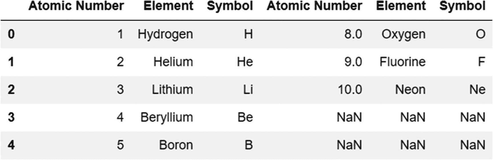

默认情况下，`concat` 函数执行外连接，返回两个对象的所有记录。连接后的结果集将有五条记录（等于较长对象——第一个 `DataFrame` 的长度）。由于第二个 `DataFrame` 只有三行，你可以在最终连接对象的第四行和第五行看到空值。我们可以通过添加 `join` 参数将其更改为内连接。如下所示使用内连接后，最终结果集将只包含两个对象中索引匹配的那些记录。

代码：
```python
pd.concat([periodic_table,periodic_table_extended],axis=1,join='inner')
```

输出：

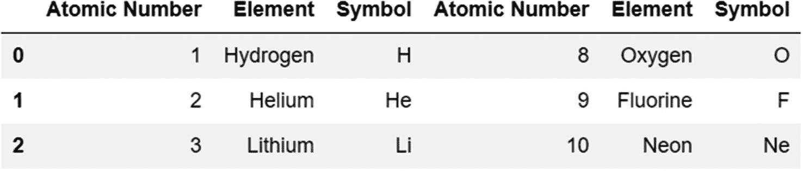

我们可以使用 `keys` 参数来标识最终结果集中被拼接的每个对象。

代码：
```python
pd.concat([periodic_table,periodic_table_extended],axis=1,keys=['第一个周期表','第二个周期表'])
```

输出：

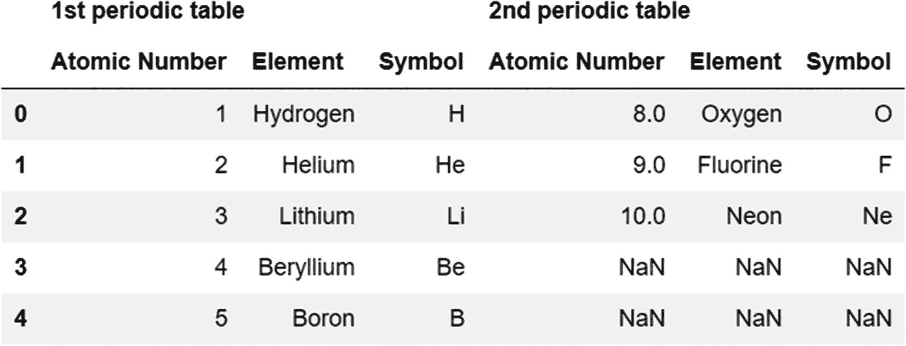

## Join 方法 – 索引对索引

`join` 方法基于共同的索引值对齐两个 Pandas 对象。也就是说，它会在两个对象中查找匹配的索引值，然后将它们垂直对齐。此方法的默认连接类型是左连接。让我们看一个连接两个对象的示例。

代码：
```python
periodic_table.join(periodic_table_extended,lsuffix='_left',rsuffix='_right')
```

输出：

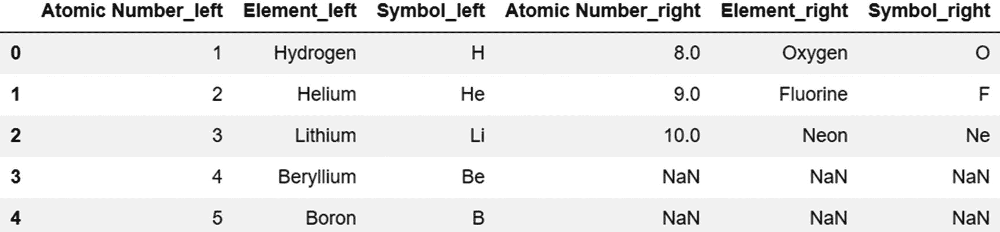

由于在上例中两个 `DataFrame` 对象有共同的列名，我们需要使用 `lsuffix` 和 `rsuffix` 参数来区分它们。索引 0、1 和 2 是两个对象共有的。结果集包含第一个 `DataFrame` 中的所有行，如果第二个 `DataFrame` 中存在索引不匹配的行，则这些行中的所有值均为空值（用 `NaN` 表示）。`join` 方法使用的默认连接类型是左连接。

## Merge 方法 – 基于共同列的 SQL 类型连接

与 `join` 方法类似，`merge` 方法也用于水平连接对象。它用于连接两个具有共同列名的 `DataFrame` 对象。`join` 和 `merge` 方法的主要区别在于：`join` 方法基于共同的索引值合并对象，而 `merge` 方法基于共同的列名合并对象。另一个区别是 `merge` 方法的默认连接类型是内连接，而 `join` 方法默认执行左连接。

让我们通过一个示例了解 `merge` 方法的工作原理。这里定义的两个 `DataFrame` 对象有一个共同的列名——`Atomic Number`。这种情况适合应用 `merge` 方法。

代码：
```python
periodic_table=pd.DataFrame({'Atomic Number':[1,2,3,4,5],'Element':['Hydrogen','Helium','Lithium','Beryllium','Boron'],'Symbol':['H','He','Li','Be','B']})
periodic_table_extended=pd.DataFrame({'Atomic Number':[1,2,3],'Natural':'Yes'})
periodic_table.merge(periodic_table_extended)
```

输出：

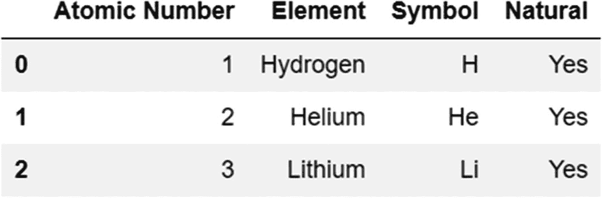

合并操作必须存在共同的列名，否则会报错。如果两个 `DataFrame` 之间有多个共同列，我们可以使用 `on` 参数指定要执行合并的列。

我们可以使用 `how` 参数更改默认的连接类型（内连接）。

代码：
```python
periodic_table.merge(periodic_table_extended,how='outer')
```

输出：

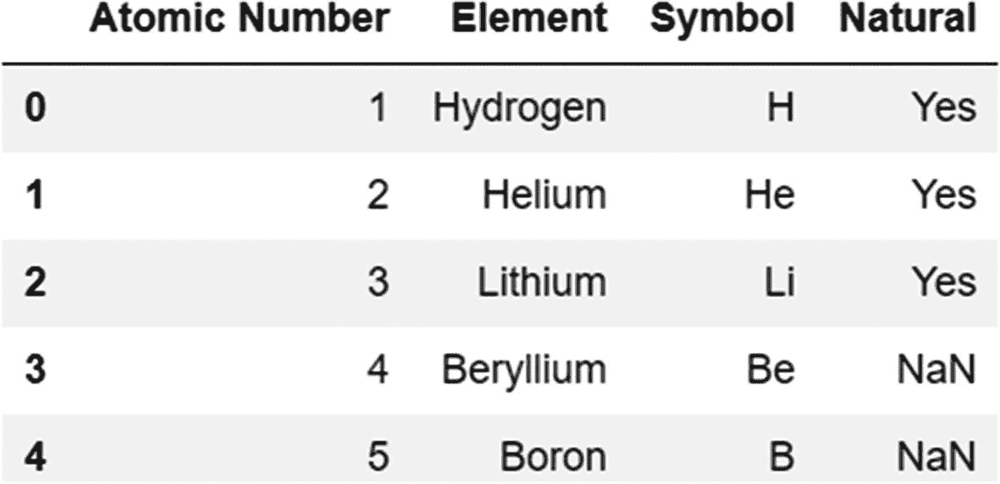

如果两个被连接的对象中有相同的列但名称不同，我们可以使用 `merge` 方法中的参数来区分这些列。

在以下示例中，有两列的值相同但名称不同。在第一个 `DataFrame` 对象中，列名为 `Atomic Number`，而在第二个 `DataFrame` 对象中，列名为 `Number`。

代码：
```python
periodic_table=pd.DataFrame({'Atomic Number':[1,2,3,4,5],'Element':['Hydrogen','Helium','Lithium','Beryllium','Boron'],'Symbol':['H','He','Li','Be','B']})
periodic_table_extended=pd.DataFrame({'Number':[1,2,3],'Natural':'Yes'})
```

使用左侧列的 `left_on` 参数和右侧列的 `right_on` 参数，我们按如下方式合并两个对象：

代码：
```python
periodic_table.merge(periodic_table_extended,left_on='Atomic Number',right_on='Number')
```

输出：

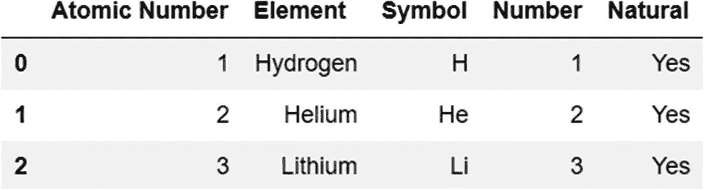

请注意，`append`、`merge` 和 `join` 都是用于 `DataFrame` 对象的方法，而 `concat` 是一个 Pandas 函数。

延伸阅读：
- Merge 方法：[`pandas.pydata.org/pandas-docs/stable/reference/api/pandas.DataFrame.merge.html`](https://pandas.pydata.org/pandas-docs/stable/reference/api/pandas.DataFrame.merge.html)
- Join 方法：[`pandas.pydata.org/pandas-docs/stable/reference/api/pandas.DataFrame.join.html#pandas.DataFrame.join`](https://pandas.pydata.org/pandas-docs/stable/reference/api/pandas.DataFrame.join.html%2523pandas.DataFrame.join)
- Concat 函数：[`pandas.pydata.org/pandas-docs/stable/reference/api/pandas.concat.html`](https://pandas.pydata.org/pandas-docs/stable/reference/api/pandas.concat.html)
- Append 方法：[`pandas.pydata.org/pandas-docs/stable/reference/api/pandas.DataFrame.append.html`](https://pandas.pydata.org/pandas-docs/stable/reference/api/pandas.DataFrame.append.html)

## 数据重构与异常处理

正如我们之前讨论的，原始状态的数据通常杂乱无章，不适合分析。大多数数据集需要经过大量处理才能用于分析和可视化。数据集中最常见的问题如下所示。

- 数据存在缺失值。
- 列名不易理解。
- 变量同时存储在行和列中。
- 某一列可能代表多个变量。
- 单个表中存在不同的观测单位。
- 数据重复。
- 数据围绕错误的轴进行组织（例如，水平排列而非垂直排列）。
- 变量是分类变量，但我们需要将其转换为数值格式以进行计算和可视化。
- 变量的数据类型未被正确识别。
- 数据包含空格、逗号、特殊符号等需要移除的内容。

在接下来的章节中，我们将了解如何处理缺失数据和重复数据，如何将数据从宽格式转换为长格式，以及如何使用 `pivot`、`stack` 和 `melt` 等方法。

### 处理缺失数据

Pandas 中的缺失数据用值 `NaN`（`非数字`）表示，记作关键字 `np.nan`。我们可以使用 `isna` 或 `isnull` 方法来查找空值。这两个方法都会为 Series 或 DataFrame 中的每个对象返回一个布尔值 `True`（表示缺失值）或 `False`（表示所有其他值）。

让我们看看降雨数据集中有多少空值。

代码：

```python
df=pd.read_csv('subset-covid-data.csv')
df.isna().sum().sum()
```

输出：

```
```

该数据集中有八个空值。`sum` 方法使用了两次。第一次 `sum` 方法计算每列缺失值的总数，第二次 `sum` 方法将这些值相加，得出整个 DataFrame 中的缺失值数量。

处理这些缺失数据有两种选择：要么删除这些值（丢弃它们），要么用合适的度量值（如均值、中位数或众数）替换这些值，作为缺失值的近似值。让我们逐一了解这些方法。

#### 删除缺失数据

`dropna` 方法会移除 DataFrame 或 Series 中的所有缺失值。

代码：

```python
df.dropna()
```

请注意，此方法会创建数据框的副本，而不会修改原始 DataFrame。要修改原始 DataFrame，我们使用 `inplace=True` 参数。

代码：

```python
df.dropna(inplace=True)
```

#### 缺失值插补

`Imputation` 是指替换缺失值的过程。在 Pandas 中，可以使用 `fillna` 方法，用均值、中位数或众数等集中趋势度量来替换缺失值。你也可以用固定的常量值（如 0）来填充缺失值。

我们可以使用前向填充技术，用缺失值前面的值来填充它；或者使用后向填充技术，用缺失值后面的值来替换它。

使用相同的数据集（`subset-covid-data.csv`），让我们尝试理解前向填充和后向填充的概念。

代码：

```python
data=pd.read_csv('subset-covid-data.csv')
df=data[4:7]
df
```

正如我们所见，DataFrame 对象 `df`（从原始数据集创建）中存在缺失值。

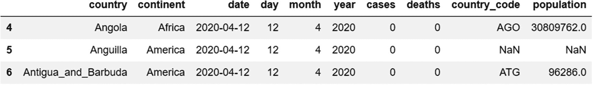

让我们使用前向填充技术（`ffill`），用前一行中位于它前面的值来替换国家 `Anguilla` 的 `NaN` 值，如下所示。

代码：

```python
df.fillna(method='ffill')
```

输出：

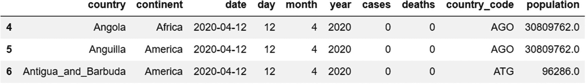

正如我们所见，`Anguilla` 的人口字段被替换为 `Angola`（它前面的记录）的相应值。

我们也可以使用后向填充技术 `bfill` 来替换缺失值，该方法会用紧随其后的下一行中出现的下一个有效观测值来替换缺失值。

代码：

```python
df.fillna(method='bfill')
```

输出：


`Anguilla` 缺失的人口值现在被替换为下一行（`Antigua_and_Barbuda`）的相应值。

一种标准的缺失值插补方法是用其他有效观测值的均值来替换空值。`fillna` 方法也可以用于此目的。

这里，我们用该列中其他两个值的均值来替换每列中的缺失值。

代码：

```python
df.fillna(df.mean())
```

输出：


`Anguilla` 缺失的人口值现在被替换为 DataFrame 对象 `df` 中其他两个国家（`Angola` 和 `Antigua_and_Barbuda`）人口数据的均值。

`插值` 是另一种用于估计数值列中缺失值的技术，最简单的插值技术是线性插值法。在线性插值中，使用直线方程从已知值估计未知值。如果有两个点 (`x`[0], `y`[0]) 和 (`x`[1], `y`[1])，则可以使用以下方程估计未知点 (`x`, `y`)：


在 Pandas 中，有一个 `interpolate` 方法，可以从已知值估计未知值。

代码：

```python
df.interpolate(method='linear')
```

输出：


每列中的缺失值都使用该列中的其他值进行插值。

延伸阅读：在 Pandas 中查看更多关于缺失数据的内容：[`https://pandas.pydata.org/pandas-docs/stable/user_guide/missing_data.html`](https://pandas.pydata.org/pandas-docs/stable/user_guide/missing_data.html)

### 数据重复

数据冗余是一种常见现象，许多记录包含相同的数据。

让我们考虑以下 DataFrame：

代码：

```python
periodic_table=pd.DataFrame({'Atomic Number':[1,2,3,4,5,5],'Element':['Hydrogen','Helium','Lithium','Beryllium','Boron','Boron'],'Symbol':['H','He','Li','Be','B','B']})
```


正如我们所见，这些数据中存在重复项（最后两行是相同的）。

在 Pandas 中，可以使用 `duplicated` 方法检测重复项的存在。`duplicated` 方法为每一行返回一个布尔值，如下所示。由于第五行是第四行的重复，因此布尔值为 `True`。

代码：

```python
periodic_table.duplicated()
```

输出：

```
0    False
1    False
2    False
3    False
4    False
5     True
dtype: bool
```

通过将此方法与 `sum` 方法链接，我们可以找到 DataFrame 中重复项的总数。

代码：

```python
periodic_table.duplicated().sum()
```

输出：

```
1
```

现在让我们使用 `drop_duplicates` 方法去除重复项。

代码：

```python
periodic_table.drop_duplicates(inplace=True)
```

输出：


重复的行已被删除。由于 `drop_duplicates` 方法不会对实际的 DataFrame 对象进行更改，我们需要使用 `inplace` 参数。

默认情况下，`drop_duplicates` 方法会保留所有重复行中的第一行。如果我们想保留最后一行，可以使用参数 `keep='last'`，如下所示。

代码：

```python
periodic_table.drop_duplicates(keep='last')
```

输出：


除了处理冗余或缺失数据外，我们可能还需要替换那些对我们的分析没有价值的数，比如空格或特殊字符。可以使用前面讨论过的 `replace` 方法来删除或替换值。我们可能还需要更改列的数据类型，因为 Pandas 可能无法正确识别所有数据类型，这可以使用 `astype` 方法来完成。

### 整洁数据与数据重构技术

整洁数据是由 Hadley Wickham 提出的一个术语。根据他撰写的一篇论文（链接：[`http://vita.had.co.nz/papers/tidy-data.pdf`](http://vita.had.co.nz/papers/tidy-data.pdf)），整洁数据有三个原则：

1.  列对应数据中的变量，每个变量映射到单个列。
2.  行只包含观测值，不包含变量。
3.  每个数据结构或表只包含一个观测单位。

请注意，使数据整洁不同于数据清洗。数据清洗涉及处理缺失值和冗余信息、删除填充字符以及更改不准确的数据类型。另一方面，将数据转换为整洁格式涉及重构数据并将其沿正确的轴排列，以便于分析。

让我们通过一个例子来理解这一点，使用以下 DataFrame。


上面的 DataFrame 显示了四名学生的年龄（岁）和身高（厘米）。虽然这些数据可读，但它不是“整洁”的形式。这个 DataFrame 存在三个违反整洁数据原则的问题：

*   学生的姓名不能用作列名。相反，我们需要为所有姓名设置一个单一的变量。
*   属性“年龄”和“身高”不应作为行中的观测值。它们实际上是不同的变量，应该是单独的列。
*   同一个 DataFrame 中有两个不同的观测单位——用于测量年龄的“年”和用于测量身高的“厘米”。

长格式的数据被认为是整洁的，在下一节中，我们将介绍 Pandas 中将数据集转换为这种结构的方法。

### 从宽格式转换为长格式（整洁数据）

以下两个 DataFrame 包含相同的数据，但具有不同的结构（宽格式和长格式）。

**宽格式**


**长格式**


转换为长格式的主要好处在于，这种格式便于数据操作，例如添加或检索数据，因为我们无需担心数据的结构。此外，当数据以长格式存储时，数据检索速度会显著提升。

让我们通过一个示例来理解这一点。首先，创建以下 DataFrame：

```python
grades=pd.DataFrame({'Biology':[90,87,45],'Chemistry':[46,56,87],'Mathematics':[95,74,45],'Physics':[75,65,33]},index=['Andrew','Sarah','Jason'])
grades
```

输出：


在这个 DataFrame 中，我们可以看到它没有遵循整洁数据的原则。有两个主要变量（学生和科目）没有被识别为列。科目变量的值，如生物、化学、数学和物理，都是观测值，不应作为列使用。

#### Stack 方法（宽格式转长格式）

我们可以使用 `stack` 方法来纠正 `grades` DataFrame 中观察到的异常情况，该方法会获取所有列名并将其移动到索引中。此方法返回一个新的 DataFrame 或 Series，并带有多级索引。

```python
grades_stacked=grades.stack()
grades_stacked
```

输出：

```
Andrew  Biology        90
Chemistry      46
Mathematics    95
Physics        75
Sarah   Biology        87
Chemistry      56
Mathematics    74
Physics        65
Jason   Biology        45
Chemistry      87
Mathematics    45
Physics        33
dtype: int64
```

如前面的输出所示，结构已从宽格式更改为长格式。

让我们检查一下这个堆叠对象的数据类型。

```python
type(grades_stacked)
```

输出：

```
pandas.core.series.Series
```

如我们所见，这是一个 Series 对象。我们可以使用 `reset_index` 方法将此对象转换为 DataFrame，以便将两个变量——姓名和科目——识别为两个单独的列：

```python
grades_stacked.reset_index()
```

输出：


在前面的输出中，我们使用 `rename_axis` 方法更改列的名称，并重置索引，如下所示。

```python
grades_stacked.rename_axis(['student_name','subject']).reset_index(name='marks')
```

输出：


要将此 DataFrame 转换回其原始（宽）格式，我们使用 `unstack` 方法，如下所示：

```python
grades_stacked.unstack()
```

输出：


#### Melt 方法（宽格式转长格式）

除了 `stack` 方法之外，`melt` 方法也可用于将数据转换为长格式。`melt` 方法比 `stack` 方法提供了更大的灵活性，它允许添加参数来自定义输出。

让我们创建相同的 DataFrame（宽格式）：

```python
grades=pd.DataFrame({'Student_Name':['Andrew','Sarah','Jason'],'Biology':[90,87,45],'Chemistry':[46,56,87],'Mathematics':[95,74,45],'Physics':[75,65,33]})
```


现在，使用 `melt` 方法将其转换为长格式。

```python
grades.melt(id_vars='Student_Name',value_vars=['Biology','Chemistry','Physics','Mathematics'],var_name='Subject',value_name='Marks')
```

输出：


我们在 `melt` 方法中使用了四个变量：

- `id_vars`：我们不想重塑并希望保持当前形式的列。如果查看 `grades` DataFrame 的原始宽格式，`Student_Name` 的结构是正确的，可以保持不变。
- `value_vars`：我们想要重塑为单个列的变量。在 `grades` DataFrame 的宽版本中，四个科目各有一列。这些实际上是一个单列的值。
- `var_name`：新重塑列的名称。我们想要创建一个单列——`"Subject"`，其值为 `"Biology"`、`"Chemistry"`、`"Physics"` 和 `"Mathematics"`。
- `value_name`：包含与重塑列（`"Subject"`）值相对应的值的列（`"Marks"`）的名称。

#### Pivot 方法（长格式转宽格式）

`pivot` 方法是另一种重塑数据的方法，但与 `melt` 和 `stack` 方法不同，该方法将数据转换为宽格式。在以下示例中，我们使用 `pivot` 方法逆转 `melt` 操作的效果。

代码：

```python
#原始 DataFrame
grades=pd.DataFrame({'Student_Name':['Andrew','Sarah','Jason'],'Biology':[90,87,45],'Chemistry':[46,56,87],'Mathematics':[95,74,45],'Physics':[75,65,33]})
#使用 melt 方法转换为长格式
grades_melted=grades.melt(id_vars='Student_Name',value_vars=['Biology','Chemistry','Physics','Mathematics'],var_name='Subject',value_name='Marks')
#使用 pivot 方法转换回宽格式
grades_melted.pivot(index='Student_Name',columns='Subject',values='Marks')
```

输出：


`pivot` 方法使用了以下参数：

- `index`：指用作索引的列。在 `grades` DataFrame 的宽格式中，我们使用 `Student_Name` 作为索引。
- `columns`：其值用于创建新列集的列的名称。`"Subject"` 列的每个值在宽格式中都会形成一个单独的列。
- `values`：用于填充 DataFrame 中值的列。在我们的 `grades` 示例中，`"Marks"` 列用于此目的。

延伸阅读：
- Melt 函数：[`https://pandas.pydata.org/pandas-docs/stable/reference/api/pandas.melt.html`](https://pandas.pydata.org/pandas-docs/stable/reference/api/pandas.melt.html)
- Pivot 函数：[`https://pandas.pydata.org/pandas-docs/stable/reference/api/pandas.pivot.html`](https://pandas.pydata.org/pandas-docs/stable/reference/api/pandas.pivot.html)

## 总结

1. Pandas 是一个用于数据整理的 Python 库，提供了诸多优势，包括支持多种输入格式导入数据、与其他库集成、速度快，以及提供数据清洗、分组、合并和可视化等功能。
2. `Series`、`DataFrames` 和 `Indexes` 构成了 Pandas 的核心。`Series` 是一维的，相当于一列；而 `DataFrame` 是二维的，相当于一个表格或电子表格。`Series` 和 `DataFrames` 使用通过哈希表实现的索引来加速数据检索。
3. 有多种方法可以创建和修改 `Series` 和 `DataFrame` 对象。列表、元组和字典等 Python 对象，以及 `NumPy` 数组，都可以用来创建 Pandas 对象。我们可以添加或删除行或列、替换值以及重命名列。
4. 在 Pandas 中，可以通过位置（`iloc` 索引器）、索引标签（`loc` 索引器）或指定条件（布尔条件）来进行数据检索。
5. Pandas 使用 `groupby` 函数进行聚合。各种函数可以与 `groupby` 函数结合使用，以计算每个组的聚合度量、根据条件过滤组、转换值或对它们应用操作。
6. Pandas 支持组合、连接和合并两个或多个对象。`append` 方法将一个对象垂直添加到现有对象，`concat` 函数可以并排或垂直添加对象。`join` 和 `merge` 方法基于公共列或索引值水平连接对象。
7. **整洁数据**指的是一种结构，其中列对应数据集中的变量，行包含观测值，并且只有一个观测单位。通常，长格式（垂直）的数据被认为是整洁的。像 `melt` 和 `stack` 这样的函数将 `DataFrame` 转换为长格式。`unstack` 和 `pivot` 函数将数据转换为宽格式。

现在我们已经学习了如何准备数据并使其可用于分析，让我们在下一章中了解数据可视化。

## 复习练习

### 问题 1

写出 Pandas 中用于以下操作的函数/索引器/属性：

*   从 HTML 文件导入数据
*   将数据导出到 Excel 文件
*   使用索引位置选择数据
*   使用其标签选择数据
*   用中位数替换空值
*   重命名列
*   获取 `DataFrame` 中的行数和列数
*   使用 `pivot` 函数转换为宽格式
*   执行两个表的内连接
*   更改序列的数据类型

### 问题 2
`df.describe` 函数返回以下汇总统计值：计数、最小值、最大值、标准差、百分位数和均值。
你需要添加哪个参数来获取以下内容：唯一值的数量、出现频率最高的值以及该值的频率？

### 问题 3

将“subset-covid-data.csv”导入到一个 `DataFrame` 中。选择以下数据：

1.  国家（`country`）和大洲（`continent`）列
2.  将 `country` 列设置为索引，并使用 `at` 或 `loc` 索引器检索国家“Algeria”的人口数据。
3.  使用 `iloc` 或 `iat` 索引器选择第 50 行和第 3 列的值。
4.  检索最后三条记录的国家代码和人口数据。
5.  选择人口大于 250 万且病例数大于 3000 的国家数据。

### 问题 4

将文件“subset-covid-data.csv”的数据导入到一个 `DataFrame` 中，并编写以下操作的代码语句：

1.  删除 `country_code` 列
2.  将该列插回到其先前所在的位置
3.  删除前三行
4.  将这些行添加回（它们原来的位置）

### 问题 5

创建以下 `DataFrame`：

```
DataFrame name: orders_df
```


```
DataFrame name: orders1_df
```


```
DataFrame name: customers_df
```


你会使用哪个函数或方法来：

1.  合并前两个 `DataFrame`（`orders_df` 和 `orders1_df`）的详细信息？
2.  创建一个 `DataFrame` 来显示客户及其订购的商品？
3.  将 `order_id` 列设置为 `orders_df` 和 `customers_df` 的索引？你现在会使用哪种方法来组合这两个对象，以显示哪些订单是由客户下达的？

### 问题 6
以下 `DataFrame` 记录了四个人的体重波动情况：


1.  创建上述 `DataFrame`。
2.  将此 `DataFrame` 转换为整洁格式。
3.  确定这四个人中谁的体重波动最小。
4.  对于平均体重小于 65 公斤的人，将其（四天内的）体重转换为磅并显示这些数据。

### 问题 7

`object` 数据类型用于包含以下数据的列：
1.  字符串
2.  数字（`int` 和 `float`）
3.  布尔值
4.  以上所有数据类型的组合

### 问题 8
可以使用点表示法（`a.column_name`）以及索引运算符（`a[column_name]`）访问列。哪种表示法是首选，为什么？

### 问题 9
哪种方法用于获取 `DataFrame` 中的元数据？
1.  `describe` 方法
2.  `value_counts` 方法
3.  `info` 方法
4.  以上都不是

### 问题 10（填空）
*   `join` 方法的默认连接类型是 ____，添加连接类型的参数是 ____
*   `merge` 方法的默认连接类型是 ____，添加连接类型的参数是 ____
*   `concat` 函数的默认连接类型是 ____，添加连接类型的参数是 ____
*   Pandas 中创建一个表示日期/时间值的对象，并且等同于以下 Python 函数：`datetime.date`、`datetime.time` 或 `datetime.datetime` 的函数是 ____
*   Pandas 中等同于 Python 中用于表示时间跨度的 `datetime.timedelta` 函数的函数是 ____

## 答案

### 问题 1

*   从 HTML 文件导入数据：

代码：
```python
pd.read_html(url)
```

*   将数据导出到 Excel 文件：

代码：
```python
df.to_excel(name_of_file)
```

*   使用索引位置选择数据：

代码：
```python
df.iloc[index position]
```

*   使用标签选择数据：

代码：
```python
df.loc[column name or index label]
```

*   用中位数替换 `DataFrame` 中的空值：

代码：
```python
df.fillna(df.median())
```

*   重命名列：

代码：
```python
df.rename(columns={'previous_name':'new_name'})
```

*   获取 `DataFrame` 中的行数和列数：

代码：
```python
df.shape
```

*   使用 `pivot` 函数转换为宽格式：

代码：
```python
df.pivot(index=column_name1, columns=column_name2, values=column_name3)
```

*   对两个 `DataFrame` 对象执行内连接：

代码：
```python
df1.merge(df2)
```
`merge` 方法的默认连接类型是 `inner`；因此我们无需显式指定。

*   更改 `Series` 对象/列的数据类型：

代码：
```python
series_name.astype(new data type)
```

### 问题 2
我们可以使用 `include='all'` 参数获取所有三个值，如下所示：

代码：
```python
df.describe(include='all')
```

### 问题 3

代码：
```python
df=pd.read_csv('subset-covid-data.csv')
```

1.  检索 `country` 和 `continent` 列

代码：
```python
df[['country','continent']]
```

2.  将 `country` 列设置为索引，并使用 `at` 或 `loc` 索引器检索国家“Algeria”的人口。

代码：
```python
df.set_index('country',inplace=True)
```

使用以下语句检索人口：

代码：
```python
df.at['Algeria','population']
```
或
```python
df.loc['Algeria','population']
```

3.  使用 `iloc` 或 `iat` 索引器选择第 50 行和第 3 列的值。

代码：
```python
df.iat[49,2]
```
或
```python
df.iloc[49,2]
```

4.  检索最后三条记录的 `country_code` 和 `population` 数据：

代码：
```python
df.iloc[203:,-1:-3:-1]
```
或
```python
df.iloc[203:,7:]
```

5.  选择人口大于 250 万且病例数大于 3000 的国家的数据。

代码：
```python
df[(df['cases']>=3000) & (df['population']>=25000000)]
```

### 问题 4（行和列的添加与删除）

1.  删除 `country_code` 列：

代码：
```python
x=df.pop('country_code')
```

2.  将此列插回到之前所在的位置：

代码：
```python
df.insert(8,'country_code',x)
```

3.  删除前三行：

代码：
```python
x=df.iloc[0:3]
pd.concat([x,df])
```

```python
df.drop([0,1,2],inplace=True)
```

### 问题 5

创建以下 DataFrame：

```python
orders_df=pd.DataFrame({'order_id':[1,2,3],'item':['pens','shirts','coffee']})
orders1_df=pd.DataFrame({'order_id':[4,5,6],'item':['crayons','tea','fruits']})
customers_df=pd.DataFrame({'order id':[1,2,3],'customer_name':['anne','ben','carlos']})
```

### 用于合并对象的函数

*   合并两个 DataFrame `orders_df` 和 `orders1_df` 的详细信息：

```python
pd.concat((orders_df,orders1_df))
```

*   创建一个合并后的 DataFrame，以显示客户及其订购的商品：

*   将 `order_id`/`order id` 列设置为 `orders_df` 和 `customers_df` DataFrame 的索引：

```python
orders_df.set_index('order_id',inplace=True)
customers_df.set_index('order id',inplace=True)
```

*   合并这两个对象以显示客户下达的订单的方法：

```python
pd.merge(orders_df,customers_df,left_on='order_id',right_on='order id')
```

```python
orders_df.join(customers_df)
```

### 问题 6（整洁数据与聚合）

1.  创建此 DataFrame。

```python
df=pd.DataFrame({'Anna':[51,52,51.4,52.8,50.5],'Ben':[70,70.5,69.1,69.8,70.5],'Carole':[64,64.2,66.8,66,63.4],'Dave':[81,81.3,80.5,80.9,81.4]})
```

2.  将其转换为整洁格式。

我们使用 `melt` 方法将 DataFrame 转换为长格式，然后重命名列。

```python
df_melted=df.melt()
df_melted.columns=['name','weight']
```

3.  为了找出这四个人中谁的体重相对于其平均体重波动最小，我们首先需要对数据进行聚合。

我们使用 `groupby` 函数根据人名对数据进行分组，并使用标准差（`np.std`）聚合函数。

```python
df_melted.groupby('name').agg({'weight':np.std})
```

输出：


从上述输出可以看出，Dave 的标准差最小，因此他的体重波动最小。

4.  对于平均体重小于 65 公斤的人，我们现在需要将其体重转换为磅，并显示他们四天的体重。

我们使用 `filter` 方法过滤掉平均体重大于 65 公斤的组，然后应用 `transform` 方法将体重转换为磅。

```python
df_melted.groupby('name').filter(lambda x:x.mean()>65)['weight'].transform(lambda x:float(x)*2.204)
```

### 问题 7

选项 1 和 4

Pandas 中的对象数据类型用于字符串或包含混合数据（如数字、字符串等）的列。

### 问题 8

索引运算符 `[]` 是首选，因为它不会与内置方法冲突，并且适用于包含空格和特殊字符的列名。当需要检索包含空格的列时，点表示法不起作用。

### 问题 9

选项 3 – `info` 方法。

`info` 方法用于获取 Series 或 DataFrame 对象的元数据。它为我们提供列名、数据类型、非空值数量以及内存使用情况。

### 问题 10（填空题）

`join` 方法的默认连接类型是“左连接”，用于添加连接类型的参数是“how”参数。

`merge` 方法的默认连接类型是“内连接”，用于添加连接类型的参数是“how”参数。

`concat` 函数的默认连接类型是“外连接”，用于添加连接类型的参数是“join”参数。

Pandas 中用于创建表示日期/时间值的对象，并且等同于以下 Python 函数：`datetime.date`、`datetime.time` 或 `datetime.datetime` 的函数是 `pd.Timestamp`。

Pandas 中等同于 Python 中用于表示时间跨度的 `datetime.timedelta` 函数的函数是 `pd.Timedelta`。

