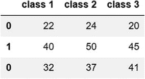
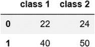
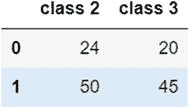
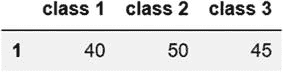
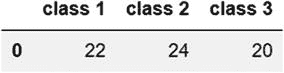

# 使用 `pd.concat` 函数

代码：
```
new_row = pd.DataFrame([{'class 1': 32, 'class 2': 37, 'class 3': 41}])
```
`pd.concat([combined_ages, new_row])`

输出：


`pd.concat` 函数用于添加新行，如上语法所示。要添加的新行被定义为一个 DataFrame 对象。然后调用 `pd.concat` 函数，并将两个 DataFrame（原始 DataFrame 和定义为 DataFrame 的新行）的名称作为参数传递。

总之，我们可以使用 `append` 方法或 `concat` 函数向 DataFrame 添加行。

### 从 DataFrame 中删除列

可以使用三种方法从 DataFrame 中删除列，如表 6-5 所示。

**表 6-5** 从 DataFrame 中删除列

| 删除列的方法 | 语法 |
| --- | --- |
| `del` 函数 | 代码：`del combined_ages['class 3']` `combined_ages` 输出： 上述语句删除最后一列（名称为 "class 3"）。请注意，删除操作是就地进行的，即在原始 DataFrame 本身中执行。 |
| 使用 `pop` 方法 | 代码：`combined_ages.pop('class 2')` 输出：`0    24` `1    50` `Name: class 2, dtype: int64` `pop` 方法就地删除一列，并将删除的列作为 Series 对象返回。 |
| 使用 `drop` 方法 | 代码：`combined_ages.drop(['class 1'], axis=1, inplace=True)` `combined_ages` 输出： 需要删除的列在列表中作为字符串提及，然后作为参数传递给 `drop` 方法。由于 `drop` 方法默认删除行（`axis=0`），如果要删除列，我们需要将轴值指定为 "1"。与 `del` 函数和 `pop` 方法不同，使用 `drop` 方法进行的删除不会发生在原始 DataFrame 对象中，因此，我们需要添加 `inplace` 参数。 |

总而言之，我们可以使用 `del` 函数、`pop` 方法或 `drop` 方法从 DataFrame 中删除列。

### 从 DataFrame 中删除行

有两种方法可以从 DataFrame 中删除行——要么使用布尔选择，要么使用 `drop` 方法，如表 6-6 所示。

**表 6-6** 从 DataFrame 中删除行

| 删除行的方法 | 语法 |
| --- | --- |
| 使用布尔选择 | 代码：`combined_ages[~(combined_ages.values < 50)]` 输出： 我们使用非运算符（`~`）来删除我们不想要的行。这里，我们删除 DataFrame 中所有小于 50 的值。 |
| 使用 `drop` 方法 | 代码：`combined_ages.drop(1)` 输出： 这里，我们删除第二行，其行索引为 1。如果要删除多行，我们需要在列表中指定这些行的索引。 |

因此，我们可以使用布尔选择或 `drop` 方法从 DataFrame 中删除行。由于 `drop` 方法同时适用于删除行和列，因此可以统一使用。请记住向 `drop` 方法添加所需的参数。对于删除列，需要添加 `axis`（=1）参数。要使更改反映在原始 DataFrame 中，需要包含 `inplace`（=True）参数。

