# 8. 数据分析案例研究

在上一章中，我们了解了各种基于 Python 的可视化库，以及如何使用这些库中的函数绘制不同的图表。现在，我们旨在通过案例研究来理解我们目前所讨论概念的实际应用。我们将研究以下三个数据集：

- 非结构化数据分析：使用来自一个提供 2018 年法国票房前 50 名电影信息的网页数据
- 空气质量分析：来自印度新德里一个空气质量监测站的数据，提供四种污染物的每日水平——二氧化硫 (`SO₂`)、以二氧化氮计的氮氧化物 (`NO₂`)、臭氧和细颗粒物 (`PM₂.₅`)
- COVID-19 趋势分析：数据集记录了 2020 年前六个月全球各国每日的病例数和死亡数

## 技术要求

### 外部文件

针对第一个案例研究，你需要参考以下维基百科 URL（数据直接取自网页）：`https://en.wikipedia.org/wiki/List_of_2018_box_office_number-one_films_in_France`

针对第二个案例研究，请从以下链接下载一个 CSV 文件：`https://github.com/DataRepo2019/Data-files/blob/master/NSIT%20Dwarka.csv`

针对第三个案例研究，请从以下链接下载一个 Excel 文件：`https://github.com/DataRepo2019/Data-files/blob/master/COVID-19-geographic-disbtribution-worldwide-2020-06-29.xlsx`

### 库

除了我们在前几章中使用的模块和库（包括 Pandas、NumPy、Matplotlib 和 Seaborn）之外，本章我们还将使用 `requests` 模块向网站发送 HTTP 请求。

要使用此模块中包含的函数，请在 Jupyter notebook 中使用以下代码行导入该模块：

```
import requests
```

如果 `requests` 模块尚未安装，你可以在 Anaconda Prompt 中使用以下命令进行安装：

```
pip install requests
```

## 方法论

我们将对每个案例研究采用以下方法论：

1.  打开一个新的 Jupyter notebook，并执行以下步骤：
    *   导入分析所需的库和数据
    *   读取数据集并检查前五行（使用 `head` 方法）
    *   获取每列的数据类型信息以及每列中非空值的数量（使用 `info` 方法）和数据集的维度（使用 `shape` 属性）
    *   获取每列的汇总统计信息（使用 `describe` 方法），并获取计数、最小值、最大值、标准差和百分位数的值

2.  数据整理
    *   检查列的数据类型是否被正确识别（使用 `info` 或 `dtype` 方法）。如果没有，则使用 `astype` 方法更改数据类型
    *   如有必要，使用 `rename` 方法重命名列
    *   使用 `drop` 方法删除任何不必要或冗余的列或行
    *   如有需要，通过使用 `melt` 或 `stack` 方法重构数据，使其整洁
    *   使用 `replace` 方法删除任何没有价值的无关数据（空白值、特殊字符等）
    *   使用 `isna` 方法检查是否存在空值，并使用 `dropna` 或 `fillna` 方法删除或填充空值
    *   如果某列能为你的分析增加价值，则添加该列
    *   如果数据是未聚合的格式，则使用 `groupby` 方法对数据进行聚合

3.  使用单变量、双变量和多变量图表对数据进行可视化

4.  基于你的分析，总结你的见解，包括观察结果和建议

## 案例研究 8-1：法国票房最高电影——分析非结构化数据

在本案例研究中，数据是从一个 HTML 页面读取的，而不是传统的 CSV 文件。我们将要使用的 URL 如下：`https://en.wikipedia.org/wiki/List_of_2018_box_office_number-one_films_in_France`

该网页有一个表格，显示了 2018 年法国票房收入前 50 名的电影数据。我们使用 Requests 库中的方法将这些数据导入 Pandas。Requests 是一个用于发起 HTTP 请求的 Python 库。它有助于从网页中提取 HTML 并与 API 进行交互。

我们希望通过分析回答的问题：

1.  找出票房收入排名前五的电影
2.  前十部电影各自的收入占比（百分比）是多少？
3.  在这一年中，月平均收入是如何变化的？

### 步骤 1：导入数据并检查数据集的特征

首先，导入库并使用必要的函数来检索数据。

代码：

```
#导入库
import requests
import pandas as pd
import seaborn as sns
import matplotlib.pyplot as plt
#将网页中的数据导入 DataFrame
url='https://en.wikipedia.org/wiki/List_of_2018_box_office_number-one_films_in_France'
req=requests.get(url)
data=pd.read_html(req.text)
df=data[0]
```

我们导入所有库，并将 URL 存储在一个变量中。然后，我们使用 `get` 方法向该 URL 发起一个 HTTP 请求，以从该网页检索信息。`requests` 对象的 `text` 属性包含 HTML 数据，该数据被传递给 `pd.read_html` 函数。该函数返回一个 DataFrame 对象列表，其中包含网页上的各个表格。由于网页上只有一个表格，因此 DataFrame（`df`）只包含一个表格。

检查前几条记录：

代码：

```
df.head()
```

输出：

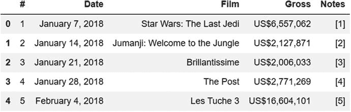

获取数据类型和缺失值：

代码：

```
df.info()
```

输出：

```
RangeIndex: 50 entries, 0 to 49
Data columns (total 5 columns):
```

# 50 个非空 int64 类型

`Date` 50 个非空 object 类型
`Film` 50 个非空 object 类型
`Gross` 50 个非空 object 类型
`Notes` 50 个非空 object 类型
`dtypes`: `int64(1)`, `object(4)`
`memory usage`: `2.0+ KB`

如我们所见，各列的数据类型并非我们所需的格式。`Gross` 列代表总收入，本应是数值列。然而，由于该列包含数值和非数值数据（如 `,`、`$` 符号以及字母 `U` 和 `S` 等字符），它被分配了 `object` 数据类型。在下一步中，我们将处理此类问题。

## 第 2 步：数据整理

在这一步中，我们将：

1.  移除不必要的字符
2.  更改数据类型
3.  移除不需要的列
4.  从现有列创建新列

让我们从 `Gross` 列中移除不需要的字符串，仅保留数值：

```python
# 从 Gross 列中移除不必要的字符
df['Gross']=df['Gross'].str.replace(r"US\$","").str.replace(r",","")
```

在上述语句中，我们使用了一系列链式替换方法和正则表达式原理来替换非数字字符。第一个替换方法移除 `US$`，第二个替换方法移除逗号。将字符替换为空字符串（`""`）等同于移除该字符。

现在，让我们使用 `astype` 方法进行类型转换，将该列的数据类型更改为 `int64`，以便该列可用于计算和可视化：

```python
# 更改 Gross 列的数据类型，使其成为数值列
df['Gross']=df['Gross'].astype('int64')
```

为了检查这些更改是否已生效，我们查看该列的前几条记录并验证数据类型：

```python
df['Gross'].head(5)
```

输出：

```
0     6557062
1     2127871
2     2006033
3     2771269
4    16604101
Name: Gross, dtype: int64
```

从输出中可以看出，该列的数据类型已更改，并且值不再包含字符串。

我们还需要提取日期的月份部分，我们将首先更改 `Date` 列的数据类型，然后对其应用 `DatetimeIndex` 方法，如下所示。

```python
# 更改 Date 列的数据类型以提取其组成部分
df['Date']=df['Date'].astype('datetime64')
# 为月份创建一个新列
df['Month']=pd.DatetimeIndex(df['Date']).month
```

最后，我们使用以下语句从 `DataFrame` 中移除两个不必要的列。

```python
# 删除不必要的列
df.drop(['#','Notes'],axis=1,inplace=True)
```

## 第 3 步：可视化

为了可视化我们的数据，首先我们创建另一个 `DataFrame`（`df1`），它包含原始 `DataFrame`（`df`）中列的子集。这个 `DataFrame` `df1` 只包含两列——`Film`（电影名称）和 `Gross`（总收入）。然后，我们按收入降序对值进行排序。如下所示。

```python
df1=df[['Film','Gross']].sort_values(ascending=False,by='Gross')
```

有一个不需要的列（`index`）被添加到了这个 `DataFrame` 中，我们将在下一步中将其移除。

```python
df1.drop(['index'],axis=1,inplace=True)
```

### 收入最高的五部电影

我们创建的第一个图表是柱状图，显示收入最高的五部电影：（图 8-1）。

```python
# 绘制收入最高的 5 部电影
# 设置图形大小
plt.figure(figsize=(10,5))
# 创建柱状图
ax=sns.barplot(x='Film',y='Gross',data=df1.head(5))
# 旋转 x 轴标签
ax.set_xticklabels(labels=df1.head()['Film'],rotation=75)
# 设置标题
ax.set_title("Top 5 Films per revenue")
# 设置 Y 轴标签
ax.set_ylabel("Gross revenue")
# 在柱状图上标注数值
for p in ax.patches:
    ax.annotate(p.get_height(),(p.get_x()+p.get_width()/2,p.get_height()),ha='center',va='bottom')
```

输出：

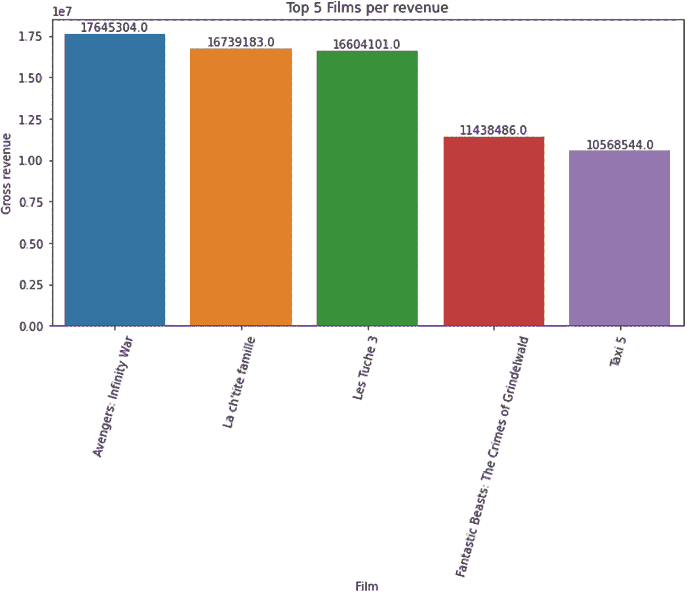

**图 8-1** 饼图显示收入最高的五部电影各自的百分比份额

为了展示收入最高的十部电影（按收入计）的份额，我们创建了一个饼图（图 8-2）。

```python
# 饼图显示收入最高的 10 部电影各自在总收入中的百分比份额
df1['Gross'].head(10).plot(kind='pie',autopct='%.2f%%',labels=df1['Film'],figsize=(10,5))
```

输出：

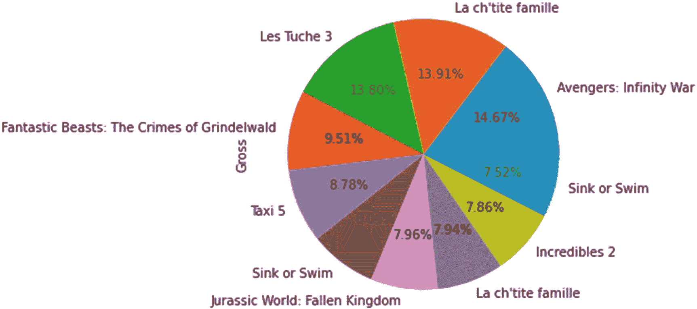

**图 8-2** 饼图描绘收入最高的十部电影的收入份额

我们首先创建另一个 `DataFrame`，通过计算每个月的平均值来聚合月度数据（图 8-3）。

```python
# 按月聚合收入
df2=df.groupby('Month')['Gross'].mean()
# 创建折线图
df2.plot(kind='line',figsize=(10,5))
```

输出：

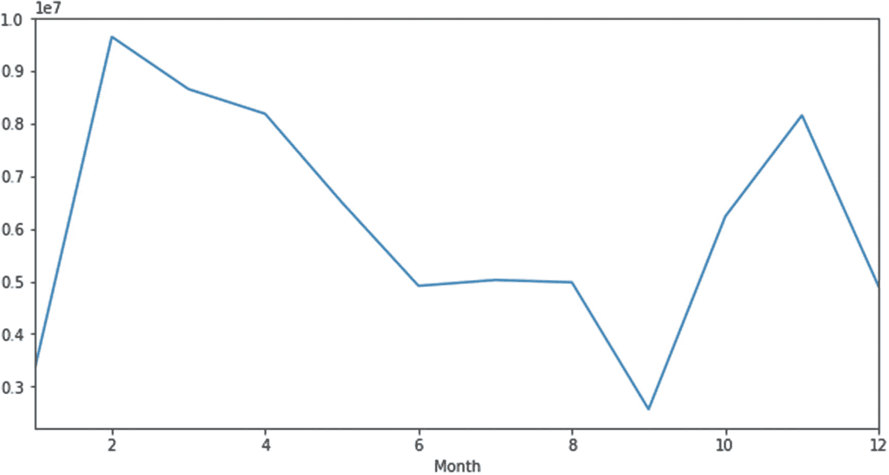

**图 8-3** 2018 年（法国）月均票房收入

## 第 4 步：基于分析和可视化得出结论

1.  月均收入波动较大，可能取决于电影的上映月份，这可能需要跨年份进行进一步分析。
2.  2018 年法国收入最高的三部电影是*《复仇者联盟》*、*《La Ch’tite Famille》*和*《Les Tuche 3》*。

# 案例研究 8-2：数据分析在空气质量管理的应用

为了监测环境空气质量状况，印度中央污染控制委员会（`CPCB`）运营着一个遍布全国的大型监测站网络。定期监测的参数包括二氧化硫（`SO[2]`）、以二氧化氮（`NO[2]`）计的氮氧化物、臭氧和细颗粒物（`PM[2.5]`）。根据多年趋势，国家首都德里的空气质量已成为公众关注的问题。以下是对每日空气质量数据的分步分析，以展示数据分析如何协助规划作为空气质量管理一部分的干预措施。

注意：本案例研究使用的数据集名称为：`NSIT Dwarka.csv`。有关如何导入此数据集的详细信息，请参阅技术说明部分。

### 我们希望通过分析回答的问题：

1.  年度平均值：在 `SO[2]`、`NO[2]`、臭氧和 `PM[2.5]` 这四种污染物中，哪些污染物的年平均水平经常超过规定的年度标准？
2.  每日标准：对于关注的污染物，每年有多少天超过了每日标准？
3.  时间变化：哪些月份中，大多数日期的污染水平超过了临界水平？

## 第 1 步：导入数据并检查数据集特征

```python
import pandas as pd
import numpy as np
import seaborn as sns
import matplotlib.pyplot as plt
# aqdata 是 DataFrame 的名称，是 Air Quality Data 的缩写。
aqdata=pd.read_csv('NSIT Dwarka.csv')
aqdata.head()
```

输出：

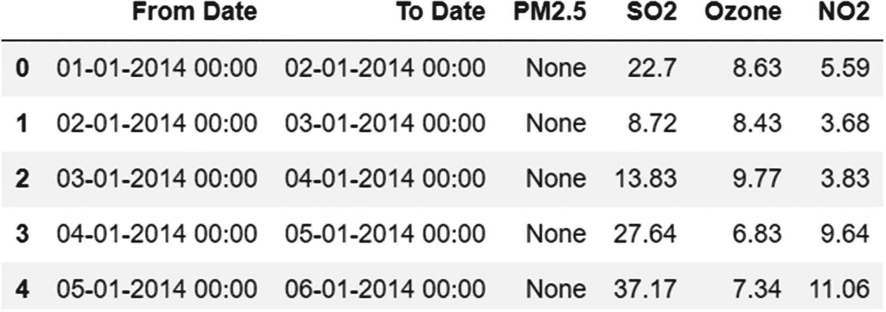

### 检查各列的数据类型：

```python
aqdata.info()
```

输出：

```
RangeIndex: 2192 entries, 0 to 2191
Data columns (total 6 columns):
From Date    2191 non-null object
To Date      2191 non-null object
PM2.5        2191 non-null object
SO2          2187 non-null object
Ozone        2187 non-null object
NO2          2190 non-null object
dtypes: object(6)
memory usage: 102.8+ KB
```

观察：尽管 `SO[2]`、`NO[2]`、臭氧和 `PM[2.5]` 的数值是数字类型，但 `Pandas` 将这些列的数据类型读取为 `"object"`。为了处理这些列（例如绘制图表、观察趋势、计算聚合值），我们需要更改这些列的数据类型。此外，数据中似乎还存在一些缺失条目。

## 第 2 步：数据整理

基于上一步的观察结果，在本步骤中，我们将：

1.  处理缺失值：我们可以选择删除空值或替换空值。
2.  更改各列的数据类型。

# 检查数据集中的缺失值：

代码：

```
aqdata.isna().sum()
```

输出：

```
From Date    1
To Date      1
PM2.5        1
SO2          5
Ozone        5
NO2          2
dtype: int64
```

看起来缺失值并不多，但问题就在这里。当我们使用 `head` 语句检查前几行时，发现原始数据集中有些缺失值表示为 `None`。然而，Pandas 并未将这些值识别为空值。让我们将值 `None` 替换为 `np.nan`，以便 Pandas 将这些值识别为空值：

代码：

```
aqdata=aqdata.replace({'None':np.nan})
```

现在，如果我们计算空值的数量，会看到一个截然不同的情况，表明数据集中存在更多的缺失值。

代码：

```
aqdata.isna().sum()
```

输出：

```
From Date      1
To Date        1
PM2.5        562
SO2           84
Ozone        106
NO2          105
dtype: int64
```

让我们检查一下各列当前的数据类型：

代码：

```
aqdata.info()
```

输出：

```
RangeIndex: 2192 entries, 0 to 2191
Data columns (total 6 columns):
From Date    2191 non-null object
To Date      2191 non-null object
PM2.5        1630 non-null object
SO2          2108 non-null object
Ozone        2086 non-null object
NO2          2087 non-null object
dtypes: object(6)
memory usage: 102.8+ KB
```

我们看到，包含数值的列未被识别为数值列，包含日期的列也未正确识别。列的数据类型不正确会阻碍下一步的分析趋势和绘制图表的工作；这一步要求列的数据类型采用适合 Pandas 读取的格式。在下面的代码中，我们使用 `pd.to_datetime` 方法将 `"From Date"` 和 `"To Date"` 列的数据类型转换为 `datetime` 类型，这样可以更轻松地分析日期的各个组成部分，例如月份和年份。

代码：

```
aqdata['From Date']=pd.to_datetime(aqdata['From Date'], format='%d-%m-%Y %H:%M')
aqdata['To Date']=pd.to_datetime(aqdata['To Date'], format='%d-%m-%Y %H:%M')
aqdata['SO2']=pd.to_numeric(aqdata['SO2'],errors='coerce')
aqdata['NO2']=pd.to_numeric(aqdata['NO2'],errors='coerce')
aqdata['Ozone']=pd.to_numeric(aqdata['Ozone'],errors='coerce')
aqdata['PM2.5']=pd.to_numeric(aqdata['PM2.5'],errors='coerce')
```

使用 `info` 方法检查数据类型是否已更改。

代码：

```
aqdata.info()
```

输出：

```
RangeIndex: 2192 entries, 0 to 2191
Data columns (total 6 columns):
From Date    2191 non-null datetime64[ns]
To Date      2191 non-null datetime64[ns]
PM2.5        1630 non-null float64
SO2          2108 non-null float64
Ozone        2086 non-null float64
NO2          2087 non-null float64
dtypes: datetime64ns, float64(4)
memory usage: 102.8 KB
```

由于我们的大部分分析都基于年度数据，因此我们使用 `pd.DatetimeIndex` 函数创建一个新列来提取年份。

代码：

```
aqdata['Year'] = pd.DatetimeIndex(aqdata['From Date']).year
```

现在，我们为每年创建单独的 `DataFrame` 对象，以便按年分析数据。

代码：

```
#提取每年的数据
aq2014=aqdata[aqdata['Year']==2014]
aq2015=aqdata[aqdata['Year']==2015]
aq2016=aqdata[aqdata['Year']==2016]
aq2017=aqdata[aqdata['Year']==2017]
aq2018=aqdata[aqdata['Year']==2018]
aq2019=aqdata[aqdata['Year']==2019]
```

现在，让我们查看每年数据中的空值数量：

代码：

```
#检查 2014 年的缺失值
aq2014.isna().sum()
```

输出：

```
From Date      0
To Date        0
PM2.5        365
SO2            8
Ozone          8
NO2            8
Year           0
dtype: int64
```

代码：

```
#检查 2015 年的缺失值
aq2015.isna().sum()
```

输出：

```
From Date      0
To Date        0
PM2.5        117
SO2           12
Ozone         29
NO2           37
Year           0
dtype: int64
```

代码：

```
#检查 2016 年的缺失值
aq2016.isna().sum()
```

输出：

```
From Date     0
To Date       0
PM2.5        43
SO2          43
Ozone        47
NO2          42
Year          0
dtype: int64
```

代码：

```
#检查 2017 年的缺失值
aq2017.isna().sum()
```

输出：

```
From Date     0
To Date       0
PM2.5        34
SO2          17
Ozone        17
NO2          12
Year          0
dtype: int64
```

代码：

```
#检查 2018 年的缺失值
aq2018.isna().sum()
```

输出：

```
From Date    0
To Date      0
PM2.5        2
SO2          2
Ozone        2
NO2          2
Year         0
dtype: int64
```

代码：

```
#检查 2019 年的缺失值
aq2019.isna().sum()
```

输出：

```
From Date    0
To Date      0
PM2.5        0
SO2          1
Ozone        2
NO2          3
Year         0
dtype: int64
```

从每年空值的分析中，我们看到 2014 年和 2015 年的数据包含大部分缺失值。因此，我们选择忽略 2014 年和 2015 年的数据，并分析 2016 年至 2019 年这 4 年的数据。根据印度中央污染控制委员会制定的规范，我们需要至少 104 个每日监测值才能得出年度平均值。2016、2017、2018 和 2019 年将是分析空气质量数据的四个年份。在进入下一步之前，我们删除 2016 年至 2019 年每年数据中的缺失值，而不是替换它们，因为如下所示，这四年中每年都有足够的数据（超过 104 个读数）来计算年度平均值。

代码：

```
#删除选定的四年分析数据中的空值
aq2016.dropna(inplace=True) # inplace=True 表示对原始数据框进行修改
aq2017.dropna(inplace=True)
aq2018.dropna(inplace=True)
aq2019.dropna(inplace=True)
```

# 数据可视化

## 分析第一部分：绘制污染物的年度平均值

基于监测到的 `PM[2.5]`、`SO[2]`、`NO[2]` 和臭氧 (`O[3]`) 的 24 小时平均环境空气浓度，绘制年度平均值，以识别哪些参数超过了国家规定的年度平均环境空气质量标准。

首先，我们计算每种污染物（`PM[2.5]`、`SO[2]`、`NO[2]` 和臭氧）的年度平均值，如下所示：

代码：

```
#每年 SO2 的年度平均值
s16avg=round(aq2016['SO2'].mean(),2)
s17avg=round(aq2017['SO2'].mean(),2)
s18avg=round(aq2018['SO2'].mean(),2)
s19avg=round(aq2019['SO2'].mean(),2)
#每年 PM2.5 的年度平均值
p16avg=round(aq2016['PM2.5'].mean(),2)
p17avg=round(aq2017['PM2.5'].mean(),2)
p18avg=round(aq2018['PM2.5'].mean(),2)
p19avg=round(aq2019['PM2.5'].mean(),2)
#每年 NO2 的年度平均值
n16avg=round(aq2016['NO2'].mean(),2)
n17avg=round(aq2017['NO2'].mean(),2)
n18avg=round(aq2018['NO2'].mean(),2)
n19avg=round(aq2019['NO2'].mean(),2)
```

说明：表示污染物平均值变量的命名规则如下：污染物首字母、年份以及表示平均值的缩写`avg`。例如，`s15avg`表示 2015 年 `SO[2]`的平均水平。我们使用`mean`方法计算平均值，并用`round`函数将平均值四舍五入到两位小数。由于臭氧不适用年度标准，因此我们不考虑臭氧。

接下来，我们为每种污染物创建一个包含两列的`DataFrame`。其中一列代表年份，另一列显示该年份的年平均浓度。

代码：

```python
#Creating data frames with yearly averages for each pollutant
dfs=pd.DataFrame({'Yearly average':[s16avg,s17avg,s18avg,s19avg]},index=['2016','2017','2018','2019']) #dfs is for SO2
dfp=pd.DataFrame({'Yearly average':[p16avg,p17avg,p18avg,p19avg]},index=['2016','2017','2018','2019']) #dfp is for PM2.5
dfn=pd.DataFrame({'Yearly average':[n16avg,n17avg,n18avg,n19avg]},index=['2016','2017','2018','2019']) #dfn is for NO2
```

现在，我们准备绘制每种污染物年平均浓度的图表（图 8-4）。

代码：

```python
#Creating a figure with 3 subplots - 1 for each pollutant
fig,(ax1,ax2,ax3)=plt.subplots(1,3)
#Creating a DataFrame the yearly averages for NO2
dfn.plot(kind='bar',figsize=(20,5),ax=ax1)
#Setting the title for the first axes object
ax1.set_title("NO2", fontsize=18)
#Setting the X-axis label for the NO2 graph
ax1.set_xlabel("Years", fontsize=18)
ax1.legend().set_visible(False)
#Setting the Y-axis label
ax1.set_ylabel("Yearly average", fontsize=18)
#Creating a dashed line to indicate the annual standard
ax1.hlines(40, -.9,15, linestyles="dashed")
#Labelling this dashed line
ax1.annotate('Annual avg. standard for NO2',(-0.5,38))
#labelling the bars
for p in ax1.patches:
ax1.annotate(p.get_height(),(p.get_x()+p.get_width()/2,p.get_height()), color="black", ha="left", va ='bottom',fontsize=12)
#Plotting the yearly averages similarly for PM2.5
dfp.plot(kind='bar',figsize=(20,5),ax=ax2)
ax2.set_title("PM2.5", fontsize=18)
ax2.hlines(40, -.9,15, linestyles="dashed")
ax2.annotate('Annual avg. standard for PM2.5',(-0.5,48))
ax2.legend().set_visible(False)
for p in ax2.patches:
ax2.annotate(p.get_height(),(p.get_x()+p.get_width()/2,p.get_height()), color="black", ha="center", va ='bottom',fontsize=12)
#Plotting the yearly averages similarly for SO2
dfs.plot(kind='bar',figsize=(20,5),ax=ax3)
ax3.hlines(50, -.9,15, linestyles="dashed")
ax3.annotate('Annual avg. standard for SO2',(-0.5,48))
ax3.set_title("SO2", fontsize=18)
ax3.legend().set_visible(False)
for p in ax3.patches:
ax3.annotate(p.get_height(),(p.get_x()+p.get_width()/2,p.get_height()), color="black", ha="center", va ='bottom',fontsize=12)
```

输出：

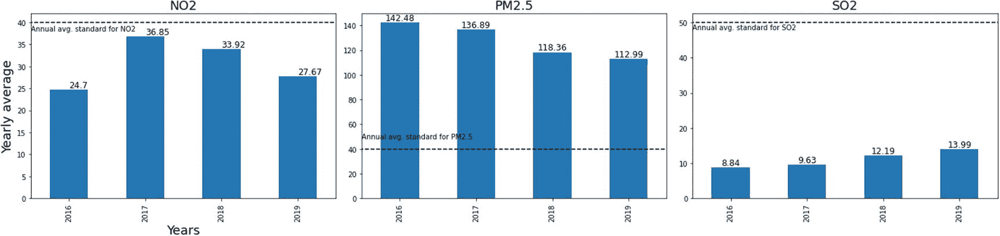

**图 8-4** 污染物（`NO[2]`、`PM[2.5]` 和 `SO[2]`）的年平均浓度与其年平均标准对比

观察：很明显，只有 `PM[2.5]`超过了年平均标准。对于 `NO[2]`，观测值相对接近规定标准。对于 `SO[2]`，观测值远低于年度标准。因此，在进一步分析中，只考虑这两种污染物（`NO[2]` 和 `PM[2.5]`）。

#### 空气质量分析第二部分：绘制每年 PM[2.5]和 NO[2]超过 24 小时标准的天数

虽然分析的第一步指出了空气质量管理和干预规划中需要关注的污染物，但在第二步中，我们展示了每年超过 24 小时标准的不同超标水平的分布情况。对于 PM[2.5]，我们绘制了每年观测值落在以下范围内的天数。

1.  0 至 60 μg/m³
2.  61 至 120 μg/m³
3.  121 至 180 μg/m³
4.  > 180 μg/m³

为了绘制这些数据，我们需要为 2016 年至 2019 年每年创建 `DataFrame` 对象，捕获 PM[2.5]浓度落在每个区间内的天数，如下所示：

```python
#Creating intervals for 2016 with the number of days with PM2.5 concentration falling in that interval
a2=aq2016[(aq2016['PM2.5']60) & (aq2016['PM2.5']120) & (aq2016['PM2.5']180)]['PM2.5'].count()
dfpb2016=pd.DataFrame({'year':'2016','pm levels':['60) & (aq2017['PM2.5']120) & (aq2017['PM2.5']180)]['PM2.5'].count()
dfpb2017=pd.DataFrame({'year':'2017','pm levels':['60) & (aq2018['PM2.5']120) & (aq2018['PM2.5']180)]['PM2.5'].count()
dfpb2018=pd.DataFrame({'year':'2018','pm levels':['60) & (aq2019['PM2.5']120) & (aq2019['PM2.5']180)]['PM2.5'].count()
dfpb2019=pd.DataFrame({'year':'2019','pm levels':['<60','between 61 and 120','between 121 and 180','greater than 180'],'number of critical days':[a5,b5,c5,d5]})
```

现在，我们为每年绘制这些区间的堆叠条形图。为此，我们需要按如下方式创建数据透视表：

```python
dfpivot2019=dfpb2019.pivot(index='year',columns='pm levels',values='number of critical days')
dfpivot2018=dfpb2018.pivot(index='year',columns='pm levels',values='number of critical days')
dfpivot2017=dfpb2017.pivot(index='year',columns='pm levels',values='number of critical days')
dfpivot2016=dfpb2016.pivot(index='year',columns='pm levels',values='number of critical days')
```

使用这些数据透视表，我们创建堆叠条形图（图 8-5），如下所示：

```python
#Creating a figure with 4 sub-plots, one for each year from 2016-19
fig,(ax1,ax2,ax3,ax4)=plt.subplots(1,4)
fig.suptitle("Number of days per year in each interval")
cmp=plt.cm.get_cmap('RdBu')
#Plotting stacked horizontal bar charts for each year to represent intervals of PM2.5 levels
dfpivot2019.loc[:,['<60','between 61 and 120','between 121 and 180','greater than 180']].plot.barh(stacked=True, cmap=cmp,figsize=(15,5),ax=ax1)
dfpivot2018.loc[:,['<60','between 61 and 120','between 121 and 180','greater than 180']].plot.barh(stacked=True, cmap=cmp, figsize=(15,5),ax=ax2)
dfpivot2017.loc[:,['<60','between 61 and 120','between 121 and 180','greater than 180']].plot.barh(stacked=True, cmap=cmp, figsize=(15,5),ax=ax3)
dfpivot2016.loc[:,['<60','between 61 and 120','between 121 and 180','greater than 180']].plot.barh(stacked=True, cmap=cmp, figsize=(15,5),ax=ax4)
#Setting the properties - legend, yaxis and title
ax1.legend().set_visible(False)
ax2.legend().set_visible(False)
ax3.legend().set_visible(False)
ax4.legend(loc='center left',bbox_to_anchor=(1,0.5))
ax1.get_yaxis().set_visible(False)
ax2.get_yaxis().set_visible(False)
ax3.get_yaxis().set_visible(False)
ax4.get_yaxis().set_visible(False)
ax1.set_title('2019')
ax2.set_title('2018')
ax3.set_title('2017')
ax4.set_title('2016')
```

输出：

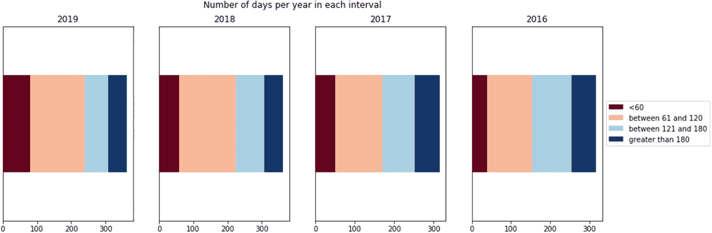

`图 8-5` PM[2.5] 每年各区间水平的天数

观察：可以看出，每年都观测到 PM[2.5]值超过 180 μg/m³，因此，作为起步，对包括交通在内的主要污染活动的限制可以集中在这一类别。

### NO[2] 区间绘图

同样，对于 NO[2]，绘制了每年监测值超过 24 小时标准 80 μg/m³的天数（图 8-6）。首先，我们为 NO[2]创建一个数据框，捕获每年值高于 80 μg/m³的天数，如下所示。

# 计算每年二氧化氮浓度超标天数

```python
a=aq2015[(aq2015['NO2']>=80)]['NO2'].count()
b=aq2016[(aq2016['NO2']>=80)]['NO2'].count()
c=aq2017[(aq2017['NO2']>=80)]['NO2'].count()
d=aq2018[(aq2018['NO2']>=80)]['NO2'].count()
e=aq2019[(aq2019['NO2']>=80)]['NO2'].count()
dfno=pd.DataFrame({'years':['2015','2016','2017','2018','2019'],'number of days with NO2>80 μg':[a,b,c,d,e]})
ax=dfno.plot(kind='bar',figsize=(10,5))
ax.set_xticklabels(['2015','2016','2017','2018','2019'])
ax.set_title("NO2 number of days in each year with critical levels of concentration")
for p in ax.patches:
ax.annotate(p.get_height(), (p.get_x() + p.get_width() / 2, p.get_height()), ha = 'center', va = 'bottom')
```

输出：

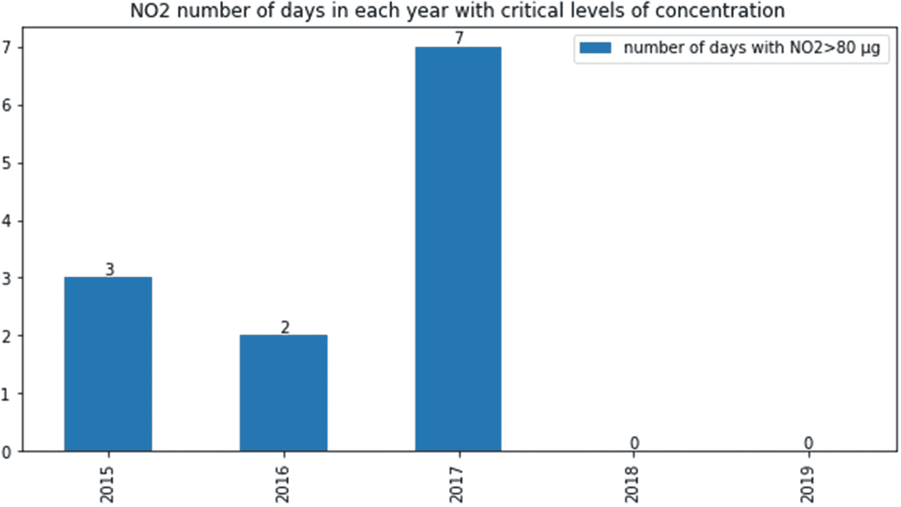

`图 8-6` 每年二氧化氮浓度超标天数

`推论：` 在五年中，仅有三年观测到的 24 小时二氧化氮值超标。由于观测到的 24 小时二氧化氮值仅略微超标，且超标天数很少，因此下一步将重点放在对 PM₂.₅的进一步分析上。

## 空气质量分析第三部分：识别 PM₂.₅日均值在大部分天数中超标月份

在对交通流量和建筑施工等显著影响环境 PM₂.₅浓度的活动实施限制之前，有必要提前发出充分通知，以避免给公众带来不便。因此，对于日均 PM₂.₅值显著高于 180 μg/m³的情况，我们按年份绘制了年内各月的时间变化图。为此，我们针对十二个月中的每一个月，统计了每年 24 小时 PM₂.₅值超过 180 μg/m³的临界空气污染天数。

首先，我们为每年创建一个数据框，其中包含每个月 PM₂.₅值超过 180 μg/m³的天数，如下所示。

```python
#为 2016 年创建一个数据框，包含每个月 PM2.5 浓度>180 的天数
aq2016['Month']=pd.DatetimeIndex(aq2016['From Date']).month #提取月份
aq2016['condition']=(aq2016['PM2.5']>=180 ) #创建一个布尔列，当 PM2.5 值大于 180 时为 True，小于 180 时为 False
aq2016['condition']=aq2016['condition'].replace({False:np.nan}) #将 False 值替换为空值，以便下一条语句中的 count 方法仅统计 True 值或对应 PM2.5>180 的值
selection1=aq2016.groupby('Month')['condition'].count() #使用 groupby 方法计算每个月满足条件(PM2.5>180)的天数
#对 2017 年重复上述过程，创建一个数据框，包含每个月 PM2.5 浓度>180 的天数
aq2017['Month']=pd.DatetimeIndex(aq2017['From Date']).month
aq2017['condition']=(aq2017['PM2.5']>=180 )
aq2017['condition']=aq2017['condition'].replace({False:np.nan})
selection2=aq2017.groupby('Month')['condition'].count()
#对 2018 年重复上述过程，创建一个数据框，包含每个月 PM2.5 浓度>180 的天数
aq2018['Month']=pd.DatetimeIndex(aq2018['From Date']).month
aq2018['condition']=(aq2018['PM2.5']>=180 )
aq2018['condition']=aq2018['condition'].replace({False:np.nan})
selection3=aq2018.groupby('Month')['condition'].count()
#对 2019 年重复上述过程，创建一个数据框，包含每个月 PM2.5 浓度>180 的天数
aq2019['Month']=pd.DatetimeIndex(aq2019['From Date']).month
aq2019['condition']=(aq2019['PM2.5']>=180 )
aq2019['condition']=aq2019['condition'].replace({False:np.nan})
selection4=aq2019.groupby('Month')['condition'].count()
```

现在，我们将所有 DataFrame 对象连接成一个对象（我们称之为`selectionc`），以获取每个月 PM₂.₅ > 180 μg/m³天数的综合视图，如下所示。

```python
#selectionc 数据框是一个综合数据框，显示每年 PM2.5 的月度临界值
selectionc=pd.concat([selection1,selection1,selection3,selection4],axis=1)
#重命名列
selectionc.columns=['2016','2017','2018','2019']
selectionc
```

输出：

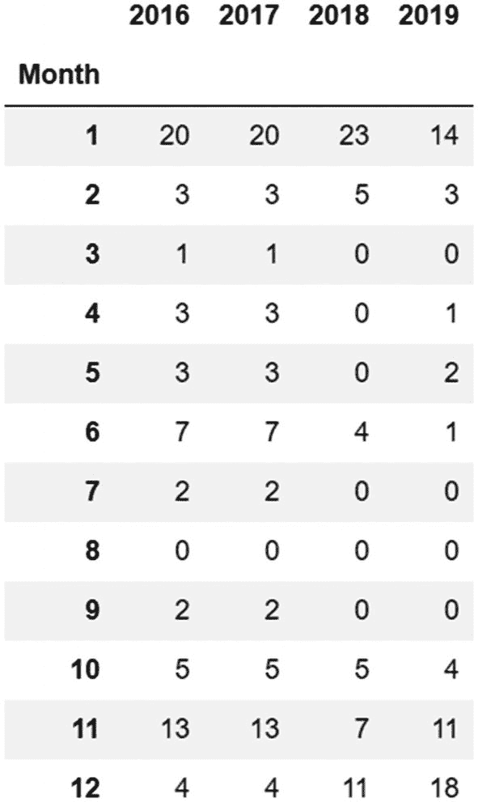

从该表中我们可以观察到，第 1 个月（一月）、第 11 个月（十一月）和第 12 个月（十二月）是所有四年中最关键的月份，因为这些月份中 PM₂.₅ > 180 μg/m³的天数最多。

现在我们已经准备好了所有数据，让我们使用以下代码来可视化 PM₂.₅的临界天数（图 8-7）。

```python
#创建一个柱状图，表示 PM2.5 浓度超标(>180)的天数
ax=selectionc.plot(kind='bar',figsize=(20,7),width=0.7,align='center',colormap='Paired')
bars = ax.patches
#创建图案以代表每一年
patterns =('-','x','/','O')
#ax.legend(loc='upper left', borderpad=1.5, labelspacing=1.5)
ax.legend((patterns),('2016','2017','2018','2019'))
hatches = [p for p in patterns for i in range(len(selectionc))]
#为每个柱状条设置图案
for bar, hatch in zip(bars, hatches):
bar.set_hatch(hatch)
#标记月份、X 轴和 Y 轴
ax.set_xticklabels(['Jan','Feb','Mar','Apr','May','June','July','Aug','Sept','Oct','Nov','Dec'],rotation=30)
ax.set_xlabel('Month',fontsize=12)
ax.set_ylabel('Number of days with critical levels of PM2.5',fontsize=12)
#标记柱状条
for i in ax.patches:
ax.text(i.get_x()-.003, i.get_height()+.3,
round(i.get_height(),2), fontsize=10,
color='dimgrey')
ax.legend()
ax.set_title("Number of days with critical levels of PM2.5 in each month of years 2016-19")
```

输出：

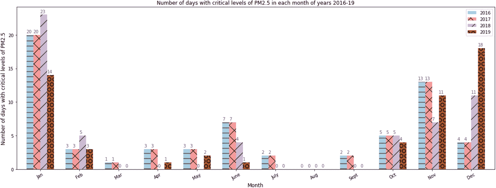

`图 8-7` PM₂.₅ – 每年每月超标天数

### 第四步：基于分析和可视化得出结论

从上图可以看出，大多数严重污染天数集中在一月、十一月和十二月。因此，根据过去四年记录的 PM₂.₅日均浓度，可能会在一月、十一月和十二月对交通流量、建筑施工活动、柴油泵组的使用、从邻邦进入德里的交通分流以及其他类似活动实施限制。要为整个德里做出此类决策，还需要分析其他监测站的数据。上述数据和分析的传播将有助于人们提前为限制措施做好准备，并理解这些措施背后的理由。

上述方法利用数据分析作为辅助空气质量管理的工具，使用了位于德里内塔吉·苏巴斯理工学院（NSIT）的一个监测站记录的数据。该方法可按照以下思路进一步推进。

1.  对 NO₂重复上述步骤，以显示导致大部分 NO₂记录值超过 24 小时标准天数的关键月份。进行此项练习将再次有助于识别 PM₂.₅和 NO₂这两个参数均面临严重污染水平的月份，并制定相应计划。

2.  使用来自 NSIT 空气质量监测站的数据进行的分析，可重复应用于其他站点的类似数据，以便能够为整个德里规划干预措施。

## 案例研究 8-3：全球 COVID-19 病例分析

本数据集包含截至 2020 年 6 月 29 日 COVID-19 病例的地理分布数据（来源：欧洲疾病预防控制中心，来源网址：[https://www.ecdc.europa.eu/en/publications-data/download-todays-data-geographic-distribution-covid-19-cases-worldwide](https://www.ecdc.europa.eu/en/publications-data/download-todays-data-geographic-distribution-covid-19-cases-worldwide)）。请注意，此链接包含最新数据，但我们使用的是截至 6 月 29 日的数据（数据集链接见本章开头的“技术要求”部分）。

我们希望通过分析回答的问题包括：

1.  哪些国家的死亡率最高、病例数最多、死亡人数最多？
2.  自疫情开始以来，病例数和死亡人数的月度趋势如何？
3.  一些国家实施了封锁措施以帮助拉平曲线。这一措施是否有助于减少病例数？

### 步骤 1：导入数据并检查数据集特征

读取数据集，并使用 `pd.read_excel` 函数检查前五行（使用 `head` 方法）：

```python
df=pd.read_excel('COVID-19-geographic-distribution-worldwide-2020-06-29.xlsx')
df.head()
```

输出：

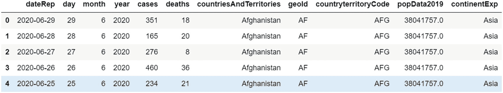

获取每列的数据类型以及每列中非空值的数量信息（使用 `info` 方法）。

```python
df.info()
```

输出：

```
RangeIndex: 26562 entries, 0 to 26561
Data columns (total 11 columns):
dateRep                    26562 non-null datetime64[ns]
day                        26562 non-null int64
month                      26562 non-null int64
year                       26562 non-null int64
cases                      26562 non-null int64
deaths                     26562 non-null int64
countriesAndTerritories    26562 non-null object
geoId                      26455 non-null object
countryterritoryCode       26498 non-null object
popData2019                26498 non-null float64
continentExp               26562 non-null object
dtypes: datetime64ns, float64(1), int64(5), object(4)
memory usage: 2.2+ MB
```

获取每列的汇总统计信息（使用 `describe` 方法），并获取计数、最小值、最大值、标准差和百分位数的值：

```python
df.describe()
```

输出：

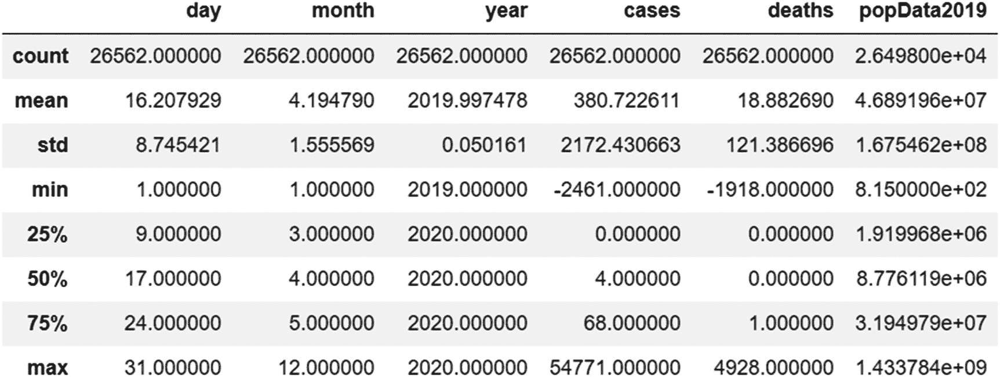

### 步骤 2：数据整理

在此步骤中，我们将：

*   检查列的数据类型是否被准确识别。如果没有，则更改数据类型：从 `info` 方法的输出中，我们看到所有列的数据类型都已正确识别。
*   如有必要，重命名列：在以下代码中，我们正在重命名 DataFrame 的列。

```python
#更改列名
df.columns=['date','day','month','year','cases','deaths','country','old_country_code','country_code','population','continent']
```

*   删除任何不必要的列或行：

我们看到 DataFrame 中国家代码列出现了两次（有两个不同的名称：`old_country_code` 和 `country_code`），因此我们删除其中一列（`old_country_code`）：

```python
#删除冗余的列名
df.drop(['old_country_code'],axis=1,inplace=True)
```

*   删除任何没有价值的无关数据：

此 DataFrame 中没有空格、特殊字符或任何其他无关字符。我们看到 2019 年 12 月只有一天的数据；因此我们删除该月的数据，并为剩余的 11 个月创建一个新的 DataFrame（`df1`）。

```python
df1=df[df.month!=12]
```

*   使用 `isna` 或 `isnull` 方法检查是否存在空值，如果存在，则应用适当的方法处理它们：

计算空值的百分比：

```python
df1.isna().sum().sum()/len(df1)
```

输出：

```
0.008794112096622004
```

由于空值的百分比小于 1%，我们在下一步中删除空值。

```python
df1.dropna(inplace=True)
```

*   如果数据是未聚合的格式，则聚合数据：

此 DataFrame 中的数据不是聚合格式，我们在此步骤中使用 `groupby` 方法将其转换为聚合格式。我们可以按国家、按大洲或按日期分组。让我们按国家名称分组。

```python
#按国家名称聚合数据
df_by_country=df1.groupby('country')['cases','deaths'].sum()
df_by_country
```

输出（仅显示前九行）：

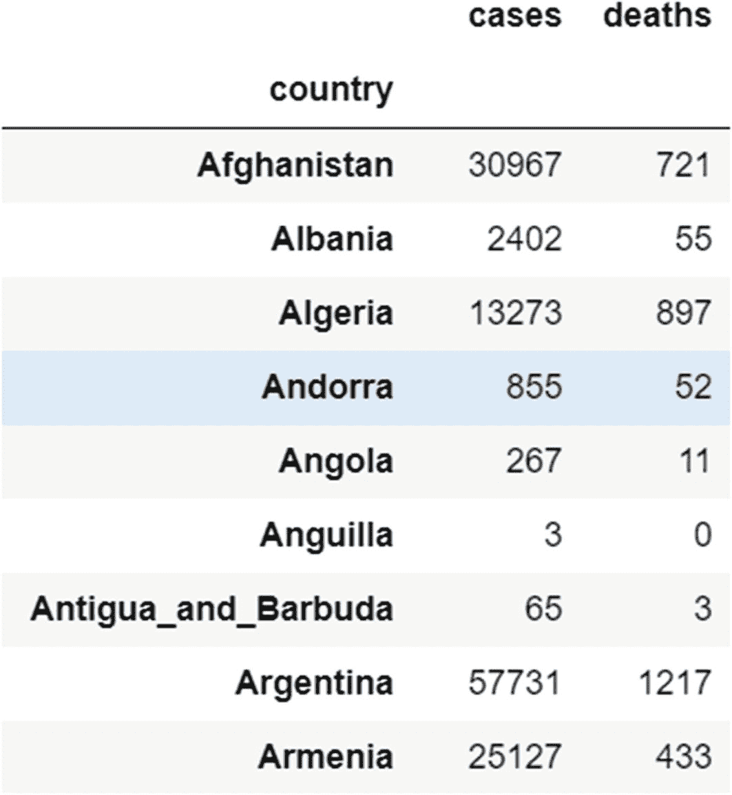

上述输出显示了每个国家的病例数和死亡数的汇总情况。让我们向这个聚合后的 DataFrame 添加另一列——死亡率，即死亡人数与病例数的比率。

```python
#添加一个新列，表示死亡率，即死亡人数与病例数的比率
df_by_country['mortality_rate']=df_by_country['deaths']/df_by_country['cases']
```

### 步骤 3：数据可视化

在本案例研究的第一个可视化中，我们使用 DataFrame `df_by_country` 中的聚合数据来显示死亡率最高的前二十个国家（图 8-8）。

代码：

```python
#按降序对死亡率值进行排序
plt.figure(figsize=(15,10))
ax=df_by_country['mortality_rate'].sort_values(ascending=False).head(20).plot(kind='bar')
ax.set_xticklabels(ax.get_xticklabels(), rotation=45, ha="right")
for p in ax.patches:
    ax.annotate(p.get_height().round(2),(p.get_x()+p.get_width()/2,p.get_height()),ha='center',va='bottom')
ax.set_xlabel("国家")
ax.set_ylabel("死亡率")
ax.set_title("死亡率最高的国家")
```

输出：

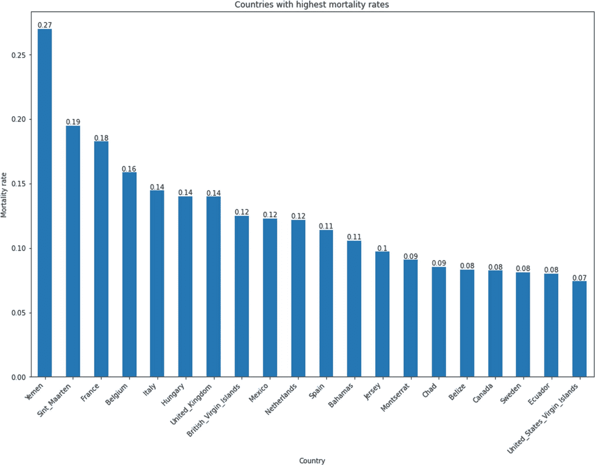

图 8-8 显示 COVID-19 死亡率最高国家的条形图

在第二个可视化中，我们使用饼图显示 COVID-19 病例数最多的十个国家，如图 8-9 所示。

代码：

```python
#饼图显示 COVID 病例数最多的国家
df_cases=df_by_country['cases'].sort_values(ascending=False)
ax=df_cases.head(10).plot(kind='pie',autopct='%.2f%%',labels=df_cases.index,figsize=(12,8))
ax.set_title("病例数排名前十的国家")
```

输出：

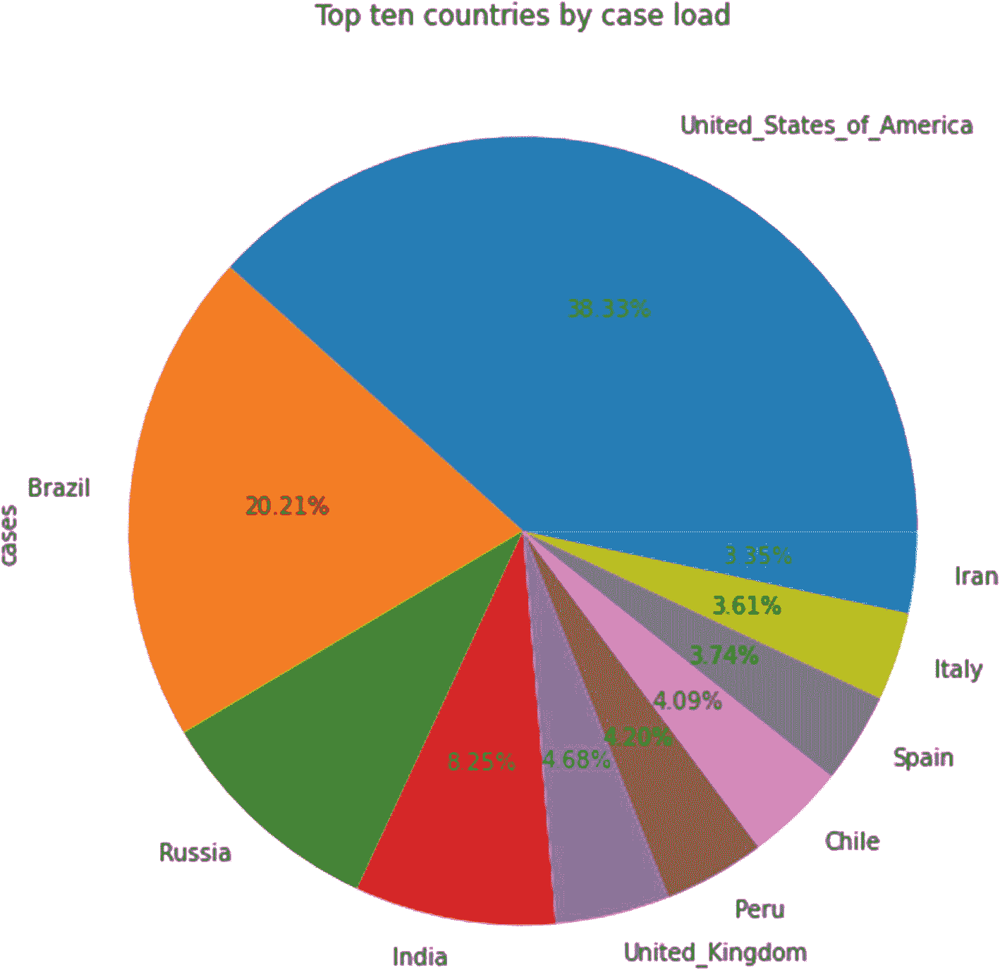

图 8-9 显示 COVID-19 病例数前十国家占比的饼图

在下一个可视化中，我们使用条形图找出在 COVID-19 疫情中人类生命损失最惨重的五个国家（图 8-10）。

代码：

```python
#按降序对死亡人数进行排序
plt.figure(figsize=(10,6))
ax=df_by_country['deaths'].sort_values(ascending=False).head(5).plot(kind='bar')
ax.set_xticklabels(ax.get_xticklabels(), rotation=45, ha="right")
for p in ax.patches:
    ax.annotate(p.get_height(),(p.get_x()+p.get_width()/2,p.get_height()),ha='center',va='bottom')
ax.set_title("因 COVID-19 死亡人数最多的国家")
ax.set_xlabel("国家")
ax.set_ylabel("死亡人数")
```

输出：

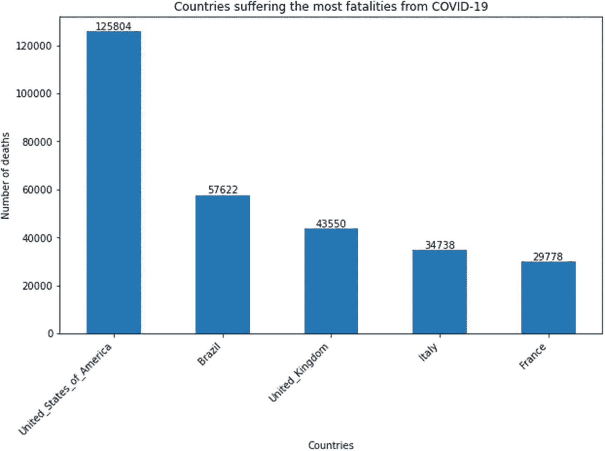

图 8-10 显示死亡人数最多的五个国家的条形图

现在，我们绘制折线图，以观察 COVID-19 病例数和死亡人数的月度趋势。为了绘制折线图，我们首先按月聚合数据，然后并排绘制两条折线图，分别显示病例数和死亡数，如图 8-11 所示。

代码：

```python
df_by_month=df1.groupby('month')['cases','deaths'].sum()
fig=plt.figure(figsize=(15,10))
ax1=fig.add_subplot(1,2,1)
ax2=fig.add_subplot(1,2,2)
df_by_month['cases'].plot(kind='line',ax=ax1)
ax1.set_title("Total COVID-19 cases across months in 2020")
ax1.set_xlabel("Months in 2020")
ax1.set_ylabel("Number of cases(in million)")
df_by_month['deaths'].plot(kind='line',ax=ax2)
ax2.set_title("Total COVID-19 deaths across months in 2020")
ax2.set_xlabel("Months in 2020")
ax2.set_ylabel("Number of deaths")
```

输出：

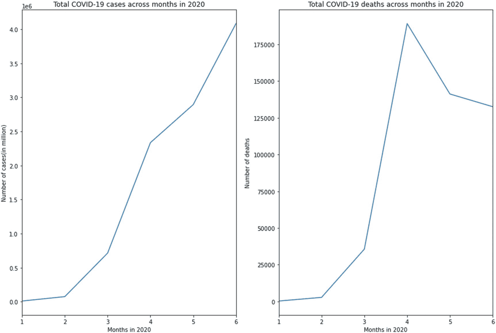

图 8-11 封锁对拉平曲线的影响

许多国家实施了封锁，以遏制病例激增的趋势并拉平曲线。我们现在关注四个国家——印度、英国、意大利和德国——这些国家在 3 月份实施了封锁，以观察这一措施是否产生了预期效果。首先，我们为每个国家创建 `DataFrame` 对象，并按月聚合数据。

代码：

```python
#Creating DataFrames for each country
#Monthwise aggregated data for Germany
df_germany=df1[df1.country=='Germany']
df_germany_monthwise=df_germany.groupby('month')['cases','deaths'].sum()
df_germany_grouped=df_germany_monthwise.reset_index()
#Monthwise aggregated data for UK
df_uk=df1[df1.country=='United_Kingdom']
df_uk_monthwise=df_uk.groupby('month')['cases','deaths'].sum()
df_uk_grouped=df_uk_monthwise.reset_index()
#Monthwise aggregated data for India
df_india=df1[df1.country=='India']
df_india_monthwise=df_india.groupby('month')['cases','deaths'].sum()
df_india_grouped=df_india_monthwise.reset_index()
#Monthwise aggregated data for Italy
df_italy=df1[df1.country=='Italy']
df_italy_monthwise=df_italy.groupby('month')['cases','deaths'].sum()
df_italy_grouped=df_italy_monthwise.reset_index()
```

现在，我们使用上一步创建的 `DataFrame` 对象为这些国家绘制折线图，以观察 2020 年各月的病例数，如图 8-12 所示。

代码：

```python
#Plotting the data for four countries (UK, India, Italy and Germany) where lockdowns were imposed
fig=plt.figure(figsize=(20,15))
ax1=fig.add_subplot(2,2,1)
df_uk_grouped.plot(kind='line',x='month',y='cases',ax=ax1)
ax1.set_title("Cases in UK across months")
ax2=fig.add_subplot(2,2,2)
df_india_grouped.plot(kind='line',x='month',y='cases',ax=ax2)
ax2.set_title("Cases in India across months")
ax3=fig.add_subplot(2,2,3)
df_italy_grouped.plot(kind='line',x='month',y='cases',ax=ax3)
ax3.set_title("Cases in Italy across months")
ax4=fig.add_subplot(2,2,4)
df_germany_grouped.plot(kind='line',x='month',y='cases',ax=ax4)
ax4.set_title("Cases in Germany across months")
```

输出：

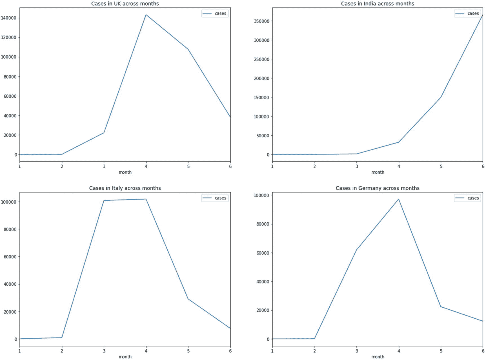

图 8-12 英国、印度、德国和意大利在 2020 年前 6 个月的总病例数

### 步骤 4：基于分析和可视化得出结论

- **病例数**：美国、巴西、俄罗斯、印度和英国的病例数最高。
- **死亡人数**：美国、巴西、英国、意大利和法国的死亡人数最高。
- **死亡率**：也门、圣马丁、法国、比利时和意大利的死亡率最高。
- **趋势**：
    - 总病例数一直在稳步上升，而总死亡人数在 4 月之后有所下降。
    - **封锁的影响**：我们分析了四个国家——印度、英国、德国和意大利——这些国家在 3 月份实施了封锁。除印度外，所有这些国家在实施封锁后，病例数总体呈下降趋势。在英国和德国，病例数最初（在封锁早期阶段）有所上升，但在达到峰值后开始下降。

## 总结

- 在本章中，我们研究了多个案例，从结构化和非结构化数据源导入数据。`Pandas` 支持从多种格式读取数据。
- `requests` 模块具有使我们能够向网页发送 HTTP 请求并将页面内容存储在对象中的函数。
- 典型的描述性或探索性数据分析案例始于构建我们希望通过分析回答的问题，并弄清楚如何导入数据。之后，我们获取有关数据的更多信息——各列的含义、测量单位、缺失值的数量、不同列的数据类型等。
- 数据整理（我们准备、清理和结构化数据以使其适合分析）是描述性或探索性数据分析的核心。典型活动包括删除无关数据、处理空值、重命名列、聚合数据和更改数据类型。
- 一旦数据准备好并适合分析，我们使用 `Matplotlib`、`Seaborn` 和 `Pandas` 等库对数据进行可视化，以帮助我们获得能够回答最初构建的问题的见解。

## 复习练习

### 问题 1（迷你案例研究）

考虑以下网页上的第一个表格：[`https://en.wikipedia.org/wiki/Climate_of_South_Africa`](https://en.wikipedia.org/wiki/Climate_of_South_Africa)。它包含南非各城市夏季和冬季最高和最低温度（摄氏度）的数据。

- 使用 `requests` 模块中的适当方法向此 URL 发送 `get` 请求，并将此页面第一个表格中的数据存储到 Pandas `DataFrame` 中。
- 将列重命名如下：`'City'`、`'Summer(max)'`、`'Summer(min)'`、`'Winter(max)'`、`'Winter(min)'`。
- 将 `'Winter(min)'` 列第一行中的负值替换为 `0`，并将此列的数据类型转换为 `int64`。
- 绘制图表以显示南非夏季最热的城市（使用 `Summer(max)` 列）。
- 绘制图表以显示南非冬季最冷的城市（使用 `Winter(min)` 列）。

### 问题 2

十名员工（以 A–J 为首字母）的周薪如下：100、120、80、155、222、400、199、403、345、290。将周薪存储在一个 `DataFrame` 中。

- 绘制条形图以按降序显示工资。
- 使用 `annotate` 方法标记条形图中的每个条形。

### 问题 3

| 1. 用于发送 HTTP 请求的模块 | a. 网页的 URL |
| :--- | :--- |
| 2. `Get` 方法 | b. `req.text` |
| 3. 传递给 `get` 方法的参数 | c. 使用给定的 URL 获取信息 |
| 4. 包含 Unicode 内容的属性 | d. `Requests` |

### 问题 4

`read_html` Pandas 函数读取：

1.  网页上的所有 HTML 内容
2.  网页中的 HTML 标签
3.  所有 HTML 表格作为 `DataFrame` 对象的列表
4.  网页中的 HTML 列表

## 答案

### 问题 1

代码：

```python
import requests
import pandas as pd
import seaborn as sns
import matplotlib.pyplot as plt
%matplotlib inline
url='https://en.wikipedia.org/wiki/Climate_of_South_Africa'
#making a get request to the URL
req = requests.get(url)
#storing the HTML data in a DataFrame
data = pd.read_html(req.text)
#Reading the first table
df=data[0]
#Renaming the columns
df.columns=['City','Summer(max)','Summer(min)','Winter(max)','Winter(min)']
#Replacing the negative value with 0
df['Winter(min)']=df['Winter(min)'].str.replace(r"–2","0")
#Changing the data type from object to int64
df['Winter(min)']=df['Winter(min)'].astype('int64',errors='ignore')
#Using the city as the index to facilitate plotting
df1=df.set_index('City')
#Hottest five cities during Summer
df1['Summer(max)'].sort_values(ascending=False).head(5).plot(kind='bar')
#Coldest five cities during Winter
df1['Winter(min)'].sort_values().head(5).plot(kind='bar')
```

### 问题 2

代码：

```python
numbers=pd.Series([100,120,80,155,222,400,199,403,345,290])
#converting the data to a DataFrame
numbers.to_frame()
#labelling the index
numbers.index=list('ABCDEFGHIJ')
#labelling the column
numbers.columns=['Wages']
ax=numbers.sort_values(ascending=False).plot(kind='bar')
#labelling the bars
for p in ax.patches:
    ax.annotate(p.get_height(),(p.get_x()+p.get_width()/2,p.get_height()),ha='center',va='bottom')
```

### 问题 3

1-d; 2-c; 3-a; 4-b

### 问题 4

选项 3

网页中每个表格的内容都存储在一个独立的 `DataFrame` 对象中。