# 7. 使用 Python 库进行数据可视化

在上一章中，我们了解了 Pandas，这是一个拥有各种函数的库，用于准备数据以使其适合分析和可视化。可视化是一种理解数据模式、识别异常值和其他关注点，并向外部受众展示我们发现的方法，而无需手动筛选数据。可视化还有助于我们从原始数据中收集信息，并获得否则难以得出的见解。

学完本章后，您将能够理解常用的图表，理解 Matplotlib 中面向对象和有状态的方法，并应用这些方法进行可视化，学习如何使用 Pandas 进行绘图，以及了解如何使用 Seaborn 创建图形。

## 技术要求

在您的 Jupyter notebook 中，输入以下内容以导入以下库。

```python
import pandas as pd
import seaborn as sns
import matplotlib.pyplot as plt
```

这里，`plt` 是 Matplotlib 的 `pyplot` 模块的简写名称或别名，我们用它来进行绘图；`sns` 是 Seaborn 库的别名；`pd` 是 Pandas 的别名。

如果这些库尚未安装，请转到 Anaconda Prompt 并按如下方式安装它们：

```
pip install matplotlib
pip install seaborn
pip install pandas
```

### 外部文件

我们在本章中使用 *Titanic* 数据集来演示各种图表。

请使用以下链接下载数据集：[`https://github.com/DataRepo2019/Data-files/blob/master/titanic.csv`](https://github.com/DataRepo2019/Data-files/blob/master/titanic.csv)

您也可以通过以下步骤下载此数据集：

*   点击以下链接：[`https://github.com/DataRepo2019/Data-files`](https://github.com/DataRepo2019/Data-files)
*   点击：Code ➤ Download ZIP


*   从下载的 zip 文件夹中，打开“titanic.csv”文件。

## 常用图表

在探索性或描述性数据分析中广泛使用的一些基本图表包括条形图、饼图、直方图、散点图、箱线图和热力图；这些在表 7-1 中进行了说明。

**表 7-1** 描述性数据分析中用于可视化数据的常用图表

| 图表类型 | 描述 | 形状 |
| --- | --- | --- |
| 条形图 | 条形图可以可视化分类数据，条形的宽度或高度代表每个类别的值。条形可以垂直或水平显示。 | 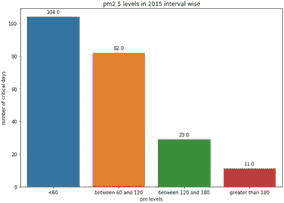 |
| 直方图 | 直方图用于可视化连续变量的分布。它将连续变量的范围划分为区间，并显示大多数值所在的位置。 | 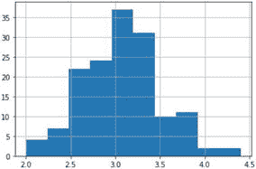 |


### 箱线图

箱线图有助于直观地描绘数据的统计特征。箱线图提供五点概括，图中的每条线都代表所绘制数据的一个统计度量（参见右图）。这五个度量是：

- 最小值
- 第 25 百分位数
- 中位数（第 50 百分位数）
- 第 75 百分位数
- 最大值

右图中看到的小圆圈/点代表异常值（或极端值）。箱子两侧代表最小值和最大值的两条线也称为“须”。这些须之外的任何点都称为异常值。箱子中间的线代表中位数。

箱线图通常用于连续（比率/区间）变量，但也可用于某些分类变量，如有序变量。

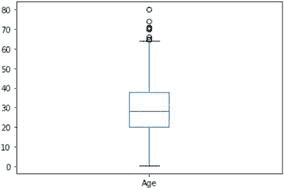

#### 饼图

饼图将变量的不同值显示为圆内的扇形区域。饼图用于分类变量。

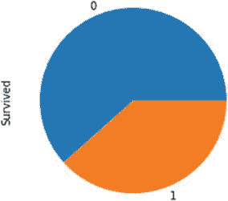

#### 散点图

散点图将两个连续变量的值显示为 x 轴和 y 轴上的点，帮助我们直观地判断这两个变量是否相关。

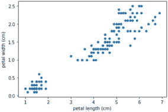

### 热力图

热力图使用颜色编码矩阵显示多个变量之间的相关性，其中颜色饱和度代表变量之间相关性的强度。热力图有助于同时可视化多个变量。

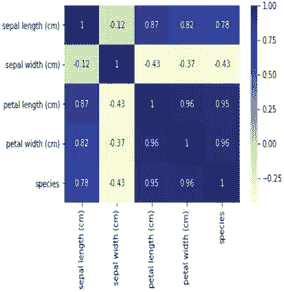

现在让我们看看一些用于可视化的 Python 库，首先从 Matplotlib 开始。

## Matplotlib

Python 中用于数据可视化的主要库是 Matplotlib。Matplotlib 具有许多与 Matlab（一种带有绘图工具的计算环境兼编程语言）相似的视觉化功能。Matplotlib 主要用于绘制二维图形，对创建三维图形的支持有限。

与 Seaborn 和 Pandas 等其他库（它们使用一些默认设置来简化创建绘图的代码编写）相比，使用 Matplotlib 创建的绘图需要更多的代码行和参数自定义。Matplotlib 构成了使用 Python 进行的大多数可视化的基础。

Matplotlib 有两种接口：有状态接口和面向对象接口，如表 7-2 所述。

### 表 7-2 Matplotlib 中的接口

| 有状态接口 | 面向对象接口 |
| --- | --- |
| 此接口使用基于 Matlab 的`pyplot`类。创建该类的单个对象，用于所有绘图目的。 | 在此接口中，我们为绘图的不同元素使用不同的对象。此接口中用于绘图的两个主要对象是：<br>- `figure`对象，作为其他对象的容器。<br>- `axes`对象，是实际的绘图区域，包含 x 轴、y 轴、点、线、图例和标签。请注意，此处的 axes 并非指 x 轴和 y 轴，而是指整个子图。 |
| **代码示例（使用有状态接口进行可视化）：**<br>`import matplotlib.pyplot as plt`<br>`%matplotlib inline`<br>`x=[1,2,3,4]`<br>`y=[3,6,9,12]`<br>`plt.plot(x,y) # plot 函数在 x 和 y 坐标之间绘制一条线`<br>`plt.xlim(0,5) # 设置 x 轴的范围`<br>`plt.ylim(0,15) # 设置 y 轴的范围` | **代码示例（使用面向对象接口进行可视化）：**<br>`import matplotlib.pyplot as plt`<br>`%matplotlib inline`<br>`x=[1,2,3,4]`<br>`y=[3,6,9,12]`<br>`fig,ax=plt.subplots(figsize=(10,5)) # subplots 方法创建一个元组，返回一个 figure 和一个或多个 axes。`<br>`ax.plot(x,y) # 使用 axes 对象创建绘图` |
| `plt.xlabel('X 轴') # 标记 x 轴`<br>`plt.ylabel('Y 轴') # 标记 y 轴`<br>`plt.title('基本绘图') # 添加标题`<br>`plt.suptitle('图形标题',size=20,y=1.02) # 为整个图形添加标题`<br><br>**自定义（使用有状态接口）：**<br>在此接口中，所有更改都使用指向图形或轴的`pyplot`对象的当前状态进行，如下所示。<br><br>**代码示例：**<br>`#此代码对使用 plt 对象创建的图形进行修改`<br>`ax=plt.gca() # 当前轴`<br>`ax.set_ylim(0,12) # 用于设置 y 轴范围`<br>`fig=plt.gcf() # 当前图形`<br>`fig.set_size_inches(4,4) # 用于设置图形大小` | **自定义（使用面向对象接口）：**<br>在此接口中，由于我们为图形和每个子图或轴都有不同的对象，因此这些对象被单独自定义和标记，如下所示。<br><br>**代码示例：**<br>`#此代码对使用上述面向对象接口创建的图形进行修改`<br>`ax.set_xlim(0,5) # 设置 x 轴范围`<br>`ax.set_ylim(0,15) # 设置 y 轴范围`<br>`ax.set_xlabel('X 轴') # 标记 x 轴`<br>`ax.set_ylabel('Y 轴') # 标记 y 轴`<br>`ax.set_title('基本绘图') # 为绘制的图形添加标题`<br>`fig.suptitle('图形标题',size=20,y=1.03) # 为整个图形添加标题` |

延伸阅读：了解更多关于这两种不同接口的信息：[`matplotlib.org/3.1.1/tutorials/introductory/lifecycle.html`](https://matplotlib.org/3.1.1/tutorials/introductory/lifecycle.html)

### 使用 Matplotlib 进行绘图的方法

面向对象方法是 Matplotlib 中推荐的绘图方法，因为它能够控制和自定义每个单独的对象或绘图。以下步骤使用面向对象方法进行绘图。

#### 1. 创建图形（外部容器）并设置其尺寸

`plt.figure`函数创建一个图形并设置其尺寸（宽度和高度），如下所示。

**代码：**

#### 2. 确定子图数量并为图形中的每个子图分配位置

在以下示例中，我们创建两个子图并将它们垂直放置。因此，我们将图形分为两行一列，每个部分有一个子图。

`fig.add_subplot`函数创建一个 axes 对象或子图，并为每个子图分配一个位置。参数`211`（用于创建第一个 axes 对象`ax1`的`add_subplot`函数）表示我们在具有两行一列的图形中为其分配第一个位置。

参数`212`（用于创建第二个 axes 对象`ax2`的`add_subplot`函数）表示我们在具有两行一列的图形中为其分配第二个位置。请注意，第一个数字表示行数，第二个数字表示列数，最后一个数字表示子图或轴的位置。

**代码：**

```
ax1=fig.add_subplot(211)
ax2=fig.add_subplot(212)
```

#### 3. 绘制并标记每个子图


好的，作为高级文档工程师和翻译员，我将严格遵循您提供的注意事项和示例格式，将给定的英文文本翻译成中文。


为每个子图分配位置后，我们开始生成各个子图。我们将创建一个直方图（使用 `hist` 函数）和一个条形图（使用 `bar` 函数）。x 轴和 y 轴使用 `set_xlabel` 和 `set_ylabel` 函数进行标记。

代码：

```
# labelling the x axis
ax1.set_xlabel("Age")
# labelling the y axis
ax1.set_ylabel("Frequency")
# plotting a histogram using the hist function
ax1.hist(df['Age'])
# labelling the X axis
ax2.set_xlabel("Category")
# labelling the Y axis
ax2.set_ylabel("Numbers")
# setting the x and y lists for plotting the bar chart
x=['Males','Females']
y=[577,314]
# using the bar function to plot a bar graph
ax2.bar(x,y)
```

```
fig=plt.figure(figsize=(10,5))
```

输出：

请注意，图 7-1 的上半部分由第一个坐标轴对象（直方图）占据，而图的下半部分包含第二个子图（条形图）。

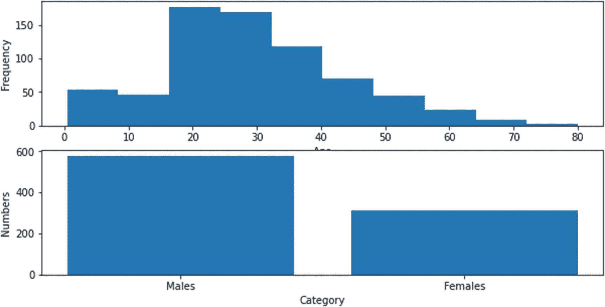

图 7-1 图形中的子图

### 使用 Pandas 绘图

Pandas 库在后台使用 Matplotlib 库进行可视化，但使用 Pandas 函数绘制图表更加直观和用户友好。Pandas 要求数据采用宽格式或聚合格式。

Pandas 中使用的 `plot` 函数（基于 Matplotlib 的 `plot` 函数）允许我们通过自定义 `kind` 参数的值来创建各种图表，该参数指定了图表的类型。这也是面向对象编程中多态性的一个例子（我们在第 2 章中学习过的 OOPS 原则之一），我们使用相同的方法来做不同的事情。`plot` 方法中的 `kind` 参数会根据你想要绘制的图表类型而变化。

让我们学习如何使用 *Iris* 数据集在 Pandas 中创建图表。

*Iris* 数据集包含来自鸢尾属植物不同物种的样本。每个样本包含五个属性：花萼长度、花萼宽度、花瓣长度、花瓣宽度和物种（*Iris setosa*、*Iris versicolor* 和 *Iris virginica*）。每个物种有 50 个样本。*Iris* 数据集内置于 `sklearn` 库中，可以按如下方式导入：

代码：

```
import pandas as pd
from sklearn.datasets import load_iris
data=load_iris()
iris=pd.DataFrame(data=data.data,columns=data.feature_names)
iris['species']=pd.Series(data['target']).map({0:'setosa',1:'versicolor',2:'virginica'})
```

#### 散点图

散点图有助于我们理解两个变量之间是否存在线性关系。要在 Pandas 中生成散点图，我们需要将值 `scatter` 与参数 `kind` 一起使用，并在 `plot` 函数的参数列表中提及要用于绘图的列（由参数 `x` 和 `y` 指定）。图 7-2 中的图表表明这两个变量（`花瓣长度` 和 `花瓣宽度`）是线性相关的。

代码：

```
iris.plot(kind='scatter',x='petal length (cm)',y='petal width (cm)')
```

输出：

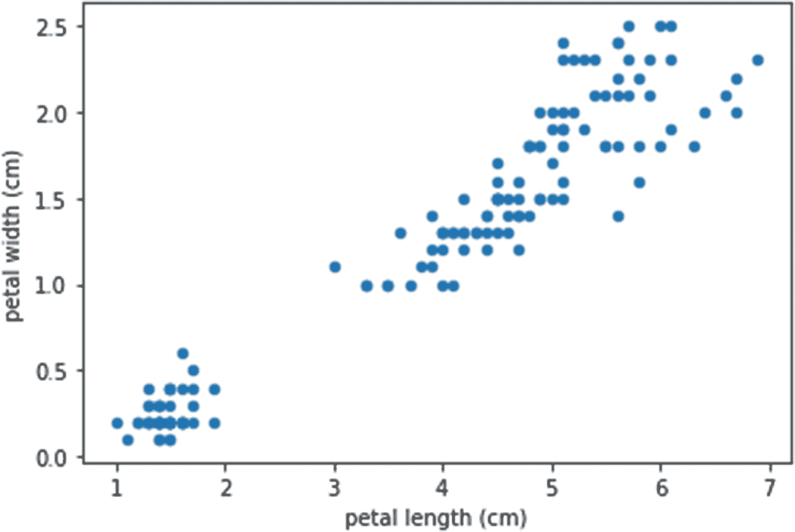

图 7-2 Pandas 中的散点图

#### 直方图

直方图用于可视化频率分布，用不同的条形表示不同区间内的频率（图 7-3）。在 `plot` 函数中，将值 `hist` 与 `kind` 参数一起使用来创建直方图。

代码：

```
iris['sepal width (cm)'].plot(kind='hist')
```

输出：

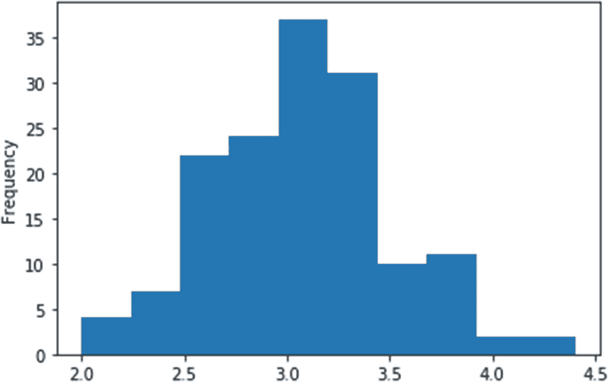

图 7-3 直方图示例

从这个直方图中可以看出，`花萼宽度` 变量近似服从正态分布。

#### 饼图

饼图将构成一个变量的不同值显示为圆中的扇形（图 7-4）。请注意，Pandas 需要使用 `value_counts` 函数来计算每个类别中的值的数量，因为在 Pandas 中绘图时不会自动执行聚合（我们稍后会看到，如果使用 Seaborn 库绘图，则会处理聚合）。我们需要将值 `pie` 与 `kind` 参数一起使用来创建饼图。

代码：

```
iris['species'].value_counts().plot(kind='pie')
```

输出：

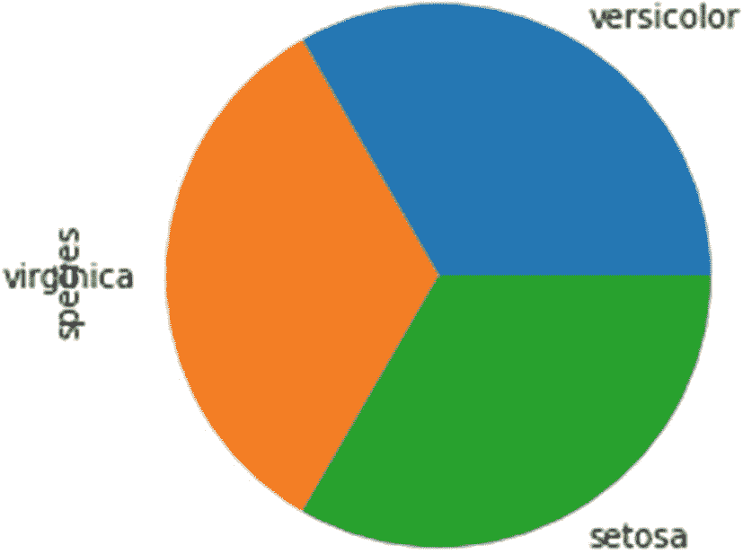

图 7-4 使用 Pandas 创建饼图

我们看到这三个物种（`virginica`、`setosa` 和 `versicolor`）构成了相等的圆扇区，也就是说，它们具有相同数量的值。

Pandas 的 `plot` 方法非常直观且易于使用。只需更改 `kind` 参数的值，我们就可以绘制各种图表。

延伸阅读：查看更多可以在 Pandas 中使用的图表类型：[`https://pandas.pydata.org/pandas-docs/stable/user_guide/visualization.html#other-plots`](https://pandas.pydata.org/pandas-docs/stable/user_guide/visualization.html%2523other-plots)

## Seaborn 库

Seaborn 是另一个基于 Python 的数据可视化库。Seaborn 更改了 Matplotlib 的默认属性，以调整调色板并自动对列执行聚合。默认设置使得编写创建各种图表所需的代码更加容易。

Seaborn 也提供了自定义这些图表的能力，但自定义选项比 Matplotlib 少。

Seaborn 支持对二维以上数据进行可视化。它还要求数据采用长（整洁）格式，这与 Pandas 需要宽格式数据的要求相反。

让我们看看如何使用 *Titanic* 数据集在 Seaborn 中绘制图表。

我们使用 Seaborn 中的函数创建不同的图表来可视化该数据集中的不同变量。

在使用 Seaborn 库的函数之前，需要先导入它。Seaborn 库的别名是 `sns`，用于调用绘图函数。

代码：

```
import seaborn as sns
titanic=pd.read_csv('titanic.csv')
```

### 箱线图

箱线图基于统计参数给出了变量的分布和偏斜程度的概念，并指示异常值（用圆圈或点表示）的存在，如图 7-5 所示。Seaborn 中的 `boxplot` 函数可用于创建箱线图。要可视化的特征的列名作为参数传递给此函数。

代码：

```
sns.boxplot(titanic['Age'])
```

输出：

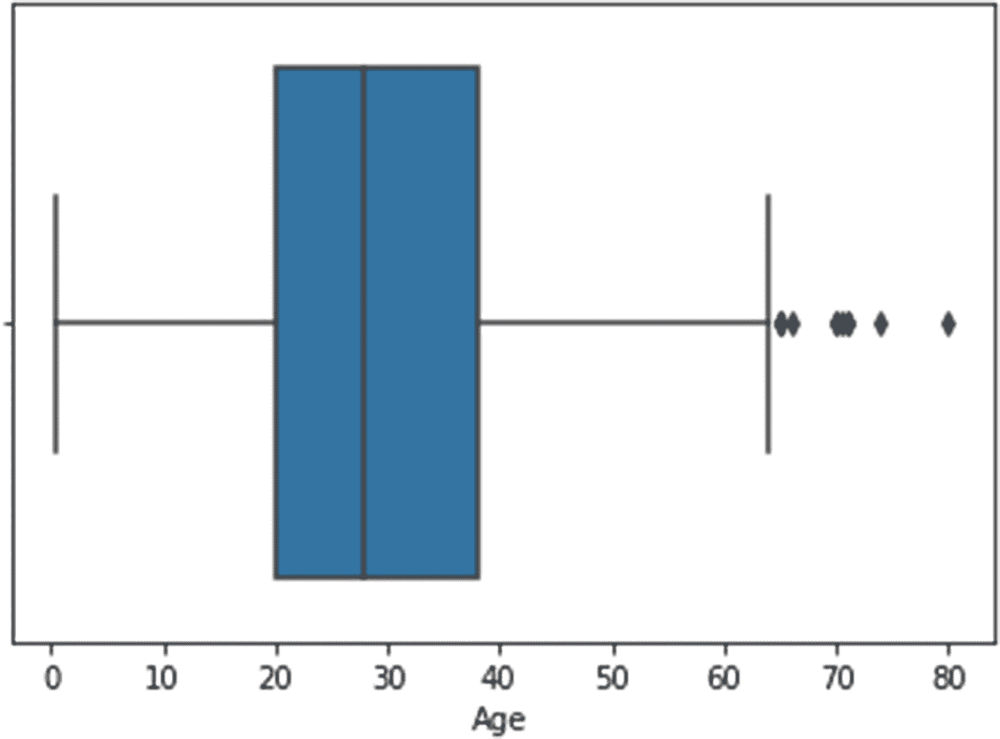

图 7-5 展示 `Age` 变量的箱线图

### 向任何 Seaborn 绘图函数添加参数

当我们向 Seaborn 中使用的任何函数传递参数时，有两种方法可以使用：

-   我们可以使用完整的列名（包括 DataFrame 的名称），跳过 `data` 参数。

代码：

```
sns.boxplot(titanic['Age'])
```

-   或者，将列名作为字符串提及，并使用 `data` 参数指定 DataFrame 的名称。

代码：

```
sns.boxplot(x='Age',data=titanic)
```

### 核密度估计

核密度估计是一种用于可视化连续变量概率分布的图，如图 7-6 所示。Seaborn 中的 `kdeplot` 函数用于绘制核密度估计图。

代码：

```
sns.kdeplot(titanic['Age'])
```

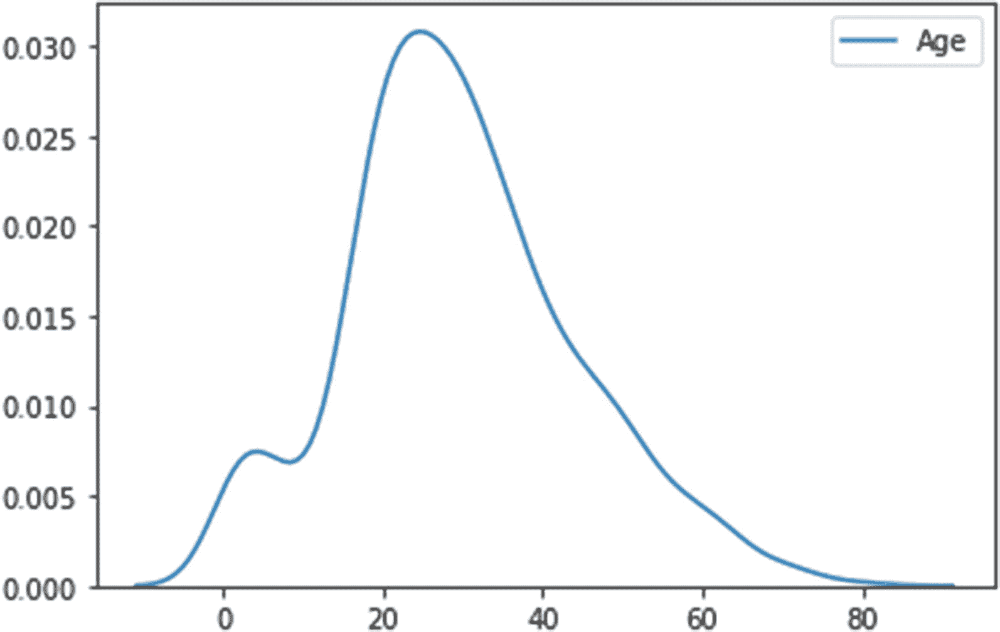

图 7-6 核密度估计（KDE）图示例


延伸阅读：[`https://seaborn.pydata.org/generated/seaborn.kdeplot.html`](https://seaborn.pydata.org/generated/seaborn.kdeplot.html)

### 小提琴图

小提琴图融合了箱线图与核密度图，其形状代表频率分布，如图 7-7 所示。我们使用 Seaborn 中的 `violinplot` 函数来生成小提琴图。

代码：

```
sns.violinplot(x='Pclass',y='Age',data=titanic)
```

输出：

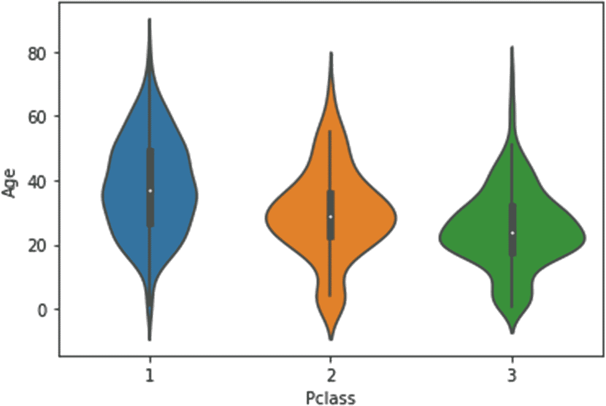

图 7-7：Seaborn 中小提琴图示例

延伸阅读：[`https://seaborn.pydata.org/generated/seaborn.violinplot.html`](https://seaborn.pydata.org/generated/seaborn.violinplot.html)

### 计数图

计数图用于绘制分类变量，条形长度代表变量每个唯一值的观测数量。在图 7-8 中，两个条形分别显示了未幸存乘客数量（对应 `Survived` 变量值为 0）和幸存乘客数量（对应 `Survived` 变量值为 1）。Seaborn 中的 `countplot` 函数可用于生成计数图。

代码：

```
sns.countplot(titanic['Survived'])
```

输出：

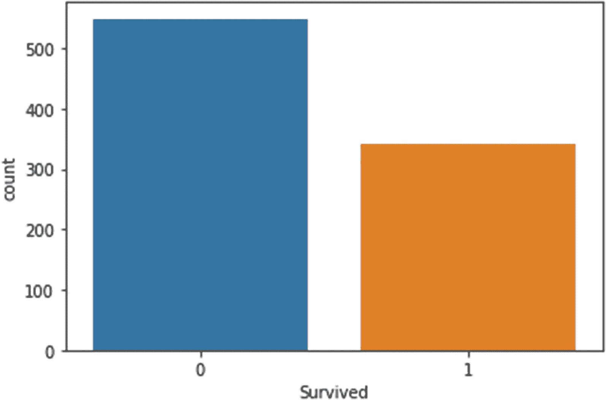

图 7-8：Seaborn 中计数图示例

延伸阅读：[`https://seaborn.pydata.org/generated/seaborn.countplot.html`](https://seaborn.pydata.org/generated/seaborn.countplot.html)

### 热力图

热力图是相关矩阵的图形化表示，展示了数据集中不同变量之间的相关性，如图 7-9 所示。颜色强度代表相关性的强弱，数值代表相关程度（数值越接近 1，表示两个变量相关性越强）。注意对角线上的数值均为 1，因为它们表示变量与自身的相关性。Seaborn 中的 `heatmap` 函数用于创建热力图。参数 `annot`（值为 `True`）用于显示代表相关程度的数值，`cmap` 参数可用于更改默认调色板。`corr` 方法会创建一个包含各变量对之间相关程度的 DataFrame。热力图的标签来自相关 DataFrame（本例中为 `titanic.corr`）的索引和列值。

代码：

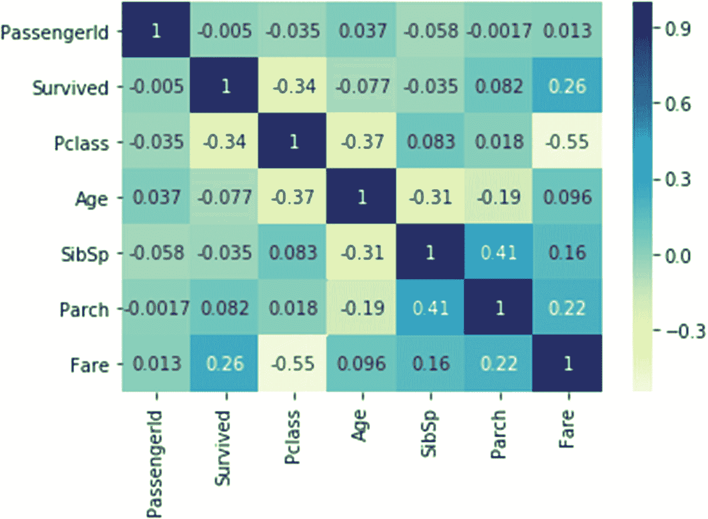

图 7-9：Seaborn 中热力图示例

```
sns.heatmap(titanic.corr(),annot=True,cmap='YlGnBu')
```

延伸阅读：
- 查看更多关于 `heatmap` 函数及其参数的信息：[`https://seaborn.pydata.org/generated/seaborn.heatmap.html`](https://seaborn.pydata.org/generated/seaborn.heatmap.html)
- 查看更多关于自定义调色板和颜色映射的信息：[`https://seaborn.pydata.org/tutorial/color_palettes.html`](https://seaborn.pydata.org/tutorial/color_palettes.html)

### 分面网格

分面网格表示单个参数的分布或参数之间的关系，这些关系分布在一个包含 `row`、`column` 或 `hue` 参数的网格中，如图 7-10 所示。第一步，我们创建一个网格对象（`row`、`col` 和 `hue` 参数为可选）；第二步，我们使用该网格对象绘制所选图形（图形名称和要绘制的变量作为参数传递给 `map` 函数）。Seaborn 中的 `FacetGrid` 函数用于绘制分面网格。

示例：

代码：


```python
g = sns.FacetGrid(titanic, col="Sex",row='Survived') #初始化网格
g.map(plt.hist,'Age')#使用网格对象绘制直方图
```

输出：

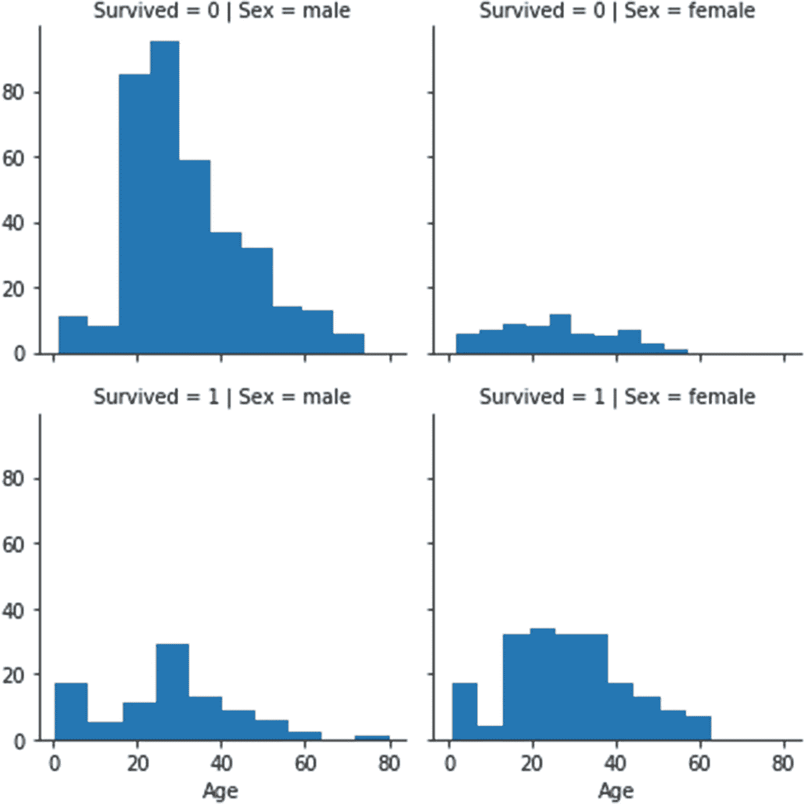

图 7-10 分面网格示例

#### Regplot
此图使用线性回归模型在两个连续变量的数据点之间绘制回归线，如图 7-11 所示。Seaborn 函数 `regplot` 用于创建此图。

代码：

```python
sns.regplot(x='Age',y='Fare',data=titanic)
```

输出：

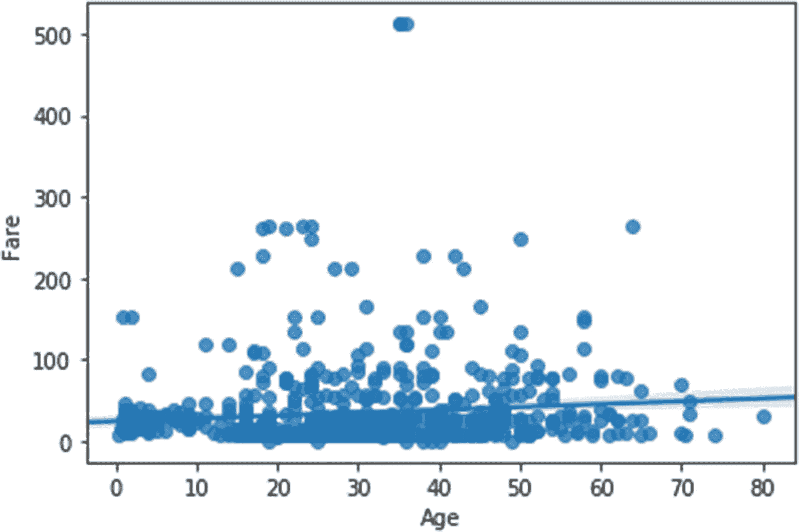

图 7-11 regplot 示例

延伸阅读：[`https://seaborn.pydata.org/generated/seaborn.regplot.html#seaborn.regplot`](https://seaborn.pydata.org/generated/seaborn.regplot.html%2523seaborn.regplot)

#### lmplot
此图是 `regplot` 和分面网格的组合，如图 7-12 所示。使用 `lmplot` 函数，我们可以观察两个连续变量在不同参数值下的关系。在以下示例中，我们绘制了两个数值变量（`Age` 和 `Fare`）在不同行和列变量构成的网格中的分布。

代码：

```python
sns.lmplot(x='Age',y='Fare',row='Survived',data=titanic,col='Sex')
```

输出：

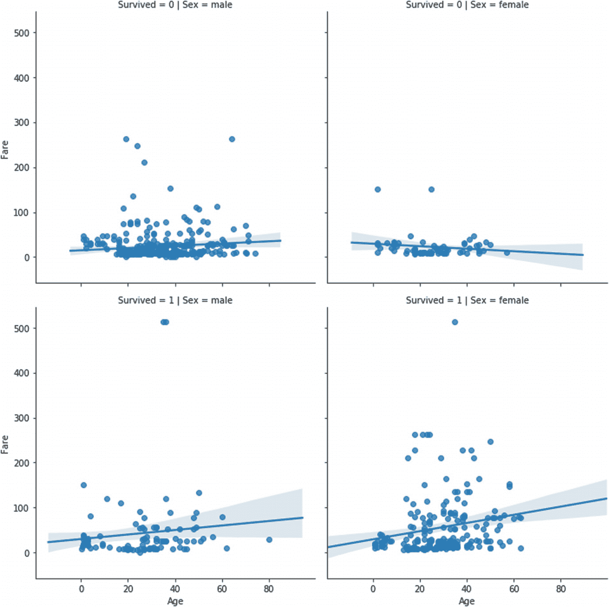

图 7-12 `lmplot` 示例

以下总结了 `regplot` 和 `lmplot` 之间的区别：

*   `regplot` 函数仅接受两个变量作为参数，而 `lmplot` 函数接受多个参数。
*   `lmplot` 函数在图形对象级别工作，而 `regplot` 函数在坐标轴对象级别工作。

关于 `lmplot` 的延伸阅读：[`https://seaborn.pydata.org/generated/seaborn.lmplot.html`](https://seaborn.pydata.org/generated/seaborn.lmplot.html)
查看更多关于 `regplot` 和 `lmplot` 区别的内容：[`https://seaborn.pydata.org/tutorial/regression.html#functions-to-draw-linear-regression-models`](https://seaborn.pydata.org/tutorial/regression.html%2523functions-to-draw-linear-regression-models)

#### 带状图
带状图类似于散点图。区别在于带状图中使用的变量类型。散点图的两个变量都是连续的，而带状图将一个分类变量与一个连续变量进行绘制，如图 7-13 所示。Seaborn 函数 `stripplot` 生成带状图。考虑以下示例，其中 `Age` 变量是连续的，而 `Survived` 变量是分类的。

代码：

```python
sns.stripplot(x='Survived',y='Age',data=titanic)
```

输出：

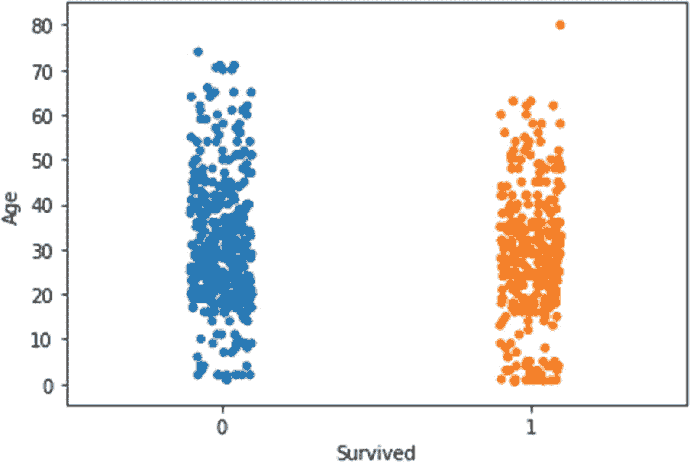

图 7-13 带状图示例

延伸阅读：[`https://seaborn.pydata.org/generated/seaborn.stripplot.html`](https://seaborn.pydata.org/generated/seaborn.stripplot.html)

#### 蜂群图
蜂群图类似于带状图，区别在于蜂群图中的点不像带状图中的点那样重叠。由于点分布更分散，我们可以更好地了解连续变量的分布，如图 7-14 所示。Seaborn 函数 `swarmplot` 生成蜂群图。

代码：

```python
sns.swarmplot(x='Survived',y='Age',data=titanic)
```

输出：

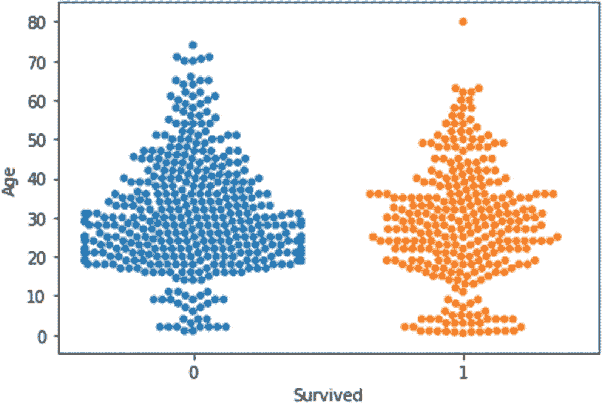

图 7-14 蜂群图示例

延伸阅读：[`https://seaborn.pydata.org/generated/seaborn.swarmplot.html#seaborn.swarmplot`](https://seaborn.pydata.org/generated/seaborn.swarmplot.html%2523seaborn.swarmplot)

#### Catplot
Catplot 是带状图和分面网格的组合。我们可以通过指定 `row`、`col` 或 `hue` 参数，将一个连续变量与多个分类变量进行绘制，如图 7-15 所示。请注意，虽然带状图是 `catplot` 函数生成的默认图，但它也可以生成其他类型的图。可以使用 `kind` 参数更改图的类型。

代码：

```python
sns.catplot(x='Survived',y='Age',col='Survived',row='Sex',data=titanic)
```

输出：

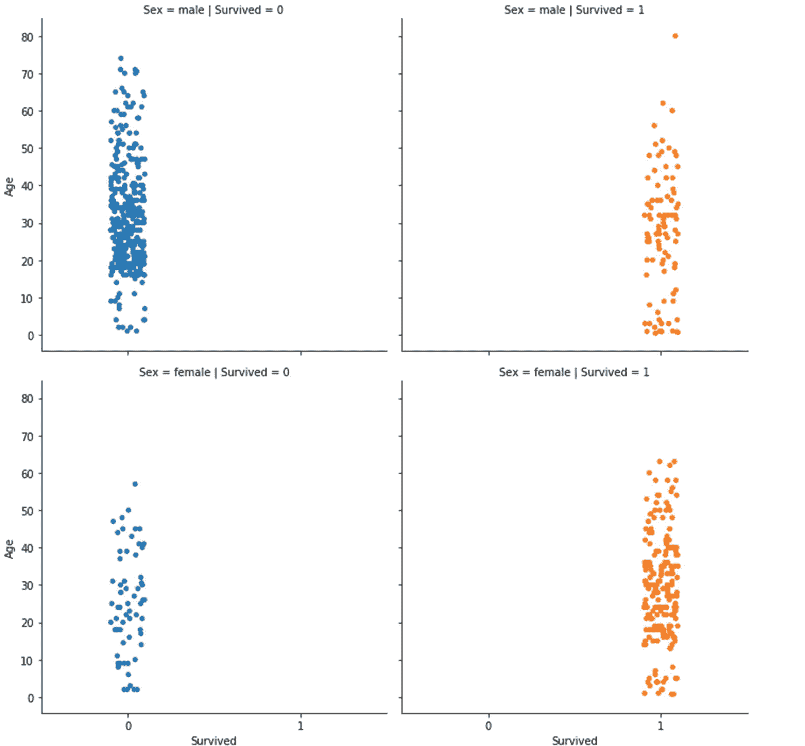

图 7-15 Seaborn 中 catplot 的示例

延伸阅读：[`https://seaborn.pydata.org/generated/seaborn.catplot.html`](https://seaborn.pydata.org/generated/seaborn.catplot.html)

#### 配对图
配对图显示数据集中所有可能变量对之间的双变量关系，如图 7-16 所示。Seaborn 函数 `pairplot` 创建配对图。请注意，您无需提供任何列名作为参数，因为数据集中的所有变量都会自动被考虑用于绘图。您需要传递的唯一参数是 DataFrame 的名称。在配对图输出中显示的一些图中，任何给定的变量也会与自身进行绘制。配对图对角线上的图显示了这些图。

代码：

```python
sns.pairplot(data=titanic)
```

输出：

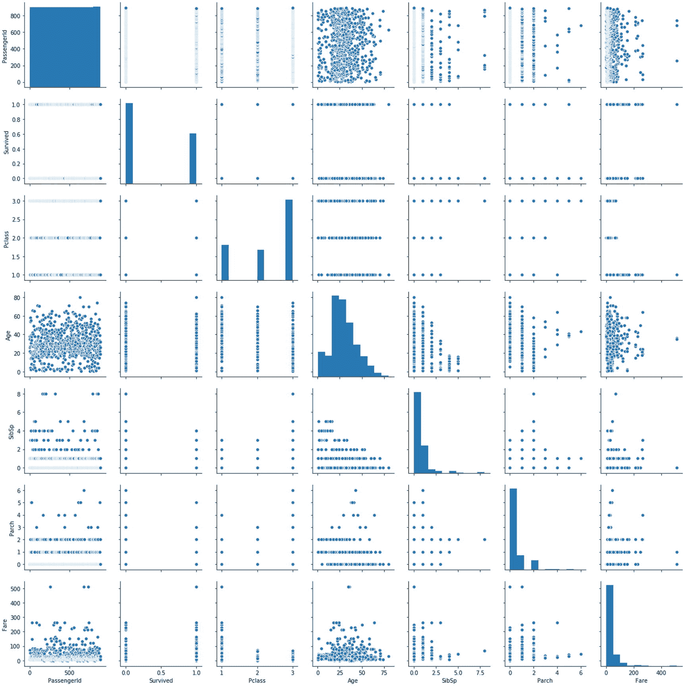

图 7-16 Seaborn 中配对图的示例

#### 联合图
联合图显示两个变量之间的关系以及每个变量的单独分布，如图 7-17 所示。`jointplot` 函数将要绘制的两个变量的名称作为参数。

代码：

```python
sns.jointplot(x='Fare',y='Age',data=titanic)
```

输出：

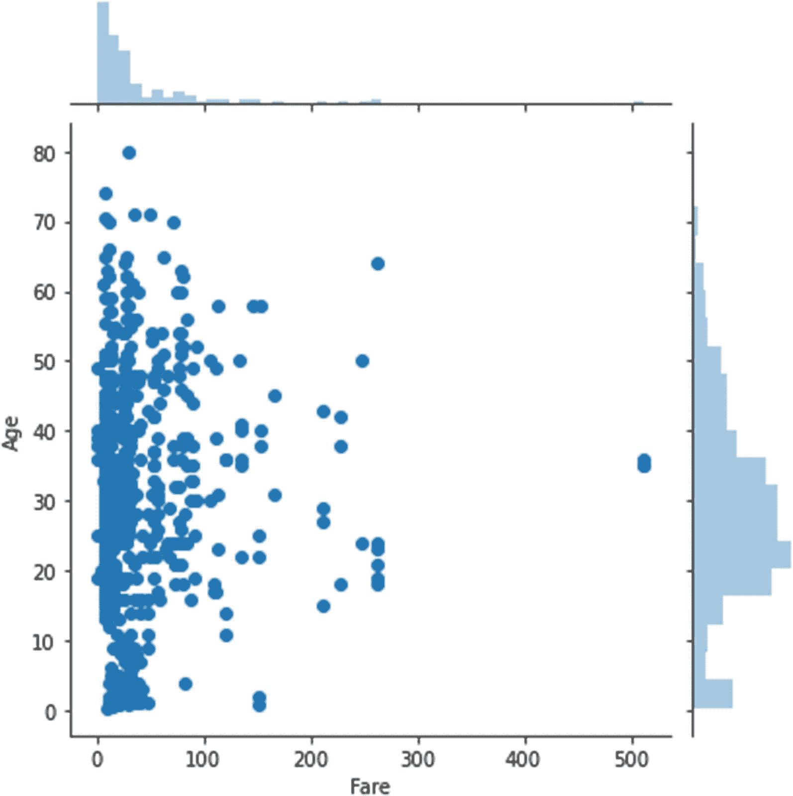

图 7-17 Seaborn 中联合图的示例

关于 `jointplot` 的延伸阅读：[`https://seaborn.pydata.org/generated/seaborn.jointplot.html#seaborn.jointplot`](https://seaborn.pydata.org/generated/seaborn.jointplot.html%2523seaborn.jointplot)
关于 Seaborn 库的延伸阅读：
可在 Seaborn 中创建的各种图形示例：[`https://seaborn.pydata.org/examples/index.html`](https://seaborn.pydata.org/examples/index.html)
Seaborn 入门及已解决的示例：[`https://seaborn.pydata.org/introduction.html`](https://seaborn.pydata.org/introduction.html)

## 总结

1.  有三种基于 Python 的库可用于 Python 中的可视化——Matplotlib（基于 Matlab）、Pandas 和 Seaborn。
2.  在绘制图形之前，我们需要确定需要绘制的变量类型以及需要绘制的变量数量。对于分类变量，使用条形图和饼图；对于连续变量，使用直方图和散点图。
3.  Matplotlib 有两个用于绘图的接口——有状态接口和面向对象接口。有状态接口使用 `pyplot` 类，并跟踪该类对象的当前状态。面向对象接口使用对象的层次结构来表示图的各种元素，并使用这些对象进行绘图。
4.  Pandas 中用于绘图的 `plot` 函数，在后台使用 Matplotlib。该函数只需更改传递给它的参数，即可轻松绘制任何类型的图形，从而利用了多态性（一名多形）的原则。


## Seaborn 与可视化复习

`Seaborn` 是另一个在后台使用 `Matplotlib` 的库。通过更改其默认参数，它最大限度地减少了执行聚合、标签和图形元素颜色编码的需求。它还提供了可视化两个以上变量的能力。

在下一章中，我们将研究一些真实世界的案例研究，将我们学到的关于可视化和数据整理的知识付诸实践。

## 复习练习

### 问题 1

当你有以下变量时，你会使用哪种图表？

- 一个分类变量
- 一个连续变量
- 两个连续变量
- 三个或更多连续变量
- 一个连续变量和一个分类变量
- 两个连续变量和两个或更多分类变量

### 问题 2

将左侧的函数与右侧正确的描述匹配起来

1. `FacetGrid` | a. 显示所有可能的变量对之间关系以及单个变量分布的图表
2. `Catplot` | b. 在分类参数网格上绘制连续变量的图表
3. `Swarmplot` | c. 绘制一个连续变量和一个分类变量，且点不重叠的图表
4. `Pairplot` | d. 结合箱线图和核密度估计的图表
5. `Violinplot` | e. 分面网格和带状图的组合

### 问题 3

关于使用 `Pandas` 库执行的可视化，以下哪项是正确的？

1. 绘制图表时会自动执行聚合
2. `Pandas` 需要长格式的数据
3. 使用 `plot` 方法绘制图表
4. 使用 `type` 参数指定图表类型
5. 使用 `kind` 参数指定图表类型

### 问题 4

用于在行内显示 `Matplotlib` 和 `Pandas` 图表的魔法命令是

1. `%matplotlib`
2. `%inline`
3. `%matplotlib inline`
4. 以上都不是

#### 问题 5

坐标轴对象指的是

1. x 轴
2. y 轴
3. x 轴和 y 轴
4. 包含图形的子图

#### 问题 6

对于给定的 `DataFrame`，`df`，我们如何指定 `heatmap` 函数中使用的以下参数？

1. 相关矩阵
2. 用于为热图中的方块着色的颜色映射
3. 每个参数之间相关程度的数值

#### 问题 7

`Sklearn` 库有一个内置数据集 `Iris`。它包含来自鸢尾属植物不同物种的样本。每个样本包含四个属性：花萼长度、花萼宽度、花瓣长度、花瓣宽度和物种（`Iris setosa`、`Iris versicolor` 和 `Iris virginica`），每个物种有 50 个样本。

- 将此数据集中的数据读入一个 `DataFrame`。
- 创建一个包含两个子图的 10*5 图形。
- 在第一个子图中，绘制花瓣长度与花瓣宽度的关系图。
- 在第二个子图中，绘制花萼长度与花萼宽度的关系图。
- 对于每个图表，标记 x 轴和 y 轴并设置标题。

#### 问题 8

使用 `Seaborn` 中的 `load_dataset` 函数从 `tips` 数据集（内置于 `Seaborn`）加载数据。该数据集包含访问餐厅的不同顾客的总账单金额和小费金额。顾客根据他们的性别、吸烟偏好以及访问的日期和时间进行分类。

- 创建一个图表，显示吸烟者和非吸烟者总账单的分布（带状图），跨越包含时间和性别列不同值的网格。
- 创建一个图表，显示 `tip` 和 `total_bill` 列之间的关系，针对：男性和吸烟者、男性和非吸烟者、女性和吸烟者、女性和非吸烟者。

## 答案

### 问题 1

- 一个分类变量：计数图
- 一个连续变量：直方图、核密度估计
- 两个连续变量：散点图、线图
- 三个或更多连续变量：热图
- 一个连续变量和一个分类变量：带状图、蜂群图、条形图
- 两个连续变量和两个或更多分类变量：`catplot`、`FacetGrid`、`lmplot`

### 问题 2

1-b; 2-e; 3-c; 4-a; 5-d

### 问题 3

选项 3 和 5

`Pandas` 使用带有 `kind` 参数的 `plot` 方法来创建各种图表。`Pandas` 要求数据采用宽格式或聚合形式。与 `Seaborn` 不同，默认情况下不会进行聚合。在应用 `plot` 方法之前，需要使用 `value_counts` 方法进行聚合。

### 问题 4

选项 3

我们使用魔法命令 (`%matplotlib inline`) 在 `Matplotlib` 和 `Pandas` 中行内显示图表。

#### 问题 5

选项 4

术语“axes”用词不当，并非指 x 轴或 y 轴。它指的是子图或绘图区域，该区域是图形对象的一部分。一个图形可以包含多个子图。

#### 问题 6

- 相关矩阵：`df.corr()`（生成一个表示相关矩阵的 `DataFrame`）
- 用于为热图中的方块着色的颜色映射：`cmap` 参数
- 表示相关程度的数值：`annot` 参数（`annot=True`）

#### 问题 7

```python
import matplotlib.pyplot as plt
from sklearn.datasets import load_iris
import pandas as pd
#importing the iris dataset
data=load_iris()
iris=pd.DataFrame(data=data.data,columns=data.feature_names)
iris['species']=data.target
iris['species']=iris['species'].map({0:'setosa',1:'versicolor',2:'virginica'})
iris['species'].value_counts().plot(kind='bar')
fig=plt.figure(figsize=(10,5))
ax1=fig.add_subplot(121) #defining the first subplot
#plotting petal length vs petal width in the first subplot
iris.plot(kind='scatter',x='petal length (cm)',y='petal width (cm)',ax=ax1)
#adding the title for the first subplot
ax1.set_title("Petal length vs width")
#adding the label for the X axis
ax1.set_xlabel("Petal length")
#adding the label for the Y axis
ax1.set_ylabel("Petal width")
ax2=fig.add_subplot(122) #defining the second subplot
#plotting sepal length vs sepal width in the second subplot
iris.plot(kind='scatter',x='sepal length (cm)',y='sepal width (cm)',ax=ax2)
ax2.set_xlabel("Sepal length")
ax2.set_ylabel("Sepal width")
ax2.set_title("Sepal length vs width")
#Increasing the distance width between the subplots
fig.subplots_adjust(wspace=1)
```

#### 问题 8

```python
import seaborn as sns
#loading the data into a DataFrame using the load_dataset function
tips = sns.load_dataset("tips")
#creating a catplot for showing the distribution of the total bill for different combinations of parameters
sns.catplot(x='smoker',y='total_bill',row='time',col='sex',data=tips)
#defining the FacetGrid object and setting the row and column values
g=sns.FacetGrid(tips,row='sex',col='smoker')
#specifying the plot and the columns we want to display
g.map(plt.scatter,'tip','total_bill')
```

