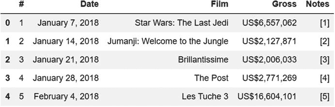

# 8. 数据分析案例研究

在上一章中，我们了解了各种基于 Python 的可视化库，以及如何使用这些库中的函数绘制不同的图表。现在，我们旨在通过案例研究来理解我们目前所讨论概念的实际应用。我们将研究以下三个数据集：

- 非结构化数据分析：使用来自一个提供 2018 年法国票房前 50 名电影信息的网页数据
- 空气质量分析：来自印度新德里一个空气质量监测站的数据，提供四种污染物的每日水平——二氧化硫 (SO₂)、以二氧化氮计的氮氧化物 (NO₂)、臭氧和细颗粒物 (PM₂.₅)
- COVID-19 趋势分析：数据集记录了 2020 年前六个月全球各国每日的病例数和死亡数


## 技术要求

### 外部文件

针对第一个案例研究，你需要参考以下维基百科 URL（数据直接取自网页）：[`https://en.wikipedia.org/wiki/List_of_2018_box_office_number-one_films_in_France`](https://en.wikipedia.org/wiki/List_of_2018_box_office_number-one_films_in_France)

针对第二个案例研究，请从以下链接下载一个 CSV 文件：[`https://github.com/DataRepo2019/Data-files/blob/master/NSIT%20Dwarka.csv`](https://github.com/DataRepo2019/Data-files/blob/master/NSIT%2520Dwarka.csv)

针对第三个案例研究，请从以下链接下载一个 Excel 文件：[`https://github.com/DataRepo2019/Data-files/blob/master/COVID-19-geographic-disbtribution-worldwide-2020-06-29.xlsx`](https://github.com/DataRepo2019/Data-files/blob/master/COVID-19-geographic-disbtribution-worldwide-2020-06-29.xlsx)

### 库

除了我们在前几章中使用的模块和库（包括 Pandas、NumPy、Matplotlib 和 Seaborn）之外，本章我们还将使用 `requests` 模块向网站发送 HTTP 请求。

要使用此模块中包含的函数，请在 Jupyter notebook 中使用以下代码行导入该模块：

```
import requests
```

如果 `requests` 模块尚未安装，你可以在 Anaconda Prompt 中使用以下命令进行安装：

```
pip install requests
```

## 方法论

我们将对每个案例研究采用以下方法论：

1.  打开一个新的 Jupyter notebook，并执行以下步骤：
    *   导入分析所需的库和数据
    *   读取数据集并检查前五行（使用 `head` 方法）
    *   获取每列的数据类型信息以及每列中非空值的数量（使用 `info` 方法）和数据集的维度（使用 `shape` 属性）
    *   获取每列的汇总统计信息（使用 `describe` 方法），并获取计数、最小值、最大值、标准差和百分位数的值

2.  数据整理
    *   检查列的数据类型是否被正确识别（使用 `info` 或 `dtype` 方法）。如果没有，则使用 `astype` 方法更改数据类型
    *   如有必要，使用 `rename` 方法重命名列
    *   使用 `drop` 方法删除任何不必要或冗余的列或行
    *   如有需要，通过使用 `melt` 或 `stack` 方法重构数据，使其整洁
    *   使用 `replace` 方法删除任何没有价值的无关数据（空白值、特殊字符等）
    *   使用 `isna` 方法检查是否存在空值，并使用 `dropna` 或 `fillna` 方法删除或填充空值
    *   如果某列能为你的分析增加价值，则添加该列
    *   如果数据是未聚合的格式，则使用 `groupby` 方法对数据进行聚合

3.  使用单变量、双变量和多变量图表对数据进行可视化

4.  基于你的分析，总结你的见解，包括观察结果和建议

## 案例研究 8-1：法国票房最高电影——分析非结构化数据

在本案例研究中，数据是从一个 HTML 页面读取的，而不是传统的 CSV 文件。我们将要使用的 URL 如下：[`https://en.wikipedia.org/wiki/List_of_2018_box_office_number-one_films_in_France`](https://en.wikipedia.org/wiki/List_of_2018_box_office_number-one_films_in_France)

该网页有一个表格，显示了 2018 年法国票房收入前 50 名的电影数据。我们使用 Requests 库中的方法将这些数据导入 Pandas。Requests 是一个用于发起 HTTP 请求的 Python 库。它有助于从网页中提取 HTML 并与 API 进行交互。

我们希望通过分析回答的问题：

1.  找出票房收入排名前五的电影
2.  前十部电影各自的收入占比（百分比）是多少？
3.  在这一年中，月平均收入是如何变化的？

### 步骤 1：导入数据并检查数据集的特征

首先，导入库并使用必要的函数来检索数据。

代码：

```
#导入库
import requests
import pandas as pd
import seaborn as sns
import matplotlib.pyplot as plt
#将网页中的数据导入 DataFrame
url='https://en.wikipedia.org/wiki/List_of_2018_box_office_number-one_films_in_France'
req=requests.get(url)
data=pd.read_html(req.text)
df=data[0]
```

我们导入所有库，并将 URL 存储在一个变量中。然后，我们使用 `get` 方法向该 URL 发起一个 HTTP 请求，以从该网页检索信息。requests 对象的 `text` 属性包含 HTML 数据，该数据被传递给 `pd.read_html` 函数。该函数返回一个 DataFrame 对象列表，其中包含网页上的各个表格。由于网页上只有一个表格，因此 DataFrame（`df`）只包含一个表格。

检查前几条记录：

代码：

```
df.head()
```

输出：


获取数据类型和缺失值：

代码：

```
df.info()
```

输出：

```
RangeIndex: 50 entries, 0 to 49
Data columns (total 5 columns):
```


