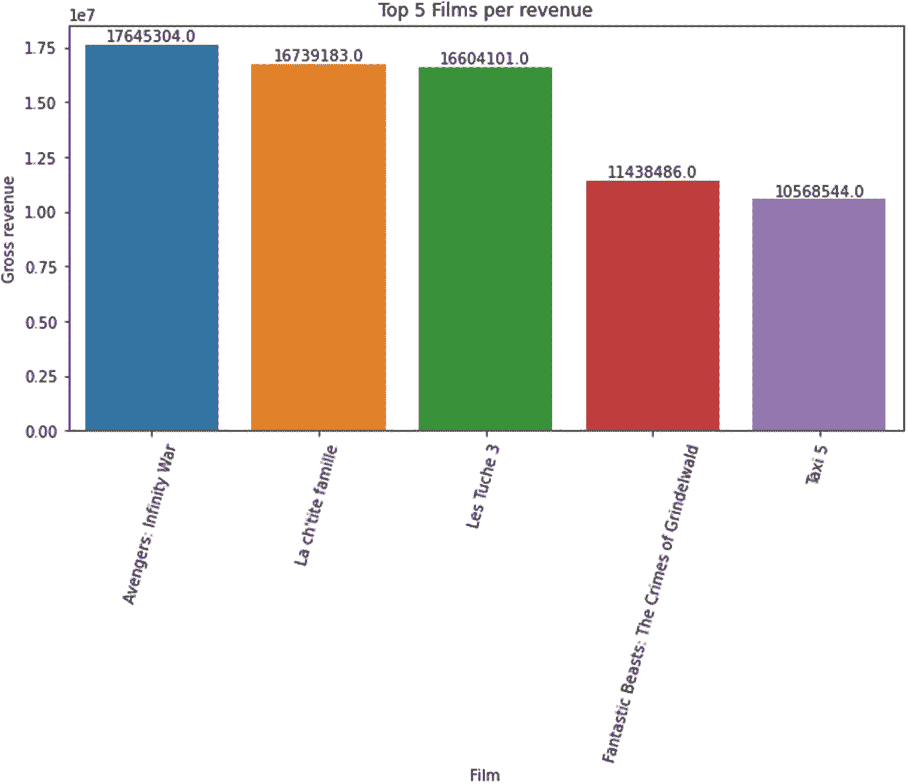
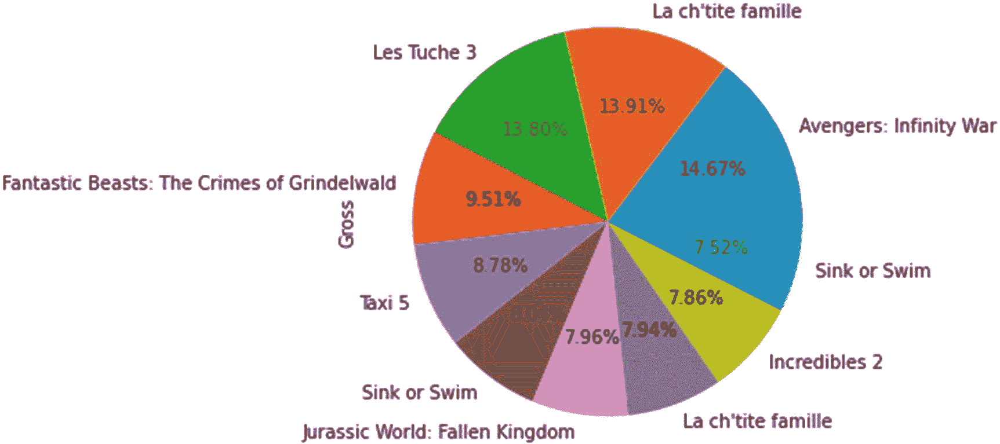
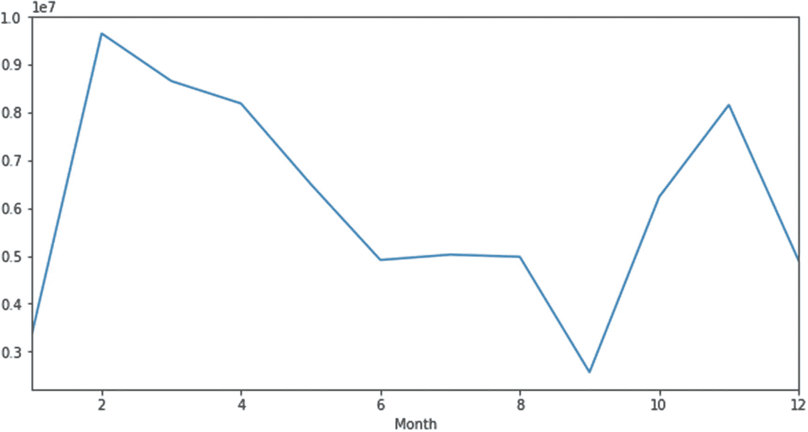
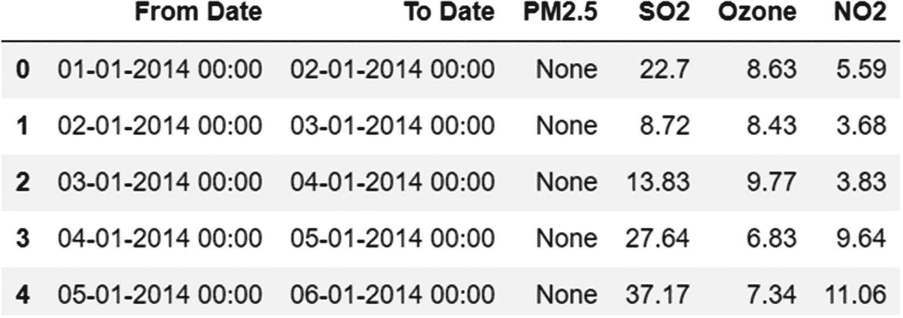
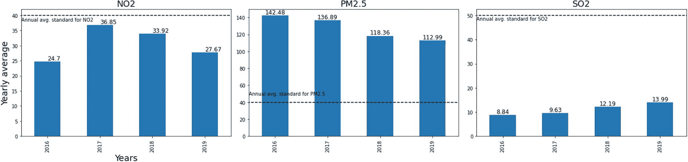
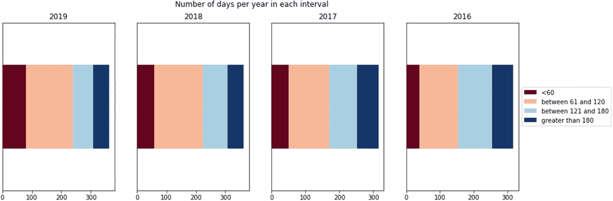

# 50 个非空 int64 类型
`Date` 50 个非空 object 类型
`Film` 50 个非空 object 类型
`Gross` 50 个非空 object 类型
`Notes` 50 个非空 object 类型
`dtypes`: int64(1), object(4)
`memory usage`: 2.0+ KB

如我们所见，各列的数据类型并非我们所需的格式。`Gross` 列代表总收入，本应是数值列。然而，由于该列包含数值和非数值数据（如 `,`、`$` 符号以及字母 `U` 和 `S` 等字符），它被分配了 object 数据类型。在下一步中，我们将处理此类问题。

### 第 2 步：数据整理

在这一步中，我们将：

1.  移除不必要的字符
2.  更改数据类型
3.  移除不需要的列
4.  从现有列创建新列

让我们从 `Gross` 列中移除不需要的字符串，仅保留数值：

```
# 从 Gross 列中移除不必要的字符
df['Gross']=df['Gross'].str.replace(r"US\$","").str.replace(r",","")
```

在上述语句中，我们使用了一系列链式替换方法和正则表达式原理来替换非数字字符。第一个替换方法移除 `US$`，第二个替换方法移除逗号。将字符替换为空字符串（`""`）等同于移除该字符。

现在，让我们使用 `astype` 方法进行类型转换，将该列的数据类型更改为 `int64`，以便该列可用于计算和可视化：

```
# 更改 Gross 列的数据类型，使其成为数值列
df['Gross']=df['Gross'].astype('int64')
```

为了检查这些更改是否已生效，我们查看该列的前几条记录并验证数据类型：

```
df['Gross'].head(5)
```

输出：

```
0     6557062
1     2127871
2     2006033
3     2771269
4    16604101
Name: Gross, dtype: int64
```

从输出中可以看出，该列的数据类型已更改，并且值不再包含字符串。

我们还需要提取日期的月份部分，我们将首先更改 `Date` 列的数据类型，然后对其应用 `DatetimeIndex` 方法，如下所示。

```
# 更改 Date 列的数据类型以提取其组成部分
df['Date']=df['Date'].astype('datetime64')
# 为月份创建一个新列
df['Month']=pd.DatetimeIndex(df['Date']).month
```

最后，我们使用以下语句从 DataFrame 中移除两个不必要的列。

```
# 删除不必要的列
df.drop(['#','Notes'],axis=1,inplace=True)
```

### 第 3 步：可视化

为了可视化我们的数据，首先我们创建另一个 DataFrame（`df1`），它包含原始 DataFrame（`df`）中列的子集。这个 DataFrame `df1` 只包含两列——`Film`（电影名称）和 `Gross`（总收入）。然后，我们按收入降序对值进行排序。如下所示。

```
df1=df[['Film','Gross']].sort_values(ascending=False,by='Gross')
```

有一个不需要的列（`index`）被添加到了这个 DataFrame 中，我们将在下一步中将其移除。

```
df1.drop(['index'],axis=1,inplace=True)
```

#### 收入最高的五部电影

我们创建的第一个图表是柱状图，显示收入最高的五部电影：（图 8-1）。

```
# 绘制收入最高的 5 部电影
# 设置图形大小
plt.figure(figsize=(10,5))
# 创建柱状图
ax=sns.barplot(x='Film',y='Gross',data=df1.head(5))
# 旋转 x 轴标签
ax.set_xticklabels(labels=df1.head()['Film'],rotation=75)
# 设置标题
ax.set_title("Top 5 Films per revenue")
# 设置 Y 轴标签
ax.set_ylabel("Gross revenue")
# 在柱状图上标注数值
for p in ax.patches:
    ax.annotate(p.get_height(),(p.get_x()+p.get_width()/2,p.get_height()),ha='center',va='bottom')
```

输出：



**图 8-1** 饼图显示收入最高的五部电影各自的百分比份额

为了展示收入最高的十部电影（按收入计）的份额，我们创建了一个饼图（图 8-2）。

```
# 饼图显示收入最高的 10 部电影各自在总收入中的百分比份额
df1['Gross'].head(10).plot(kind='pie',autopct='%.2f%%',labels=df1['Film'],figsize=(10,5))
```

输出：



**图 8-2** 饼图描绘收入最高的十部电影的收入份额

我们首先创建另一个 DataFrame，通过计算每个月的平均值来聚合月度数据（图 8-3）。

```
# 按月聚合收入
df2=df.groupby('Month')['Gross'].mean()
# 创建折线图
df2.plot(kind='line',figsize=(10,5))
```

输出：



**图 8-3** 2018 年（法国）月均票房收入

### 第 4 步：基于分析和可视化得出结论

1.  月均收入波动较大，可能取决于电影的上映月份，这可能需要跨年份进行进一步分析。
2.  2018 年法国收入最高的三部电影是*《复仇者联盟》*、*《La Ch’tite Famille》*和*《Les Tuche 3》*。

## 案例研究 8-2：数据分析在空气质量管理的应用

为了监测环境空气质量状况，印度中央污染控制委员会（CPCB）运营着一个遍布全国的大型监测站网络。定期监测的参数包括二氧化硫（SO[2]）、以二氧化氮（NO[2]）计的氮氧化物、臭氧和细颗粒物（PM[2.5]）。根据多年趋势，国家首都德里的空气质量已成为公众关注的问题。以下是对每日空气质量数据的分步分析，以展示数据分析如何协助规划作为空气质量管理一部分的干预措施。

注意：本案例研究使用的数据集名称为：`NSIT Dwarka.csv`。有关如何导入此数据集的详细信息，请参阅技术说明部分。

### 我们希望通过分析回答的问题：

1.  年度平均值：在 SO[2]、NO[2]、臭氧和 PM[2.5] 这四种污染物中，哪些污染物的年平均水平经常超过规定的年度标准？
2.  每日标准：对于关注的污染物，每年有多少天超过了每日标准？
3.  时间变化：哪些月份中，大多数日期的污染水平超过了临界水平？

### 第 1 步：导入数据并检查数据集特征

```
import pandas as pd
import numpy as np
import seaborn as sns
import matplotlib.pyplot as plt
# aqdata 是 DataFrame 的名称，是 Air Quality Data 的缩写。
aqdata=pd.read_csv('NSIT Dwarka.csv')
aqdata.head()
```

输出：



### 检查各列的数据类型：

```
aqdata.info()
```

输出：

```
RangeIndex: 2192 entries, 0 to 2191
Data columns (total 6 columns):
From Date    2191 non-null object
To Date      2191 non-null object
PM2.5        2191 non-null object
SO2          2187 non-null object
Ozone        2187 non-null object
NO2          2190 non-null object
dtypes: object(6)
memory usage: 102.8+ KB
```


观察：尽管 `SO[2]`、`NO[2]`、臭氧和 `PM[2.5]` 的数值是数字类型，但 Pandas 将这些列的数据类型读取为 `"*object"`。为了处理这些列（例如绘制图表、观察趋势、计算聚合值），我们需要更改这些列的数据类型。此外，数据中似乎还存在一些缺失条目。

### 第 2 步：数据整理

基于上一步的观察结果，在本步骤中，我们将：

1.  处理缺失值：我们可以选择删除空值或替换空值。
2.  更改各列的数据类型。

#### 检查数据集中的缺失值：

代码：

```
aqdata.isna().sum()
```

输出：

```
From Date    1
To Date      1
PM2.5        1
SO2          5
Ozone        5
NO2          2
dtype: int64
```

看起来缺失值并不多，但问题就在这里。当我们使用 `head` 语句检查前几行时，发现原始数据集中有些缺失值表示为 `None`。然而，Pandas 并未将这些值识别为空值。让我们将值 `None` 替换为 `np.nan`，以便 Pandas 将这些值识别为空值：

代码：

```
aqdata=aqdata.replace({'None':np.nan})
```

现在，如果我们计算空值的数量，会看到一个截然不同的情况，表明数据集中存在更多的缺失值。

代码：

```
aqdata.isna().sum()
```

输出：

```
From Date      1
To Date        1
PM2.5        562
SO2           84
Ozone        106
NO2          105
dtype: int64
```

让我们检查一下各列当前的数据类型：

代码：

```
aqdata.info()
```

输出：

```
RangeIndex: 2192 entries, 0 to 2191
Data columns (total 6 columns):
From Date    2191 non-null object
To Date      2191 non-null object
PM2.5        1630 non-null object
SO2          2108 non-null object
Ozone        2086 non-null object
NO2          2087 non-null object
dtypes: object(6)
memory usage: 102.8+ KB
```

我们看到，包含数值的列未被识别为数值列，包含日期的列也未正确识别。列的数据类型不正确会阻碍下一步的分析趋势和绘制图表的工作；这一步要求列的数据类型采用适合 Pandas 读取的格式。在下面的代码中，我们使用 `pd.to_datetime` 方法将 `"From Date"` 和 `"To Date"` 列的数据类型转换为 `datetime` 类型，这样可以更轻松地分析日期的各个组成部分，例如月份和年份。

代码：

```
aqdata['From Date']=pd.to_datetime(aqdata['From Date'], format='%d-%m-%Y %H:%M')
aqdata['To Date']=pd.to_datetime(aqdata['To Date'], format='%d-%m-%Y %H:%M')
aqdata['SO2']=pd.to_numeric(aqdata['SO2'],errors='coerce')
aqdata['NO2']=pd.to_numeric(aqdata['NO2'],errors='coerce')
aqdata['Ozone']=pd.to_numeric(aqdata['Ozone'],errors='coerce')
aqdata['PM2.5']=pd.to_numeric(aqdata['PM2.5'],errors='coerce')
```

使用 `info` 方法检查数据类型是否已更改。

代码：

```
aqdata.info()
```

输出：

```
RangeIndex: 2192 entries, 0 to 2191
Data columns (total 6 columns):
From Date    2191 non-null datetime64[ns]
To Date      2191 non-null datetime64[ns]
PM2.5        1630 non-null float64
SO2          2108 non-null float64
Ozone        2086 non-null float64
NO2          2087 non-null float64
dtypes: datetime64ns, float64(4)
memory usage: 102.8 KB
```

由于我们的大部分分析都基于年度数据，因此我们使用 `pd.DatetimeIndex` 函数创建一个新列来提取年份。

代码：

```
aqdata['Year'] = pd.DatetimeIndex(aqdata['From Date']).year
```

现在，我们为每年创建单独的 DataFrame 对象，以便按年分析数据。

代码：

```
#提取每年的数据
aq2014=aqdata[aqdata['Year']==2014]
aq2015=aqdata[aqdata['Year']==2015]
aq2016=aqdata[aqdata['Year']==2016]
aq2017=aqdata[aqdata['Year']==2017]
aq2018=aqdata[aqdata['Year']==2018]
aq2019=aqdata[aqdata['Year']==2019]
```

现在，让我们查看每年数据中的空值数量：

代码：

```
#检查 2014 年的缺失值
aq2014.isna().sum()
```

输出：

```
From Date      0
To Date        0
PM2.5        365
SO2            8
Ozone          8
NO2            8
Year           0
dtype: int64
#检查 2015 年的缺失值
aq2015.isna().sum()
```

输出：

```
From Date      0
To Date        0
PM2.5        117
SO2           12
Ozone         29
NO2           37
Year           0
dtype: int64
```

代码：

```
#检查 2016 年的缺失值
aq2016.isna().sum()
```

输出：

```
From Date     0
To Date       0
PM2.5        43
SO2          43
Ozone        47
NO2          42
Year          0
dtype: int64
#检查 2017 年的缺失值
aq2017.isna().sum()
```

输出：

```
From Date     0
To Date       0
PM2.5        34
SO2          17
Ozone        17
NO2          12
Year          0
dtype: int64
```

代码：

```
#检查 2018 年的缺失值
aq2018.isna().sum()
```

输出：

```
From Date    0
To Date      0
PM2.5        2
SO2          2
Ozone        2
NO2          2
Year         0
dtype: int64
```

代码：

```
#检查 2019 年的缺失值
aq2019.isna().sum()
```

输出：

```
From Date    0
To Date      0
PM2.5        0
SO2          1
Ozone        2
NO2          3
Year         0
dtype: int64
```

从每年空值的分析中，我们看到 2014 年和 2015 年的数据包含大部分缺失值。因此，我们选择忽略 2014 年和 2015 年的数据，并分析 2016 年至 2019 年这 4 年的数据。根据印度中央污染控制委员会制定的规范，我们需要至少 104 个每日监测值才能得出年度平均值。2016、2017、2018 和 2019 年将是分析空气质量数据的四个年份。在进入下一步之前，我们删除 2016 年至 2019 年每年数据中的缺失值，而不是替换它们，因为如下所示，这四年中每年都有足够的数据（超过 104 个读数）来计算年度平均值。

代码：

```
#删除选定的四年分析数据中的空值
aq2016.dropna(inplace=True) # inplace=True 表示对原始数据框进行修改
aq2017.dropna(inplace=True)
aq2018.dropna(inplace=True)
aq2019.dropna(inplace=True)
```

### 第 3 步：数据可视化

#### 分析第一部分：绘制污染物的年度平均值

基于监测到的 `PM[2.5]`、`SO[2]`、`NO[2]` 和臭氧 (`O[3]`) 的 24 小时平均环境空气浓度，绘制年度平均值，以识别哪些参数超过了国家规定的年度平均环境空气质量标准。

首先，我们计算每种污染物（`PM[2.5]`、`SO[2]`、`NO[2]` 和臭氧）的年度平均值，如下所示：

代码：

```
#每年 SO2 的年度平均值
s16avg=round(aq2016['SO2'].mean(),2)
s17avg=round(aq2017['SO2'].mean(),2)
s18avg=round(aq2018['SO2'].mean(),2)
s19avg=round(aq2019['SO2'].mean(),2)
#每年 PM2.5 的年度平均值
p16avg=round(aq2016['PM2.5'].mean(),2)
p17avg=round(aq2017['PM2.5'].mean(),2)
p18avg=round(aq2018['PM2.5'].mean(),2)
p19avg=round(aq2019['PM2.5'].mean(),2)
#每年 NO2 的年度平均值
n16avg=round(aq2016['NO2'].mean(),2)
n17avg=round(aq2017['NO2'].mean(),2)
n18avg=round(aq2018['NO2'].mean(),2)
n19avg=round(aq2019['NO2'].mean(),2)
```


说明：表示污染物平均值变量的命名规则如下：污染物首字母、年份以及表示平均值的缩写`avg`。例如，`s15avg`表示 2015 年 SO[2]的平均水平。我们使用`mean`方法计算平均值，并用`round`函数将平均值四舍五入到两位小数。由于臭氧不适用年度标准，因此我们不考虑臭氧。

接下来，我们为每种污染物创建一个包含两列的`DataFrame`。其中一列代表年份，另一列显示该年份的年平均浓度。

代码：

```python
#Creating data frames with yearly averages for each pollutant
dfs=pd.DataFrame({'Yearly average':[s16avg,s17avg,s18avg,s19avg]},index=['2016','2017','2018','2019']) #dfs is for SO2
dfp=pd.DataFrame({'Yearly average':[p16avg,p17avg,p18avg,p19avg]},index=['2016','2017','2018','2019']) #dfp is for PM2.5
dfn=pd.DataFrame({'Yearly average':[n16avg,n17avg,n18avg,n19avg]},index=['2016','2017','2018','2019']) #dfn is for NO2
```

现在，我们准备绘制每种污染物年平均浓度的图表（图 8-4）。

代码：

```python
#Creating a figure with 3 subplots - 1 for each pollutant
fig,(ax1,ax2,ax3)=plt.subplots(1,3)
#Creating a DataFrame the yearly averages for NO2
dfn.plot(kind='bar',figsize=(20,5),ax=ax1)
#Setting the title for the first axes object
ax1.set_title("NO2", fontsize=18)
#Setting the X-axis label for the NO2 graph
ax1.set_xlabel("Years", fontsize=18)
ax1.legend().set_visible(False)
#Setting the Y-axis label
ax1.set_ylabel("Yearly average", fontsize=18)
#Creating a dashed line to indicate the annual standard
ax1.hlines(40, -.9,15, linestyles="dashed")
#Labelling this dashed line
ax1.annotate('Annual avg. standard for NO2',(-0.5,38))
#labelling the bars
for p in ax1.patches:
ax1.annotate(p.get_height(),(p.get_x()+p.get_width()/2,p.get_height()), color="black", ha="left", va ='bottom',fontsize=12)
#Plotting the yearly averages similarly for PM2.5
dfp.plot(kind='bar',figsize=(20,5),ax=ax2)
ax2.set_title("PM2.5", fontsize=18)
ax2.hlines(40, -.9,15, linestyles="dashed")
ax2.annotate('Annual avg. standard for PM2.5',(-0.5,48))
ax2.legend().set_visible(False)
for p in ax2.patches:
ax2.annotate(p.get_height(),(p.get_x()+p.get_width()/2,p.get_height()), color="black", ha="center", va ='bottom',fontsize=12)
#Plotting the yearly averages similarly for SO2
dfs.plot(kind='bar',figsize=(20,5),ax=ax3)
ax3.hlines(50, -.9,15, linestyles="dashed")
ax3.annotate('Annual avg. standard for SO2',(-0.5,48))
ax3.set_title("SO2", fontsize=18)
ax3.legend().set_visible(False)
for p in ax3.patches:
ax3.annotate(p.get_height(),(p.get_x()+p.get_width()/2,p.get_height()), color="black", ha="center", va ='bottom',fontsize=12)
```

输出：



**图 8-4** 污染物（NO[2]、PM[2.5] 和 SO[2]）的年平均浓度与其年平均标准对比

观察：很明显，只有 PM[2.5]超过了年平均标准。对于 NO[2]，观测值相对接近规定标准。对于 SO[2]，观测值远低于年度标准。因此，在进一步分析中，只考虑这两种污染物（NO[2] 和 PM[2.5]）。

#### 空气质量分析第二部分：绘制每年 PM[2.5]和 NO[2]超过 24 小时标准的天数

虽然分析的第一步指出了空气质量管理和干预规划中需要关注的污染物，但在第二步中，我们展示了每年超过 24 小时标准的不同超标水平的分布情况。对于 PM[2.5]，我们绘制了每年观测值落在以下范围内的天数。

1.  0 至 60 μg/m³
2.  61 至 120 μg/m³
3.  121 至 180 μg/m³
4.  > 180 μg/m³

为了绘制这些数据，我们需要为 2016 年至 2019 年每年创建`DataFrame`对象，捕获 PM[2.5]浓度落在每个区间内的天数，如下所示：

代码：

```python
#Creating intervals for 2016 with the number of days with PM2.5 concentration falling in that interval
a2=aq2016[(aq2016['PM2.5']60) & (aq2016['PM2.5']120) & (aq2016['PM2.5']180)]['PM2.5'].count()
dfpb2016=pd.DataFrame({'year':'2016','pm levels':['60) & (aq2017['PM2.5']120) & (aq2017['PM2.5']180)]['PM2.5'].count()
dfpb2017=pd.DataFrame({'year':'2017','pm levels':['60) & (aq2018['PM2.5']120) & (aq2018['PM2.5']180)]['PM2.5'].count()
dfpb2018=pd.DataFrame({'year':'2018','pm levels':['60) & (aq2019['PM2.5']120) & (aq2019['PM2.5']180)]['PM2.5'].count()
dfpb2019=pd.DataFrame({'year':'2019','pm levels':['<60','between 61 and 120','between 121 and 180','greater than 180'],'number of critical days':[a5,b5,c5,d5]})
```

现在，我们为每年绘制这些区间的堆叠条形图。为此，我们需要按如下方式创建数据透视表：

代码：

```python
dfpivot2019=dfpb2019.pivot(index='year',columns='pm levels',values='number of critical days')
dfpivot2018=dfpb2018.pivot(index='year',columns='pm levels',values='number of critical days')
dfpivot2017=dfpb2017.pivot(index='year',columns='pm levels',values='number of critical days')
dfpivot2016=dfpb2016.pivot(index='year',columns='pm levels',values='number of critical days')
```

使用这些数据透视表，我们创建堆叠条形图（图 8-5），如下所示：

代码：

```python
#Creating a figure with 4 sub-plots, one for each year from 2016-19
fig,(ax1,ax2,ax3,ax4)=plt.subplots(1,4)
fig.suptitle("Number of days per year in each interval")
cmp=plt.cm.get_cmap('RdBu')
#Plotting stacked horizontal bar charts for each year to represent intervals of PM2.5 levels
dfpivot2019.loc[:,['<60','between 61 and 120','between 121 and 180','greater than 180']].plot.barh(stacked=True, cmap=cmp,figsize=(15,5),ax=ax1)
dfpivot2018.loc[:,['<60','between 61 and 120','between 121 and 180','greater than 180']].plot.barh(stacked=True, cmap=cmp, figsize=(15,5),ax=ax2)
dfpivot2017.loc[:,['<60','between 61 and 120','between 121 and 180','greater than 180']].plot.barh(stacked=True, cmap=cmp, figsize=(15,5),ax=ax3)
dfpivot2016.loc[:,['<60','between 61 and 120','between 121 and 180','greater than 180']].plot.barh(stacked=True, cmap=cmp, figsize=(15,5),ax=ax4)
#Setting the properties - legend, yaxis and title
ax1.legend().set_visible(False)
ax2.legend().set_visible(False)
ax3.legend().set_visible(False)
ax4.legend(loc='center left',bbox_to_anchor=(1,0.5))
ax1.get_yaxis().set_visible(False)
ax2.get_yaxis().set_visible(False)
ax3.get_yaxis().set_visible(False)
ax4.get_yaxis().set_visible(False)
ax1.set_title('2019')
ax2.set_title('2018')
ax3.set_title('2017')
ax4.set_title('2016')
```

输出：



**图 8-5** PM[2.5] 每年各区间水平的天数

观察：可以看出，每年都观测到 PM[2.5]值超过 180 μg/m³，因此，作为起步，对包括交通在内的主要污染活动的限制可以集中在这一类别。

## NO[2] 区间绘图

同样，对于 NO[2]，绘制了每年监测值超过 24 小时标准 80 μg/m³的天数（图 8-6）。首先，我们为 NO[2]创建一个数据框，捕获每年值高于 80 μg/m³的天数，如下所示。

代码：


