# 计算每年二氧化氮浓度超标天数

```python
a=aq2015[(aq2015['NO2']>=80)]['NO2'].count()
b=aq2016[(aq2016['NO2']>=80)]['NO2'].count()
c=aq2017[(aq2017['NO2']>=80)]['NO2'].count()
d=aq2018[(aq2018['NO2']>=80)]['NO2'].count()
e=aq2019[(aq2019['NO2']>=80)]['NO2'].count()
dfno=pd.DataFrame({'years':['2015','2016','2017','2018','2019'],'number of days with NO2>80 μg':[a,b,c,d,e]})
ax=dfno.plot(kind='bar',figsize=(10,5))
ax.set_xticklabels(['2015','2016','2017','2018','2019'])
ax.set_title("NO2 number of days in each year with critical levels of concentration")
for p in ax.patches:
ax.annotate(p.get_height(), (p.get_x() + p.get_width() / 2, p.get_height()), ha = 'center', va = 'bottom')
```

输出：

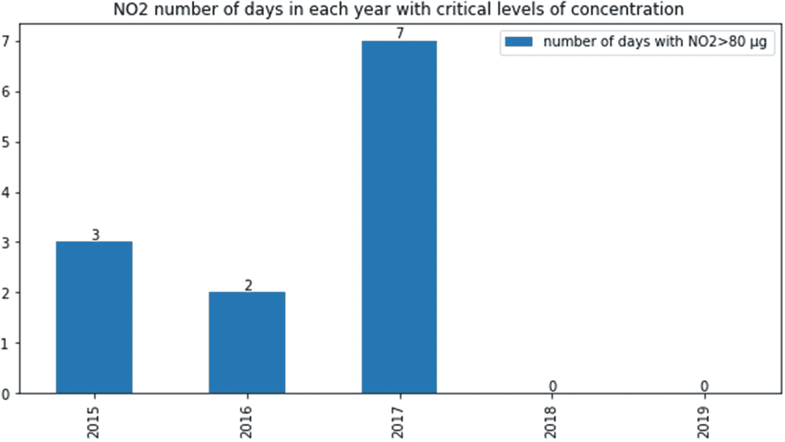

`图 8-6` 每年二氧化氮浓度超标天数

`推论：` 在五年中，仅有三年观测到的 24 小时二氧化氮值超标。由于观测到的 24 小时二氧化氮值仅略微超标，且超标天数很少，因此下一步将重点放在对 PM₂.₅的进一步分析上。

## 空气质量分析第三部分：识别 PM₂.₅日均值在大部分天数中超标月份

在对交通流量和建筑施工等显著影响环境 PM₂.₅浓度的活动实施限制之前，有必要提前发出充分通知，以避免给公众带来不便。因此，对于日均 PM₂.₅值显著高于 180 μg/m³的情况，我们按年份绘制了年内各月的时间变化图。为此，我们针对十二个月中的每一个月，统计了每年 24 小时 PM₂.₅值超过 180 μg/m³的临界空气污染天数。

首先，我们为每年创建一个数据框，其中包含每个月 PM₂.₅值超过 180 μg/m³的天数，如下所示。

```python
#为 2016 年创建一个数据框，包含每个月 PM2.5 浓度>180 的天数
aq2016['Month']=pd.DatetimeIndex(aq2016['From Date']).month #提取月份
aq2016['condition']=(aq2016['PM2.5']>=180 ) #创建一个布尔列，当 PM2.5 值大于 180 时为 True，小于 180 时为 False
aq2016['condition']=aq2016['condition'].replace({False:np.nan}) #将 False 值替换为空值，以便下一条语句中的 count 方法仅统计 True 值或对应 PM2.5>180 的值
selection1=aq2016.groupby('Month')['condition'].count() #使用 groupby 方法计算每个月满足条件(PM2.5>180)的天数
#对 2017 年重复上述过程，创建一个数据框，包含每个月 PM2.5 浓度>180 的天数
aq2017['Month']=pd.DatetimeIndex(aq2017['From Date']).month
aq2017['condition']=(aq2017['PM2.5']>=180 )
aq2017['condition']=aq2017['condition'].replace({False:np.nan})
selection2=aq2017.groupby('Month')['condition'].count()
#对 2018 年重复上述过程，创建一个数据框，包含每个月 PM2.5 浓度>180 的天数
aq2018['Month']=pd.DatetimeIndex(aq2018['From Date']).month
aq2018['condition']=(aq2018['PM2.5']>=180 )
aq2018['condition']=aq2018['condition'].replace({False:np.nan})
selection3=aq2018.groupby('Month')['condition'].count()
#对 2019 年重复上述过程，创建一个数据框，包含每个月 PM2.5 浓度>180 的天数
aq2019['Month']=pd.DatetimeIndex(aq2019['From Date']).month
aq2019['condition']=(aq2019['PM2.5']>=180 )
aq2019['condition']=aq2019['condition'].replace({False:np.nan})
selection4=aq2019.groupby('Month')['condition'].count()
```

现在，我们将所有 DataFrame 对象连接成一个对象（我们称之为`selectionc`），以获取每个月 PM₂.₅ > 180 μg/m³天数的综合视图，如下所示。

```python
#selectionc 数据框是一个综合数据框，显示每年 PM2.5 的月度临界值
selectionc=pd.concat([selection1,selection1,selection3,selection4],axis=1)
#重命名列
selectionc.columns=['2016','2017','2018','2019']
selectionc
```

输出：

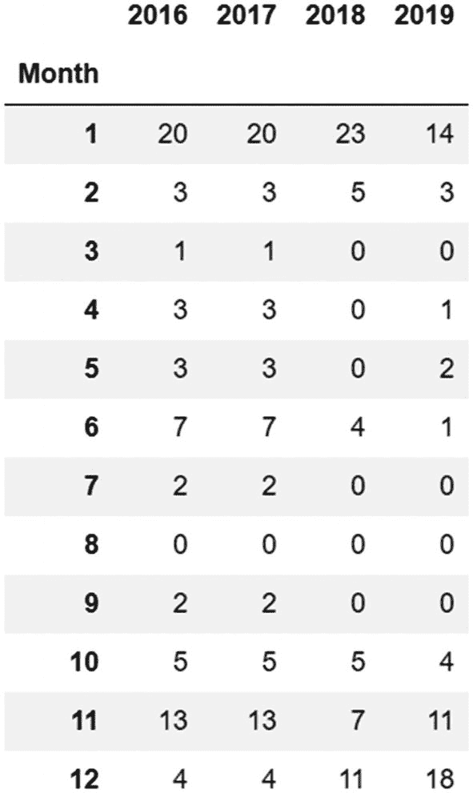

从该表中我们可以观察到，第 1 个月（一月）、第 11 个月（十一月）和第 12 个月（十二月）是所有四年中最关键的月份，因为这些月份中 PM₂.₅ > 180 μg/m³的天数最多。

现在我们已经准备好了所有数据，让我们使用以下代码来可视化 PM₂.₅的临界天数（图 8-7）。

```python
#创建一个柱状图，表示 PM2.5 浓度超标(>180)的天数
ax=selectionc.plot(kind='bar',figsize=(20,7),width=0.7,align='center',colormap='Paired')
bars = ax.patches
#创建图案以代表每一年
patterns =('-','x','/','O')
#ax.legend(loc='upper left', borderpad=1.5, labelspacing=1.5)
ax.legend((patterns),('2016','2017','2018','2019'))
hatches = [p for p in patterns for i in range(len(selectionc))]
#为每个柱状条设置图案
for bar, hatch in zip(bars, hatches):
bar.set_hatch(hatch)
#标记月份、X 轴和 Y 轴
ax.set_xticklabels(['Jan','Feb','Mar','Apr','May','June','July','Aug','Sept','Oct','Nov','Dec'],rotation=30)
ax.set_xlabel('Month',fontsize=12)
ax.set_ylabel('Number of days with critical levels of PM2.5',fontsize=12)
#标记柱状条
for i in ax.patches:
ax.text(i.get_x()-.003, i.get_height()+.3,
round(i.get_height(),2), fontsize=10,
color='dimgrey')
ax.legend()
ax.set_title("Number of days with critical levels of PM2.5 in each month of years 2016-19")
```

输出：

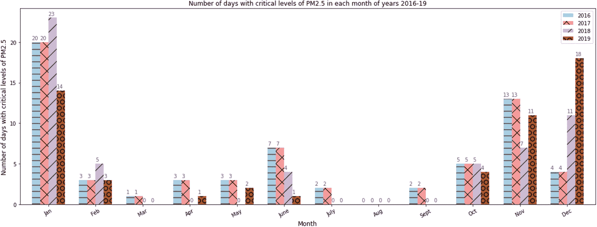

`图 8-7` PM₂.₅ – 每年每月超标天数

### 第四步：基于分析和可视化得出结论

从上图可以看出，大多数严重污染天数集中在一月、十一月和十二月。因此，根据过去四年记录的 PM₂.₅日均浓度，可能会在一月、十一月和十二月对交通流量、建筑施工活动、柴油泵组的使用、从邻邦进入德里的交通分流以及其他类似活动实施限制。要为整个德里做出此类决策，还需要分析其他监测站的数据。上述数据和分析的传播将有助于人们提前为限制措施做好准备，并理解这些措施背后的理由。

上述方法利用数据分析作为辅助空气质量管理的工具，使用了位于德里内塔吉·苏巴斯理工学院（NSIT）的一个监测站记录的数据。该方法可按照以下思路进一步推进。

1.  对 NO₂重复上述步骤，以显示导致大部分 NO₂记录值超过 24 小时标准天数的关键月份。进行此项练习将再次有助于识别 PM₂.₅和 NO₂这两个参数均面临严重污染水平的月份，并制定相应计划。

2.  使用来自 NSIT 空气质量监测站的数据进行的分析，可重复应用于其他站点的类似数据，以便能够为整个德里规划干预措施。

## 案例研究 8-3：全球 COVID-19 病例分析

本数据集包含截至 2020 年 6 月 29 日 COVID-19 病例的地理分布数据（来源：欧洲疾病预防控制中心，来源网址：[https://www.ecdc.europa.eu/en/publications-data/download-todays-data-geographic-distribution-covid-19-cases-worldwide](https://www.ecdc.europa.eu/en/publications-data/download-todays-data-geographic-distribution-covid-19-cases-worldwide)）。请注意，此链接包含最新数据，但我们使用的是截至 6 月 29 日的数据（数据集链接见本章开头的“技术要求”部分）。

我们希望通过分析回答的问题包括：

1.  哪些国家的死亡率最高、病例数最多、死亡人数最多？
2.  自疫情开始以来，病例数和死亡人数的月度趋势如何？
3.  一些国家实施了封锁措施以帮助拉平曲线。这一措施是否有助于减少病例数？

### 步骤 1：导入数据并检查数据集特征

读取数据集，并使用 `pd.read_excel` 函数检查前五行（使用 `head` 方法）：

```python
df=pd.read_excel('COVID-19-geographic-distribution-worldwide-2020-06-29.xlsx')
df.head()
```

输出：

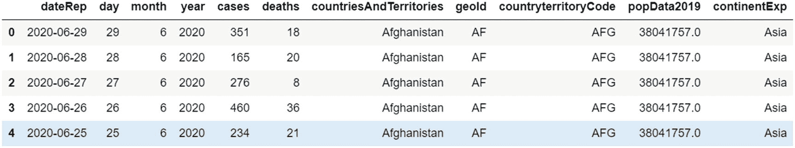

获取每列的数据类型以及每列中非空值的数量信息（使用 `info` 方法）。

```python
df.info()
```

输出：

```
RangeIndex: 26562 entries, 0 to 26561
Data columns (total 11 columns):
dateRep                    26562 non-null datetime64[ns]
day                        26562 non-null int64
month                      26562 non-null int64
year                       26562 non-null int64
cases                      26562 non-null int64
deaths                     26562 non-null int64
countriesAndTerritories    26562 non-null object
geoId                      26455 non-null object
countryterritoryCode       26498 non-null object
popData2019                26498 non-null float64
continentExp               26562 non-null object
dtypes: datetime64ns, float64(1), int64(5), object(4)
memory usage: 2.2+ MB
```

获取每列的汇总统计信息（使用 `describe` 方法），并获取计数、最小值、最大值、标准差和百分位数的值：

```python
df.describe()
```

输出：

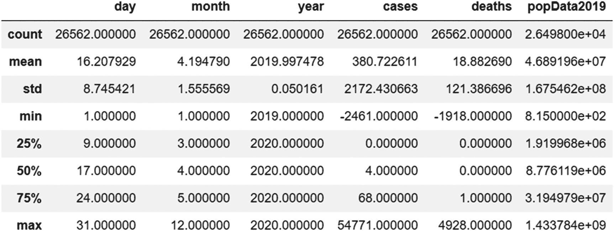

### 步骤 2：数据整理

在此步骤中，我们将：

*   检查列的数据类型是否被准确识别。如果没有，则更改数据类型：从 `info` 方法的输出中，我们看到所有列的数据类型都已正确识别。
*   如有必要，重命名列：在以下代码中，我们正在重命名 DataFrame 的列。

```python
#更改列名
df.columns=['date','day','month','year','cases','deaths','country','old_country_code','country_code','population','continent']
```

*   删除任何不必要的列或行：

我们看到 DataFrame 中国家代码列出现了两次（有两个不同的名称：`old_country_code` 和 `country_code`），因此我们删除其中一列（`old_country_code`）：

```python
#删除冗余的列名
df.drop(['old_country_code'],axis=1,inplace=True)
```

*   删除任何没有价值的无关数据：

此 DataFrame 中没有空格、特殊字符或任何其他无关字符。我们看到 2019 年 12 月只有一天的数据；因此我们删除该月的数据，并为剩余的 11 个月创建一个新的 DataFrame（`df1`）。

```python
df1=df[df.month!=12]
```

*   使用 `isna` 或 `isnull` 方法检查是否存在空值，如果存在，则应用适当的方法处理它们：

计算空值的百分比：

```python
df1.isna().sum().sum()/len(df1)
```

输出：

```
0.008794112096622004
```

由于空值的百分比小于 1%，我们在下一步中删除空值。

```python
df1.dropna(inplace=True)
```

*   如果数据是未聚合的格式，则聚合数据：

此 DataFrame 中的数据不是聚合格式，我们在此步骤中使用 `groupby` 方法将其转换为聚合格式。我们可以按国家、按大洲或按日期分组。让我们按国家名称分组。

```python
#按国家名称聚合数据
df_by_country=df1.groupby('country')['cases','deaths'].sum()
df_by_country
```

输出（仅显示前九行）：

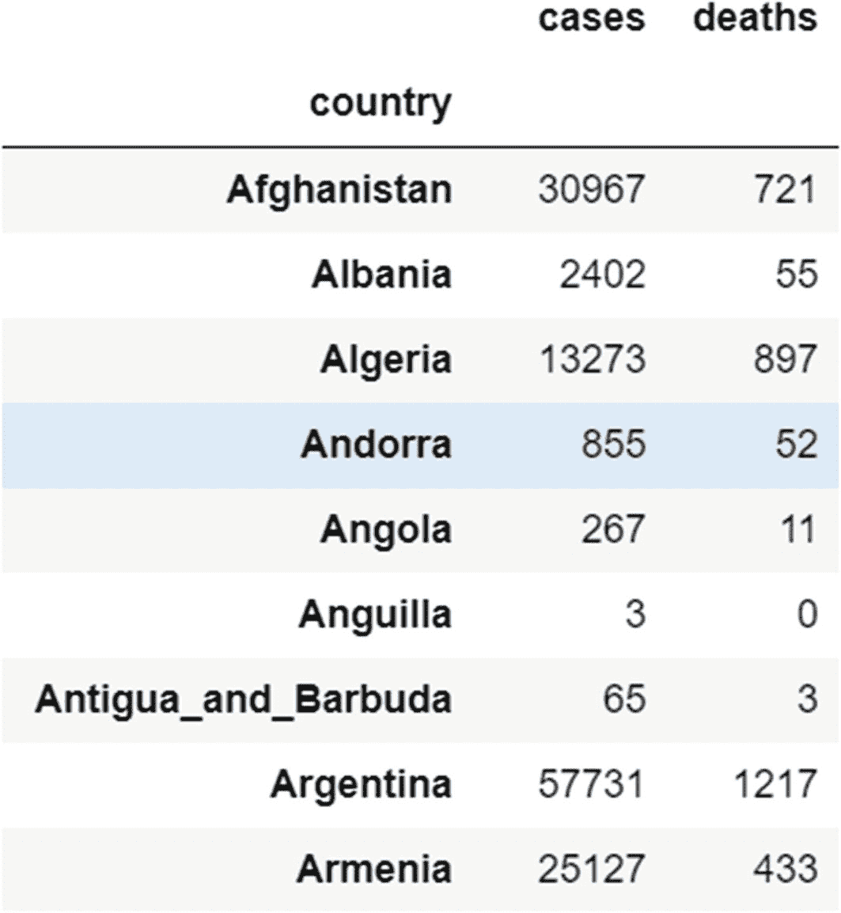

上述输出显示了每个国家的病例数和死亡数的汇总情况。让我们向这个聚合后的 DataFrame 添加另一列——死亡率，即死亡人数与病例数的比率。

```python
#添加一个新列，表示死亡率，即死亡人数与病例数的比率
df_by_country['mortality_rate']=df_by_country['deaths']/df_by_country['cases']
```

### 步骤 3：数据可视化

在本案例研究的第一个可视化中，我们使用 DataFrame `df_by_country` 中的聚合数据来显示死亡率最高的前二十个国家（图 8-8）。

代码：

```python
#按降序对死亡率值进行排序
plt.figure(figsize=(15,10))
ax=df_by_country['mortality_rate'].sort_values(ascending=False).head(20).plot(kind='bar')
ax.set_xticklabels(ax.get_xticklabels(), rotation=45, ha="right")
for p in ax.patches:
    ax.annotate(p.get_height().round(2),(p.get_x()+p.get_width()/2,p.get_height()),ha='center',va='bottom')
ax.set_xlabel("国家")
ax.set_ylabel("死亡率")
ax.set_title("死亡率最高的国家")
```

输出：

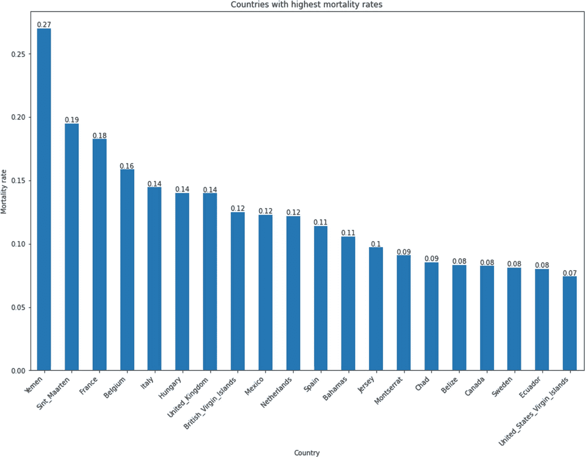

图 8-8 显示 COVID-19 死亡率最高国家的条形图

在第二个可视化中，我们使用饼图显示 COVID-19 病例数最多的十个国家，如图 8-9 所示。

代码：

```python
#饼图显示 COVID 病例数最多的国家
df_cases=df_by_country['cases'].sort_values(ascending=False)
ax=df_cases.head(10).plot(kind='pie',autopct='%.2f%%',labels=df_cases.index,figsize=(12,8))
ax.set_title("病例数排名前十的国家")
```

输出：

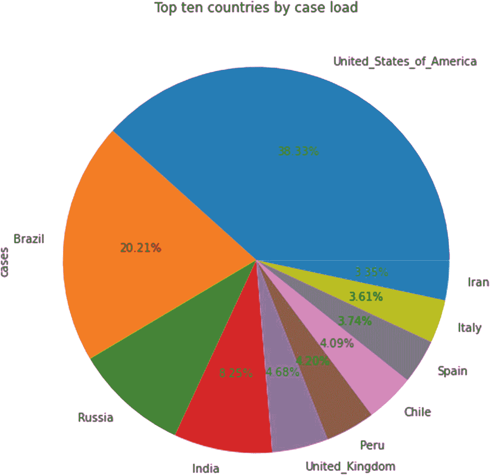

图 8-9 显示 COVID-19 病例数前十国家占比的饼图

在下一个可视化中，我们使用条形图找出在 COVID-19 疫情中人类生命损失最惨重的五个国家（图 8-10）。

代码：

```python
#按降序对死亡人数进行排序
plt.figure(figsize=(10,6))
ax=df_by_country['deaths'].sort_values(ascending=False).head(5).plot(kind='bar')
ax.set_xticklabels(ax.get_xticklabels(), rotation=45, ha="right")
for p in ax.patches:
    ax.annotate(p.get_height(),(p.get_x()+p.get_width()/2,p.get_height()),ha='center',va='bottom')
ax.set_title("因 COVID-19 死亡人数最多的国家")
ax.set_xlabel("国家")
ax.set_ylabel("死亡人数")
```

输出：

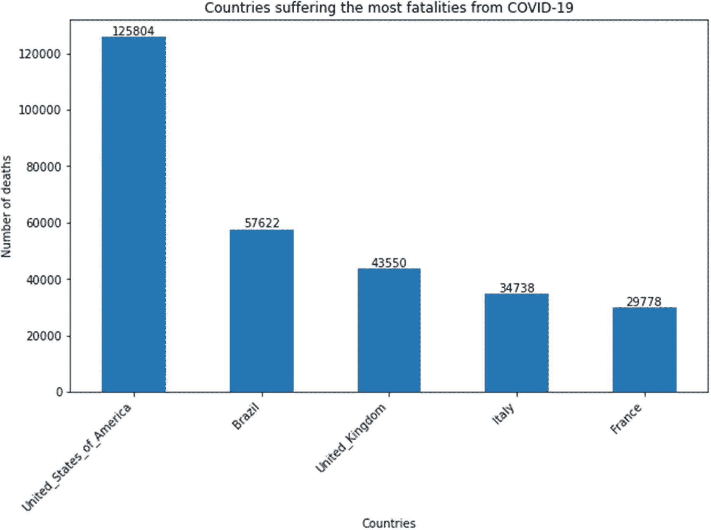

图 8-10 显示死亡人数最多的五个国家的条形图

现在，我们绘制折线图，以观察 COVID-19 病例数和死亡人数的月度趋势。为了绘制折线图，我们首先按月聚合数据，然后并排绘制两条折线图，分别显示病例数和死亡数，如图 8-11 所示。

代码：

```python
df_by_month=df1.groupby('month')['cases','deaths'].sum()
fig=plt.figure(figsize=(15,10))
ax1=fig.add_subplot(1,2,1)
ax2=fig.add_subplot(1,2,2)
df_by_month['cases'].plot(kind='line',ax=ax1)
ax1.set_title("Total COVID-19 cases across months in 2020")
ax1.set_xlabel("Months in 2020")
ax1.set_ylabel("Number of cases(in million)")
df_by_month['deaths'].plot(kind='line',ax=ax2)
ax2.set_title("Total COVID-19 deaths across months in 2020")
ax2.set_xlabel("Months in 2020")
ax2.set_ylabel("Number of deaths")
```

输出：

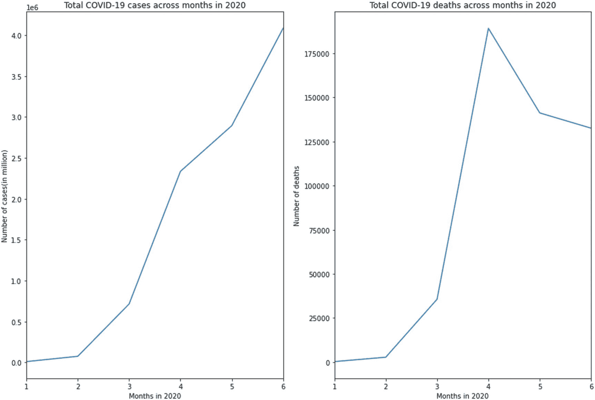

图 8-11 封锁对拉平曲线的影响

许多国家实施了封锁，以遏制病例激增的趋势并拉平曲线。我们现在关注四个国家——印度、英国、意大利和德国——这些国家在 3 月份实施了封锁，以观察这一措施是否产生了预期效果。首先，我们为每个国家创建 `DataFrame` 对象，并按月聚合数据。

代码：

```python
#Creating DataFrames for each country
#Monthwise aggregated data for Germany
df_germany=df1[df1.country=='Germany']
df_germany_monthwise=df_germany.groupby('month')['cases','deaths'].sum()
df_germany_grouped=df_germany_monthwise.reset_index()
#Monthwise aggregated data for UK
df_uk=df1[df1.country=='United_Kingdom']
df_uk_monthwise=df_uk.groupby('month')['cases','deaths'].sum()
df_uk_grouped=df_uk_monthwise.reset_index()
#Monthwise aggregated data for India
df_india=df1[df1.country=='India']
df_india_monthwise=df_india.groupby('month')['cases','deaths'].sum()
df_india_grouped=df_india_monthwise.reset_index()
#Monthwise aggregated data for Italy
df_italy=df1[df1.country=='Italy']
df_italy_monthwise=df_italy.groupby('month')['cases','deaths'].sum()
df_italy_grouped=df_italy_monthwise.reset_index()
```

现在，我们使用上一步创建的 `DataFrame` 对象为这些国家绘制折线图，以观察 2020 年各月的病例数，如图 8-12 所示。

代码：

```python
#Plotting the data for four countries (UK, India, Italy and Germany) where lockdowns were imposed
fig=plt.figure(figsize=(20,15))
ax1=fig.add_subplot(2,2,1)
df_uk_grouped.plot(kind='line',x='month',y='cases',ax=ax1)
ax1.set_title("Cases in UK across months")
ax2=fig.add_subplot(2,2,2)
df_india_grouped.plot(kind='line',x='month',y='cases',ax=ax2)
ax2.set_title("Cases in India across months")
ax3=fig.add_subplot(2,2,3)
df_italy_grouped.plot(kind='line',x='month',y='cases',ax=ax3)
ax3.set_title("Cases in Italy across months")
ax4=fig.add_subplot(2,2,4)
df_germany_grouped.plot(kind='line',x='month',y='cases',ax=ax4)
ax4.set_title("Cases in Germany across months")
```

输出：

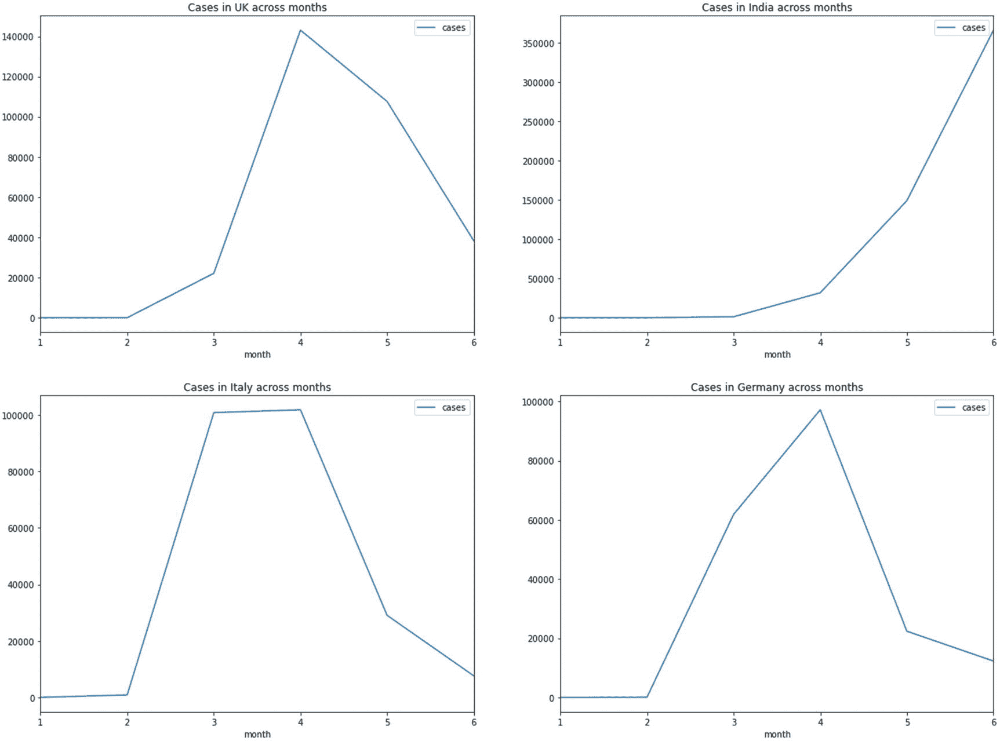

图 8-12 英国、印度、德国和意大利在 2020 年前 6 个月的总病例数

### 步骤 4：基于分析和可视化得出结论

- **病例数**：美国、巴西、俄罗斯、印度和英国的病例数最高。
- **死亡人数**：美国、巴西、英国、意大利和法国的死亡人数最高。
- **死亡率**：也门、圣马丁、法国、比利时和意大利的死亡率最高。
- **趋势**：
    - 总病例数一直在稳步上升，而总死亡人数在 4 月之后有所下降。
    - **封锁的影响**：我们分析了四个国家——印度、英国、德国和意大利——这些国家在 3 月份实施了封锁。除印度外，所有这些国家在实施封锁后，病例数总体呈下降趋势。在英国和德国，病例数最初（在封锁早期阶段）有所上升，但在达到峰值后开始下降。

## 总结

- 在本章中，我们研究了多个案例，从结构化和非结构化数据源导入数据。`Pandas` 支持从多种格式读取数据。
- `requests` 模块具有使我们能够向网页发送 HTTP 请求并将页面内容存储在对象中的函数。
- 典型的描述性或探索性数据分析案例始于构建我们希望通过分析回答的问题，并弄清楚如何导入数据。之后，我们获取有关数据的更多信息——各列的含义、测量单位、缺失值的数量、不同列的数据类型等。
- 数据整理（我们准备、清理和结构化数据以使其适合分析）是描述性或探索性数据分析的核心。典型活动包括删除无关数据、处理空值、重命名列、聚合数据和更改数据类型。
- 一旦数据准备好并适合分析，我们使用 `Matplotlib`、`Seaborn` 和 `Pandas` 等库对数据进行可视化，以帮助我们获得能够回答最初构建的问题的见解。

## 复习练习

### 问题 1（迷你案例研究）

考虑以下网页上的第一个表格：[`https://en.wikipedia.org/wiki/Climate_of_South_Africa`](https://en.wikipedia.org/wiki/Climate_of_South_Africa)。它包含南非各城市夏季和冬季最高和最低温度（摄氏度）的数据。

- 使用 `requests` 模块中的适当方法向此 URL 发送 `get` 请求，并将此页面第一个表格中的数据存储到 Pandas `DataFrame` 中。
- 将列重命名如下：`'City'`、`'Summer(max)'`、`'Summer(min)'`、`'Winter(max)'`、`'Winter(min)'`。
- 将 `'Winter(min)'` 列第一行中的负值替换为 `0`，并将此列的数据类型转换为 `int64`。
- 绘制图表以显示南非夏季最热的城市（使用 `Summer(max)` 列）。
- 绘制图表以显示南非冬季最冷的城市（使用 `Winter(min)` 列）。

### 问题 2

十名员工（以 A–J 为首字母）的周薪如下：100、120、80、155、222、400、199、403、345、290。将周薪存储在一个 `DataFrame` 中。

- 绘制条形图以按降序显示工资。
- 使用 `annotate` 方法标记条形图中的每个条形。

### 问题 3

| 1. 用于发送 HTTP 请求的模块 | a. 网页的 URL |
| :--- | :--- |
| 2. `Get` 方法 | b. `req.text` |
| 3. 传递给 `get` 方法的参数 | c. 使用给定的 URL 获取信息 |
| 4. 包含 Unicode 内容的属性 | d. `Requests` |

### 问题 4

`read_html` Pandas 函数读取：

1.  网页上的所有 HTML 内容
2.  网页中的 HTML 标签
3.  所有 HTML 表格作为 `DataFrame` 对象的列表
4.  网页中的 HTML 列表

## 答案

### 问题 1

代码：

```python
import requests
import pandas as pd
import seaborn as sns
import matplotlib.pyplot as plt
%matplotlib inline
url='https://en.wikipedia.org/wiki/Climate_of_South_Africa'
#making a get request to the URL
req = requests.get(url)
#storing the HTML data in a DataFrame
data = pd.read_html(req.text)
#Reading the first table
df=data[0]
#Renaming the columns
df.columns=['City','Summer(max)','Summer(min)','Winter(max)','Winter(min)']
#Replacing the negative value with 0
df['Winter(min)']=df['Winter(min)'].str.replace(r"–2","0")
#Changing the data type from object to int64
df['Winter(min)']=df['Winter(min)'].astype('int64',errors='ignore')
#Using the city as the index to facilitate plotting
df1=df.set_index('City')
#Hottest five cities during Summer
df1['Summer(max)'].sort_values(ascending=False).head(5).plot(kind='bar')
#Coldest five cities during Winter
df1['Winter(min)'].sort_values().head(5).plot(kind='bar')
```

### 问题 2

代码：

```python
numbers=pd.Series([100,120,80,155,222,400,199,403,345,290])
#converting the data to a DataFrame
numbers.to_frame()
#labelling the index
numbers.index=list('ABCDEFGHIJ')
#labelling the column
numbers.columns=['Wages']
ax=numbers.sort_values(ascending=False).plot(kind='bar')
#labelling the bars
for p in ax.patches:
    ax.annotate(p.get_height(),(p.get_x()+p.get_width()/2,p.get_height()),ha='center',va='bottom')
```

### 问题 3

1-d; 2-c; 3-a; 4-b

### 问题 4

选项 3

网页中每个表格的内容都存储在一个独立的 `DataFrame` 对象中。